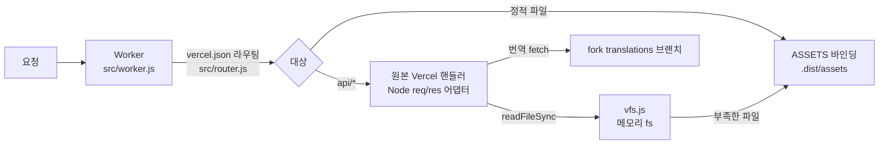

# 한국어 사이트 — Cloudflare Workers 배포

이 fork는 원본 사이트(Vercel)를 Cloudflare Workers로 옮겨, 한국어를 기본 언어로 서비스한다.
원본의 `site/`, `api/`, `lib/`, `vercel.json`은 그대로 두고, 이 디렉터리가 그 위에 얹히는 구조다.
그래서 upstream을 merge해도 충돌이 거의 없다.

## 구조



| 파일 | 역할 |
|------|------|
| `src/router.js` | `vercel.json`의 `routes`/`redirects`/`rewrites`/`headers`/`trailingSlash`를 해석 |
| `src/worker.js` | 진입점. 라우팅 → 정적 파일 또는 `api/*` 핸들러 실행, 함수 응답 colo 캐시 |
| `src/node-adapter.js` | Vercel 핸들러용 Node `req`/`res` 대체 객체 |
| `src/vfs.js` | 핸들러의 `fs.readFileSync`를 ASSETS에서 미리 받아 둔 메모리 저장소로 응답 |
| `src/fetch-redirect.js` | Workers가 지원하지 않는 `fetch(..., { redirect: 'error' })`를 흉내 냄 |
| `build.mjs` | 원본 빌드 실행 → `.dist/assets` 구성 → fork 설정 적용 → esbuild 번들 |
| `site.config.json` | fork 설정: `origin`, `translationsRepository`, `defaultLanguage` |

`build.mjs`가 배포 산출물에 적용하는 변경은 세 가지다.

- 번역 URL `raw.githubusercontent.com/rohitg00/.../translations/`를 이 fork로 바꾼다. 영어 원문 링크는 upstream을 그대로 가리킨다.
- `origin`이 설정되어 있으면 `https://aiengineeringfromscratch.com`을 그 값으로 바꾼다.
- 모든 HTML `<head>` 바로 뒤에 첫 방문 시 `localStorage.lang = "ko"`를 넣는 스크립트를 삽입한다. 사용자가 English를 고르면 그 선택이 유지된다.

## 번역 흐름

1. `languages.json`에서 `ko`는 `"ci": true`이고, `site/ui-strings.json`의 `overrides.ko`에 UI 문자열 192개를 직접 번역해 두었다.
2. `main`에 push하면 `.github/workflows/translate.yml`이 NLLB-200으로 레슨을 phase별로 번역해 `translations` 브랜치의 `i18n/ko/`에 올린다. 첫 실행은 전체 phase를 번역한다.
3. 번역 실행이 끝날 때마다 `cloudflare-deploy.yml`이 다시 빌드한다. 빌드는 번역 coverage를 읽어 어떤 레슨을 서버에서 한국어로 렌더링할지 정한다.

번역이 아직 없는 레슨은 영어로 표시된다.

## 로컬 실행

```bash
cd cloudflare
npm install
cd ..
node cloudflare/build.mjs            # 원본 사이트 빌드 포함 (site/ 파일이 수정됨)
node cloudflare/build.mjs --skip-site # site/가 이미 빌드되어 있으면
cd cloudflare
npm test
npx wrangler dev                      # http://localhost:8787
```

원본 빌드는 Vercel과 마찬가지로 `site/*.html`, `site/data.js`, `README.md`를 제자리에서 수정한다.
로컬에서 빌드한 뒤에는 `git checkout -- site README.md`로 되돌린다.
`wrangler dev`가 실행 중이면 Windows에서 `.dist`가 잠겨 재빌드가 실패한다. 먼저 dev 서버를 끈다.

## 배포

### 처음 한 번 (수동)

```bash
cd cloudflare
npx wrangler login
npx wrangler deploy
```

배포가 끝나면 `https://aifs-ko.<계정 서브도메인>.workers.dev` 주소가 출력된다.

### GitHub Actions 자동 배포

fork 저장소 Settings → Secrets and variables → Actions에서 다음을 등록한다.

| 종류 | 이름 | 값 |
|------|------|----|
| Secret | `CLOUDFLARE_API_TOKEN` | Cloudflare 대시보드 → My Profile → API Tokens → "Edit Cloudflare Workers" 템플릿 |
| Secret | `CLOUDFLARE_ACCOUNT_ID` | Workers 대시보드 오른쪽의 Account ID |
| Variable | `AIFS_ORIGIN` | 최종 주소. 예: `https://aifs-ko.example.workers.dev` 또는 커스텀 도메인 |

secret이 없으면 deploy 단계는 경고만 남기고 건너뛴다. 배포를 끄려면 변수 `CLOUDFLARE_DEPLOY=off`를 설정한다.

`AIFS_ORIGIN`을 비워 두면 canonical·sitemap·OG 주소가 원본 도메인을 가리킨다.
검색 노출을 원하면 반드시 설정한다.

## 요금제 주의

Workers Free 플랜의 CPU 한도는 요청당 10ms다.
레슨 SSR(마크다운 렌더링, `lesson-seo.json` 2MB 파싱)과 OG PNG 생성은 cold start에서 이 한도를 넘을 가능성이 높다. 실측은 하지 않았다.
초과하면 Error 1102가 난다. 안정적으로 운영하려면 Workers Paid 플랜(월 $5)을 권한다.
함수 응답은 `caches.default`에 캐시하므로 같은 페이지의 두 번째 요청부터는 CPU를 거의 쓰지 않는다. 다만 Cache API는 `*.workers.dev` 주소에서는 효과가 없고 커스텀 도메인에서만 동작하는 것으로 알고 있다. 배포 후 확인이 필요하다.

## upstream 동기화

```bash
git fetch origin main
git merge origin/main
```

`vercel.json`의 라우트, `api/` 핸들러, 빌드 명령은 이 디렉터리가 매 빌드마다 읽어 쓰므로 따로 손볼 필요가 없다.
다만 새 `api/*.js` 함수가 추가되면 `src/worker.js`의 `HANDLERS`에 등록해야 한다. 등록하지 않으면 `build.mjs`가 실패하며 해당 파일 이름을 알려 준다.
새 Node 내장 모듈을 쓰면 번들 단계에서 오류가 나므로, 그때 `build.mjs`의 `NODE_BUILTINS`나 `src/shims/`에 추가한다.
