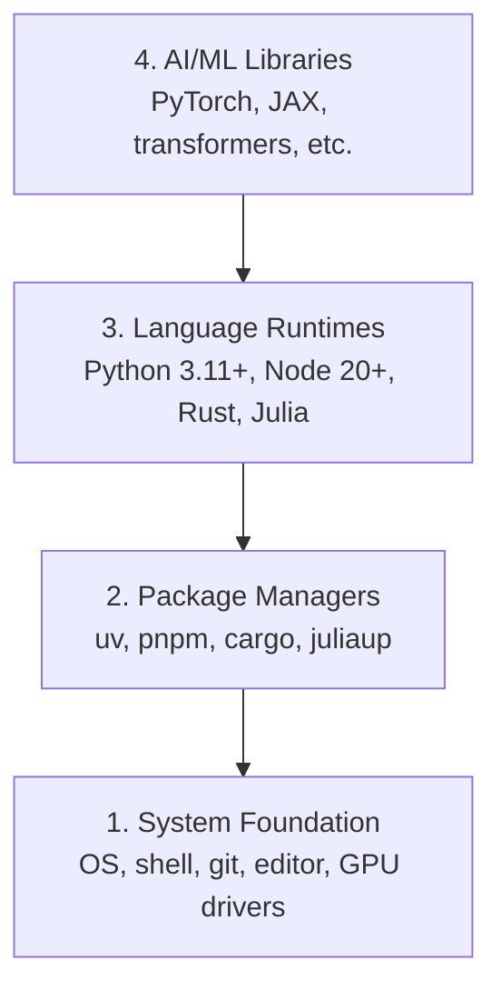

# 개발 환경

> 도구가 당신의 생각을 형성합니다. 한번만 설정해, 제대로 설정해

**Type:** Build
**Languages:** Python, Node.js, Rust
**Prerequisites:** None
**Time:** ~45 minutes

## 학습 목표

- 파이썬 3.11+, 노드.js 20+ 및 스 툴 체인을 처음부터 설정하십시오
- 재생 가능한 빌드들을 위한 가상 환경과 패키지 관리자를 구성
- CUDA/MPS로 GPU 접속을 확인하고 테스트 텐서 동작을 실행
- 네 층 스택을 이해하십시오: 시스템, 패키지, 실행 시간, AI 라이브러리

## 문제

여러분은 파이썬, 타이프스크립트, 러스트, 줄리아를 이용한 500개 이상의 수업을 통해 인공지능 공학을 배우려고 합니다. 환경이 파괴되면, 모든 수업은 학습 대신 도구에 맞서 싸워요.

대부분의 사람들은 환경 설정을 건너뛰고, 수입 오류, 버전 충돌, 그리고 실종된 CUDA 드라이버를 수시간 동안 디버깅합니다. 우리는 이것을 한 번, 제대로 할 것입니다.

## 개념

인공지능 공학 환경은 네 층을 가지고 있습니다.



아래층을 설치합니다. 각 층은 아래층에 달려 있습니다.

```figure
s0-env-stack
```

## 건설 해

### 단계 1: 시스템 기반

시스템 확인하고 기본 설치를 설치하세요.

```bash
# macOS
xcode-select --install
brew install git curl wget

# Ubuntu/Debian
sudo apt update && sudo apt install -y build-essential git curl wget unzip

# Windows (use WSL2)
wsl --install -d Ubuntu-24.04
```

### 단계 2: UV와 파이썬

우리는 사용 `uv` 파이프보다 10-100배 더 빠른 것이므로 가상 환경을 자동으로 처리합니다.

```bash
curl -LsSf https://astral.sh/uv/install.sh | sh

uv python install 3.12

uv venv
source .venv/bin/activate  # or .venv\Scripts\activate on Windows

uv pip install numpy matplotlib jupyter
```

확인:

```python
import sys
print(f"Python {sys.version}")

import numpy as np
print(f"NumPy {np.__version__}")
a = np.array([1, 2, 3])
print(f"Vector: {a}, dot product with itself: {np.dot(a, a)}")
```

### 단계 3: pnpm와 함께 Node.js

타입스크립트 수업 (아지언, MCP 서버, 웹 앱)

```bash
curl -fsSL https://fnm.vercel.app/install | bash
fnm install 22
fnm use 22

npm install -g pnpm

node -e "console.log('Node', process.version)"
```

Fnm 설치기 확인`unzip`먼저 출발하고 `Not installing fnm due to missing dependencies.`이 파일은 Linux에서 zip 아카이브를 풀고, macOS에서는 Homebrew를 통해 설치합니다.`unzip`; 우분투, 데비안, 그리고 WSL2에서 1 단계 apt 라인 (`sudo apt install -y unzip`그 단계를 건너뛰었다면)

**macOS / Apple Silicon (M1/M2/M3/M4):**설치가 종료되면`Error: Cannot install under Rosetta 2 in ARM default prefix (/opt/homebrew)`로제타 2에 탑재된`arch`발자국`i386`(Homebrew) 는 네이티브의 arm64 빌드인데, fnm 강제 arm64를 설치하고,`fnm install 22`이 부분의 본문은

```bash
arch -arm64 brew install fnm
echo 'eval "$(fnm env --use-on-cd)"' >> ~/.zshrc
source ~/.zshrc
```

### 4단계: 

성능 비평적 수업 (이명, 시스템)

```bash
curl --proto '=https' --tlsv1.2 -sSf https://sh.rustup.rs | sh

rustc --version
cargo --version
```

### 단계 5: 줄리아 (선택)

줄리아가 빛나는 수학 수업을 위해

```bash
curl -fsSL https://install.julialang.org | sh

julia -e 'println("Julia ", VERSION)'
```

### 단계 6: GPU 설정 (당신이 가지고 있다면)

**NVIDIA (Linux / Windows):**

```bash
nvidia-smi

# Install PyTorch with CUDA
uv pip install torch torchvision torchaudio --index-url https://download.pytorch.org/whl/cu124
```

**macOS / Apple Silicon (M1/M2/M3/M4):** 맥에는 CUDA가 없는데 실패도 안되죠**not**통과`--index-url .../cuXXX`(이 바퀴는 리눅스/윈도우에서만 설치되어 있기 때문에 설치가 실패합니다.) 애플의 MPS (메탈) GPU 백엔드를 포함하는 일반 빌드를 설치하십시오:

```bash
uv pip install torch torchvision torchaudio
```

확인 (어떤 플랫폼에서도 작동):

```python
import torch
print(f"CUDA available: {torch.cuda.is_available()}")           # False on macOS — expected
print(f"MPS available:  {torch.backends.mps.is_available()}")   # True on Apple Silicon
if torch.cuda.is_available():
    print(f"GPU: {torch.cuda.get_device_name(0)}")
```

GPU가 없죠? 문제 없어요. 대부분의 수업은 CPU에 작동합니다. 훈련이 어려운 수업에서는 Google Colab 또는 클라우드 GPU를 사용하세요.

### 7단계: 시작하려는 경로를 확인하세요

이 수업의 모든 명령어를 저장소 루트에서 실행하세요
함유되어 있습니다`README.md`그리고`phases/`비행기 전선에서는 필요한 것만 확인합니다
선택된 경로를 시작하면, 기본으로 나중에 사용할 수 있는 도구를 건너뛰어
경고의 벽이 아닌 분명한 답이 하나만

초보자 전체 순서 시작:

```bash
python3 phases/00-setup-and-tooling/01-dev-environment/code/verify.py --route beginner
```

아니면 원하는 경로를 확인하세요:

```bash
python3 phases/00-setup-and-tooling/01-dev-environment/code/verify.py --route ml-foundations
python3 phases/00-setup-and-tooling/01-dev-environment/code/verify.py --route llm-engineering
python3 phases/00-setup-and-tooling/01-dev-environment/code/verify.py --route agents
python3 phases/00-setup-and-tooling/01-dev-environment/code/verify.py --route mcp
python3 phases/00-setup-and-tooling/01-dev-environment/code/verify.py --route agent-skills
python3 phases/00-setup-and-tooling/01-dev-environment/code/verify.py --route certification
```

추가`--show-later`비행 전에 동일한 도구를 선택적으로 검사하려면
나중에 사용되는
선택된 경로

실패한 모든 필요한 검사는 발견된 경로 또는 수입 오류와
정확한 교정 명령. 에이전트 기술과 인증 경로는 또한
파이썬 스크립트가 AI 호스트가
어떤 기술을 발견하거나, 선택된 기술 범위가 적혀있다는 것을

초보기 전 비행이 지나면, 첫 번째 실행 가능한 교훈이 정확히 인쇄됩니다.

```text
Ready to start Beginner course.
Next: python3 phases/01-math-foundations/01-linear-algebra-intuition/code/vectors.py
```

## 사용 하 고

환경은 확인 된 경로를 시작하기에 준비되어 있습니다. 나중에 도구를 설치하십시오.
첫 번째 수업을 완전히 차단하는 대신
여기가 교육과정에서 사용할 것입니다.

| Language | Used In | Package Manager |
|----------|---------|-----------------|
| Python | Phases 1-12 (ML, DL, NLP, Vision, Audio, LLMs) | uv |
| TypeScript | Phases 13-17 (Tools, Agents, Swarms, Infra) | pnpm |
| Rust | Phases 12, 15-17 (Performance-critical systems) | cargo |
| Julia | Phase 1 (Math foundations) | Pkg |

## 선박

이 수업은 누구나 실행할 수 있는 검증 스크립트를 만들어서 설정을 확인할 수 있습니다.

보시다시피`outputs/prompt-env-check.md`인공지능 보조가 환경 문제를 진단하는 데 도움이 되는

## 운동

1. 확인 스크립트를 실행하고 오류를 수정
2. 이 코스 위해 파이썬 가상 환경을 만들고 파이터치를 설치하십시오
3. 네 가지 언어로 "안녕하세요"라고 써서 각각 실행하세요

### 암시

**Exercise 1.**달아`python3 phases/00-setup-and-tooling/01-dev-environment/code/verify.py --route beginner`다음을 보기 전에 첫 번째 실패 선을 수정하고 스크립트를 다시 실행하고 필요한 모든 탐사선이 통과되면 확인이 완료됩니다.

**Exercise 2.**환경은`uv venv`저장소 루트에서 활성화하고, 하드웨어와 일치하는 단계 6의 명령으로 PyTorch를 설치합니다. 실행 `python -c "import torch; print(torch.__version__)"`환경 내부에 있는 경우, 버전 번호는 설치 작업이 완료된 것을 의미합니다.

**Exercise 3.**The Concept에서 실행시간은 Python, Node.js에서 TypeScript, Rust, Julia로 4개로 사용하세요. 각 파일에 대해 작은 파일을 작성하고 실행하세요.`python3``npx tsx`(Node.js는 `.ts`직접 파일)`cargo run`또는`rustc`그리고`julia`모든 실행은 0 코드로 메시지를 인쇄하고 출력해야 합니다.
