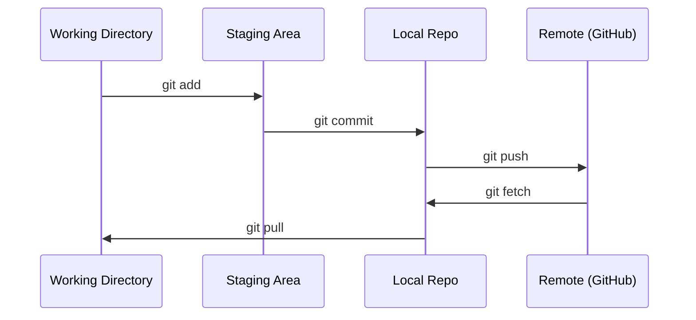

# Git & 협업

> 버전 컨트롤은 선택적이지 않습니다. 모든 실험, 모든 모델, 모든 수업이 추적됩니다.

**Type:** Learn
**Languages:** --
**Prerequisites:** Phase 0, Lesson 01
**Time:** ~30 minutes

## 학습 목표

- git 아이덴티티를 구성하고 매일 추가, 컴백, 푸시 작업 흐름을 사용
- 주요 부분을 깨지 않고 개별 실험을 위해 분할과 결합
- 글씨를 써`.gitignore`모델 체크포인트 및 큰 바이너리 파일들을 제외한
-  로 로 로그인 기록을 탐색`git log`프로젝트의 발전을 이해하기 위해서

## 문제

20단계로 수백개의 코드 파일을 작성할 예정입니다. 버전 제어 없이는 작업이 사라지고, 해제할 수 없는 것들을 깨고 다른 사람들과 협업할 방법이 없습니다.

Git은 도구입니다. GitHub은 코드들이 살고 있습니다. 이 수업은 이 과정에 필요한 것을 다루고 있습니다. 그 이상의 것이 아닙니다.

## 개념



기억해야 할 세 가지 것
1. 자주 저장 (`git commit`)
2. 원격으로 밀어넣어 (`git push`)
3. 실험 분야 (`git checkout -b experiment`)

```figure
s0-commit-dag
```

## 건설 해

### 단계 1: git을 구성

```bash
git config --global user.name "Your Name"
git config --global user.email "you@example.com"
```

### 단계 2: 일일 업무 흐름

```bash
git status
git add file.py
git commit -m "Add perceptron implementation"
git push origin main
```

### 단계 3: 실험에 대한 분할

```bash
git checkout -b experiment/new-optimizer

# ... make changes, commit ...

git checkout main
git merge experiment/new-optimizer
```

### 단계 4: 이 과정 리포와 함께 작업

리포 코스 자체를 누르면 안 됩니다.  관리자만 작성 액세스 할 수 있습니다. 먼저 GitHub에 포크 (포크 버튼, 오른쪽 상위) 를 입력하세요.`origin`자신의 본본에서 지적한 점:

```bash
git clone https://github.com/YOUR-USERNAME/ai-engineering-from-scratch.git
cd ai-engineering-from-scratch

git checkout -b my-progress
# work through lessons, commit your code
git push origin my-progress
```

## 사용 하 고

이 코스에서는 다음과 같은 명령이 필요합니다.

| Command | When |
|---------|------|
| `git clone` | Get the course repo |
| `git add` + `git commit` | Save your work |
| `git push` | Back it up to GitHub |
| `git checkout -b` | Try something without breaking main |
| `git log --oneline` | See what you've done |

이 과정에 리베이스, 리 픽, 또는 하위 모듈이 필요하지 않습니다.

## 운동

1. 이 리포를 , 을 복제하고,`my-progress`파일로 작성하고, 로그인하고, 밀어 넣고
2. `.gitignore`그 중에서도 체크포인트 파일 모델 (`.pt``.pth``.safetensors`)
3. 이 리포의 콤비 록을 보세요`git log --oneline`그리고 수업이 어떻게 추가되었는지 읽어보세요

### 암시

**Exercise 1.**GitHub에서 Fork을 클릭하세요`git clone`네 가벼운 갈래의 URL`git push -u origin my-progress`GitHub에 가닥을 열고 지점 목록이 표시되는 것을 확인하세요`my-progress`당신의 파일과 함께

**Exercise 2.**확장자마다 하나의 패턴을 추가하십시오. 예를 들어`*.pt`, a`.gitignore`저장소 루트에서 파일. 각 확장 프로그램과 함께 빈 파일을 생성하고 실행 `git status`; 그 중 어느 것도 추적되지 않은 파일 목록에 표시되지 않습니다.

**Exercise 3.**달아`git log --oneline`그리고 그 다음`git log --oneline -- phases/00-setup-and-tooling`이 단계를 변경한 컴백들만 표시합니다.`git show --stat <hash>`어떤 수업 파일을 추가했는지 확인하기 위해서요.

## 주요 용어

| Term | What people say | What it actually means |
|------|----------------|----------------------|
| Commit | "Saving" | A snapshot of your entire project at a point in time |
| Branch | "A copy" | A pointer to a commit that moves forward as you work |
| Merge | "Combining code" | Taking changes from one branch and applying them to another |
| Remote | "The cloud" | A copy of your repo hosted somewhere else (GitHub, GitLab) |
