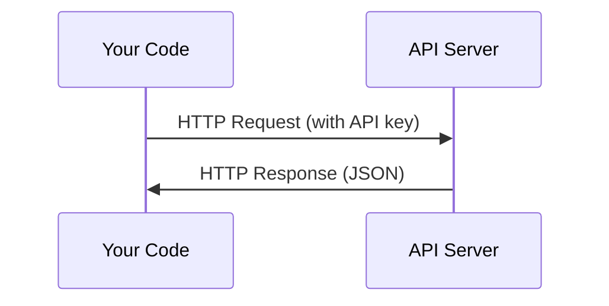

# API 및 키

> 모든 AI API는 동일한 방식으로 작동합니다. 요청을 보내고 응답을 얻습니다. 세부 사항은 변하지만 패턴은 변하지 않습니다.

**Type:** Build
**Languages:** Python, TypeScript
**Prerequisites:** Phase 0, Lesson 01
**Time:** ~30 minutes

## 학습 목표

- 환경 변수를 사용하여 API 키를 안전하게 저장하고`.env`파일
- 인트로피 파이썬 SDK와 원료 HTTP를 사용하여 LLM API 호출을 수행하십시오
- 디버깅을 위한 SDK 기반 및 원료 HTTP 요청/ 응답 형식을 비교
- 인증 및 비율 제한을 포함한 일반적인 API 오류를 식별하고 처리합니다

## 문제

11단계부터 LLM API (Anthropic, OpenAI, Google) 를 호출할 것입니다. 13-16단계에서는 이러한 API를 루프로 사용하는 에이전트를 만들 것입니다. API 키가 어떻게 작동하는지, 안전하게 저장하는 방법과 첫 번째 API 호출을하는 방법을 알아야합니다.

## 개념



API 호출마다:
1. 최종점 (URL)
2. API 키 (확인)
3. 요청 기관 (당신이 원하는 것)
4. 반응체 (당신이 무엇을 얻는가)

```figure
s0-secret-inject
```

## 건설 해

### 단계 1: API 키를 안전하게 저장

코드에 API 키를 넣지 말고 환경 변수를 사용하세요.

```bash
export ANTHROPIC_API_KEY="sk-ant-..."
export OPENAI_API_KEY="sk-..."
```

또는 `.env`파일 (그건 추가함)`.gitignore`):

```
ANTHROPIC_API_KEY=sk-ant-...
OPENAI_API_KEY=sk-...
```

### 단계 2: 첫 번째 API 호출 (파이톤)

```python
import os

import anthropic

client = anthropic.Anthropic()

MODEL = os.environ.get("LLM_MODEL", "claude-sonnet-5")

response = client.messages.create(
    model=MODEL,
    max_tokens=256,
    messages=[{"role": "user", "content": "What is a neural network in one sentence?"}]
)

print(response.content[0].text)
```

`LLM_MODEL`다른 공급업체는 (OpenAI, Google, 그리고 다른) 키와 모델 아이디의 동일한 패턴을 따르지만 각은 자체 SDK, 엔드포인트 및 요청/ 응답 스키마를 가지고 있습니다.

### 단계 3: 첫 번째 API 호출 (TypeScript)

```typescript
import Anthropic from "@anthropic-ai/sdk";

const client = new Anthropic();

const MODEL = process.env.LLM_MODEL ?? "claude-sonnet-5";

const response = await client.messages.create({
  model: MODEL,
  max_tokens: 256,
  messages: [{ role: "user", content: "What is a neural network in one sentence?" }],
});

console.log(response.content[0].text);
```

### 단계 4: RAW HTTP (SDK가 없습니다)

```python
import os
import urllib.request
import json

url = "https://api.anthropic.com/v1/messages"
headers = {
    "Content-Type": "application/json",
    "x-api-key": os.environ["ANTHROPIC_API_KEY"],
    "anthropic-version": "2023-06-01",
}
body = json.dumps({
    "model": os.environ.get("LLM_MODEL", "claude-sonnet-5"),
    "max_tokens": 256,
    "messages": [{"role": "user", "content": "What is a neural network in one sentence?"}],
}).encode()

req = urllib.request.Request(url, data=body, headers=headers, method="POST")
with urllib.request.urlopen(req) as resp:
    result = json.loads(resp.read())
    print(result["content"][0]["text"])
```

SDK가 하우드 아래에서 하는 일은 이렇습니다. 원소 HTTP 호출을 이해하는 것은 디버깅을 할 때 도움이 됩니다.

## 사용 하 고

이 과정에 대해:

| API | When you need it | Free tier |
|-----|-----------------|-----------|
| Anthropic (Claude) | Phases 11-16 (agents, tools) | $5 credit on signup |
| OpenAI | Phase 11 (comparison) | $5 credit on signup |
| Hugging Face | Phases 4-10 (models, datasets) | Free |

지금 당장 다 필요 없어 수업이 필요할 때 준비해

## 선박

이 교훈은 다음과 같은 결과를 낳습니다.
- `outputs/prompt-api-troubleshooter.md`- 일반적인 API 오류를 진단

## 운동

1. 인트로피 API 키를 가져와서 첫 번째 API 호출을 해
2. 원본 HTTP 버전을 시도하고 응답 형식을 SDK 버전과 비교하십시오
3. 의도적으로 잘못된 API 키를 사용하여 오류 메시지를 읽으십시오

### 암시

**Exercise 1.**인트로피 콘솔에 키를 만들고 넣으십시오`ANTHROPIC_API_KEY`수업에서 보여준 대로, 그리고 실행`code/first_api_call.py`. 스크립트가 모델 응답을 인쇄하고 오류가 없는 상태에서 호출이 작동합니다.

**Exercise 2.**두 가지 기능 모두 `code/first_api_call.py`텍스트와 토큰의 숫자를만 인쇄합니다. 추가 `print(response)``call_with_sdk()`그리고`print(result)``call_raw_http()`, 다음 스크립트를 실행하여 두 개의 완전한 응답을 볼 수 있습니다. 필드 이름을 비교: 원본 JSON는 동일한 `content``usage`그리고`stop_reason`SDK에서 객체 속성에 변환하는 필드

**Exercise 3.**세트 `ANTHROPIC_API_KEY`한 터미널에서만 가짜 값을 입력하고 스크립트를 다시 실행하세요. 출력에서 HTTP 상태 코드와 오류 유형을 찾아보세요. 인증 실패로 401 상태가 반환됩니다.

## 주요 용어

| Term | What people say | What it actually means |
|------|----------------|----------------------|
| API key | "Password for the API" | A unique string that identifies your account and authorizes requests |
| Rate limit | "They're throttling me" | Maximum requests per minute/hour to prevent abuse and ensure fair usage |
| Token | "A word" (in API context) | A billing unit: input and output tokens are counted and charged separately |
| Streaming | "Real-time responses" | Getting the response word by word instead of waiting for the full response |
