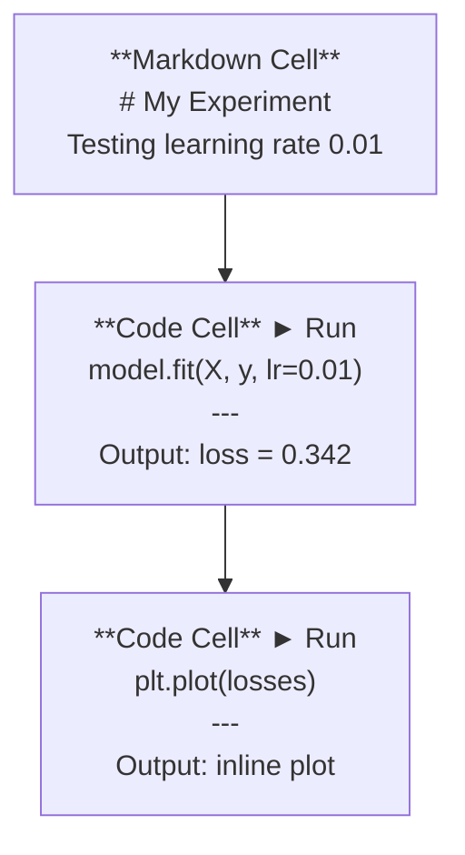
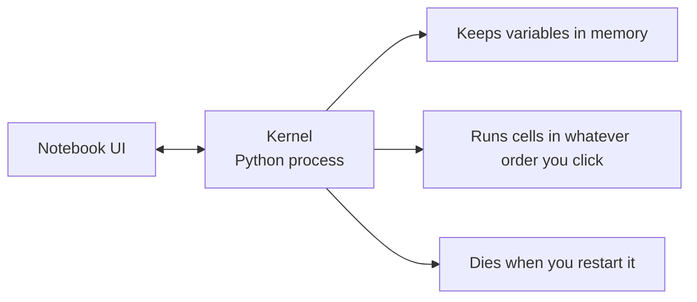

# 주피터 노트북

> 노트북은 인공지능 공학의 연구소입니다. 여기서 프로토타입을 만들어서 생산에 옮깁니다.

**Type:** Build
**Languages:** Python
**Prerequisites:** Phase 0, Lesson 01
**Time:** ~30 minutes

## 학습 목표

- JupyterLab, Jupyter 노트북 또는 VS 코드를 Jupyter 확장 프로그램으로 설치 및 실행
- 마법 명령어를 사용하세요 (`%timeit``%%time``%matplotlib inline`) 를 기준으로 하고, 직렬으로 표시하기 위해
- 노트북과 스크립트를 사용할 때 구분하고 "노트북에서 탐색, 스크립트에서 배포" 작업 흐름을 적용하십시오.
- 일반적인 노트북 함정을 식별하고 피하십시오. 명령 밖 실행, 숨겨진 상태 및 메모리 누출

## 문제

모든 인공지능 논문, 튜토리얼, Kaggle 경쟁은 Jupyter 노트북을 사용합니다. 그들은 코드를 조각으로 실행하고 출력을 직렬로 볼 수 있도록 합니다. 코드와 설명을 섞고 빠르게 반복합니다. 노트북 없이 인공지능을 배우려고 한다면, 당신은 노트북 없이 수학 숙제를 수행합니다.

하지만 노트북은 진짜 함정이 있습니다. 사람들은 모든 것에 대해 악역을 합니다. 노트북을 언제 쓸지, 스크립트를 언제 쓸지 아는 것은 나중에 악몽을 디버깅하는 것을 막을 것입니다.

## 개념

노트북은 세포 목록입니다. 각 세포는 코드 또는 텍스트입니다.



커널은 파이썬 프로세스입니다. 당신이 세포를 실행할 때, 그것은 코드를 커널에 보내고, 그 결과물을 실행하고 다시 보내죠. 모든 세포는 같은 커널을 공유하고, 따라서 셀들 사이에 변수가 유지됩니다.



"당신이 클릭한 주문" 부분은 슈퍼 파워와 발 총이 모두 있습니다.

```figure
s0-cell-order
```

## 건설 해

### 단계 1: 인터페이스를 선택

3가지 옵션, 1개의 형식:

| Interface | Install | Best for |
|-----------|---------|----------|
| JupyterLab | `pip install jupyterlab` then `jupyter lab` | Full IDE experience, multiple tabs, file browser, terminal |
| Jupyter Notebook | `pip install notebook` then `jupyter notebook` | Simple, lightweight, one notebook at a time |
| VS Code | Install "Jupyter" extension | Already in your editor, git integration, debugging |

세 사람은 모두 같은 글을 읽고 쓰는 것`.ipynb`당신이 원하는 것을 선택하세요. JupyterLab는 인공지능 작업에서 가장 흔합니다.

```bash
pip install jupyterlab
jupyter lab
```

### 단계 2: 중요한 키보드 단축키

두 가지 모드로 작동합니다.`Escape`명령 모드 (왼쪽의 파란색 바) 에 대해`Enter`편집 모드 (녹색 바) 에 대한

**Command mode (most used):**

| Key | Action |
|-----|--------|
| `Shift+Enter` | Run cell, move to next |
| `A` | Insert cell above |
| `B` | Insert cell below |
| `DD` | Delete cell |
| `M` | Convert to markdown |
| `Y` | Convert to code |
| `Z` | Undo cell operation |
| `Ctrl+Shift+H` | Show all shortcuts |

**Edit mode:**

| Key | Action |
|-----|--------|
| `Tab` | Autocomplete |
| `Shift+Tab` | Show function signature |
| `Ctrl+/` | Toggle comment |

`Shift+Enter`하루에도 수천 번 사용해야 할 것 입니다. 먼저 배우세요.

### 단계 3: 세포 유형

**Code cells**파이썬을 실행하고 출력을 표시:

```python
import numpy as np
data = np.random.randn(1000)
data.mean(), data.std()
```

출력: `(0.0032, 0.9987)`

**Markdown cells**형식화된 텍스트를 렌더링하세요. 당신이 무엇을 하고 있는지, 왜 하는지 문서화하기 위해 사용하세요. 헤더, 대장, 줄기, 라텍스 수학 (`$E = mc^2$`), 표 및 이미지

### 4단계: 마법 명령

파이썬이 아니라 Jupyter에 특화된 명령어입니다`%`(선 마술) 또는`%%`(세포 마법)

**Time your code:**

```python
%timeit np.random.randn(10000)
```

출력: `45.2 us +/- 1.3 us per loop`

```python
%%time
model.fit(X_train, y_train, epochs=10)
```

출력: `Wall time: 2.34 s`

`%timeit`코드를 여러 번 실행하고 평균을 합니다.`%%time`한번 실행해`%timeit`마이크로 벤치마크에 대해`%%time`훈련 경주

**Enable inline plots:**

```python
%matplotlib inline
```

모든`plt.plot()`또는`plt.show()`이제 바로 노트북에 렌더링합니다.

**Install packages without leaving the notebook:**

```python
!pip install scikit-learn
```

`!`이 예제는 모든 셸 명령어를 실행합니다.

**Check environment variables:**

```python
%env CUDA_VISIBLE_DEVICES
```

### 단계 5: 부적 인 출력을 선으로 표시

노트북은 셀의 마지막 표현을 자동으로 표시합니다. 하지만 제어할 수 있습니다.

```python
import pandas as pd

df = pd.DataFrame({
    "model": ["Linear", "Random Forest", "Neural Net"],
    "accuracy": [0.72, 0.89, 0.94],
    "training_time": [0.1, 2.3, 45.6]
})
df
```

이것은 형식화된 HTML 테이블을 렌더링합니다. 텍스트 덤프가 아닙니다.

```python
import matplotlib.pyplot as plt

plt.figure(figsize=(8, 4))
plt.plot([1, 2, 3, 4], [1, 4, 2, 3])
plt.title("Inline Plot")
plt.show()
```

이 음반은 세포 아래에서 나타납니다. 이것이 노트북이 AI 작업을 지배하는 이유입니다. 데이터, 음반, 코드 모두 함께 볼 수 있습니다.

사진에 대해서는:

```python
from IPython.display import Image, display
display(Image(filename="architecture.png"))
```

### 단계 6: 구글 콜라브

콜라브는 클라우드에서 무료로 사용할 수 있는 Jupyter 노트북입니다. GPU, 사전 설치 라이브러리, 구글 드라이브 통합을 제공합니다. 설정을 요구하지 않습니다.

1. 가[colab.research.google.com](https://colab.research.google.com)
2. 다운로드 `.ipynb`이 과정의 파일
3. 실행시간 > 실행시간 유형 변경 > T4 GPU (무료)

콜라브의 차이점은 로컬 주피터:
- 세션 사이에는 파일은 유지되지 않습니다 (Drive 또는 다운로드에 저장)
- 미리 설치된: 피, 파다, 매트플로트리브, 타르치, 텐서플로, 슐러너
- `from google.colab import files`파일 업로드/다운로드
- `from google.colab import drive; drive.mount('/content/drive')`지속 가능한 저장용
- 90분간 비활성 이후 세션 종료 (자료 레벨)

## 사용 하 고

### 노트북과 스크립트: 언제 어떤 것을 사용해야 하는가

| Use notebooks for | Use scripts for |
|-------------------|-----------------|
| Exploring a dataset | Training pipelines |
| Prototyping a model | Reusable utilities |
| Visualizing results | Anything with `if __name__` |
| Explaining your work | Code that runs on a schedule |
| Quick experiments | Production code |
| Course exercises | Packages and libraries |

규칙:**explore in notebooks, ship in scripts**- 그래

인공지능의 일반적인 작업 흐름:
1. 노트북에서 데이터를 탐구
2. 노트북에 모델의 프로토타입
3. 일단 작동하면 코드를 `.py`파일
4. 이산화`.py`추가 실험을 위해 메모장에 다시 파일을

### 일반적인 함정

**Out-of-order execution.**셀 5을 실행하고 셀 2을 실행하고 셀 7을 실행합니다. 노트북은 컴퓨터에서 작동하지만 누군가가 위에서 아래로 실행하면 끊어집니다. 수정: 커널 > 공유하기 전에 다시 시작하고 실행하십시오.

**Hidden state.**세포를 삭제하지만 생성된 변수는 여전히 메모리에 있습니다. 노트북은 깨끗하지만 유령 세포에 의존합니다. 수정: 커널을 정기적으로 다시 시작하십시오.

**Memory leaks.**4GB의 데이터 세트를 로드하고, 모델을 훈련하고, 또 다른 데이터 세트를 로드하고, 아무것도 풀리지 않습니다.`del variable_name`그리고`gc.collect()`또는 커널을 다시 시작하세요

## 선박

이 교훈은 다음과 같은 결과를 낳습니다.
- `outputs/prompt-notebook-helper.md`노트북 문제 해결

## 운동

1. JupyterLab을 열고 노트북을 작성하고 사용하세요 `%timeit`리스트 이해와 numpy를 비교하여 100,000개의 무작위 숫자의 배열을 생성하기 위해
2. CSV를 로드하고 데이터 프레임을 표시하고 차트를 표시하는 마크다운과 코드 셀 모두 있는 노트북을 생성합니다.
3. 코드 좀 `code/notebook_tips.py`, Colab 노트북에 붙여서 무료 GPU로 실행

### 암시

**Exercise 1.**JupyterLab을 시작하세요`jupyter lab`, 그리고 각 버전을 자신의 셀에 넣고`%timeit`두 세포 모두 같은 100,000 크기를 사용해서 두 번 같은 작업을 측정합니다.

**Exercise 2.**사용`pd.read_csv`데이터에 대해 데이터 프레임을 셀의 마지막 라인으로 표시하고 `df.plot()`Kernel > Restart & Run All 이후, 모든 셀은 실행 카운터에서 숫자를 표시해야 하며, 어떤 셀도 오류를 표시할 수 없습니다.

**Exercise 3.**콜라브에서, 코드를 붙이기 전에 실행시간을 선택하세요. 실행시간은 각 함수에서 `code/notebook_tips.py`그 부분을 인쇄하고,`torch.cuda.is_available()`수익금`True`한 세포에 갇혀있어요

## 주요 용어

| Term | What people say | What it actually means |
|------|----------------|----------------------|
| Kernel | "The thing running my code" | A separate Python process that executes cells and keeps variables in memory |
| Cell | "A code block" | An independently runnable unit in a notebook, either code or markdown |
| Magic command | "Jupyter tricks" | Special commands prefixed with `%` or `%%` that control the notebook environment |
| `.ipynb` | "Notebook file" | A JSON file containing cells, outputs, and metadata. Stands for IPython Notebook |

## 더 많은 읽기

- [JupyterLab Docs](https://jupyterlab.readthedocs.io/)전체 기능 집합에
- [Google Colab FAQ](https://research.google.com/colaboratory/faq.html)콜라브에 대한 제한 및 특성에 대해
- [28 Jupyter Notebook Tips](https://www.dataquest.io/blog/jupyter-notebook-tips-tricks-shortcuts/)전력 사용자 단축키
