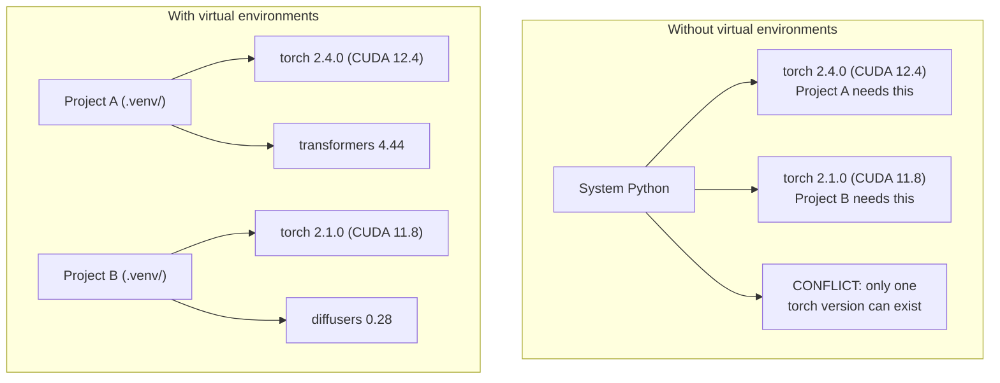

# 파이썬 환경

> 의존적 지옥은 현실이고 가상 환경은 치료법입니다.

**Type:** Build
**Languages:** Shell
**Prerequisites:** Phase 0, Lesson 01
**Time:** ~30 minutes

## 학습 목표

- `uv``venv`또는`conda`
- 글씨를 써`pyproject.toml`선택적 의존 그룹과 재생가능성을 위한 잠금 파일을 생성
- 일반적인 함정을 진단하고 해결합니다. 글로벌 설치, 파이프/콘다 혼합, CUDA 버전 부합
- 서로 충돌하는 의존성을 가진 프로젝트들을 위한 단계별 환경 전략을 시행

## 문제

파이토르치 2.4를 설치하면 정비 프로젝트가 됩니다. 다음 주에 다른 프로젝트가 파이토르치 2.1를 필요로 합니다. CUDA 빌드가 고정되어 있기 때문에.

이것은 의존적 지옥입니다. AI/ML 작업에서 끊임없이 발생합니다.

- 파이토르치, 자엑스, 텐서플로우 각이 각자의 CUDA 결합을 배포한다
- 모델 라이브러리들은 특정 프레임워크 버전을 핑
- 세계적`pip install`그 전에 있었던 모든 것을 덮어쓰는
- CUDA 11.8 빌드는 CUDA 12.x 드라이버와 작동하지 않습니다 (그리고 반대로)

해결책은 모든 프로젝트가 자신의 패키지와 함께 고립된 환경을 갖게 되는 것입니다.

## 개념



```figure
s0-env-isolation
```

## 건설 해

### 선택 1: uv venv (상담)

`uv`파이썬 패키지 관리자 (Python Package Manager) 는 파이프보다 10-100배 더 빠른 시스템입니다.

```bash
curl -LsSf https://astral.sh/uv/install.sh | sh

uv python install 3.12

cd your-project
uv venv
source .venv/bin/activate
```

설치 패키지:

```bash
uv pip install torch numpy
```

`pyproject.toml`한 단계로

```bash
uv init my-ai-project
cd my-ai-project
uv add torch numpy matplotlib
```

### 선택지 2: venv (부팅)

설치할 수 없다면`uv`, 파이썬 배와 함께`venv`이 부분의 본문은

```bash
python3 -m venv .venv
source .venv/bin/activate  # Linux/macOS
.venv\Scripts\activate     # Windows

pip install torch numpy
```

더 느려`uv`, 하지만 파이썬이 설치된 모든 곳에 작동합니다.

### 선택지 3: 콘다 (필요한 때)

코ন্দা는 CUDA 도구 키트, cuDNN, C 라이브러리와 같은 비 파이썬 의존성을 관리합니다.

- 시스템 전체에 설치하지 않고 특정 CUDA 도구 키트 버전이 필요합니다
- 공유 클러스터에 있는 상태인데 시스템 패키지를 설치할 수 없습니다
- 도서관의 설치 지침은 "공동체를 사용하라"라고 말합니다.

```bash
# Install miniconda (not the full Anaconda)
curl -LsSf https://repo.anaconda.com/miniconda/Miniconda3-latest-Linux-x86_64.sh -o miniconda.sh
bash miniconda.sh -b

conda create -n myproject python=3.12
conda activate myproject

conda install pytorch torchvision torchaudio pytorch-cuda=12.4 -c pytorch -c nvidia
```

한 가지 규칙: 만약 당신이 환경에 대해 콘다를 사용한다면, 그 환경의 모든 패키지에 대해 콘다를 사용하라.`pip install`콘다엔브에 들어가서 중독성 충돌이 발생하는데

### 이 과정: 단계별 전략

모든 과정에 하나의 환경을 만들 수 있습니다. 그렇지 않습니다. 다른 단계들은 다른 (때문에 모순적인) 의존성을 필요로 합니다.

전략:

```
ai-engineering-from-scratch/
├── .venv/                    <-- shared lightweight env for phases 0-3
├── phases/
│   ├── 04-neural-networks/
│   │   └── .venv/            <-- PyTorch env
│   ├── 05-cnns/
│   │   └── .venv/            <-- same PyTorch env (symlink or shared)
│   ├── 08-transformers/
│   │   └── .venv/            <-- might need different transformer versions
│   └── 11-llm-apis/
│       └── .venv/            <-- API SDKs, no torch needed
```

시나리오가 `code/env_setup.sh`이 과정의 기본 환경을 만들어 줍니다.

## pyproject.toml 기본

모든 파이썬 프로젝트에는`pyproject.toml`- 대체해`setup.py``setup.cfg`그리고`requirements.txt`한 파일로

```toml
[project]
name = "ai-engineering-from-scratch"
version = "0.1.0"
requires-python = ">=3.11"
dependencies = [
    "numpy>=1.26",
    "matplotlib>=3.8",
    "jupyter>=1.0",
    "scikit-learn>=1.4",
]

[project.optional-dependencies]
torch = ["torch>=2.3", "torchvision>=0.18"]
llm = ["anthropic>=0.39", "openai>=1.50"]
```

다음으로 설치:

```bash
uv pip install -e ".[torch]"    # base + PyTorch
uv pip install -e ".[llm]"     # base + LLM SDKs
uv pip install -e ".[torch,llm]" # everything
```

## 잠금 파일

잠금 파일은 모든 의존성 (변동성 포함) 을 정확한 버전으로 니다. 이것은 재생가능성을 보장합니다. 잠금 파일에서 설치하는 모든 사람이 정확히 동일한 패키지를 얻습니다.

```bash
# uv generates uv.lock automatically when using uv add
uv add numpy

# pip-tools approach
uv pip compile pyproject.toml -o requirements.lock
uv pip install -r requirements.lock
```

로크 파일을 git에 연결해 놓습니다. 누군가가 리포를 복제하면 로크 파일에서 설치하고 동일한 버전을 얻습니다.

## 흔히 하는 실수

### 1. 전 세계적으로 설치

```bash
pip install torch  # BAD: installs to system Python

source .venv/bin/activate
pip install torch  # GOOD: installs to virtual environment
```

패키지가 어디로 가는지 확인하세요.

```bash
which python       # should show .venv/bin/python, not /usr/bin/python
which pip           # should show .venv/bin/pip
```

### 2. 과 콩을 섞는

```bash
conda create -n myenv python=3.12
conda activate myenv
conda install pytorch -c pytorch
pip install some-other-package   # BAD: can break conda's dependency tracking
conda install some-other-package # GOOD: let conda manage everything
```

콘다 내부에서 pip을 사용해야 하는 경우 (어떤 패키지는 파이프만 사용된다) 먼저 모든 콘다 패키지를 설치하고, 파이프 패키지는 마지막입니다.

### 3. 활성화하는 것을 잊고

```bash
python train.py           # uses system Python, missing packages
source .venv/bin/activate
python train.py           # uses project Python, packages found
```

상자 표시 표시에는 환경 이름이 표시되어야 합니다:

```
(.venv) $ python train.py
```

### 4. .venv에서 git에 대한 약속

```bash
echo ".venv/" >> .gitignore
```

가상 환경은 200MB~2GB입니다. 그들은 기계들 사이에 휴대할 수 있는 것이 아니라 로컬입니다.`pyproject.toml`그리고 그 대신 잠금 파일

### 5. CUDA 버전의 일치가 없습니다

```bash
nvidia-smi                # shows driver CUDA version (e.g., 12.4)
python -c "import torch; print(torch.version.cuda)"  # shows PyTorch CUDA version

# These must be compatible.
# PyTorch CUDA version must be <= driver CUDA version.
```

## 사용 하 고

설정 스크립트를 실행하여 수업 환경을 생성합니다.

```bash
bash phases/00-setup-and-tooling/06-python-environments/code/env_setup.sh
```

이것은 `.venv`기본 의존성을 설치하고 검증한 repo 루트에서

## 운동

1. 달아`env_setup.sh`그리고 모든 체크가 통과되는 것을 확인합니다
2. 두 번째 가상 환경을 만들고, 다른 버전의 numpy를 설치하고, 두 환경이 고립된 것을 확인합니다.
3. 글씨를 써`pyproject.toml`PyTorch과 Anthropic SDK를 필요로 하는 프로젝트
4. 의도적으로 global (venv) 를 활성화하지 않고 global (global) 로 패키지를 설치하고, 어디로 가는지 알아보고,

### 암시

**Exercise 1.**달아`bash phases/00-setup-and-tooling/06-python-environments/code/env_setup.sh`저장소 루트에서 출력 라인을 읽어 보세요. 체크가 실패하면 그 항목을 수정하고 스크립트를 다시 실행하세요.

**Exercise 2.**새로운 폴더에 두 번째 환경을 `uv venv`, 그것을 활성화하고,  버전 핀과 같은 오래된 numpy 설치`numpy==1.26.4`- 달아`python -c "import numpy; print(numpy.__version__)"`각 환경에서 두 버전이 다를 수 있습니다.

**Exercise 3.**pyproject.toml의 예시에서 시작하여 기본 및 목록`torch`그리고`anthropic`아래`dependencies`- 달아`uv pip install -e .`또는`uv sync`새로운 환경에서 파일이 정확할 때 두 패키지가 오류 없이 수입됩니다.

**Exercise 4.**모든 환경을 비활성화하고 실행`pip install --user <small package>`, 그리고 도망쳐`pip show <package>`그리고 읽으세요`Location`라인. `pip uninstall <package>`그리고 달아`pip show`다시 확인해 보겠습니다.

## 주요 용어

| Term | What people say | What it actually means |
|------|----------------|----------------------|
| Virtual environment | "A venv" | An isolated directory containing a Python interpreter and packages, separate from the system Python |
| Lockfile | "Pinned dependencies" | A file listing every package and its exact version, guaranteeing identical installs across machines |
| pyproject.toml | "The new setup.py" | The standard Python project configuration file, replacing setup.py/setup.cfg/requirements.txt |
| Transitive dependency | "A dependency of a dependency" | Package B depends on C; if you install A which depends on B, C is a transitive dependency of A |
| CUDA mismatch | "My GPU isn't working" | PyTorch was compiled for a different CUDA version than what your GPU driver supports |
