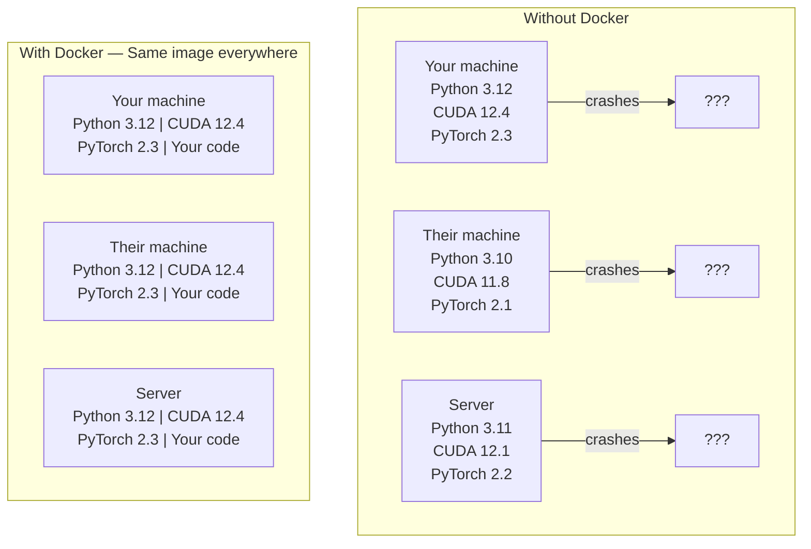

# 인공지능의 도커

> 컨테이너들은 "내 기계에 일한다"는 것을 과거의 일으로 만듭니다.

**Type:** Build
**Languages:** Docker
**Prerequisites:** Phase 0, Lessons 01 and 03
**Time:** ~60 minutes

## 학습 목표

- GPU를 지원하는 Docker 이미지를 CUDA, PyTorch, AI 라이브러리와 Docker 파일에서 구축
- 컨테이너 재건 중 모델, 데이터 세트 및 코드를 유지하기 위해 볼륨으로 호스트 디렉토리를 설치합니다
- NVIDIA 컨테이너 툴킷을 컨테이너 내부의 GPU를 노출시키기 위해 구성합니다
- Docker Compose를 사용하여 다 서비스 AI 응용 프로그램을 (인퍼런스 서버 + 벡터 데이터베이스) 오케스트라하십시오

## 문제

당신은 PyTorch 2.3, CUDA 12.4 및 파이썬 3.12로 노트북에서 모델을 훈련시켰습니다.

인공지능 프로젝트는 의존성 악몽입니다. 전형적인 스택에는 파이썬, 파이토르치, CUDA 드라이버, cuDNN, 시스템 수준의 C 라이브러리, 그리고 정확한 컴파일러 버전이 필요한 플래시-ATN와 같은 전문 패키지가 있습니다. 도커는 이 모든 것을 모든 곳에서 동일하게 실행되는 단일 이미지로 패키지합니다.

## 개념

도커는 코드, 런타임, 라이브러리, 시스템 도구를 컨테이너라는 단위 장치로 묶어 놓습니다. 가벼운 가상 머신이라고 생각하세요.



### 인공지능 프로젝트가 왜 대부분의 프로젝트보다 더 더 닷커를 필요로 하는 걸까요?

1. **GPU drivers are fragile.**CUDA 12.4 코드는 CUDA 11.8에서 실행되지 않습니다. Docker는 NVIDIA 컨테이너 툴킷을 통해 호스트 GPU 드라이버를 공유하면서 컨테이너 내부에 있는 CUDA 툴킷을 격리합니다.

2. **Model weights are large.**7B 파라미터 모델은 fp16에서 14 GB입니다. 당신은 그것을 재건 할 때마다 다시 다운로드 할 필요가 없습니다. 도커 볼륨은 호스트에서 모델 디렉토리를 설치 할 수 있습니다.

3. **Multi-service architectures are common.**실제 인공지능 응용 프로그램은 단순히 파이썬 스크립트만이 아닙니다. 그것은 추론 서버, RAG의 벡터 데이터베이스, 아마도 웹 프론트엔드입니다. Docker Compose는 이 모든 것을 하나의 명령으로 구성합니다.

### 주요 어휘

| Term | What it means |
|------|---------------|
| Image | A read-only template. Your recipe. Built from a Dockerfile. |
| Container | A running instance of an image. Your kitchen. |
| Dockerfile | Instructions to build an image. Layer by layer. |
| Volume | Persistent storage that survives container restarts. |
| docker-compose | A tool for defining multi-container applications in YAML. |

### 인공지능의 일반적인 컨테이너 패턴

```
Dev Container
  Full toolkit. Editor support. Jupyter. Debugging tools.
  Used during development and experimentation.

Training Container
  Minimal. Just the training script and dependencies.
  Runs on GPU clusters. No editor, no Jupyter.

Inference Container
  Optimized for serving. Small image. Fast cold start.
  Runs behind a load balancer in production.
```

```figure
s0-image-layers
```

## 건설 해

### 단계 1: Docker를 설치

```bash
# macOS
brew install --cask docker
open /Applications/Docker.app

# Ubuntu
curl -fsSL https://get.docker.com | sh
sudo usermod -aG docker $USER
# Log out and back in for group change to take effect
```

확인:

```bash
docker --version
docker run hello-world
```

### 단계 2: NVIDIA 컨테이너 툴킷 (NVIDIA GPU를 가진 리눅스) 을 설치하십시오

이 방법은 Docker 컨테이너가 GPU에 접근할 수 있게 해줍니다. macOS 및 Windows (WSL2) 사용자는 이것을 건너뛰어 사용할 수 있습니다.

```bash
distribution=$(. /etc/os-release;echo $ID$VERSION_ID)
curl -fsSL https://nvidia.github.io/libnvidia-container/gpgkey | sudo gpg --dearmor -o /usr/share/keyrings/nvidia-container-toolkit-keyring.gpg
curl -s -L https://nvidia.github.io/libnvidia-container/$distribution/libnvidia-container.list | \
    sed 's#deb https://#deb [signed-by=/usr/share/keyrings/nvidia-container-toolkit-keyring.gpg] https://#g' | \
    sudo tee /etc/apt/sources.list.d/nvidia-container-toolkit.list

sudo apt-get update
sudo apt-get install -y nvidia-container-toolkit
sudo nvidia-ctk runtime configure --runtime=docker
sudo systemctl restart docker
```

컨테이너 내부의 GPU 접근 테스트:

```bash
docker run --rm --gpus all nvidia/cuda:12.4.1-base-ubuntu22.04 nvidia-smi
```

GPU 정보를 보면 도구가 작동합니다.

### 3단계: 기본 이미지를 이해

올바른 기본 이미지를 선택하면 몇 시간 동안 디버깅을 할 수 있습니다.

```
nvidia/cuda:12.4.1-devel-ubuntu22.04
  Full CUDA toolkit. Compilers included.
  Use for: building packages that need nvcc (flash-attn, bitsandbytes)
  Size: ~4 GB

nvidia/cuda:12.4.1-runtime-ubuntu22.04
  CUDA runtime only. No compilers.
  Use for: running pre-built code
  Size: ~1.5 GB

pytorch/pytorch:2.6.0-cuda12.4-cudnn9-runtime
  PyTorch pre-installed on top of CUDA.
  Use for: skipping the PyTorch install step
  Size: ~6 GB

python:3.12-slim
  No CUDA. CPU only.
  Use for: inference on CPU, lightweight tools
  Size: ~150 MB
```

### 4단계: 인공지능 개발을 위한 Docker파일 작성

여기 이 도커파일입니다`code/Dockerfile`- 그 안에서 걸어봐

```dockerfile
FROM --platform=linux/amd64 nvidia/cuda:12.4.1-devel-ubuntu22.04

ENV DEBIAN_FRONTEND=noninteractive
ENV PYTHONUNBUFFERED=1

RUN apt-get update && apt-get install -y --no-install-recommends \
    software-properties-common \
    git \
    curl \
    build-essential \
    && add-apt-repository -y ppa:deadsnakes/ppa \
    && apt-get update && apt-get install -y --no-install-recommends \
    python3.12 \
    python3.12-venv \
    python3.12-dev \
    && rm -rf /var/lib/apt/lists/*

RUN update-alternatives --install /usr/bin/python python /usr/bin/python3.12 1

RUN curl -sSL https://raw.githubusercontent.com/pypa/get-pip/3b73145063be545b649ad9ca83ea8da5fc915a4f/public/get-pip.py -o /tmp/get-pip.py \
    && echo "a341e1a43e38001c551a1508a73ff23636a11970b61d901d9a1cad2a18f57055  /tmp/get-pip.py" | sha256sum -c - \
    && python /tmp/get-pip.py \
    && rm /tmp/get-pip.py \
    && update-alternatives --install /usr/bin/pip pip /usr/local/bin/pip3.12 1

RUN python -m pip install --no-cache-dir --upgrade pip setuptools wheel

RUN python -m pip install --no-cache-dir \
    torch==2.6.0+cu124 \
    torchvision==0.21.0+cu124 \
    torchaudio==2.6.0+cu124 \
    --index-url https://download.pytorch.org/whl/cu124

RUN python -m pip install --no-cache-dir \
    numpy \
    pandas \
    scikit-learn \
    matplotlib \
    jupyter \
    transformers \
    datasets \
    accelerate \
    safetensors

WORKDIR /workspace

VOLUME ["/workspace", "/models"]

EXPOSE 8888

CMD ["python"]
```

만들어라

```bash
docker build -t ai-dev -f phases/00-setup-and-tooling/07-docker-for-ai/code/Dockerfile .
```

이 작업은 처음 몇 시간 걸립니다 (CUDA 기본 이미지를 다운로드 + PyTorch). 이후 빌드에는 캐시 레이어를 사용합니다.

**macOS / Apple Silicon (M1/M2/M3/M4):**`--platform=linux/amd64``FROM`이 빌드는 Mac에서 성공하게 만드는 것이 바로 이 라인입니다. CUDA 기본 이미지는 또한 arm64 버전을 배포하고 Docker Desktop는 Apple Silicon에서 자동으로 선택합니다.`cu124`바퀴는 x86_64에만 적용됩니다`pip install torch==2.6.0+cu124`계층이 실패합니다`No matching distribution found for torch==2.6.0+cu124`. 플랫폼을 꽂으면 x86_64 이미지를 끌어내고 에뮬레이션 하에 실행: 빌드 더 느리고 컨테이너에는 GPU가 없습니다 (Mac에는 CUDA가 없습니다).`--gpus all``docker run`맥에서 아래의 명령어. 애플 실리콘에서 GPU 작업을 위해, 레슨 01에서 MPS 빌드와 함께 레슨을 네이티브로 실행하고 NVIDIA GPU를 가진 x86_64 리눅스 호스트에 이 이미지를 저장하십시오.

실행하세요:

```bash
docker run --rm -it --gpus all \
    -v $(pwd):/workspace \
    -v ~/models:/models \
    ai-dev python -c "import torch; print(f'PyTorch {torch.__version__}, CUDA: {torch.cuda.is_available()}')"
```

Jupyter를 컨테이너 안에 실행하세요:

```bash
docker run --rm -it --gpus all \
    -v $(pwd):/workspace \
    -v ~/models:/models \
    -p 8888:8888 \
    ai-dev jupyter notebook --ip=0.0.0.0 --port=8888 --no-browser --allow-root
```

### 단계 5: 데이터 및 모델의 볼륨 마운팅

AI 작업에 있어서 볼륨 마운트는 매우 중요합니다. 그것 없이는 컨테이너가 멈춰서 14GB 모델 다운로드가 사라집니다.

```bash
# Mount your code
-v $(pwd):/workspace

# Mount a shared models directory
-v ~/models:/models

# Mount datasets
-v ~/datasets:/data
```

훈련 스크립트 안에, 마운팅 경로에서 로드:

```python
from transformers import AutoModel

model = AutoModel.from_pretrained("/models/llama-7b")
```

모델은 호스트 파일 시스템에서 작동합니다. 재 다운로드 없이 원하는 만큼 컨테이너를 재건하세요.

### 단계 6: 다 서비스 인공지능 앱을 위해 Docker Compose

실제 RAG 응용 프로그램은 추론 서버와 벡터 데이터베이스가 필요합니다. Docker Compose는 두 가지 모두 하나의 명령으로 실행됩니다.

보시다시피`code/docker-compose.yml`이 부분의 본문은

```yaml
services:
  ai-dev:
    build:
      context: .
      dockerfile: Dockerfile
    deploy:
      resources:
        reservations:
          devices:
            - driver: nvidia
              count: all
              capabilities: [gpu]
    volumes:
      - ../../../:/workspace
      - ~/models:/models
      - ~/datasets:/data
    ports:
      - "8888:8888"
    stdin_open: true
    tty: true
    command: jupyter notebook --ip=0.0.0.0 --port=8888 --no-browser --allow-root

  qdrant:
    image: qdrant/qdrant:v1.12.5
    ports:
      - "6333:6333"
      - "6334:6334"
    volumes:
      - qdrant_data:/qdrant/storage

volumes:
  qdrant_data:
```

모든 것을 시작하세요:

```bash
cd phases/00-setup-and-tooling/07-docker-for-ai/code
docker compose up -d
```

이제 인공지능 개발 컨테이너는 벡터 데이터베이스에 접근할 수 있습니다`http://qdrant:6333`서비스 이름에 따라 Docker Compose는 공유 네트워크를 자동으로 생성합니다.

인공지능 컨테이너 내부에서 연결을 테스트합니다.

```python
from qdrant_client import QdrantClient

client = QdrantClient(host="qdrant", port=6333)
print(client.get_collections())
```

모든 걸 멈춰라

```bash
docker compose down
```

추가`-v`또한 qdrant의 부피를 삭제하기 위해서:

```bash
docker compose down -v
```

### 단계 7: 인공지능 작업에 유용한 도커 명령어

```bash
# List running containers
docker ps

# List all images and their sizes
docker images

# Remove unused images (reclaim disk space)
docker system prune -a

# Check GPU usage inside a running container
docker exec -it <container_id> nvidia-smi

# Copy a file from container to host
docker cp <container_id>:/workspace/results.csv ./results.csv

# View container logs
docker logs -f <container_id>
```

## 사용 하 고

이제 인공지능 개발 환경이 재생가능합니다. 이 과정의 나머지 시간에는

- 사용`docker compose up`개발 환경과 벡터 데이터베이스를 함께 시작하려면
- 코드, 모델, 데이터들을 볼륨으로 배치하여 재건 중 아무것도 잃지 않도록
- 수업이 새로운 파이썬 패키지를 필요로 할 때, Docker파일에 추가하고 재구성
- 팀 동료들과 공유하세요. 그들은 같은 환경을 얻습니다.

### GPU가 없나요?

`--gpus all`플래그와 NVIDIA 배포 블록. 컨테이너는 여전히 CPU 기반 수업을 위해 작동합니다. PyTorch는 CUDA의 부재를 감지하고 자동으로 CPU로 다시 떨어집니다.

## 운동

1. 도커파일을 만들고 실행하라`python -c "import torch; print(torch.__version__)"`컨테이너 내부
2. Docker-compose stack를 시작하여 Qdrant이 AI 컨테이너에서 액세스 가능한지 확인합니다`http://qdrant:6333/collections`
3. 추가`flask`도커파일로 연결하여 간단한 API 서버를 port 5000에 실행합니다.`-p 5000:5000`
4. `docker images`. 기본 이미지를 `devel` `runtime`그리고 크기를 비교

### 암시

**Exercise 1.**`docker build -t ai-dev -f phases/00-setup-and-tooling/07-docker-for-ai/code/Dockerfile .`수업에서 명령, 그리고 입력 실행`docker run --rm ai-dev`맥에서, 그냥 놔둬`--gpus all`이 컨테이너는`2.6.0`- 그래

**Exercise 2.**달아`docker compose up -d``code/`폴더를 열고 `ai-dev`서비스`docker compose exec ai-dev bash`- 안에 들어서, 도망쳐`curl http://qdrant:6333/collections`JSON 응답은 서비스 이름이 컴포지 네트워크에서 해결되는 것을 의미합니다.

**Exercise 3.**`RUN pip install flask`Docker파일로 연결하여 다시 구축하고 서버를 시작하세요`host="0.0.0.0"`, 컨테이너 내부의 로컬호스트에 연결된 서버가 외부에서 접근할 수 없기 때문입니다.`http://localhost:5000`포트 지도가 작동하는지 확인하기 위해

**Exercise 4.**달아`docker images ai-dev`그리고 크기의 열을 적어주세요.`devel` `runtime``FROM`라인, 새로운 태그를 사용하여 만들고 두 크기를 비교하십시오. 실행시간 이미지는 컴파일러와 헤더를 제외합니다.

## 주요 용어

| Term | What people say | What it actually means |
|------|----------------|----------------------|
| Container | "Lightweight VM" | An isolated process using the host kernel, with its own filesystem and network |
| Image layer | "Cached step" | Each Dockerfile instruction creates a layer. Unchanged layers are cached, so rebuilds are fast. |
| NVIDIA Container Toolkit | "GPU in Docker" | A runtime hook that exposes host GPUs to containers via `--gpus` flag |
| Volume mount | "Shared folder" | A directory on the host mapped into the container. Changes persist after the container stops. |
| Base image | "Starting point" | The `FROM` image your Dockerfile builds on top of. Determines what is pre-installed. |
