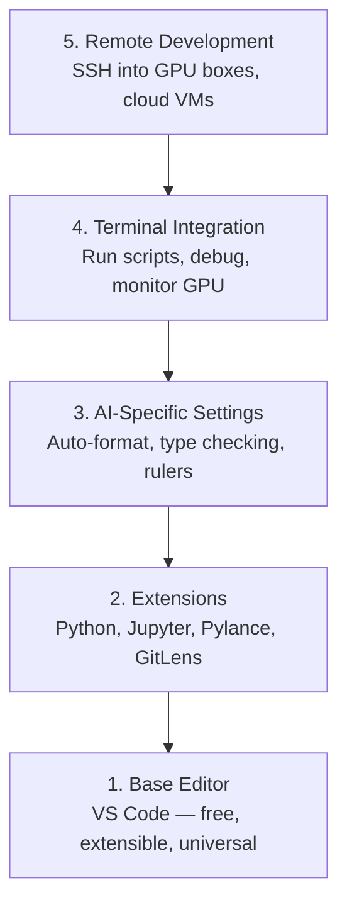

# 편집자 설정

> 편집자가 네 코파일럿이야 한번 설정해 놓으면 안 돼

**Type:** Build
**Languages:** --
**Prerequisites:** Phase 0, Lesson 01
**Time:** ~20 minutes

## 학습 목표

- 파이썬, 주피터, 리팅 및 리모트 SSH에 필수 확장 프로그램과 함께 VS 코드를 설치
- AI 작업 흐름에 대한 형식-에 저장, 타입 확인 및 노트북 출력 스크롤을 구성
- 원격 GPU 머신에서 로컬인 것처럼 코드를 편집하고 디버깅 할 수 있는 원격 SSH를 설정
- 편집자 대안 (Cursor, Windsurf, Neovim) 과 AI 작업에 대한 그들의 타협을 평가하십시오

## 문제

여러분은 편집기 내부에서 파이썬을 작성하고 노트북을 실행하고 훈련 루프를 디버깅하고 GPU 박스에 SSH를 넣는 데 수천 시간을 보낼 것입니다. 잘못된 편집기가 모든 세션을 마찰로 만듭니다. 자동으로 완료되지 않고, 입력 지적이 없고, 인라인 오류가 없고, 수동 포맷 및 무작위적인 터미널 작업 흐름이 없습니다.

올바른 설정은 20분이나 걸립니다.

## 개념

인공지능 엔지니어링 편집기 설정은 다섯 가지 필요합니다.



```figure
s0-lsp-roundtrip
```

## 건설 해

### 단계 1: VS 코드를 설치

VS Code는 추천된 편집기입니다. 그것은 무료이며 모든 OS에서 실행되며, 1급 Jupyter 노트북 지원이 있으며, 확장 생태계는 AI 작업에 필요한 모든 것을 포함합니다.

다운로드 [code.visualstudio.com](https://code.visualstudio.com/)- 그래

터미널에서 확인:

```bash
code --version
```

만약`code`macOS에서 찾을 수 없습니다, VS 코드를 열, 누르 `Cmd+Shift+P`, "Shell Command"를 입력하고 "PATH에서 '코드' 명령을 설치하라"를 선택합니다.

### 2단계: 필수 확장 프로그램을 설치

VS 코드 (`) 에서 통합 터미널을 열` Ctrl+```) 모든 플랫폼에서 AI 작업에 중요한 확장 프로그램을 설치합니다.

```bash
code --install-extension ms-python.python
code --install-extension ms-python.vscode-pylance
code --install-extension ms-toolsai.jupyter
code --install-extension eamodio.gitlens
code --install-extension ms-vscode-remote.remote-ssh
code --install-extension ms-python.debugpy
code --install-extension ms-python.black-formatter
code --install-extension charliermarsh.ruff
```

각자가 하는 일은

| Extension | Why |
|-----------|-----|
| Python | Language support, virtual env detection, run/debug |
| Pylance | Fast type checking, autocomplete, import resolution |
| Jupyter | Run notebooks inside VS Code, variable explorer |
| GitLens | See who changed what, inline git blame |
| Remote SSH | Open a folder on a remote GPU box as if it were local |
| Debugpy | Step-through debugging for Python |
| Black Formatter | Auto-format on save, consistent style |
| Ruff | Fast linting, catches common mistakes |

파일`code/vscode/extensions.json`이 수업은 전체 추천 목록 을 포함 합니다.`.vscode/extensions.json`프로젝트 폴더에 들어가서 VS Code는 폴더를 열 때 설치하도록 요청합니다.

### 단계 3: 설정 설정

설정의 복사`code/vscode/settings.json`이 수업에서, 또는 수동으로 적용 `Settings > Open Settings (JSON)`- 그래

인공지능 작업의 주요 설정:

```jsonc
{
    "python.analysis.typeCheckingMode": "basic",
    "editor.formatOnSave": true,
    "editor.rulers": [88, 120],
    "notebook.output.scrolling": true,
    "files.autoSave": "afterDelay"
}
```

왜 이 문제들이 중요할까요?

- **Type checking on basic**: 실행하기 전에 잘못된 정답 유형을 잡습니다. 텐서 모양의 부합과 잘못된 API 매개 변수에 대한 디버깅 시간을 절약합니다.
- **Format on save**다시 포맷을 생각하지 마세요. 블랙은 처리합니다.
- **Rulers at 88 and 120**: 블랙 랩 (88) 의 120 마커는 문서 문자열과 댓글이 너무 길어지면서 표시됩니다.
- **Notebook output scrolling**: 훈련 루프 는 수천 개의 라인을 인쇄 합니다. 스크롤 하지 않으면 출력 패널이 폭발합니다.
- **Auto-save**: 저장하는 것을 잊을 것입니다. 훈련 스크립트는 구석된 코드를 실행합니다. 자동 저장은 그것을 방지합니다.

### 단계 4: 터미널 통합

VS 코드의 통합 터미널은 훈련 스크립트를 실행하고 GPU를 모니터링하고 환경을 관리하는 곳입니다.

제대로 설정해

```jsonc
{
    "terminal.integrated.defaultProfile.osx": "zsh",
    "terminal.integrated.defaultProfile.linux": "bash",
    "terminal.integrated.fontSize": 13,
    "terminal.integrated.scrollback": 10000
}
```

유용한 단축키:

| Action | macOS | Linux/Windows |
|--------|-------|---------------|
| Toggle terminal | `` Ctrl+` `` | `` Ctrl+` `` |
| New terminal | `` Ctrl+Shift+` `` | `` Ctrl+Shift+` `` |
| Split terminal | `Cmd+\` | `Ctrl+Shift+5` |

분할 터미널은 유용합니다. 하나는 스크립트를 실행하는 데, 하나는 GPU를 모니터링하는 데`nvidia-smi -l 1`또는`watch -n 1 nvidia-smi`- 그래

### 단계 5: 원격 개발 (GPU 박스에 SSH)

이 프로그램은 인공지능 작업에 가장 중요한 확장 프로그램입니다. 당신은 원격 기계 (클라우드 VM, 연구소 서버, Lambda, Vast.ai) 에서 훈련을 실행할 것입니다. 원격 SSH는 원격 파일 시스템을 열고 파일을 편집하고 터미널을 실행하고 모든 것이 로컬처럼 디버깅 할 수 있습니다.

설정:

1. 리모트 SSH 확장 프로그램을 설치하십시오 (단계 2에서 수행됩니다).
2. 누르 `Ctrl+Shift+P`(또는`Cmd+Shift+P`), "Remote-SSH: Host에 연결하라"라는 타입을 입력합니다.
3. 들어가`user@your-gpu-box-ip`- 그래
4. VS 코드는 자동으로 서버 구성 요소를 원격 머신에 설치합니다.

비밀번호 없이 접속하려면 SSH 키를 설정하세요:

```bash
ssh-keygen -t ed25519 -C "your-email@example.com"
ssh-copy-id user@your-gpu-box-ip
```

호스트를 추가합니다`~/.ssh/config`편리함:

```
Host gpu-box
    HostName 203.0.113.50
    User ubuntu
    IdentityFile ~/.ssh/id_ed25519
    ForwardAgent yes
```

이제`Remote-SSH: Connect to Host > gpu-box`즉시 연결됩니다.

## 대체 방법

### 가속

[cursor.com](https://cursor.com)이 코드는 AI 코드 생성 기능이 내장되어 있는 VS Code 포크입니다. 이 코드는 동일한 확장 생태계와 설정 형식을 사용합니다. Cursor를 사용하면 이 수업의 모든 것이 여전히 적용됩니다. 동일한 것을 수입합니다 `settings.json`그리고`extensions.json`- 그래

### 윈드서핑

[windsurf.com](https://windsurf.com)AI의 첫 번째 VS 코드 포크입니다. 같은 이야기: 동일한 확장 프로그램, 동일한 설정 형식, 동일한 원격 SSH 지원

### 비무/네오비무

이미 Vim 또는 Neovim을 사용하고 있고 생산적인 경우, 거기에 머물러 있습니다. AI 파이썬 작업의 최소 설정:

- **pyright**또는**pylsp**타입 검사를 위해 (메이슨 또는 수동 설치를 통해)
- **nvim-lspconfig**언어 서버 통합
- **jupyter-vim**또는**molten-nvim**노트북과 같은 실행에
- **telescope.nvim**파일/표호 검색
- **none-ls.nvim**형식/을 위한 검은색과 

Vim를 아직 사용하지 않는 경우 지금부터 시작하지 마십시오. 학습 곡선은 AI 엔지니어링을 배우는 것과 경쟁합니다. VS 코드를 사용하세요.

## 사용 하 고

이 설정으로, 매일의 작업 흐름은 다음과 같습니다.

1. VS 코드에서 프로젝트 폴더를 열 (또는 원격 SSH를 통해 GPU 상자에 연결)
2. 자동 완료, 입력 팁 및 인라인 오류로 파이썬을 편집기에 작성하십시오.
3. Jupyter 노트북을 Jupyter 확장과 맞선 실행하십시오.
4. 훈련 스크립트를 위해 통합 터미널을 사용하세요.`uv pip install`, 그리고 GPU 모니터링
5. 참여하기 전에 GitLens에 대한 변경 사항을 검토하십시오.

## 운동

1. VS 코드 및 단계 2에 나열된 모든 확장 프로그램을 설치
2. 복사 `settings.json`이 수업에서 VS 코드 구성에
3. 파이썬 파일을 열고 Pylance에서 save에 타입 팁과 블랙 포맷을 표시하는지 확인
4. 원격 기계에 액세스 할 수 있다면 원격 SSH를 설정하고 폴더를 열십시오

### 암시

**Exercise 1.**단계 2에서 테이블에서 확장 프로그램을 설치하거나 각 ID를 설치합니다.`code/vscode/extensions.json``code --install-extension <id>`- 달아`code --list-extensions`그리고 모든 신분증을 파일과 비교해 보세요.

**Exercise 2.**열기 설정 > 열기 설정 (JSON) 를 열고 의 내용을 복사`code/vscode/settings.json`만약 파일에는 이미 설정이 있다면 키를 합쳐서 유효한 JSON를 유지하세요. VS 코드에는 빨간 선으로 파장된 파일이 표시됩니다.

**Exercise 3.**타입 해설을 사용하여 함수를 작성하고, 이를 호출하는 데 매달아 놓습니다. Pylance는 추론된 타입을 보여줍니다. 라인에 추가 공간을 추가하고 파일을 저장합니다.

**Exercise 4.**서버를 추가합니다`~/.ssh/config`먼저 확인해 주세요`ssh <host>`터미널에서 작동합니다. 그리고 연결하려면 원격 SSH 명령어를 사용하십시오. 원격 머신에서 VS 코드 실행될 때 상태 표시줄은 호스트 이름을 보여줍니다.

## 주요 용어

| Term | What people say | What it actually means |
|------|----------------|----------------------|
| LSP | "Autocomplete engine" | Language Server Protocol: a standard for editors to get type info, completions, and diagnostics from a language-specific server |
| Pylance | "The Python plugin" | Microsoft's Python language server using Pyright for type checking and IntelliSense |
| Remote SSH | "Working on the server" | VS Code extension that runs a lightweight server on a remote machine and streams the UI to your local editor |
| Format on save | "Auto-prettier" | The editor runs a formatter (Black, Ruff) every time you save, so code style is always consistent |
