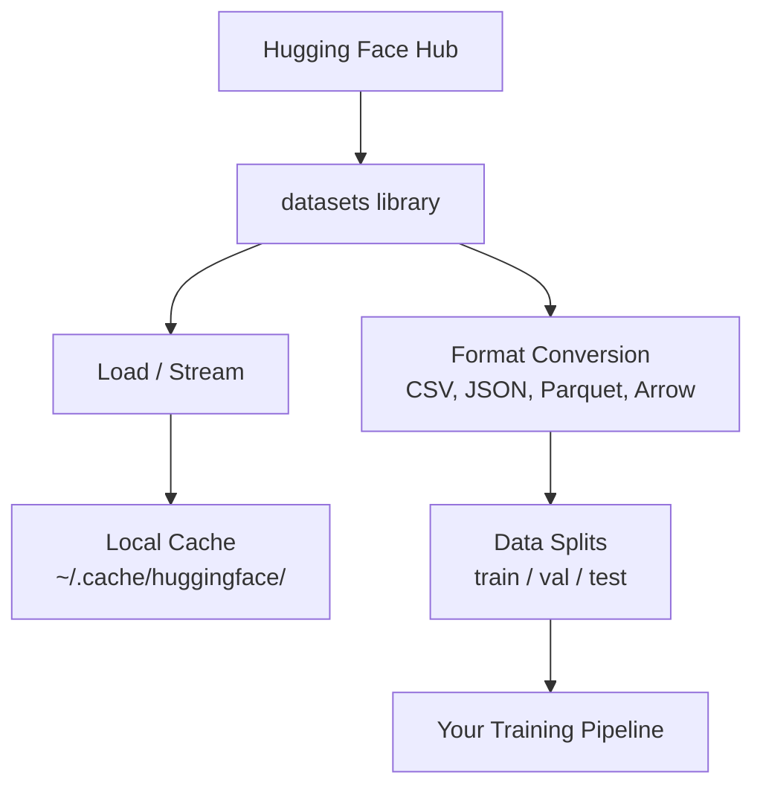

# 데이터 관리

> 데이터는 연료입니다. 어떻게 관리하느냐가 얼마나 빨리 가는지 결정합니다.

**Type:** Build
**Language:**파이썬
**Prerequisites:** Phase 0, Lesson 01
**Time:** ~45 minutes

## 학습 목표

- Hugging Face을 사용하여 데이터 세트를 로드, 스트리밍, 캐시`datasets`도서관
- CSV, JSON, Parquet, Arrow 형식들 사이에서 변환하고 그들의 타협을 설명
- 고정된 무작위 씨앗으로 재생 가능한 열차/확인/실험 분할을 생성
- `.gitignore`, Git LFS 또는 DVC

## 문제

모든 인공지능 프로젝트는 데이터로 시작됩니다. 데이터 세트를 찾아서 다운로드하고, 포맷을 변환하고, 훈련과 평가에 분할하고, 실험을 재생할 수 있도록 버전으로 만들어야 합니다. 수동적으로 수행하는 것은 느리고 오류가 발생할 수 있습니다. 반복 가능한 작업 흐름이 필요합니다.

## 개념



포옹하는 얼굴`datasets`라이브러리는 인공지능 작업에 필요한 데이터를 로드하는 표준 방법입니다. 다운로드, 캐시, 포맷 변환 및 스트리밍을 처리합니다.

```figure
s0-data-pipeline
```

## 건설 해

### 단계 1: 데이터 세트 라이브러리를 설치

```bash
pip install datasets huggingface_hub
```

### 단계 2: 데이터 세트를 로드

```python
from datasets import load_dataset

dataset = load_dataset("stanfordnlp/imdb")
print(dataset)
print(dataset["train"][0])
```

이 캔들은 IMDB 영화 리뷰 데이터 세트를 다운로드 합니다. 첫 번째 다운로드 후, 그것은 캐시에서 로드 됩니다.`~/.cache/huggingface/datasets/`- 그래

### 단계 3: 큰 데이터 세트를 스트리밍

일부 데이터 세트는 디스크에 들어갈 수 없을 정도로 크기 때문에 스트리밍은 전체 파일을 다운로드하지 않고 줄에 줄로 로드합니다.

```python
dataset = load_dataset("wikimedia/wikipedia", "20231101.en", split="train", streaming=True)

for i, example in enumerate(dataset):
    print(example["title"])
    if i >= 4:
        break
```

스트리밍은 당신에게 `IterableDataset`.열을 도착할 때 처리합니다. 데이터 세트의 크기와 상관없이 메모리 사용은 일정합니다.

### 단계 4: 데이터셋 형식

`datasets`라이브러리는 하우드 아래 Apache Arrow를 사용합니다. 파이프라인의 필요에 따라 다른 형식으로 변환할 수 있습니다.

```python
dataset = load_dataset("stanfordnlp/imdb", split="train")

dataset.to_csv("imdb_train.csv")
dataset.to_json("imdb_train.json")
dataset.to_parquet("imdb_train.parquet")
```

형식 비교:

| Format | Size | Read Speed | Best For |
|--------|------|-----------|----------|
| CSV | Large | Slow | Human readability, spreadsheets |
| JSON | Large | Slow | APIs, nested data |
| Parquet | Small | Fast | Analytics, columnar queries |
| Arrow | Small | Fastest | In-memory processing (what `datasets` uses internally) |

AI 작업에 Parquet는 최고의 저장 형식입니다. 화살표는 메모리에 작업하는 것입니다. CSV와 JSON는 교환을 위해 있습니다.

### 단계 5: 데이터 분할

모든 ML 프로젝트에는 세 개의 분할이 필요합니다.

- **Train**: 모델은 이로부터 학습한다 (일반적으로 80%).
- **Validation**: 훈련 중에 진전을 확인합니다 (일반적으로 10%)
- **Test**: 교육이 끝난 후 최종 평가 (일반적으로 10%)

일부 데이터 세트는 미리 나뉘어 있습니다. 그렇지 않은 경우, 직접 나눌 수 있습니다.

```python
dataset = load_dataset("stanfordnlp/imdb", split="train")

split = dataset.train_test_split(test_size=0.2, seed=42)
train_val = split["train"].train_test_split(test_size=0.125, seed=42)

train_ds = train_val["train"]
val_ds = train_val["test"]
test_ds = split["test"]

print(f"Train: {len(train_ds)}, Val: {len(val_ds)}, Test: {len(test_ds)}")
```

항상 재배가능성을 위한 씨앗을 설정해 두세요. 같은 씨앗은 매번 같은 분리를 만들어냅니다.

### 단계 6: 다운로드 및 캐시 모델

모델은 큰 파일입니다.`huggingface_hub`라이브러리에서 다운로드 및 캐시 처리

```python
from huggingface_hub import hf_hub_download, snapshot_download

model_path = hf_hub_download(
    repo_id="sentence-transformers/all-MiniLM-L6-v2",
    filename="config.json"
)
print(f"Cached at: {model_path}")

model_dir = snapshot_download("sentence-transformers/all-MiniLM-L6-v2")
print(f"Full model at: {model_dir}")
```

모델 캐시 `~/.cache/huggingface/hub/`다운로드 한 번, 그들은 즉시 다음 실행에 로드.

### 단계 7: 큰 파일을 처리

모델 무게와 큰 데이터 세트는 git에 들어가서는 안 됩니다.

**Option A: .gitignore (simplest)**

```
*.bin
*.safetensors
*.pt
*.onnx
data/*.parquet
data/*.csv
models/
```

**Option B: Git LFS (track large files in git)**

```bash
git lfs install
git lfs track "*.bin"
git lfs track "*.safetensors"
git add .gitattributes
```

Git LFS는 레포에 포인터를 저장하고 실제 파일을 별도의 서버에 저장합니다. GitHub은 1GB를 무료로 제공합니다.

**Option C: DVC (data version control)**

```bash
pip install dvc
dvc init
dvc add data/training_set.parquet
git add data/training_set.parquet.dvc data/.gitignore
git commit -m "Track training data with DVC"
```

DVC는 작은 크기를 만듭니다.`.dvc`데이터 자체는 S3, GCS 또는 다른 원격 저장 백엔드에 있습니다.

| Approach | Complexity | Best For |
|----------|-----------|----------|
| .gitignore | Low | Personal projects, downloaded data you can re-fetch |
| Git LFS | Medium | Teams sharing model weights via git |
| DVC | High | Reproducible experiments, large datasets, teams |

이 과정에 대해`.gitignore`DVC를 사용하여 기계에 대한 정확한 실험을 재현해야 합니다.

### 8단계: 저장 패턴

**Local storage**10GB 이하의 데이터 세트에서 작동합니다. HF 캐시는 자동으로 처리합니다.

**Cloud storage**더 큰 또는 기계에 공유되는 모든 것에 해당합니다.

```python
import os

local_path = os.path.expanduser("~/.cache/huggingface/datasets/")

# s3_path = "s3://my-bucket/datasets/"
# gcs_path = "gs://my-bucket/datasets/"
```

DVC는 S3와 GCS와 직접적으로 통합됩니다:

```bash
dvc remote add -d myremote s3://my-bucket/dvc-store
dvc push
```

이 과정에 대한 로컬 스토리지는 충분합니다. 클라우드 스토리지는 원격 GPU 인스턴스에 정렬을 할 때 관련됩니다.

## 이 과정 에서 사용 된 데이터 세트

| Dataset | Lessons | Size | What It Teaches |
|---------|---------|------|----------------|
| IMDB | Tokenization, classification | 84 MB | Text classification basics |
| WikiText | Language modeling | 181 MB | Next-token prediction |
| SQuAD | QA systems | 35 MB | Question answering, spans |
| Common Crawl (subset) | Embeddings | Varies | Large-scale text processing |
| MNIST | Vision basics | 21 MB | Image classification fundamentals |
| COCO (subset) | Multimodal | Varies | Image-text pairs |

이 모든 것 을 지금 다운로드 할 필요 가 없습니다. 각 수업 에서는 필요 가 무엇 인가 하는 것 이 구체적 이 있습니다.

## 사용 하 고

모든 것이 작동하는지 확인하기 위해 유틸리티 스크립트를 실행하십시오:

```bash
python code/data_utils.py
```

이 방법은 작은 데이터 세트를 다운로드하고 변환하고, 나뉘어 요약을 인쇄합니다.

## 선박

이 교훈은 다음과 같은 결과를 낳습니다.
- `code/data_utils.py`- 재사용 가능한 데이터 로딩 및 캐시 기능
- `outputs/prompt-data-helper.md`- 작업에 적합한 데이터 세트를 찾는 데 필요한

## 운동

1.  로드`glue``mrpc`첫 5가지 예제를 구성하고 검사합니다
2. 스트리밍 `c4`데이터 세트를 계산하고 10초에 얼마나 많은 예를 처리할 수 있는지 계산합니다
3. 데이터 세트를 Parquet로 변환하고 파일 크기를 CSV로 비교
4. 고정된 씨앗으로 70/15/15 열차/발/테스트 분할을 만들어 크기를 확인한다

### 암시

**Exercise 1.**전화`load_and_inspect("glue", "mrpc")``code/data_utils.py`또는`load_dataset("glue", "mrpc")`직접 인쇄하고`ds["train"][:5]`모든 예는`sentence1``sentence2`그리고`label`필드

**Exercise 2.**데이터 세트를 로드하여 `streaming=True`,`stream_dataset`        `time.time()`시작 시간을 더하기 10초를 지나면 count을 프린트하고 두 번 실행합니다. 첫 번째 실행은 연결 시작을 포함하기 때문입니다.

**Exercise 3.**같은 데이터 세트를 저장하여 `to_csv`그리고`to_parquet`,`convert_format` 크기를 비교해 보세요`ls -lh`또는`os.path.getsize`파켓 파일을 다시 로드해`load_from_parquet`그리고 행수 수가 변하지 않았는지 확인하세요.

**Exercise 4.**사용`train_test_split`두 번씩 고정된 `seed`이 세 가지 길이는 원래 길이를 합쳐야 하며, 두 번째 라인은 같은 씨를 가지고 있어야 합니다.

## 주요 용어

| Term | What people say | What it actually means |
|------|----------------|----------------------|
| Dataset split | "Training data" | A named subset (train/val/test) used at different stages of the ML lifecycle |
| Streaming | "Load it lazily" | Processing data row by row from a remote source without downloading the full dataset |
| Parquet | "Compressed CSV" | A columnar file format optimized for analytical queries and storage efficiency |
| Arrow | "Fast dataframe" | An in-memory columnar format used internally by the datasets library for zero-copy reads |
| Git LFS | "Git for big files" | An extension that stores large files outside the git repo while keeping pointers in version control |
| DVC | "Git for data" | A version control system for datasets and models that integrates with cloud storage |
| Cache | "Already downloaded" | A local copy of previously fetched data, stored at ~/.cache/huggingface/ by default |
