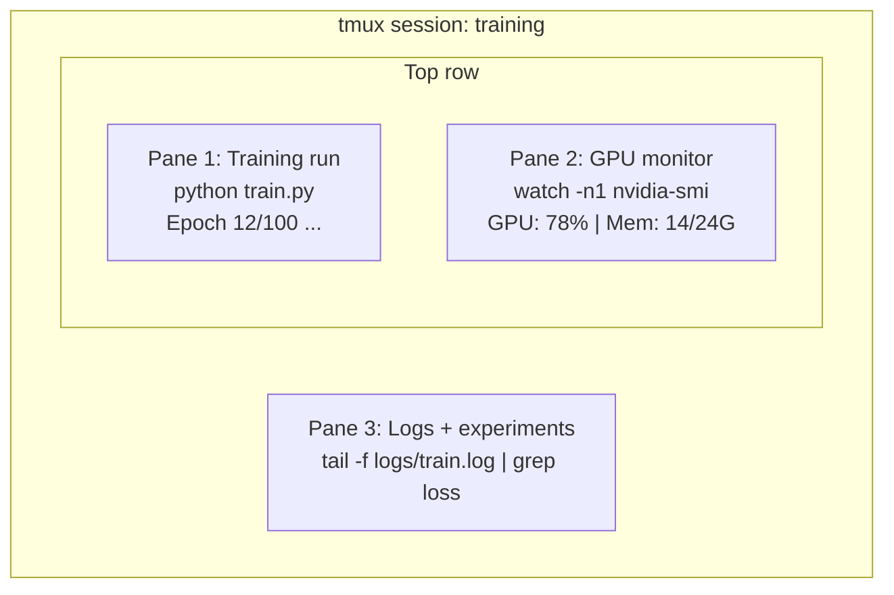

# 터미널 & 셸

> 터미널은 인공지능 엔지니어들이 사는 곳이죠.

**Type:** Learn
**Languages:** --
**Prerequisites:** Phase 0, Lesson 01
**Time:** ~35 minutes

## 학습 목표

- 파이프링, 리더렉션, 그리고`grep`명령 줄에서 훈련 로그를 필터링하고 처리하기
- 동시에 훈련 및 GPU 모니터링을 위해 여러 패널을 사용하여 지속적인 tmux 세션을 생성합니다
-   시스템 및 GPU 자원을 모니터링`htop``nvtop`그리고`nvidia-smi`
- SSH를 사용하여 로컬 및 리모트 기계들 사이의 파일 전송,`scp`그리고`rsync`

## 문제

당신은 어떤 편집기보다 더 많은 시간을 터미널에 보낼 것입니다. 훈련 실행, GPU 모니터링, 로그 꼬리, 원격 SSH 세션, 환경 관리. 모든 AI 작업 흐름은 껍데기를 만납니다. 당신이 여기 느린다면, 당신은 어디에서나 느립니다.

이 수업은 인공지능 작업에 중요한 단말기 기술을 다루고 있습니다. 유닉스 역사도 없고, 바쉬 스크립트에 깊이 뛰어들지 않습니다. 꼭 필요한 것 같습니다.

## 개념



3가지가 동시에 실행되고, 단 하나의 터미널이 있습니다.

```figure
s0-shell-pipeline
```

## 건설 해

### 단계 1: 상자를 알아보세요

어떤 을 실행하는지 확인해

```bash
echo $SHELL
```

대부분의 시스템은`bash`또는`zsh`둘 다 잘 작동합니다. 이 코스의 명령은 둘 다 작동합니다.

알아야 할 핵심 사항:

```bash
# Move around
cd ~/projects/ai-engineering-from-scratch
pwd
ls -la

# History search (most useful shortcut you'll learn)
# Ctrl+R then type part of a previous command
# Press Ctrl+R again to cycle through matches

# Clear terminal
clear   # or Ctrl+L

# Cancel a running command
# Ctrl+C

# Suspend a running command (resume with fg)
# Ctrl+Z
```

### 단계 2: 파이프링 및 리디렉션

파이프링은 명령어를 연결합니다. 이렇게 로그, 필터 출력 및 체인 도구를 처리합니다. 당신은 이것을 끊임없이 사용할 것입니다.

```bash
# Count how many times "loss" appears in a log
cat train.log | grep "loss" | wc -l

# Extract just the loss values from training output
grep "loss:" train.log | awk '{print $NF}' > losses.txt

# Watch a log file update in real time, filtering for errors
tail -f train.log | grep --line-buffered "ERROR"

# Sort experiments by final accuracy
grep "final_accuracy" results/*.log | sort -t= -k2 -n -r

# Redirect stdout and stderr to separate files
python train.py > output.log 2> errors.log

# Redirect both to the same file
python train.py > train_full.log 2>&1
```

필요한 3가지 리더렉트:

| Symbol | What it does |
|--------|-------------|
| `>` | Write stdout to file (overwrite) |
| `>>` | Append stdout to file |
| `2>` | Write stderr to file |
| `2>&1` | Send stderr to same place as stdout |
| `\|` | Send stdout of one command as stdin to the next |

### 3단계: 배경 프로세스

훈련은 몇 시간 걸립니다. 터미널은 항상 열려있지 않으세요.

```bash
# Run in background (output still goes to terminal)
python train.py &

# Run in background, immune to hangup (closing terminal won't kill it)
nohup python train.py > train.log 2>&1 &

# Check what's running in background
jobs
ps aux | grep train.py

# Bring a background job to foreground
fg %1

# Kill a background process
kill %1
# or find its PID and kill that
kill $(pgrep -f "train.py")
```

`&``nohup`그리고`screen`- 그래`tmux`이 부분의 본문은

| Method | Survives terminal close? | Can reattach? |
|--------|-------------------------|---------------|
| `command &` | No | No |
| `nohup command &` | Yes | No (check log file) |
| `screen` / `tmux` | Yes | Yes |

몇 분 이상 tmux을 사용하십시오.

### 단계 4: tmux

tmux는 여러 패널을 사용하여 지속적인 터미널 세션을 만들 수 있습니다. 이것은 훈련 실행을 관리하는 가장 유용한 단일 도구입니다.

```bash
# Install
# macOS
brew install tmux
# Ubuntu
sudo apt install tmux

# Start a named session
tmux new -s training

# Split horizontally
# Ctrl+B then "

# Split vertically
# Ctrl+B then %

# Navigate between panes
# Ctrl+B then arrow keys

# Detach (session keeps running)
# Ctrl+B then d

# Reattach
tmux attach -t training

# List sessions
tmux ls

# Kill a session
tmux kill-session -t training
```

일반적인 AI 작업 흐름 세션:

```bash
tmux new -s train

# Pane 1: start training
python train.py --epochs 100 --lr 1e-4

# Ctrl+B, " to split, then run GPU monitor
watch -n1 nvidia-smi

# Ctrl+B, % to split vertically, tail the logs
tail -f logs/experiment.log

# Now detach with Ctrl+B, d
# SSH out, go get coffee, come back
# tmux attach -t train
```

### 단계 5: htop 및 nvtop으로 모니터링

```bash
# System processes (better than top)
htop

# GPU processes (if you have NVIDIA GPU)
# Install: sudo apt install nvtop (Ubuntu) or brew install nvtop (macOS)
nvtop

# Quick GPU check without nvtop
nvidia-smi

# Watch GPU usage update every second
watch -n1 nvidia-smi

# See which processes are using the GPU
nvidia-smi --query-compute-apps=pid,name,used_memory --format=csv
```

`htop`당신이 사용하는 키바이딩:
- `F6`또는`>`열에 따라 분류 (메모리 누출을 찾기 위해 메모리에 따라 분류)
- `F5`트리뷰를 전환하기 위해 (아동 프로세스를 참조)
- `F9`프로세스를 죽이기 위해서
- `/`프로세스 이름을 검색하기 위해

### 단계 6: 원격 GPU 박스 SSH

클라우드 GPU (Lambda, RunPod, Vast.ai) 를 임대하면 SSH를 통해 연결됩니다.

```bash
# Basic connection
ssh user@gpu-box-ip

# With a specific key
ssh -i ~/.ssh/my_gpu_key user@gpu-box-ip

# Copy files to remote
scp model.pt user@gpu-box-ip:~/models/

# Copy files from remote
scp user@gpu-box-ip:~/results/metrics.json ./

# Sync a whole directory (faster for many files)
rsync -avz ./data/ user@gpu-box-ip:~/data/

# Port forward (access remote Jupyter/TensorBoard locally)
ssh -L 8888:localhost:8888 user@gpu-box-ip
# Now open localhost:8888 in your browser

# SSH config for convenience
# Add to ~/.ssh/config:
# Host gpu
#     HostName 192.168.1.100
#     User ubuntu
#     IdentityFile ~/.ssh/gpu_key
#
# Then just:
# ssh gpu
```

### 단계 7: 인공지능 작업에 유용한 별명

이 을 추가해 주세요`~/.bashrc`또는`~/.zshrc`이 부분의 본문은

```bash
source phases/00-setup-and-tooling/10-terminal-and-shell/code/shell_aliases.sh
```

아니면 원하는 것을 복사할 수도 있습니다.

```bash
# GPU status at a glance
alias gpu='nvidia-smi --query-gpu=index,name,utilization.gpu,memory.used,memory.total,temperature.gpu --format=csv,noheader'

# Kill all Python training processes
alias killtraining='pkill -f "python.*train"'

# Quick virtual environment activate
alias ae='source .venv/bin/activate'

# Watch training loss
alias watchloss='tail -f logs/*.log | grep --line-buffered "loss"'
```

보시다시피`code/shell_aliases.sh`전체 세트에서

### 8단계: 일반적인 AI 단말 패턴

이런 것들은 실제로 반복적으로 등장합니다.

```bash
# Run training, log everything, notify when done
python train.py 2>&1 | tee train.log; echo "DONE" | mail -s "Training complete" you@email.com

# Compare two experiment logs side by side
diff <(grep "accuracy" exp1.log) <(grep "accuracy" exp2.log)

# Find the largest model files (clean up disk space)
find . -name "*.pt" -o -name "*.safetensors" | xargs du -h | sort -rh | head -20

# Download a model from Hugging Face
wget https://huggingface.co/model/resolve/main/model.safetensors

# Untar a dataset
tar xzf dataset.tar.gz -C ./data/

# Count lines in all Python files (see how big your project is)
find . -name "*.py" | xargs wc -l | tail -1

# Check disk space (training data fills disks fast)
df -h
du -sh ./data/*

# Environment variable check before training
env | grep -i cuda
env | grep -i torch
```

## 사용 하 고

이 과정 중에 각 도구가 작동하는 순간입니다.

| Tool | When you use it |
|------|----------------|
| tmux | Every training run (Phases 3+) |
| `tail -f` + `grep` | Monitoring training logs |
| `nohup` / `&` | Quick background tasks |
| `htop` / `nvtop` | Debugging slow training, OOM errors |
| SSH + `rsync` | Working on cloud GPUs |
| Piping + redirects | Processing experiment results |
| Aliases | Saving time on repetitive commands |

## 운동

1. tmux를 설치하고 세 개의 패널을 사용하여 세션을 생성하고 실행합니다.`htop`한 개,`watch -n1 date`다른 한글에서 파이썬 스크립트를 사용해서
2. 에서 별명을 추가`code/shell_aliases.sh`을 구성하고 다시 충전합니다`source ~/.zshrc`(또는`~/.bashrc`)
3.                                                                                                                                                                                                                                                                                                                                                                                                                                                                                                                              `for i in $(seq 1 100); do echo "epoch $i loss: $(echo "scale=4; 1/$i" | bc)"; sleep 0.1; done > fake_train.log`그리고 사용`grep``tail`그리고`awk`손실값만 추출하기 위해서
4. 액세스 할 수 있는 서버에 SSH 구성 항목을 설정 (또는 사용)`localhost`문법을 연습하기 위해서)

### 암시

**Exercise 1.**시작해`tmux new -s practice`, 그리고 앞음으로 나눌 수 있습니다`Ctrl+B`다음으로`"`그리고`%`, 그리고 `Ctrl+B`화살키를 가지고`Ctrl+B`그럼`d`, 달아`tmux ls`, 그리고 다시 `tmux attach -t practice`이 세 가지 프로그램 모두 여전히 실행되어야 합니다.

**Exercise 2.**`code/shell_aliases.sh``~/.zshrc`또는`~/.bashrc`, 그리고 도망쳐`source`그 파일에서`alias`또는`type <name>`새로운 별명 중 하나가 껍데기가 그것을 알고 있는지 확인하기 위해

**Exercise 3.**첫 번째 `tail -5 fake_train.log`라인 형식을 확인하기 위해`grep loss`그리고 마지막 필드를 `awk '{print $NF}'`; 출력량은 100개의 숫자가 작아질 수 있습니다.

**Exercise 4.**복사 `Host gpu`수업부터 `~/.ssh/config`그리고 변화`HostName`그리고`User`당신의 서버에, 또는`localhost`사용자 이름과`ssh -G gpu`SSH가 사용할 설정을 인쇄하기 위해.`ssh gpu`연결하기 위해서요.

## 주요 용어

| Term | What people say | What it actually means |
|------|----------------|----------------------|
| Shell | "The terminal" | The program that interprets your commands (bash, zsh, fish) |
| tmux | "Terminal multiplexer" | A program that lets you run multiple terminal sessions inside one window, and detach/reattach |
| Pipe | "The bar thing" | The `\|` operator that sends one command's output as input to another |
| PID | "Process ID" | A unique number assigned to every running process, used to monitor or kill it |
| nohup | "No hangup" | Runs a command immune to the hangup signal, so closing the terminal won't kill it |
| SSH | "Connecting to the server" | Secure Shell, an encrypted protocol for running commands on a remote machine |
