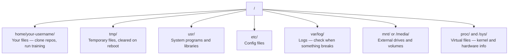

# 인공지능용 리눅스

> 대부분의 인공지능은 리눅스에서 작동합니다.

**Type:** Learn
**Languages:** --
**Prerequisites:** Phase 0, Lesson 01
**Time:** ~30 minutes

## 학습 목표

- 리눅스 파일 시스템을 탐색하고 명령 줄에서 필수 파일 작업을 수행
- 파일 권한 관리 `chmod`그리고`chown`"허락 거부" 오류를 해결하기 위해
- `apt`그리고 인공지능 작업에 새로운 GPU 박스를 설정
- 일반적으로 원격 기기에서 일하는 개발자를 방해하는 macOS에서 Linux 사이의 차이를 식별하십시오

## 문제

MacOS 또는 Windows에서 개발합니다. 하지만 클라우드 GPU 상자에 SSH를 넣거나 Lambda 인스턴스를 빌려주거나 EC2 기계를 작동시키면 Ubuntu에 착륙합니다. 터미널은 유일한 인터페이스입니다 파이더, 익스플로러, GUI가 없습니다. 파일 시스템을 탐색하고 패키지를 설치하고 명령줄에서 프로세스를 관리할 수 없다면 구글에서 "Linux에서 파일을 어떻게 해제할 수 있는지"를 검색하는 동안 비활성 GPU 시간 비용을 지불하게 됩니다.

이것은 생존 가이드입니다. 인공지능 작업에 원격 리눅스 머신에서 작동하는 데 필요한 것을 정확히 다루고 있습니다. 더 이상 아무것도 없습니다.

## 파일 시스템 레이아웃

리눅스는 모든 것을 하나의 루트 아래 조직합니다`/`- 아니 `C:\`또는`/Volumes`당신이 실제로 만질 수 있는 디렉토리:



네 집 디렉토리는`~`또는`/home/your-username`거의 모든 일이 여기서 벌어집니다.

## 필수적 인 명령

이 15개의 명령어는 원격 GPU 상자에서 할 수 있는 95%를 차지합니다.

### 이동

```bash
pwd                         # Where am I?
ls                          # What's here?
ls -la                      # What's here, including hidden files with details?
cd /path/to/dir             # Go there
cd ~                        # Go home
cd ..                       # Go up one level
```

### 파일 및 디렉토리

```bash
mkdir my-project            # Create a directory
mkdir -p a/b/c              # Create nested directories in one shot

cp file.txt backup.txt      # Copy a file
cp -r src/ src-backup/      # Copy a directory (recursive)

mv old.txt new.txt          # Rename a file
mv file.txt /tmp/           # Move a file

rm file.txt                 # Delete a file (no trash, it's gone)
rm -rf my-dir/              # Delete a directory and everything inside
```

`rm -rf`영구적인 상태입니다. 취소할 수 없습니다. 입력하기 전에 경로를 두 번 확인하세요.

### 파일 을 읽는 것

```bash
cat file.txt                # Print entire file
head -20 file.txt           # First 20 lines
tail -20 file.txt           # Last 20 lines
tail -f log.txt             # Follow a log file in real time (Ctrl+C to stop)
less file.txt               # Scroll through a file (q to quit)
```

### 검색

```bash
grep "error" training.log           # Find lines containing "error"
grep -r "learning_rate" .           # Search all files in current directory
grep -i "cuda" config.yaml          # Case-insensitive search

find . -name "*.py"                 # Find all Python files under current dir
find . -name "*.ckpt" -size +1G     # Find checkpoint files larger than 1GB
```

## 허가

리눅스 파일마다 소유자 및 권한 비트가 있습니다. 스크립트가 실행되지 않거나 디렉토리에 쓸 수 없을 때 이것을 보게 될 것입니다.

```bash
ls -l train.py
# -rwxr-xr-- 1 user group 2048 Mar 19 10:00 train.py
#  ^^^             owner permissions: read, write, execute
#     ^^^          group permissions: read, execute
#        ^^        everyone else: read only
```

일반적인 수정:

```bash
chmod +x train.sh           # Make a script executable
chmod 755 deploy.sh         # Owner: full, others: read+execute
chmod 644 config.yaml       # Owner: read+write, others: read only

chown user:group file.txt   # Change who owns a file (needs sudo)
```

"허락 거부"가 쓰여있으면 거의 항상 권한 문제가 됩니다.`chmod +x`또는`sudo`대부분의 사건을 해결해 줄 것입니다.

## 패키지 관리 (apt)

우분투 사용 `apt`이렇게 시스템 수준의 소프트웨어를 설치합니다.

```bash
sudo apt update             # Refresh the package list (always do this first)
sudo apt install -y htop    # Install a package (-y skips confirmation)
sudo apt install -y build-essential  # C compiler, make, etc. Needed by many Python packages
sudo apt install -y tmux    # Terminal multiplexer (keep sessions alive after disconnect)

apt list --installed        # What's installed?
sudo apt remove htop        # Uninstall
```

새로운 GPU 상자에 설치하는 일반적인 패키지:

```bash
sudo apt update && sudo apt install -y \
    build-essential \
    git \
    curl \
    wget \
    tmux \
    htop \
    unzip \
    python3-venv
```

## 사용자 및 sudo

보통 일반 사용자로 로그인되어 있습니다. 일부 작업에는 root (admin) 액세스가 필요합니다.

```bash
whoami                      # What user am I?
sudo command                # Run a single command as root
sudo su                     # Become root (exit to go back, use sparingly)
```

클라우드 GPU 인스턴스에서는 일반적으로 유일한 사용자이며 이미 sudo 액세스 권한을 가지고 있습니다. 모든 것을 루트로 실행하지 마십시오. 필요했을 때만 sudo를 사용합니다.

## 프로세스 및 시스템

훈련이 끝나면, 아니면 무슨 일이 일어나고 있는지 확인해야 할 때:

```bash
htop                        # Interactive process viewer (q to quit)
ps aux | grep python        # Find running Python processes
kill 12345                  # Gracefully stop process with PID 12345
kill -9 12345               # Force kill (use when graceful doesn't work)
nvidia-smi                  # GPU processes and memory usage
```

systemd는 서비스 (백그라운드 데몬) 를 관리합니다.

```bash
sudo systemctl start nginx          # Start a service
sudo systemctl stop nginx           # Stop it
sudo systemctl restart nginx        # Restart it
sudo systemctl status nginx         # Check if it's running
sudo systemctl enable nginx         # Start automatically on boot
```

## 디스크 공간

GPU 상자는 종종 디스크 공간이 제한되어 있습니다. 모델과 데이터 세트는 빠르게 채워집니다.

```bash
df -h                       # Disk usage for all mounted drives
df -h /home                 # Disk usage for /home specifically

du -sh *                    # Size of each item in current directory
du -sh ~/.cache             # Size of your cache (pip, huggingface models land here)
du -sh /data/checkpoints/   # Check how big your checkpoints are

# Find the biggest space hogs
du -h --max-depth=1 / 2>/dev/null | sort -hr | head -20
```

일반적인 공간 절약 장치:

```bash
# Clear pip cache
pip cache purge

# Clear apt cache
sudo apt clean

# Remove old checkpoints you don't need
rm -rf checkpoints/epoch_01/ checkpoints/epoch_02/
```

## 네트워크

모델을 다운로드하고 파일을 전송하고 명령 줄에서 API를 입력합니다.

```bash
# Download files
wget https://example.com/model.bin                   # Download a file
curl -O https://example.com/data.tar.gz              # Same thing with curl
curl -s https://api.example.com/health | python3 -m json.tool  # Hit an API, pretty-print JSON

# Transfer files between machines
scp model.bin user@remote:/data/                     # Copy file to remote machine
scp user@remote:/data/results.csv .                  # Copy file from remote to local
scp -r user@remote:/data/checkpoints/ ./local-dir/   # Copy directory

# Sync directories (faster than scp for large transfers, resumes on failure)
rsync -avz --progress ./data/ user@remote:/data/
rsync -avz --progress user@remote:/results/ ./results/
```

사용`rsync`끝`scp`큰 것을 위해 바이트를 전송하고 끊긴 연결을 처리합니다.

## 세션을 살아있게 해

리모컨 상자에 SSH를 넣으면 노트북을 닫으면 훈련이 끝나지 않습니다.

```bash
tmux new -s train           # Start a new session named "train"
# ... start your training, then:
# Ctrl+B, then D            # Detach (training keeps running)

tmux ls                     # List sessions
tmux attach -t train        # Reattach to session

# Inside tmux:
# Ctrl+B, then %            # Split pane vertically
# Ctrl+B, then "            # Split pane horizontally
# Ctrl+B, then arrow keys   # Switch between panes
```

항상 스 안에 긴 훈련 일을 해

## 윈도우 사용자 WSL2

윈도우를 사용하는 경우 WSL2는 듀얼 부팅 없이 리눅스 환경을 제공합니다.

```bash
# In PowerShell (admin)
wsl --install -d Ubuntu-24.04

# After restart, open Ubuntu from Start menu
sudo apt update && sudo apt upgrade -y
```

WSL2는 리눅스 커널을 실행합니다. 이 수업의 모든 것이 그 안에 작동합니다.`/mnt/c/Users/YourName/`WSL 내부에서

GPU 패스트로로는 Windows 측면에 설치된 NVIDIA 드라이버와 작동합니다. Windows NVIDIA 드라이버를 설치하면 CUDA는 WSL2 내에서 사용할 수 있습니다.

## Gotchas: macOS에서 Linux

맥오스에서 왔다면 걸림돌이 될 수 있는 것들:

| macOS | Linux | Notes |
|-------|-------|-------|
| `brew install` | `sudo apt install` | Different package names sometimes. `brew install htop` vs `sudo apt install htop` works the same, but `brew install readline` vs `sudo apt install libreadline-dev` does not. |
| `open file.txt` | `xdg-open file.txt` | But you won't have a GUI on a remote box. Use `cat` or `less`. |
| `pbcopy` / `pbpaste` | Not available | Pipe to/from clipboard doesn't exist over SSH. |
| `~/.zshrc` | `~/.bashrc` | macOS defaults to zsh. Most Linux servers use bash. |
| `/opt/homebrew/` | `/usr/bin/`, `/usr/local/bin/` | Binaries live in different places. |
| `sed -i '' 's/a/b/' file` | `sed -i 's/a/b/' file` | macOS sed needs an empty string after `-i`. Linux does not. |
| Case-insensitive filesystem | Case-sensitive filesystem | `Model.py` and `model.py` are two different files on Linux. |
| Line endings `\n` | Line endings `\n` | Same. But Windows uses `\r\n`, which breaks bash scripts. Run `dos2unix` to fix. |

## 빠른 참조 카드

```
Navigation:     pwd, ls, cd, find
Files:          cp, mv, rm, mkdir, cat, head, tail, less
Search:         grep, find
Permissions:    chmod, chown, sudo
Packages:       apt update, apt install
Processes:      htop, ps, kill, nvidia-smi
Services:       systemctl start/stop/restart/status
Disk:           df -h, du -sh
Network:        curl, wget, scp, rsync
Sessions:       tmux new/attach/detach
```

```figure
s0-process-fork
```

## 운동

1. SSH를 어떤 Linux 기계 (또는 WSL2를 열) 에 입력하고 홈 디렉토리로 이동합니다. 프로젝트 폴더를 생성하고, 그 안에 3개의 빈 파일을 생성합니다.`touch`, 그리고 그 다음으로`ls -la`- 그래
2. 설치`htop`apt를 사용하여 실행하고 어떤 프로세스가 가장 많은 메모리를 사용하고 있는지 확인합니다.
3.        `sleep 300`내부에 있는 것, 분리, 세션을 나열하고 다시 연결합니다.
4. 사용`df -h`사용 가능한 디스크 공간을 확인하려면`du -sh ~/.cache/*`당신의 캐시에서 공간을 차지하는 것을 찾아내기 위해
5. 로컬 머신에서 원격으로 파일을 전송하여 `scp`, 그리고 같은 전송을 `rsync`그리고 그 경험을 비교해 보세요.

### 암시

**Exercise 1.**사용`cd ~``mkdir`그리고`cd`새로운 폴더에 들어가서 실행하세요`touch`3개의 파일 이름을 가지고 있습니다.`ls -la`출력, 세 파일의 크기가 0이고 사용자의 이름이 소유자라는 것을 확인합니다.

**Exercise 2.** 설치`sudo apt install -y htop`시작하고 누르세요`F6`(또는 열 이름을 클릭) 로 분류하기 위해`MEM%`리스트의 맨 위쪽에 있는 프로세스는 가장 많은 메모리를 사용합니다.

**Exercise 3.**사용`tmux new -s train`수업에서, 실행`sleep 300`, 그리고 `Ctrl+B`그럼`d`- 달아`tmux ls`그 다음 세션을 보고`tmux attach -t train`;`sleep`아직 도망쳐야 합니다.

**Exercise 4.**달아`df -h`그리고 읽으세요`Avail`홈 폴더를 저장하는 파일 시스템에서 열을 열고 실행`du -sh ~/.cache/* | sort -h`가장 큰 폴더가 마지막 줄에 있습니다.

**Exercise 5.**파일의 복사`scp file.txt user@host:~/`, 그리고 도망쳐`rsync -avP file.txt user@host:~/`같은 파일에서 실행하세요`rsync`두 번째 명령: 거의 아무것도 보내지 않습니다. 원격 측의 파일은 변하지 않았기 때문입니다.
