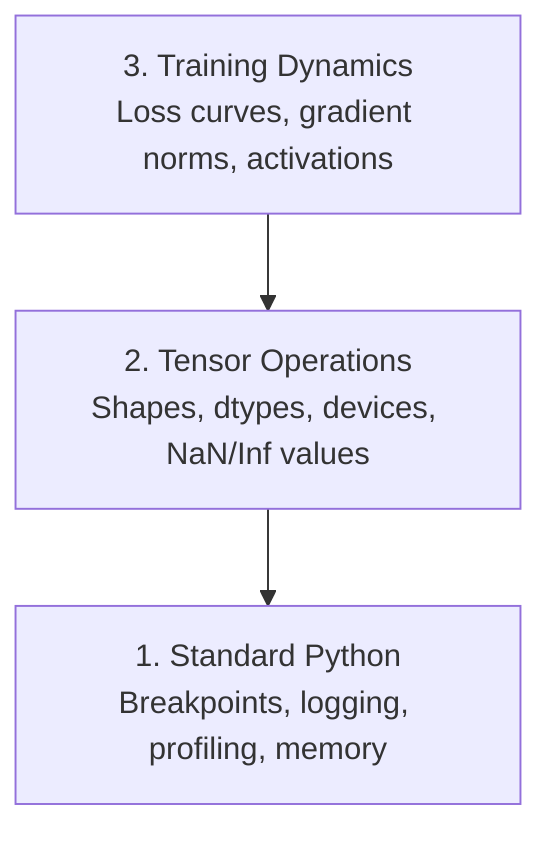

# 디버깅 및 프로파일링

> 최악의 인공지능 버그는 충돌하지 않고 똥에 조용히 훈련하고 아름다운 손실 곡선을 보고합니다.

**Type:** Build
**Language:**파이썬
**Prerequisites:** Lesson 1 (Dev Environment), basic PyTorch familiarity
**Time:** ~60 minutes

## 학습 목표

- 조건부 사용`breakpoint()`그리고`debug_print`훈련 중 텐서 모양, dtypes, NaN 값을 검사하기 위해
- 프로파일 훈련 루프 `cProfile``line_profiler`그리고`tracemalloc`병목을 찾아내기 위해
- 일반적인 AI 버그를 감지합니다. 모양 부합, NaN 손실, 데이터 누출 및 잘못된 장치 텐서
- 손실 곡선, 무게 히스토그램 및 기하급수 분포를 시각화하기 위해 TensorBoard을 설정

## 문제

인공지능 코드는 일반 코드와는 다르게 실패합니다. 웹 앱은 스택 추적으로 충돌합니다. 잘못된 구성 훈련 루프는 8 시간 동안 실행되며 GPU 시간에서 $ 200를 태우고 모든 입력의 평균을 예측하는 모델을 생성합니다. 코드는 결코 오류가 발생하지 않습니다. 오류는 잘못된 장치에 텐서, 잊혀진 입니다.`.detach()`, 또는 표지가 특징에 빠져나오게 되는

이 침묵의 오류를 감지하는 디버깅 도구가 필요해요. 시간이 낭비되고 계산이 되지 않는 전에요.

## 개념

인공지능 디버깅은 세 단계로 작동합니다.



대부분의 사람들은 3단계로 뛰어들지만 AI 버그의 80%는 1단계와 2단계에서 살고 있습니다.

```figure
s0-flame-hot
```

## 건설 해

### 1부: 인쇄 해제 (예, 작동)

인쇄 디버깅은 폐기됩니다. 그것은 안 됩니다. 텐서 코드에서는 타겟 프린트 명령어가 디버거를 통과하는 것보다 더 낫습니다. 왜냐하면 당신은 모양, dtypes, 값 범위를 동시에 볼 필요가 있기 때문입니다.

```python
def debug_print(name, tensor):
    print(f"{name}: shape={tensor.shape}, dtype={tensor.dtype}, "
          f"device={tensor.device}, "
          f"min={tensor.min().item():.4f}, max={tensor.max().item():.4f}, "
          f"mean={tensor.mean().item():.4f}, "
          f"has_nan={tensor.isnan().any().item()}")
```

의심스러운 모든 수술 후 전화해 버그가 발견되면

### 2부: 파이썬 디버거 (pdb 및 브레이크포인트)

내장 디버거는 인공지능 작업에 미미평가되어 있습니다.`breakpoint()`훈련 루프에 들어가서 텐서들을 상호작용적으로 검사해 보세요.

```python
def training_step(model, batch, criterion, optimizer):
    inputs, labels = batch
    outputs = model(inputs)
    loss = criterion(outputs, labels)

    if loss.item() > 100 or torch.isnan(loss):
        breakpoint()

    loss.backward()
    optimizer.step()
```

디버거가 당신을 내놓을 때 유용한 명령어:

- `p outputs.shape`모양을 확인하기 위해
- `p loss.item()`손실 값을 확인하기 위해
- `p torch.isnan(outputs).sum()`나노를 계산하기
- `p model.fc1.weight.grad`기하급수 검사를 하기 위해서
- `c`계속하고,`q`그만두기

이건 조건부 디버깅이야 뭔가 잘못됐을 때만 멈춰야 돼

### 3부: 파이썬 로그

인쇄 문서를 로그링으로 교체하면 디버깅이 빠른 검사를 넘어갑니다.

```python
import logging

logging.basicConfig(
    level=logging.INFO,
    format="%(asctime)s [%(levelname)s] %(message)s",
    handlers=[
        logging.FileHandler("training.log"),
        logging.StreamHandler()
    ]
)
logger = logging.getLogger(__name__)

logger.info("Starting training: lr=%.4f, batch_size=%d", lr, batch_size)
logger.warning("Loss spike detected: %.4f at step %d", loss.item(), step)
logger.error("NaN loss at step %d, stopping", step)
```

로그링은 시간표, 강도 수준, 파일 출력 등을 제공합니다. 훈련 실행이 새벽 3시에 실패하면, 화면을 스크롤하는 터미널 출력 대신 로그 파일을 원합니다.

### 4부: 시간 코드 섹션

시간이 어디로 가고 있는지 아는 것은 최적화로의 첫 번째 단계입니다.

```python
import time

class Timer:
    def __init__(self, name=""):
        self.name = name

    def __enter__(self):
        self.start = time.perf_counter()
        return self

    def __exit__(self, *args):
        elapsed = time.perf_counter() - self.start
        print(f"[{self.name}] {elapsed:.4f}s")

with Timer("data loading"):
    batch = next(dataloader_iter)

with Timer("forward pass"):
    outputs = model(batch)

with Timer("backward pass"):
    loss.backward()
```

일반적인 발견: 데이터 로딩은 60%의 교육 시간을 필요로 합니다.`num_workers > 0`더 빠른 GPU가 아닌

### 5부: cProfile 및 line_profiiler

수동 타이머를 넘어서면

```bash
python -m cProfile -s cumtime train.py
```

이것은 누적 시간으로 분류된 모든 함수 호출을 보여줍니다.

```bash
pip install line_profiler
```

```python
@profile
def train_step(model, data, target):
    output = model(data)
    loss = F.cross_entropy(output, target)
    loss.backward()
    return loss

# Run with: kernprof -l -v train.py
```

### 6부: 기억력 프로필

#### 트레이스말록과 함께 CPU 메모리

```python
import tracemalloc

tracemalloc.start()

# your code here
model = build_model()
data = load_dataset()

snapshot = tracemalloc.take_snapshot()
top_stats = snapshot.statistics("lineno")
for stat in top_stats[:10]:
    print(stat)
```

#### memory_profiler와 함께 CPU 메모리

```bash
pip install memory_profiler
```

```python
from memory_profiler import profile

@profile
def load_data():
    raw = read_csv("data.csv")       # watch memory jump here
    processed = preprocess(raw)       # and here
    return processed
```

                `python -m memory_profiler your_script.py`라인별 메모리 사용량을 확인하기 위해서

#### PyTorch로 GPU 메모리

```python
import torch

if torch.cuda.is_available():
    print(torch.cuda.memory_summary())

    print(f"Allocated: {torch.cuda.memory_allocated() / 1e9:.2f} GB")
    print(f"Cached: {torch.cuda.memory_reserved() / 1e9:.2f} GB")
```

OOM (Out of Memory) 를 누르면

1. 배트 크기를 줄이십시오 (항상 먼저 시도하십시오)
2. 사용`torch.cuda.empty_cache()`캐시 메모리를 자유롭게 하기 위해
3. 사용`del tensor`다음으로`torch.cuda.empty_cache()`큰 중간 제품
4. 혼합 정밀도를 사용 (`torch.cuda.amp`) 메모리 사용량을 절반으로 줄이기 위해
5. 매우 깊은 모델에 있어서 기하급수 점검을 사용한다

### 7부: 일반적인 인공지능 곤충과 그 탐지 방법

#### 형태 불합

가장 흔한 버그. 텐서에는 모양이 있습니다.`[batch, features]`모델이 기대할 때`[batch, channels, height, width]`- 그래

```python
def check_shapes(model, sample_input):
    print(f"Input: {sample_input.shape}")
    hooks = []

    def make_hook(name):
        def hook(module, inp, out):
            in_shape = inp[0].shape if isinstance(inp, tuple) else inp.shape
            out_shape = out.shape if hasattr(out, "shape") else type(out)
            print(f"  {name}: {in_shape} -> {out_shape}")
        return hook

    for name, module in model.named_modules():
        hooks.append(module.register_forward_hook(make_hook(name)))

    with torch.no_grad():
        model(sample_input)

    for h in hooks:
        h.remove()
```

샘플 패치를 통해 한번 실행해 보세요. 모델의 모든 모양 변환을 지도로 표시합니다.

#### 나나 손실

나나 손실은 폭발한 것을 의미합니다.

- 학습률이 너무 높다
- 관세 손실에서 0으로 나눌 수 있습니다
- 0 또는 음수의 로그
- RNNs에서 폭발 gradients

```python
def detect_nan(model, loss, step):
    if torch.isnan(loss):
        print(f"NaN loss at step {step}")
        for name, param in model.named_parameters():
            if param.grad is not None:
                if torch.isnan(param.grad).any():
                    print(f"  NaN gradient in {name}")
                if torch.isinf(param.grad).any():
                    print(f"  Inf gradient in {name}")
        return True
    return False
```

#### 데이터 유출

테스트 세트에서 99%의 정확도가 높습니다

```python
def check_data_leakage(train_set, test_set, id_column="id"):
    train_ids = set(train_set[id_column].tolist())
    test_ids = set(test_set[id_column].tolist())
    overlap = train_ids & test_ids
    if overlap:
        print(f"DATA LEAKAGE: {len(overlap)} samples in both train and test")
        return True
    return False
```

또한 시간 유출을 확인합니다. 과거를 예측하기 위해 미래의 데이터를 사용하세요. 분할 전에 시간표에 따라 분류합니다.

#### 잘못된 장치

다른 장치의 텐서 (CPU와 GPU) 는 실행 시간 오류를 유발합니다. 하지만 때로는 텐서가 GPU에 있는 동안 CPU에 침묵하게 유지되며 훈련은 느리게 실행됩니다.

```python
def check_devices(model, *tensors):
    model_device = next(model.parameters()).device
    print(f"Model device: {model_device}")
    for i, t in enumerate(tensors):
        if t.device != model_device:
            print(f"  WARNING: tensor {i} on {t.device}, model on {model_device}")
```

### 8부: 텐서보드 기본

텐서보드는 시간이 지남에 따라 훈련 안에서 일어나는 일을 보여줍니다.

```bash
pip install tensorboard
```

```python
from torch.utils.tensorboard import SummaryWriter

writer = SummaryWriter("runs/experiment_1")

for step in range(num_steps):
    loss = train_step(model, batch)

    writer.add_scalar("loss/train", loss.item(), step)
    writer.add_scalar("lr", optimizer.param_groups[0]["lr"], step)

    if step % 100 == 0:
        for name, param in model.named_parameters():
            writer.add_histogram(f"weights/{name}", param, step)
            if param.grad is not None:
                writer.add_histogram(f"grads/{name}", param.grad, step)

writer.close()
```

발사하라

```bash
tensorboard --logdir=runs
```

무엇을 찾아야 하는가:

- **Loss not decreasing**: 학습률이 너무 낮거나 모델 아키텍처 문제
- **Loss oscillating wildly**: 학습률이 너무 높다
- **Loss goes to NaN**: 수학적 불안정성 (이하 NaN 섹션 참조)
- **Train loss decreasing, val loss increasing**: 과장
- **Weight histograms collapsing to zero**: 사라지는 기하급수
- **Gradient histograms exploding**: gradient 절단 필요

### 9부: VS 코드 디버거

인터랙티브 디버깅을 위해 VS 코드를 `launch.json`이 부분의 본문은

```json
{
    "version": "0.2.0",
    "configurations": [
        {
            "name": "Debug Training",
            "type": "debugpy",
            "request": "launch",
            "program": "${file}",
            "console": "integratedTerminal",
            "justMyCode": false
        }
    ]
}
```

터를 클릭하여 틈새점을 설정합니다. 텐서 속성을 검사하기 위해 변수 패널을 사용하세요. 디버그 콘솔은 임의 Python 표현을 실행 중간에 실행할 수 있습니다.

데이터 사전 처리 파이프라인을 통과하는 데 유용합니다.

## 사용 하 고

여기 대부분의 인공지능 버그를 잡는 디버깅 작업 흐름이 있습니다.

1. **Before training**: 실행`check_shapes`샘플 배치를 통해 입력 및 출력 크기가 기대에 부합하는 것을 확인합니다.
2. **First 10 steps**사용:`debug_print`손실, 출력, 그리고 기하급수에 대해 확인합니다. 아무것도 NaN가 아닌 것을 확인하고 값은 합리적인 범위에 있습니다.
3. **During training**: 로그 손실, 학습 속도, 그리고 gradient 규범. 시각화 위해 TensorBoard를 사용하십시오.
4. **When something breaks**: 떨어뜨려`breakpoint()`실패 지점에서 텐서들을 상호작용적으로 검사합니다.
5. **For performance**데이터 로딩 시간, 앞선 시간, 후진 시간, 오오미 근처에 있는 경우 프로필 메모리

## 선박

디버깅 툴킷 스크립트를 실행하세요:

```bash
python phases/00-setup-and-tooling/12-debugging-and-profiling/code/debug_tools.py
```

보시다시피`outputs/prompt-debug-ai-code.md`인공지능에 대한 특정 버그를 진단하는

## 운동

1. 달아`debug_tools.py`각 섹션의 출력을 통해 읽으십시오. NaN (힌트: 앞 패스에서 0으로 나눌 수 있습니다) 를 도입하기 위해 도미 모델을 수정하고 탐지기가 그것을 잡는 것을 지켜보십시오.
2. 훈련 루프를 프로파일하여 `cProfile`그리고 가장 느린 함수를 식별합니다.
3. 사용`tracemalloc`데이터 로딩 파이프라인에서 가장 많은 메모리를 할당하는 라인을 찾아내기 위해
4. 간단한 훈련을 위해 TensorBoard을 설정하고 모델이 과잉 적합하는지 확인합니다.
5. 사용`breakpoint()`훈련 루프 내부에서 텐서 모양, 장치 및 디버거 프롬프트에서 gradient 값을 검사하는 연습

### 암시

**Exercise 1.**달아`python3 phases/00-setup-and-tooling/12-debugging-and-profiling/code/debug_tools.py`그리고 각 데모 함수의 출력을 읽어보세요.`demo_nan_detection`그래서 그 출력은 0으로 나뉘어 다시 실행됩니다.`detect_nan`단계 번호로 NaN 경고를 인쇄해야 합니다.

**Exercise 2.** 루프를 실행하세요`python -m cProfile -s cumtime your_script.py`, 또는 그것을 포장 `cProfile.Profile()`.                      `cumtime`가장 큰 시간으로 자신의 코드를 사용하는 함수는 가장 느립니다.

**Exercise 3.**전화`tracemalloc.start()`데이터 로딩 코드 이전에`tracemalloc.take_snapshot()`그 후,`demo_memory_tracking`인쇄`snapshot.statistics("lineno")[:5]`; 첫 번째 줄은 가장 큰 배당을 가진 파일과 줄 번호를 나타냅니다.

**Exercise 4.**훈련 손실과 검증 손실을 기록하여`SummaryWriter`모든 시대를 따라가서`tensorboard --logdir=runs`만약 훈련 손실이 계속 감소하고 검증 손실이 증가하면 모델이 과잉으로 올라간다.

**Exercise 5.**      `breakpoint()`                        `loss.backward()`그리고 스크립트를 실행하세요`(Pdb)`빨리, 인쇄`x.shape``x.device`그리고`next(model.parameters()).grad`, 그리고 입력`c`다음 단계로 진행하기 위해서입니다.
