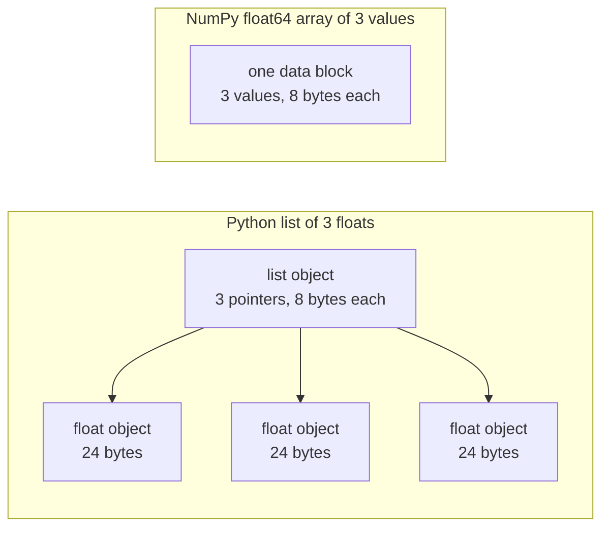

# 인공지능 공학에 필요한 파이썬

> 이 코스의 대부분의 코드는 같은 작은 파이썬 어휘들을 사용합니다. 수학과 모델 수업이 그것에 의존하기 전에 이 세트를 알아보세요.

**Type:** Build
**Languages:** Python
**Prerequisites:** Dev Environment, Python Environments
**Time:** ~120 minutes

## 학습 목표

- 대부분의 코스 코드가 사용하는 어휘를 읽고 작성하십시오. 파킹 및 f-스트링에서 데이터 클래스와 이해에 이르기까지.
- 오류 없이 잘못된 결과를 주는 3개의 파이썬 오류를 찾아보세요. 공유 목록, 변경 가능한 기본 설정, 사용된 생성기.
- CSV 및 JSON 로더, 씨드 스플릿, 그리고 표준 라이브러리를 사용하는 미니 패치 생성기를 구축하십시오.
- 순수한 파이썬으로 점수 곱, 평균, 표준 deviation를 작성하고 속도와 메모리 사용량을 측정합니다.
- 숫자에 대한 순수한 파이썬 루프가 느린 이유를 설명하고, NumPy 방송이 어떻게 루프를 컴파일된 코드로 옮기는지를 설명하십시오.

## 문제

이 단계 이후의 수업은 수학과 모델에 간단한 파이썬을 사용합니다. 수업의 541개의 파이썬 파일 중 276개의 파일은`dataclasses`187개의 파일도 전화합니다`random.seed`또는`random.Random`만약 이 어휘들이 새로운 경우, 수학을 읽을 때 문법을 읽습니다.

파이썬은 오류 메시지가 없는 잘못된 결과를 주는 행동도 가지고 있습니다. 두 개의 이름은 한 목록에 참조할 수 있으므로 한 이름의 변경은 다른 이름을 변경합니다. 기본 정수는 한 호출에서 다음으로 값을 유지합니다. 생성기는 한 번의 통과 후에 빈이므로 두 번째 훈련 시대는 데이터가 없으며 손실은 변하지 않습니다.

마지막 문제는 속도입니다. 우리의 테스트 노트북에서, 순수한 파이썬 루프가 백만 개의 플로이트를 넘어서는데 약 30 밀리초를 걸렸습니다. NumPy는 1 밀리초가 채 되지 않은 시간 안에 같은 점 제품을 계산했습니다. 당신은 이유를 알아야 합니다. 그래서 당신은 맑은 루프와 배열 동작을 선택할 수 있습니다.

## 개념

### 코스 코드가 사용하는 것

우리는 모든 541 파이썬 파일을 분석했습니다`phases/*/*/code/``ast`이 테이블은 적어도 한 번씩 각 구성물을 사용하는 파일을 계산합니다. 계산은 이 수업을 작성한 날부터입니다. 수업이 추가됨에 따라 변경됩니다.

| Construct | Files | Share |
|-----------|-------|-------|
| Function definitions | 541 | 100% |
| `if __name__ == "__main__":` | 529 | 98% |
| f-strings | 517 | 96% |
| Tuple unpacking | 448 | 83% |
| Classes | 379 | 70% |
| List comprehensions | 375 | 69% |
| Type hints on functions | 342 | 63% |
| Generator expressions | 326 | 60% |
| Slices | 314 | 58% |
| `lambda` | 175 | 32% |
| `try` and `except` | 120 | 22% |
| `with` statements | 96 | 18% |
| Dict comprehensions | 93 | 17% |
| Generator functions with `yield` | 14 | 3% |

수입은 어떤 표준 모듈이 중요하는지 보여줍니다. 541개의 파일 중 340개가`from __future__ import annotations`, 그리고 276개 수입`dataclasses`- `math``random`그리고`json`모듈은 187, 175 및 126 파일에 나타납니다.`collections`모듈은 70개의 파일에서 나타납니다.`itertools`4개만 나타납니다.

수업은 안 돼요`map()`또는`filter()`이해는 그 일을 합니다.`sorted``min``max`또는`.sort``key=`이 수업은 이 목록의 상단에 있는 어휘에 가장 많은 시간을 투자합니다.

### 이름 은 물체 를 가리키는 것 이다

파이썬에서 변수는 객체를 가리키는 이름이다. 할당은 객체에 이름을 묶는다. 객체를 복사하지 않는다. 두 개의 이름이 한 목록에 참조하면 두 이름 중 한 명으로의 변경이 두 개의 이름으로 모두 표시된다. 숫자, 문자열, 튜플은 변경될 수 없으므로 이 규칙은 그들에게 아무런 문제가 발생하지 않습니다. 목록, 디킷 및 집합은 변경될 수 있으므로 독립 버전이 필요할 때 복사하십시오.

### 리스트는 포인터를 포함하고, 배열은 숫자를 포함하고

파이썬 목록은 숫자를 직접 저장하지 않습니다. 포인터를 저장하고, 각 포인터는 전체 파이썬 객체를 참조합니다. 64 비트 CPython 빌드에서, 각 포인터는 8 바이트를 가지고 있으며 각 `float`객체는 24 바이트를 필요로 합니다.`float64`배열은 원자 8 바이트 값을 한 블록의 메모리에 옆으로 저장합니다.



목록에 있는 루프는 각 요소에 대해 많은 작업을 수행합니다. 인터프리터는 한 번에 하나의 바이트 코드 명령어를 실행합니다. 각 요소에 대해 포인터를 따라 각 오페란드의 유형을 확인합니다. 그 다음 플롯 복제 코드를 호출하고 결과를 유지하기 위해 파이썬 플롯 객체를 만듭니다.

NumPy는 원자재 값에 대한 컴파일된 코드 루프에서 동일한 수학적 작업을 수행합니다. 전체 배열에 대한 데이터 유형을 한 번 확인하고, 각 요소에 대한 파이썬 객체를 만들지 않습니다. 벡터화된 코드는 전체 배열에 대한 하나의 동작을 설명합니다.`(x - mean) / std`이 강의의 벡터 함수는 이 규칙을 따르고 각각의 함수는 하나의 배열 동작을 수행하므로 나중에 NumPy 호출으로 교체할 수 있습니다

### 리스트는 모든 항목을 포함하고, 생성기는 하나

리스트 이해는 다음 라인이 실행되기 전에 모든 항목을 생성합니다. 호출자가 다음 항목을 요청할 때마다 생성기는 하나의 항목을 생성합니다. 목록의 메모리는 항목의 수와 함께 증가합니다. 생성기의 메모리는 거의 동일한 수의 항목에 대해 유지됩니다.

발전기는 한 번만 실행될 수 있습니다. 마지막 항목이 끝나면,`StopIteration`각 요청에 따라, 그래서 두 번째 `for`이 코드는 매 시대마다 한 번 데이터 세트를 읽습니다. 따라서 매 시대마다 새로운 생성기를 만들어야 합니다.

학습 코드에 있어서 생성기 기능은 드물다. 딥러닝 수업에서 사용하는 데이터 로더는 배치를 반복할 수 있으므로 아이디어는 모든 훈련 루프에 있습니다. 그림은 두 가지 접근 방식을 동일한 8 행에 보여줍니다.

```figure
s0-list-vs-generator
```

## 필요 한 언어

이 섹션의 각 블록은 자체적으로 실행됩니다. 파일을 저장하고 실행합니다.`python3`블록은 파이썬 3.11 또는 최신 버전이 필요합니다. 개발 환경 수업에서 설치한 버전입니다.

### 1. 가치, 수집 및 포장

파이썬은 네 개의 내장 컬렉션을 가지고 있습니다. 각각의 컬렉션을 언제 사용할지 알아보세요.

| Type | Example | Ordered | Can change | Typical use in the course |
|------|---------|---------|------------|---------------------------|
| `list` | `[0.5, 1.2]` | Yes | Yes | Samples, losses, weights |
| `tuple` | `(32, 784)` | Yes | No | Shapes, fixed records, dict keys |
| `dict` | `{"lr": 0.01}` | Insertion order | Yes | Configs, vocabularies, JSON rows |
| `set` | `{"cat", "dog"}` | No | Yes | Unique tokens, overlap checks |

이 블록은 임무가 목록을 복사하지 않는 것을 보여줍니다.

```python
weights = [0.5, -1.2, 3.0]
alias = weights
alias[0] = 99.0
print(weights)

independent = list(weights)
independent[1] = 0.0
print(weights, independent)

grid = [[0] * 3] * 2
grid[0][0] = 1
print(grid)

grid = [[0] * 3 for _ in range(2)]
grid[0][0] = 1
print(grid)
```

```text
[99.0, -1.2, 3.0]
[99.0, -1.2, 3.0] [99.0, 0.0, 3.0]
[[1, 0, 0], [1, 0, 0]]
[[1, 0, 0], [0, 0, 0]]
```

표현`[[0] * 3] * 2`한 내부 목록에 두 개의 참조를 가진 외부 목록을 만듭니다. 이해는 각 줄에 새로운 내부 목록을 만듭니다. 수학 단계는 목록에서 매트릭스를 만듭니다. 그래서 이해 형태를 사용하십시오.

파킹을 해제하면 일련의 항목을 한 줄에 여러 개의 이름에 지정합니다. 별이있는 이름은 나머지 항목을 수집합니다. f 문자열은 표현의 값을 문자열에 넣으며, 대장 다음의 선택적 형식을 사용합니다.

```python
shape = (32, 784)
batch_size, n_features = shape
first, *middle, last = [1, 2, 3, 4, 5]
x, y = 1.0, 3.0
x, y = y, x

config = {"lr": 0.01, "epochs": 5}
config["seed"] = 7
tokens = ["the", "cat", "sat", "on", "the", "mat"]
vocab = set(tokens)

print(batch_size, n_features, first, middle, last, x, y)
print(config.get("momentum", 0.9), "cat" in vocab, len(vocab))
print(f"lr={config['lr']:.0e} loss={0.123456:.3f} n={60_000:,} {batch_size=}")
```

```text
32 784 1 [2, 3, 4] 5 3.0 1.0
0.9 True 5
lr=1e-02 loss=0.123 n=60,000 batch_size=32
```

`dict.get`키가 없어진 경우 기본값을 반환합니다.`in`집합에 대한 시험은 어떤 집합 크기에 대해서도 거의 같은 시간을 필요로 합니다.`{batch_size=}`양식은 이름과 값을 인쇄하여 디버깅을 할 때 도움이 됩니다.

한 조각`a[start:stop:step]`포함됩니다`start`그리고 배제합니다`stop`음의 지수는 끝에서 계산됩니다. 목록의 조각은 새로운 목록입니다. 그래서 큰 목록의 조각은 모든 지표를 복사합니다.

```python
tokens = ["<s>", "the", "cat", "sat", "on", "the", "mat", "</s>"]
print(tokens[1:-1])
print(tokens[:3], tokens[-3:])
print(tokens[::2])
print(tokens[::-1][:2])
windows = [tokens[i:i + 3] for i in range(len(tokens) - 2)]
print(len(windows), windows[0])
```

```text
['the', 'cat', 'sat', 'on', 'the', 'mat']
['<s>', 'the', 'cat'] ['the', 'mat', '</s>']
['<s>', 'cat', 'on', 'mat']
['</s>', 'mat']
6 ['<s>', 'the', 'cat']
```

### 2. 이해

이해는 하나의 표현에서 반복 가능한 단어에서 목록을 만들고, 정하는 것, 또는 집합을 만듭니다. 그것은 설명하는 수학과 비슷합니다.

```python
scores = [0.91, 0.42, 0.77, 0.15, 0.66]
labels = [1 if s >= 0.5 else 0 for s in scores]
high = [s for s in scores if s > 0.6]
squares = {i: i * i for i in range(4)}
lengths = {len(word) for word in ["a", "bb", "cc", "ddd"]}
sum_sq = sum(s * s for s in scores)

matrix = [[1, 2, 3], [4, 5, 6]]
transposed = [list(column) for column in zip(*matrix)]
flat = [v for row in matrix for v in row]

print(labels, high, squares, lengths, round(sum_sq, 4))
print(transposed, flat)
```

```text
[1, 0, 1, 0, 1] [0.91, 0.77, 0.66] {0: 0, 1: 1, 2: 4, 3: 9} {1, 2, 3} 2.0555
[[1, 4], [2, 5], [3, 6]] [1, 2, 3, 4, 5, 6]
```

 `if`몇 가지 항목만 보관합니다.`for`조건부 표현이 될 수 있습니다.`a if condition else b`- 두 개`for`두 개의 둥근 루프와 같은 순서로 실행되는 문항입니다.

형 괄호는 생성자 표현을 만듭니다.`sum(s * s for s in scores)``sum`한 번에 1개의 제곱을 읽습니다. 파이썬은 리스트를 만들지 않습니다.`zip(*matrix)`, 별은 각 줄을 별도의 논리로 통과하고,`zip`각 위치에서 항목을 쌍으로 묶는다.

### 3. 함수, 논증 및 종료

기본 값은 논쟁을 선택적으로 만듭니다. 키워드 논쟁은 호출에서 매개 변수를 이름 붙인다.`*`매개 변수 목록에서 다음 매개 변수를 키워드만 만듭니다.

```python
def clip(value, low=0.0, high=1.0):
    return max(low, min(high, value))


def train(data, *, lr=0.01, epochs=3):
    return f"{len(data)} samples, lr={lr}, epochs={epochs}"


def make_scaler(factor):
    def scale(values):
        return [v * factor for v in values]
    return scale


print(clip(1.7), clip(-3.0, low=-1.0), clip(0.4, high=0.3))
print(train([1, 2, 3], lr=0.1))
to_percent = make_scaler(100)
print(to_percent([0.25, 0.5]))
```

```text
1.0 -1.0 0.3
3 samples, lr=0.1, epochs=3
[25.0, 50.0]
```

키워드만 사용하는 경우,`train(data, 0.1, 3)`증가합니다`TypeError`전화자는 반드시 써야 합니다`lr=0.1`두 숫자는 우연히 자리를 바꿀 수 없습니다.

내적 기능`scale`사용 `factor`이 함수를 만든 함수에서 Python은`factor``scale`함수는 크리에이터로부터 변수를 저장하는 함수입니다.

A`lambda`이름 없는 일표 표현 함수입니다.`key=`함수, 8부에서 보여준다.

파이썬은 기본값을 실행할 때 한번 평가합니다.`def`기본값을 사용하는 모든 호출은 동일한 객체를 얻습니다.

```python
def add_bad(item, bucket=[]):
    bucket.append(item)
    return bucket


def add_good(item, bucket=None):
    if bucket is None:
        bucket = []
    bucket.append(item)
    return bucket


add_bad("a")
print(add_bad("b"))
add_good("a")
print(add_good("b"))
```

```text
['a', 'b']
['b']
```

사용`None`목록, 디렉트, 또는 세트의 기본값으로 설정합니다. 함수 내부에서 새로운 객체를 생성합니다.

### 4. 클래스 및 데이터 클래스

`@dataclass`장식 작가는 이렇게 썼습니다.`__init__``__repr__`그리고`__eq__`표기된 필드에서`frozen=True`, 객체는 창조 후 변경될 수 없습니다, 그리고 당신은 그것을 명령 키로 사용할 수 있습니다

```python
from dataclasses import dataclass, field


@dataclass(frozen=True)
class Example:
    features: tuple[float, ...]
    label: int


@dataclass
class TrainConfig:
    lr: float = 0.01
    epochs: int = 5
    hidden: list[int] = field(default_factory=lambda: [64, 32])

    def describe(self):
        return f"lr={self.lr} epochs={self.epochs} hidden={self.hidden}"


ex = Example((1.5, 2.0), 1)
print(ex)
print(ex == Example((1.5, 2.0), 1), len({ex, Example((1.5, 2.0), 1)}))
print(TrainConfig(epochs=10).describe())
try:
    ex.label = 0
except AttributeError as err:
    print(type(err).__name__)
```

```text
Example(features=(1.5, 2.0), label=1)
True 1
lr=0.01 epochs=10 hidden=[64, 32]
FrozenInstanceError
```

`field(default_factory=...)`데이터 클래스 내부에서 공유 기본 문제 3부에서 해결합니다.

특수 방법은 클래스를 파이썬 문법으로 연결합니다.`len(ds)`전화`__len__`그리고`ds[2]`전화`__getitem__`- 그래

```python
class SquaresDataset:
    def __init__(self, n):
        self.n = n

    def __len__(self):
        return self.n

    def __getitem__(self, index):
        if not 0 <= index < self.n:
            raise IndexError(index)
        return index, index * index


ds = SquaresDataset(4)
print(len(ds), ds[2])
print(list(ds))
```

```text
4 (2, 4)
[(0, 0), (1, 1), (2, 4), (3, 9)]
```

`for`내부 `list(ds)``__iter__`파이썬 호출`__getitem__`0과 1, 2등이 될 때까지`IndexError`.PyTorch 지도형 데이터 세트는 동일한 두 방법을 사용합니다.`__len__`그리고`__getitem__`- 그래

### 5. 이터레이터 및 발전기

반복가능한 것은 어떤 객체도`for`루프가 받아들이는 것`iter()`이변을 일으켜서`next()`이테이터는 하나의 항목을 요청합니다. 이테이터는 더 많은 항목이 없을 때, `StopIteration`- A`for`루프 호출`next()`당신을 위해, 그리고 `StopIteration`- 그래

```python
numbers = [10, 20, 30]
it = iter(numbers)
print(next(it), next(it), next(it))
try:
    next(it)
except StopIteration:
    print("no more items")


def countdown(n):
    while n > 0:
        yield n
        n -= 1


gen = countdown(3)
print(type(gen).__name__)
print(list(gen))
print(list(gen))
```

```text
10 20 30
no more items
generator
[3, 2, 1]
[]
```

 함수`yield`그 몸에는 생성기 기능이 있습니다. 그 호출은 그 코드 중 하나를 실행하지 않고 생성기 객체를 반환합니다.`next()`시체를 다음으로 옮깁니다`yield`그리고 그 자리에 멈추고, 두번째`list(gen)`그 전기는 처음 사용되었기 때문에 빈 상태입니다.

생성기는 한 줄에 한 파일을 읽을 수 있습니다.

```python
import os
import tempfile


def read_rows(path):
    with open(path, encoding="utf-8") as fh:
        header = fh.readline().rstrip("\n").split(",")
        for line in fh:
            yield dict(zip(header, line.rstrip("\n").split(",")))


with tempfile.TemporaryDirectory() as tmp:
    path = os.path.join(tmp, "rows.csv")
    with open(path, "w", encoding="utf-8") as fh:
        fh.write("x,label\n")
        fh.writelines(f"{i * 0.5},{i % 2}\n" for i in range(5))
    rows = read_rows(path)
    print(next(rows))
    print(sum(1 for _ in rows))
```

```text
{'x': '0.0', 'label': '0'}
4
```

`read_rows`한 번에 파일의 한 줄을 메모리에 저장합니다.`read_rows`실제 CSV 파일은 인용된 필드 안에 komma를 포함할 수 있으므로 Build It는 `csv`모듈

```python
import sys

as_list = [i * i for i in range(1_000_000)]
as_generator = (i * i for i in range(1_000_000))
print(sys.getsizeof(as_list), sys.getsizeof(as_generator))
print(sum(as_list) == sum(as_generator))
```

64비트 CPython에서는 목록은 8MB에 대해보고하고 생성기는 200바이트에 대해보고합니다. `sys.getsizeof`목록의 포인터만 계산하고, 정수 객체들은 더 많은 메모리를 사용합니다.`tracemalloc`, 우리가 디버깅과 프로필 수업에서 사용한

### 6. 컨텍스트 관리자 및 예외

A`with`이 문서는 설정 코드를 실행하고, 그 다음에는 그 몸체, 그리고 청소 코드를 실행합니다.`open()`파일의 문장을 닫는 컨텍스트 관리자입니다.

디버깅과 프로필 수업에서, 우리는`Timer``__enter__`그리고`__exit__`- `contextlib.contextmanager`디코레이터는 같은 종류의 물체를 생성기에서 만듭니다.`yield`             `finally`블록은 청소입니다.

```python
import time
from contextlib import contextmanager


@contextmanager
def timer(label):
    start = time.perf_counter()
    try:
        yield
    finally:
        print(f"{label}: {(time.perf_counter() - start) * 1000:.1f} ms")


def parse_label(text):
    try:
        return int(text)
    except ValueError:
        raise ValueError(f"label must be an integer, got {text!r}") from None


with timer("sum of squares"):
    total = sum(i * i for i in range(200_000))

print(parse_label("3"))
try:
    parse_label("cat")
except ValueError as err:
    print("rejected:", err)
```

```text
sum of squares: 9.4 ms
3
rejected: label must be an integer, got 'cat'
```

기계의 시간은 달라질 것입니다.`except`제1항, 예를 들어`ValueError`또는`KeyError`- 한`except:`예외 없는 조항은 또한 처리합니다 `KeyboardInterrupt`, 즉 Ctrl+C는 포함된 루프를 중지하지 못할 수 있습니다. 입력값이 잘못되면 명확한 메시지로 예외를 제기하십시오.`from None`당신의 메시지가 원래의 추적을 대체할 때

### 7. 기기 단서, 모듈 및 주요 경호

입력 지적이 는 어떤 함수가 무엇을 가져다가 반환하는지 독자에게 알려줍니다. 파이썬은 코드를 실행할 때 확인하지 않습니다. mypy 같은 타입 체크러는 코드를 실행하기 전에 읽습니다.

```python
from __future__ import annotations

from collections.abc import Iterable, Sequence


def mean(values: Sequence[float]) -> float:
    if not values:
        raise ValueError("mean() needs at least one value")
    return sum(values) / len(values)


def count_tokens(docs: Iterable[str]) -> int:
    return sum(len(doc.split()) for doc in docs)


def main() -> None:
    print(mean([1.0, 2.0, 4.0]))
    print(count_tokens(["the cat sat", "on the mat"]))
    print(mean.__annotations__)


if __name__ == "__main__":
    main()
```

```text
2.3333333333333335
6
{'values': 'Sequence[float]', 'return': 'float'}
```

`from __future__ import annotations`, 파이썬은 마지막 줄에서 보여준 것처럼 각 단서를 문자열로 저장합니다.`Sequence``len()`목록이나 튜플 같은 지표. `Iterable`어떤 물체를 의미함`for`많은 과정 파일들은 같은 이름을 가져온`typing`, 또한 효과가 있습니다.

모든`.py`파일은 모듈입니다.`python3 file.py`, 파이썬은`__name__` `"__main__"`다른 파일이 수입할 때`__name__`- 방위원님 전화`main()`첫 번째 경우에만. 경비원 때문에,`code/tests/`수입할 수 있습니다`main.py`데모가 시작되지 않은 상태에서

### 8. 파일, JSON, CSV 및 분류

`pathlib.Path` 와 연결되는 경로를`/`한 번의 통화로 전체 파일을 읽을 수 있습니다. 항상`encoding="utf-8"`, 왜냐하면 기본 코딩은 운영 체제에 달려 있기 때문입니다.

```python
import csv
import json
import tempfile
from pathlib import Path

rows = [
    {"text": "great movie", "label": 1, "score": 0.93},
    {"text": "boring plot", "label": 0, "score": 0.12},
    {"text": "fine acting", "label": 1, "score": 0.58},
]

with tempfile.TemporaryDirectory() as tmp:
    json_path = Path(tmp) / "reviews.json"
    json_path.write_text(json.dumps(rows, indent=2), encoding="utf-8")
    from_json = json.loads(json_path.read_text(encoding="utf-8"))

    csv_path = Path(tmp) / "reviews.csv"
    with csv_path.open("w", newline="", encoding="utf-8") as fh:
        writer = csv.DictWriter(fh, fieldnames=["text", "label", "score"])
        writer.writeheader()
        writer.writerows(rows)
    with csv_path.open(newline="", encoding="utf-8") as fh:
        from_csv = list(csv.DictReader(fh))

print(from_json == rows)
print(from_csv[0])

by_score = sorted(rows, key=lambda r: r["score"], reverse=True)
print([r["text"] for r in by_score])
print(max(rows, key=lambda r: r["score"])["text"])
print([r["text"] for r in sorted(rows, key=lambda r: (-r["label"], r["text"]))])
```

```text
True
{'text': 'great movie', 'label': '1', 'score': '0.93'}
['great movie', 'fine acting', 'boring plot']
great movie
['fine acting', 'great movie', 'boring plot']
```

JSON는 숫자를 숫자로 저장합니다. CSV는 각 필드를 문자열로 반환하므로 각 필드를 변환해야합니다.`newline=""`,`csv`문서는 그렇게 한다고 말합니다.

A`key=`함수는 Python가 각 항목에 대해 비교하는 값을 반환합니다. `sorted``min`그리고`max`모든 사람들이 1을 받아들이고 있습니다. 튜플 키는 첫 번째 값으로 분류하고, 두 번째 값을 연결기에서만 사용합니다. 마이너스 표시는 더 큰 라벨을 먼저 배치합니다. 파이썬의 분류는 안정적입니다. 따라서 동일한 키가있는 항목은 원래 순서를 유지합니다.

### 9. 계산, 그룹화 및 반복 도구

이 두 모듈은 일반 목록과 디킷이 제공하지 않는 데이터 구조와 반복 도구를 보유하고 있습니다.

```python
from collections import Counter, defaultdict, deque
from itertools import chain, islice, product

labels = ["cat", "dog", "cat", "bird", "cat", "dog"]
counts = Counter(labels)
print(counts.most_common(2))

positions = defaultdict(list)
for i, label in enumerate(labels):
    positions[label].append(i)
print(dict(positions))

recent = deque(maxlen=3)
for loss in [2.0, 1.5, 1.2, 1.1, 0.9]:
    recent.append(loss)
print(list(recent), round(sum(recent) / len(recent), 3))

print(list(product([0.1, 0.01], [16, 32])))
print(list(chain([1, 2], [3], [4, 5])))
print(list(islice(range(100), 5, 10)))
```

```text
[('cat', 3), ('dog', 2)]
{'cat': [0, 2, 4], 'dog': [1, 5], 'bird': [3]}
[1.2, 1.1, 0.9] 1.067
[(0.1, 16), (0.1, 32), (0.01, 16), (0.01, 32)]
[1, 2, 3, 4, 5]
[5, 6, 7, 8, 9]
```

`Counter`표지판이나 토큰 등 해시 가능한 아이템을 계산합니다. `defaultdict(list)`새로운 키를 처음 사용하는 순간 빈 목록을 생성하므로 그룹링 루프는 키 체크가 필요하지 않습니다. `deque(maxlen=3)`네 번째 항목을 추가하면 가장 오래된 항목을 제거합니다. 이는 최근 손실에 대한 이동 창을 제공합니다. `enumerate`각 항목에 대한 지표를 제시합니다.

`product`입력의 모든 조합을 나타냅니다. 이것은 하이퍼파라미터 그리드입니다.`chain`끝에서 끝까지 반복되는 것을 결합합니다.`islice`이 세트에서 사용된 Mini Batch Generator는`islice`- 그래

### 10. 숫자에 대한 루프는 왜 느리지는

`dis`모듈은 함수에서 인터프리터가 실행하는 바이트 코드 명령어를 인쇄합니다.

```python
import dis


def dot(a, b):
    total = 0.0
    for x, y in zip(a, b):
        total += x * y
    return total


dis.dis(dot)
```

`FOR_ITER`이 방법은 각 요소에 대해 10개의 명령어를 곱하고 덧셈에 대해 사용한다.

루프는 더 적은 단계가 바이텍ód으로 실행되면 더 빨리 됩니다.`sum``map`그리고`zip`C로 작성됩니다. Build It은 순수한 파이썬으로 이 효과를 측정하고, Use It는 전체 루프를 NumPy로 이동합니다.

## 건설 해

이제 나중에 수업에 필요한 조각을 만들겠습니다.`code/main.py`그리고`code/tests/test_main.py`아래의 블록마다 자체적으로 실행됩니다.

### 단계 1: 기록 타입 및 데이터 세트 로더

로더는 CSV 파일 또는 JSON 파일을 하나의 형태로 읽습니다.

```python
import csv
import json
import tempfile
from dataclasses import dataclass
from pathlib import Path


@dataclass(frozen=True)
class Record:
    features: tuple[float, ...]
    label: int


def row_to_record(row, names, label_field="label"):
    if label_field not in row:
        raise ValueError(f"row has no {label_field!r} field: {row}")
    if set(row) != {*names, label_field}:
        raise ValueError(f"row fields {list(row)} do not match {[*names, label_field]}")
    return Record(tuple(float(row[name]) for name in names), int(row[label_field]))


def load_records(path, label_field="label"):
    path = Path(path)
    if path.suffix == ".json":
        rows = json.loads(path.read_text(encoding="utf-8"))
    elif path.suffix == ".csv":
        with path.open(newline="", encoding="utf-8") as fh:
            rows = list(csv.DictReader(fh))
    else:
        raise ValueError(f"unsupported file type: {path.suffix!r}")
    if not rows:
        return []
    names = [key for key in rows[0] if key != label_field]
    return [row_to_record(row, names, label_field) for row in rows]


with tempfile.TemporaryDirectory() as tmp:
    csv_path = Path(tmp) / "data.csv"
    csv_path.write_text("x1,x2,label\n1.5,60,1\n1.8,82.5,0\n", encoding="utf-8")
    json_path = Path(tmp) / "data.json"
    json_path.write_text('[{"x1": 1.5, "x2": 60, "label": 1}]', encoding="utf-8")
    print(load_records(csv_path))
    print(load_records(json_path))
```

```text
[Record(features=(1.5, 60.0), label=1), Record(features=(1.8, 82.5), label=0)]
[Record(features=(1.5, 60.0), label=1)]
```

첫 번째 줄은 특징 이름과 순서를 설정합니다. `DictReader`그리고`json.loads`키를 파일 순서로 유지하고, 디렉트는 키가 추가된 순서를 유지합니다. JSON 표준은 객체의 키에 대한 순서를 정의하지 않습니다.`row_to_record`각 줄을 이름대로, 첫 줄의 순서대로 읽습니다. 실종된 라벨, 실종 또는 추가 기능 또는 알려지지 않은 파일 타입을 `ValueError`메세지를 통해, 그래서 잘못된 파일은 시작에서 실행을 멈추게 됩니다.`main.py`또한`save_records`, 같은 두 형식을 작성합니다.

### 단계 2: 씨를 뿌린 열차와 시험 분할

```python
import random


def train_test_split(items, test_fraction=0.2, seed=0):
    if not 0.0 < test_fraction < 1.0:
        raise ValueError(f"test_fraction must be between 0 and 1, got {test_fraction}")
    if len(items) < 2:
        raise ValueError(f"need at least 2 items to split, got {len(items)}")
    order = list(range(len(items)))
    random.Random(seed).shuffle(order)
    n_test = min(max(1, round(len(items) * test_fraction)), len(items) - 1)
    test = [items[i] for i in order[:n_test]]
    train = [items[i] for i in order[n_test:]]
    return train, test


items = list(range(10))
print(train_test_split(items, seed=1))
print(train_test_split(items, seed=1) == train_test_split(items, seed=1))
print(train_test_split(items, seed=2)[1])
print(items)
```

```text
([9, 7, 5, 3, 0, 4, 1, 2], [6, 8])
True
[5, 9]
[0, 1, 2, 3, 4, 5, 6, 7, 8, 9]
```

`random.Random(seed)`개인 무작위 숫자 생성기를 만듭니다.`random.seed(seed)`모든 모듈이 공유하는 하나의 글로벌 생성기를 다시 설정하여 다른 라이브러리에서 호출하면 순서를 변경할 수 있습니다.`random.seed`96개`random.Random`새 코드에서 개인전달기를 사용하세요

함수는 지수 목록을 섞어 넣기 때문에 입력 목록은 변하지 않습니다. 같은 씨앗은 항상 같은 분할을 제공합니다. 각 측면은 적어도 한 항목을 유지하므로 2 개 미만의 목록은 상승합니다.`ValueError`표준화와 같은 학습 단계 전에 데이터를 분할합니다. 디버깅 및 프로필 수업에서 우리는 기차와 테스트 데이터 사이의 겹치는 것이 너무 높은 테스트 점수를 제공합니다.

### 단계 3: 미니 패치 발전기

```python
from itertools import islice


def batches(items, batch_size, drop_last=False):
    if batch_size < 1:
        raise ValueError(f"batch_size must be at least 1, got {batch_size}")
    return _batch_iter(iter(items), batch_size, drop_last)


def _batch_iter(iterator, batch_size, drop_last):
    while True:
        batch = list(islice(iterator, batch_size))
        if not batch or (drop_last and len(batch) < batch_size):
            return
        yield batch


print(list(batches(range(10), 4)))
print(list(batches(range(10), 4, drop_last=True)))
squares = (i * i for i in range(7))
print([len(b) for b in batches(squares, 3)])

for epoch in range(2):
    sizes = [len(b) for b in batches(range(10), 4)]
    print(f"epoch {epoch}: {sizes}")
```

```text
[[0, 1, 2, 3], [4, 5, 6, 7], [8, 9]]
[[0, 1, 2, 3], [4, 5, 6, 7]]
[3, 3, 1]
epoch 0: [4, 4, 2]
epoch 1: [4, 4, 2]
```

`islice``batch_size`반복자에서 항목. `batches`필요만`iter()`, 그래서 목록, 파일 및 다른 생성기를 받아 들인다. 마지막 배트는 배트의 크기의 길이가 배트의 크기의 곱하기가 되지 않을 때 작습니다. `drop_last=True`이 패치를 제거합니다. 패치가 고정된 패치를 필요로 하는 모델에 대해서요.

작업은 두 개의 함수로 이루어집니다. 왜냐하면 생성기 함수가 첫 번째 함수까지 코드를 실행하지 않기 때문입니다.`next()`- 그네이터 안에 있는 체크로`batches(data, 0)`에포크 루프 는 에포크 루프 의 호출 을 합니다.`batches()`모든 시대를 반복해서 반복해서 반복해서 반복해서 반복해서 반복해서 반복해서 반복해서 반복해서 반복해서 반복해서 반복해서 반복해서 반복해서 반복해서 반복해서 반복해서 반복해서 반복해서 반복해서 반복해서 반복해서 반복해서 반복해서 반복해서 반복해서 반복해서 반복해서 반복해서 반복해서 반복해서 반복해서 반복해서 반복해서 반복해서 반복해서 반복해서 반복해서 반복해서 반복해서 반복해서 반복해서 반복해서 반복해서 반복해서 반복해서 반복해서 반복해서 반복해서 반복해서 반복해서 반복해서 반복해서 반복해서 반복해서 반복해서 반복해서 반복해서 반복해서 반복해서 반복해서 반복해서 반복해서 반복해서 반복해서 반복해서 반복해서 반복해서 반복해서 반복해서 반복해서 반복해서 반복해서 반복해서 반복해서 반복해서 반복해서 반복해서 반복해서 반복해서 반복해서 반복해서 반복해서 반복해서 반복해서 반복해서 반복해서 반복해서 반복해서 반복해서 반복해서 반복해서 반복해서 반복해서 반복해서 반복해서 반복해서 반복해서 반복해서 반복해서 반복해서 반복해서 반복해서 반복해서 반복해서 반복해서 반복해서 반복해서

### 단계 4: 벡터 수학과 표준화

```python
import math


def dot(a, b):
    return sum(x * y for x, y in zip(a, b, strict=True))


def mean(values):
    if not values:
        raise ValueError("mean() needs at least one value")
    return sum(values) / len(values)


def std(values):
    mu = mean(values)
    return math.sqrt(sum((v - mu) ** 2 for v in values) / len(values))


def make_standardizer(rows):
    columns = list(zip(*rows))
    means = [mean(c) for c in columns]
    scales = [s if s > 0 else 1.0 for s in (std(c) for c in columns)]

    def standardize(row):
        return [(v - m) / s for v, m, s in zip(row, means, scales, strict=True)]

    return standardize


print(dot([1.0, 2.0, 3.0], [4.0, 5.0, 6.0]))
values = [2.0, 4.0, 4.0, 4.0, 5.0, 5.0, 7.0, 9.0]
print(mean(values), std(values))

train_rows = [(1.0, 100.0), (2.0, 300.0), (3.0, 500.0)]
standardize = make_standardizer(train_rows)
print([[round(v, 3) for v in standardize(r)] for r in train_rows])
print([round(v, 3) for v in standardize((4.0, 700.0))])
```

```text
32.0
5.0 2.0
[[-1.225, -1.225], [0.0, 0.0], [1.225, 1.225]]
[2.449, 2.449]
```

`strict=True``zip`증가합니다`ValueError`두 개의 벡터가 서로 다른 길이가 있을 때`zip`더 짧은 입력 끝에 멈추고 오류 없이 잘못된 답을 반환합니다.`strict`이 문구는 파이썬 3.10 또는 최신 버전이 필요합니다.

`std`로 나눌 수 있습니다`n`, 그래서 인구 표준차각을 제공합니다.`statistics.pstdev`그래요`n - 1`샘플에서 더 큰 인구의 확산을 추정할 때

`make_standardizer`이 프로그램은 한 번 훈련 라인에서 수단과 표준 경각심을 계산하고,`standardize`테스트 라인에 동일한 함수를 적용하면 테스트 데이터가 통계에 영향을 미치지 않습니다. 상수 열은 표준차각 0을 가지고 있으므로 표준화는 1의 스케일을 사용합니다.

### 단계 5: 완전 실행

`code/main.py`이 작업은 두 개의 클러스터에서 400개의 기록을 만들고 CSV와 JSON로 저장하고 두 파일을 다시 로드합니다.

가장 가까운 중부분류 분류기는 각 클래스의 평균 특징 벡터를 저장합니다. 입력값에 가장 가까운 평균을 가진 클래스를 예측합니다. `fit_centroids`한 번씩 줄을 합쳐서, 기억에 있는 전체 훈련이 필요없습니다. `predict`사용 `min()``key=`가장 가까운 중심을 찾는 기능입니다.

```bash
python3 phases/00-setup-and-tooling/13-python-for-ai-engineering/code/main.py
```

```text
Python for AI engineering: a standard-library toolkit
data     400 records, CSV and JSON load back unchanged: True
split    320 train, 80 test, records in both: 0
batches  size 48: [48, 48, 48, 48, 48, 48, 32]
scale    train feature means after standardizing: [0.0, 0.0]
model    nearest-centroid test accuracy: raw 0.86, standardized 0.89
speed    dot product of 200,000 floats, best of 5:
           index loop         6.60 ms
           zip generator      5.93 ms
           map + mul          2.89 ms
memory   peak bytes to sum 100,000 squares:
           list              4,000,616
           generator               472
```

두 가지 특징은 매우 다른 스케일을 가지고 있습니다. 두 번째 특징은 첫 번째의 10배가 퍼져 있기 때문에 원자 원자 거리를 제어하고 원자 정확도가 낮습니다.

### 단계 6: 속도와 메모리를 측정

```python
import operator
import random
import time
import tracemalloc


def dot_index_loop(a, b):
    total = 0.0
    for i in range(len(a)):
        total += a[i] * b[i]
    return total


def dot_zip(a, b):
    return sum(x * y for x, y in zip(a, b, strict=True))


def dot_map(a, b):
    return sum(map(operator.mul, a, b))


def best_time(fn, *args, repeat=5):
    times = []
    for _ in range(repeat):
        start = time.perf_counter()
        fn(*args)
        times.append(time.perf_counter() - start)
    return min(times)


def peak_bytes(fn):
    tracemalloc.start()
    try:
        fn()
        return tracemalloc.get_traced_memory()[1]
    finally:
        tracemalloc.stop()


rng = random.Random(0)
a = [rng.random() for _ in range(1_000_000)]
b = [rng.random() for _ in range(1_000_000)]
for fn in (dot_index_loop, dot_zip, dot_map):
    print(f"{fn.__name__:15} {best_time(fn, a, b) * 1000:7.2f} ms")

print(peak_bytes(lambda: sum([i * i for i in range(100_000)])))
print(peak_bytes(lambda: sum(i * i for i in range(100_000))))
```

`best_time`여러 실행 중 가장 빠른 것을 보고합니다. 기계의 다른 프로그램들은 시간을 추가할 수 밖에 없습니다. 따라서 최소는 실제 비용과 가장 가깝습니다.`timeit`모듈은 같은 조언을 제공합니다.

파이썬 3.111의 테스트 노트북에서 인덱스 루프는 약 33 ms, 지프 버전은 약 30 ms,`map`3개 모두 같은 수학적 계산을 합니다.`map`버전이 더 빨라서`map`그리고`operator.mul`C어로 작성되어 있으므로 각 요소에 대해 더 적은 바이트 코드 명령이 실행됩니다. 메모리 번호는 이 숫자를 반복합니다. 목록에 대해 약 4 MB, 생성기에 대해 1 KB 미만입니다.

## 사용 하 고

### 표준 라이브러리 버전

표준 도서관에는 여러분이 만든 대부분의 작품들이 테스트된 버전이 있습니다.

| You built | Standard library | Note |
|-----------|------------------|------|
| `mean`, `std` | `statistics.fmean`, `statistics.pstdev` | The tests compare against these |
| `dot` | `math.sumprod` | Python 3.12 or newer |
| `batches` | `itertools.batched` | Python 3.12 or newer, gives tuples |
| `best_time` | `timeit.repeat` | Also turns off garbage collection during the runs |
| `peak_bytes` | `tracemalloc` | The same module, with snapshots and per-line statistics |

```python
import statistics
import sys

values = [2.0, 4.0, 4.0, 4.0, 5.0, 5.0, 7.0, 9.0]
print(statistics.fmean(values), statistics.pstdev(values))

if sys.version_info >= (3, 12):
    import math
    from itertools import batched

    print(math.sumprod([1.0, 2.0, 3.0], [4.0, 5.0, 6.0]))
    print(list(batched(range(10), 4)))
```

```text
5.0 2.0
32.0
[(0, 1, 2, 3), (4, 5, 6, 7), (8, 9)]
```

이 코스는 파이썬 3.111을 지원합니다.`main.py`자신의 사용 `dot`그리고`batches`파이썬 3.11, 블록은 첫 줄만 인쇄합니다.

### 집계된 배열과 같은 수학

Python 환경 수업에서 NumPy를 가상 환경에서 설치하십시오. 예를 들어 `uv pip install numpy`수업 코드와 테스트는 필요없습니다.

```python
import time

import numpy as np

n = 1_000_000
rng = np.random.default_rng(0)
a = rng.random(n)
b = rng.random(n)
a_list, b_list = a.tolist(), b.tolist()

start = time.perf_counter()
slow = sum(x * y for x, y in zip(a_list, b_list))
python_ms = (time.perf_counter() - start) * 1000

start = time.perf_counter()
fast = float(a @ b)
numpy_ms = (time.perf_counter() - start) * 1000

print(f"pure Python {python_ms:8.2f} ms")
print(f"NumPy       {numpy_ms:8.2f} ms")
print(f"difference  {abs(slow - fast):.1e}")
print(a.dtype, a.itemsize, a.nbytes)
```

우리의 테스트 노트북에서 NumPy는 1 ms 미만 걸렸고, 순수한 파이썬 버전은 약 30 ms 걸렸습니다. 두 버전은 다른 순서로 제품을 추가하기 때문에 마지막 숫자에 따라 두 결과가 다릅니다. 부동 포인트 덧셈은 다른 순서로 약간 다른 결과를 제공합니다.

NumPy는 세 가지 이유로 더 빨리 작동합니다.

- 배열은 원료를 저장합니다`float64`한 블록의 메모리 안에 8바이트의 값이 있습니다. 플롯 목록은 각 값에 8바이트의 포인터와 24바이트의 플롯 객체가 필요합니다.
- 루프는 컴파일된 코드에서 실행됩니다. NumPy는 전체 배열에 대한 데이터 유형을 한 번 확인하고 각 요소에 대해 파이썬 객체를 만들지 않습니다.
- 메모리에서 옆으로 자리잡고 있는 값들은 NumPy가 SIMD 명령어를 사용할 수 있게 해줍니다.

매우 작은 배열에 있어서, NumPy 호출의 고정 비용은 짧은 파이썬 루프보다 크기도 합니다. 연습 4은 컴퓨터에서 NumPy가 더 빨라지는 크기를 찾습니다.

### 방송

방송은 NumPy가 코드를 ループ 없이 다양한 모양의 배열을 결합할 수 있게 해줍니다. 이 블록은 `make_standardizer`4단계부터

```python
import numpy as np

X = np.array([[1.0, 100.0], [2.0, 300.0], [3.0, 500.0]])
mu = X.mean(axis=0)
sigma = X.std(axis=0)
Z = (X - mu) / sigma
print(X.shape, mu.shape, Z.shape)
print(Z.round(3))

norms = np.sqrt((X ** 2).sum(axis=1, keepdims=True))
print(norms.shape, (X / norms).shape)
```

```text
(3, 2) (2,) (3, 2)
[[-1.225 -1.225]
 [ 0.     0.   ]
 [ 1.225  1.225]]
(3, 1) (3, 2)
```

NumPy는 마지막 차원부터 첫 차원까지 두 가지 모양을 비교한다. 두 차원 중 하나가 1이면 또는 같을 때 호환된다.

| Shape of `X` | Shape of the other array | Result |
|--------------|--------------------------|--------|
| `(3, 2)` | `(2,)`, column means | `(3, 2)` |
| `(3, 2)` | `(3, 1)`, row norms with `keepdims=True` | `(3, 2)` |
| `(3, 2)` | `(3,)`, row norms without `keepdims` | `ValueError` |

마지막 줄은 일반적인 오류입니다. NumPy는 후속 2와 3을 비교하고, 둘 중 어느 것도 1이 아닙니다. Keep `keepdims=True`줄이 줄여서 결과를 원래 배열과 결합하면 됩니다.

## 선박

이 교훈은`outputs/prompt-python-review.md`. 이것은 인공지능 및 데이터 프로젝트에서 파이썬 코드를 검토하는 명령어입니다. 파일 또는 디프레스를 제공하십시오. 이 수업에서 모호어와 침묵 오류를 위한 코드를 확인합니다.

- 공유 참조 및 변수성 기본 주장
- 2차 시대가 사용후 읽히는 발전기
- 씨앗이 없는 무작위 숫자 또는 지구적 씨앗만 있는 숫자
- 테스트 분할에서 나온 통계
- 큰 숫자 배열에 대한 순수 파이썬 루프

그 자료는 모든 발견을 보고하고 그 위치와 문제와 해결방안을 제시합니다.

## 운동

1. 달아`run_demo(seed=8)``main.py`변하는 출력 라인을 찾아서 변하지 않는 라인을 찾아서 왜 분할 크기가 변하지 않는지 설명해 주세요
2. 글쓰기`median(values)`순수한 파이썬으로 테스트해 보세요`statistics.median`이색과 이색의 리스트에
3. 글쓰기`stream_records(path)`, 1개의 생성기를 생산하는`Record`CSV 파일에서 한 번에 200,000 줄의 파일을 만들어`stream_records`그리고`load_records``tracemalloc`- 그래
4. 글쓰기`matvec(matrix, vector)`순수한 파이썬과 NumPy에서 측정합니다.`best_time`4, 64, 1024. 컴퓨터에서 NumPy가 더 빨리 되는 크기를 찾아보세요.
5. 컨셉에서 구조를 스캔하는 것을 작성하세요.`ast.parse`그리고`ast.walk`각 파일에서`phases/*/*/code/*.py`. 파일들을 셀 수 있어`ast.ListComp``ast.Yield`그리고`ast.With`그리고 계산을 테이블과 비교해 보세요.

### 암시

**Exercise 1.**수입`run_demo``code/main.py`그리고 `seed=7`그리고`seed=8`, 그리고 두 결과를 `format_report`. 무작위 데이터에서 나오는 값은 변경됩니다. 분할 크기는 오직 `n`그리고`test_fraction`그래서 그들은 그대로 유지됩니다.

**Exercise 2.**먼저 목록의 복사본을 분류하고, 중간 항목을 홀수 길이로, 중간 항목의 중간 항목을 정수 길이로 선택합니다.`statistics.median``[3, 1, 2]`그리고`[4, 1, 3, 2]`; 둘 다 같은 숫자를 제시해야 합니다.

**Exercise 3.**읽으세요`load_records``code/main.py`그리고 그 분석 단계를 계속하고, 하지만`yield`각각`Record`리스트에 첨부하는 대신 사용하세요`save_records``make_dataset(200_000)`파일을 작성하고 비교하기 위해`peak_bytes(lambda: load_records(path))``peak_bytes(lambda: sum(1 for _ in your_generator(path)))`.전기기는 호출기 내부에서 사용되어야 합니다, 또는`peak_bytes`그 결과, 그 규모가 훨씬 작아질 것으로 보고해야 합니다.

**Exercise 4.**사용`dot`순수한 파이썬 버전의 모델로 매 라인에 한 번 호출하고,`np.array(matrix) @ np.array(vector)`두 사람 모두 함께 할 시간`best_time`그리고 각 크기에 한 줄 테이블을 인쇄합니다. 두 개의 결과는 시간을 비교하기 전에 동일해야합니다.

**Exercise 5.**각 파일을 읽으세요`Path.read_text`, 그것을 분석합니다`ast.parse`, 그리고 사용`any(isinstance(node, ast.ListComp) for node in ast.walk(tree))`하나의 구조를 테스트하기 위해 각 파일을 한 번 계산합니다. 왜냐하면 컨셉의 테이블에서 파일을 계산하기 때문입니다.

## 주요 용어

| Term | What people say | What it means |
|------|----------------|----------------------|
| Iterable | "Something you can loop over" | An object that `iter()` accepts, such as a list, a file, or a generator |
| Iterator | "A cursor" | An object whose `__next__` method returns one item per call and raises `StopIteration` at the end |
| Generator | "A lazy list" | An iterator from a `yield` function or a generator expression. It makes each item on request and runs only once. |
| Comprehension | "A one-line loop" | An expression that builds a list, dict, or set from an iterable, with an optional filter |
| Closure | "A function inside a function" | A function that keeps variables from the function that created it |
| Dataclass | "A struct" | A class whose `__init__`, `__repr__`, and `__eq__` methods Python writes from the annotated fields |
| Context manager | "A with block" | An object that runs setup code at the start of a `with` block and cleanup code at the end, even after an exception |
| Seed | "The random number" | The start value of a pseudo-random generator. The same seed gives the same sequence. |
| Vectorized code | "Fast code" | Code that applies one operation to a whole array, so that compiled code runs the loop |
| Broadcasting | "Automatic shape matching" | The NumPy rules that combine arrays of different shapes by using size-1 dimensions again, with no copy |

## 더 많은 읽기

- [The Python Tutorial: Data Structures](https://docs.python.org/3/tutorial/datastructures.html): 목록, 튜플, 집합, 디킷, 이해
- [The Python Tutorial: Classes](https://docs.python.org/3/tutorial/classes.html): 스코프, 클래스, 반복자, 생성자
- [dataclasses](https://docs.python.org/3/library/dataclasses.html):  등 모든 장식자의 선택`frozen`그리고`field`- 그래
- [collections](https://docs.python.org/3/library/collections.html)이 책:`Counter``defaultdict``deque`, 그리고 다른 컨테이너 타입.
- [itertools](https://docs.python.org/3/library/itertools.html)이 책:`islice``chain``product``batched`그리고 그것들을 결합시키는 요리법도 있습니다.
- [Sorting Techniques](https://docs.python.org/3/howto/sorting.html): 키 함수, 안정적인 종류, 그리고 여러 키에 종류.
- [timeit](https://docs.python.org/3/library/timeit.html): 작은 코드 조각을 측정하는 방법, 그리고 최소한의 보고를 하는 이유.
- [random](https://docs.python.org/3/library/random.html): 글로벌 발전기,`random.Random`예를 들어,
- [PEP 255: Simple Generators](https://peps.python.org/pep-0255/): 추가된 제안`yield`, 그 설계의 이유를 설명합니다.
- [NumPy: Broadcasting](https://numpy.org/doc/stable/user/basics.broadcasting.html): 전체 모양 규칙, 다이어그램과 함께.
- [Harris et al., Array programming with NumPy, Nature 585, 2020](https://doi.org/10.1038/s41586-020-2649-2): NumPy 배열의 설계와 그 속도 이유
