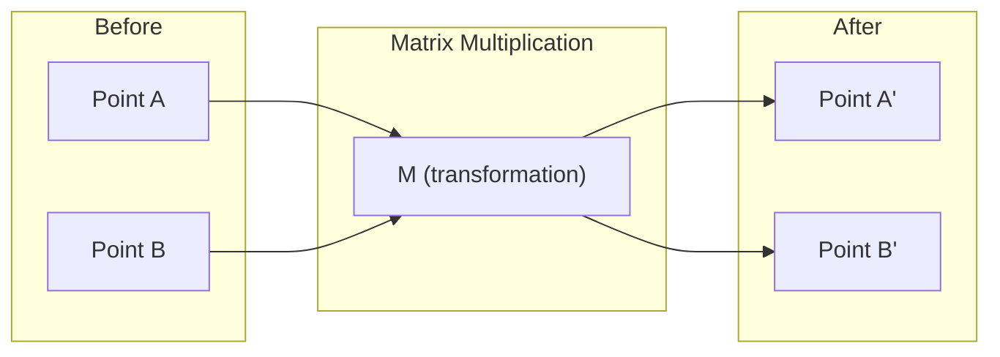
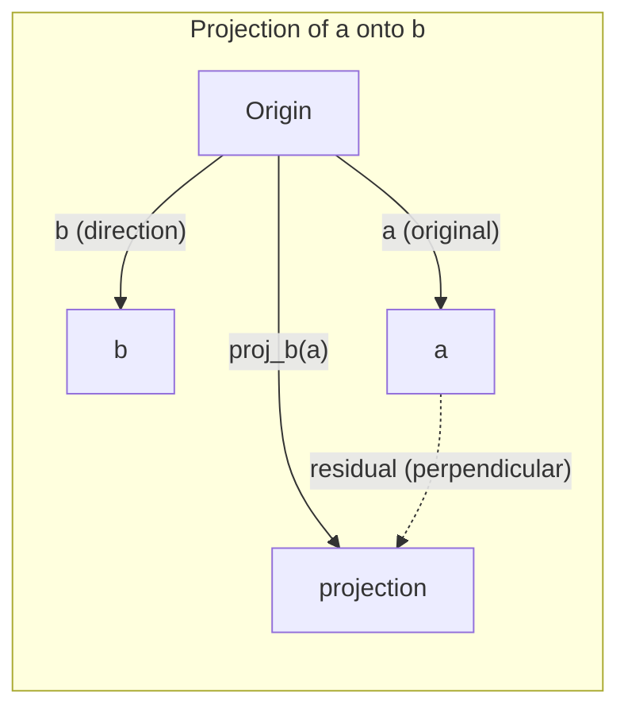

# 선형수제 직관

> 모든 인공지능 모델은 매트릭스 수학이고, 고급 모자를 쓰고 있습니다.

**Type:** Learn
**Languages:** Python, Julia
**Prerequisites:** Phase 0
**Time:** ~60 minutes

## 학습 목표

- 파이썬에서 벡터 및 매트릭스 동작 (수합, 점수 곱, 매트릭스 곱) 을 처음부터 구현
- 점수 제품, 투명 및 그라미드 프로세스가 어떻게 하는지를 기하학적 방법으로 설명하십시오
- 선 줄 줄 줄이를 사용하여 벡터 집합의 선형 독립, 순위 및 기초를 결정합니다.
- 선형 대수 개념을 인공지능 응용 프로그램과 연결: 임베디션, 관심 점수 및 LoRA

## 문제

ML 논문을 열면 첫 페이지에는 벡터, 매트리스, 점 제품, 변환이 있습니다. 선형수술 직관 없이는, 이것들은 단지 상징입니다. 이를 통해 신경망이 실제로 무엇을 하는지 볼 수 있습니다. 공간에서 지점을 움직입니다.

수학자가 될 필요는 없습니다. 이 연산의 기하학적 의미를 알아보고 직접 코드를 작성해야 합니다.

## 개념

### 벡터는 포인트 (그리고 방향)

vektore는 숫자의 목록입니다. 하지만 그 숫자는 어떤 의미를 가지고 있습니다. 그들은 공간의 좌표입니다.

**2D vector [3, 2]:**

| x | y | Point |
|---|---|-------|
| 3 | 2 | The vector points from origin (0,0) to (3, 2) on the plane |

벡터는 크기가 있습니다$\sqrt{3^2 + 2^2} = \sqrt{13}$오른쪽으로 향하고

인공지능에서 벡터는 모든 것을 나타냅니다.
- 단어 → 768개의 숫자의 벡터 (이 함축 공간에서 "의 의미")
- 이미지가 → 수백만 픽셀 값의 벡터
- 사용자 → 선호도 벡터

### 매트리스 는 변화

매트릭스는 한 벡터를 다른 벡터로 변환합니다. 그것은 회전, 확장, 스트레칭 또는 프로젝션을 할 수 있습니다.



인공지능에서는 매트릭스가 모델입니다.
- 신경 네트워크 중량은 → 입력값을 출력으로 변환하는 매트리스
- 주의 점수 → 집중할 수 있는 매트릭스
- 함축 → 가동자

### 닷 제품 측정 유사성

두 개의 벡터의 점 곱은 얼마나 비슷하는지 보여줍니다.

```math
\begin{aligned}
a \cdot b &= a_1 \times b_1 + a_2 \times b_2 + \cdots + a_n \times b_n \\[4pt]
\text{Same direction:} \quad a \cdot b &> 0 \quad \text{(similar)} \\
\text{Perpendicular:} \quad a \cdot b &= 0 \quad \text{(unrelated)} \\
\text{Opposite direction:} \quad a \cdot b &< 0 \quad \text{(dissimilar)}
\end{aligned}
```

이것은 문자 그대로 검색 엔진, 추천 시스템, RAG가 작동하는 방식입니다. 높은 점 제품들을 가진 벡터를 찾아내는 것입니다.

### 선형 독립

벡터는 선형적으로 독립적입니다. 만약 집합의 어떤 벡터가 다른 벡터의 조합으로 쓸 수 없다면$v_1, v_2, v_3$3D 공간에 걸쳐서 독립된 형태가 되죠. 하나는 다른 것의 조합이라면,

인공지능에 있어서 중요한 이유는: 기능 매트릭스는 선형적으로 독립된 열을 가지고 있어야 합니다. 두 가지 기능이 완벽하게 상관관계가 있는 경우 (선형적으로 의존적) 모델은 그 효과를 구별할 수 없습니다. 이것은 회귀에서 다각선성을 유발합니다. 무게 매트릭스는 불안정해지고, 작은 입력 변화는 야생 출력 변동을 일으킵니다.

**Concrete example:**

```
v1 = [1, 0, 0]
v2 = [0, 1, 0]
v3 = [2, 1, 0]   # v3 = 2*v1 + v2
```

$v_1$그리고$v_2$이 두 개의 값은 독립적이지만, 스칼라 복수 또는 다른 것의 조합이 아닙니다.$v_3 = 2 v_1 + v_2$그래서$\lbrace v_1, v_2, v_3 \rbrace$이 3개의 벡터는 모두 xy 평면에 있습니다. 어떻게 결합하든, [0, 0, 1]에 도달할 수 없습니다.

데이터 세트에서: feature_3 = 2*feature_1 + feature_2를 추가하면 feature_3는 모델에 새로운 정보를 줄 수 있습니다. 더 나쁜 것은 정상적인 방정식을 단일화시킵니다. 무게에 대한 고유한 해결책이 없습니다.

### 기초 및 계급

기본은 전체 공간을 는 선형적으로 독립된 벡터의 최소 집합입니다. 기본 벡터의 수는 공간의 차원입니다.

3D 공간의 표준 기초는 {[1,0,0], [0,1,0], [0,0,1]}. 그러나 3D의 모든 3개의 독립적인 벡터는 유효한 기초를 형성한다.

매트릭스의 순위 = 선형 독립된 열의 수 = 선형 독립된 행의 수.$\text{rank} < \min(\text{rows}, \text{cols})$, 행렬은 순위 부족합니다.
- 이 시스템은 무한히 많은 솔루션을 가지고 있습니다 (또는 전혀 없습니다)
- 변환 과정에서 정보가 손실됩니다.
- 매트릭스는 뒤집어질 수 없습니다

| Situation | Rank | What it means for ML |
|-----------|------|---------------------|
| Full rank $(\text{rank} = \min(m, n))$ | Maximum possible | Unique least-squares solution exists. Model is well-conditioned. |
| Rank deficient $(\text{rank} < \min(m, n))$ | Below maximum | Features are redundant. Infinitely many weight solutions. Regularization needed. |
| Rank 1 | 1 | Every column is a scaled copy of one vector. All data lies on a line. |
| Near rank-deficient (small singular values) | Numerically low | Matrix is ill-conditioned. Tiny input noise causes large output changes. Use SVD truncation or ridge regression. |

### 투영

프로젝션 벡터**a**벡터에**b**의 구성 요소를 제공합니다.**a****b**이 부분의 본문은

```math
\mathop{\mathrm{proj}}_b(a) = \frac{a \cdot b}{b \cdot b} \, b
```

잔여$(a - \mathop{\mathrm{proj}}_b(a))$$b$이 정형 분해는 가장 작은 광장 조화를 위한 기초입니다.

투영은 ML에서 모든 곳에 있습니다.
- 선형 회귀는 관측에서 열 공간까지의 거리를 최소화합니다.
- PCA는 최대 변동 방향에 대한 데이터를 투입한다
- 트랜스포머에서 주의는 키에 대한 질의의 예측을 계산합니다



**Example:** $a = [3, 4]$$b = [1, 0]$

$\mathop{\mathrm{proj}}_b(a) = (3 \cdot 1 + 4 \cdot 0) / (1 \cdot 1 + 0 \cdot 0) \cdot [1, 0] = 3 \cdot [1, 0] = [3, 0]$

이 투자는 y 요소를 떨어뜨립니다. 이것은 가장 간단한 형태로 차원적 감소입니다.

### 그램-슈미드트 프로세스

독립된 벡터들의 집합을 정통적 기본으로 변환하는 것. 정통적은 모든 벡터가 길이 1이고, 모든 쌍이 수직이라고 의미합니다.

알고리즘:
1. 첫 번째 벡터를 가져가 정상화해
2. 두 번째 벡터를 가져가서 첫 번째에 대한 투구를 빼고 정상화
3. 세 번째 벡터를 가져와서 전의 벡터에 대한 프로젝션을 빼고 정상화
4. 나머지 벡터에 대해 반복

```
Input:  v1, v2, v3, ... (linearly independent)

u1 = v1 / |v1|

w2 = v2 - (v2 dot u1) * u1
u2 = w2 / |w2|

w3 = v3 - (v3 dot u1) * u1 - (v3 dot u2) * u2
u3 = w3 / |w3|

Output: u1, u2, u3, ... (orthonormal basis)
```

QR 분해는 내부적으로 작동하는 방식입니다. Q는 정규적 기본이고, R는 투사 계수를 캡처합니다. QR 분해는 다음과 같이 사용됩니다.
- 선형 시스템을 해결하는 (가우스 제거보다 더 안정적인)
- 계산 고유값 (QR 알고리즘)
- 최소 제곱의 회귀 (표준 수학적 방법)

```figure
eigen-directions
```

## 건설 해

### 단계 1: 처음부터 벡터 (파이톤)

```python
class Vector:
    def __init__(self, components):
        self.components = list(components)
        self.dim = len(self.components)

    def __add__(self, other):
        return Vector([a + b for a, b in zip(self.components, other.components)])

    def __sub__(self, other):
        return Vector([a - b for a, b in zip(self.components, other.components)])

    def dot(self, other):
        return sum(a * b for a, b in zip(self.components, other.components))

    def magnitude(self):
        return sum(x**2 for x in self.components) ** 0.5

    def normalize(self):
        mag = self.magnitude()
        return Vector([x / mag for x in self.components])

    def cosine_similarity(self, other):
        return self.dot(other) / (self.magnitude() * other.magnitude())

    def __repr__(self):
        return f"Vector({self.components})"


a = Vector([1, 2, 3])
b = Vector([4, 5, 6])

print(f"a + b = {a + b}")
print(f"a · b = {a.dot(b)}")
print(f"|a| = {a.magnitude():.4f}")
print(f"cosine similarity = {a.cosine_similarity(b):.4f}")
```

### 단계 2: 처음부터 매트릭스 (파이톤)

```python
class Matrix:
    def __init__(self, rows):
        self.rows = [list(row) for row in rows]
        self.shape = (len(self.rows), len(self.rows[0]))

    def __matmul__(self, other):
        if isinstance(other, Vector):
            return Vector([
                sum(self.rows[i][j] * other.components[j] for j in range(self.shape[1]))
                for i in range(self.shape[0])
            ])
        rows = []
        for i in range(self.shape[0]):
            row = []
            for j in range(other.shape[1]):
                row.append(sum(
                    self.rows[i][k] * other.rows[k][j]
                    for k in range(self.shape[1])
                ))
            rows.append(row)
        return Matrix(rows)

    def transpose(self):
        return Matrix([
            [self.rows[j][i] for j in range(self.shape[0])]
            for i in range(self.shape[1])
        ])

    def __repr__(self):
        return f"Matrix({self.rows})"


rotation_90 = Matrix([[0, -1], [1, 0]])
point = Vector([3, 1])

rotated = rotation_90 @ point
print(f"Original: {point}")
print(f"Rotated 90°: {rotated}")
```

### 3단계: 인공지능에 있어서 왜 중요한가

```python
import random

random.seed(42)
weights = Matrix([[random.gauss(0, 0.1) for _ in range(3)] for _ in range(2)])
input_vector = Vector([1.0, 0.5, -0.3])

output = weights @ input_vector
print(f"Input (3D): {input_vector}")
print(f"Output (2D): {output}")
print("This is what a neural network layer does -- matrix multiplication.")
```

### 단계 4: 줄리아 버전

```julia
a = [1.0, 2.0, 3.0]
b = [4.0, 5.0, 6.0]

println("a + b = ", a + b)
println("a · b = ", a ⋅ b)       # Julia supports unicode operators
println("|a| = ", √(a ⋅ a))
println("cosine = ", (a ⋅ b) / (√(a ⋅ a) * √(b ⋅ b)))

# Matrix-vector multiplication
W = [0.1 -0.2 0.3; 0.4 0.5 -0.1]
x = [1.0, 0.5, -0.3]
println("Wx = ", W * x)
println("This is a neural network layer.")
```

### 단계 5: 선형 독립 및 처음부터 투영 (파이톤)

```python
def is_linearly_independent(vectors):
    n = len(vectors)
    dim = len(vectors[0].components)
    mat = Matrix([v.components[:] for v in vectors])
    rows = [row[:] for row in mat.rows]
    rank = 0
    for col in range(dim):
        pivot = None
        for row in range(rank, len(rows)):
            if abs(rows[row][col]) > 1e-10:
                pivot = row
                break
        if pivot is None:
            continue
        rows[rank], rows[pivot] = rows[pivot], rows[rank]
        scale = rows[rank][col]
        rows[rank] = [x / scale for x in rows[rank]]
        for row in range(len(rows)):
            if row != rank and abs(rows[row][col]) > 1e-10:
                factor = rows[row][col]
                rows[row] = [rows[row][j] - factor * rows[rank][j] for j in range(dim)]
        rank += 1
    return rank == n


def project(a, b):
    scalar = a.dot(b) / b.dot(b)
    return Vector([scalar * x for x in b.components])


def gram_schmidt(vectors):
    orthonormal = []
    for v in vectors:
        w = v
        for u in orthonormal:
            proj = project(w, u)
            w = w - proj
        if w.magnitude() < 1e-10:
            continue
        orthonormal.append(w.normalize())
    return orthonormal


v1 = Vector([1, 0, 0])
v2 = Vector([1, 1, 0])
v3 = Vector([1, 1, 1])
basis = gram_schmidt([v1, v2, v3])
for i, u in enumerate(basis):
    print(f"u{i+1} = {u}")
    print(f"  |u{i+1}| = {u.magnitude():.6f}")

print(f"u1 · u2 = {basis[0].dot(basis[1]):.6f}")
print(f"u1 · u3 = {basis[0].dot(basis[2]):.6f}")
print(f"u2 · u3 = {basis[1].dot(basis[2]):.6f}")
```

## 사용 하 고

이제 NumPy와 같은 일이 있습니다. 실제로 실제로 사용하실 것은

```python
import numpy as np

a = np.array([1, 2, 3], dtype=float)
b = np.array([4, 5, 6], dtype=float)

print(f"a + b = {a + b}")
print(f"a · b = {np.dot(a, b)}")
print(f"|a| = {np.linalg.norm(a):.4f}")
print(f"cosine = {np.dot(a, b) / (np.linalg.norm(a) * np.linalg.norm(b)):.4f}")

W = np.random.randn(2, 3) * 0.1
x = np.array([1.0, 0.5, -0.3])
print(f"Wx = {W @ x}")
```

### NumPy로 순위, 투영 및 QR

```python
import numpy as np

A = np.array([[1, 2], [2, 4]])
print(f"Rank: {np.linalg.matrix_rank(A)}")

a = np.array([3, 4])
b = np.array([1, 0])
proj = (np.dot(a, b) / np.dot(b, b)) * b
print(f"Projection of {a} onto {b}: {proj}")

Q, R = np.linalg.qr(np.random.randn(3, 3))
print(f"Q is orthogonal: {np.allclose(Q @ Q.T, np.eye(3))}")
print(f"R is upper triangular: {np.allclose(R, np.triu(R))}")
```

### 피토르치 -- 텐서들은 자동화된 벡터입니다

```python
import torch

x = torch.randn(3, requires_grad=True)
y = torch.tensor([1.0, 0.0, 0.0])

similarity = torch.dot(x, y)
similarity.backward()

print(f"x = {x.data}")
print(f"y = {y.data}")
print(f"dot product = {similarity.item():.4f}")
print(f"d(dot)/dx = {x.grad}")
```

x에 대한 점수 곱의 기하성은 y입니다. PyTorch은 이것을 자동으로 계산했습니다. 신경망의 모든 동작은 이런 동작에서 만들어졌습니다. 매트릭스 곱, 점수 제품, 투사, 그리고 모든 동작을 통해 기하성을 자동으로 추적합니다.

NumPy가 한 줄에 하는 일을 처음부터 만들어냈어 이제 뚜 아래 무슨 일이 일어나고 있는지 알 수 있어

## 선박

이 교훈은 다음과 같은 결과를 낳습니다.
- `outputs/prompt-linear-algebra-tutor.md`-- 인공지능 보조자들이 직선수학을 지하학적 직관으로 가르칠 수 있도록

## 연결

이 수업의 모든 것은 현대 인공지능의 특정 부분과 연결되어 있습니다.

| Concept | Where it shows up |
|---------|------------------|
| Dot product | Attention scores in transformers, cosine similarity in RAG |
| Matrix multiply | Every neural network layer, every linear transformation |
| Linear independence | Feature selection, avoiding multicollinearity |
| Rank | Determining if a system is solvable, LoRA (low-rank adaptation) |
| Projection | Linear regression (projecting onto column space), PCA |
| Gram-Schmidt / QR | Numerical solvers, eigenvalue computation |
| Orthonormal basis | Stable numerical computation, whitening transforms |

로라는 특별한 언급을 받을 자격이 있습니다. 그것은 중량 업데이트를 낮은 순위 매트리로 분해함으로써 큰 언어 모델을 미세하게 조정합니다. 로라는 4096x4096 무게 매트릭스 (16M 매트릭스) 를 업데이트하는 대신 4096x16 및 16x4096 (131K 매트릭스) 의 두 매트릭스를 업데이트합니다. 16위 제한은 LoRA가 무게 업데이트가 4096차원 공간의 16차원 하위 공간에서 살고 있다고 가정한다는 것을 의미합니다. 이것은 직선수학이 실제 작업을 수행합니다.

## 운동

1. 시행`Vector.angle_between(other)`두 개의 벡터 사이의 각을
2. x 좌표를 두 배로 곱하고 y 좌표를 세 배로 곱한 2D 스케일링 행렬을 만들어서 벡터에 적용 [1, 1]
3. 5개의 무작위 단어와 같은 벡터를 (차원 50)  주어, 코시노 유사성을 사용하여 가장 유사한 두 가지를 찾아
4. 그래미스미드 출력이 정말로 정통적이라는 것을 확인합니다. 모든 쌍이 점수 0이고 모든 벡터는 크기가 1인지 확인합니다.
5. 3x3 행렬을 생성하여 2등급으로 확인합니다`rank()`다음으로, 기둥이 어떤 기하학적 물체를 뻗어 있는지 설명합니다.
6. [1, 2, 3] 을 [1, 1, 1] 로 로 로 로 로 로 로 로 로 로 로 로 로 로 로 로 로 로 로 로 로 로 로 로 로 로 로 로 로 로 로 로 로 로 로 로 로 로 로 로 로 로 로 로 로 로 로 로 로 로 로 로 로 로 로 로 로 로 로 로 로 로 로 로 로 로 로 로 로 로 로 로 로 로 로 로 로 로 로 로 로 로 로 로 로 로 로 로 로 로 로 로 로 로 로 로 로 로 로 로 로 로 로 로 로 로 로 로 로 로 로 로 로 로 로 로 로 로 로 로 로 로 로 로 로 로 로 로 로. 그 결과 는 기하학적으로 무엇 을 나타낸다?

### 암시

**Exercise 1.**`cosine_similarity`, -1에서 1 사이의 값을 유지하고, 아크 코시노스를 가져다가 레이디언을 수로 변환합니다.`Vector([1, 0])`그리고`Vector([0, 1])`90을 주어서 그 자체로 0을 주는

**Exercise 2.**2x2 행렬의 지각에 두 척도 계수를 넣고 다른 두 개의 세포에 0을 넣습니다. [1, 1]의 결과는 [2, 3]이어야합니다.

**Exercise 3.**5개의 벡터 (10쌍) 의 각 쌍의 코시노스 유사성을 계산하고 가장 큰 값을 유지하십시오. 먼저 1을 주어야 하는 벡터를 사용하여 ループ을 스스로 확인합니다.

**Exercise 4.**사용`gram_schmidt`3개의 독립적인 벡터에서 계산하고`dot`각 쌍에 대해`magnitude`각 벡터에 대해 비교해 보세요`1e-9`, 왜냐하면 부동의 지점은 정확한 0을 주지 않기 때문입니다.

**Exercise 5.**세 번째 줄이나 열을 첫 두 개의 합으로 만들어서 한 방향이 반복됩니다. `rank()`2을 반환해야 하며, 기둥은 기원을 가로지르는 평면을 횡단합니다.

**Exercise 6.**규모를 계산해봐$\frac{a \cdot b}{b \cdot b}$그리고 곱하기$b$그 안에서, 또는 전화`project_onto`남은 걸 확인해$a$미소 투자는 [1, 1, 1]로 0의 점 곱하기

## 주요 용어

| Term | What people say | What it actually means |
|------|----------------|----------------------|
| Vector | "An arrow" | A list of numbers representing a point or direction in n-dimensional space |
| Matrix | "A table of numbers" | A transformation that maps vectors from one space to another |
| Dot product | "Multiply and sum" | A measure of how aligned two vectors are -- the core of similarity search |
| Embedding | "Some AI magic" | A vector that represents the meaning of something (word, image, user) |
| Linear independence | "They don't overlap" | No vector in the set can be written as a combination of the others |
| Rank | "How many dimensions" | The number of linearly independent columns (or rows) in a matrix |
| Projection | "The shadow" | The component of one vector in the direction of another |
| Basis | "The coordinate axes" | A minimal set of independent vectors that span the space |
| Orthonormal | "Perpendicular unit vectors" | Vectors that are mutually perpendicular and each have length 1 |
