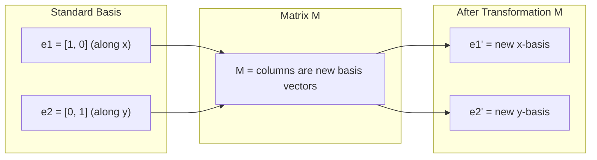
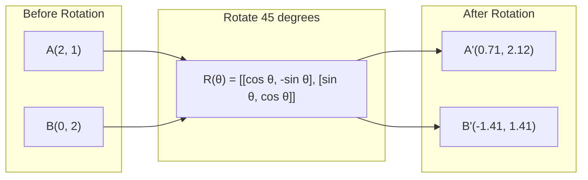
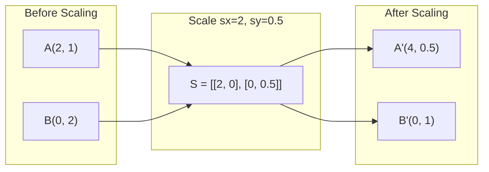
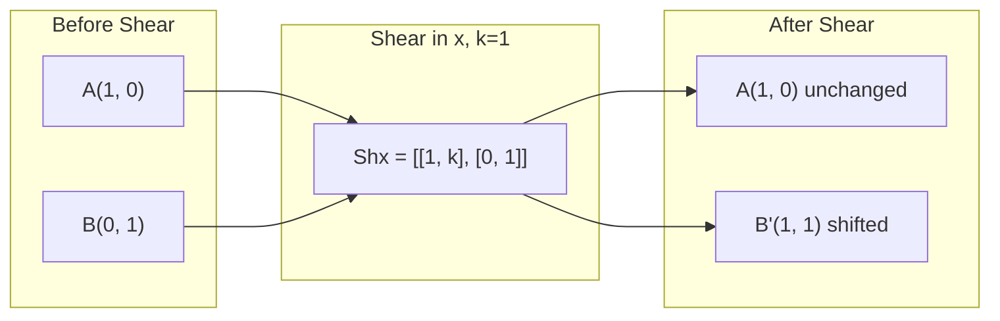
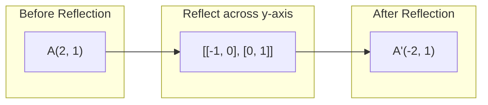
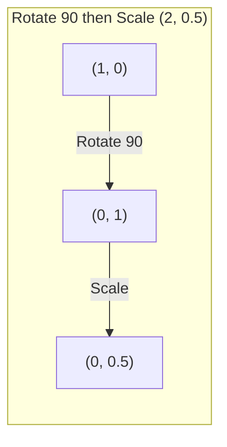
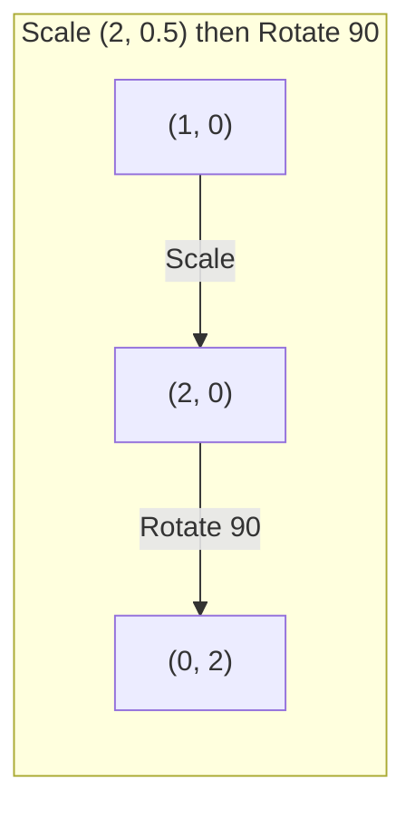

# 매트릭스 변환

> 매트릭스는 공간을 재구성하는 기계입니다. 모든 점에 어떤 영향을 미치는지 알아내면 전체적인 변형을 이해할 수 있습니다.

**Type:** Build
**Languages:** Python, Julia
**Prerequisites:** Phase 1, Lessons 01-02 (Linear Algebra Intuition, Vectors & Matrices Operations)
**Time:** ~75 minutes

## 학습 목표

- 회전, 스케일링, 절단, 반사 매트릭스를 구성하고 2D 및 3D 포인트에 적용합니다
- 매트릭스 곱셈으로 여러 변환을 작성하고 순서가 중요하다는 것을 확인합니다
- 특징 방정식에서 2x2 매트리의 고유값과 고유벡터를 계산한다
- 왜 고유값이 PCA 방향, RNN 안정성, 스펙트럼 클러스터링 행동을 결정하는지 설명합니다

## 문제

PCA에 대해 읽고 "복차 행렬의 고유벡터를 찾아라". 모델 안정성에 대해 읽고 "모든 고유값이 1보다 작는지 확인해 보세요". 데이터 증강에 대해 읽고 "자발적인 회전을 적용하세요". 이 모든 것은 매트릭스가 공간에 어떻게 작용하는지 지리적으로 이해하지 못하면 의미가 없습니다.

매트릭스는 단순히 숫자의 그리드일 뿐 아니라 공간적인 기계입니다. 회전 매트릭스는 포인트를 회전합니다. 스케일링 매트릭스는 그들을 뻗습니다. 깎기 매트릭스는 그들을 기울입니다. 신경 네트워크가 데이터에 적용하는 모든 변환은 이러한 작업 중 하나 또는 그 구성입니다. 이 교훈은 이러한 작업을 구체화합니다.

## 개념

### 매트리스로서의 변형

2D의 모든 선형 변환은 2x2 행렬로 작성될 수 있습니다. 행렬은 기본 벡터 [1, 0] 및 [0, 1]가 정확히 어디에 끝나는지 알려줍니다. 나머지는 다음으로됩니다.



### 회전

각으로 2D 회전$\theta$거리와 각을 그대로 유지하며, 원형弧に沿って 모든 지점을 움직입니다.



3D에서는 각 축을 돌고 각 축은 자기 회전 행렬을 가지고 있습니다.

```math
\begin{aligned}
R_z(\theta) &= \begin{bmatrix} \cos\theta & -\sin\theta & 0 \\ \sin\theta & \cos\theta & 0 \\ 0 & 0 & 1 \end{bmatrix} \quad \text{Rotate around z-axis (x-y plane spins, z stays)} \\[6pt]
R_x(\theta) &= \begin{bmatrix} 1 & 0 & 0 \\ 0 & \cos\theta & -\sin\theta \\ 0 & \sin\theta & \cos\theta \end{bmatrix} \quad \text{Rotate around x-axis (y-z plane spins, x stays)} \\[6pt]
R_y(\theta) &= \begin{bmatrix} \cos\theta & 0 & \sin\theta \\ 0 & 1 & 0 \\ -\sin\theta & 0 & \cos\theta \end{bmatrix} \quad \text{Rotate around y-axis (x-z plane spins, y stays)}
\end{aligned}
```

### 규모가

스케일링은 각 축을 따라 독립적으로 뻗어나나 압축된다.



### 깎는

깎는 것은 한 축을 기울이고 다른 축을 고정시켜서 정사각형들을 평행ogram로 만듭니다.



셰어 매트릭스:
- `Shx = [[1, k], [0, 1]]`시위$x$$k \cdot y$
- `Shy = [[1, 0], [k, 1]]`시위$y$$k \cdot x$

### 반성

반사선은 축이나 선을 가로지르는 지점을 반영합니다.



반사 매트릭스:
- y축을 가로지르는 반사: `[[-1, 0], [0, 1]]`
- x축을 가로지르는 반사: `[[1, 0], [0, -1]]`

### 구성: 체인 변환

A와 B의 변환을 적용하면 매트릭스를 곱하는 것과 같습니다.`result = B @ A @ point`순서가 중요해요. 회전하면 스케일이 다른 결과를 가져옵니다.



구성: `S @ R = [[0, -2], [0.5, 0]]`



구성: `R @ S = [[0, -0.5], [2, 0]]`

다른 결과입니다. 매트릭스 곱셈은 변동적이지 않습니다.

### 자기값과 자기벡터

대부분의 벡터는 매트릭스가 그들을 때 때 방향을 변경합니다. Eigenvectors는 특별합니다. 매트릭스는 단지 그들을 스케일, 그들을 회전하지 않습니다. 스케일링 요소는 고유 값입니다.

```
A @ v = lambda * v

v is the eigenvector (direction that survives)
lambda is the eigenvalue (how much it stretches)

Example: A = | 2  1 |
             | 1  2 |

Eigenvector [1, 1] with eigenvalue 3:
  A @ [1,1] = [3, 3] = 3 * [1, 1]     (same direction, scaled by 3)

Eigenvector [1, -1] with eigenvalue 1:
  A @ [1,-1] = [1, -1] = 1 * [1, -1]  (same direction, unchanged)
```

매트릭스는 [1, 1]를 따라 3x로 공간을 확장하고 [1, -1]를 변하지 않고 유지합니다. 다른 모든 방향은 이 두 가지의 혼합입니다.

### 자기 구성

만약 매트릭스가$n$선형 독립된 독자벡터, 그것은 분해될 수 있습니다:

```
A = V @ D @ V^(-1)

V = matrix whose columns are eigenvectors
D = diagonal matrix of eigenvalues
V^(-1) = inverse of V

This says: rotate into eigenvector coordinates, scale along each axis, rotate back.
```

### 왜 고유값이 중요합니까?

**PCA.**코바리안스 매트릭스의 독수 vektore는 주요 구성 요소입니다. 독수 값은 각각의 구성 요소가 얼마나 많은 변수를 캡처하는지 알려줍니다. 독수 값에 따라 분류, 상위 칸을 유지하십시오.$k$, 그리고 차원적 감소가 있습니다.

**Stability.**반복 네트워크 및 동적 시스템에서, 크기가 > 1인 고유값은 출력 폭발을 일으킨다. 크기가 < 1는 그들을 사라지게 한다. 이것은 한 문장에서 명시된 사라지는/폭발하는 기하급수 문제입니다.

**Spectral methods.**그래프 신경 네트워크는 인접 매트릭스의 고유값을 사용합니다. 스펙트럼 클러스터링은 라플라시아의 고유값을 사용합니다. 고유벡터는 그래프의 구조를 보여줍니다.

### 크기의 확장 요소로 결정 요소

변환 매트릭스의 결정자는 얼마나 넓이를 (2D) 또는 볼륨을 (3D) 확장하는지 알려줍니다.

```
det = 1:   area preserved (rotation)
det = 2:   area doubled
det = 0:   space crushed to lower dimension (singular)
det = -1:  area preserved but orientation flipped (reflection)

| det(Rotation) | = 1        (always)
| det(Scale sx, sy) | = sx * sy
| det(Shear) | = 1           (area preserved)
| det(Reflection) | = -1     (orientation flipped)
```

```figure
matrix-transform
```

## 건설 해

### 단계 1: 처음부터 변환 매트릭스 (파이톤)

```python
import math

def rotation_2d(theta):
    c, s = math.cos(theta), math.sin(theta)
    return [[c, -s], [s, c]]

def scaling_2d(sx, sy):
    return [[sx, 0], [0, sy]]

def shearing_2d(kx, ky):
    return [[1, kx], [ky, 1]]

def reflection_x():
    return [[1, 0], [0, -1]]

def reflection_y():
    return [[-1, 0], [0, 1]]

def mat_vec_mul(matrix, vector):
    return [
        sum(matrix[i][j] * vector[j] for j in range(len(vector)))
        for i in range(len(matrix))
    ]

def mat_mul(a, b):
    rows_a, cols_b = len(a), len(b[0])
    cols_a = len(a[0])
    return [
        [sum(a[i][k] * b[k][j] for k in range(cols_a)) for j in range(cols_b)]
        for i in range(rows_a)
    ]

point = [1.0, 0.0]
angle = math.pi / 4

rotated = mat_vec_mul(rotation_2d(angle), point)
print(f"Rotate (1,0) by 45 deg: ({rotated[0]:.4f}, {rotated[1]:.4f})")

scaled = mat_vec_mul(scaling_2d(2, 3), [1.0, 1.0])
print(f"Scale (1,1) by (2,3): ({scaled[0]:.1f}, {scaled[1]:.1f})")

sheared = mat_vec_mul(shearing_2d(1, 0), [1.0, 1.0])
print(f"Shear (1,1) kx=1: ({sheared[0]:.1f}, {sheared[1]:.1f})")

reflected = mat_vec_mul(reflection_y(), [2.0, 1.0])
print(f"Reflect (2,1) across y: ({reflected[0]:.1f}, {reflected[1]:.1f})")
```

### 단계 2: 변환의 구성

```python
R = rotation_2d(math.pi / 2)
S = scaling_2d(2, 0.5)

rotate_then_scale = mat_mul(S, R)
scale_then_rotate = mat_mul(R, S)

point = [1.0, 0.0]
result1 = mat_vec_mul(rotate_then_scale, point)
result2 = mat_vec_mul(scale_then_rotate, point)

print(f"Rotate 90 then scale: ({result1[0]:.2f}, {result1[1]:.2f})")
print(f"Scale then rotate 90: ({result2[0]:.2f}, {result2[1]:.2f})")
print(f"Same? {result1 == result2}")
```

### 단계 3: 처음부터 자기값 (2x2)

2x2 행렬에`[[a, b], [c, d]]`, 고유값은 특징적인 방정식을 풀습니다: $\lambda^2 - (a+d)\lambda + (ad - bc) = 0$- 그래

```python
def eigenvalues_2x2(matrix):
    a, b = matrix[0]
    c, d = matrix[1]
    trace = a + d
    det = a * d - b * c
    discriminant = trace ** 2 - 4 * det
    if discriminant < 0:
        real = trace / 2
        imag = (-discriminant) ** 0.5 / 2
        return (complex(real, imag), complex(real, -imag))
    sqrt_disc = discriminant ** 0.5
    return ((trace + sqrt_disc) / 2, (trace - sqrt_disc) / 2)

def eigenvector_2x2(matrix, eigenvalue):
    a, b = matrix[0]
    c, d = matrix[1]
    if abs(b) > 1e-10:
        v = [b, eigenvalue - a]
    elif abs(c) > 1e-10:
        v = [eigenvalue - d, c]
    else:
        if abs(a - eigenvalue) < 1e-10:
            v = [1, 0]
        else:
            v = [0, 1]
    mag = (v[0] ** 2 + v[1] ** 2) ** 0.5
    return [v[0] / mag, v[1] / mag]

A = [[2, 1], [1, 2]]
vals = eigenvalues_2x2(A)
print(f"Matrix: {A}")
print(f"Eigenvalues: {vals[0]:.4f}, {vals[1]:.4f}")

for val in vals:
    vec = eigenvector_2x2(A, val)
    result = mat_vec_mul(A, vec)
    scaled = [val * vec[0], val * vec[1]]
    print(f"  lambda={val:.1f}, v={[round(x,4) for x in vec]}")
    print(f"    A@v = {[round(x,4) for x in result]}")
    print(f"    l*v = {[round(x,4) for x in scaled]}")
```

### 단계 4: 크기의 확장 요소로 결정 요소

```python
def det_2x2(matrix):
    return matrix[0][0] * matrix[1][1] - matrix[0][1] * matrix[1][0]

print(f"det(rotation 45) = {det_2x2(rotation_2d(math.pi/4)):.4f}")
print(f"det(scale 2,3)   = {det_2x2(scaling_2d(2, 3)):.1f}")
print(f"det(shear kx=1)  = {det_2x2(shearing_2d(1, 0)):.1f}")
print(f"det(reflect y)   = {det_2x2(reflection_y()):.1f}")

singular = [[1, 2], [2, 4]]
print(f"det(singular)     = {det_2x2(singular):.1f}")
print("Singular: columns are proportional, space collapses to a line.")
```

## 사용 하 고

NumPy는 최적화된 루틴으로 이 모든 일을 처리합니다.

```python
import numpy as np

theta = np.pi / 4
R = np.array([[np.cos(theta), -np.sin(theta)],
              [np.sin(theta),  np.cos(theta)]])

point = np.array([1.0, 0.0])
print(f"Rotate (1,0) by 45 deg: {R @ point}")

S = np.diag([2.0, 3.0])
composed = S @ R
print(f"Scale(2,3) after Rotate(45): {composed @ point}")

A = np.array([[2, 1], [1, 2]], dtype=float)
eigenvalues, eigenvectors = np.linalg.eig(A)
print(f"\nEigenvalues: {eigenvalues}")
print(f"Eigenvectors (columns):\n{eigenvectors}")

for i in range(len(eigenvalues)):
    v = eigenvectors[:, i]
    lam = eigenvalues[i]
    print(f"  A @ v{i} = {A @ v}, lambda * v{i} = {lam * v}")

print(f"\ndet(R) = {np.linalg.det(R):.4f}")
print(f"det(S) = {np.linalg.det(S):.1f}")

B = np.array([[3, 1], [0, 2]], dtype=float)
vals, vecs = np.linalg.eig(B)
D = np.diag(vals)
V = vecs
reconstructed = V @ D @ np.linalg.inv(V)
print(f"\nEigendecomposition A = V @ D @ V^-1:")
print(f"Original:\n{B}")
print(f"Reconstructed:\n{reconstructed}")
```

### NumPy로 3D 회전

```python
def rotation_3d_z(theta):
    c, s = np.cos(theta), np.sin(theta)
    return np.array([[c, -s, 0], [s, c, 0], [0, 0, 1]])

def rotation_3d_x(theta):
    c, s = np.cos(theta), np.sin(theta)
    return np.array([[1, 0, 0], [0, c, -s], [0, s, c]])

point_3d = np.array([1.0, 0.0, 0.0])
rotated_z = rotation_3d_z(np.pi / 2) @ point_3d
rotated_x = rotation_3d_x(np.pi / 2) @ point_3d

print(f"\n3D point: {point_3d}")
print(f"Rotate 90 around z: {np.round(rotated_z, 4)}")
print(f"Rotate 90 around x: {np.round(rotated_x, 4)}")
```

## 선박

이 수업은 PCA (단계 2) 및 신경 네트워크 중량 분석의 기하학적 기초를 구축합니다. 여기서 구축된 고유 가치/이전체 코드 는 생산 ML 시스템에서 차원적 감소, 스펙트럼 클러스터링 및 안정성 분석을 지원하는 동일한 알고리즘입니다.

## 운동

1. 회전, 스케일링, 절단 을 단위 제곱 (각 [0,0], [1,0], [1,1], [0,1]) 에 적용 한다. 각 각 에 대한 변형 된 각 을 인쇄 한다. 회전 은 각 사이 의 거리를 유지 하는지를 확인 한다.

2. 특징 방정식을 사용하여 매트릭스 [[4, 2], [1, 3]]의 고유 값을 손으로 찾아보십시오. 그 다음 처음부터 함수와 NumPy를 사용하여 확인하십시오.

3. 3 개의 변환의 구성 (30도 회전, [1.5, 0.8]로 확장, kx=0.3로 절단) 을 생성하고 8개의 점에 적용하여 원으로 배치합니다. 좌표를 인쇄합니다.

### 암시

**Exercise 1.**적용`rotation_2d``scaling_2d`그리고`shearing_2d`각 코너에 `mat_vec_mul`. 회전 시 4개의 측면 길이를 계산하고 2개의 직사각형은 전과 후로 계산하고 각각 동일하게 유지되어야 합니다.

**Exercise 2.**특징 방정식을 작성하세요$\lambda^2 - (\text{trace})\lambda + \det = 0$두 값이 추적 (7) 에 합쳐 결정자 (10) 에 곱되었는지 확인하고 비교합니다`eigenvalues_2x2`그리고`np.linalg.eigvals`- 그래

**Exercise 3.**세 개의 매트릭스를 만들어 보세요`shearing_2d(0.3, 0)`을 위해, 를 곱하기`mat_mul`신청 순서대로 결과를 8점으로 적용합니다$(\cos\theta, \sin\theta)$. 회전값은 1이고 깎는 값은 1입니다`det_2x2`구성의 $1.5 \times 0.8 = 1.2$- 그래

## 주요 용어

| Term | What people say | What it actually means |
|------|----------------|----------------------|
| Rotation matrix | "Spins things" | An orthogonal matrix that moves points along circular arcs while preserving distances and angles. Determinant is always 1. |
| Scaling matrix | "Makes things bigger" | A diagonal matrix that stretches or compresses independently along each axis. Determinant is the product of scale factors. |
| Shearing matrix | "Slants things" | A matrix that shifts one coordinate proportionally to another, turning rectangles into parallelograms. Determinant is 1. |
| Reflection | "Mirrors things" | A matrix that flips space across an axis or plane. Determinant is -1. |
| Composition | "Do two things" | Multiplying transformation matrices to chain operations. Order matters: B @ A means apply A first, then B. |
| Eigenvector | "Special direction" | A direction that the matrix only scales, never rotates. The transformation's fingerprint. |
| Eigenvalue | "How much it stretches" | The scalar factor by which the matrix scales its eigenvector. Can be negative (flip) or complex (rotation). |
| Eigendecomposition | "Break the matrix apart" | Writing a matrix as $V D V^{-1}$, separating it into its fundamental scaling directions and magnitudes. |
| Determinant | "A single number from a matrix" | The factor by which the transformation scales area (2D) or volume (3D). Zero means the transformation is irreversible. |
| Characteristic equation | "Where eigenvalues come from" | $\det(A - \lambda I) = 0$. The polynomial whose roots are the eigenvalues. |

## 더 많은 읽기

- [3Blue1Brown: Linear Transformations](https://www.3blue1brown.com/lessons/linear-transformations)-- 시각적 직관으로 매트릭스가 공간을 어떻게 재구성하는지
- [3Blue1Brown: Eigenvectors and Eigenvalues](https://www.3blue1brown.com/lessons/eigenvalues)-- 자율벡터들이 어떻게 지리적으로 의미하는지 가장 잘 설명하는 시각적 설명입니다
- [MIT 18.06 Lecture 21: Eigenvalues and Eigenvectors](https://ocw.mit.edu/courses/18-06-linear-algebra-spring-2010/)- 길버트 스트랭의 고전적인 치료법
