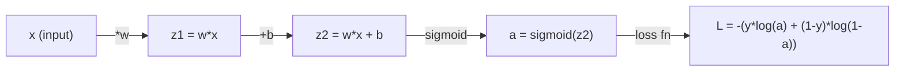
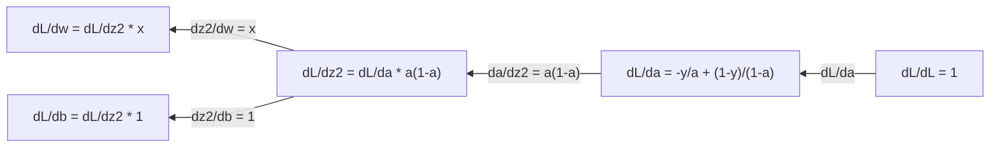
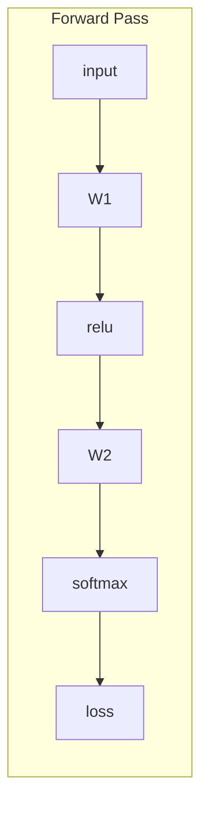
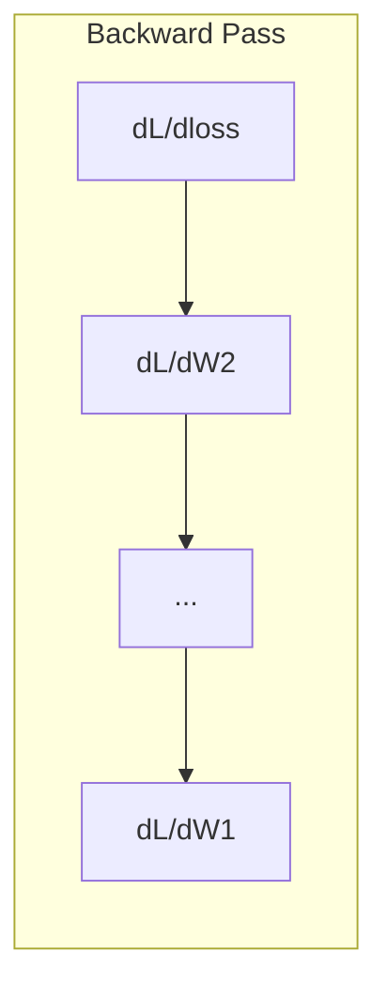

# 기계 학습의 계산

> 파생물들은 어떤 방향으로 내려가는지 알려줍니다. 신경망이 배워야 할 것은 그것뿐이죠.

**Type:** Learn
**Language:**파이썬
**Prerequisites:** Phase 1, Lessons 01-03
**Time:** ~60 minutes

## 학습 목표

- 일반적인 ML 함수들을 위한 수학적 및 분석 파생물들을 계산한다 ($x^2$, 시그모이드, 크로스 엔트로피)
- 1D 및 2D에서 손실 함수를 최소화하기 위해 처음부터 기하급수 하락을 구현
- 선형 회귀 모델의 기하급수를 추출하고 수동 중량 업데이트를 통해 훈련합니다
- 헤시안 매트릭스, 테일러 시리즈 근접과 최적화 방법과의 연결을 설명하십시오

## 문제

여러분은 수백만 개의 무게를 가진 신경망이 있습니다. 각 무게는 단추입니다. 여러분은 단추를 어느 방향으로 돌리는지를 알아내야 합니다.

계산이 없다면 신경망을 훈련시키는 것은 무작위적인 변화를 시도하고 최선의 것을 희망하는 것을 의미합니다. 파생물에서는 각 무게가 오류에 미치는 영향을 정확히 알 수 있습니다. 당신은 모든 버튼을 올바른 방향으로 매번 돌립니다.

## 개념

### 파생물은 무엇일까요?

파생상품은 변화율을 측정합니다. 함수$y = f(x)$, 파생$f'(x)$당신이 밀어주면$x$작은 양으로, 얼마나 많은 것을$y$변화?

기하학적으로, 파생물은 한 지점에서  직선의 기울기입니다.

**$f(x) = x^2$:**

| $x$ | $f(x)$ | $f'(x)$ (slope) |
|---|------|---------------|
| 0 | 0    | 0 (flat, at the bottom) |
| 1 | 1    | 2 |
| 2 | 4    | 4 (tangent line slope at this point) |
| 3 | 9    | 6 |

$x=2$, 기울기는 4입니다. 움직이면$x$오른쪽에서 조금 더$y$이 금액의 약 4배 증가합니다.$x=0$, 기울기는 0입니다. 당신은 그릇의 바닥에 있습니다.

공식적인 정의:

```math
f'(x) = \lim_{h \to 0} \frac{f(x + h) - f(x)}{h}
```

코드에서, 당신은 한계를 건너뛰고 아주 작은 하나를 사용 합니다$h$- 이 숫자의 파생자입니다.

### 부분 파생물: 한 번에 한 변수

실제 함수는 많은 입력값을 가지고 있습니다. 신경 네트워크 손실은 수천 개의 무게에 달려 있습니다. 부분 파생물은 하나를 제외하고 모든 변수를 일정하게 유지하고, 그 다음 파생물을 그 하나에 대한 것과 관련하여 가져옵니다.

```math
\begin{aligned}
f(x, y) &= x^2 + 3xy + y^2 \\[4pt]
\frac{\partial f}{\partial x} &= 2x + 3y \quad \text{(treat } y \text{ as a constant)} \\
\frac{\partial f}{\partial y} &= 3x + 2y \quad \text{(treat } x \text{ as a constant)}
\end{aligned}
```

각각의 부분 파생물들은 이렇게 대답합니다. 만약 제가 이 무게를 밀어 넣으면 손실이 어떻게 변할까요?

### 그라디언트: 모든 부분 파생물의 벡터

gradient는 모든 부분 파생물을 하나의 벡터로 집합합니다. 함수$f(x, y, z)$, 그레이디언은:

```math
\nabla f = \left[ \frac{\partial f}{\partial x}, \frac{\partial f}{\partial y}, \frac{\partial f}{\partial z} \right]
```

그라디엔트는 가장 한 상승 방향으로 지향합니다. 함수를 최소화하려면 반대 방향으로 가세요.

**Contour plot of $f(x,y) = x^2 + y^2$:**

함수는 직선으로 초심형 원들로 된 그릇 모양을 형성합니다. 최소는 (0, 0) 이다.

| Point | $\nabla f$ | $-\nabla f$ (descent direction) |
|-------|--------|----------------------------|
| (1, 1) | [2, 2] (points uphill, away from minimum) | [-2, -2] (points downhill, toward minimum) |
| (0, 0) | [0, 0] (flat, at the minimum) | [0, 0] |

이것은 그림에서 gradient의 하락입니다. gradient를 계산하고, 그것을 부정하고, 한 걸음 걸립니다.

### 최적화와 연결

신경망을 훈련시키는 것은 최적화입니다.$L(w_1, w_2, \ldots, w_n)$그 모델이 얼마나 잘못된지를 측정하는 것입니다.

```
Gradient descent update rule:

  w_new = w_old - learning_rate * dL/dw

For every weight:
  1. Compute the partial derivative of loss with respect to that weight
  2. Subtract a small multiple of it from the weight
  3. Repeat
```

학습 속도는 단계 크기를 조절합니다. 너무 큰 걸음으로 지나치게 됩니다. 너무 작아서 니다.

**Loss landscape (1D slice):**

손실 함수$L(w)$은 과 골짜기를 가진 곡선을 형성합니다$w$그 종류는 다양합니다.

| Feature | Description |
|---------|-------------|
| Global minimum | The lowest point on the entire curve -- the best solution |
| Local minimum | A valley that is lower than its neighbors but not the lowest overall |
| Slope | Gradient descent follows the slope downhill from any starting point |

기하급수적 하락은 기울기를 따라 내려다. 그것은 지역 최소에 갇힐 수 있지만, 높은 차원 공간 (백만 개의 무게) 에서 이것은 거의 실용적인 문제가 아닙니다.

### 수학적 대 분석 파생물

파생자를 계산하는 방법은 두 가지입니다.

분석: 계산 규칙을 손으로 적용합니다.$f(x) = x^2$, 파생물은$f'(x) = 2x$- 정확히요, 빨리요

수치: 정의를 사용하여 대략적으로 계산합니다. 계산합니다 $f(x+h)$그리고$f(x-h)$작은 것$h$, 그리고 차이를 사용하십시오.

```
Numerical (central difference):

f'(x) ~= f(x + h) - f(x - h)
          -----------------------
                  2h

h = 0.0001 works well in practice
```

수학적 파생물은 느려지만 어떤 함수에도 효과가 있다. 분석 파생물은 빠르지만 수식을 파생해야 한다. 신경 네트워크 프레임워크는 세 번째 접근 방식을 사용한다. 자동 분화, 기계적으로 정확한 파생물을 계산한다. 3단계에서는 볼 수 있습니다.

### 간단한 함수들을 위한 수동 파생물

ML에서 반복적으로 볼 수 있는 파생물입니다.

```
Function        Derivative       Used in
--------        ----------       -------
f(x) = x^2     f'(x) = 2x      Loss functions (MSE)
f(x) = wx + b  f'(w) = x        Linear layer (gradient w.r.t. weight)
                f'(b) = 1        Linear layer (gradient w.r.t. bias)
                f'(x) = w        Linear layer (gradient w.r.t. input)
f(x) = e^x     f'(x) = e^x     Softmax, attention
f(x) = ln(x)   f'(x) = 1/x     Cross-entropy loss
f(x) = 1/(1+e^-x)  f'(x) = f(x)(1-f(x))   Sigmoid activation
```

$f(x) = x^2$이 부분의 본문은

```
f(x) = x^2    f'(x) = 2x

  x    f(x)   f'(x)   meaning
  -2    4      -4      slope tilts left (decreasing)
  -1    1      -2      slope tilts left (decreasing)
   0    0       0      flat (minimum!)
   1    1       2      slope tilts right (increasing)
   2    4       4      slope tilts right (increasing)
```

$f(w) = wx + b$$x=3$$b=1$이 부분의 본문은

```
f(w) = 3w + 1    f'(w) = 3

The derivative with respect to w is just x.
If x is big, a small change in w causes a big change in output.
```

### 체인 규칙

함수가 구성되면, 체인 규칙은 어떻게 구별하는지 알려줍니다.

```
If y = f(g(x)), then dy/dx = f'(g(x)) * g'(x)

Example: y = (3x + 1)^2
  outer: f(u) = u^2       f'(u) = 2u
  inner: g(x) = 3x + 1    g'(x) = 3
  dy/dx = 2(3x + 1) * 3 = 6(3x + 1)
```

신경망은 함수의 연쇄입니다. 입력 -> 선형 -> 활성화 -> 선형 -> 활성화 -> 손실. 후속 확산은 출력에서 입력으로 반복적으로 적용되는 연쇄 규칙입니다. 즉 전체 알고리즘입니다.

### 헤센 매트릭스

기울기는 기울기를 알려줍니다. 헤스시아인은 곡선을 알려줍니다.

헤스시아는 2차 순위 부분 파생물들의 행렬입니다. 함수$f(x_1, x_2, \ldots, x_n)$, 입문$(i, j)$헤센어어의 경우

```math
H_{ij} = \frac{\partial^2 f}{\partial x_i \, \partial x_j}
```

2변수 함수$f(x, y)$이 부분의 본문은

```math
H = \begin{bmatrix} \dfrac{\partial^2 f}{\partial x^2} & \dfrac{\partial^2 f}{\partial x \, \partial y} \\[8pt] \dfrac{\partial^2 f}{\partial y \, \partial x} & \dfrac{\partial^2 f}{\partial y^2} \end{bmatrix}
```

**What the Hessian tells you at a critical point (where gradient = 0):**

| Hessian property | Meaning | Example surface |
|-----------------|---------|-----------------|
| Positive definite (all eigenvalues > 0) | Local minimum | Bowl pointing up |
| Negative definite (all eigenvalues < 0) | Local maximum | Bowl pointing down |
| Indefinite (mixed eigenvalues) | Saddle point | Horse saddle shape |

**Example:** $f(x, y) = x^2 - y^2$(세틀 기능)

```
df/dx = 2x       df/dy = -2y
d^2f/dx^2 = 2    d^2f/dy^2 = -2    d^2f/dxdy = 0

H = | 2   0 |
    | 0  -2 |

Eigenvalues: 2 and -2 (one positive, one negative)
--> Saddle point at (0, 0)
```

비교해 보세요$f(x, y) = x^2 + y^2$(배):

```
H = | 2  0 |
    | 0  2 |

Eigenvalues: 2 and 2 (both positive)
--> Local minimum at (0, 0)
```

**Why the Hessian matters in ML:**

뉴턴의 방법은 경각도를 따라가기보다는 더 나은 최적화 단계를 수행하기 위해 헤센법을 사용합니다.

```math
\begin{aligned}
\text{Newton's update:} \quad & w_{\text{new}} = w_{\text{old}} - H^{-1} \cdot \text{gradient} \\
\text{Gradient descent:} \quad & w_{\text{new}} = w_{\text{old}} - \text{lr} \cdot \text{gradient}
\end{aligned}
```

뉴턴의 방법은 더 빨리 모이는 이유는 헤센의 행렬이 그라디언을 "재배"하기 때문입니다. 은 방향은 더 작은 단계를 거쳐, 평면 방향은 더 큰 단계를 거쳐요.

포획: $N$매개 변수, 헤시안은$N \times N$1백만개의 매개 변수를 가진 모델은 1조개의 매트릭스가 필요합니다. 그래서 우리는 대략적인 계산을 사용합니다.

| Method | What it uses | Cost | Convergence |
|--------|-------------|------|-------------|
| Gradient descent | First derivatives only | $O(N)$ per step | Slow (linear) |
| Newton's method | Full Hessian | $O(N^3)$ per step | Fast (quadratic) |
| L-BFGS | Approximate Hessian from gradient history | $O(N)$ per step | Medium (superlinear) |
| Adam | Per-parameter adaptive rates (diagonal Hessian approx) | $O(N)$ per step | Medium |
| Natural gradient | Fisher information matrix (statistical Hessian) | $O(N^2)$ per step | Fast |

실제에서는 아담은 딥러닝의 기본 최적화자입니다. 매개 변수별 가속의 평균과 변수를 추적함으로써 2차 순서 정보를 저렴하게 추산합니다.

### 테일러 시리즈 근접

모든 부드러운 함수는 복수분으로 로컬로 근접할 수 있습니다:

```math
f(x + h) = f(x) + f'(x)\,h + \frac{1}{2} f''(x)\,h^2 + \frac{1}{6} f'''(x)\,h^3 + \cdots
```

더 많은 용어를 포함하면 더 좋은 근접이 될 것입니다. 하지만 그 지점에 가깝습니다.$x$- 그래

**Why Taylor series matter for ML:**

- **First-order Taylor = gradient descent.**사용 시$f(x + h) \approx f(x) + f'(x) h$이 선형 모델을 선택하기 위해 단계적 하락이 최소화됩니다$h = -\text{lr} \cdot f'(x)$- 그래

- **Second-order Taylor = Newton's method.**사용 $f(x + h) \approx f(x) + f'(x) h + \frac{1}{2} f''(x) h^2$이 모델은 4차원형이고, 최소화하면$h = -f'(x)/f''(x)$뉴턴의 발자국

- **Loss function design.**MSE와 크로스 엔트로피는 부드럽고, 즉 테일러 확장은 잘 행동합니다. 이것은 우연이 아닙니다. 부드러운 손실은 최적화를 예측할 수 있습니다.

```
Approximation order    What it captures    Optimization method
-------------------    -----------------   -------------------
0th order (constant)   Just the value      Random search
1st order (linear)     Slope               Gradient descent
2nd order (quadratic)  Curvature           Newton's method
Higher orders          Finer structure     Rarely used in ML
```

핵심 통찰력: 모든 gradient 기반 최적화는 실제로 손실 함수를 현지적으로 근접하고 그 근접의 최소로 단계에 도달하는 것입니다.

### ML의 통합자

파생물은 변화율을 알려줍니다. 통합자는 축적을 계산합니다. 곡선의 아래의 면적입니다.

ML에서는 인테그럴을 손으로 계산하는 경우는 거의 없습니다. 하지만 그 개념은 모든 곳에 있습니다.

**Probability.**밀도가 있는 연속 무작위 변수$p(x)$이 부분의 본문은

```math
P(a < X < b) = \int_a^b p(x) \, dx
```

확률 밀도 곡선 아래의 면적은 $a$그리고$b$그 범위에서 착륙할 확률입니다.

**Expected value.**확률로 중거된 평균 결과:

```math
\mathbb{E}[f(X)] = \int f(x) \, p(x) \, dx
```

데이터 배포에 대한 예상 손실은 필수적입니다. 훈련은 이의 경험적 인 근접을 최소화합니다.

**KL divergence.**두 분포가 얼마나 다르는지 측정합니다.

```math
\mathrm{KL}(p \,\|\, q) = \int p(x) \log \frac{p(x)}{q(x)} \, dx
```

VAEs, 지식 증축 및 베이시안 추론에서 사용됩니다.

**Normalization constants.**베이시안 추론에서

```math
p(w \mid \text{data}) = \frac{p(\text{data} \mid w) \, p(w)}{\int p(\text{data} \mid w) \, p(w) \, dw}
```

분모는 가능한 모든 매개 변수 값에 대한 통합 요소입니다. 그것은 종종 해결되지 않습니다. 그래서 우리는 MCMC와 변수 추론과 같은 근접을 사용합니다.

| Integral concept | Where it appears in ML |
|-----------------|----------------------|
| Area under curve | Probability from density functions |
| Expected value | Loss functions, risk minimization |
| KL divergence | VAEs, policy optimization, distillation |
| Normalization | Bayesian posteriors, softmax denominator |
| Marginal likelihood | Model comparison, evidence lower bound (ELBO) |

### 계산 그래프에서 다변화 체인 규칙

체인 규칙은 선의 스케라 함수에만 적용되는 것이 아닙니다. 신경 네트워크에서 변수는 팽창하고 융합됩니다. 이 방법은 파생물들이 간단한 앞을 통과하는 방법을 보여줍니다.



뒤로 가는 길은 오른쪽으로 왼쪽으로 기울기를 계산합니다.



각 화살표는 로컬 파생물 (local derivative) 를 곱한다. 어떤 매개 변수의 기하 는 손실에서 그 매개 변수에 이르는 경로에서 모든 로컬 파생물의 곱이다. 경로가 갈라지고 합병할 때, 기여를 합치 (다변형 연쇄 규칙).

이것은 모든 백프로파가션입니다. 출력에서 입력으로 계산 그래프를 통해 체계적으로 적용되는 체인 규칙입니다.

### 자코비안 행렬

함수는 벡터를 벡터로 (신경 네트워크 계층과 같이) 지도할 때, 그 파생물은 매트릭스이다. 자코비안은 모든 출력과 관련하여 모든 입력의 모든 부분 파생물을 포함합니다.

$f: \mathbb{R}^n \to \mathbb{R}^m$, 자코비안$J$$m \times n$매트릭스:

| | $x_1$ | $x_2$ | ... | $x_n$ |
|---|---|---|---|---|
| $f_1$ | $\partial f_1/\partial x_1$ | $\partial f_1/\partial x_2$ | ... | $\partial f_1/\partial x_n$ |
| $f_2$ | $\partial f_2/\partial x_1$ | $\partial f_2/\partial x_2$ | ... | $\partial f_2/\partial x_n$ |
| ... | ... | ... | ... | ... |
| $f_m$ | $\partial f_m/\partial x_1$ | $\partial f_m/\partial x_2$ | ... | $\partial f_m/\partial x_n$ |

자코비언을 신경망에 대해 손으로 계산할 수는 없습니다. PyTorch는 그것을 처리합니다. 하지만 그것이 존재한다는 것을 아는 것은 뒷방식에서 모양을 이해하는 데 도움이 됩니다.$\mathbb{R}^n$ $\mathbb{R}^m$, 자코비안은$m \times n$. 그라디엔트는 이 행렬의 전렬을 통해 뒤로 흐른다.

### 왜 신경망에 있어서 중요한지

신경망의 모든 무게는 gradient를 얻습니다. gradient는 손실을 줄이기 위해 그 무게를 조정하는 방법을 알려줍니다.





무게 업데이트마다:
- `W1 = W1 - lr * dL/dW1`
- `W2 = W2 - lr * dL/dW2`

앞선 패스는 예측과 손실을 계산합니다. 뒤로 가는 패스는 모든 무게에 대한 손실의 기하급수를 계산합니다. 그리고 모든 무게는 작은 걸음 내려가죠. 수백만 걸음 반복합니다. 그것은 깊은 학습입니다.

```figure
derivative-tangent
```

## 건설 해

### 단계 1: 처음부터 수학적 파생

```python
def numerical_derivative(f, x, h=1e-7):
    return (f(x + h) - f(x - h)) / (2 * h)

def f(x):
    return x ** 2

for x in [-2, -1, 0, 1, 2]:
    numerical = numerical_derivative(f, x)
    analytical = 2 * x
    print(f"x={x:2d}  f'(x) numerical={numerical:.6f}  analytical={analytical:.1f}")
```

수학적 파생물은 분석적 1과 많은 십자수에 일치합니다.

### 단계 2: 부분 파생물 및 기하급수

```python
def numerical_gradient(f, point, h=1e-7):
    gradient = []
    for i in range(len(point)):
        point_plus = list(point)
        point_minus = list(point)
        point_plus[i] += h
        point_minus[i] -= h
        partial = (f(point_plus) - f(point_minus)) / (2 * h)
        gradient.append(partial)
    return gradient

def f_multi(point):
    x, y = point
    return x**2 + 3*x*y + y**2

grad = numerical_gradient(f_multi, [1.0, 2.0])
print(f"Numerical gradient at (1,2): {[f'{g:.4f}' for g in grad]}")
print(f"Analytical gradient at (1,2): [2*1+3*2, 3*1+2*2] = [{2*1+3*2}, {3*1+2*2}]")
```

### 단계 3: f (x) = x^2의 최소값을 찾기 위해 계층적 하락

```python
x = 5.0
lr = 0.1
for step in range(20):
    grad = 2 * x
    x = x - lr * grad
    print(f"step {step:2d}  x={x:8.4f}  f(x)={x**2:10.6f}")
```

시작으로$x=5$, 각 단계가 가까워지고$x=0$(최저)

### 단계 4: 2D 함수에서 기하급수적 하락

```python
def f_2d(point):
    x, y = point
    return x**2 + y**2

point = [4.0, 3.0]
lr = 0.1
for step in range(30):
    grad = numerical_gradient(f_2d, point)
    point = [p - lr * g for p, g in zip(point, grad)]
    loss = f_2d(point)
    if step % 5 == 0 or step == 29:
        print(f"step {step:2d}  point=({point[0]:7.4f}, {point[1]:7.4f})  f={loss:.6f}")
```

### 단계 5: 수치 및 분석 파생물 비교

```python
import math

test_functions = [
    ("x^2",      lambda x: x**2,          lambda x: 2*x),
    ("x^3",      lambda x: x**3,          lambda x: 3*x**2),
    ("sin(x)",   lambda x: math.sin(x),   lambda x: math.cos(x)),
    ("e^x",      lambda x: math.exp(x),   lambda x: math.exp(x)),
    ("1/x",      lambda x: 1/x,           lambda x: -1/x**2),
]

x = 2.0
print(f"{'Function':<12} {'Numerical':>12} {'Analytical':>12} {'Error':>12}")
print("-" * 50)
for name, f, df in test_functions:
    num = numerical_derivative(f, x)
    ana = df(x)
    err = abs(num - ana)
    print(f"{name:<12} {num:12.6f} {ana:12.6f} {err:12.2e}")
```

### 단계 6: 헤센어 수를 계산

```python
def hessian_2d(f, x, y, h=1e-5):
    fxx = (f(x + h, y) - 2 * f(x, y) + f(x - h, y)) / (h ** 2)
    fyy = (f(x, y + h) - 2 * f(x, y) + f(x, y - h)) / (h ** 2)
    fxy = (f(x + h, y + h) - f(x + h, y - h) - f(x - h, y + h) + f(x - h, y - h)) / (4 * h ** 2)
    return [[fxx, fxy], [fxy, fyy]]

def saddle(x, y):
    return x ** 2 - y ** 2

def bowl(x, y):
    return x ** 2 + y ** 2

H_saddle = hessian_2d(saddle, 0.0, 0.0)
H_bowl = hessian_2d(bowl, 0.0, 0.0)
print(f"Saddle Hessian: {H_saddle}")  # [[2, 0], [0, -2]] -- mixed signs
print(f"Bowl Hessian:   {H_bowl}")    # [[2, 0], [0, 2]]  -- both positive
```

세일 함수의 헤시안은 자기값 2 및 -2 (무엇갈린 표지판, 세일 포인트를 확인) 를 가지고 있다. 방울은 자기값 2 및 2 (전형, 최소값을 확인) 를 가지고 있다.

### 단계 7: 테일러 근접 작업

```python
import math

def taylor_approx(f, f_prime, f_double_prime, x0, h, order=2):
    result = f(x0)
    if order >= 1:
        result += f_prime(x0) * h
    if order >= 2:
        result += 0.5 * f_double_prime(x0) * h ** 2
    return result

x0 = 0.0
for h in [0.1, 0.5, 1.0, 2.0]:
    true_val = math.sin(h)
    t1 = taylor_approx(math.sin, math.cos, lambda x: -math.sin(x), x0, h, order=1)
    t2 = taylor_approx(math.sin, math.cos, lambda x: -math.sin(x), x0, h, order=2)
    print(f"h={h:.1f}  sin(h)={true_val:.4f}  order1={t1:.4f}  order2={t2:.4f}")
```

가까이$x_0=0$$\sin(x) \approx x$(제1순위 테일러) 소형에 대한 근접은 훌륭합니다$h$하지만 큰 덩어리로 니다$h$그래서 gradient descent은 작은 학습률에서 가장 잘 작동합니다. 각 단계에서는 선형 추대도가 정확하다고 가정합니다.

### 8단계: 신경망에 있어서 왜 중요한지

```python
import random

random.seed(42)

w = random.gauss(0, 1)
b = random.gauss(0, 1)
lr = 0.01

xs = [1.0, 2.0, 3.0, 4.0, 5.0]
ys = [3.0, 5.0, 7.0, 9.0, 11.0]

for epoch in range(200):
    total_loss = 0
    dw = 0
    db = 0
    for x, y in zip(xs, ys):
        pred = w * x + b
        error = pred - y
        total_loss += error ** 2
        dw += 2 * error * x
        db += 2 * error
    dw /= len(xs)
    db /= len(xs)
    total_loss /= len(xs)
    w -= lr * dw
    b -= lr * db
    if epoch % 40 == 0 or epoch == 199:
        print(f"epoch {epoch:3d}  w={w:.4f}  b={b:.4f}  loss={total_loss:.6f}")

print(f"\nLearned: y = {w:.2f}x + {b:.2f}")
print(f"Actual:  y = 2x + 1")
```

매 매개 변수 기반 훈련 루프는 다음과 같은 패턴을 따르죠: 예측, 계산 손실, 계산 변수, 업데이트 중량.

## 사용 하 고

NumPy로 동일한 작업은 더 빠르고 간결합니다.

```python
import numpy as np

x = np.array([1, 2, 3, 4, 5], dtype=float)
y = np.array([3, 5, 7, 9, 11], dtype=float)

w, b = np.random.randn(), np.random.randn()
lr = 0.01

for epoch in range(200):
    pred = w * x + b
    error = pred - y
    loss = np.mean(error ** 2)
    dw = np.mean(2 * error * x)
    db = np.mean(2 * error)
    w -= lr * dw
    b -= lr * db

print(f"Learned: y = {w:.2f}x + {b:.2f}")
```

이제부터 gradient descending를 만들었습니다. PyTorch는 gradient 계산을 자동화합니다. 하지만 업데이트 루프는 동일합니다.

## 운동

1. 시행`numerical_second_derivative(f, x)`사용 `numerical_derivative`두 번 호출합니다.$x^3$$x=2$12이 됩니다.
2.  최소의 $f(x, y) = (x - 3)^2 + (y + 1)^2$- 시작해$(0, 0)$답은$(3, -1)$- 그래
3. 기하급수 하락 루프에 동력을 추가: 과거 기하급수 축적되는 속도 벡터를 유지하십시오.$f(x) = x^4 - 3x^2$- 그래

### 암시

**Exercise 1.**돌아오는 도우미를 정의하라`numerical_derivative(f, x)`그리고 그 보조를 `numerical_derivative`다시 한번. 결과가 다면, 더 큰 단계를 사용하세요.`h=1e-4`두 호출에 대한 값은$x=2$12에 가깝게 될 것 같아요

**Exercise 2.**그레이디언을 적어라$(2(x - 3), 2(y + 1))$또는 사용`numerical_gradient`, 그리고 전화`gradient_descent_nd`$(0, 0)$10단계마다 점을 인쇄하고, 앞으로 움직여야 합니다.$(3, -1)$그리고 손실은 0에 가깝게 떨어질 것입니다.

**Exercise 3.**속도를 유지하세요`v`, 갱신`v = momentum * v - lr * grad`, 그리고 추가`v` `x`. 각 방법의 단계들을 계산하여 0에 가까운 기하급수까지 도달해야 합니다. 최소는 $x = \pm\sqrt{1.5} \approx \pm 1.225$- 그래

## 주요 용어

| Term | What people say | What it actually means |
|------|----------------|----------------------|
| Derivative | "The slope" | The rate of change of a function at a point. Tells you how much the output changes per unit change in input. |
| Partial derivative | "Derivative of one variable" | The derivative with respect to one variable while all others are held constant. |
| Gradient | "Direction of steepest ascent" | A vector of all partial derivatives. Points in the direction that increases the function fastest. |
| Gradient descent | "Go downhill" | Subtract the gradient (times a learning rate) from the parameters to reduce the loss. The core of neural network training. |
| Learning rate | "Step size" | A scalar that controls how big each gradient descent step is. Too large: diverge. Too small: converge slowly. |
| Chain rule | "Multiply the derivatives" | The rule for differentiating composed functions: $\frac{df}{dx} = \frac{df}{dg} \cdot \frac{dg}{dx}$. The mathematical basis of backpropagation. |
| Jacobian | "Matrix of derivatives" | When a function maps vectors to vectors, the Jacobian is the matrix of all partial derivatives of outputs with respect to inputs. |
| Numerical derivative | "Finite differences" | Approximating a derivative by evaluating the function at two nearby points and computing the slope between them. |
| Backpropagation | "Reverse-mode autodiff" | Computing gradients layer by layer from output to input using the chain rule. How neural networks learn. |
| Hessian | "Matrix of second derivatives" | The matrix of all second-order partial derivatives. Describes the curvature of a function. Positive definite Hessian at a critical point means local minimum. |
| Taylor series | "Polynomial approximation" | Approximating a function near a point using its derivatives: $f(x+h) \approx f(x) + f'(x)h + \frac{1}{2}f''(x)h^2 + \cdots$ The basis for understanding why gradient descent and Newton's method work. |
| Integral | "Area under the curve" | The accumulation of a quantity over a range. In ML, integrals define probabilities, expected values, and KL divergence. |

## 더 많은 읽기

- [3Blue1Brown: Essence of Calculus](https://www.3blue1brown.com/topics/calculus)- 파생물, 통합물 및 연쇄 규칙의 시각적 직관
- [Stanford CS231n: Backpropagation](https://cs231n.github.io/optimization-2/)- 신경망 계층을 통해 gradients가 흐르는 방식
