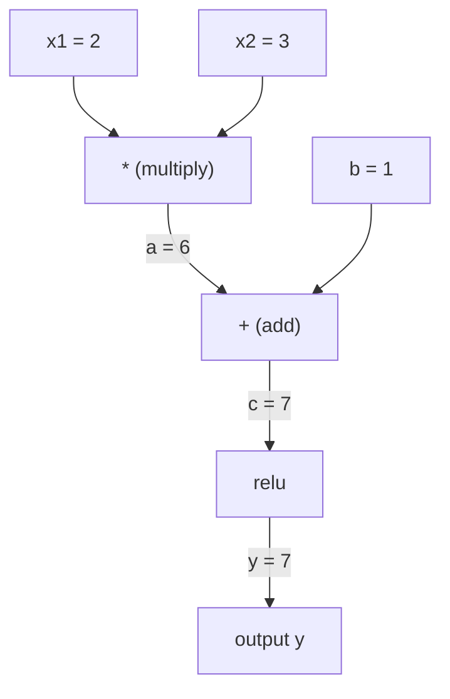
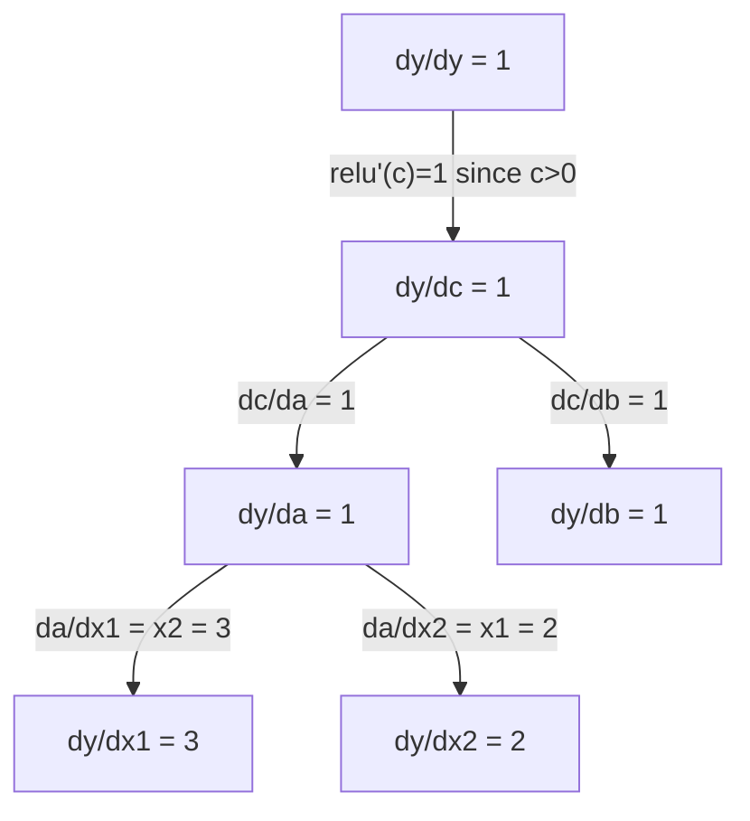

# 체인 규칙 및 자동 차별

> 체인 규칙은 학습하는 모든 신경망의 원동력이 됩니다.

**Type:** Build
**Language:**파이썬
**Prerequisites:** Phase 1, Lesson 04 (Derivatives & Gradients)
**Time:** ~90 minutes

## 학습 목표

- 역 모드 자동 디프트를 통해 동작을 기록하고 gradients를 계산하는 최소 자동 디프트를 구축한다.
- 토폴로직 소리트를 사용하여 계산 그래프를 통해 앞뒤로 통과하는 실행
- 처음부터 오토그라드 엔진만 사용하여 XOR에 다층 페르셉트론을 구축하고 훈련하십시오.
- 수학적 한정된 차이에 대한 gradient 검사를 사용하여 자동 변명의 정확성을 확인

## 문제

간단한 함수의 파생수를 계산할 수 있습니다. 하지만 신경 네트워크는 단순한 함수 아닙니다. 그것은 수백 개의 함수가 함께 구성되어 있습니다. 매트릭스 곱하기, 편향을 추가, 활성화를 적용, 매트릭스 다시 곱하기, 소프트맥스, 크로스 엔트로피 손실. 출력은 함수의 함수의 함수입니다.

네트워크 훈련에 있어서, 각각의 무게에 대한 손실의 기하급수가 필요합니다. 수 백만 개의 매개 변수에서 손으로 수행하는 것은 불가능합니다. 수적으로 수행하는 것은 너무 느리죠.

체인 규칙은 수학을 제공합니다. 자동 차별화는 알고리즘을 제공합니다. 함께 그들은 당신이 한 번 앞으로 통과하는 시간 대비 함수의 임의적인 구성을 통해 정확한 기하급수 계산을 할 수 있습니다.

PyTorch, TensorFlow, JAX가 작동하는 방식입니다. 여러분은 초상화 버전을 만들 것입니다.

## 개념

### 사슬 규칙

만약$y = f(g(x))$, 의 파생$y$$x$이 함수는

```math
\frac{dy}{dx} = \frac{dy}{dg} \cdot \frac{dg}{dx} = f'(g(x)) \cdot g'(x)
```

연쇄를 따라 파생물을 곱하면 각 링크가 로컬 파생물을 기여합니다.

예를 들어:$y = \sin(x^2)$

```math
\begin{aligned}
g(x) &= x^2 \qquad & g'(x) &= 2x \\
f(g) &= \sin(g) \qquad & f'(g) &= \cos(g) \\[4pt]
\frac{dy}{dx} &= \cos(x^2) \cdot 2x
\end{aligned}
```

더 깊은 구성에 대해서는, 그 체인은 다음과 같습니다.

```math
\begin{aligned}
y &= f(g(h(x))) \\[4pt]
\frac{dy}{dx} &= f'(g(h(x))) \cdot g'(h(x)) \cdot h'(x)
\end{aligned}
```

신경망의 모든 층은 이 체인의 하나의 연결고리입니다.

### 계산 그래프

계산 그래프는 체인 규칙을 시각화합니다. 모든 작업은 노드로됩니다. 데이터가 그래프를 통해 앞으로 흐릅니다. 기하자는 뒤로 흐릅니다.

**Forward pass (compute values):**



**Backward pass (compute gradients):**



뒤로 통과는 각 노드에서 체인 규칙을 적용하여 출력에서 입력으로 기하급수들을 전파합니다.

### 앞 모드 vs 역 모드

그래프를 통해 체인 규칙을 적용하는 두 가지 방법이 있습니다.

**Forward mode**입력에서 시작하여 파생물들을 앞으로 밀어냅니다.$dx/dx = 1$그리고 각 동작을 통해 퍼집니다. 입력량이 적고 출력량이 많을 때 좋습니다.

```
Forward mode: seed dx/dx = 1, propagate forward

  x = 2       (dx/dx = 1)
  a = x^2     (da/dx = 2x = 4)
  y = sin(a)  (dy/dx = cos(a) * da/dx = cos(4) * 4 = -2.615)
```

**Reverse mode**출력에서 시작해서 기하급수들을 뒤로 끌어들이죠.$dy/dy = 1$그리고 각 동작을 거꾸로 퍼뜨리죠. 많은 입력과 출력량이 적을 때 좋습니다.

```
Reverse mode: seed dy/dy = 1, propagate backward

  y = sin(a)  (dy/dy = 1)
  a = x^2     (dy/da = cos(a) = cos(4) = -0.654)
  x = 2       (dy/dx = dy/da * da/dx = -0.654 * 4 = -2.615)
```

신경망은 수백만 개의 입력 (중) 과 하나의 출력 (손실) 을 가지고 있다. 역류 모드는 모든 기하를 한 번으로 계산한다. 이것이 역류 모드를 사용하는 이유입니다.

| Mode | Seed | Direction | Best when |
|------|------|-----------|-----------|
| Forward | $dx_i/dx_i = 1$ | Input to output | Few inputs, many outputs |
| Reverse | $dy/dy = 1$ | Output to input | Many inputs, few outputs (neural nets) |

### 앞모습에 대한 두 개의 숫자

앞면 모드는 이중 번호로 우아하게 구현될 수 있습니다. 이중 번호는 $a + b\epsilon$어디$\epsilon^2 = 0$- 그래

```
Dual number: (value, derivative)

(2, 1) means: value is 2, derivative w.r.t. x is 1

Arithmetic rules:
  (a, a') + (b, b') = (a+b, a'+b')
  (a, a') * (b, b') = (a*b, a'*b + a*b')
  sin(a, a')         = (sin(a), cos(a)*a')
```

입력 변수를 파생 1으로 배열합니다. 파생은 모든 동작을 통해 자동으로 번식합니다.

### 오토그라드 엔진 을 만드는 것

오토그라드 엔진은 세 가지 필요해요

1. **Value wrapping.**값과 기하급수성을 저장하는 객체에 모든 숫자를 포장합니다.
2. **Graph recording.**모든 작업은 입력과 로컬 그라디언트 함수를 기록합니다.
3. **Backward pass.**토폴로직적으로 그래프를 분류하고, 그 다음 각 노드에 사슬 규칙을 적용하여 역으로 걸어갑니다.

바로 이 토르치의 모습입니다`autograd`- 그래요`torch.Tensor`클래스는 값을 고, 동작을 기록합니다.`requires_grad=True`, 그리고 당신이 호출할 때 gradients를 계산합니다`.backward()`- 그래

### 파이토르치 오토그라드 가 Hood 아래 작동 하는 방법

PyTorch 코드를 작성할 때

```python
x = torch.tensor(2.0, requires_grad=True)
y = x ** 2 + 3 * x + 1
y.backward()
print(x.grad)  # 7.0 = 2*x + 3 = 2*2 + 3
```

내부 PyTorch:

1. `Tensor``x``requires_grad=True`
2. 모든 작업 (`**``*``+`) 는 새로운 노드를 생성하고 후진 함수를 기록합니다
3. `y.backward()`기록된 그래프를 통해 역 모드 자동 디프레이를 유발합니다
4. 각 노드의`grad_fn`로컬 그라디언트를 계산하고 부모 노드에 전달합니다
5. 그라디엔트는 `.grad`추가 (이 아닌 대체) 를 통해 속성

그래프는 동적 (런에 의해 정의) 이다. 모든 앞 패스에 새로운 그래프가 구축된다. 이 때문에 PyTorch는 모델 내부의 제어 흐름 (만약 / 그렇지 않으면, 루프) 를 지원한다.

```figure
chain-rule
```

## 건설 해

### 단계 1: 가치 클래스

```python
class Value:
    def __init__(self, data, children=(), op=''):
        self.data = data
        self.grad = 0.0
        self._backward = lambda: None
        self._prev = set(children)
        self._op = op

    def __repr__(self):
        return f"Value(data={self.data:.4f}, grad={self.grad:.4f})"
```

모든`Value`숫자의 데이터, 그 그라디언 (초초적으로 0), 후진 함수, 그리고 그것을 생성한 자식 노드에 대한 포인터를 저장합니다.

### 단계 2: 기하급수 추적을 위한 수학적 작업

```python
    def __add__(self, other):
        other = other if isinstance(other, Value) else Value(other)
        out = Value(self.data + other.data, (self, other), '+')
        def _backward():
            self.grad += out.grad
            other.grad += out.grad
        out._backward = _backward
        return out

    def __mul__(self, other):
        other = other if isinstance(other, Value) else Value(other)
        out = Value(self.data * other.data, (self, other), '*')
        def _backward():
            self.grad += other.data * out.grad
            other.grad += self.data * out.grad
        out._backward = _backward
        return out

    def relu(self):
        out = Value(max(0, self.data), (self,), 'relu')
        def _backward():
            self.grad += (1.0 if out.data > 0 else 0.0) * out.grad
        out._backward = _backward
        return out
```

각 작업은 로컬 그레디언트를 계산하고 상류 그레디언트를 곱하는 방법을 아는 폐쇄를 만듭니다 (`out.grad`                                                                                                                                 `+=`값이 여러 동작에서 사용되는 경우를 처리합니다.

### 3단계: 뒤로 가는

```python
    def backward(self):
        topo = []
        visited = set()
        def build_topo(v):
            if v not in visited:
                visited.add(v)
                for child in v._prev:
                    build_topo(child)
                topo.append(v)
        build_topo(self)

        self.grad = 1.0
        for v in reversed(topo):
            v._backward()
```

토폴로직 분류는 각 노드의 기하급수가 자녀들에게 퍼지기 전에 완전히 계산되도록 합니다.$dy/dy = 1$)

### 단계 4: 완전한 엔진을 위한 더 많은 작업

기본 Value 클래스는 덧셈, 곱셈, 릴루를 처리합니다. 실제 오토그라드 엔진은 더 많은 것이 필요합니다. 신경 네트워크를 구축하는 데 필요한 작업은 다음과 같습니다.

```python
    def __neg__(self):
        return self * -1

    def __sub__(self, other):
        return self + (-other)

    def __radd__(self, other):
        return self + other

    def __rmul__(self, other):
        return self * other

    def __rsub__(self, other):
        return other + (-self)

    def __pow__(self, n):
        out = Value(self.data ** n, (self,), f'**{n}')
        def _backward():
            self.grad += n * (self.data ** (n - 1)) * out.grad
        out._backward = _backward
        return out

    def __truediv__(self, other):
        return self * (other ** -1) if isinstance(other, Value) else self * (Value(other) ** -1)

    def exp(self):
        import math
        e = math.exp(self.data)
        out = Value(e, (self,), 'exp')
        def _backward():
            self.grad += e * out.grad
        out._backward = _backward
        return out

    def log(self):
        import math
        out = Value(math.log(self.data), (self,), 'log')
        def _backward():
            self.grad += (1.0 / self.data) * out.grad
        out._backward = _backward
        return out

    def tanh(self):
        import math
        t = math.tanh(self.data)
        out = Value(t, (self,), 'tanh')
        def _backward():
            self.grad += (1 - t ** 2) * out.grad
        out._backward = _backward
        return out
```

**Why each operation matters:**

| Operation | Backward rule | Used in |
|-----------|--------------|---------|
| `__sub__` | Reuses add + neg | Loss computation (pred - target) |
| `__pow__` | $n \cdot x^{n-1}$ | Polynomial activations, MSE ($\text{error}^2$) |
| `__truediv__` | Reuses mul + pow(-1) | Normalization, learning rate scaling |
| `exp` | $\exp(x) \cdot \text{upstream}$ | Softmax, log-likelihood |
| `log` | $(1/x) \cdot \text{upstream}$ | Cross-entropy loss, log probabilities |
| `tanh` | $(1 - \tanh^2) \cdot \text{upstream}$ | Classic activation function |

똑똑한 부분은`__sub__`그리고`__truediv__`기존의 동작에 따라 정의됩니다. 그들은 체인 규칙이 기본 부가/무가/파우 동작을 통해 구성되기 때문에 올바른 기하급수들을 무료로 얻습니다.

### 단계 5: 처음부터 미니 MLP

Value 클래스 전체로 신경망을 만들 수 있습니다. PyTorch도 없고 NumPy도 없습니다.

```python
import random

class Neuron:
    def __init__(self, n_inputs):
        self.w = [Value(random.uniform(-1, 1)) for _ in range(n_inputs)]
        self.b = Value(0.0)

    def __call__(self, x):
        act = sum((wi * xi for wi, xi in zip(self.w, x)), self.b)
        return act.tanh()

    def parameters(self):
        return self.w + [self.b]

class Layer:
    def __init__(self, n_inputs, n_outputs):
        self.neurons = [Neuron(n_inputs) for _ in range(n_outputs)]

    def __call__(self, x):
        return [n(x) for n in self.neurons]

    def parameters(self):
        return [p for n in self.neurons for p in n.parameters()]

class MLP:
    def __init__(self, sizes):
        self.layers = [Layer(sizes[i], sizes[i+1]) for i in range(len(sizes)-1)]

    def __call__(self, x):
        for layer in self.layers:
            x = layer(x)
        return x[0] if len(x) == 1 else x

    def parameters(self):
        return [p for layer in self.layers for p in layer.parameters()]
```

A`Neuron`계산기`tanh(w1*x1 + w2*x2 + ... + b)`- A`Layer`신경 세포 목록입니다.`MLP`각 무게는`Value`그래서 전화`loss.backward()`매 매개 변수에 gradients를 퍼뜨립니다.

**Training on XOR:**

```python
random.seed(42)
model = MLP([2, 4, 1])  # 2 inputs, 4 hidden neurons, 1 output

xs = [[0, 0], [0, 1], [1, 0], [1, 1]]
ys = [-1, 1, 1, -1]  # XOR pattern (using -1/1 for tanh)

for step in range(100):
    preds = [model(x) for x in xs]
    loss = sum((p - y) ** 2 for p, y in zip(preds, ys))

    for p in model.parameters():
        p.grad = 0.0
    loss.backward()

    lr = 0.05
    for p in model.parameters():
        p.data -= lr * p.grad

    if step % 20 == 0:
        print(f"step {step:3d}  loss = {loss.data:.4f}")

print("\nPredictions after training:")
for x, y in zip(xs, ys):
    print(f"  input={x}  target={y:2d}  pred={model(x).data:6.3f}")
```

이것은 마이크로그라드입니다. 순수한 파이썬에서 자동 차별화와 함께 완전한 신경 네트워크 훈련 루프입니다. 모든 상업적 딥러닝 프레임워크는 대량으로 같은 일을 합니다.

### 단계 6: 단계적 검진

자율분열이 맞는지 어떻게 알 수 있을까요? 숫자 파생물들에 비교해보세요. 이것은 gradient checking입니다.

```python
def gradient_check(build_expr, x_val, h=1e-7):
    x = Value(x_val)
    y = build_expr(x)
    y.backward()
    autodiff_grad = x.grad

    y_plus = build_expr(Value(x_val + h)).data
    y_minus = build_expr(Value(x_val - h)).data
    numerical_grad = (y_plus - y_minus) / (2 * h)

    diff = abs(autodiff_grad - numerical_grad)
    return autodiff_grad, numerical_grad, diff
```

복잡한 표현에 테스트해 보세요.

```python
def expr(x):
    return (x ** 3 + x * 2 + 1).tanh()

ad, num, diff = gradient_check(expr, 0.5)
print(f"Autodiff:  {ad:.8f}")
print(f"Numerical: {num:.8f}")
print(f"Difference: {diff:.2e}")
# Difference should be < 1e-5
```

새로운 작업을 구현할 때 계층 검사는 필수적입니다. 만약 당신의 후진 패스가 버그를 가지고 있다면, 수치 검사는 그것을 잡습니다. 모든 심각한 딥 러닝 구현은 개발 중에 계층 검사를 실행합니다.

**When to use gradient checking:**

| Situation | Do gradient check? |
|-----------|-------------------|
| Adding a new operation to your autograd | Yes, always |
| Debugging a training loop that won't converge | Yes, check gradients first |
| Production training | No, too slow (2x forward passes per parameter) |
| Unit tests for autograd code | Yes, automate it |

### 단계 7: 수동 계산에 대한 검증

```python
x1 = Value(2.0)
x2 = Value(3.0)
a = x1 * x2          # a = 6.0
b = a + Value(1.0)    # b = 7.0
y = b.relu()          # y = 7.0

y.backward()

print(f"y = {y.data}")          # 7.0
print(f"dy/dx1 = {x1.grad}")   # 3.0 (= x2)
print(f"dy/dx2 = {x2.grad}")   # 2.0 (= x1)
```

수동 확인:`y = relu(x1*x2 + 1)`- 그 이후로`x1*x2 + 1 = 7 > 0`, 레루는 정체성입니다.
`dy/dx1 = x2 = 3`-`dy/dx2 = x1 = 2`엔진이 맞습니다

## 사용 하 고

### PyTorch에 대한 확인

```python
import torch

x1 = torch.tensor(2.0, requires_grad=True)
x2 = torch.tensor(3.0, requires_grad=True)
a = x1 * x2
b = a + 1.0
y = torch.relu(b)
y.backward()

print(f"PyTorch dy/dx1 = {x1.grad.item()}")  # 3.0
print(f"PyTorch dy/dx2 = {x2.grad.item()}")  # 2.0
```

같은 gradients. 당신의 엔진은 PyTorch와 같은 결과를 계산합니다. 왜냐하면 수학은 동일하기 때문입니다.

### 더 복잡한 표현

```python
a = Value(2.0)
b = Value(-3.0)
c = Value(10.0)
f = (a * b + c).relu()  # relu(2*(-3) + 10) = relu(4) = 4

f.backward()
print(f"df/da = {a.grad}")  # -3.0 (= b)
print(f"df/db = {b.grad}")  #  2.0 (= a)
print(f"df/dc = {c.grad}")  #  1.0
```

## 선박

이 교훈은 다음과 같은 결과를 낳습니다.
- `outputs/skill-autodiff.md`-- 자동형 시스템 구축 및 디버깅의 기술
- `code/autodiff.py`-- 최소 자동화 엔진을 확장할 수 있습니다

여기서 만들어진 값 클래스는 3단계 신경 네트워크 훈련 루프의 기초입니다.

## 운동

1. 추가`__pow__`값 클래스로 계산할 수 있도록`x ** n`확인해봐$\frac{d}{dx}(x^3)$$x=2$=`12.0`- 그래

2. 추가`tanh`활성화 기능으로 사용되죠$\tanh'(0) = 1$그리고$\tanh'(2) = 0.0707$(경험생)

3. 하나의 신경 세포에 대한 계산 그래프를 만들죠.`y = relu(w1*x1 + w2*x2 + b)`5개의 gradients를 계산하고 PyTorch에 대한 검증을 해보세요.

4. 이중 번호를 사용하여 앞면 자동화 구현.`Dual`클래스하고 확인해 보세요. 역 모드 엔진과 동일한 파생물질을 제공합니다.

### 암시

**Exercise 1.** `Value`이미 정의합니다`__pow__`- 그 책을 읽어봐`_backward`그리고 적용되는 것을 확인합니다$n x^{n-1}$들어오는 기하급수까지`x = Value(2.0)``y = x ** 3``y.backward()``x.grad`12.0이어야 합니다.

**Exercise 2.**사용$\tanh'(x) = 1 - \tanh(x)^2$`_backward`자신의 한정된 차이에 대해 확인하세요$\frac{\tanh(x + h) - \tanh(x - h)}{2h}$동의해야 합니다$x = 0$그리고$x = 2$- 그래

**Exercise 3.**건설`w1*x1 + w2*x2 + b``Value`객체, 적용 `relu`, 그리고 전화`backward`PyTorch과 비교하기 전에, 입력값이`relu`양성, 그라디엔트가`w1`=`x1`; 만약 음수라면, 다섯 가지 gradients 모두 0입니다.

**Exercise 4.**각 에서 값과 파생자를 저장합니다`Dual`, 그리고 제품 규칙을 사용$(a, a')(b, b') = (ab, a'b + ab')$곱하기 위해 입력값을 파생값 1으로 세우고 결과를 비교해 봅시다`x.grad`같은 기능을 위해 역 모드 엔진에서

## 주요 용어

| Term | What people say | What it actually means |
|------|----------------|----------------------|
| Chain rule | "Multiply the derivatives" | The derivative of composed functions equals the product of each function's local derivative, evaluated at the right point |
| Computational graph | "The network diagram" | A directed acyclic graph where nodes are operations and edges carry values (forward) or gradients (backward) |
| Forward mode | "Push derivatives forward" | Autodiff that propagates derivatives from inputs to outputs. One pass per input variable. |
| Reverse mode | "Backpropagation" | Autodiff that propagates gradients from outputs to inputs. One pass per output variable. |
| Autograd | "Automatic gradients" | A system that records operations on values, builds a graph, and computes exact gradients via the chain rule |
| Dual numbers | "Value plus derivative" | Numbers of the form $a + b\epsilon$ ($\epsilon^2 = 0$) that carry derivative information through arithmetic |
| Topological sort | "Dependency order" | Ordering graph nodes so every node comes after all its dependencies. Required for correct gradient propagation. |
| Gradient accumulation | "Add, don't replace" | When a value feeds into multiple operations, its gradient is the sum of all incoming gradient contributions |
| Dynamic graph | "Define by run" | A computation graph rebuilt on every forward pass, allowing Python control flow inside models (PyTorch style) |
| Gradient checking | "Numerical verification" | Comparing autodiff gradients against numerical finite-difference gradients to verify correctness. Essential for debugging. |
| MLP | "Multi-layer perceptron" | A neural network with one or more hidden layers of neurons. Each neuron computes a weighted sum plus bias, then applies an activation function. |
| Neuron | "Weighted sum + activation" | The basic unit: $\text{output} = \text{activation}(w_1 x_1 + w_2 x_2 + \cdots + b)$. The weights and bias are learnable parameters. |

## 더 많은 읽기

- [3Blue1Brown: Backpropagation calculus](https://www.youtube.com/watch?v=tIeHLnjs5U8)-- 신경망의 체인 규칙의 시각적 설명
- [PyTorch Autograd mechanics](https://pytorch.org/docs/stable/notes/autograd.html)-- 실제 시스템이 어떻게 작동하는지
- [Baydin et al., Automatic Differentiation in Machine Learning: a Survey](https://arxiv.org/abs/1502.05767)-- 종합적인 참조
