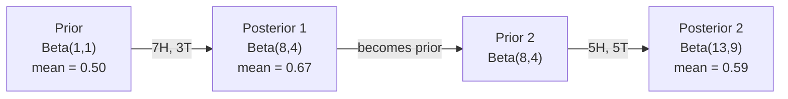

# 베이즈 정리는

> 확률은 여러분이 기대하는 것에 관한 것이고, 베이즈 정리는 여러분이 배우는 것에 관한 것입니다.

**Type:** Build
**Language:**파이썬
**Prerequisites:** Phase 1, Lesson 06 (Probability Fundamentals)
**Time:** ~75 minutes

## 학습 목표

- 예전에 대한 확률, 확률, 증거에서 후속 확률을 계산하기 위해 베이즈 정리를 적용
- 라플라스 평형화 및 로그 공간 계산으로 순수 베이즈 텍스트 분류기를 처음부터 구축하십시오
- MLE 및 MAP 추정치를 비교하고 MAP가 L2 정규화에 어떻게 대응하는지 설명합니다
- A/B 테스트를 위해 베타-비노미얼 합동 전자를 사용하여 연속적인 베이시안 업데이트를 구현

## 문제

의학 검사는 99% 정확합니다. 검사는 긍정적입니다. 실제로 질병이있는 확률은 무엇입니까?

대부분의 사람들은 99%라고 말합니다. 실제 대답은 질병이 얼마나 드문지에 달려 있습니다. 10,000명 중 1명이 가지고 있다면 긍정적 인 결과는 질병에 걸릴 확률이 1% 정도밖에 되지 않습니다. 다른 99%의 긍정적 인 결과는 건강한 사람들로부터 거짓 알람입니다.

이것은 장난이 아닙니다. 이것은 베이즈의 정리입니다. 모든 스팸 필터, 모든 의료 진단, 불확실성을 수치화하는 모든 기계 학습 모델은 이러한 정확한 추론을 사용합니다. 당신은 신념으로 시작합니다. 당신은 증거를 볼 수 있습니다. 당신은 업데이트합니다.

이것을 이해하지 못한 채 ML 시스템을 만들면 모델 출력들을 잘못 해석하고 나쁜 임대점을 설정하고 지나치게 자신감 있는 예측을 할 수 있습니다.

## 개념

### 합동 확률에서 베이즈까지

여러분은 이미 06번 수업에서 조건적 확률이

```math
P(A \mid B) = \frac{P(A \text{ and } B)}{P(B)}
```

그리고 대칭적으로:

```math
P(B \mid A) = \frac{P(A \text{ and } B)}{P(A)}
```

두 표현은 동일한 수치를 공유합니다: $P(A \text{ and } B)$- 짝짓기를 하고 재편

```math
\begin{aligned}
P(A \text{ and } B) &= P(A \mid B) \cdot P(B) = P(B \mid A) \cdot P(A) \\[4pt]
&\text{Therefore:} \\[4pt]
P(A \mid B) &= \frac{P(B \mid A) \cdot P(A)}{P(B)}
\end{aligned}
```

이것은 베이즈 정리입니다. 4개의 양은 1개의 방정식입니다.

### 네 부분

| Part | Name | What it means |
|------|------|---------------|
| $P(A \mid B)$ | Posterior | Your updated belief about $A$ after seeing evidence $B$ |
| $P(B \mid A)$ | Likelihood | How probable the evidence $B$ is if $A$ is true |
| $P(A)$ | Prior | Your belief about $A$ before seeing any evidence |
| $P(B)$ | Evidence | Total probability of seeing $B$ under all possibilities |

증거 기간$P(B)$전체 확률 법칙을 사용하여 확장할 수 있습니다.

```math
P(B) = P(B \mid A) \cdot P(A) + P(B \mid \text{not } A) \cdot P(\text{not } A)
```

### 의료 검사 예제

질병은 1명에서 1명에게 발생한다. 검사는 99% 정확 (병인의 99%를 잡으며, 1%의 경우 거짓 긍정적으로 나타난다).

```math
\begin{aligned}
P(\text{sick}) &= 0.0001 \quad \text{(prior: disease is rare)} \\
P(\text{positive} \mid \text{sick}) &= 0.99 \quad \text{(likelihood: test catches it)} \\
P(\text{positive} \mid \text{healthy}) &= 0.01 \quad \text{(false positive rate)} \\[6pt]
P(\text{positive}) &= P(\text{positive} \mid \text{sick}) \cdot P(\text{sick}) + P(\text{positive} \mid \text{healthy}) \cdot P(\text{healthy}) \\
&= 0.99 \cdot 0.0001 + 0.01 \cdot 0.9999 \\
&= 0.000099 + 0.009999 \\
&= 0.010098 \\[6pt]
P(\text{sick} \mid \text{positive}) &= P(\text{positive} \mid \text{sick}) \cdot P(\text{sick}) / P(\text{positive}) \\
&= 0.99 \cdot 0.0001 / 0.010098 \\
&= 0.0098 \\
&= 0.98\%
\end{aligned}
```

1퍼센트도 되지 않습니다. 전후의 경우 지배적이다. 질병이 희귀할 때, 정확한 검사도 대부분 거짓 dương tính를 나타냅니다. 그래서 의사들은 확인 검사를 지시합니다.

### 스팸 필터 예제

"토토리"라는 단어를 담은 이메일을 받았어요. 스팸인가요?

```math
\begin{aligned}
P(\text{spam}) &= 0.3 \quad \text{(30\% of email is spam)} \\
P(\text{"lottery"} \mid \text{spam}) &= 0.05 \quad \text{(5\% of spam emails contain "lottery")} \\
P(\text{"lottery"} \mid \text{not spam}) &= 0.001 \quad \text{(0.1\% of legitimate emails contain "lottery")} \\[6pt]
P(\text{"lottery"}) &= 0.05 \cdot 0.3 + 0.001 \cdot 0.7 \\
&= 0.015 + 0.0007 \\
&= 0.0157 \\[6pt]
P(\text{spam} \mid \text{"lottery"}) &= 0.05 \cdot 0.3 / 0.0157 \\
&= 0.955 \\
&= 95.5\%
\end{aligned}
```

한 단어로 확률이 30%에서 95.5%로 바뀌게 됩니다. 실제 스팸 필터는 수백 단어에 걸쳐 동시에 베이스를 적용합니다.

### 이 naive Bayes: 독립 가정

이이브 베이즈는 모든 특징이 클래스를 고려하여 조건적으로 독립적이라고 가정함으로써 여러 가지 특징으로 확장합니다.

```math
P(\text{class} \mid \text{feature}_1, \text{feature}_2, \ldots, \text{feature}_n) = \frac{P(\text{class}) \cdot P(\text{feature}_1 \mid \text{class}) \cdot P(\text{feature}_2 \mid \text{class}) \cdots P(\text{feature}_n \mid \text{class})}{P(\text{feature}_1, \text{feature}_2, \ldots, \text{feature}_n)}
```

"나이브" 부분은 독립 가정입니다. 텍스트에서 단어 발생은 독립적이지 않습니다 ("뉴"와 "요크"는 상관관계가 있습니다). 그러나 분류자는 계층을 순위화 할 필요가 있기 때문에 그 가정은 실제로 놀랍도록 잘 작동합니다.

모든 클래스에서 나모너가 동일하기 때문에, 그냥 을 건너뛰고 수치를 비교할 수 있습니다.

```math
\text{score}(\text{class}) = P(\text{class}) \cdot \prod_i P(\text{feature}_i \mid \text{class})
```

가장 높은 점수를 받은 수업을 선택하세요.

### 최대 확률 추정 (MLE)

어떻게 알 수 있을까요?$P(\text{feature} \mid \text{class})$훈련 자료에서?

```math
P(\text{"free"} \mid \text{spam}) = \frac{\text{number of spam emails containing "free"}}{\text{total spam emails}}
```

이것은 MLE입니다. 관찰된 데이터를 가장 확률로 만드는 매개 변수 값을 선택합니다. 당신은 확률 함수를 극대화하고 있습니다.

문제: 훈련 중에 스팸에 단어가 나타나지 않으면 MLE는 확률을 0으로 부여합니다. 보이지 않는 단어 한 마디로 제품이 전부 죽습니다.

```math
P(\text{word} \mid \text{class}) = \frac{\text{count}(\text{word}, \text{class}) + 1}{\text{total\_words\_in\_class} + \text{vocabulary\_size}}
```

모든 숫자에 1을 더하면 확률이 0이 되지 않습니다.

### 최후의 최상위 (MAP)

MLE는 어떤 매개 변수를 극대화해야 하는지 묻습니다$P(\text{data} \mid \text{parameters})$- 그래요

MAP는 어떤 매개 변수를 극대화하는지 묻습니다$P(\text{parameters} \mid \text{data})$- 그래요

베이즈 정리에 따르면

```math
P(\text{parameters} \mid \text{data}) \propto P(\text{data} \mid \text{parameters}) \cdot P(\text{parameters})
```

MAP는 매개 변수 자체에 선행자를 추가합니다. 매개 변수가 작아야 한다고 생각하면, 큰 값을 처벌하는 선행자로 코드를 작성합니다. 이것은 ML에서 L2 정규화와 동일합니다. 기둥 회귀에서 "리드" 페널티는 문자 그대로 무게에 대한 가우스 선행입니다.

| Estimation | Optimizes | ML equivalent |
|------------|-----------|---------------|
| MLE | $P(\text{data} \mid \text{params})$ | Unregularized training |
| MAP | $P(\text{data} \mid \text{params}) \cdot P(\text{params})$ | L2 / L1 regularization |

### 베이시안어와 빈번론자: 실제적인 차이점

빈번적 인 실험자 들 은 매개 변수를 고정 된 알려지지 않은 것 으로 간주 하고 "내가 이 실험 을 여러 번 반복 한다면 어떻게 될 것 입니까?"라고 묻습니다.

바에이즈족 은 매개 변수 를 분포 로 간주 하고, "내가 관찰 한 것 을 고려 하여, 매개 변수 에 대해 어떻게 생각 합니까?"라고 묻습니다.

ML 시스템을 구축하는 데 있어서 실질적인 차이점은

| Aspect | Frequentist | Bayesian |
|--------|-------------|----------|
| Output | Point estimate | Distribution over values |
| Uncertainty | Confidence intervals (about procedure) | Credible intervals (about parameter) |
| Small data | Can overfit | Prior acts as regularization |
| Computation | Usually faster | Often requires sampling (MCMC) |

대부분의 생산 ML는 빈도 (SGD, 포인트 추정) 이다. 베이시언 방법들은 가산불확률 (의학적 결정, 안전 비평적 시스템) 또는 데이터가 희소할 때 (몇 번의 촬영 학습, 냉동 시작) 에 빛난다.

### 왜 바이에스주의 사고가 ML에 중요한지

그 연결은 비유보다 깊습니다.

**Priors are regularization.**가우스 선수는 L2 정규화, 라플라스 선수는 L1입니다. 정규화 용어를 추가할 때마다 어떤 매개 변수 값을 기대하는지에 대한 베이시언 진술을 하고 있습니다.

**Posteriors are uncertainty.**예측된 확률은 모델이 그 추정치에 얼마나 확신하는지 알려주지 않습니다. 베이시안 방법은 분포를 제공합니다.$P(\text{spam})$0.8에서 0.95 사이입니다".

**Bayes updates are online learning.**오늘날의 후자는 내일의 전자가 됩니다. 모델이 새로운 데이터를 볼 때, 처음부터 재교육 대신 점진적으로 자신의 신념을 업데이트합니다.

**Model comparison is Bayesian.**베이시언 정보 기준 (BIC), 소재 확률, 베이시언 요인은 모두 베이시언 추론을 사용하여 과잉 부합되지 않은 모델을 선택할 수 있습니다.

```figure
bayes-update
```

## 건설 해

### 단계 1: 베이즈 정리의 함수

```python
def bayes(prior, likelihood, false_positive_rate):
    evidence = likelihood * prior + false_positive_rate * (1 - prior)
    posterior = likelihood * prior / evidence
    return posterior

result = bayes(prior=0.0001, likelihood=0.99, false_positive_rate=0.01)
print(f"P(sick|positive) = {result:.4f}")
```

### 단계 2: 순진한 베이즈 분류기

```python
import math
from collections import defaultdict

class NaiveBayes:
    def __init__(self, smoothing=1.0):
        self.smoothing = smoothing
        self.class_counts = defaultdict(int)
        self.word_counts = defaultdict(lambda: defaultdict(int))
        self.class_word_totals = defaultdict(int)
        self.vocab = set()

    def train(self, documents, labels):
        for doc, label in zip(documents, labels):
            self.class_counts[label] += 1
            words = doc.lower().split()
            for word in words:
                self.word_counts[label][word] += 1
                self.class_word_totals[label] += 1
                self.vocab.add(word)

    def predict(self, document):
        words = document.lower().split()
        total_docs = sum(self.class_counts.values())
        vocab_size = len(self.vocab)
        best_class = None
        best_score = float("-inf")
        for cls in self.class_counts:
            score = math.log(self.class_counts[cls] / total_docs)
            for word in words:
                count = self.word_counts[cls].get(word, 0)
                total = self.class_word_totals[cls]
                score += math.log((count + self.smoothing) / (total + self.smoothing * vocab_size))
            if score > best_score:
                best_score = score
                best_class = cls
        return best_class
```

로그 확률은 하위 흐름을 방지한다. 많은 작은 확률을 곱하면 부동점에 너무 작은 숫자를 생성한다. 로그 확률을 합하면 수치적으로 안정적이며 수학적으로 동등하다.

### 단계 3: 스팸 데이터에 대한 훈련

```python
train_docs = [
    "win free money now",
    "free lottery ticket winner",
    "claim your prize today free",
    "urgent offer free cash",
    "congratulations you won free",
    "meeting tomorrow at noon",
    "project update attached",
    "can we schedule a call",
    "quarterly report review",
    "lunch on thursday sounds good",
    "team standup notes attached",
    "please review the pull request",
]

train_labels = [
    "spam", "spam", "spam", "spam", "spam",
    "ham", "ham", "ham", "ham", "ham", "ham", "ham",
]

classifier = NaiveBayes()
classifier.train(train_docs, train_labels)

test_messages = [
    "free money waiting for you",
    "meeting rescheduled to friday",
    "you won a free prize",
    "please review the attached report",
]

for msg in test_messages:
    print(f"  '{msg}' -> {classifier.predict(msg)}")
```

### 4단계: 학습된 확률을 검사

```python
def show_top_words(classifier, cls, n=5):
    vocab_size = len(classifier.vocab)
    total = classifier.class_word_totals[cls]
    probs = {}
    for word in classifier.vocab:
        count = classifier.word_counts[cls].get(word, 0)
        probs[word] = (count + classifier.smoothing) / (total + classifier.smoothing * vocab_size)
    sorted_words = sorted(probs.items(), key=lambda x: x[1], reverse=True)
    for word, prob in sorted_words[:n]:
        print(f"    {word}: {prob:.4f}")

print("\nTop spam words:")
show_top_words(classifier, "spam")
print("\nTop ham words:")
show_top_words(classifier, "ham")
```

## 사용 하 고

스키트-러닝 배는 생산 준비가 된 순진한 베이즈 구현:

```python
from sklearn.feature_extraction.text import CountVectorizer
from sklearn.naive_bayes import MultinomialNB
from sklearn.metrics import classification_report

vectorizer = CountVectorizer()
X_train = vectorizer.fit_transform(train_docs)
clf = MultinomialNB()
clf.fit(X_train, train_labels)

X_test = vectorizer.transform(test_messages)
predictions = clf.predict(X_test)
for msg, pred in zip(test_messages, predictions):
    print(f"  '{msg}' -> {pred}")
```

동일한 알고리즘. CountVectorizer는 토큰화와 어휘 구축을 처리합니다. MultinomialNB는 내부적으로 평행 및 로그 확률을 처리합니다. 처음부터 버전은 40 줄에 동일한 작업을합니다.

## 선박

여기서 구축된 NaiveBayes 클래스는 전체 파이프라인을 보여줍니다. 토큰화, 라플라스 평행과 확률 추정, 로그 공간 예측.`code/bayes.py`파이썬의 표준 라이브러리를 넘어서는 의존성이 없는

### 합동적 인 전신

전과 후자는 같은 분포가족에 속할 때, 전자는 "연합"이라고 합니다. 이것은 베이시안 업데이트를 대수학적으로 깨끗하게 만듭니다. 숫자 통합 없이 닫힌 형태의 후자는 있습니다.

| Likelihood | Conjugate Prior | Posterior | Example |
|-----------|----------------|-----------|---------|
| Bernoulli | $\text{Beta}(a, b)$ | $\text{Beta}(a + \text{successes}, b + \text{failures})$ | Coin flip bias estimation |
| Normal (known variance) | $\text{Normal}(\mu_0, \sigma_0)$ | Normal(weighted mean, smaller variance) | Sensor calibration |
| Poisson | $\text{Gamma}(a, b)$ | $\text{Gamma}(a + \text{sum of counts}, b + n)$ | Modeling arrival rates |
| Multinomial | $\text{Dirichlet}(\alpha)$ | $\text{Dirichlet}(\alpha + \text{counts})$ | Topic modeling, language models |

왜 중요한지: 합동 전자 없이, 후자를 근사하기 위해 몬테카로 샘플링이나 변수 추론이 필요합니다. 합동 전자로는 두 개의 숫자를 업데이트합니다.

베타 분포는 실제에서 가장 흔한 합동 전제입니다. $\text{Beta}(a, b)$확률 매개 변수에 대한 신념을 나타냅니다. 평균은$a/(a+b)$더 큰$a+b$, 더 집중 (신뢰) 분포.

베타 전의 특별한 경우:
- $\text{Beta}(1, 1)$이 매개 변수에 대해 의견이 없습니다.
- $\text{Beta}(10, 10)$0.5에 도달한 경우, 매개 변수가 0.5에 가깝다고 확신합니다.
- $\text{Beta}(1, 10)$= 0으로 기울여서, 매개 변수가 작다고 생각하죠.

업데이트 규칙은 매우 간단합니다.

```math
\begin{aligned}
\text{Prior:} \quad & \text{Beta}(a, b) \\
\text{Data:} \quad & s \text{ successes}, f \text{ failures} \\
\text{Posterior:} \quad & \text{Beta}(a + s, b + f)
\end{aligned}
```

통합자, 샘플링이 없고, 덧셈만

### 순서적 베이시어 업데이트

베이시안 추론은 자연스럽게 순서적입니다. 오늘날의 후자는 내일의 전자가 됩니다. 이것이 실제 시스템이 모든 역사적 데이터를 재처리하지 않고 점진적으로 배우는 방법입니다.

구체적인 예: 동전이 공정인지 여부를 추정하는 것.

**Day 1: No data yet.**
시작해$\text{Beta}(1, 1)$- 유니폼 전신님, 의견이 없어요
- 이전 평균: 0.5
- 전면은 평평하다 [0, 1]

**Day 2: Observe 7 heads, 3 tails.**
$\text{Posterior} = \text{Beta}(1 + 7, 1 + 3) = \text{Beta}(8, 4)$
- 후속 평균: $8/12 = 0.667$
- 증거 는 동전 이 머리 를 향해 편향 을 가지고 있는 것으로 알려 줍니다

**Day 3: Observe 5 more heads, 5 more tails.**
어제의 후자를 오늘의 전자로 사용하세요.
$\text{Posterior} = \text{Beta}(8 + 5, 4 + 5) = \text{Beta}(13, 9)$
- 후속 평균: $13/22 = 0.591$
- 균형 잡힌 새로운 데이터는 0.5으로 추정치를 끌어 올렸습니다.



관찰의 순서가 중요하지 않습니다.$\text{Beta}(1,1)$12개의 머리와 8개의 꼬리 모두 동시에 업데이트됩니다$\text{Beta}(13, 9)$-- 같은 결과입니다. 순서적인 업데이트와 대량 업데이트는 수학적으로 동등합니다. 하지만 순서적인 업데이트는 원시 데이터를 저장하지 않고 모든 단계에서 결정을 내릴 수 있습니다.

이것은 생산 ML 시스템에서 온라인 학습의 기초입니다. 슨의 강도 샘플링, 계발적 추천 시스템 및 스트리밍 기호 탐지기는 모두이 패턴을 사용합니다.

### A/B 테스트에 연결

A/B 테스트는 Bayesian 추론을 위장합니다.

설정: 두 개의 버튼 색상을 테스트하고 있습니다. 변종 A (নীଳା) 와 변종 B (녹색). 어느 쪽이 더 많은 클릭을 받는지 알고 싶습니다.

베이시안 A/B 테스트:

1. **Prior.**시작해$\text{Beta}(1, 1)$두 가지 변종에 대해서는 사전 선호도 없습니다.
2. **Data.**A 변종: 1000 조회 중 50 번의 클릭 B 변종: 1000 조회 중 65 번의 클릭
3. **Posteriors.**
   - A: $\text{Beta}(1 + 50, 1 + 950) = \text{Beta}(51, 951)$평균 = 0.051
   - B: $\text{Beta}(1 + 65, 1 + 935) = \text{Beta}(66, 936)$. 평균 = 0.066
4. **Decision.**계산$P(B > A)$-- B의 진정한 변환율이 A보다 높을 확률이

컴퓨터$P(B > A)$분석적으로 어렵지만 몬테카로에서는 비약적인 문제입니다.

```
1. Draw 100,000 samples from Beta(51, 951)  -> samples_A
2. Draw 100,000 samples from Beta(66, 936)  -> samples_B
3. P(B > A) = fraction of samples where B > A
```

만약$P(B > A) > 0.95$, 당신은 발송 변종 B. 0.05에서 0.95 사이라면, 당신은 계속 데이터를 수집합니다.$P(B > A) < 0.05$, 당신은 A 변종을 배로

주파수 A/B 테스트에 대한 장점:
- 직접 확률표시를 얻습니다. "B가 더 좋은 확률은 97%입니다".
- p값의 혼란이 없고, null 가설을 거부하지 않는 가보도 없습니다.
- 거짓 양성률을 부풀어놓지 않고 언제든지 결과를 확인할 수 있습니다.
- 이전 지식 (예: 이전 테스트는 통상 3~8%) 의 전환율을 나타냅니다.

| Aspect | Frequentist A/B | Bayesian A/B |
|--------|----------------|--------------|
| Output | p-value | $P(B > A)$ |
| Interpretation | "How surprising is this data if A=B?" | "How likely is B better than A?" |
| Early stopping | Inflates false positives | Safe at any point (given a well-chosen prior and correctly specified model) |
| Prior knowledge | Not used | Encoded as Beta prior |
| Decision rule | $p < 0.05$ | $P(B > A) > \text{threshold}$ |

## 운동

1. **Multiple tests.**독립적인 테스트에서 환자에게 두 번이나 긍정적 인 검사가 (두 가지 모두 99% 정확성, 질병 발생률은 10,000명 중 1명)$P(\text{sick})$두 테스트 후, 첫 번째 테스트에서 후기를 두 번째 테스트에서 앞부분으로 사용하세요.

2. **Smoothing impact.**스팸 분류기를 실행하여 0.01, 0.1, 1.0 및 10.0의 평행값을 사용하세요. 상위 단어 확률은 어떻게 변합니까? 평행=0와 햄에서만 나타나는 단어에 어떻게 될까요?

3. **Add features.**NaiveBayes 클래스를 확장하여 메시지 길이를 (단/장) 단어 수와 함께 기능으로 사용한다. 추정 $P(\text{short} \mid \text{spam})$그리고$P(\text{short} \mid \text{ham})$훈련 데이터에서 예측 점수를 접어 넣습니다.

4. **MAP by hand.**관찰된 데이터를 고려하여 (상품의 10개에서 7개)$\text{Beta}(2,2)$이전: MLE 추정과 비교 ($7/10$)

### 암시

**Exercise 1.**전화`bayes`1번 테스트 후 후부를 얻으려면 후부를 앞으로 다시 호출하십시오.`sequential_bayes(prior, likelihood, false_positive_rate, 2)`0.5에 가까운 값이어야 합니다.

**Exercise 2.**하나 만들어봐`NaiveBayes(smoothing=s)`각 값에 대해 동일한 데이터에 훈련하고 인쇄합니다`top_words`스팸에 나타나지 않는 단어의 확률은 0이므로 로그가 정의되지 않습니다.

**Exercise 3.**얼마나 많은 스팸 및 햄 메시지가 짧는지 계산하고, 각 클래스의 메시지의 숫자에 나눌 수 있으며, 그 비율의 로그를 점수에 추가합니다.`predict`각 클래스의 확률이 1이 되는 것을 확인해 보세요

**Exercise 4.**$\text{Beta}(\alpha, \beta)$이전, MAP 추정은$\frac{h + \alpha - 1}{n + \alpha + \beta - 2}$- 놔$h = 7$$n = 10$; 결과는 MLE (0.7) 와 이전 모드 (0.5) 사이여야 합니다.

## 주요 용어

| Term | What people say | What it actually means |
|------|----------------|----------------------|
| Prior | "My initial guess" | $P(\text{hypothesis})$ before observing evidence. In ML: the regularization term. |
| Likelihood | "How well the data fits" | $P(\text{evidence} \mid \text{hypothesis})$. How probable the observed data is under a specific hypothesis. |
| Posterior | "My updated belief" | $P(\text{hypothesis} \mid \text{evidence})$. The prior multiplied by the likelihood, then normalized. |
| Evidence | "The normalizing constant" | $P(\text{data})$ across all hypotheses. Ensures the posterior sums to 1. |
| Naive Bayes | "That simple text classifier" | A classifier that assumes features are independent given the class. Works well despite the false assumption. |
| Laplace smoothing | "Add-one smoothing" | Adding a small count to every feature to prevent zero probabilities from unseen data. |
| MLE | "Just use the frequencies" | Choose parameters that maximize $P(\text{data} \mid \text{parameters})$. No prior. Can overfit with small data. |
| MAP | "MLE with a prior" | Choose parameters that maximize $P(\text{data} \mid \text{parameters}) \cdot P(\text{parameters})$. Equivalent to regularized MLE. |
| Log-probability | "Work in log space" | Using $\log(P)$ instead of $P$ to avoid floating-point underflow when multiplying many small numbers. |
| False positive | "A wrong alarm" | The test says positive, but the true state is negative. Drives the base rate fallacy. |

## 더 많은 읽기

- [3Blue1Brown: Bayes' theorem](https://www.youtube.com/watch?v=HZGCoVF3YvM)- 의료 검사 예시와 함께 시각적 설명
- [Stanford CS229: Generative Learning Algorithms](https://cs229.stanford.edu/main_notes.pdf)- 순진한 베이즈와 차별적인 모델과의 연결
- [Think Bayes](https://greenteapress.com/wp/think-bayes/)- 무료 책, 파이썬 코드와 함께 베이시언 통계
- [scikit-learn Naive Bayes](https://scikit-learn.org/stable/modules/naive_bayes.html)- 생산 구현 및 각 변종을 언제 사용할 것인가
