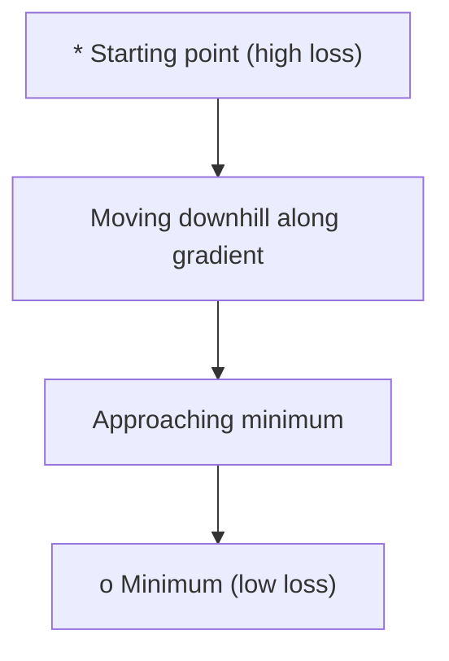
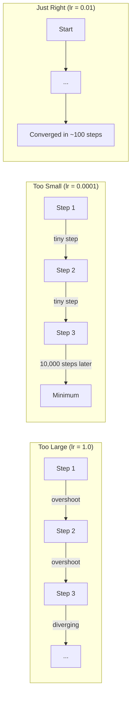
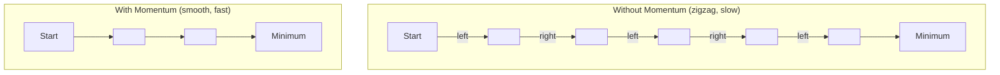
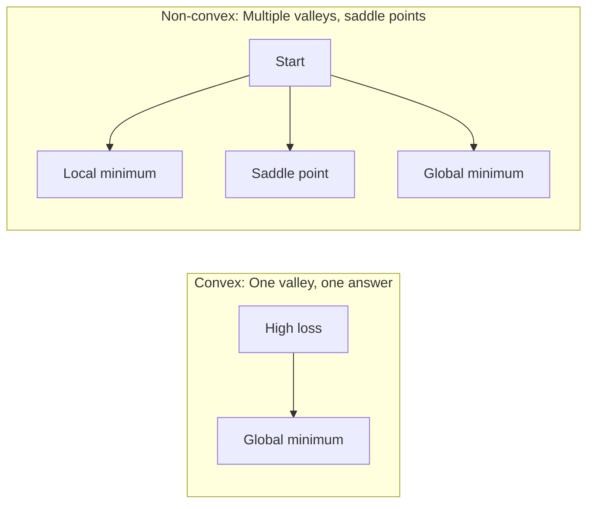
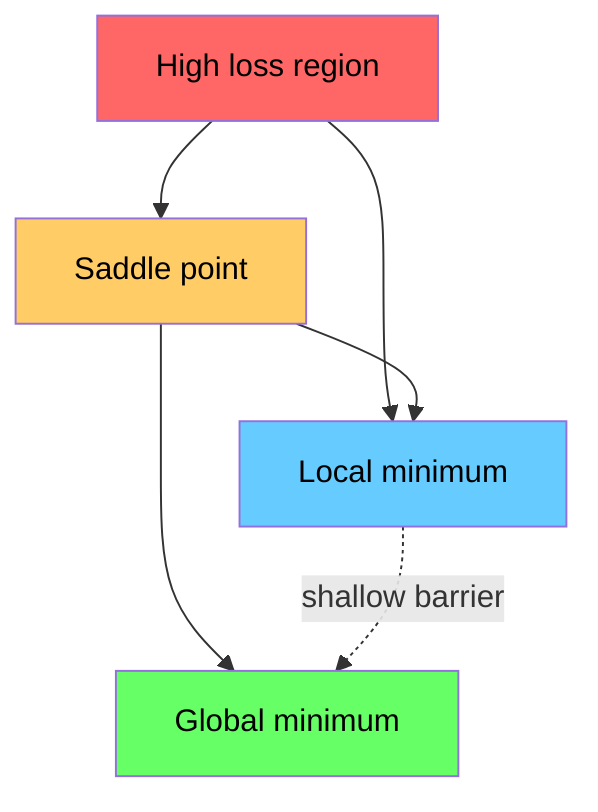

# 최적화

> 신경망을 훈련시키는 것은 계곡의 바닥을 찾는 것 이상입니다.

**Type:** Build
**Language:**파이썬
**Prerequisites:** Phase 1, Lessons 04-05 (Derivatives, Gradients)
**Time:** ~75 minutes

## 학습 목표

- 바닐라 기하급수 하락, 동력을 가진 SGD, 그리고 처음부터 아담을 구현
- 로젠브록 함수에 최적화 컨버전스를 비교하고 아담이 체중별 학습률을 조정하는 이유를 설명합니다
- 형의 패스 ландша프와 형이 아닌 패스 ландша프를 구분하고 높은 차원에서 세일 포인트의 역할을 설명합니다.
- 훈련 안정성을 위해 학습 속도 스케줄을 구성 (단계 붕괴, 코시네 , 온화)

## 문제

손실 함수는 있습니다. 그것은 얼마나 잘못된 모델이 있는지 알려줍니다. 당신은 gradients를 가지고 있습니다. 그들은 손실을 더 악화시키는 방향을 알려줍니다. 이제 당신은 언덕 아래로 걷는 전략을 필요로 합니다.

순진한 접근법은 간단합니다. 그라디엔트의 반대편으로 이동합니다. 단계의 비율을 학습률이라고 불리는 숫자에 따라 측정합니다. 다시 말해 이것은 경각층 하락입니다. 그리고 효과가 있습니다. 하지만 "노동"에는 주의가 있습니다. 너무 많은 학습률을 가지고 계곡을 완전히 지나가게 되고 벽 사이에 뛰어넘게 됩니다. 너무 작고 수천 개의 불필요한 걸음으로 답을 향해 니다. 세일 포인트를 치면 최소한의 것을 찾지 못했지만 움직이지 않게 됩니다.

딥러닝의 모든 최적화는 같은 질문에 대한 답입니다. 어떻게 하면 더 빠르고 안정적으로 계곡의 바닥에 도달할 수 있을까요?

## 개념

### 최적화란 무엇 입니까?

최적화는 함수를 최소화 (또는 극대화) 하는 입력값을 찾는 것이다. 기계 학습에서 함수는 손실이다. 입력값은 모델의 무게이다. 훈련은 최적화이다.

```
minimize L(w) where:
  L = loss function
  w = model weights (could be millions of parameters)
```

### 계층적 하락 (반닐라)

가장 간단한 최적화. 모든 무게에 대한 손실의 기하급수 계산. 각 무게를 그 기하급수 반대 방향으로 이동. 학습 속도와 단계의 규모.

```math
w = w - \text{lr} \cdot \text{gradient}
```

그게 전체 알고리즘입니다. 한 줄입니다.



### 학습 속도: 가장 중요한 과다 매개 변수

학습 속도는 단계의 크기를 조절하고, 모든 걸 결정합니다.



올바른 학습률을 나타내는 공식은 없습니다. 실험을 통해 찾을 수 있습니다. 공통적인 출발점은: 아담의 0.001 , 운동량으로 SGD의 0.01입니다.

### SGD vs 배트 vs 미니 배트

바닐라 기하급수 하락은 한 단계가 걸리기 전에 전체 데이터 세트의 기하급수를 계산합니다. 이것을 대량 기하급수 하락이라고 합니다. 그것은 안정적이지만 느립니다.

스토카스틱 그라디언트 다운 (SGD) 는 하나의 무작위 샘플에서 그라디언트를 계산하고 즉시 단계합니다.

미니 배트 가속 하락은 차이를 나눕니다. 작은 배트 (32, 64, 128, 256 샘플) 에 걸쳐 가속을 계산하고, 단계. 이것은 실제로 모든 사람들이 사용하는 것입니다.

| Variant | Batch size | Gradient quality | Speed per step | Noise |
|---------|-----------|-----------------|---------------|-------|
| Batch GD | Entire dataset | Exact | Slow | None |
| SGD | 1 sample | Very noisy | Fast | High |
| Mini-batch | 32-256 | Good estimate | Balanced | Moderate |

SGD와 미니 배트에서 발생하는 소음은 버그가 아니라, 한 지역 최소 및 세일 포인트에서 벗어날 수 있도록 도와줍니다.

### 운동: 공이 내리막으로 굴러가는

바닐라 계곡 하락은 현재 계곡만을 살펴본다. 계곡 지크자그 (간 좁은 계곡에서 흔히 볼 수 있는) 이 있다면 진전이 느리죠. 모멘텀은 과거 계곡을 속도 용어로 축적함으로써 이것을 수정합니다.

```math
\begin{aligned}
v &= \beta \cdot v + \text{gradient} \\
w &= w - \text{lr} \cdot v
\end{aligned}
```

비유: 돌아 내려가는 공. 모든 돌 때 멈추지 않고 다시 시작 하지 않습니다. 일관된 방향으로 속도를 높이고 진동을 완화 합니다.



`beta`(일반적으로 0.9) 는 얼마나 많은 역사를 유지해야 하는지 제어합니다. 더 높은 베타는 더 많은 동력을 의미하며, 더 부드러운 경로를 의미하지만 방향 변화에 더 느린 반응입니다.

### 아담: 적응적 학습률

다른 무게는 다른 학습률을 필요로 합니다. 거의 큰 gradients를 얻는 무게는 마침내 큰 단계를 거쳐야 합니다. 끊임없이 거대한 gradients를 얻는 무게는 작은 단계를 거쳐야 합니다.

아담 (응응동 순간 추정) 은 무게에 따라 두 가지를 추적합니다.

1. 첫 순간 ($m$): 가속 평균 (동력 같은)
2. 두 번째 순간 ($v$): 평방 gradients의 실행 평균 ( gradient magnitude)

```math
\begin{aligned}
m &= \beta_1 \cdot m + (1 - \beta_1) \cdot \text{gradient} \\
v &= \beta_2 \cdot v + (1 - \beta_2) \cdot \text{gradient}^2 \\[4pt]
\hat{m} &= m / (1 - \beta_1^t) \quad \text{bias correction} \\
\hat{v} &= v / (1 - \beta_2^t) \quad \text{bias correction} \\[4pt]
w &= w - \text{lr} \cdot \hat{m} / (\sqrt{\hat{v}} + \epsilon)
\end{aligned}
```

`sqrt(v_hat)`큰 파급수하가 있는 무게는 큰 숫자로 나뉘어집니다 (작은 효과적 단계). 작은 파급수하가 있는 무게는 작은 숫자로 나뉘어집니다 (큰 효과적 단계). 각 무게는 자신의 적응 학습 속도를 얻습니다.

기본 하이퍼파리미터: `lr=0.001, beta1=0.9, beta2=0.999, epsilon=1e-8`이 기본 설정은 대부분의 문제에서 잘 작동합니다.

### 학습률 일정이

일정한 학습률은 타협입니다. 훈련 초기에는 큰 단계가 필요해서 빠른 발전을 이루고 있습니다. 훈련 후반에는 최소한의 단계에 가까운 미세한 조화를 이루는 작은 단계가 필요하죠.

일반적인 일정은:

| Schedule | Formula | Use case |
|----------|---------|----------|
| Step decay | $\text{lr} = \text{lr} \cdot \text{factor}$ every $N$ epochs | Simple, manual control |
| Exponential decay | $\text{lr} = \text{lr}_0 \cdot \text{decay}^t$ | Smooth reduction |
| Cosine annealing | $\text{lr} = \text{lr} _{\min} + 0.5 \cdot (\text{lr} _{\max} - \text{lr} _{\min}) \cdot (1 + \cos(\pi t / T))$ | Transformers, modern training |
| Warmup + decay | Linear ramp up, then decay | Large models, prevents early instability |

### 형과 비형

직 함수는 최소 1개, 그라디언트 하락은 항상 그 함수를 찾습니다.$f(x) = x^2$ 모양입니다.

신경망 손실 기능은 구부리되지 않습니다. 그들은 많은 지역 최소, 세일 포인트 및 평면 영역을 가지고 있습니다.



실제적으로, 고차원 신경망의 로컬 미니마는 거의 문제가 되지 않는다. 대부분의 로컬 미니마는 글로벌 미니멀에 가까운 손실 값을 가지고 있다. Saddle point (어떤 방향으로 평평하고 다른 방향으로 곡선) 은 진정한 장애물이다. 미니 배트에서 발생하는 운동력과 소음이 그들을 탈출하는 데 도움이 된다.

### 손실 풍경 시각화

손실은 모든 무게의 함수입니다. 100만 무게의 모델에서는 손실 풍경이 1,000,001 차원 공간에 살고 있습니다. 우리는 무게 공간에서 무작위로 두 가지 방향을 선택하고 그 방향에 걸쳐 손실을 그려 2D 표면을 생성함으로써 시각화합니다.



날카로운 최소의 일반화는 좋지 않습니다. 평면한 최소의 일반화는 좋습니다. 이것은 운동량으로 SGD가 최종 테스트 정확성에 있어서 아담을 능가하는 이유 중 하나입니다. 그 소음은 날카로운 최소로 정착하는 것을 막습니다.

```figure
gradient-descent
```

## 건설 해

### 단계 1: 테스트 기능을 정의

로젠브록 함수는 고전적인 최적화 기준이다. 최소는 1, 1에 있으며, 좁은 곡선 골짜기 안에 있어 쉽게 찾을 수 있지만 따라가기 어렵다.

```math
f(x, y) = (1 - x)^2 + 100 \cdot (y - x^2)^2
```

```python
def rosenbrock(params):
    x, y = params
    return (1 - x) ** 2 + 100 * (y - x ** 2) ** 2

def rosenbrock_gradient(params):
    x, y = params
    df_dx = -2 * (1 - x) + 200 * (y - x ** 2) * (-2 * x)
    df_dy = 200 * (y - x ** 2)
    return [df_dx, df_dy]
```

### 단계 2: 바닐라 기하급수 하락

```python
class GradientDescent:
    def __init__(self, lr=0.001):
        self.lr = lr

    def step(self, params, grads):
        return [p - self.lr * g for p, g in zip(params, grads)]
```

### 단계 3: 추진력으로 SGD

```python
class SGDMomentum:
    def __init__(self, lr=0.001, momentum=0.9):
        self.lr = lr
        self.momentum = momentum
        self.velocity = None

    def step(self, params, grads):
        if self.velocity is None:
            self.velocity = [0.0] * len(params)
        self.velocity = [
            self.momentum * v + g
            for v, g in zip(self.velocity, grads)
        ]
        return [p - self.lr * v for p, v in zip(params, self.velocity)]
```

### 4단계: 아담

```python
class Adam:
    def __init__(self, lr=0.001, beta1=0.9, beta2=0.999, epsilon=1e-8):
        self.lr = lr
        self.beta1 = beta1
        self.beta2 = beta2
        self.epsilon = epsilon
        self.m = None
        self.v = None
        self.t = 0

    def step(self, params, grads):
        if self.m is None:
            self.m = [0.0] * len(params)
            self.v = [0.0] * len(params)

        self.t += 1

        self.m = [
            self.beta1 * m + (1 - self.beta1) * g
            for m, g in zip(self.m, grads)
        ]
        self.v = [
            self.beta2 * v + (1 - self.beta2) * g ** 2
            for v, g in zip(self.v, grads)
        ]

        m_hat = [m / (1 - self.beta1 ** self.t) for m in self.m]
        v_hat = [v / (1 - self.beta2 ** self.t) for v in self.v]

        return [
            p - self.lr * mh / (vh ** 0.5 + self.epsilon)
            for p, mh, vh in zip(params, m_hat, v_hat)
        ]
```

### 단계 5: 실행하고 비교

```python
def optimize(optimizer, func, grad_func, start, steps=5000):
    params = list(start)
    history = [params[:]]
    for _ in range(steps):
        grads = grad_func(params)
        params = optimizer.step(params, grads)
        history.append(params[:])
    return history

start = [-1.0, 1.0]

gd_history = optimize(GradientDescent(lr=0.0005), rosenbrock, rosenbrock_gradient, start)
sgd_history = optimize(SGDMomentum(lr=0.0001, momentum=0.9), rosenbrock, rosenbrock_gradient, start)
adam_history = optimize(Adam(lr=0.01), rosenbrock, rosenbrock_gradient, start)

for name, history in [("GD", gd_history), ("SGD+M", sgd_history), ("Adam", adam_history)]:
    final = history[-1]
    loss = rosenbrock(final)
    print(f"{name:6s} -> x={final[0]:.6f}, y={final[1]:.6f}, loss={loss:.8f}")
```

예상 출력: 아담이 가장 빨리 모순된다. 동력을 가진 SGD는 더 부드러운 경로를 따르고 있다. 바닐라 GD는 좁은 계곡을 따라 천천히 진행한다.

## 사용 하 고

실제에서는 PyTorch 또는 JAX 최적화기를 사용한다. 그들은 매개 변수 그룹, 체중 감소, 기하급수 절단 및 GPU 가속을 처리한다.

```python
import torch

model = torch.nn.Linear(784, 10)

sgd = torch.optim.SGD(model.parameters(), lr=0.01, momentum=0.9)
adam = torch.optim.Adam(model.parameters(), lr=0.001)
adamw = torch.optim.AdamW(model.parameters(), lr=0.001, weight_decay=0.01)

scheduler = torch.optim.lr_scheduler.CosineAnnealingLR(adam, T_max=100)
```

엄지 손가락 규칙:

- 아담 (lr=0.001) 로 시작하면 대부분의 문제에서 조정 없이 작동합니다.
- 가장 좋은 최종 정확도가 필요하고 더 많은 조정을 할 수 있을 때, 동력을 가진 SGD로 전환하십시오 (lr=0.01, 동력을=0.9)
- 트랜스포머에 AdamW (중력 해체된 아담) 를 사용한다.
- 항상 몇 개의 시대를 초월한 훈련에 학습률 스케줄을 사용하십시오.
- 훈련이 불안정하다면 학습 속도를 줄이고 훈련이 너무 느린다면 증가시켜라.

## 선박

이 교훈 은 올바른 최적화 기법을 선택하는 데 도움 이 된다.`outputs/prompt-optimizer-guide.md`- 그래

여기서 만들어진 최적화 클래스는 3단계로 다시 나타납니다. 신경망을 처음부터 훈련시키면 말이죠.

## 운동

1. **Learning rate sweep.**로젠브록 함수에 따라 배움률 [0.0001, 0.0005, 0.001, 0.005, 0.01]로 바닐라 계층 하락을 실행하십시오. 각 단계에 대한 5000 단계 후에 최종 손실을 표시하거나 인쇄하십시오. 여전히 공감하는 가장 큰 학습률을 찾아보십시오.

2. **Momentum comparison.**로젠브록 함수에 따라 동력 값 [0.0, 0.5, 0.9, 0.99]를 사용하여 SGD를 실행하세요. 모든 단계에서 손실을 추적하세요. 어느 동력 값이 가장 빨리 공렴합니까?

3. **Saddle point escape.**함수를 정의합니다$f(x, y) = x^2 - y^2$0.01에서 시작해 바닐라 GD, SGD와 운동량, 그리고 아담의 행동을 비교해 보세요.

4. **Implement learning rate decay.**GradientDescent 클래스에 기하급수적 붕괴 스케줄을 추가합니다: `lr = lr_0 * 0.999^step`로젠브록 함수의 붕괴와 붕괴 없이의 공감대를 비교해 보세요.

### 암시

**Exercise 1.**학습률을 점검하고,`GradientDescent(lr=...)`각 분당으로 전달하고`optimize``rosenbrock`그리고`rosenbrock_gradient`. 경주로 갈라진 경주로 갈라진 경주로 갈라진 경주로 갈라진 경주로 갈라진 경주로 갈라진 경주로 갈라진 경주로 갈라진 경주로 갈라진 경주로 갈라진 경주로 갈라진 경주로 갈라진 경주로 갈라진 경주로 갈라진 경주로 갈라진 경주로 갈라진 경주로 갈라진 경주로 갈라진 경주로 갈라진 경주로 갈라진 경주로 갈라진 경주로 갈라진 경주로 갈라진 경주로 갈라진 경주로 갈라진 경주로 갈라진 경주로 갈라진 경주로 갈라진 경주로 갈라진 경주로 갈라진 경주로 갈라진 경주로 갈라진 경주로 갈라진 경주로 갈라진 경주로 갈라진 경주로 갈라진 경주로 갈라진 경주로 갈라진 경주로`nan`; 최소는 $(1, 1)$0의 손실로

**Exercise 2.**창조`SGDMomentum(momentum=m)`각 값에 대해 그리고 각 단계 후에 손실을 기록합니다. 사용 `find_convergence_step`속도를 비교하고, 오버스오프를 찾기 위해 상승과 하락의 손실을 찾아보세요.

**Exercise 3.**그레이디언을 적어라$(2x, -2y)$그리고 (0.01, 0.01) 에서 세 가지 최적화를 실행하세요.$y$100단계마다: 탈출하는 최적화는$\lvert y \rvert$큰 자란다.

**Exercise 4.**저장`lr_0`그리고 에 있는 다리 카운터`GradientDescent`, 그리고 계산`lr = lr_0 * 0.999 ** step`내부`step`. 학습률을 단계 0 및 단계 1000에서 인쇄해야 합니다.`lr_0`약$0.37 \times \text{lr}_0$- 그래

## 주요 용어

| Term | What people say | What it actually means |
|------|----------------|----------------------|
| Gradient descent | "Go downhill" | Update weights by subtracting the gradient scaled by the learning rate. The most basic optimizer. |
| Learning rate | "Step size" | A scalar that controls how far each update moves the weights. Too large causes divergence. Too small wastes compute. |
| Momentum | "Keep rolling" | Accumulate past gradients into a velocity vector. Dampens oscillations and accelerates movement through consistent directions. |
| SGD | "Random sampling" | Stochastic gradient descent. Compute gradient on a random subset instead of the full dataset. Almost always means mini-batch SGD in practice. |
| Mini-batch | "A chunk of data" | A small subset of training data (32-256 samples) used to estimate the gradient. Balances speed and gradient accuracy. |
| Adam | "The default optimizer" | Adaptive Moment Estimation. Tracks per-weight running averages of gradients and squared gradients to give each weight its own learning rate. |
| Bias correction | "Fix the cold start" | Adam's first and second moments are initialized to zero. Bias correction divides by $(1 - \beta^t)$ to compensate during early steps. |
| Learning rate schedule | "Change lr over time" | A function that adjusts the learning rate during training. Large steps early, small steps late. |
| Convex function | "One valley" | A function where any local minimum is the global minimum. Gradient descent always finds it. Neural network losses are not convex. |
| Saddle point | "Flat but not a minimum" | A point where the gradient is zero but it is a minimum in some directions and a maximum in others. Common in high dimensions. |
| Loss landscape | "The terrain" | The loss function plotted over weight space. Visualized by slicing along two random directions. |
| Convergence | "Getting there" | The optimizer has reached a point where further steps do not meaningfully reduce the loss. |

## 더 많은 읽기

- [Sebastian Ruder: An overview of gradient descent optimization algorithms](https://ruder.io/optimizing-gradient-descent/)- 모든 주요 최적화자들에 대한 종합적인 조사
- [Why Momentum Really Works (Distill)](https://distill.pub/2017/momentum/)- 동력 역학의 상호작용적 시각화
- [Adam: A Method for Stochastic Optimization (Kingma & Ba, 2014)](https://arxiv.org/abs/1412.6980)- 원본 아담 문서, 읽기 쉽고 짧습니다
- [Visualizing the Loss Landscape of Neural Nets (Li et al., 2018)](https://arxiv.org/abs/1712.09913)- 날카로운 최소와 평평한 최소의
