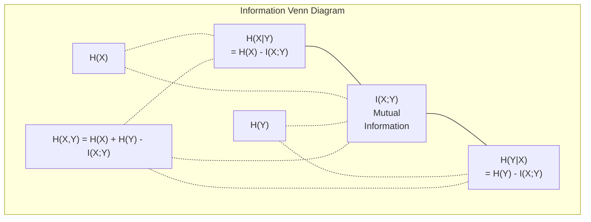

# 정보 이론

> 정보 이론은 놀라움을 측정하고 손실 함수는 그것에 기반을 두고 있습니다.

**Type:** Learn
**Language:**파이썬
**Prerequisites:** Phase 1, Lesson 06 (Probability)
**Time:** ~60 minutes

## 학습 목표

- 엔트로피, 크로스 엔트로피, KL 분리를 처음부터 계산하고 그 관계를 설명하십시오.
- 왜 횡성 엔트로피 손실을 최소화하는 것은 로그 확률을 극대화하는 것과 동등한 이유를 추출합니다
- 특징과 목표 사이의 상호 정보를 계산하여 특징의 중요성을 순위합니다
- 언어 모델이 선택하는 효과적인 어휘자료 크기로 혼란을 설명하십시오.

## 문제

전화해`CrossEntropyLoss()`여러분이 훈련하는 모든 분류 모델에서 "분기"를 볼 수 있습니다. 언어 모델 논문마다 "분기"를 볼 수 있습니다. 여러분은 VAEs, 디스틸레이션, RLHF의 KL 분기에 대해 읽습니다. 이것들은 분리된 개념이 아닙니다. 모두 다른 모자를 착용하는 것과 같은 아이디어입니다.

정보 이론은 불확실성, 압축, 예측에 대한 논의를 할 수 있는 언어를 제공합니다. 클로드 논은 1948년에 통신 문제를 해결하기 위해 발명했습니다.

이 수업은 모든 공식들을 처음부터 만들어서 어디서 왔는지, 왜 작동하는지 알 수 있게 합니다.

## 개념

### 정보 내용 (사외)

예상치 못한 일이 생기면 더 많은 정보를 담고 있습니다. 동전 상륙 머신? 놀라운 것은 아닙니다. 복권에서 승리? 매우 놀라운 것입니다.

확률이 있는 사건의 정보 내용$p$이 함수는

```math
I(x) = -\log(p(x))
```

로그 2를 사용하면 비트, 자연 로그를 사용하면 nats를 얻을 수 있습니다. 같은 아이디어, 다른 단위

```
Event              Probability    Surprise (bits)
Fair coin heads    0.5            1.0
Rolling a 6        0.167          2.58
1-in-1000 event    0.001          9.97
Certain event      1.0            0.0
```

어떤 사건들은 정보도 없고, 이미 알고 있었잖아요.

### 엔트로피 (평균 놀라움)

엔트로피는 분포의 모든 가능한 결과에서 예상되는 놀라움입니다.

```math
H(P) = -\sum_{x} p(x) \log(p(x))
```

공정 동전은 바이너리 변수 1비트 (fail) 에 최대 엔트로피를 가지고 있습니다. 편향 동전은 (99% heads) 낮은 엔트로피를 가지고 있습니다. 0.08비트. 당신은 이미 무슨 일이 일어날지 알고 있습니다. 그래서 각 플립은 거의 아무것도 말하지 않습니다.

```math
\begin{aligned}
\text{Fair coin:} \quad & H = -(0.5 \log_2(0.5) + 0.5 \log_2(0.5)) = 1.0 \text{ bit} \\
\text{Biased coin:} \quad & H = -(0.99 \log_2(0.99) + 0.01 \log_2(0.01)) = 0.08 \text{ bits}
\end{aligned}
```

엔트로피는 분포의 불확정성을 측정합니다.

### 크로스 엔트로피 (일일 사용 하는 손실 함수)

크로스 엔트로피는 분포를 사용하면 평균 놀라움을 측정합니다 $Q$실제로 배포로부터 오는 이벤트를 암호화하기 위해$P$- 그래

```math
H(P, Q) = -\sum_{x} p(x) \log(q(x))
```

$P$실제 분포 (표) 입니다.$Q$이 모델의 예측입니다.$Q$ 맞춤형$P$완벽한, 크로스 엔트로피는 엔트로피에 해당합니다.

분류에 따라$P$한 열의 벡터 (진짜 클래스는 확률 1이 있고, 다른 모든 것은 0이) 이다. 이것은 십계 엔트로피를 단순화하여:

```math
H(P, Q) = -\log(q(\text{true\_class}))
```

즉, 분류에 대한 전체 십계 엔트로피 손실 공식입니다. 올바른 클래스의 예측 확률을 극대화합니다.

### KL 분포 간 거리는

KL 격차는 당신이 사용하는 것에 대해 얼마나 더 많은 놀라움을 얻을 수 있는지 측정합니다$Q$대신$P$- 그래

```math
\begin{aligned}
D_{KL}(P \,\|\, Q) &= \sum_{x} p(x) \log(p(x) / q(x)) \\
&= H(P, Q) - H(P)
\end{aligned}
```

크로스 엔트로피는 엔트로피 + KL 분포입니다. 실제 분포의 엔트로피는 훈련 중에 일정하기 때문에, 크로스 엔트로피를 최소화하는 것은 KL 분포를 최소화하는 것과 동일합니다. 당신은 당신의 모델의 분포를 진정한 분포로 밀어냅니다.

KL 분차는 대칭적이지 않습니다: $D_{KL}(P \Vert Q) \ne D_{KL}(Q \Vert P)$- 진짜 거리의 측정값이 아닙니다.

### 상호 정보

상호 정보의 측정은 한 변수를 아는 것이 다른 변수에 대해 얼마나 많은 것을 알려주는지를 측정합니다.

```math
\begin{aligned}
I(X; Y) &= H(X) - H(X \mid Y) \\
&= H(X) + H(Y) - H(X, Y)
\end{aligned}
```

만약$X$그리고$Y$서로 다른 정보들은 독립적이지만, 상호 정보는 무상입니다. 하나를 아는 것은 다른 것에 대해 아무 것도 말하지 않습니다. 서로 완벽하게 상관관계가 있다면 상호 정보는 어느 변수의 엔트로피와 같습니다.

특징 선택에서 특징과 대상 사이의 높은 상호 정보로 특징이 유용하다는 것을 의미합니다. 상호 정보의 저도는 잡음이라는 것을 의미합니다.

### 조건부 엔트로피

$H(Y \mid X)$얼마나 불확실성이 남아 있는지 측정합니다$Y$당신이 관찰한 후에$X$- 그래

```math
H(Y \mid X) = H(X,Y) - H(X)
```

두 가지 극단적인 경우
- 만약$X$완전히 결정합니다$Y$그럼$H(Y \mid X) = 0$- 알면서$X$$Y$예를 들어:$X$= 온도가 섭씨,$Y$= 온도는 Fahrenheit입니다.
- 만약$X$그 얘기는$Y$그럼$H(Y \mid X) = H(Y)$- 알면서$X$이 방법은 불확실성을 전혀 줄이지 않습니다. 예제:$X$= 동전 환각,$Y$= 내일의 날씨

조건적 엔트로피는 항상 부정적이 아니며 절대 초과되지 않습니다$H(Y)$이 부분의 본문은

```math
0 \le H(Y \mid X) \le H(Y)
```

기계 학습에서 조건적 엔트로피는 결정 트리에서 나타납니다. 각각의 분할에서 알고리즘은 특징을 선택합니다.$X$최소화 할 수 있습니다$H(Y \mid X)$-- 라벨에 대한 불확실성을 가장 많이 제거하는 특징$Y$- 그래

### 관절 엔트로피

$H(X,Y)$의 합동 분포의 엔트로피입니다$X$그리고$Y$함께요

```math
H(X,Y) = -\sum_{x} \sum_{y} p(x,y) \log(p(x,y))
```

주요 속성:

```math
H(X,Y) \le H(X) + H(Y)
```

평등은$X$그리고$Y$서로 다른 정보들을 공유한다면, 합동 엔트로피는 개별 엔트로피의 합보다 작습니다. "실종" 엔트로피는 상호 정보입니다.



인간관계:
- $H(X,Y) = H(X) + H(Y \mid X) = H(Y) + H(X \mid Y)$
- $I(X;Y) = H(X) - H(X \mid Y) = H(Y) - H(Y \mid X)$
- $H(X,Y) = H(X) + H(Y) - I(X;Y)$

### 상호 정보 (깊은 다이빙)

상호 정보$I(X;Y)$한 변수를 아는 것이 다른 변수에 대한 불확실성을 얼마나 줄이는지를 수치화합니다.

```math
\begin{aligned}
I(X;Y) &= H(X) - H(X \mid Y) \\
&= H(Y) - H(Y \mid X) \\
&= H(X) + H(Y) - H(X,Y) \\
&= \sum_{x} \sum_{y} p(x,y) \log\left(\frac{p(x,y)}{p(x) \, p(y)}\right)
\end{aligned}
```

특성은:
- $I(X;Y) \ge 0$항상, 어떤 것을 관찰함으로써 정보를 잃지 않습니다.
- $I(X;Y) = 0$만약 그리고 오직 만약$X$그리고$Y$독립적인 존재입니다.
- $I(X;Y) = I(Y;X)$- KL 분차와 달리 대칭성입니다
- $I(X;X) = H(X)$변수는 모든 정보를 자기 자신과 공유합니다.

**Mutual information for feature selection.**ML에서는 목표에 대한 정보를 제공하는 기능이 필요합니다. 상호 정보는 특징을 순위화하는 원칙적인 방법을 제공합니다.

1. 각 기능에 대해$X_i$, 계산$I(X_i; Y)$어디$Y$목표 변수입니다.
2. MI 점수에 따라 순위 특징
3. 꼭대기를 유지하세요$k$특징

이것은 특징과 목표 사이의 모든 관계에서 작동합니다. 선형, 비선형, 단조적 또는 그렇지 않습니다. 상관관계는 선형 관계를만 잡습니다. MI는 모든 것을 잡습니다.

| Method | Detects | Computational cost | Handles categorical? |
|--------|---------|-------------------|---------------------|
| Pearson correlation | Linear relationships | $O(n)$ | No |
| Spearman correlation | Monotonic relationships | $O(n \log n)$ | No |
| Mutual information | Any statistical dependency | $O(n \log n)$ with binning | Yes |

### 레이블 부드럽기 및 크로스 엔트로피

표준 분류는 하드 타겟을 사용합니다: [0, 0, 1, 0]. 진정한 클래스는 확률 1을 얻습니다. 다른 모든 것이 0.

```math
\text{soft\_target} = (1 - \epsilon) \cdot \text{hard\_target} + \epsilon / \text{num\_classes}
```

$\epsilon = 0.1$그리고 4급:
- 험한 목표: [0, 0, 1, 0]
- 부드러운 목표: [0.025, 0.025, 0.925, 0.025]

정보 이론의 관점에서, 라벨 평행은 목표 분포의 엔트로피를 증가시킵니다. 하드 일-핫 목표물은 엔트로피 0을 가지고 있습니다. 불확실성이 없습니다. 소프트 목표물은 긍정적 엔트로피를 가지고 있습니다.

이 점 은 왜 도움 이 됩니까?
- 모델이 로그티를 극단적 값으로 끌어당기는 것을 막습니다 (그림대 엔트로피의 경우 일-열 목표와 완벽하게 일치하기 위해 무한 로그티가 필요합니다)
- 규칙화 역할을 한다: 모델은 100% 확신할 수 없다
- 기계를 향상시킵니다: 예측된 확률은 진정한 불확실성을 더 잘 반영합니다
- 훈련과 추론 행동 사이의 격차를 줄입니다

라벨 가벼운 상태에서 크로스 엔트로피 손실은 다음과 같습니다.

```math
L = (1 - \epsilon) \cdot \text{CE}(\text{hard\_target}, \text{prediction}) + \epsilon \cdot H_{\text{uniform}}(\text{prediction})
```

두 번째 용어는 확립되지 않은 예측을 처벌합니다. 신뢰에 대한 직접적인 규칙화입니다.

### 왜 교차 엔트로피가 분류 손실 이냐

3가지 관점, 같은 결론

**Information theory view.**크로스 엔트로피는 실제 배포가 아닌 모델의 배포를 사용하여 낭비되는 비트의 수를 측정합니다. 이를 최소화하면 모델이 현실의 가장 효율적인 코딩이 됩니다.

**Maximum likelihood view.**$N$실제 클래스 있는 훈련 샘플$y_i$이 부분의 본문은

```math
\begin{aligned}
\text{Likelihood} &= \prod_i q(y_i) \\
\text{Log-likelihood} &= \sum_i \log(q(y_i)) \\
\text{Negative log-likelihood} &= -\sum_i \log(q(y_i))
\end{aligned}
```

마지막 줄은 크로스 엔트로피 손실입니다. 크로스 엔트로피를 최소화 = 모델에 따른 훈련 데이터의 가능성을 극대화합니다.

**Gradient view.**로그이트와 관련하여 크로스 엔트로피의 기하성은 간단합니다 (예측 - 진실). 깨끗하고 안정적이며 계산이 빠르다. 이 때문에 소프트맥스와 완벽하게 결합합니다.

### 비트와 나트

유일한 차이점은 로그 기반입니다.

```
log base 2   -> bits      (information theory tradition)
log base e   -> nats      (machine learning convention)
log base 10  -> hartleys  (rarely used)
```

1 nat = $1/\ln(2)$비트 = 1.4427 비트. PyTorch 및 TensorFlow는 기본적으로 자연 로그 (nats) 를 사용합니다.

### 혼란

혼란은 십계 엔트로피의 기하급수입니다. 그것은 모델이 불확실한 것과 같은 확률의 실제 선택의 수를 보여줍니다.

```math
\begin{aligned}
\text{Perplexity} &= 2^{H(P,Q)} \quad \text{(if using bits)} \\
\text{Perplexity} &= e^{H(P,Q)} \quad \text{(if using nats)}
\end{aligned}
```

50개의 복잡성을 가진 언어 모델은 평균적으로 50개의 가능한 다음 토큰 중에서 균일하게 선택해야 할 것처럼 혼란스럽습니다.

GPT-2는 일반적인 기준에 대해 ~30의 복잡성을 달성했습니다. 현대 모델은 잘 표현된 도메인들에 대한 단자리입니다.

```figure
entropy-kl
```

## 건설 해

### 단계 1: 정보 내용과 엔트로피

```python
import math

def information_content(p, base=2):
    if p <= 0 or p > 1:
        return float('inf') if p <= 0 else 0.0
    return -math.log(p) / math.log(base)

def entropy(probs, base=2):
    return sum(
        p * information_content(p, base)
        for p in probs if p > 0
    )

fair_coin = [0.5, 0.5]
biased_coin = [0.99, 0.01]
fair_die = [1/6] * 6

print(f"Fair coin entropy:   {entropy(fair_coin):.4f} bits")
print(f"Biased coin entropy: {entropy(biased_coin):.4f} bits")
print(f"Fair die entropy:    {entropy(fair_die):.4f} bits")
```

### 단계 2: 크로스 엔트로피와 KL 분화

```python
def cross_entropy(p, q, base=2):
    total = 0.0
    for pi, qi in zip(p, q):
        if pi > 0:
            if qi <= 0:
                return float('inf')
            total += pi * (-math.log(qi) / math.log(base))
    return total

def kl_divergence(p, q, base=2):
    return cross_entropy(p, q, base) - entropy(p, base)

true_dist = [0.7, 0.2, 0.1]
good_model = [0.6, 0.25, 0.15]
bad_model = [0.1, 0.1, 0.8]

print(f"Entropy of true dist:     {entropy(true_dist):.4f} bits")
print(f"CE (good model):          {cross_entropy(true_dist, good_model):.4f} bits")
print(f"CE (bad model):           {cross_entropy(true_dist, bad_model):.4f} bits")
print(f"KL divergence (good):     {kl_divergence(true_dist, good_model):.4f} bits")
print(f"KL divergence (bad):      {kl_divergence(true_dist, bad_model):.4f} bits")
```

### 단계 3: 분류 손실로 크로스 엔트로피

```python
def softmax(logits):
    max_logit = max(logits)
    exps = [math.exp(z - max_logit) for z in logits]
    total = sum(exps)
    return [e / total for e in exps]

def cross_entropy_loss(true_class, logits):
    probs = softmax(logits)
    return -math.log(probs[true_class])

logits = [2.0, 1.0, 0.1]
true_class = 0

probs = softmax(logits)
loss = cross_entropy_loss(true_class, logits)

print(f"Logits:      {logits}")
print(f"Softmax:     {[f'{p:.4f}' for p in probs]}")
print(f"True class:  {true_class}")
print(f"Loss:        {loss:.4f} nats")
print(f"Perplexity:  {math.exp(loss):.2f}")
```

### 단계 4: 크로스 엔트로피는 부정적인 로그 확률과 같습니다

```python
import random

random.seed(42)

n_samples = 1000
n_classes = 3
true_labels = [random.randint(0, n_classes - 1) for _ in range(n_samples)]
model_logits = [[random.gauss(0, 1) for _ in range(n_classes)] for _ in range(n_samples)]

ce_loss = sum(
    cross_entropy_loss(label, logits)
    for label, logits in zip(true_labels, model_logits)
) / n_samples

nll = -sum(
    math.log(softmax(logits)[label])
    for label, logits in zip(true_labels, model_logits)
) / n_samples

print(f"Cross-entropy loss:      {ce_loss:.6f}")
print(f"Negative log-likelihood: {nll:.6f}")
print(f"Difference:              {abs(ce_loss - nll):.2e}")
```

### 5단계: 상호 정보

```python
def mutual_information(joint_probs, base=2):
    rows = len(joint_probs)
    cols = len(joint_probs[0])

    margin_x = [sum(joint_probs[i][j] for j in range(cols)) for i in range(rows)]
    margin_y = [sum(joint_probs[i][j] for i in range(rows)) for j in range(cols)]

    mi = 0.0
    for i in range(rows):
        for j in range(cols):
            pxy = joint_probs[i][j]
            if pxy > 0:
                mi += pxy * math.log(pxy / (margin_x[i] * margin_y[j])) / math.log(base)
    return mi

independent = [[0.25, 0.25], [0.25, 0.25]]
dependent = [[0.45, 0.05], [0.05, 0.45]]

print(f"MI (independent): {mutual_information(independent):.4f} bits")
print(f"MI (dependent):   {mutual_information(dependent):.4f} bits")
```

## 사용 하 고

NumPy를 사용하는 것과 같은 개념, 실제에서 사용하는 방법:

```python
import numpy as np

def np_entropy(p):
    p = np.asarray(p, dtype=float)
    mask = p > 0
    result = np.zeros_like(p)
    result[mask] = p[mask] * np.log(p[mask])
    return -result.sum()

def np_cross_entropy(p, q):
    p, q = np.asarray(p, dtype=float), np.asarray(q, dtype=float)
    mask = p > 0
    return -(p[mask] * np.log(q[mask])).sum()

def np_kl_divergence(p, q):
    return np_cross_entropy(p, q) - np_entropy(p)

true = np.array([0.7, 0.2, 0.1])
pred = np.array([0.6, 0.25, 0.15])
print(f"Entropy:    {np_entropy(true):.4f} nats")
print(f"Cross-ent:  {np_cross_entropy(true, pred):.4f} nats")
print(f"KL div:     {np_kl_divergence(true, pred):.4f} nats")
```

넌 처음부터 뭘 지냈어?`torch.nn.CrossEntropyLoss()`이제 여러분은 왜 훈련 중에 손실이 줄어든지 알 수 있습니다. 모델의 예측 분포는 낭비된 정보의 나트에서 측정되는 실제 분포에 가까워지고 있습니다.

## 운동

1. 영어 알파벳의 엔트로피를 일률적 분포 (26 글자) 를 가정 하여 계산 해 보십시오. 그 다음 실제 글자 주파수를 사용하여 추정 해 보십시오. 어느 글자 보다 높으며, 그 이유 는 무엇 입니까?

2. 모델은 진급 1의 샘플에 로그티 [5.0, 2.0, 0.5]를 출력합니다.`cross_entropy_loss`어떤 로그티가 0 손실을 줄 수 있을까요?

3. KL 분배가 대칭적이지 않다는 것을 보여주십시오. 두 가지 분배를 선택하세요.$P$그리고$Q$그리고 계산$D_{KL}(P \Vert Q)$그리고$D_{KL}(Q \Vert P)$왜 서로 다르는지 설명해 주세요.

4. 토큰 예측의 일련의 혼란을 계산하는 함수를 생성합니다. (true_token_index, predicted_logits) 쌍의 목록을 제공하면, 순서의 혼란을 반환합니다.

### 암시

**Exercise 1.**전화`entropy`26개의 확률이 같을 때, 결과는$\log_2 26 \approx 4.70$실제 문자 주파수는 균일하지 않아서 엔트로피가 낮아야 합니다.

**Exercise 2.**계산`softmax`그 다음에는$-\ln$지수 1에서 확률의`cross_entropy_loss(1, logits)`; 둘 다 3.06에 가깝게 있어야 합니다. 1급의 로지트는 다른 두 가지보다 훨씬 크면만 손실이 0에 가까워집니다.

**Exercise 3.**예를 들어, 다른 모양의 두 개의 작은 분포를 사용하십시오.$P = [0.9, 0.1]$그리고$Q = [0.5, 0.5]$, 그리고 전화`kl_divergence`두 가지 값은 서로 다를 수 있습니다. 왜냐하면 각 방향은 다른 분포로 로그 비율을 중량하기 때문입니다.

**Exercise 4.**각 쌍에 대해 계산해 보세요`cross_entropy_loss(true_token_index, predicted_logits)`, 평균을 가져다가 `perplexity`- 유니폼을 확인해$V$토큰: 혼란은 $V$- 그래

## 주요 용어

| Term | What people say | What it actually means |
|------|----------------|----------------------|
| Information content | "Surprise" | The number of bits (or nats) needed to encode an event: $-\log(p)$ |
| Entropy | "Randomness" | The average surprise across all outcomes of a distribution. Measures irreducible uncertainty. |
| Cross-entropy | "The loss function" | Average surprise when using model distribution $Q$ to encode events from true distribution $P$. |
| KL divergence | "Distance between distributions" | Extra bits wasted by using $Q$ instead of $P$. Equals cross-entropy minus entropy. Not symmetric. |
| Mutual information | "How related are X and Y" | Reduction in uncertainty about $X$ from knowing $Y$. Zero means independent. |
| Softmax | "Turn logits into probabilities" | Exponentiate and normalize. Maps any real-valued vector to a valid probability distribution. |
| Perplexity | "How confused the model is" | Exponential of cross-entropy. The effective vocabulary size the model is choosing from at each step. |
| Bits | "Shannon's unit" | Information measured with log base 2. One bit resolves one fair coin flip. |
| Nats | "ML's unit" | Information measured with natural log. Used by PyTorch and TensorFlow by default. |
| Negative log-likelihood | "NLL loss" | Identical to cross-entropy loss for one-hot labels. Minimizing it maximizes the probability of correct predictions. |

## 더 많은 읽기

- [Shannon 1948: A Mathematical Theory of Communication](https://people.math.harvard.edu/~ctm/home/text/others/shannon/entropy/entropy.pdf)- 원본 종이를 읽을 수 있는
- [Visual Information Theory (Chris Olah)](https://colah.github.io/posts/2015-09-Visual-Information/)- 엔트로피와 KL 분리의 가장 좋은 시각적 설명
- [PyTorch CrossEntropyLoss docs](https://pytorch.org/docs/stable/generated/torch.nn.CrossEntropyLoss.html)- 프레임워크가 방금 구축한 것을 어떻게 구현하는지
