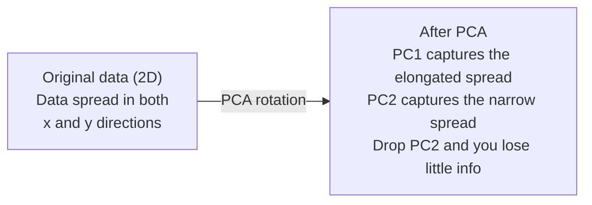

# 차원적 인 감소

> 고차원 데이터는 구조를 가지고 있습니다. 올바른 각에서 보면 찾을 수 있습니다.

**Type:** Build
**Language:**파이썬
**Prerequisites:** Phase 1, Lessons 01 (Linear Algebra Intuition), 02 (Vectors, Matrices & Operations), 03 (Eigenvalues & Eigenvectors), 06 (Probability & Distributions)
**Time:** ~90 minutes

## 학습 목표

- PCA를 처음부터 구현: 센터 데이터, 코버리안스 매트릭스를 계산, eigendecompose, 프로젝트
- 설명된 변동 비율과 팔꿈치 방법을 사용하여 주요 구성 요소의 수를 선택합니다.
- 2D로 MNIST 숫자를 시각화하기 위해 PCA, t-SNE, UMAP를 비교하고 그들의 타협을 설명하십시오
- 표준 PCA가 처리할 수 없는 비선형 데이터 구조를 분리하기 위해 RBF 커널과 커널 PCA를 적용한다

## 문제

샘플에 784개의 특징이 있는 데이터 세트가 있습니다. 아마도 그것은 손으로 쓴 숫자의 픽셀 값일 수도 있습니다. 어쩌면 유전자 표현 수준일 수도 있습니다. 어쩌면 사용자 행동 신호일 수도 있습니다. 784개의 차원을 시각화할 수 없습니다. 당신은 그들을 지도 할 수 없습니다. 당신은 심지어 그것에 대해 생각할 수 없습니다.

하지만 784의 특징들 대부분은 과잉입니다. 실제 정보는 훨씬 작은 표면에 서식합니다. 손으로 쓰인 "7"는 784 독립적인 숫자가 필요 없습니다. 그 숫자는 몇 개 필요합니다.

차원적 감소는 그 작은 표면을 찾아내며 784차원 데이터를 가져다가 2, 10 또는 50차원으로 압축하고 중요한 구조를 유지합니다.

## 개념

### 차원성의 저주

고차원 공간은 직관적이지 않습니다. 차원이 커질수록 세 가지가 깨집니다.

**Distance becomes meaningless.**높은 차원에서 두 개의 무작위 점 사이의 거리는 같은 값으로 공감합니다. 각 점들이 다른 점으로부터 대략 같은 거리에 있다면, 가장 가까운 이웃 검색은 작동하지 않습니다.

```
Dimension    Avg distance ratio (max/min between random points)
2            ~5.0
10           ~1.8
100          ~1.2
1000         ~1.02
```

**Volume concentrates in corners.**                         $d$크기는 $2^d$100개 차원에서는 거의 모든 볼륨이 중심에서 멀리 떨어진 각지에 있습니다. 데이터 포인트는 가장자리에 퍼져 있습니다.

**You need exponentially more data.**공간에서 샘플의 밀도를 유지하려면 2D에서 20D로 이동하는 것이 필요합니다$10^{18}$데이터 밀도는 더 많을수록 더 많은 데이터를 얻을 수 있습니다.

### PCA: 중요한 방향을 찾아

주요 구성 요소 분석 (PCA) 은 데이터의 가장 많은 차이를 보이는 축을 찾아냅니다. 즉, 첫 번째 축이 가장 많은 차이를, 두 번째 축이 가장 많은 차이를 파악하는 방향으로 좌표 시스템을 회전합니다.

알고리즘:

```
1. Center the data        (subtract the mean from each feature)
2. Compute covariance     (how features move together)
3. Eigendecomposition     (find the principal directions)
4. Sort by eigenvalue     (biggest variance first)
5. Project               (keep top k eigenvectors, drop the rest)
```

왜 Eigendekomposition? 코바리안스 매트릭스는 대칭적이고 긍정적인 반 정의적이다. 그 독수 vektore는 특징 공간에서 정렬 방향이다. 독수 값은 각 방향이 얼마나 많은 변수를 포착하는지 알려줍니다. 최대 변수의 방향에 따라 가장 큰 독수 값 포인트를 가진 독수 vektore는 가장 큰 변수를 포착합니다.



- **Before PCA:**데이터 클라우드는 x 및 y 축 모두에서 직사각형으로 퍼져 있습니다
- **After PCA:**좌표 시스템은 PC1가 최대 변함 방향 (장기 변함) 과 PC2가 최소 변함 방향 ( 좁은 변함) 과 일치하도록 회전된다.
- **Dimensionality reduction:**PC2를 떨어뜨리면 PC1에 데이터를 투입합니다. 아주 적은 정보를 잃습니다.

### 설명된 변동 비율

각 주요 구성 요소는 전체 변이의 일부를 포착합니다. 설명된 변의 비율은 얼마나 많은지를 알려줍니다.

```
Component    Eigenvalue    Explained ratio    Cumulative
PC1          4.73          0.473              0.473
PC2          2.51          0.251              0.724
PC3          1.12          0.112              0.836
PC4          0.89          0.089              0.925
...
```

누적 설명된 변이가 0.95에 도달하면 많은 구성 요소가 95%의 정보를 캡처한다는 것을 알고 있습니다. 그 다음 모든 것은 대부분 소음입니다.

### 구성 요소의 수를 선택

세 가지 전략:

1. **Threshold.**90~95%의 변수를 설명할 수 있는 충분한 구성 요소를 보관하십시오.
2. **Elbow method.**콤포넌트마다 변수를 설명해줬어요
3. **Downstream performance.**PCA를 사전 처리에 사용하세요.$k$그리고 모델의 정확성을 측정합니다.$k$정확도가 높은 곳이라면

### t-SNE: 이웃을 보존

t-분산 스토카스틱 이웃 임베디언 (t-SNE) 은 시각화 위해 설계되었습니다. 어떤 지점이 서로 가까이 있는지 보존하면서 2D (또는 3D) 으로 고차원 데이터를 지도합니다.

직관: 원래 공간에서, 각 지점의 거리를 기준으로 확률 분포를 계산합니다. 가까운 지점들은 높은 확률을 얻습니다. 먼 지점들은 낮은 확률을 얻습니다. 그리고 같은 확률 분포가 있는 2D 배열을 찾습니다. 784 차원에서의 이웃 지점들은 2D의 이웃이 됩니다.

t-SNE의 주요 성질:
- 비선형, PCA가 할 수 없는 복잡한 복합체를 펼칠 수 있습니다.
- 스토카스틱, 다른 라운드는 다른 레이아웃을 만들어냅니다.
- 혼란 매개 변수는 얼마나 많은 이웃을 고려해야 하는지 제어합니다 (유통적인 범위: 5-50).
- 출력에서 클러스터 사이의 거리는 의미가 없습니다. 클러스터들만 의미 있습니다.
- 큰 데이터 세트에서 느려집니다.$O(n^2)$기본적으로

### UMAP: 더 빠르고 더 나은 글로벌 구조

유니폼 매니폴드 접근 및 투사 (UMAP) 는 t-SNE와 비슷하게 작동하지만 두 가지 장점이 있습니다.
- 더 빨리, 모든 쌍방향 거리를 계산하기 보다는 대략적인 이웃 그래프를 사용합니다.
- 더 나은 글로벌 구조. 생산의 상대적 위치는 t-SNE보다 더 의미있는 경향이 있습니다.

UMAP는 고차원 공간 ( "무조한 토폴로지 표현") 에서 중량 그래프를 구축하고, 이 그래프를 가능한 한 보존하는 저차원 레이아웃을 찾습니다.

주요 매개 변수:
- `n_neighbors`지역 구조를 정의하는 이웃의 수는 (정말 복잡함과 비슷하다).
- `min_dist`: 출력에서 포인트가 얼마나 밀접하게 결합되는지. 낮은 값은 더 밀집한 클러스터를 만듭니다.

### 언제 사용해야 하는 것

| Method | Use case | Preserves | Speed |
|--------|----------|-----------|-------|
| PCA | Preprocessing before training | Global variance | Fast (exact), works on millions of samples |
| PCA | Quick exploratory visualization | Linear structure | Fast |
| t-SNE | Publication-quality 2D plots | Local neighborhoods | Slow (< 10k samples ideal) |
| UMAP | 2D visualization at scale | Local + some global structure | Medium (handles millions) |
| PCA | Feature reduction for models | Variance-ranked features | Fast |
| t-SNE / UMAP | Understanding cluster structure | Cluster separation | Medium to slow |

엄지손가락 규칙: 사전 처리 및 데이터 압축을 위해 PCA를 사용하십시오. 2D 구조를 시각화 할 때 t-SNE 또는 UMAP를 사용하십시오.

### 커널 PCA

표준 PCA는 선형 하위 공간을 찾습니다. 그것은 좌표 시스템을 회전하고 축을 떨어뜨립니다. 하지만 데이터가 비선형 다중면에 있다면 어떨까요? 2D의 원은 어떤 선으로 분리될 수 없습니다. 표준 PCA는 도움이 되지 않습니다.

커널 PCA는 커널 함수에서 유발되는 고차원 기능 공간에서 PCA를 적용합니다. 그 공간의 좌표를 명시적으로 계산하지 않고요. 이것은 커널 트릭입니다.

알고리즘:
1. 커널 매트릭스를 계산합니다$K$어디$K_{ij} = k(x_i, x_j)$
2. 기능 공간에서 커널 매트릭스를 중앙으로
3. Eigendecompose 중앙 커널 매트릭스
4. 상위 고유벡터 (중계 $1/\sqrt{\text{eigenvalue}}$) 는 예측

일반적인 커널 기능:

| Kernel | Formula | Good for |
|--------|---------|----------|
| RBF (Gaussian) | $\exp(-\gamma \lVert x - y \rVert^2)$ | Most nonlinear data, smooth manifolds |
| Polynomial | $(x \cdot y + c)^d$ | Polynomial relationships |
| Sigmoid | $\tanh(\alpha x \cdot y + c)$ | Neural network-like mappings |

커널 PCA와 표준 PCA를 언제 사용할 것인가:

| Criterion | Standard PCA | Kernel PCA |
|-----------|-------------|------------|
| Data structure | Linear subspace | Nonlinear manifold |
| Speed | $O(\min(n^2 d, d^2 n))$ | $O(n^2 d + n^3)$ |
| Interpretability | Components are linear combinations of features | Components lack direct feature interpretation |
| Scalability | Works on millions of samples | Kernel matrix is $n \times n$, memory-limited |
| Reconstruction | Direct inverse transform | Requires pre-image approximation |

2차원 중추적 원: 두 개의 점들의 반지, 하나는 다른 쪽 안에 있습니다. 표준 PCA는 두 가지를 동일한 선에 투입합니다. 분류에 쓸모 없습니다. RBF 커널을 가진 커널 PCA는 내부 원과 외부 원을 서로 다른 지역으로 지도하여 선형적으로 분리할 수 있습니다.

### 재건 오류

차원적 인 감소가 얼마나 좋습니까? 784 차원을 50으로 압축했습니다.

재구성 오류를 측정:
1. 프로젝트 자료$k$크기는: $X_{\text{reduced}} = X W_k$
2. 재건:$\hat{X} = X_{\text{reduced}} W_k^T$
3. 계산 MSE: $\text{mean}((X - \hat{X})^2)$

PCA에 대해서는 재구성 오류가 설명된 변동과 순수한 관계를 가지고 있습니다.

```math
\begin{aligned}
\text{Reconstruction error} &= \text{sum of eigenvalues NOT included} \\
\text{Total variance} &= \text{sum of ALL eigenvalues} \\
\text{Fraction lost} &= \frac{\text{sum of dropped eigenvalues}}{\text{sum of all eigenvalues}}
\end{aligned}
```

각 구성 요소에 대한 설명된 변동 비율은 다음과 같습니다.

```math
\text{explained\_ratio}_k = \frac{\text{eigenvalue}_k}{\sum \text{all eigenvalues}}
```

구성 요소의 수에 대한 누적 설명 된 변수를 그려보면 "구름" 곡선을 얻을 수 있습니다.
- 곡선은 평평화된다 (회익이 감소한다)
- 누적 변수는 당신의 임계점을 넘는다 (일반적으로 0.90 또는 0.95)
- 하류 작업 수행 평야

재구성 오류는 선택보다 유용합니다 $k$이 방법은 비정상성 검출을 위해 사용될 수 있습니다. 높은 재구성 오류의 샘플은 학습된 하위 공간에 맞지 않는 비정상성입니다. 이것은 생산 시스템에서 PCA 기반의 비정상성 검출의 기초입니다.

```figure
pca-axes
```

## 건설 해

### 단계 1: PCA는 처음부터 시작됩니다.

```python
import numpy as np

class PCA:
    def __init__(self, n_components):
        self.n_components = n_components
        self.components = None
        self.mean = None
        self.eigenvalues = None
        self.explained_variance_ratio_ = None

    def fit(self, X):
        self.mean = np.mean(X, axis=0)
        X_centered = X - self.mean

        cov_matrix = np.cov(X_centered, rowvar=False)

        eigenvalues, eigenvectors = np.linalg.eigh(cov_matrix)

        sorted_idx = np.argsort(eigenvalues)[::-1]
        eigenvalues = eigenvalues[sorted_idx]
        eigenvectors = eigenvectors[:, sorted_idx]

        self.components = eigenvectors[:, :self.n_components].T
        self.eigenvalues = eigenvalues[:self.n_components]
        total_var = np.sum(eigenvalues)
        self.explained_variance_ratio_ = self.eigenvalues / total_var

        return self

    def transform(self, X):
        X_centered = X - self.mean
        return X_centered @ self.components.T

    def fit_transform(self, X):
        self.fit(X)
        return self.transform(X)
```

### 단계 2: 합성 데이터에 대한 테스트

```python
np.random.seed(42)
n_samples = 500

t = np.random.uniform(0, 2 * np.pi, n_samples)
x1 = 3 * np.cos(t) + np.random.normal(0, 0.2, n_samples)
x2 = 3 * np.sin(t) + np.random.normal(0, 0.2, n_samples)
x3 = 0.5 * x1 + 0.3 * x2 + np.random.normal(0, 0.1, n_samples)

X_synthetic = np.column_stack([x1, x2, x3])

pca = PCA(n_components=2)
X_reduced = pca.fit_transform(X_synthetic)

print(f"Original shape: {X_synthetic.shape}")
print(f"Reduced shape:  {X_reduced.shape}")
print(f"Explained variance ratios: {pca.explained_variance_ratio_}")
print(f"Total variance captured: {sum(pca.explained_variance_ratio_):.4f}")
```

### 단계 3: 2D로 MNIST 숫자를

```python
from sklearn.datasets import fetch_openml

mnist = fetch_openml("mnist_784", version=1, as_frame=False, parser="auto")
X_mnist = mnist.data[:5000].astype(float)
y_mnist = mnist.target[:5000].astype(int)

pca_mnist = PCA(n_components=50)
X_pca50 = pca_mnist.fit_transform(X_mnist)
print(f"50 components capture {sum(pca_mnist.explained_variance_ratio_):.2%} of variance")

pca_2d = PCA(n_components=2)
X_pca2d = pca_2d.fit_transform(X_mnist)
print(f"2 components capture {sum(pca_2d.explained_variance_ratio_):.2%} of variance")
```

### 단계 4: sklearn과 비교

```python
from sklearn.decomposition import PCA as SklearnPCA
from sklearn.manifold import TSNE

sklearn_pca = SklearnPCA(n_components=2)
X_sklearn_pca = sklearn_pca.fit_transform(X_mnist)

print(f"\nOur PCA explained variance:     {pca_2d.explained_variance_ratio_}")
print(f"Sklearn PCA explained variance: {sklearn_pca.explained_variance_ratio_}")

diff = np.abs(np.abs(X_pca2d) - np.abs(X_sklearn_pca))
print(f"Max absolute difference: {diff.max():.10f}")

tsne = TSNE(n_components=2, perplexity=30, random_state=42)
X_tsne = tsne.fit_transform(X_mnist)
print(f"\nt-SNE output shape: {X_tsne.shape}")
```

### 단계 5: UMAP 비교

```python
try:
    from umap import UMAP

    reducer = UMAP(n_components=2, n_neighbors=15, min_dist=0.1, random_state=42)
    X_umap = reducer.fit_transform(X_mnist)
    print(f"UMAP output shape: {X_umap.shape}")
except ImportError:
    print("Install umap-learn: pip install umap-learn")
```

## 사용 하 고

PCA는 분류기 전에 사전 처리가 됩니다.

```python
from sklearn.decomposition import PCA as SklearnPCA
from sklearn.linear_model import LogisticRegression
from sklearn.model_selection import train_test_split
from sklearn.metrics import accuracy_score

X_train, X_test, y_train, y_test = train_test_split(
    X_mnist, y_mnist, test_size=0.2, random_state=42
)

results = {}
for k in [10, 30, 50, 100, 200]:
    pca_k = SklearnPCA(n_components=k)
    X_tr = pca_k.fit_transform(X_train)
    X_te = pca_k.transform(X_test)

    clf = LogisticRegression(max_iter=1000, random_state=42)
    clf.fit(X_tr, y_train)
    acc = accuracy_score(y_test, clf.predict(X_te))
    var_captured = sum(pca_k.explained_variance_ratio_)
    results[k] = (acc, var_captured)
    print(f"k={k:>3d}  accuracy={acc:.4f}  variance={var_captured:.4f}")
```

784 차원보다 훨씬 앞서서 연출하는 평야

## 선박

이 교훈은 다음과 같은 결과를 낳습니다.
- `outputs/skill-dimensionality-reduction.md`- 주어진 작업에 적합한 차원적 인 감소 기술을 선택하는 능력

## 운동

1. PCA 클래스를 지원하도록 수정합니다 `inverse_transform`. 10, 50, 200개의 구성 요소에서 MNIST 숫자를 재구성하여 각 구성 요소에 대한 재구성 오류 (원본의 평균 제곱 차이) 를 인쇄합니다.

2. t-SNE를 같은 MNIST 하위 집합에서 5, 30 및 100의 혼란 값으로 실행하십시오. 출력 변경 방법을 설명하십시오. 왜 혼란은 클러스터 밀도를 영향을 미칩니다?

3. 50가지 기능이 있는 데이터 세트를 가져가 5가지 기능만 정보를 주는 것을`sklearn.datasets.make_classification`). PCA를 적용하고 설명된 변함 곡선에서 데이터가 사실상 5차원적이라는 것을 올바르게 확인하는지 확인합니다.

### 암시

**Exercise 1.**읽으세요`inverse_transform``PCA`각 구성 요소의 숫자에 대해 하나의 모델을 적용하고`reconstruction_error`10, 50 및 200개의 구성요소에서 오류가 증가함에 따라 감소해야 합니다.

**Exercise 2.** 적합`sklearn.manifold.TSNE`같은 부분집단에 3번씩만 변합니다`perplexity`, 그리고 같은 것을 사용하십시오`random_state`낮은 혼란은 몇 개의 이웃을 바라보고 작은 긴 그룹을 기대합니다. 높은 혼란은 더 많은 이웃을 바라보고 더 크고 부드러운 그룹을 기대합니다.

**Exercise 3.**전화`make_classification(n_features=50, n_informative=5, n_redundant=45)`, 적합합니다`PCA`, 그리고 누적 설명 변수를 인쇄합니다. 과잉 특징은 정보적인 것들의 선형 조합입니다. 그래서 곡선은 5개의 구성 요소에서 거의 1.0에 도달합니다.`n_redundant=0`: 나머지 45개의 특징은 독립적인 소음이며 곡선은 평평하지 않습니다.

## 주요 용어

| Term | What people say | What it actually means |
|------|----------------|----------------------|
| Curse of dimensionality | "Too many features" | Distances, volumes, and data density all behave counterintuitively as dimensions grow. Models need exponentially more data to compensate. |
| PCA | "Reduce dimensions" | Rotate your coordinate system so the axes align with the directions of maximum variance, then drop the low-variance axes. |
| Principal component | "An important direction" | An eigenvector of the covariance matrix. The direction in feature space along which the data varies most. |
| Explained variance ratio | "How much info this component has" | The fraction of total variance captured by one principal component. Sum the top $k$ ratios to see how much $k$ components preserve. |
| Covariance matrix | "How features correlate" | A symmetric matrix where entry $(i,j)$ measures how feature $i$ and feature $j$ move together. Diagonal entries are individual variances. |
| t-SNE | "That cluster plot" | A nonlinear method that maps high-dimensional data to 2D by preserving pairwise neighborhood probabilities. Good for visualization, not for preprocessing. |
| UMAP | "Faster t-SNE" | A nonlinear method based on topological data analysis. Preserves both local and some global structure. Scales better than t-SNE. |
| Perplexity | "A t-SNE knob" | Controls the effective number of neighbors each point considers. Low perplexity focuses on very local structure. High perplexity captures broader patterns. |
| Manifold | "The surface the data lives on" | A lower-dimensional surface embedded in a higher-dimensional space. A sheet of paper crumpled in 3D is a 2D manifold. |

## 더 많은 읽기

- [A Tutorial on Principal Component Analysis](https://arxiv.org/abs/1404.1100)(Shlens) - PCA의 명확한 추출은 처음부터
- [How to Use t-SNE Effectively](https://distill.pub/2016/misread-tsne/)(Wattenberg et al.) - t-SNE 함정 및 파라미터 선택에 대한 대화형 가이드
- [UMAP documentation](https://umap-learn.readthedocs.io/)- UMAP의 저자들에 의한 이론과 실제적인 지침
