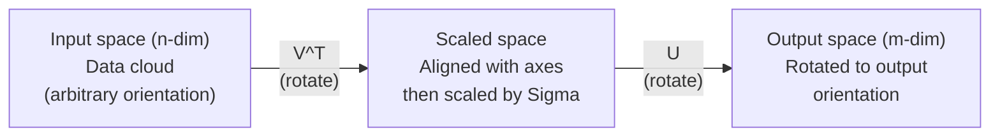
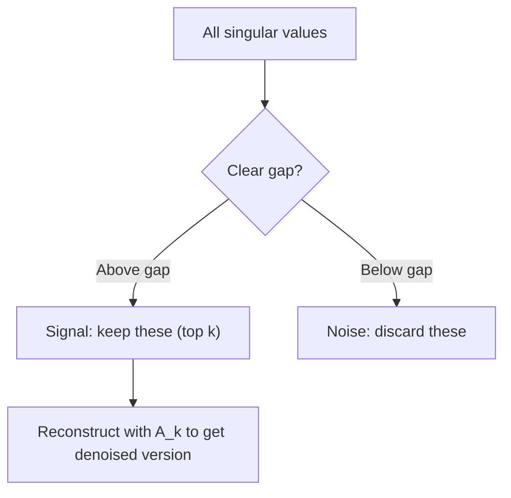

# 단일 값 분해

> SVD는 스위스 육군의 선형수학의 칼입니다. 매트릭스마다 하나 있습니다. 모든 데이터 과학자는 하나 필요합니다.

**Type:** Build
**Languages:** Python, Julia
**Prerequisites:** Phase 1, Lessons 01 (Linear Algebra Intuition), 02 (Vectors & Matrices Operations), 03 (Matrix Transformations)
**Time:** ~120 minutes

## 학습 목표

- 전력 반복을 통해 SVD를 구현하고$U$$\Sigma$그리고$V^T$
- 이미지 압축을 위해 줄여진 SVD를 적용하고 압축 비율과 재구성 오류를 측정합니다
- SVD를 통해 Moore-Penrose의 변형을 계산하여 과분한 최소 광장 시스템을 해결합니다
- SVD를 PCA, 추천 시스템 (라텐트 요소) 및 NLP에서 라텐트 의미 분석에 연결

## 문제

1000x2000 매트릭스 (영화 시청률) 를 가지고 있습니다. 아마도 사용자 영화 등급이 있을 것입니다. 어쩌면 문서 기간 주파수 테이블일 수도 있습니다. 어쩌면 그림의 픽셀 값일 수도 있습니다. 당신은 그것을 압축하거나 소멸하거나, 숨겨진 구조를 찾아내거나, 또는 가장 적은 제곱의 시스템을 해결해야합니다. Eigendecomposition는 제곱 매트릭스에서만 작동합니다. 그 경우에도 매트릭스가 전체 선형 독립된 독자벡터 집합을 가질 필요가 있습니다.

SVD는 어떤 매트릭스, 어떤 모양, 어떤 순위, 어떤 조건도 없이 작동합니다. 매트릭스가 공간에 어떤 영향을 미치는지에 대한 기하학을 나타내는 세 가지 요소로 매트릭스를 분해합니다.

## 개념

### SVD가 어떻게 지리적으로 수행하는지

매트릭스마다 형태와 상관없이 세 가지 작업을 수행합니다. 회전, 스케일, 회전. SVD는 이 분해를 명시적으로 만듭니다.

```math
\underset{\substack{m \times n \\ \text{(any)}}}{A} = \underset{\substack{m \times m \\ \text{(rotate)}}}{U} \cdot \underset{\substack{m \times n \\ \text{(scale)}}}{\Sigma} \cdot \underset{\substack{n \times n \\ \text{(rotate)}}}{V^T}
```

어떤 매트릭스를 $A$, SVD는 다음과 같은 요소로 요약합니다
- $V^T$입력 공간에서 벡터를 회전 ($n$-차원형)
- $\Sigma$각 축을 따라 빗자루 (stretches or compresses)
- $U$결과물을 출력 공간에 돌립니다 ($m$-차원형)



이렇게 생각해보세요. SVD에 매트릭스를 넘겨주면, 매트릭스는 "이 매트릭스는 입력구름을 가져다가 먼저$V^T$, 그리고 그것을 에 은 에 $\Sigma$, 그리고 은 을 을$U$." 단일 값은 엘립소이드의 축의 길이가 됩니다.

### 전체 분해

매트릭스$A$모양이 있는$m \times n$이 부분의 본문은

```math
\begin{aligned}
& A = U \cdot \Sigma \cdot V^T \\[6pt]
& \text{where:} \\
& \quad U \text{ is } m \times m, \text{ orthogonal } (U^T U = I) \\
& \quad \Sigma \text{ is } m \times n, \text{ diagonal (singular values on the diagonal)} \\
& \quad V \text{ is } n \times n, \text{ orthogonal } (V^T V = I) \\[6pt]
& \text{The singular values } \sigma_1 \ge \sigma_2 \ge \cdots \ge \sigma_r > 0 \\
& \text{where } r = \mathop{\mathrm{rank}}(A)
\end{aligned}
```

의 기둥$U$좌파 단일 벡터라고 합니다.$V$직선 단수 벡터라고 합니다.$\Sigma$이 값은 항상 부정적이 아니며, 일반적으로 감소 순서로 분류됩니다.

### 왼쪽 싱글 벡터, 싱글 값, 오른쪽 싱글 벡터

SVD의 각 구성 요소는 다른 기하학적 의미를 가지고 있습니다.

**Right singular vectors (columns of $V$):**이 입력 공간에 대한 정규적 기초를 형성합니다 ($\mathbb{R}^n$) 는 입력 공간의 방향이 출력 공간의 정렬 방향으로 매트릭스가 지도를 내놓는 방향입니다.

**Singular values (diagonal of $\Sigma$):**이 값은 i-일자 값으로 매트릭스가 i-일자 값으로 매트릭스가 얼마나 많은 벡터를 뻗어 나는지 알 수 있습니다.

**Left singular vectors (columns of $U$):**이 값들은 출력 공간의 정형적 기초를 형성한다 ($\mathbb{R}^m$). i-th 왼쪽 싱글버드 벡터는 출력 공간에서 i-th 오른쪽 싱글버드 벡터가 착륙하는 방향입니다 (스케일링 후에).

이 둘 사이의 관계는

```
A * v_i = sigma_i * u_i

The matrix A takes the i-th right singular vector v_i,
scales it by sigma_i, and maps it to the i-th left singular vector u_i.
```

이것은 어떤 매트릭스가 무엇을 하는지 좌표에 따라 좌표에 대한 그림을 제공합니다.

### 외부 제품 형태

SVD는 순위-1 매트리스의 합으로 작성될 수 있습니다.

```
A = sigma_1 * u_1 * v_1^T + sigma_2 * u_2 * v_2^T + ... + sigma_r * u_r * v_r^T

Each term sigma_i * u_i * v_i^T is a rank-1 matrix (an outer product).
The full matrix is the sum of r such matrices, where r is the rank.
```

이 형태는 낮은 순위 근접의 기초입니다. 각 용어는 하나의 구조 층을 추가합니다. 첫 번째 용어는 단일 가장 중요한 패턴을 캡처합니다. 두 번째는 다음 가장 중요한 패턴을 캡처합니다. 그리고 그 밖에도. 이 수를 줄이면 주어진 순위에서 가능한 가장 좋은 근접을 제공합니다.

```math
\begin{aligned}
\text{Rank-1 approx:} \quad & A_1 = \sigma_1 u_1 v_1^T \\
& \text{(captures the dominant pattern)} \\[6pt]
\text{Rank-2 approx:} \quad & A_2 = \sigma_1 u_1 v_1^T + \sigma_2 u_2 v_2^T \\
& \text{(captures the two most important patterns)} \\[6pt]
\text{Rank-}k\text{ approx:} \quad & A_k = \text{sum of top } k \text{ terms} \\
& \text{(optimal by the Eckart-Young theorem)}
\end{aligned}
```

### 자기자연의 구성에 대한 관계

SVD와 Eigende Komposition는 깊은 연관성을 가지고 있습니다.$A$직접적으로 의 고유값과 고유벡터에서$A^T A$그리고$A A^T$- 그래

```
A^T A = V * Sigma^T * U^T * U * Sigma * V^T
      = V * Sigma^T * Sigma * V^T
      = V * D * V^T

where D = Sigma^T * Sigma is a diagonal matrix with sigma_i^2 on the diagonal.

So:
- The right singular vectors (V) are eigenvectors of A^T A
- The singular values squared (sigma_i^2) are eigenvalues of A^T A

Similarly:
A A^T = U * Sigma * V^T * V * Sigma^T * U^T
      = U * Sigma * Sigma^T * U^T

So:
- The left singular vectors (U) are eigenvectors of A A^T
- The eigenvalues of A A^T are also sigma_i^2
```

이 연결은 세 가지 사실을 알려줍니다.
1. 싱글러 값은 항상 실제적이고 부정적이지는 않습니다 (그들은 긍정적 반 정의 매트릭스의 고유 값의 제곱근입니다).
2. SVD를 계산할 수 있는 방법은$A^T A$, 하지만 이것은 조건 번호를 제곱하고 수치 정확도를 잃습니다.
3. 언제$A$이 부분의 경우, SVD와 Eigendekomposition는 같은 것입니다.

### 단축된 SVD: 낮은 순위 근접

에카트-젊은 미르스키 정리는 최고의$\text{rank-}k$$A$(프로베니우스 및 스펙트럼 표준 모두)$k$단일 값과 그에 따른 벡터:

```math
\begin{aligned}
& A_k = U_k \cdot \Sigma_k \cdot V_k^T \\[6pt]
& \text{where:} \\
& \quad U_k \text{ is } m \times k \quad \text{(first } k \text{ columns of } U\text{)} \\
& \quad \Sigma_k \text{ is } k \times k \quad \text{(top-left } k \times k \text{ block of } \Sigma\text{)} \\
& \quad V_k \text{ is } n \times k \quad \text{(first } k \text{ columns of } V\text{)} \\[6pt]
& \text{Approximation error} = \sigma_{k+1} \quad \text{(in spectral norm)} \\
& \text{Approximation error} = \sqrt{\sigma_{k+1}^2 + \cdots + \sigma_r^2} \quad \text{(in Frobenius norm)}
\end{aligned}
```

이것은 단순히 "좋은" 근접이 아니라, 순위 근접이 가장 좋은 것으로 증명될 수 있습니다.$k$- 다른 건 없어요$\text{rank-}k$매트릭스는 $A$- 그래

| Component | Relative magnitude | Kept in rank-3 approx? |
|-----------|-------------------|------------------------|
| $\sigma_1$ | Largest | Yes |
| $\sigma_2$ | Large | Yes |
| $\sigma_3$ | Medium-large | Yes |
| $\sigma_4$ | Medium | No (error) |
| $\sigma_5$ | Medium-small | No (error) |
| $\sigma_6$ | Small | No (error) |
| $\sigma_7$ | Very small | No (error) |
| $\sigma_8$ | Tiny | No (error) |

3번째로$A_3$가장 큰 3개의 단일 값들을 캡처합니다. 오류 = 나머지 값 ($\sigma_4$ $\sigma_8$)

만약 단일 값이 빠르게 붕괴한다면, 작은 값이$k$매트릭스의 대부분을 포착합니다. 만약 그들이 천천히 붕괴한다면 매트릭스는 낮은 구조를 가지고 있지 않습니다.

### SVD로 이미지 압축

회색 스케일 이미지는 픽셀 강도의 매트릭스입니다. 800x600의 이미지는 480,000개의 값을 가지고 있습니다. SVD는 훨씬 적은 값으로 접근할 수 있습니다.

```
Original image: 800 x 600 = 480,000 values

SVD with rank k:
  U_k:      800 x k values
  Sigma_k:  k values
  V_k:      600 x k values
  Total:    k * (800 + 600 + 1) = k * 1401 values

  k=10:   14,010 values   (2.9% of original)
  k=50:   70,050 values  (14.6% of original)
  k=100: 140,100 values  (29.2% of original)

  The compression ratio improves as k gets smaller,
  but visual quality degrades.
```

주요 통찰력: 자연 이미지는 급속히 붕괴되는 단일 값이 있습니다. 첫 몇 개의 단일 값은 넓은 구조 (형, 경각층) 를 캡처합니다. 후자는 미세한 세부 사항과 소음을 캡처합니다. 50 순위에서 줄이는 것은 종종 85% 더 적은 저장량을 사용하면서 원본과 거의 동일하게 보이는 이미지를 생성합니다.

### 추천 시스템 SVD

넷플릭스 상이 이것을 유명하게 만들었습니다. 대부분의 작품이 없는 사용자 영화 시청률 행렬이 있습니다.

```
             Movie1  Movie2  Movie3  Movie4  Movie5
  User1      [  5      ?       3       ?       1  ]
  User2      [  ?      4       ?       2       ?  ]
  User3      [  3      ?       5       ?       ?  ]
  User4      [  ?      ?       ?       4       3  ]

  ? = unknown rating
```

이 평가 매트릭스는 낮은 순위를 가지고 있습니다. 사용자는 완전히 독립적인 취향을 가지고 있지 않습니다. 대부분의 선호도를 설명하는 몇 가지 잠그고 있는 요인 (행동과 드라마, 오래된 것과 새로운, 뇌와 내장) 가 있습니다.

(충전) 평가 매트릭스에 SVD가 그것을 분해하여:
- $U$: 잠자연 요소 공간에서 사용자 프로파일
- $\Sigma$: 각 잠복 요소의 중요성
- $V^T$: 잠자연 요소 공간에서 영화 프로필

영화에 대한 사용자의 예측 평가는 영화의 프로필과 함께 사용자의 프로필의 점수 산물 (일자 값으로 중량) 이다. 낮은 순위 인 근접은 부족한 항목을 채우게 된다.

실제에서는 실종된 데이터를 직접 처리하는 사이먼 펑크의 인크레멘탈 SVD 또는 ALS (최소 사각형을 대행) 같은 변형을 사용합니다. 하지만 핵심 아이디어는 동일합니다.

### NLP에서 SVD: 잠잠한 의미 분석

또한 latente semantic indexing (LSI) 라고도 불리는 latente semantic analysis (LSA) 는 SVD를 용어 문서 매트릭스에 적용합니다.

```
             Doc1   Doc2   Doc3   Doc4
  "cat"      [  3      0      1      0  ]
  "dog"      [  2      0      0      1  ]
  "fish"     [  0      4      1      0  ]
  "pet"      [  1      1      1      1  ]
  "ocean"    [  0      3      0      0  ]

After SVD with rank k=2:

  Each document becomes a point in 2D "concept space."
  Each term becomes a point in the same 2D space.
  Documents about similar topics cluster together.
  Terms with similar meanings cluster together.

  "cat" and "dog" end up near each other (land pets).
  "fish" and "ocean" end up near each other (water concepts).
  Doc1 and Doc3 cluster if they share similar topics.
```

LSA는 원본에서 의미적 유사성을 캡처하는 최초의 성공적인 방법 중 하나였습니다. 그것은 동호어 용어가 유사한 문서에서 나타나는 경향이 있기 때문에 작동합니다. 그래서 SVD는 동일한 잠복 차원으로 그룹화합니다. 현대 단어 임베디션 (Word2Vec, GloVe) 은 이 아이디어의 후손으로 볼 수 있습니다.

### 소음 감축을 위한 SVD

소음 데이터에는 신호가 상위 단일 값에 집중되어 있으며 소음은 모든 단일 값에 퍼져 있습니다. 단축하면 소음 바닥을 제거합니다.

**Clean signal singular values:**

| Component | Magnitude | Type |
|-----------|-----------|------|
| $\sigma_1$ | Very large | Signal |
| $\sigma_2$ | Large | Signal |
| $\sigma_3$ | Medium | Signal |
| $\sigma_4$ | Near zero | Negligible |
| $\sigma_5$ | Near zero | Negligible |

**Noisy signal singular values (noise adds to all):**

| Component | Magnitude | Type |
|-----------|-----------|------|
| $\sigma_1$ | Very large | Signal |
| $\sigma_2$ | Large | Signal |
| $\sigma_3$ | Medium | Signal |
| $\sigma_4$ | Small | Noise |
| $\sigma_5$ | Small | Noise |
| $\sigma_6$ | Small | Noise |
| $\sigma_7$ | Small | Noise |



이 기기는 신호 처리, 과학적인 측정, 데이터 청소에 사용됩니다. 추가적인 소음으로 손상된 매트릭스를 가진 경우, 줄여진 SVD는 신호와 소음을 분리하는 원칙적인 방법입니다.

### SVD를 통해 가짜반복

무어-펜로즈의 외면적 역대$A^+$SVD는 매트릭스 역전도를 비제곱과 단일 매트릭스로 일반화합니다.

```
If A = U * Sigma * V^T, then:

A+ = V * Sigma+ * U^T

where Sigma+ is formed by:
  1. Transpose Sigma (swap rows and columns)
  2. Replace each non-zero diagonal entry sigma_i with 1/sigma_i
  3. Leave zeros as zeros

For A (m x n):      A+ is (n x m)
For Sigma (m x n):  Sigma+ is (n x m)
```

이 역대적 은 최소 광수 문제를 해결 합니다.$Ax = b$정확한 해결책이 없습니다 (이렇게 정해진 시스템)$x = A^+ b$가장 적은 제곱의 해법입니다 (최소)$\lVert Ax - b \rVert$)

```
Overdetermined system (more equations than unknowns):

  [1  1]         [3]
  [2  1] x   =   [5]       No exact solution exists.
  [3  1]         [6]

  x_ls = A+ b = V * Sigma+ * U^T * b

  This gives the x that minimizes the sum of squared residuals.
  Same result as the normal equations (A^T A)^(-1) A^T b,
  but numerically more stable.
```

### 수학적 안정성의 장점

의 자체 구성을 계산하는$A^T A$의 고유값을 (eigenvalues of 의 고유값을)$A^T A$$\sigma_i^2$) 이 조건 번호를 제곱하여 수치 오류를 증폭시킵니다.

```
Example:
  A has singular values [1000, 1, 0.001]
  Condition number of A: 1000 / 0.001 = 10^6

  A^T A has eigenvalues [10^6, 1, 10^{-6}]
  Condition number of A^T A: 10^6 / 10^{-6} = 10^{12}

  Computing SVD directly: works with condition number 10^6
  Computing via A^T A:     works with condition number 10^{12}
                           (6 extra digits of precision lost)
```

현대 SVD 알고리즘 (골브-카한 쌍방식 진단) 은 직접적으로 작동합니다$A$, 결코 형성되지 않습니다$A^T A$그래서 항상 선호해야 합니다`np.linalg.svd(A)`끝`np.linalg.eig(A.T @ A)`- 그래

### PCA에 연결

PCA는 중앙 데이터에 SVD입니다. 이것은 비유가 아닙니다. 그것은 문자 그대로 같은 계산입니다.

```
Given data matrix X (n_samples x n_features), centered (mean subtracted):

Covariance matrix: C = (1/(n-1)) * X^T X

PCA finds eigenvectors of C. But:

  X = U * Sigma * V^T    (SVD of X)

  X^T X = V * Sigma^2 * V^T

  C = (1/(n-1)) * V * Sigma^2 * V^T

So the principal components are exactly the right singular vectors V.
The explained variance for each component is sigma_i^2 / (n-1).

In sklearn, PCA is implemented using SVD, not eigendecomposition.
It is faster and more numerically stable.
```

이것은 10강에서 차원적 감소에 대해 배운 모든 것이 HUD 아래 SVD입니다. PCA는 머신러닝에서 SVD의 가장 일반적인 응용입니다.

```figure
svd-rank-reconstruction
```

## 건설 해

### 단계 1: 전력 반복을 사용하여 처음부터 SVD

아이디어: 가장 큰 단일 값과 그 벡터를 찾기 위해,$A^T A$(또는$A A^T$) 다음으로 매트릭스를 디프레이트하고 다음 싱글 값에 대해 반복합니다.

```python
import numpy as np

def power_iteration(M, num_iters=100):
    n = M.shape[1]
    v = np.random.randn(n)
    v = v / np.linalg.norm(v)

    for _ in range(num_iters):
        Mv = M @ v
        v = Mv / np.linalg.norm(Mv)

    eigenvalue = v @ M @ v
    return eigenvalue, v

def svd_from_scratch(A, k=None):
    m, n = A.shape
    if k is None:
        k = min(m, n)

    sigmas = []
    us = []
    vs = []

    A_residual = A.copy().astype(float)

    for _ in range(k):
        AtA = A_residual.T @ A_residual
        eigenvalue, v = power_iteration(AtA, num_iters=200)

        if eigenvalue < 1e-10:
            break

        sigma = np.sqrt(eigenvalue)
        u = A_residual @ v / sigma

        sigmas.append(sigma)
        us.append(u)
        vs.append(v)

        A_residual = A_residual - sigma * np.outer(u, v)

    U = np.column_stack(us) if us else np.empty((m, 0))
    S = np.array(sigmas)
    V = np.column_stack(vs) if vs else np.empty((n, 0))

    return U, S, V
```

### 단계 2: NumPy와 테스트하고 비교

```python
np.random.seed(42)
A = np.random.randn(5, 4)

U_ours, S_ours, V_ours = svd_from_scratch(A)
U_np, S_np, Vt_np = np.linalg.svd(A, full_matrices=False)

print("Our singular values:", np.round(S_ours, 4))
print("NumPy singular values:", np.round(S_np, 4))

A_reconstructed = U_ours @ np.diag(S_ours) @ V_ours.T
print(f"Reconstruction error: {np.linalg.norm(A - A_reconstructed):.8f}")
```

### 단계 3: 이미지 압축 데모

```python
def compress_image_svd(image_matrix, k):
    U, S, Vt = np.linalg.svd(image_matrix, full_matrices=False)
    compressed = U[:, :k] @ np.diag(S[:k]) @ Vt[:k, :]
    return compressed

image = np.random.seed(42)
rows, cols = 200, 300
image = np.random.randn(rows, cols)

for k in [1, 5, 10, 20, 50]:
    compressed = compress_image_svd(image, k)
    error = np.linalg.norm(image - compressed) / np.linalg.norm(image)
    original_size = rows * cols
    compressed_size = k * (rows + cols + 1)
    ratio = compressed_size / original_size
    print(f"k={k:>3d}  error={error:.4f}  storage={ratio:.1%}")
```

### 단계 4: 잡음 감소

```python
np.random.seed(42)
clean = np.outer(np.sin(np.linspace(0, 4*np.pi, 100)),
                 np.cos(np.linspace(0, 2*np.pi, 80)))
noise = 0.3 * np.random.randn(100, 80)
noisy = clean + noise

U, S, Vt = np.linalg.svd(noisy, full_matrices=False)
denoised = U[:, :5] @ np.diag(S[:5]) @ Vt[:5, :]

print(f"Noisy error:    {np.linalg.norm(noisy - clean):.4f}")
print(f"Denoised error: {np.linalg.norm(denoised - clean):.4f}")
print(f"Improvement:    {(1 - np.linalg.norm(denoised - clean) / np.linalg.norm(noisy - clean)):.1%}")
```

### 단계 5: 가짜 역전

```python
A = np.array([[1, 1], [2, 1], [3, 1]], dtype=float)
b = np.array([3, 5, 6], dtype=float)

U, S, Vt = np.linalg.svd(A, full_matrices=False)
S_inv = np.diag(1.0 / S)
A_pinv = Vt.T @ S_inv @ U.T

x_svd = A_pinv @ b
x_lstsq = np.linalg.lstsq(A, b, rcond=None)[0]
x_pinv = np.linalg.pinv(A) @ b

print(f"SVD pseudoinverse solution:  {x_svd}")
print(f"np.linalg.lstsq solution:   {x_lstsq}")
print(f"np.linalg.pinv solution:    {x_pinv}")
```

## 사용 하 고

전체 작업 디모가 있습니다`code/svd.py`. SVD를 이미지 압축, 추천 시스템, 잠잠한 의미 분석 및 소음 감소에 적용하는 것을 보기 위해 실행하십시오.

```bash
python svd.py
```

리아 버전`code/svd.jl`리아의 모국어를 사용하여 동일한 개념을 보여줍니다 `svd()`기능 및`LinearAlgebra`패키지

```bash
julia svd.jl
```

## 선박

이 교훈은 다음과 같은 결과를 낳습니다.
- `outputs/skill-svd.md`- 실제 프로젝트에서 SVD를 언제 어떻게 적용할지 알 수 있는 능력

## 운동

1. 전력 반복을 사용하지 않고 처음부터 전체 SVD를 구현하십시오. 대신, 의 자체 구성을 계산하십시오.$A^T A$$V$그리고 단수값을 계산해 보세요$U = A V \Sigma^{-1}$. 전력 반복 버전과 NumPy와 수학적 정확성을 비교하십시오.

2. 실제 회색 스케일 이미지를 로드 (또는 회색 스케일로 변환) 하여 1, 5, 10, 25, 50, 100 순위에서 압축하십시오. 각 순위에서 압축 비율과 상대적 오류를 계산하여 이미지를 시각적으로 수용할 수 있는 순위를 찾아보십시오.

3. 작은 추천 시스템을 구축하십시오. 알려진 항목을 사용하여 10x8 사용자 영화 평가 행렬을 생성하십시오. 행량 수단으로 부족한 항목을 작성하십시오. SVD를 계산하고 3 순위 근접을 재구성하십시오. 부족한 평가 예측을 위해 재구성 행렬을 사용하십시오. 예측이 합리적인지 확인하십시오.

4. 3개의 합성 주제를 가진 100x50 문서 용어 매트릭스를 생성하십시오. 각 주제는 5개의 연관된 용어를 가지고 있습니다. 소음을 추가합니다. SVD를 적용하고 상위 3개의 단일 값이 나머지보다 훨씬 크는지 확인합니다. 3차원 잠자리 공간에 문서들을 프로젝트하고 같은 주제 클러스터에서 문서들을 함께 확인합니다.

5. 깨끗한 낮은 순위 매트릭스를 생성 (상위 3, 크기는 50x40) 하고 다른 수준에서 가우스 소음을 추가 ($\sigma$= 0.1, 0.5, 1.0, 2.0) 각 노이즈 레벨에 대해, 을 어 최적의 단축 순위를 찾아내기$k$1에서 40까지의 경우, 청정 매트릭스에 대한 재구성 오류를 측정합니다.$k$소음 수준에 따른 변화

### 암시

**Exercise 1.**계산$A^T A$, 자신의 값과 자신의 벡터를 얻을 수 있습니다`np.linalg.eigh`, 그리고 하향 순서로 분류합니다.$U \Sigma V^T$재건$A$그리고 오류를 비교해 보세요`svd_from_scratch`그리고`np.linalg.svd`- 그래

**Exercise 2.**전화`truncated_svd`각 순위에서 이미지를 재구성해`reconstruct`, 그리고 사용`compression_ratio(m, n, k)`순위가 커질수록 상대적 오류가 떨어질 것이고, 명확한 블록이 없는 첫 번째 순위는 답입니다.

**Exercise 3.**실종된 세포를 표시하고, 줄 평균으로 채우고,`truncated_svd`그리고`reconstruct`. 그 다음 결과를 측정: 평정 범위 밖의 예측을 계산하고 알려진 셀에서 가장 큰 변화를 인쇄합니다. 3 순위 근접은 어느 것도 보장하지 않습니다. 따라서 유효한 평가가 필요한 경우 범위에서 예측을 클립합니다.

**Exercise 4.**각 주제를 5개의 용어들로 구성하여 문서에 높은 숫자를 추가하고 소음만 추가합니다. 단위 값을 인쇄합니다. 첫 3개는 4개보다 훨씬 크어야 합니다. 다음 주제를 따라 3D 좌표를 색칠하고 각 주제가 하나의 그룹을 구성하는지 확인하십시오.

**Exercise 5.**깨끗한 행렬을 50x3와 3x40의 무작위 행렬의 곱으로 만들어서 각각에 소음을 추가합니다.$\sigma$- 각 사람$k$, 순위를 비교해 보세요$k$깨끗한 매트릭스를 사용하여 재건을 합니다. 최고의 것을 기대합니다.$k$낮은 소음으로 3에 가까운 소음으로 낮은 소음으로 낮은 소음으로

## 주요 용어

| Term | What people say | What it actually means |
|------|----------------|----------------------|
| SVD | "Factor any matrix" | Decompose $A$ into $U \Sigma V^T$ where $U$ and $V$ are orthogonal and $\Sigma$ is diagonal with non-negative entries. Works for any matrix of any shape. |
| Singular value | "How important this component is" | The $i$-th diagonal entry of $\Sigma$. Measures how much the matrix stretches along the i-th principal direction. Always non-negative, sorted in decreasing order. |
| Left singular vector | "Output direction" | A column of $U$. The direction in output space that the $i$-th right singular vector maps to (after scaling by $\sigma_i$). |
| Right singular vector | "Input direction" | A column of $V$. The direction in input space that the matrix maps to the $i$-th left singular vector (after scaling by $\sigma_i$). |
| Truncated SVD | "Low-rank approximation" | Keep only the top $k$ singular values and their vectors. Produces the provably best $\text{rank-}k$ approximation to the original matrix (Eckart-Young theorem). |
| Rank | "True dimensionality" | The number of non-zero singular values. Tells you how many independent directions the matrix actually uses. |
| Pseudoinverse | "Generalized inverse" | $V \Sigma^+ U^T$. Inverts non-zero singular values, leaves zeros as zeros. Solves least-squares problems for non-square or singular matrices. |
| Condition number | "How sensitive to errors" | $\sigma_{\max} / \sigma_{\min}$. A large condition number means small input changes cause large output changes. SVD reveals this directly. |
| Latent factor | "Hidden variable" | A dimension in the low-rank space discovered by SVD. In recommendations, a latent factor might correspond to genre preference. In NLP, it might correspond to a topic. |
| Frobenius norm | "Total matrix size" | Square root of the sum of squared entries. Equals the square root of the sum of squared singular values. Used to measure approximation error. |
| Eckart-Young theorem | "SVD gives the best compression" | For any target rank $k$, the truncated SVD minimizes the approximation error over all possible $\text{rank-}k$ matrices. |
| Power iteration | "Find the biggest eigenvector" | Repeatedly multiply a random vector by the matrix and normalize. Converges to the eigenvector with the largest eigenvalue. The building block of many SVD algorithms. |

## 더 많은 읽기

- [Gilbert Strang: Linear Algebra and Its Applications, Chapter 7](https://math.mit.edu/~gs/linearalgebra/)- SVD를 응용 프로그램으로 철저하게 처리
- [3Blue1Brown: But what is the SVD?](https://www.youtube.com/watch?v=vSczTbgc8Rc)- SVD에 대한 기하학적 직관
- [We Recommend a Singular Value Decomposition](https://www.ams.org/publicoutreach/feature-column/fcarc-svd)- 미국 수학교육학회에서 접근 가능한 개요
- [Netflix Prize and Matrix Factorization](https://sifter.org/~simon/journal/20061211.html)- 시몬 펑크의 추천 블로그
- [Latent Semantic Analysis](https://en.wikipedia.org/wiki/Latent_semantic_analysis)- SVD의 원래 NLP 응용
- [Numerical Linear Algebra by Trefethen and Bau](https://people.maths.ox.ac.uk/trefethen/text.html)- SVD 알고리즘과 그 수학적 특성을 이해하는 금 표준
