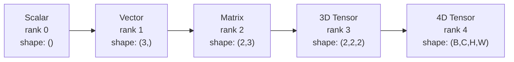
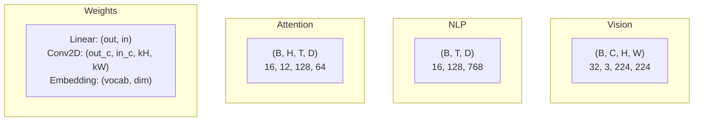
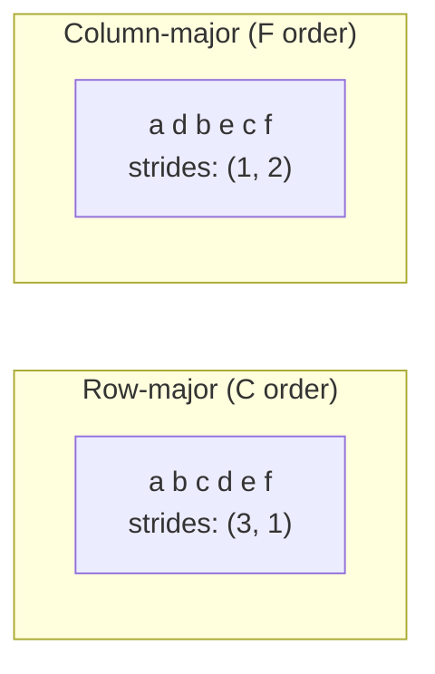
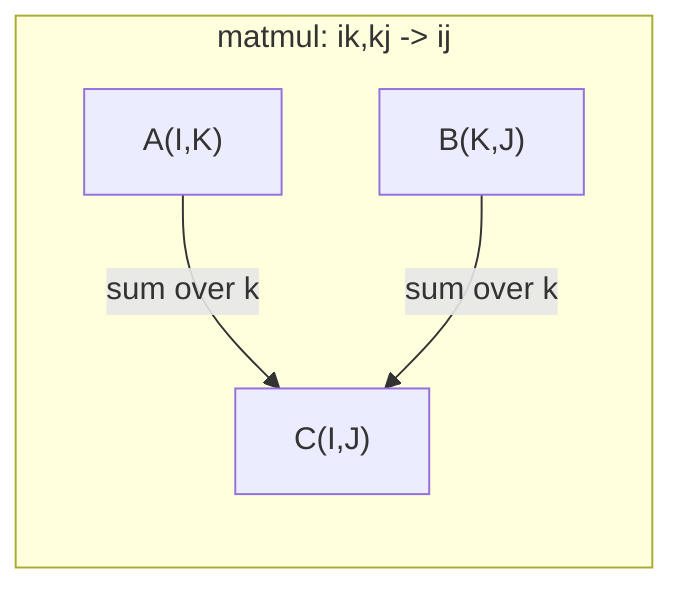

# 텐서 작업

> 텐서들은 데이터와 딥러닝의 공통 언어입니다. 모든 이미지, 문장, gradient이 그 안에서 흐릅니다.

**Type:** Build
**Language:**파이썬
**Prerequisites:** Phase 1, Lessons 01 (Linear Algebra Intuition), 02 (Vectors, Matrices & Operations)
**Time:** ~90 minutes

## 학습 목표

- 형태, 단계, 재형, 변환 및 요소별 동작을 처음부터 구현하는 텐서 클래스
- 데이터 복사 없이 다양한 형태의 텐서에서 작동하기 위해 방송 규칙을 적용한다
- 점 제품, 매트릭스 곱셈, 외부 제품 및 배트 작전에 대한 합수 표현을 작성하십시오.
- 다중머리 주의의 모든 단계를 통해 정확한 텐서 모양을 추적하십시오

## 문제

트랜스포머를 만들면 앞면이 깨끗해 보이는데, 실행하면`RuntimeError: mat1 and mat2 shapes cannot be multiplied (32x768 and 512x768)`형식을 쳐다보고, 변신을 시도해 보죠.`Expected 4D input (got 3D input)`- 을 빼면 다른 것이 깨질 거야

형식의 오류는 딥러닝 코드에서 가장 흔한 오류입니다. 개념적으로 어렵지 않습니다. 각각의 작업은 형태 계약이 있습니다. 하지만 빠르게 증식됩니다. 트랜스포머는 수십 개의 변형, 전신, 방송이 서로 묶여 있습니다. 한 가지 잘못된 축과 오류 캐스케이드 더 나쁜 것은 일부 모양의 오류는 전혀 오류를 내리지 않습니다. 그들은 잘못된 차원을 따라 방송하거나 잘못된 축을 합쳐서 조용히 쓰레기를 생산합니다.

매트릭스는 두 개의 집합의 사물 사이의 쌍형 관계를 처리합니다. 실제 데이터는 두 차원으로 맞지 않습니다. 224x224의 32 RGB 이미지의 무대는 4D 텐서입니다:`(32, 3, 224, 224)`12개의 머리로 자기주의도 4차원입니다`(batch, heads, seq_len, head_dim)`데이터 구조가 필요해 모든 차원을 일반화하고, 모든 차원을 순수하게 구성하는 작업이 필요합니다. 그 구조는 텐서입니다. 그 동작을 마스터하고 모양 오류는 비약적으로 디버깅이 가능합니다.

## 개념

### 텐서란 무엇인가?

수 는 일률적인 데이터 타입의 다차원 수 수열이다.**rank**(또는**order**) 각 차원은**axis**- **shape**각 축을 따라 크기를 나열하는 튜플입니다.



전체 요소 = 모든 크기의 산물.`(2, 3, 4)` $2 \cdot 3 \cdot 4 = 24$요소들

### 깊이 학습에서 텐서 형태

다른 데이터 타입은 협약에 따라 특정 텐서 모양으로 지도를 만듭니다.



파이토르치는 NCHW (채널-첫) 를 사용한다. 텐서플로우는 NHWC (채널-최후) 에 기본 설정되어 있다. 부합된 레이아웃은 침묵적인 느려진 속도 또는 오류를 유발한다.

### 메모리 레이아웃이 어떻게 작동하는지

메모리 2D 배열은 1D 바이트의 순서입니다.**Strides**각 축을 따라 한 걸음 이동하기 위해 몇 개의 요소를 건너뛰어야 하는지 알려줍니다.



트랜스포스는 데이터를 움직이지 않고, 단계들을 교환하여 텐서를 만듭니다.**non-contiguous**-- 행의 요소들은 더 이상 기억에 인접하지 않습니다.

### 방송 규칙

방송은 데이터를 복사하지 않고 다른 모양의 텐서에서 작동하도록 합니다. 오른쪽에서 모양을 조정합니다. 두 차원은 같거나 1이면 1이면 1이면 1이면으로 채워집니다.

```
Tensor A:     (8, 1, 6, 1)
Tensor B:        (7, 1, 5)
Padded B:     (1, 7, 1, 5)
Result:       (8, 7, 6, 5)
```

### 에인섬: 보편적인 텐서 동작

아인슈타인 합계표는 각 축을 문자로 표시합니다. 입력된 축은 합쳐집니다. 출력되지 않습니다. 두 축은 유지됩니다.



주요 패턴: `i,i->`(점점 제품)`i,j->ij`(외국제 제품)`ii->`(조각)`ij->ji`(변화)`bij,bjk->bik`(배치 매트무일),`bhtd,bhsd->bhts`(주의점점)

```figure
tensor-broadcast
```

## 건설 해

코드는 `code/tensors.py`각 단계마다 그 단계의 실행에 대한 언급이 있습니다.

### 단계 1: 텐서 저장 및 단계

텐서에서는 숫자와 모양 메타데이터의 평면 목록을 저장합니다. 단계들은 여러 차원 인덱스를 평면 위치로 지도하는 방법을 덱싱 논리로 알려줍니다.

```python
class Tensor:
    def __init__(self, data, shape=None):
        if isinstance(data, (list, tuple)):
            self._data, self._shape = self._flatten_nested(data)
        elif isinstance(data, np.ndarray):
            self._data = data.flatten().tolist()
            self._shape = tuple(data.shape)
        else:
            self._data = [data]
            self._shape = ()

        if shape is not None:
            total = reduce(lambda a, b: a * b, shape, 1)
            if total != len(self._data):
                raise ValueError(
                    f"Cannot reshape {len(self._data)} elements into shape {shape}"
                )
            self._shape = tuple(shape)

        self._strides = self._compute_strides(self._shape)

    @staticmethod
    def _compute_strides(shape):
        if len(shape) == 0:
            return ()
        strides = [1] * len(shape)
        for i in range(len(shape) - 2, -1, -1):
            strides[i] = strides[i + 1] * shape[i + 1]
        return tuple(strides)
```

모양에`(3, 4)`, 단계들은`(4, 1)`-- 1 줄을 앞당기기 위해 4개의 요소를 건너뛰고 1개의 열을 앞당기 위해 1개의 요소를 건너뛰고

### 단계 2: 다시 닦아, 압축, 비압

재구성 (Reshape) 은 요소 순서를 변경하지 않고 형태를 변경합니다. 전체 요소 수는 동일해야 합니다. 사용 `-1`한 차원의 크기를 추론하기 위해서

```python
t = Tensor(list(range(12)), shape=(2, 6))
r = t.reshape((3, 4))
r = t.reshape((-1, 3))
```

압축은 1 크기의 축을 제거합니다. 압축이 되지 않는 것은 1 크기의 축을 제거합니다. 압축이 되지 않는 것은 방송에 중요한 요소입니다.`(D,)`배트에 추가된`(B, T, D)`             `(1, 1, D)`- 그래

```python
t = Tensor(list(range(6)), shape=(1, 3, 1, 2))
s = t.squeeze()
v = Tensor([1, 2, 3])
u = v.unsqueeze(0)
```

### 단계 3: 이식 및 이동

이식하는 것은 두 개의 축을 교환하고, 이동하는 것은 모든 축을 재편합니다. 이렇게 NCHW와 NHWC를 변환합니다.

```python
mat = Tensor(list(range(6)), shape=(2, 3))
tr = mat.transpose(0, 1)

t4d = Tensor(list(range(24)), shape=(1, 2, 3, 4))
perm = t4d.permute((0, 2, 3, 1))
```

트랜스포스 또는 퍼무트 후, 텐서는 메모리에서 연속적이지 않습니다.`view`비연접한 텐서에서 실패합니다 -- 사용 `reshape`또는 전화`.contiguous()`먼저

### 단계 4: 요소별 운용 및 감소

요소별 ops (add, multiply, subtract) 는 각 요소에 독립적으로 적용되며 모양을 유지합니다. 감소 (sum, mean, max) 는 하나 이상의 축을 붕괴합니다.

```python
a = Tensor([[1, 2], [3, 4]])
b = Tensor([[10, 20], [30, 40]])
c = a + b
d = a * 2
s = a.sum(axis=0)
```

CNN에서 글로벌 평균 합동: `(B, C, H, W).mean(axis=[2, 3])`생산합니다`(B, C)`. NLP에서 순서 평균 합성: `(B, T, D).mean(axis=1)`생산합니다`(B, D)`- 그래

### 단계 5: NumPy 를 통해 방송

`demo_broadcasting_numpy()``tensors.py`핵심 패턴을 보여줍니다.

```python
activations = np.random.randn(4, 3)
bias = np.array([0.1, 0.2, 0.3])
result = activations + bias

images = np.random.randn(2, 3, 4, 4)
scale = np.array([0.5, 1.0, 1.5]).reshape(1, 3, 1, 1)
result = images * scale

a = np.array([1, 2, 3]).reshape(-1, 1)
b = np.array([10, 20, 30, 40]).reshape(1, -1)
outer = a * b
```

방송을 통해 쌍별 거리: 재구성 `(M, 2)` `(M, 1, 2)`그리고`(N, 2)` `(1, N, 2)`, 추출, 제곱, 마지막 축을 합쳐서 제곱근을 가져가겠습니다`(M, N)`- 그래

### 단계 6: 에인섬 작업

`demo_einsum()`그리고`demo_einsum_gallery()`함수는 모든 일반적인 패턴을 통과합니다.

```python
a = np.array([1.0, 2.0, 3.0])
b = np.array([4.0, 5.0, 6.0])
dot = np.einsum("i,i->", a, b)

A = np.array([[1, 2], [3, 4], [5, 6]], dtype=float)
B = np.array([[7, 8, 9], [10, 11, 12]], dtype=float)
matmul = np.einsum("ik,kj->ij", A, B)

batch_A = np.random.randn(4, 3, 5)
batch_B = np.random.randn(4, 5, 2)
batch_mm = np.einsum("bij,bjk->bik", batch_A, batch_B)
```

수축의 계산 비용은 모든 지수 크기의 곱입니다 (수축 및 수축).`bij,bjk->bik`$B=32$$I=128$$J=64$$K=128$이 책:$32 \cdot 128 \cdot 64 \cdot 128 = 33{,}554{,}432$곱셈을 할 수 있습니다.

### 단계 7: 에너스럼을 통해 주의 메커니즘

`demo_attention_einsum()`기능은 다중머리 주의를 끝으로 구현합니다.

```python
B, H, T, D = 2, 4, 8, 16
E = H * D

X = np.random.randn(B, T, E)
W_q = np.random.randn(E, E) * 0.02

Q = np.einsum("bte,ek->btk", X, W_q)
Q = Q.reshape(B, T, H, D).transpose(0, 2, 1, 3)

scores = np.einsum("bhtd,bhsd->bhts", Q, K) / np.sqrt(D)
weights = softmax(scores, axis=-1)
attn_output = np.einsum("bhts,bhsd->bhtd", weights, V)

concat = attn_output.transpose(0, 2, 1, 3).reshape(B, T, E)
output = np.einsum("bte,ek->btk", concat, W_o)
```

각 단계는 텐서 작업입니다: 투명 (매트무알 통한 einsum), 헤드 스플리팅 (재형 + 변신), 주의 점수 (배치 매트무알 통한 einsum), 중량 합 (배치 매트무알 통한 einsum), 헤드 융합 (재형 + 변신), 출력 투명 (매트무알 통한 einsum).

## 사용 하 고

### 스크래치 vs 피

| Operation | Scratch (Tensor class) | NumPy |
|---|---|---|
| Create | `Tensor([[1,2],[3,4]])` | `np.array([[1,2],[3,4]])` |
| Reshape | `t.reshape((3,4))` | `a.reshape(3,4)` |
| Transpose | `t.transpose(0,1)` | `a.T` or `a.transpose(0,1)` |
| Squeeze | `t.squeeze(0)` | `np.squeeze(a, 0)` |
| Sum | `t.sum(axis=0)` | `a.sum(axis=0)` |
| Einsum | N/A | `np.einsum("ij,jk->ik", a, b)` |

### 스크래치 vs 파이토치

```python
import torch

t = torch.tensor([[1, 2, 3], [4, 5, 6]], dtype=torch.float32)
t.shape
t.stride()
t.is_contiguous()

t.reshape(3, 2)
t.unsqueeze(0)
t.transpose(0, 1)
t.transpose(0, 1).contiguous()

torch.einsum("ik,kj->ij", A, B)
```

PyTorch은 오토그라드, GPU 지원 및 최적화된 BLAS 커널을 추가합니다. 모양의 의미학은 동일합니다. 스크래치 버전을 이해하면 PyTorch 모양 오류가 읽을 수 있습니다.

### 모든 신경 네트워크 계층은 텐서 작업으로

| Operation | Tensor Form | Einsum |
|---|---|---|
| Linear layer | `Y = X @ W.T + b` | `"bd,od->bo"` + bias |
| Attention QKV | `Q = X @ W_q` | `"btd,dh->bth"` |
| Attention scores | `Q @ K.T / sqrt(d)` | `"bhtd,bhsd->bhts"` |
| Attention output | `softmax(scores) @ V` | `"bhts,bhsd->bhtd"` |
| Batch norm | `(X - mu) / sigma * gamma` | element-wise + broadcast |
| Softmax | `exp(x) / sum(exp(x))` | element-wise + reduction |

## 선박

이 수업은 두 가지 반복 가능한 명령어를 제공합니다.

1. **`outputs/prompt-tensor-shapes.md`**-- 텐서 모양의 부합을 디버깅하는 체계적인 프롬프트. 모든 일반적인 동작 (matmul, 방송, 고양이, 선형, Conv2d, BatchNorm, softmax) 에 대한 결정 테이블과 수정 검색 테이블을 포함합니다.

2. **`outputs/prompt-tensor-debugger.md`**-- 단계별 디버깅 명령어, 형식의 오류가 차단하는 경우 AI 보조에 붙여넣습니다. 오류 메시지와 텐서 모양을 입력하여 정확한 수정점을 얻습니다.

## 운동

1. **Easy -- Reshape round-trip.**모양의 텐서를 가져라`(2, 3, 4)`-   `(6, 4)`, 그리고 `(24,)`, 그리고 다시 `(2, 3, 4)`. 확인 요소 순서는 평면 데이터를 인쇄함으로써 각 단계에 보존됩니다.

2. **Medium -- Implement broadcasting.**`Tensor``broadcast_to(shape)`1 크기의 크기를 확장하여 목표 모양과 일치하는 방법`_elementwise_op`작동하기 전에 자동으로 방송됩니다.`(3, 1)`그리고`(1, 4)`생산`(3, 4)`- 그래

3. **Hard -- Build einsum from scratch.**기본 `einsum(subscripts, *tensors)`적어도: 점수산 (`i,i->`), 매트릭스 곱 (`ij,jk->ik`), 외부 제품 (`i,j->ij`), 그리고 이룰 수 있는`ij->ji`) 서브스크립트 문자열을 분석하고, 계약된 지표를 확인하고, 모든 지수 조합을 ループ하여 결과를 비교합니다.`np.einsum`- 그래

4. **Hard -- Attention shape tracker.**함수를 작성하여`batch_size``seq_len``embed_dim`그리고`num_heads`입구와 인쇄를 통해 여러 헤드 주의의 모든 단계에 정확한 모양을 나타냅니다. 입구, Q/K/V 투영, 헤드 스플릿, 주의 점수, 소프트맥스 무게, 중량 합, 헤드 융합, 출력 투영.`demo_attention_einsum()`출력

### 암시

**Exercise 1.** 에서 텐서를 만들`list(range(24))`각 요소가 자신의 위치를 나타냅니다.`reshape`전화, 인쇄`flatten().to_list()`그리고 0에서 23까지의 순서로 계속 있는지 확인하세요.

**Exercise 2.**이 두 크기가 같거나 그 중 하나가 1이면만 방영이 가능합니다. 그래서 먼저 그 규칙을 확인하고 오류가 발생하면 오류를 나타냅니다.`(3, 1)`그리고`(1, 4)`, 그 항목을 확인하세요`[i][j]`이 결과의 값은`a[i][0] + b[0][j]`, 그리고 전체 결과를 NumPy와 비교합니다.

**Exercise 3.**구독을 나눌 수 있습니다`->`입력값에 있는 글자가 출력값에 있지 않은 글자는 합계 지표이기 때문에 각 글자의 모든 값을 둥글게 둥글게 둥글게 둥글게 둥글게 둥글게 둥글게 둥글게 둥글게 둥글게 둥글게 둥글게 둥글게 둥글게 둥글게 둥글게 둥글게 둥글게 둥글게 둥글게 둥글게 둥글게 둥글게 둥글게 둥글게 둥글게 둥글게 둥글게 둥글게 둥글게 둥글게 둥글게 둥글게 둥글게 둥글게 둥글게 둥글게 둥글게 둥글게 둥글게 둥글게 둥글게 둥글게 둥글게 둥글게 둥글게 둥글게 둥글게 둥글게 둥글게 둥글게 둥글게 둥글게 둥글게 둥글게 둥글게 둥글게 둥글게 둥글게 둥글게 둥글게 둥글게 둥글게 둥글게 둥글게 둥글게 둥글게 둥글게 둥글게 둥글게 둥글게 둥글게 둥글게 둥글게 둥글게 둥글게 둥글게 둥글게 둥글게 둥글게 둥글게 둥글게 둥글게 둥글게 둥글게 둥글게 둥글게 둥글게 둥글게 둥글게 둥글게 둥글게 둥글게 둥글게 둥글게 둥글게 둥글게 둥글게 둥글게 둥글게 둥글게 둥글게 둥글게 둥글게 둥글게 둥글게 둥글게`np.allclose(mine, np.einsum(...))`- 그래

**Exercise 4.**머리 크기로 시작하세요`embed_dim // num_heads`그리고 그것을 주장합니다`embed_dim % num_heads == 0`주의율은 모양이 있습니다`(batch_size, num_heads, seq_len, seq_len)`, 그래서 인쇄물을 그 모양과 그 모양에 대해 확인해 보세요`demo_attention_einsum()`발자국

## 주요 용어

| Term | What people say | What it actually means |
|---|---|---|
| Tensor | "A matrix but more dimensions" | A multi-dimensional array with uniform type and defined shape, strides, and operations |
| Rank | "The number of dimensions" | The number of axes. A matrix has rank 2, not rank equal to its matrix rank |
| Shape | "The size of the tensor" | A tuple listing the size along each axis. `(2, 3)` means 2 rows, 3 columns |
| Stride | "How memory is laid out" | The number of elements to skip to advance one position along each axis |
| Broadcasting | "It just works when shapes differ" | A strict set of rules: align from right, dimensions must be equal or one must be 1 |
| Contiguous | "The tensor is normal" | Elements stored sequentially in memory with no gaps or reordering from the logical layout |
| Einsum | "A fancy way to write matmul" | A general notation that expresses any tensor contraction, outer product, trace, or transpose in one line |
| View | "Same as reshape" | A tensor sharing the same memory buffer but with different shape/stride metadata. Fails on non-contiguous data |
| Contraction | "Summing over an index" | The general operation where a shared index between tensors is multiplied and summed, producing a lower-rank result |
| NCHW / NHWC | "PyTorch vs TensorFlow format" | Memory layout conventions for image tensors. NCHW puts channels before spatial dims, NHWC puts them after |

## 더 많은 읽기

- [NumPy Broadcasting](https://numpy.org/doc/stable/user/basics.broadcasting.html)-- 시각적인 예시를 가진 가톨릭 규칙
- [PyTorch Tensor Views](https://pytorch.org/docs/stable/tensor_view.html)-- 시각이 작동하고 복사할 때
- [einops](https://github.com/arogozhnikov/einops)-- 텐서 재구성을 읽을 수 있고 안전하게 만드는 도서관
- [The Illustrated Transformer](https://jalammar.github.io/illustrated-transformer/)-- 주의를 통해 흐르는 텐서 모양을 시각화합니다
- [Einstein Summation in NumPy](https://numpy.org/doc/stable/reference/generated/numpy.einsum.html)-- 예제들을 포함한 전체적인 합자 문서
