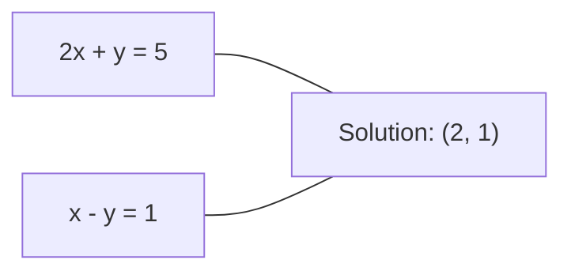
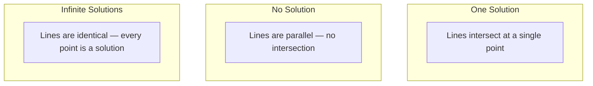

# 선형 시스템

> 해결$Ax = b$수학에서 가장 오래된 문제로 신경망을 계속 운영합니다.

**Type:** Build
**Language:**파이썬
**Prerequisites:** Phase 1, Lessons 01 (Linear Algebra Intuition), 02 (Vectors & Matrices), 03 (Matrix Transformations)
**Time:** ~120 minutes

## 학습 목표

- 해결해$Ax = b$가우스 제거와 부분 회전 및 뒷 교체
- LU, QR, 그리고 레스키 분해와 함께 요소 매트릭스 및 각이 적절한 시점에 설명
- 최소 제곱의 정상적인 방정식을 추출하고 선형과 줄기 회귀에 연결합니다
- 상태 번호를 사용하여 상태가 좋지 않은 시스템을 진단하고 안정시키기 위해 정규화를 적용합니다

## 문제

선형 회귀를 훈련할 때마다 선형 시스템을 풀고, 가장 적은 제곱의 맞춤을 계산할 때마다 선형 시스템을 풀고, 신경 네트워크 층이 계산할 때마다`y = Wx + b`이 방법은 선형 시스템의 한 측면을 평가하는 것입니다. 정규화를 추가하면 시스템을 수정합니다. 가우스 프로세스를 사용하면 매트릭스를 가공합니다.

방정식$Ax = b$모든 곳에 나타납니다.$A$알려진 계수들의 행렬입니다.$b$알려진 출력의 벡터입니다.$x$이 값은 우리가 찾고자 하는 미지의 벡터입니다.$A$데이터 매트릭스입니다.$b$ $x$전체 모델은 다음과 같이 줄여줍니다:$x$그런 것$Ax$$b$가능한 한

이 수업은 그 방정식을 처음부터 해결하기 위한 모든 주요 방법을 구성합니다. 어떤 방법들은 왜 빠르고 다른 방법들은 안정적이는지, 어떤 방법들은 왜 단지 정렬된 시스템만 작동하고 다른 방법들은 왜 과정정된 시스템을 처리하는지, 그리고 왜 당신의 매트릭스의 조건 번호가 당신의 답이 전혀 의미가 있는지 결정하는지 이해하실 것입니다.

## 개념

### Ax = b의 의미

선형 방정식의 체계는 기하학적 해석을 가지고 있다. 각 방정식은 초평형을 정의한다. 해법은 모든 초평선이 교차하는 지점 (또는 지점 집합) 이다.

```
2x + y = 5          Two lines in 2D.
x - y  = 1          They intersect at x=2, y=1.
```



세 가지 일이 일어날 수 있습니다.



매트릭스 형태로 "하나의 해결책"은$A$이 방법은 "변화 가능"입니다. "해결이 없습니다"는 시스템이 일관성이 없다는 것을 의미합니다. "무궁무진한 해답"은$A$0개의 공간이 있습니다. 대부분의 ML 문제는 "정확한 해결책이 없습니다"라는 범주에 속합니다. 왜냐하면 여러분이 모르는 것 (변수) 보다 더 많은 방정식을 (데이터 포인트) 가지고 있기 때문입니다.

### 기둥 사진 vs 줄 사진

두 가지 방법이 있습니다.$Ax = b$- 그래

**Row picture.**각 줄$A$이 방정식은 하나의 방정식을 정의합니다. 각 방정식은 초평선입니다.

**Column picture.**각 열$A$벡터입니다. 문제는 $A$생산합니다$b$- 그래요

```
A = | 2  1 |    b = | 5 |
    | 1 -1 |        | 1 |

Row picture: solve 2x + y = 5 and x - y = 1 simultaneously.

Column picture: find x1, x2 such that:
  x1 * [2, 1] + x2 * [1, -1] = [5, 1]
  2 * [2, 1] + 1 * [1, -1] = [4+1, 2-1] = [5, 1]   check.
```

기둥 그림은 더 근본적입니다.$b$$A$, 시스템에는 해결책이 있습니다.$b$가장 가까운 지점은 가장 작은 제곱의 해소입니다

### 가우스식 제거

가우시안 제거 변환$Ax = b$상부 삼각형 체계로$Ux = c$이 방법은 바로 바로

알고리즘:

```
1. For each column k (the pivot column):
   a. Find the largest entry in column k at or below row k (partial pivoting).
   b. Swap that row with row k.
   c. For each row i below k:
      - Compute multiplier m = A[i][k] / A[k][k]
      - Subtract m times row k from row i.
2. Back substitute: solve from the last equation upward.
```

예를 들어:

```
Original:
| 2  1  1 | 8 |       R2 = R2 - (2)R1     | 2  1   1 |  8 |
| 4  3  3 |20 |  -->  R3 = R3 - (1)R1 --> | 0  1   1 |  4 |
| 2  3  1 |12 |                            | 0  2   0 |  4 |

                       R3 = R3 - (2)R2     | 2  1   1 |  8 |
                                       --> | 0  1   1 |  4 |
                                           | 0  0  -2 | -4 |

Back substitute:
  -2 * x3 = -4    -->  x3 = 2
  x2 + 2  = 4     -->  x2 = 2
  2*x1 + 2 + 2 = 8 --> x1 = 2
```

가우시안 제거 비용$O(n^3)$운영.$1000 \times 1000$이 시스템은 약 10억개의 부동소수점 작업을 합니다.$A$- 그래

### 부분적 회전: 왜 중요합니까

회전 없이 가우스 제거는 실패하거나 쓰레기를 생성할 수 있습니다. 회전 요소가 0이라면 0으로 나눌 수 있습니다. 작은 경우, 회전 오류를 증폭시킵니다.

```
Bad pivot:                       With partial pivoting:
| 0.001  1 | 1.001 |            Swap rows first:
| 1      1 | 2     |            | 1      1 | 2     |
                                 | 0.001  1 | 1.001 |
m = 1/0.001 = 1000              m = 0.001/1 = 0.001
R2 = R2 - 1000*R1               R2 = R2 - 0.001*R1
| 0.001  1     | 1.001   |      | 1      1     | 2     |
| 0     -999   | -999.0  |      | 0      0.999 | 0.999 |

x2 = 1.000 (correct)            x2 = 1.000 (correct)
x1 = (1.001 - 1)/0.001          x1 = (2 - 1)/1 = 1.000 (correct)
   = 0.001/0.001 = 1.000        Stable because the multiplier is small.
```

제한된 정확도로 부동소수점 수학적에서, 회전되지 않은 버전은 중요한 숫자를 잃을 수 있습니다. 부분 회전은 항상 오류 증폭을 최소화하기 위해 가장 큰 사용할 수 있는 회전기를 선택합니다.

### LU 분해

LU 분해 요인$A$아래 삼각형 행렬에$L$그리고 상부 삼각형 행렬$U$이 책:$A = LU$- $L$매트릭스는 가우스 제거의 곱수를 저장합니다.$U$매트릭스는 제거의 결과입니다.

```
A = L @ U

| 2  1  1 |   | 1  0  0 |   | 2  1   1 |
| 4  3  3 | = | 2  1  0 | @ | 0  1   1 |
| 2  3  1 |   | 1  2  1 |   | 0  0  -2 |
```

왜 그냥 제거하는 대신 요인이 되는 걸까요?$L$그리고$U$, 해결$Ax = b$새로운 $b$비용만$O(n^2)$이 부분의 본문은

```math
\begin{aligned}
Ax &= b \\
LUx &= b \\
&\text{Let } y = Ux\text{:} \\
Ly &= b \quad \text{(forward substitution, } O(n^2)\text{)} \\
Ux &= y \quad \text{(back substitution, } O(n^2)\text{)}
\end{aligned}
```

$O(n^3)$이 경우, 이 값은 1회로 계산을 통해 계산된다.$O(n^2)$1000개의 시스템을 같은 방법으로 풀어야 한다면$A$하지만 다른$b$벡터, LU는 전체 작업의 1000/3의 인수를 절약합니다.

부분 회전으로, 당신은 얻을$PA = LU$어디$P$행의 교환을 기록하는 변동 매트릭스입니다.

### QR 분해

QR 분해 요인$A$정형 행렬에$Q$그리고 상부 삼각형 행렬$R$이 책:$A = QR$- 그래

정형 행렬은 특성을 가지고 있습니다$Q^T Q = I$그 열은 정규형 벡터입니다$Q$길기와 각을 보존합니다.

```
A = Q @ R

Q has orthonormal columns: Q^T Q = I
R is upper triangular

To solve Ax = b:
  QRx = b
  Rx = Q^T b    (just multiply by Q^T, no inversion needed)
  Back substitute to get x.
```

QR는 최소 광장 문제를 해결하기 위해 LU보다 수적으로 안정적입니다.$Q$기둥별로:

```
Given columns a1, a2, ... of A:

q1 = a1 / ||a1||

q2 = a2 - (a2 . q1) * q1        (subtract projection onto q1)
q2 = q2 / ||q2||                (normalize)

q3 = a3 - (a3 . q1) * q1 - (a3 . q2) * q2
q3 = q3 / ||q3||

R[i][j] = qi . aj    for i <= j
```

각 단계로 전과 같이 구성 요소를 제거합니다$q$새로운 정형 방향만 남는 벡터입니다.

### 레스키 분해

언제$A$대칭 ($A = A^T$) 과 긍정적 정의 (모든 고유값이 긍정적) 을$A = L L^T$어디$L$아래 삼각형입니다. 이것은 레스키 분해입니다.

```
A = L @ L^T

| 4  2 |   | 2  0 |   | 2  1 |
| 2  5 | = | 1  2 | @ | 0  2 |

L[i][i] = sqrt(A[i][i] - sum(L[i][k]^2 for k < i))
L[i][j] = (A[i][j] - sum(L[i][k]*L[j][k] for k < j)) / L[j][j]    for i > j
```

레스키는 LU보다 두 배 더 빠르고 저장량의 절반이 필요합니다. 그것은 단지 대칭적 긍정적 정의 매트릭스에서만 작동합니다. 그러나 그 대상은 끊임없이 나타납니다.

- 코바리안스 매트릭스는 대칭적 긍정적 반 정의 (정규화와 함께 긍정적 정의) 이다.
- 가우스 프로세스의 커널 매트릭스는 대칭적 긍정적 정의입니다.
- 최소상 직 함수의 헤스시아인은 대칭적 긍정적 정의입니다.
- $A^T A$항상 대칭적 양성 반 정의입니다.

가우스 프로세스에서는 커널 매트릭스를 팩터링합니다$K$스키와 함께 해소해$K \alpha = y$레스키 계수는 또한 소변 확률의 로그 결정자를 제공합니다.$\log \det(K) = 2 \sum \log(\mathop{\mathrm{diag}}(L))$- 그래

### 최소 제곱: Ax = b가 정확한 해법을 가지고 있지 않을 때

만약$A$ $m \times n$$m > n$(알아지지 않은 것보다 더 많은 방정식) 은 시스템 과잉 결정되어 있습니다. 정확한 해결책은 없습니다. 대신, 당신은 제곱 오류를 최소화합니다.

```
minimize ||Ax - b||^2

This is the sum of squared residuals:
  sum((A[i,:] @ x - b[i])^2 for i in range(m))
```

최소화기는 정상적인 방정식을 만족시킵니다:

```math
A^T A x = A^T b
```

추리: 확장 $\lVert Ax - b \rVert^2 = (Ax - b)^T (Ax - b) = x^T A^T A x - 2 x^T A^T b + b^T b$에 대한 경각심을 생각해 보세요$x$, 0으로 설정:$2 A^T A x - 2 A^T b = 0$- 그래

```
Original system (overdetermined, 4 equations, 2 unknowns):
| 1  1 |         | 3 |
| 1  2 | x     = | 5 |       No exact x satisfies all 4 equations.
| 1  3 |         | 6 |
| 1  4 |         | 8 |

Normal equations:
A^T A = | 4  10 |    A^T b = | 22 |
        | 10 30 |            | 63 |

Solve: x = [1.5, 1.7]

This is linear regression. x[0] is the intercept, x[1] is the slope.
```

### 정상적인 방정식 = 선형 회귀

연결은 정확합니다. 선형 회귀에서, 데이터 매트릭스$X$표본에 1 줄, 특징에 1 열이 있습니다.$y$표본에 한 항목을 가지고 있습니다.$w$만족합니다.

```math
\begin{aligned}
X^T X w &= X^T y \\
w &= (X^T X)^{-1} X^T y
\end{aligned}
```

이것은 선형 회귀의 폐쇄형 솔루션입니다.`sklearn.linear_model.LinearRegression.fit()`이 계산을 (또는 QR 또는 SVD를 통해 동등한 것을) 합니다.

규칙화 용어를 추가합니다$\lambda I$매트릭스까지 이동하면

```math
\begin{aligned}
(X^T X + \lambda I) w &= X^T y \\
w &= (X^T X + \lambda I)^{-1} X^T y
\end{aligned}
```

규칙화는 매트릭스를 더 잘 조건화 (정확하게 역전하는 것이 더 쉬워) 하고 무게를 제로로 축소함으로써 과잉 부합을 방지합니다.$X^T X + \lambda I$항상 대칭적 긍정적 인 정의적 인 경우$\lambda > 0$그래서 스키를 이용해 해결해 볼 수 있습니다.

### 사이드 어버스 (Moore-Penrose)

이 ' ' ' ' ' ' ' ' ' ' ' ' ' ' ' ' ' ' ' ' ' ' ' ' ' ' ' ' ' ' ' ' ' ' ' ' ' ' ' ' ' ' ' ' ' ' ' ' ' ' ' ' ' ' ' ' ' ' ' ' ' ' ' ' ' ' ' ' ' ' ' ' ' ' ' ' ' ' ' ' ' ' ' ' ' ' ' ' ' ' ' ' ' ' ' ' ' ' ' ' ' ' ' ' ' ' ' ' ' ' ' ' ' ' ' ' ' ' ' ' ' ' ' ' ' ' ' ' ' ' ' ' ' ' ' ' ' ' ' ' ' ' ' ' ' ' ' ' ' ' ' ' ' ' ' ' ' ' ' ' ' ' ' ' ' ' ' ' ' ' ' ' ' ' ' ' ' ' ' ' ' ' ' ' ' ' ' ' ' ' ' ' ' ' ' ' ' ' ' ' ' ' ' ' ' ' ' ' ' ' ' ' ' ' ' ' ' ' ' ' ' ' ' ' ' ' ' ' ' ' ' ' ' ' ' ' ' ' ' ' ' ' ' ' ' ' ' ' ' ' ' ' ' ' ' ' ' ' ' ' ' ' ' ' ' ' ' ' ' ' ' ' ' ' ' ' ' ' ' ' ' ' ' ' ' ' ' ' ' ' ' ' ' ' ' ' ' ' ' ' ' ' ' ' ' ' ' ' ' ' ' ' ' ' ' ' ' ' ' ' ' ' ' ' ' ' ' ' ' ' ' ' ' ' ' ' ' ' ' ' ' ' ' ' ' ' ' ' ' ' ' ' ' ' ' ' ' ' ' ' ' ' ' ' ' ' ' ' ' ' ' ' ' ' ' ' ' ' ' ' ' ' ' ' ' ' ' ' ' ' ' ' ' ' ' ' ' ' ' ' ' ' ' ' ' ' ' ' ' ' ' ' ' ' ' ' ' ' ' ' ' ' ' ' ' ' ' ' ' ' ' ' ' ' ' ' ' ' ' ' ' ' ' ' ' ' ' ' ' ' ' ' ' ' ' ' ' ' ' ' ' ' ' ' ' ' ' ' ' ' ' ' ' ' ' ' ' ' ' ' ' ' ' ' ' ' ' ' ' ' ' ' ' ' ' ' ' ' ' ' ' ' ' ' ' ' ' ' '$A^+$매트릭스 인버전을 비제곱 및 싱글 매트릭스로 일반화합니다.$A$이 부분의 본문은

```math
\begin{aligned}
x &= A^+ b \\[4pt]
\text{where } A^+ &= V \Sigma^+ U^T \quad \text{(computed via SVD)}
\end{aligned}
```

$\Sigma^+$0이 아닌 각 단일 값의 상호를 가져다가 결과를 옮기는 방식으로 형성됩니다.$A = U \Sigma V^T$그럼$A^+ = V \Sigma^+ U^T$- 그래

```
A = U Sigma V^T        (SVD)

Sigma = | 5  0 |       Sigma+ = | 1/5  0  0 |
        | 0  2 |                | 0  1/2  0 |
        | 0  0 |

A+ = V Sigma+ U^T
```

이 역변은 최소 표준 최저 광장 솔루션을 제공합니다.
- 한 가지 해결책:$A^+ b$- 그래요
- 해결책은 없습니다.$A^+ b$가장 적은 제곱의 해법을 제공합니다.
- 무한한 해결책:$A^+ b$가장 작은 것을 가진 사람에게 주는 것입니다.$\lVert x \rVert$- 그래

피의`np.linalg.lstsq`그리고`np.linalg.pinv`둘 다 SVD를 내부적으로 사용한다.

### 조건 번호

조건 번호는 입력의 작은 변화에 대한 솔루션의 민감도를 측정합니다. 매트릭스$A$, 조건 번호는:

```math
\kappa(A) = \lVert A \rVert \cdot \lVert A^{-1} \rVert = \frac{\sigma_{\max}}{\sigma_{\min}}
```

어디$\sigma_{\max}$그리고$\sigma_{\min}$가장 크고 가장 작은 단일 값입니다.

```
Well-conditioned (kappa ~ 1):        Ill-conditioned (kappa ~ 10^15):
Small change in b -->                Small change in b -->
small change in x                    huge change in x

| 2  0 |   kappa = 2/1 = 2          | 1   1          |   kappa ~ 10^15
| 0  1 |   safe to solve            | 1   1+10^(-15) |   solution is garbage
```

엄지 손가락 규칙:
- $\kappa < 100$: 안전, 솔루션 정확
- $\kappa \approx 10^k$당신은 약$k$수치는 부동소수점 수학적 정확성입니다.
- $\kappa \approx 10^{16}$(float64): 해법은 의미가 없습니다. 매트릭스는 사실상 단수입니다.

ML에서, 부적절한 조건이 나타나는 것은 특징이 거의 상반되는 경우에입니다.$\lambda I$) 에서 상태 수를 향상시킵니다.$\sigma_{\max} / \sigma_{\min}$ $(\sigma_{\max} + \lambda) / (\sigma_{\min} + \lambda)$- 그래

### 반복 방법: 합성 기하급수

매우 큰 희소 시스템 (무지 않은 수백만) 에 대해, LU 또는 레스키와 같은 직접적인 방법은 너무 비싸다. 반복적인 방법은 여러 반복에 대한 추측을 개선함으로써 해결책을 근접합니다.

합성 기하급수 (CG) 가 해결됩니다 $Ax = b$언제$A$정답은 정답을 찾을 수 있습니다$n$반복 (정확한 수학적) 하지만 일반적으로 의 고유값이$A$뭉쳐져 있습니다.

```
Algorithm sketch:
  x0 = initial guess (often zero)
  r0 = b - A x0           (residual)
  p0 = r0                 (search direction)

  For k = 0, 1, 2, ...:
    alpha = (rk . rk) / (pk . A pk)
    x_{k+1} = xk + alpha * pk
    r_{k+1} = rk - alpha * A pk
    beta = (r_{k+1} . r_{k+1}) / (rk . rk)
    p_{k+1} = r_{k+1} + beta * pk
    if ||r_{k+1}|| < tolerance: stop
```

CG는 다음 각 호에서 사용됩니다.
- 대규모 최적화 (뉴턴-CG 방법)
- PDE 분별을 해결
- 커널 매트릭스가 너무 크면 팩터링할 수 없는 커널 방법
- 다른 반복 해상기 위한 사전 조건

컨버전스 비율은 조건 번호에 달려 있습니다. 더 나은 조건화된 시스템은 더 빨리 konverge, 이는 규칙화가 도움이 되는 또 다른 이유입니다.

### 전체적인 그림: 어떤 방법

| Method | Requirements | Cost | Use case |
|--------|-------------|------|----------|
| Gaussian elimination | Square, nonsingular $A$ | $O(n^3)$ | One-off solve of a square system |
| LU decomposition | Square, nonsingular $A$ | $O(n^3)$ factor + $O(n^2)$ solve | Multiple solves with the same $A$ |
| QR decomposition | Any $A$ ($m \ge n$) | $O(mn^2)$ | Least squares, numerically stable |
| Cholesky | Symmetric positive definite $A$ | $O(n^3/3)$ | Covariance matrices, Gaussian processes, ridge regression |
| Normal equations | Overdetermined ($m > n$) | $O(mn^2 + n^3)$ | Linear regression (small $n$) |
| SVD / pseudoinverse | Any $A$ | $O(mn^2)$ | Rank-deficient systems, minimum-norm solutions |
| Conjugate gradient | Symmetric positive definite, sparse $A$ | $O(n \cdot k \cdot \text{nnz})$ | Large sparse systems, $k$ = iterations |

### ML에 연결

이 수업의 모든 방법은 생산 ML에 나타납니다:

**Linear regression.**닫힌 형태의 솔루션은 정상적인 방정식을 해결합니다 $X^T X w = X^T y$이것은 레스키 (만약$n$작은) 또는 QR (수적 안정성이 중요하다면) 또는 SVD (매트릭스가 순위 부족할 수 있다면)

**Ridge regression.**추가 $\lambda I$ $X^T X$- 정규화된 시스템$(X^T X + \lambda I) w = X^T y$항상 스키를 통해 해결할 수 있습니다.$X^T X + \lambda I$이 값은$\lambda > 0$- 그래

**Gaussian processes.**예측 평균은 해결을 필요로 합니다$K \alpha = y$어디$K$ () 는 핵 행렬입니다.$K$로그 소재 확률은$\log \det(K) = 2 \sum \log(\mathop{\mathrm{diag}}(L))$- 그래

**Neural network initialization.**정렬 초기화는 QR 분해를 사용하여 열이 정렬된 중량 매트릭스를 생성합니다. 이것은 깊은 네트워크에서 신호 붕괴를 방지합니다.

**Preconditioning.**대규모 최적화기는 합동 gradient 용해수용의 전 조건으로 불완전한 Cholesky 또는 불완전 LU를 사용합니다.

**Feature engineering.**조건 번호$X^T X$만약 당신의 특징이 짝이 없는지 알려줍니다.$\kappa$크기가 크고, 특징을 떨어뜨리거나 규칙화를 추가합니다.

```figure
linear-system-conditioning
```

## 건설 해

### 단계 1: 부분 회전으로 가우스 제거

```python
import numpy as np

def gaussian_elimination(A, b):
    n = len(b)
    Ab = np.hstack([A.astype(float), b.reshape(-1, 1).astype(float)])

    for k in range(n):
        max_row = k + np.argmax(np.abs(Ab[k:, k]))
        Ab[[k, max_row]] = Ab[[max_row, k]]

        if abs(Ab[k, k]) < 1e-12:
            raise ValueError(f"Matrix is singular or nearly singular at pivot {k}")

        for i in range(k + 1, n):
            m = Ab[i, k] / Ab[k, k]
            Ab[i, k:] -= m * Ab[k, k:]

    x = np.zeros(n)
    for i in range(n - 1, -1, -1):
        x[i] = (Ab[i, -1] - Ab[i, i+1:n] @ x[i+1:n]) / Ab[i, i]

    return x
```

### 단계 2: LU 분해

```python
def lu_decompose(A):
    n = A.shape[0]
    L = np.eye(n)
    U = A.astype(float).copy()
    P = np.eye(n)

    for k in range(n):
        max_row = k + np.argmax(np.abs(U[k:, k]))
        if max_row != k:
            U[[k, max_row]] = U[[max_row, k]]
            P[[k, max_row]] = P[[max_row, k]]
            if k > 0:
                L[[k, max_row], :k] = L[[max_row, k], :k]

        for i in range(k + 1, n):
            L[i, k] = U[i, k] / U[k, k]
            U[i, k:] -= L[i, k] * U[k, k:]

    return P, L, U

def lu_solve(P, L, U, b):
    n = len(b)
    Pb = P @ b.astype(float)

    y = np.zeros(n)
    for i in range(n):
        y[i] = Pb[i] - L[i, :i] @ y[:i]

    x = np.zeros(n)
    for i in range(n - 1, -1, -1):
        x[i] = (y[i] - U[i, i+1:] @ x[i+1:]) / U[i, i]

    return x
```

### 3단계: 레스키 분해

```python
def cholesky(A):
    n = A.shape[0]
    L = np.zeros_like(A, dtype=float)

    for i in range(n):
        for j in range(i + 1):
            s = A[i, j] - L[i, :j] @ L[j, :j]
            if i == j:
                if s <= 0:
                    raise ValueError("Matrix is not positive definite")
                L[i, j] = np.sqrt(s)
            else:
                L[i, j] = s / L[j, j]

    return L
```

### 단계 4: 정상적인 방정식을 통해 최소 제곱

```python
def least_squares_normal(A, b):
    AtA = A.T @ A
    Atb = A.T @ b
    return gaussian_elimination(AtA, Atb)

def ridge_regression(A, b, lam):
    n = A.shape[1]
    AtA = A.T @ A + lam * np.eye(n)
    Atb = A.T @ b
    L = cholesky(AtA)
    y = np.zeros(n)
    for i in range(n):
        y[i] = (Atb[i] - L[i, :i] @ y[:i]) / L[i, i]
    x = np.zeros(n)
    for i in range(n - 1, -1, -1):
        x[i] = (y[i] - L.T[i, i+1:] @ x[i+1:]) / L.T[i, i]
    return x
```

### 단계 5: 조건 번호

```python
def condition_number(A):
    U, S, Vt = np.linalg.svd(A)
    return S[0] / S[-1]
```

## 사용 하 고

실제 데이터에 대한 선형 회귀와 빗대어 회귀를 위한 조각들을 합쳐서

```python
np.random.seed(42)
X_raw = np.random.randn(100, 3)
w_true = np.array([2.0, -1.0, 0.5])
y = X_raw @ w_true + np.random.randn(100) * 0.1

X = np.column_stack([np.ones(100), X_raw])

w_ols = least_squares_normal(X, y)
print(f"OLS weights (ours):    {w_ols}")

w_np = np.linalg.lstsq(X, y, rcond=None)[0]
print(f"OLS weights (numpy):   {w_np}")
print(f"Max difference: {np.max(np.abs(w_ols - w_np)):.2e}")

w_ridge = ridge_regression(X, y, lam=1.0)
print(f"Ridge weights (ours):  {w_ridge}")

from sklearn.linear_model import Ridge
ridge_sk = Ridge(alpha=1.0, fit_intercept=False)
ridge_sk.fit(X, y)
print(f"Ridge weights (sklearn): {ridge_sk.coef_}")
```

## 선박

이 교훈은 다음과 같은 결과를 낳습니다.
- `code/linear_systems.py`가우스 제거, LU 분해, 스키 분해, 최소 광장 및 릴리지 회귀의 처음부터 구현을 포함하고 있습니다.
- 정상적인 방정식과 스클러너의 선형 회귀가 동일한 무게를 생성한다는 작업적인 증명

## 운동

1. 시스템을 해결해 주세요`[[1,2,3],[4,5,6],[7,8,10]] x = [6, 15, 27]`가우시안 제거, LU 용액을 사용해서`np.linalg.solve`세 가지 모두 부동소수점 용납량 내에서 동일한 답을 확인합니다.

2. 50x5 무작위 행렬 X를 생성하고 목표 y = X @ w_true + 소음.`np.linalg.qr`), SVD (비서`np.linalg.svd`), 그리고`np.linalg.lstsq`. 4가지 솔루션을 비교하고, 조건 수를 측정합니다.$X^T X$그리고 어떤 방법을 신뢰하는지 어떻게 영향을 미치는지 설명합니다.

3. 거의 단일 행렬을 생성하여 두 개의 열을 거의 동일하게 만들 수 있습니다 (예를 들어, 열 2 = 열 1 + 1e-10 * 소음).$Ax = b$규칙화와 그 없이 (add $0.01 I$) 용액과 잔재 를 비교 하고, 왜 규칙화 가 도움 이 되는지를 설명 하십시오.

4. 100x100 무작위 대칭적 긍정적 정의 매트릭스에서 합동 기하 알고리즘을 구현하십시오. 용납 1e-8에 konverge하기 위해 몇 번 반복이 필요하는지 계산하십시오.$n$반복

5. 스키 롤러와 LU 롤러와`np.linalg.solve`10 , 50 , 200 , 500의 대칭적 긍정적 결정 매트릭스에서 결과를 그려보세요.

### 암시

**Exercise 1.**전화`gaussian_elimination(A, b)`그럼`lu_decompose(A)`다음으로`lu_solve(P, L, U, b)`그럼`np.linalg.solve(A, b)`모든 답변을 확인해 주세요`np.allclose(A @ x, b)`그리고 세 가지 답을 비교해 보세요.`np.allclose`- 그래

**Exercise 2.**사용`least_squares_normal`일반 방정식과 다른 방법의 3개의 NumPy 함수에서 모두 4개의 답이`w_true`비교해 보세요`condition_number(X.T @ X)``condition_number(X)`: 첫 번째가 두 번째의 제곱이기 때문에 정상적인 방정식은 가장 정확성을 잃습니다.

**Exercise 3.**위 조건 번호를 기대합니다$10^{9}$- `np.linalg.solve`그리고`ridge_regression(A, b, 0.01)`, 그리고 비교`np.linalg.norm(x)`두 잔재 모두 작지만, 정규화 없는 용액은 보통 매우 큰 입력을 가지고 있습니다.

**Exercise 4.**`B @ B.T + n * np.eye(n)`, 즉 각 고유값이 긍정적이기 위해`conjugate_gradient`, 그리고 최종 잔여 규범이 1e-8 이하인지 확인하고 그 수치가 최대 100인지 확인합니다.

**Exercise 5.**똑같은 것을 사용하세요`B @ B.T + n * np.eye(n)`3개의 풀수와 시간 매트릭스 각각을 풀 수 있습니다`time.perf_counter`레스키는 LU의 수학적 절반 정도가 필요하기 때문에 더 큰 크기에 가장 명확한 비율이 있습니다.

## 주요 용어

| Term | What people say | What it actually means |
|------|----------------|----------------------|
| Linear system | "Solve for x" | A set of linear equations $Ax = b$. Finding $x$ means finding the input that produces output $b$ under transformation $A$. |
| Gaussian elimination | "Row reduce" | Systematically zero out entries below the diagonal using row operations, producing an upper triangular system solvable by back substitution. $O(n^3)$. |
| Partial pivoting | "Swap rows for stability" | Before eliminating in column $k$, swap the row with the largest absolute value in that column to the pivot position. Prevents division by small numbers. |
| LU decomposition | "Factor into triangles" | Write $A = LU$ where $L$ is lower triangular (stores multipliers) and $U$ is upper triangular (the eliminated matrix). Amortizes the $O(n^3)$ cost over multiple solves. |
| QR decomposition | "Orthogonal factorization" | Write $A = QR$ where $Q$ has orthonormal columns and $R$ is upper triangular. More stable than LU for least squares. |
| Cholesky decomposition | "Square root of a matrix" | For symmetric positive definite $A$, write $A = LL^T$. Half the cost of LU. Used for covariance matrices, kernel matrices, and ridge regression. |
| Least squares | "Best fit when exact is impossible" | Minimize the sum of squared residuals $\lVert Ax - b \rVert^2$ when the system is overdetermined (more equations than unknowns). |
| Normal equations | "The calculus shortcut" | $A^T A x = A^T b$. Setting the gradient of $\lVert Ax - b \rVert^2$ to zero. This IS the closed-form solution to linear regression. |
| Pseudoinverse | "Inversion for non-square matrices" | $A^+ = V \Sigma^+ U^T$ via SVD. Gives the minimum-norm least-squares solution for any matrix, square or rectangular, singular or not. |
| Condition number | "How trustworthy is this answer" | $\kappa = \sigma_{\max} / \sigma_{\min}$. Measures sensitivity to input perturbations. Lose about $\log_{10}(\kappa)$ digits of precision. |
| Ridge regression | "Regularized least squares" | Solve $(X^T X + \lambda I) w = X^T y$. Adding $\lambda I$ improves conditioning and shrinks weights toward zero. Prevents overfitting. |
| Conjugate gradient | "Iterative Ax=b for big matrices" | An iterative solver for symmetric positive definite systems. Converges in at most $n$ steps. Practical for large sparse systems where factorization is too expensive. |
| Overdetermined system | "More data than parameters" | $m > n$ in an $m\text{-by-}n$ system. No exact solution exists. Least squares finds the best approximation. This is every regression problem. |
| Back substitution | "Solve from the bottom up" | Given an upper triangular system, solve the last equation first, then substitute backward. $O(n^2)$. |
| Forward substitution | "Solve from the top down" | Given a lower triangular system, solve the first equation first, then substitute forward. $O(n^2)$. Used in the L step of LU solves. |

## 더 많은 읽기

- [MIT 18.06: Linear Algebra](https://ocw.mit.edu/courses/18-06-linear-algebra-spring-2010/)(길버트 스트랭) - 선형 시스템과 매트릭스 인산화에 대한 최종 과정
- [Numerical Linear Algebra](https://people.maths.ox.ac.uk/trefethen/text.html)(Trefethen & Bau) - 수치 안정성, 조건화, 그리고 알고리즘이 왜 실패하는지 이해하는 표준 참조
- [Matrix Computations](https://www.press.jhu.edu/books/title/10678/matrix-computations)(골브와 반 론) -- 매트릭스 알고리즘에 대한 백과사전 참조
- [3Blue1Brown: Inverse Matrices](https://www.3blue1brown.com/lessons/inverse-matrices)-- 어떤 문제를 해결하는 시각적 직관$Ax = b$기하학적 의미
