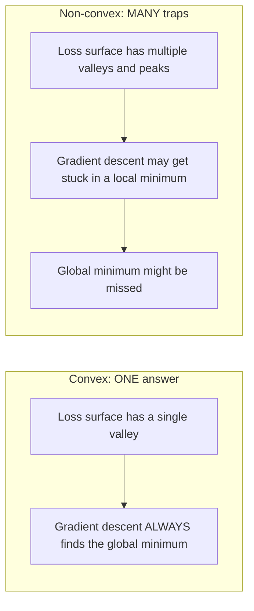
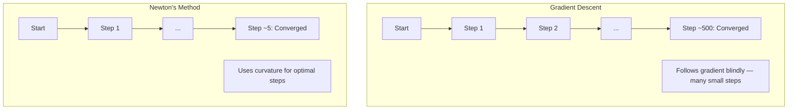
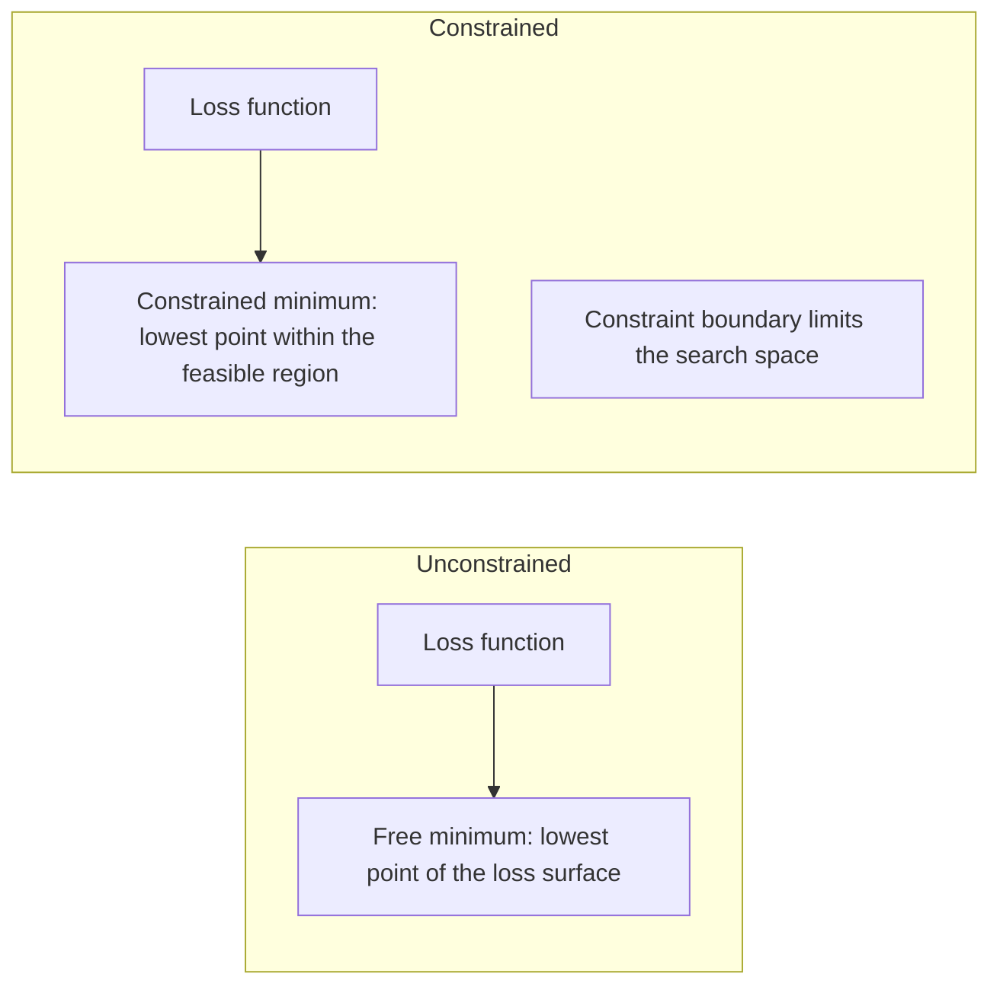
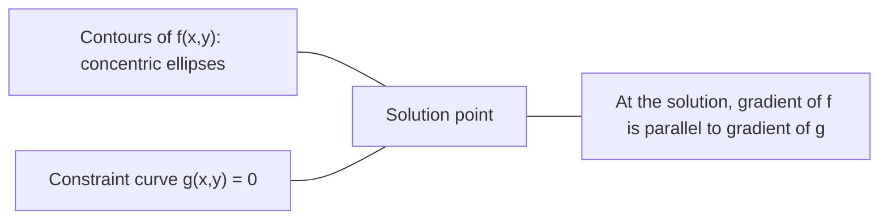

# 형 최적화

> 돌한 문제들은 하나의 계곡을 가지고 있고 신경망은 수백만 개의 신경망을 가지고 있습니다.

**Type:** Build
**Language:**파이썬
**Prerequisites:** Phase 1, Lessons 04 (Calculus for ML), 08 (Optimization)
**Time:** ~90 minutes

## 학습 목표

- 함수가 정의, 두 번째 파생물, 헤스센 기준을 사용하여 구부러진 여부를 테스트
- 뉴턴의 방법을 적용하고 그 사각형적 인 인 인접률을 그레디언트 하락과 비교
- 라그랑 제곱을 사용하여 제한된 최적화 문제를 해결하고 KKT 조건을 해석
- 왜 신경 네트워크 손실 풍경이 구부러지지 않은지 설명하지만 SGD는 여전히 좋은 해결책을 찾습니다

## 문제

8강에서는 gradient descent, momentum, Adam를 배웠죠. 그 최적화자들은 어떤 표면에서도 내려가지만, 아무런 보장이 없습니다. 비상형 풍경에 있는 gradient descent은 나쁜 지역 최소에 착륙하거나, 시들 포인트에 갇혀 있거나 영원히 흔들릴 수도 있습니다. 어쨌든 신경망이 비상형이고 대안이 없기 때문에 사용했습니다.

하지만 기계 학습의 많은 문제들은 구동형이다. 선형 회귀, 물적 회귀, SVM, LASSO, 립 회귀. 이들에겐 더 강력한 것이 있다. 수학적인 보장으로 최적화. 구동형 문제는 정확히 하나의 계곡을 가지고 있다. 하락으로 걷는 모든 알고리즘은 글로벌 최소에 도달할 것이다. 다시 시작이 필요없다. 학습 속도 일정이 없다. 기도도 없다.

직성을 이해하는 것은 세 가지 일을 합니다. 첫째, 문제가 쉬운 (직) 와 어려운 (직) 때 알려줍니다. 둘째, 직 문제를 해결하기 위해 뉴턴의 방법과 같은 더 빠른 도구를 제공합니다. 셋째, ML 전반에 나타나는 개념을 설명합니다. 규칙화라는 한계, SVM의 이중성, 그리고 왜 깊은 학습이 모든 좋은 특성을 위반하고도 작동하는지 설명합니다.

## 개념

### 형 집합

세트$S$ 의 두 개 점에 대해$S$, 그 사이의 선 세그먼트는 또한 완전히 $S$- 그래

| Convex sets | Not convex |
|---|---|
| **Rectangle**: any two points inside can be connected by a line segment that stays inside | **Star/crescent shape**: a line between two interior points can pass outside the set |
| **Triangle**: same property holds for all interior points | **Donut/annulus**: the hole means some line segments leave the set |
| The line segment between any two points stays within the set | The line segment between some pairs of points exits the set |

공식적인 시험: 모든 점에 대해$x, y$$S$그리고 어떤$t \in [0, 1]$, 그 요점은$tx + (1-t)y$또한 $S$- 그래

형 집합의 예:
- 라인, 비행기, 모두$\mathbb{R}^n$
- 공 (환, 구, 하이퍼스피어)
- 반 공간:$\lbrace x : a^T x \le b \rbrace$
- 형 집합의 어느 숫자의 교차

비상형 집합의 예:
- 도넛 (안누스)
- 두 개의 분해한 원의 연합
- "Dent" 또는 "홀"이 있는 모든 세트

### 형 함수

함수$f$은 이 이 이 이 이 이 이 이 이 이 이 이 이 이 이 이 이 이 이 이 이 이 이 이 이 이 이 이 이 이 이 이 이 이 이 이 이 이 이 이 이 이 이 이 이 이 이 이 이 이 이 이 이 이 이 이 이 이 이 이 이 이 이 이 이 이 이 이 이 이 이 이 이 이 이 이 $x, y$그 영역과 그 영역의 모든$t \in [0, 1]$이 부분의 본문은

```math
f(tx + (1-t)y) \le t f(x) + (1-t) f(y)
```

기하학적으로: 그래프의 두 점 사이의 선 세그먼트는 그래프 위에 또는 그래프에 있습니다.

| Property | Convex function | Non-convex function |
|---|---|---|
| **Line segment test** | The line between any two points on the graph lies **above or on** the curve | The line between some points on the graph dips **below** the curve |
| **Shape** | Single bowl/valley curving upward | Multiple peaks and valleys with mixed curvature |
| **Local minima** | Every local minimum is the global minimum | Multiple local minima may exist at different heights |

일반적인 구부리 함수:
- $f(x) = x^2$(잠언)
- $f(x) = \lvert x \rvert$(정부적 가치)
- $f(x) = e^x$(전렬)
- $f(x) = \max(0, x)$(ReLU, 비록 조각처럼 선형)
- $f(x) = -\log(x)$$x > 0$(물론 음)
- 모든 선형 함수$f(x) = a^T x + b$(상상상과 상상)

### 성 테스트

가장 쉬운 것부터 가장 엄격한 것까지 3가지의 실무 테스트

**Test 1: Second derivative test (1D).**만약$f''(x) \ge 0$모든 사람들에게$x$그럼$f$ 모양입니다.

- $f(x) = x^2$이 책:$f''(x) = 2 \ge 0$- 돌이
- $f(x) = x^3$이 책:$f''(x) = 6x$- 음$x < 0$- 은 게 아냐
- $f(x) = e^x$이 책:$f''(x) = e^x > 0$- 돌이

**Test 2: Hessian test (multivariate).**만약 헤센 행렬이$H(x)$모두에 대해 반정확한 양성입니다$x$그럼$f$헤센은 제2부수함들의 매트릭스입니다.

**Test 3: Definition test.**불평등을 확인해 보세요$f(tx + (1-t)y) \le t f(x) + (1-t) f(y)$직렬로 계산하기 어려운 함수들을 위해 유용합니다.

### 왜 이 중요 한 이유

성 최적화의 중심 정리는

**For a convex function, every local minimum is a global minimum.**

즉, 경각층 하락은 갇혀 있지 않습니다. 하락 경로는 동일한 답을 이끌어냅니다. 알고리즘은 최적의 솔루션으로 konverge 할 수 있습니다.



그 결과:
- 무작위 재발동이 필요없습니다
- 복잡한 학습수준 스케줄이 필요 없습니다
- 컨버전스 증명은 가능합니다 (비율은 함수 속성에 따라 달라집니다)
- 이 방법은 독특하다 (평평한 지역까지)

### ML에서 형과 비형

| Problem | Convex? | Why |
|---------|---------|-----|
| Linear regression (MSE) | Yes | Loss is quadratic in weights |
| Logistic regression | Yes | Log-loss is convex in weights |
| SVM (hinge loss) | Yes | Maximum of linear functions |
| LASSO (L1 regression) | Yes | Sum of convex functions is convex |
| Ridge regression (L2) | Yes | Quadratic + quadratic = convex |
| Neural network (any loss) | No | Nonlinear activations create non-convex landscape |
| k-means clustering | No | Discrete assignment step |
| Matrix factorization | No | Product of unknowns |

직 손실이 있는 선형 모델은 직입니다. 비선형 활성화를 가진 숨겨진 층을 추가하면 직성이 끊어집니다.

### 헤센 매트릭스

헤센어 $H$함수의$f: \mathbb{R}^n \to \mathbb{R}$이 $n \times n$2부차기 파생물 매트릭스

```math
H_{ij} = \frac{\partial^2 f}{\partial x_i \, \partial x_j}
```

$f(x, y) = x^2 + 3xy + y^2$이 부분의 본문은

```math
\begin{gathered}
\begin{aligned}
\frac{\partial f}{\partial x} &= 2x + 3y & \frac{\partial^2 f}{\partial x^2} &= 2 & \frac{\partial^2 f}{\partial x \, \partial y} &= 3 \\
\frac{\partial f}{\partial y} &= 3x + 2y & \frac{\partial^2 f}{\partial y \, \partial x} &= 3 & \frac{\partial^2 f}{\partial y^2} &= 2
\end{aligned} \\[8pt]
H = \begin{bmatrix} 2 & 3 \\ 3 & 2 \end{bmatrix}
\end{gathered}
```

헤센어 문자는 곡선에 대해 말해줍니다.
- 모든 긍정적 인 Eigen값: 함수는 모든 방향으로 위로 곡선을 기울인다 (이 시점에서 구부러져 있습니다)
- 모든 음의 Eigenwales: 각 방향으로 아래쪽으로 곡선 (상구, 로컬 최대)
- 혼합 표시: 세일 포인트 (일부 방향으로 위로, 다른 방향으로 아래로 곡선)
- 0 고유값: 그 방향으로 평평 ( 퇴행)

성성 (convexity) 을 위해, 헤센은 긍정적 반 정의 (all eigenvalues ) 이어야 합니다.$\ge 0$) 모든 곳에서, 한 지점에서만 아닙니다.

### 뉴턴의 방법

계층적 계층은 1차 계층 정보 ( gradient) 를 사용한다. 뉴턴의 방법은 2차 계층 정보 (Hessian) 를 사용한다. 현재 지점에서 사각형 추대와 맞닿아 있으며 그 사각형의 최소로 직접 뛰어납니다.

```math
\begin{aligned}
\text{Update rule:} \quad & x_{\text{new}} = x - H^{-1} \cdot \text{gradient} \\
\text{Compare to gradient descent:} \quad & x_{\text{new}} = x - \text{lr} \cdot \text{gradient}
\end{aligned}
```

뉴턴의 방법은 스케라 학습 속도를 역 헤시아어로 대체합니다. 이것은 자동으로 지역 곡선을 기반으로 단계 크기와 방향을 조정합니다.



이점:
- 최소의 근접의 사각형 공렴 (각 단계의 오류 사각형)
- 튜닝을 할 수 있는 학습률이 없습니다
- 규모 변동 (문제를 어떻게 매개 변수를 구비하느냐에 상관없이 작동한다)

단점:
- 헤센 비용 계산$O(n^2)$기억력 및$O(n^3)$역전
- 1백만 개의 무게를 가진 신경망에 대해$10^{12}$항목 및$10^{18}$운용
- 깊이 있는 학습에 유용하지 않습니다

### 제한된 최적화

제한 없는 최적화: 최소화 $f(x)$모든 것$x$- 그래
제한된 최적화: 최소화 $f(x)$제한이 있습니다.

실제 문제는 한계가 있습니다. 비용을 최소화하고 싶지만 예산이 제한되어 있습니다. 오류를 최소화하고 싶지만 모델 복잡성은 제한되어 있습니다.



### 래그랑스 곱셈

라그랑제 곱셈의 방법은 제한된 문제를 제한되지 않은 것으로 변환합니다.

문제는 최소화$f(x)$$g(x) = 0$- 그래

해결책: 새로운 변수를 도입 (라그랑 제곱자 $\lambda$) 과 무제한 문제를 해결하기 위해:

```math
L(x, \lambda) = f(x) + \lambda g(x)
```

용액에서, $L$0이 됩니다.

```math
\begin{aligned}
\frac{\partial L}{\partial x} &= \frac{\partial f}{\partial x} + \lambda \frac{\partial g}{\partial x} = 0 \\
\frac{\partial L}{\partial \lambda} &= g(x) = 0
\end{aligned}
```

지리 직관: 제한된 최소에서, $f$압력의 기하급수와 병행되어야 합니다$g$만약 평행이 없다면, 당신은 제한 표면을 따라 이동하고$f$더 나아가야 합니다.



예를 들어: 최소화$f(x,y) = x^2 + y^2$$x + y = 1$- 그래

```math
\begin{aligned}
L &= x^2 + y^2 + \lambda(x + y - 1) \\[4pt]
\frac{\partial L}{\partial x} &= 2x + \lambda = 0 \implies x = -\lambda/2 \\
\frac{\partial L}{\partial y} &= 2y + \lambda = 0 \implies y = -\lambda/2 \\
\frac{\partial L}{\partial \lambda} &= x + y - 1 = 0 \\[4pt]
&\text{From first two: } x = y \\
&\text{Substituting: } 2x = 1, \text{ so } x = y = 0.5, \ \lambda = -1
\end{aligned}
```

가장 가까운 지점$x + y = 1$기원에 대해서는$(0.5, 0.5)$- 그래

### KKT 조건

카루시-쿠른-터커 조건은 라그랑즈 곱셈을 불평등의 제약으로 확장합니다.

문제는 최소화$f(x)$$g_i(x) \le 0$$i = 1, \ldots, m$- 그래

KKT 조건 (최우수성 위해 필요한):

```math
\begin{aligned}
&\text{1. Stationarity:} && \frac{\partial f}{\partial x} + \sum_i \lambda_i \frac{\partial g_i}{\partial x} = 0 \\
&\text{2. Primal feasibility:} && g_i(x) \le 0 \quad \text{for all } i \\
&\text{3. Dual feasibility:} && \lambda_i \ge 0 \quad \text{for all } i \\
&\text{4. Complementary slackness:} && \lambda_i \, g_i(x) = 0 \quad \text{for all } i
\end{aligned}
```

추가적인 느슨함은 핵심 통찰력입니다.$g_i = 0$, 용액이 경계에 위치하고) 또는 곱자는 0 (제약은 중요하지 않습니다).$\lambda = 0$- 그래

KKT 조건은 SVM의 중심입니다. 지원 벡터는 제한이 활성화되는 데이터 포인트입니다 ($\lambda > 0$) 다른 모든 데이터 포인트들은$\lambda = 0$그리고 결정의 한계에 영향을 주지 않습니다.

### 제한된 최적화로 정규화

L1과 L2 정규화는 임의의 트릭이 아니라, 억제된 최적화 문제입니다.

**L2 regularization (Ridge):**

```math
\begin{aligned}
&\text{minimize } \text{Loss}(w) \text{ subject to } \lVert w \rVert^2 \le t \\[4pt]
&\text{Equivalent unconstrained form:} \\
&\text{minimize } \text{Loss}(w) + \lambda \lVert w \rVert^2
\end{aligned}
```

제약$\lVert w \rVert^2 \le t$공을 정의합니다. (2D의 원, 3D의 구구) 이 손실 kontur이 이 공을 처음 만지는 곳에 있습니다.

**L1 regularization (LASSO):**

```math
\begin{aligned}
&\text{minimize } \text{Loss}(w) \text{ subject to } \lVert w \rVert_1 \le t \\[4pt]
&\text{Equivalent unconstrained form:} \\
&\text{minimize } \text{Loss}(w) + \lambda \lVert w \rVert_1
\end{aligned}
```

제약$\lVert w \rVert_1 \le t$다이아몬드를 정의합니다 (2D로 회전된 광장).

| Property | L2 constraint (circle) | L1 constraint (diamond) |
|---|---|---|
| **Constraint shape** | Circle (sphere in higher dims) | Diamond (rotated square in 2D) |
| **Where loss contour touches** | Smooth boundary — any point on the circle | Corner — aligned with an axis |
| **Solution behavior** | Weights are small but nonzero | Some weights are exactly zero (sparse) |
| **Result** | Weight shrinkage | Feature selection |

이 이유는 L1이 희귀한 모델을 생산하는 (특성 선택) 이며 L2는 무게를 줄이는 이유 때문일 것이다. 다이아몬드는 축과 조선된 각을 가지고 있다. 손실 콘투어는 각을 만지는 가능성이 더 높으며, 하나 이상의 무게를 정확히 0으로 설정한다.

### 이중성

모든 제한된 최적화 문제 (초원) 는 동반 문제 (중성) 를 가지고 있다. 구부러진 문제에서는 초원과 쌍성 모두 같은 최적 값을 가지고 있다. 이것은 강한 양성이다.

라그랑지안 이중 함수는

```math
\begin{aligned}
&\text{Primal:} && \text{minimize } f(x) \text{ subject to } g(x) \le 0 \\
&\text{Lagrangian:} && L(x, \lambda) = f(x) + \lambda g(x) \\
&\text{Dual function:} && d(\lambda) = \min_x L(x, \lambda) \\
&\text{Dual problem:} && \text{maximize } d(\lambda) \text{ subject to } \lambda \ge 0
\end{aligned}
```

왜 이중성이 중요할까요?
- 이중 문제는 원래의 문제보다 해결하기 쉽다
- SVM는 두 가지 형태로 해결됩니다. 여기서 문제는 데이터 포인트 사이의 점 제품 (핵 트릭을 가능하게 하는) 에 달려 있습니다.
- 이중은 원자 최적의 하위 경계를 제공하며, 해액 품질을 확인하는 데 유용합니다.

SVM에 대해 구체적으로:

```
Primal: find w, b that maximize the margin 2/||w|| subject to
        y_i(w^T x_i + b) >= 1 for all i

Dual:   maximize sum(alpha_i) - 0.5 * sum_ij(alpha_i * alpha_j * y_i * y_j * x_i^T x_j)
        subject to alpha_i >= 0 and sum(alpha_i * y_i) = 0

The dual only involves dot products x_i^T x_j.
Replace x_i^T x_j with K(x_i, x_j) to get the kernel trick.
```

### 왜 깊이 있는 학습은 비상복성에도 불구하고 효과가 있는 걸까요?

신경망 손실 함수는 매우 비상형이다. 모든 고전적인 측정에 의해, 그들을 최적화하는 것은 실패해야 한다. 그러나 스토카스틱 추락 하락은 신뢰할 수 있는 좋은 해결책을 찾습니다. 여러 가지 요인이 이것을 설명합니다.

**Most local minima are good enough.**고차원 공간에서, 무작위적인 비판적 지점 (차차원값이 0이 있는 곳) 은 압도적인 수의 시들 지점이며, 로컬 미니멀이 아닙니다. 존재하는 몇 가지 로컬 미니멀은 글로벌 미니멀에 가까운 손실 값을 가지고 있습니다. 파라미터 공간은 수백만 개의 차원을 가지고 있을 때 끔찍한 로컬 미니멀에 갇히는 것은 극히 불가능합니다.

**Saddle points, not local minima, are the real obstacle.**$n$기하급수적 크기의 크기가 높을 때, 모든 크기의 확률은$n$자치값이 긍정적이 (지역 최소) 은 대략 $2^{-n}$거의 모든 중요한 점들은 시들점입니다. SGD의 소음은 그들을 탈출하는데 도움이 됩니다.

**Overparameterization smooths the landscape.**훈련 예제보다 더 많은 매개 변수를 가진 네트워크는 더 부드럽고 더 연결된 손실 표면을 가지고 있습니다. 더 넓은 네트워크는 더 적은 나쁜 로컬 최소치를 가지고 있습니다. 이것은 직관적이지만 경험적으로 일관적입니다.

**Loss landscape structure:**

| Property | Low-dimensional space | High-dimensional space |
|---|---|---|
| **Landscape** | Many isolated peaks and valleys | Smoothly connected valleys |
| **Minima** | Many isolated local minima | Few bad local minima; most are near-optimal |
| **Navigation** | Hard to find global minimum | Many paths lead to good solutions |
| **Critical points** | Mix of local minima and saddle points | Overwhelmingly saddle points, not local minima |

**Stochastic noise acts as implicit regularization.**미니 배트 SGD는 한 최소화로 정착하는 것을 방지하는 잡음을 추가합니다. 한 최소화 과잉화; 평평한 최소화. 잡음이 손실 풍경의 평평한 지역으로 최적화를 편향합니다.

### 실제 두 번째 순서 방법

순수 뉴턴의 방법은 큰 모델에 실용적이지 않습니다. 여러 추대학은 두 번째 순서 정보를 사용할 수 있게 합니다.

**L-BFGS (Limited-memory BFGS):**마지막을 사용하여 역 헤센의 근사 $m$그라디언 차이.$O(mn)$기억 대신$O(n^2)$. ~ 10,000개 매개 변수까지의 문제에서 잘 작동합니다. 클래식 ML (물리학 회귀, CRF) 에서 사용되지만 깊이 학습이 아닙니다.

**Natural gradient:**표준 헤센스산 대신 피셔 정보 매트릭스를 사용한다. 이것은 확률 분포의 기하학을 설명한다. K-FAC (크ronecker-Factored Approximate Curvature) 는 피셔 매트릭스를 크ronecker 제품으로 근접하여 신경 네트워크에 실용화한다.

**Hessian-free optimization:**용어: conjugate gradient를 사용하여$Hx = g$형성되지 않고$H$.만 헤센벡터 제품만 필요해요.$O(n)$자동 차별화를 통해 시간

**Diagonal approximations:**아담의 두 번째 순간은 헤시안의 디아고날의 직사각형 인접이다. 아다헤시안은 허치슨의 추정기를 통해 실제 헤시안 디아고날 요소를 사용하여 이것을 확장합니다.

| Method | Memory | Per-step cost | When to use |
|--------|--------|--------------|-------------|
| Gradient descent | $O(n)$ | $O(n)$ | Baseline, large models |
| Newton's method | $O(n^2)$ | $O(n^3)$ | Small convex problems |
| L-BFGS | $O(mn)$ | $O(mn)$ | Medium convex problems |
| Adam | $O(n)$ | $O(n)$ | Deep learning default |
| K-FAC | $O(n)$ | $O(n)$ per layer | Research, large-batch training |

```figure
convex-vs-nonconvex
```

## 건설 해

### 단계 1: 성 검증

샘플링 포인트와 정의를 확인함으로써 성을 경험적으로 테스트하는 함수를 구축하십시오.

```python
import random
import math

def check_convexity(f, dim, bounds=(-5, 5), samples=1000):
    violations = 0
    for _ in range(samples):
        x = [random.uniform(*bounds) for _ in range(dim)]
        y = [random.uniform(*bounds) for _ in range(dim)]
        t = random.uniform(0, 1)
        mid = [t * xi + (1 - t) * yi for xi, yi in zip(x, y)]
        lhs = f(mid)
        rhs = t * f(x) + (1 - t) * f(y)
        if lhs > rhs + 1e-10:
            violations += 1
    return violations == 0, violations
```

### 2단계: 뉴턴의 2D 방법

정해진 헤시안어를 사용하여 뉴턴의 방법을 적용해

```python
def newtons_method(f, grad_f, hessian_f, x0, steps=50, tol=1e-12):
    x = list(x0)
    history = [x[:]]
    for _ in range(steps):
        g = grad_f(x)
        H = hessian_f(x)
        det = H[0][0] * H[1][1] - H[0][1] * H[1][0]
        if abs(det) < 1e-15:
            break
        H_inv = [
            [H[1][1] / det, -H[0][1] / det],
            [-H[1][0] / det, H[0][0] / det],
        ]
        dx = [
            H_inv[0][0] * g[0] + H_inv[0][1] * g[1],
            H_inv[1][0] * g[0] + H_inv[1][1] * g[1],
        ]
        x = [x[0] - dx[0], x[1] - dx[1]]
        history.append(x[:])
        if sum(gi ** 2 for gi in g) < tol:
            break
    return history
```

### 단계 3: 라그랑 제곱 해제

라그랑지아니아에서 기하급수 하락을 사용하여 제한된 최적화를 해결하십시오.

```python
def lagrange_solve(f_grad, g_val, g_grad, x0, lr=0.01,
                   lr_lambda=0.01, steps=5000):
    x = list(x0)
    lam = 0.0
    history = []
    for _ in range(steps):
        fg = f_grad(x)
        gv = g_val(x)
        gg = g_grad(x)
        x = [
            xi - lr * (fgi + lam * ggi)
            for xi, fgi, ggi in zip(x, fg, gg)
        ]
        lam = lam + lr_lambda * gv
        history.append((x[:], lam, gv))
    return history
```

### 4단계: 1등급과 2등급을 비교

같은 사각형 함수에 따라 기하급수 하락과 뉴턴의 방법을 실행하고,

```python
def quadratic(x):
    return 5 * x[0] ** 2 + x[1] ** 2

def quadratic_grad(x):
    return [10 * x[0], 2 * x[1]]

def quadratic_hessian(x):
    return [[10, 0], [0, 2]]
```

뉴턴의 방법은 1 단계로 (이것이 사각형에 정확하다) 합쳐진다. 수등적 하하도는 수백 단계가 소요될 것입니다. 왜냐하면 헤시안의 고유값이 5배로 다르기 때문에 길게 된 계곡을 만들어냅니다.

## 사용 하 고

성 분석은 ML 모델과 해제기를 선택할 때 직접 적용된다.

구반형 문제 (물리학 회귀, SVM, LASSO):
- 전용 해상자를 사용 (liblinear, CVXPY, scipy.optimize.minimize with method='L-BFGS-B')
- 독특한 글로벌 해결책 을 기대 합니다
- 제2차 방법은 실용적이고 신속합니다

비상형 문제 (신경 네트워크) 에 대해서는:
- 첫 번째 순서 방법 (SGD, Adam) 을 사용
- 이니셔얼화와 무작위성에 따라 해결이 달라진다는 것을 받아들이십시오
- 과다 매개 변수화, 잡음 및 학습 속도 일정을 암시적인 규칙화로 사용한다
- 세계적 최저수준을 찾는 데 시간을 낭비하지 마십시오. 좋은 지역 최저수준은 충분합니다.

```python
from scipy.optimize import minimize

result = minimize(
    fun=lambda w: sum((y - X @ w) ** 2) + 0.1 * sum(w ** 2),
    x0=np.zeros(d),
    method='L-BFGS-B',
    jac=lambda w: -2 * X.T @ (y - X @ w) + 0.2 * w,
)
```

SVM에 대해, 이중 공식은 커널 트릭을 사용할 수 있습니다:

```python
from sklearn.svm import SVC

svm = SVC(kernel='rbf', C=1.0)
svm.fit(X_train, y_train)
print(f"Support vectors: {svm.n_support_}")
```

## 운동

1. **Convexity gallery.**검증기를 사용하여 이 함수를 구동성 테스트: $f(x) = x^4$$f(x) = \sin(x)$$f(x,y) = x^2 + y^2$$f(x,y) = xy$$f(x) = \max(x, 0)$그 결과마다 의미가 있는 이유를 설명해 주세요.

2. **Newton vs gradient descent race.**두 가지 방법을 실행하세요$f(x,y) = 50x^2 + y^2$출발점부터$(10, 10)$. 손실 < 1e-10을 달성하기 위해 각 단계가 얼마나 필요합니다? 조건 수 (최대의 가장 작은 헤센 고유값의 비율) 가 증가하면 경진 하락에 무슨 일이 발생합니까?

3. **Lagrange multiplier geometry.**최소화$f(x,y) = (x-3)^2 + (y-3)^2$$x + 2y = 4$. 의 기하급수성을 확인하여$f$의 기하급수와 평행합니다$g$그 해법을 찾아내야 합니다.

4. **Regularization constraint.**L1 제한된 최적화를 구현: 최소화 $(x-3)^2 + (y-2)^2$$\lvert x \rvert + \lvert y \rvert \le 1$. 용액의 좌표가 0 ( 다이아몬드 제한의 분비량) 에 해당하는 좌표가 하나 있음을 보여주십시오.

5. **Hessian eigenvalue analysis.**로젠브록 함수의 헤센 함수를 (1,1) 와 (-1,1) 에서 계산한다. 두 점에서 고유값을 계산한다.

### 암시

**Exercise 1.**달리기 전에 각 결과를 예측하세요`check_convexity`: 한 차원에서, $f''(x)$2차원에서는 헤센의 고유값을 살펴볼 수 있습니다.$f(x,y) = xy$, 헤시안은 고유값 1과 -1을 가지고 있으므로 검증자는 그것이 구부러지지 않은 것을 보고해야합니다.

**Exercise 2.**전화`optimize_gd`그리고`newtons_method`의 기하급수와 헤센$f$뉴턴의 방법은 한 단계로 사각형을 풀 수 있습니다.$2/100$이 $50x^2$용어, 그래서 $y$방향이 천천히 움직입니다.$100x^2$그리고 다시 단계를 세라

**Exercise 3.**사용`lagrange_solve`$g(x,y) = x + 2y - 4$답에 대해 확인해봐$x + 2y = 4$그리고 그$\nabla f = (2(x-3), 2(y-3))$이 값은$\nabla g = (1, 2)$- 그래

**Exercise 4.**제한 없는 최소 (3, 2) 는 다이아몬드 바깥에 있기 때문에 그 경계에 답이 있습니다. 예측된 기하급수적 하락을 사용하십시오. 기하급수적 단계를 거쳐 다시 기하급수적으로 니다.$\lvert x \rvert + \lvert y \rvert \le 1$. 결과물이 평등으로 제한을 충족하는지 확인하고 비교합니다`demo_regularization_geometry`- 그래

**Exercise 5.**전화`rosenbrock_hessian`각 점에서 결과를 전달합니다`hessian_eigenvalues_2d`1, 1에서 두 고유값은 모두 긍정적이며 그 비율은 매우 크므로 한 방향으로 계곡이 좁고 다른 방향으로 평평합니다. 그 비율을 (-1, 1) 의 비율과 비교하십시오.

## 주요 용어

| Term | What it means |
|------|---------------|
| Convex set | A set where the line segment between any two points in the set stays inside the set |
| Convex function | A function where the line between any two points on its graph lies above or on the graph. Equivalently, Hessian is positive semidefinite everywhere |
| Local minimum | A point lower than all nearby points. For convex functions, every local minimum is the global minimum |
| Global minimum | The lowest point of a function over its entire domain |
| Hessian matrix | The matrix of all second partial derivatives. Encodes curvature information |
| Positive semidefinite | A matrix whose eigenvalues are all non-negative. The multidimensional analogue of "second derivative >= 0" |
| Condition number | Ratio of largest to smallest eigenvalue of the Hessian. High condition number means elongated valleys and slow gradient descent |
| Newton's method | Second-order optimizer that uses the inverse Hessian to determine step direction and size. Quadratic convergence near the minimum |
| Lagrange multiplier | A variable introduced to convert a constrained optimization problem into an unconstrained one |
| KKT conditions | Necessary conditions for optimality with inequality constraints. Generalize Lagrange multipliers |
| Complementary slackness | At the solution, either a constraint is active or its multiplier is zero. Never both nonzero |
| Duality | Every constrained problem has a companion dual problem. For convex problems, both have the same optimal value |
| Strong duality | Primal and dual optimal values are equal. Holds for convex problems satisfying Slater's condition |
| L-BFGS | Approximate second-order method that stores the last $m$ gradient differences instead of the full Hessian |
| Saddle point | A point where the gradient is zero but it is a minimum in some directions and a maximum in others |
| Overparameterization | Using more parameters than training examples. Smooths the loss landscape and reduces bad local minima |

## 더 많은 읽기

- [Boyd & Vandenberghe: Convex Optimization](https://web.stanford.edu/~boyd/cvxbook/)- 표준 교과서, 온라인에서 무료로 사용할 수 있습니다
- [Bottou, Curtis, Nocedal: Optimization Methods for Large-Scale Machine Learning (2018)](https://arxiv.org/abs/1606.04838)- 교량 형 최적화 이론과 심도 학습 실습
- [Choromanska et al.: The Loss Surfaces of Multilayer Networks (2015)](https://arxiv.org/abs/1412.0233)- 왜 비상형 신경망의 풍경이 보이는 만큼 나쁘지 않은가
- [Nocedal & Wright: Numerical Optimization](https://link.springer.com/book/10.1007/978-0-387-40065-5)- 뉴턴 방법, L-BFGS에 대한 종합적인 참조 및 제한된 최적화
