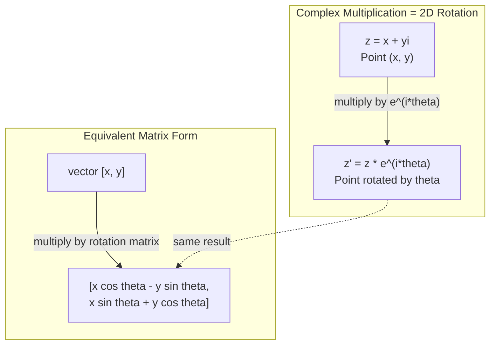
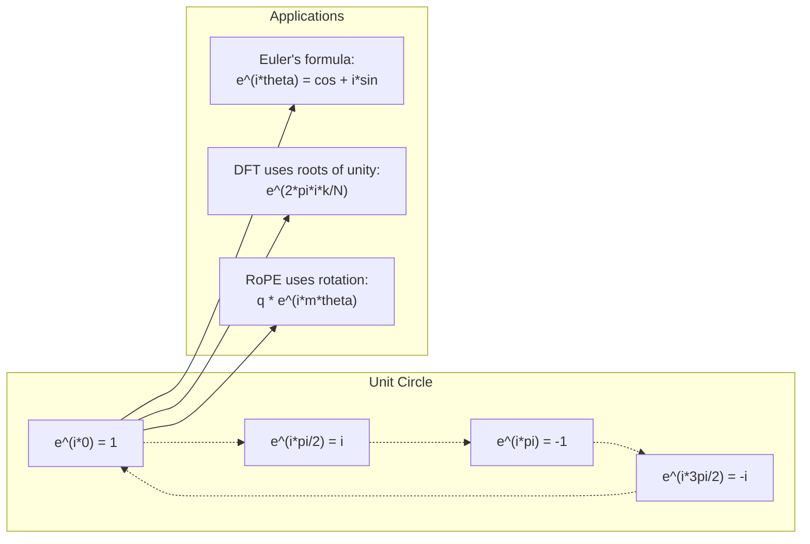

# 인공지능에 대한 복잡한 숫자

> -1의 제곱근은 상상적인 것이 아니라 회전, 주파수, 그리고 신호 처리 중 절반의 열쇠입니다.

**Type:** Learn
**Language:**파이썬
**Prerequisites:** Phase 1, Lessons 01-04 (linear algebra, calculus)
**Time:** ~60 minutes

## 학습 목표

- 복합 수학적 수행 (합합, 곱, 나눌, 합성) 을 직사각형과 극형 양식으로 수행
- 복잡한 기하급수와 삼각수학적 함수 사이의 변환을 위해 유러 공식을 적용
- 복잡한 단체의 뿌리를 사용하여 디스크릿 푸리에 변환을 구현
- 트랜스포머에서 복잡한 회전과 로페 및 시누사이드 위치 코딩이 어떻게 기반을 두고 있는지 설명합니다.

## 문제

푸리에 변환에 관한 논문을 열면`i`트랜스포머 위치 코딩을 보면`sin`그리고`cos`복잡한 기하급수들의 실제와 상상적인 부분입니다. 양자 컴퓨팅에 대해 읽으면 복잡한 벡터 공간에서 표현되는 모든 것을 발견하게 됩니다.

복잡한 숫자는 추상적 으로 보일 수 있습니다. -1의 제곱근에 기반한 숫자 시스템은 수학적인 속임수처럼 느껴집니다. 하지만 그것은 속임수 아닙니다. 그것은 회전과 진동의 자연어입니다. 어떤 것이 회전하거나 진동하거나 진동할 때마다 복잡한 숫자는 올바른 도구입니다.

복잡한 숫자를 이해하지 않으면 디스크레트 푸리에 변환을 이해할 수 없습니다. FFT를 이해할 수 없습니다. 현대 언어 모델에서 RoPE (로타리 포지션 임베딩) 이 어떻게 작동하는지 이해할 수 없습니다. 원래 트랜스포머 종이에서 시누사이드 위치 코딩이 왜 주파수를 사용하는지 이해할 수 없습니다.

이 수업은 처음부터 복잡한 수학을 만들고, 기하학과 연결하고, 기계 학습에서 복잡한 숫자가 정확히 나타나는 곳을 보여줍니다.

## 개념

### 복잡한 숫자는 무엇일까요?

복잡한 숫자는 두 부분으로 구성되어 있습니다. 실제 부분과 가상의 부분.

```
z = a + bi

where:
  a is the real part
  b is the imaginary part
  i is the imaginary unit, defined by i^2 = -1
```

이 숫자는 한 축에 있고, 상상의 숫자는 다른 축에 있고, 복잡한 숫자는 이 평면의 한 점입니다.

### 복잡한 수학적

**Addition.**실제 부분을 합쳐, 상상적인 부분을 합쳐

```math
\begin{aligned}
(a + bi) + (c + di) &= (a + c) + (b + d)i \\[4pt]
\text{Example: } (3 + 2i) + (1 + 4i) &= 4 + 6i
\end{aligned}
```

**Multiplication.**분배 법칙을 사용해서 기억하세요$i^2 = -1$- 그래

```math
\begin{aligned}
(a + bi)(c + di) &= ac + adi + bci + bdi^2 \\
&= ac + adi + bci - bd \\
&= (ac - bd) + (ad + bc)i \\[8pt]
\text{Example: } (3 + 2i)(1 + 4i) &= 3 + 12i + 2i + 8i^2 \\
&= 3 + 14i - 8 \\
&= -5 + 14i
\end{aligned}
```

**Conjugate.**상상 부분의 표지판을 뒤집어 보세요.

```math
\text{conjugate of } (a + bi) = a - bi
```

복합수와 그 합수의 곱은 항상 실제입니다.

```math
(a + bi)(a - bi) = a^2 + b^2
```

**Division.**수자와 분자를 분자의 합성자로 곱한다.

```math
\frac{a + bi}{c + di} = \frac{(a + bi)(c - di)}{c^2 + d^2}
```

이것은 가상의 부분을 지명자에서 제거하여 깨끗한 복잡한 숫자를 제공합니다.

### 복잡한 평면

복잡한 평면은 모든 복잡한 숫자를 2D 포인트로 지도합니다. 수평축은 실제 축이고 수직축은 상상적인 축입니다.

```
z = 3 + 2i  corresponds to the point (3, 2)
z = -1 + 0i corresponds to the point (-1, 0) on the real axis
z = 0 + 4i  corresponds to the point (0, 4) on the imaginary axis
```

복잡한 숫자는 동시에 기원에 있는 점과 벡터입니다. 이 두 가지 해석은 복잡한 숫자를 기하학에 유용하게 만듭니다.

### 극형

평면의 모든 점들은 기원에 있는 거리와 긍정적인 실제 축으로부터의 각에 의해 설명될 수 있습니다.

```math
\begin{aligned}
z &= r (\cos\theta + i \sin\theta) \\[4pt]
\text{where: } r &= |z| = \sqrt{a^2 + b^2} \quad \text{(magnitude, or modulus)} \\
\theta &= \mathop{\mathrm{atan2}}(b, a) \quad \text{(phase, or argument)}
\end{aligned}
```

직사각형 모양$(a + bi)$양극형$(r, \theta)$곱하기에는 좋은 것입니다.

**Multiplication in polar form.**크기를 곱하고 각을 더해봅시다

```math
\begin{aligned}
z_1 &= r_1 e^{i\theta_1} \\
z_2 &= r_2 e^{i\theta_2} \\[4pt]
z_1 z_2 &= (r_1 r_2) \, e^{i(\theta_1 + \theta_2)}
\end{aligned}
```

그래서 복잡한 숫자는 회전하기에 완벽합니다. 1의 크기로 복잡한 숫자를 곱하면 순수한 회전입니다.

### 에우러의 공식

복잡한 기하급수와 삼각수학의 교차:

```math
e^{i\theta} = \cos\theta + i \sin\theta
```

이 강의에서 가장 중요한 공식은$\theta = \pi$이 부분의 본문은

```math
\begin{aligned}
e^{i\pi} &= \cos\pi + i \sin\pi = -1 + 0i = -1 \\[4pt]
\text{Therefore: } e^{i\pi} + 1 &= 0
\end{aligned}
```

5가지 기본 상수 ($e$$i$$\pi$, 1, 0) 를 하나의 방정식으로 연결합니다.

### 왜 Euler의 공식이 ML에 중요한지

오일러의 공식은 이렇게 말합니다.$e^{i\theta}$단위 원을 추적합니다$\theta$이 부분에서$\theta = 0$, 당신은 $(1, 0)$- $\theta = \pi/2$, 당신은 $(0, 1)$- $\theta = \pi$, 당신은 $(-1, 0)$- $\theta = 3\pi/2$, 당신은 $(0, -1)$. 완전 회전$\theta = 2\pi$- 그래

이것은 복잡한 기하급수적인 회전들이라는 것을 의미합니다. 그리고 회전들은 신호 처리와 ML에서 모든 곳에 있습니다.

### 2D 회전과 연결

복합수 곱하기$(x + yi)$$e^{i\theta}$점을 회전합니다$(x, y)$각별로$\theta$그 원천을 둘러싼 것입니다.

```math
\begin{aligned}
&\text{Rotation via complex multiplication:} \\
&\quad (x + yi)(\cos\theta + i \sin\theta) = (x \cos\theta - y \sin\theta) + (x \sin\theta + y \cos\theta)i \\[8pt]
&\text{Rotation via matrix multiplication:} \\
&\quad \begin{bmatrix} \cos\theta & -\sin\theta \\ \sin\theta & \cos\theta \end{bmatrix} \begin{bmatrix} x \\ y \end{bmatrix} = \begin{bmatrix} x \cos\theta - y \sin\theta \\ x \sin\theta + y \cos\theta \end{bmatrix}
\end{aligned}
```

이 두 개의 곱셈은 2차원 회전입니다. 회전 행렬은 단지 행렬 표기식으로 작성된 복잡한 곱셈입니다.



### 파저와 회전 신호

복잡한 기하급수$e^{i\omega t}$각 주파수에서 단위 원을 돌고 있는 점입니다$\omega$- 아뇨$t$이 점은 원을 추적합니다.

이 회전 지점의 진짜 부분은$\cos(\omega t)$상상적인 부분은$\sin(\omega t)$시노수이드 신호는 회전 복합수의 그림자입니다.

```math
\begin{aligned}
e^{i\omega t} &= \cos(\omega t) + i \sin(\omega t) \\[4pt]
\text{Real part: } & \cos(\omega t) \quad \text{-- a cosine wave} \\
\text{Imaginary part: } & \sin(\omega t) \quad \text{-- a sine wave}
\end{aligned}
```

이것은 파저 표현입니다. 움직이던 시노파를 추적하는 대신 순조롭게 회전하는 화살표를 추적합니다. 단계 전환은 각의 대립이 됩니다. 광대 변화는 규모 변화입니다. 신호의 추가는 벡터 추가가 됩니다.

### 연합 의 뿌리

$N$- 통일의 뿌리는$N$단위 원에 동등하게 거리를 둔 점:

```math
w_k = e^{2\pi i k/N} \quad \text{for } k = 0, 1, 2, \ldots, N-1
```

$N = 4$, 뿌리는:$1, i, -1, -i$(자리방향 4개)
$N = 8$4개의 방사각형과 4개의 방사각형이 있습니다.

단체의 뿌리는 디스크릿 푸리에 변환의 기초입니다. DFT는 신호를 이 부분에서 구성 요소로 분해합니다.$N$같은 공간의 주파수

### DFT에 연결

신호의 디스크릿 푸리에 변환$x[0], x[1], \ldots, x[N-1]$이 함수는

```math
X[k] = \sum_{n=0}^{N-1} x[n] \, e^{-2\pi i k n/N}
```

각각$X[k]$신호가 $k$- 통일의 뿌리--$k$DFT는 신호를 $N$이 파저들은 각각의 광대성과 단계를 알려줍니다.

### 왜 내가 상상력이 없는지

"생상"이라는 단어는 역사적 우연입니다. 데카르트는 그것을 무시적으로 사용했습니다.$i$음수는 "무엇을 빼면 3에서 5을 얻을 수 있을까?"라는 질문에 답합니다.

더 유용하게:$i$90도 회전 연산자입니다.$i$한 번, 여러분은 90도로 상상축으로 회전합니다.$i$다시 ($i^2$), 다시 90도 회전합니다. 이제 당신은 부정적인 실제 방향으로 지향합니다.$i^2 = -1$이 부분은 신비롭지 않습니다. 그것은 두 개의 4분의 1 회로로 만들어진 반 회로입니다.

그래서 복잡한 숫자는 공학에서 모든 곳에 있습니다. 회전하는 모든 것 -- 전자기파, 양자 상태, 신호 진동, 위치 코딩 -- 자연적으로 복잡한 숫자로 묘사됩니다.

### 복잡한 기하급수적 대 삼각수학적 함수

오일러의 공식 이전에 엔지니어들은 신호를 이렇게 썼습니다.$A \cos(\omega t + \phi)$-- $A$, 주파수$\omega$, 단계$\phi$이 방법은 효과가 있지만 수학은 고통스럽습니다. 두 개의 코시노를 서로 다른 단계로 합하면 삼각수학적 정체성이 필요합니다.

복잡한 기하급수와 같은 신호는$A e^{i(\omega t + \phi)}$두 개의 신호를 더하면 단지 두 개의 복잡한 숫자를 더하는 것입니다. 곱하는 것은 단지 규모를 곱하고 각을 더하는 것입니다. 단계 전환은 각 추가로됩니다. 주파수 전환은 파저로 곱됩니다.

신호 처리 분야 전체가 수학이 더 깨끗하기 때문에 복잡한 기하학적 표기로 전환되었습니다. "실적 신호"는 항상 복잡한 표현의 실제 부분입니다. 상상적인 부분은 회계로 함께 수행되며 모든 대수학이 자연스럽게 작동합니다.

### 트랜스포머에 연결

**Sinusoidal positional encodings**(원래 트랜스포머 종이):

```math
\begin{aligned}
PE(pos, 2i) &= \sin\left(pos / 10000^{2i/d}\right) \\
PE(pos, 2i+1) &= \cos\left(pos / 10000^{2i/d}\right)
\end{aligned}
```

죄와 cos 쌍은 서로 다른 주파수에서 복잡한 기하급수의 실제와 상상적인 부분이다. 각 주파수는 코딩 위치에 대한 다른 "상해결"을 제공합니다. 낮은 주파수는 천천히 변화합니다. 높은 주파수는 빠르게 변화합니다. 함께 각 위치에 고유한 주파수 지문점을 제공합니다.

**RoPE (Rotary Position Embedding)**이 방법은 두 개의 토큰 사이의 상대적 위치가 회전 각이 되는 것을 의미합니다. 이 회전하는 vekt을 사용하여 주의를 계산하여, 복잡한 곱셈을 통해 상대적 위치에 민감하게 만듭니다.

| Operation | Algebraic Form | Geometric Meaning |
|-----------|---------------|-------------------|
| Addition | $(a+c) + (b+d)i$ | Vector addition in the plane |
| Multiplication | $(ac-bd) + (ad+bc)i$ | Rotate and scale |
| Conjugate | $a - bi$ | Reflect over real axis |
| Magnitude | $\sqrt{a^2 + b^2}$ | Distance from origin |
| Phase | $\mathop{\mathrm{atan2}}(b, a)$ | Angle from positive real axis |
| Division | multiply by conjugate | Reverse rotation and rescale |
| Power | $r^n e^{in\theta}$ | Rotate $n$ times, scale by $r^n$ |



```figure
roots-of-unity
```

## 건설 해

### 단계 1: 복잡한 수업

정사각형과 극형의 수리, 크기와 단계, 변환을 지원하는 복잡한 숫자 클래스를 구축하십시오.

```python
import math

class Complex:
    def __init__(self, real, imag=0.0):
        self.real = real
        self.imag = imag

    def __add__(self, other):
        return Complex(self.real + other.real, self.imag + other.imag)

    def __mul__(self, other):
        r = self.real * other.real - self.imag * other.imag
        i = self.real * other.imag + self.imag * other.real
        return Complex(r, i)

    def __truediv__(self, other):
        denom = other.real ** 2 + other.imag ** 2
        r = (self.real * other.real + self.imag * other.imag) / denom
        i = (self.imag * other.real - self.real * other.imag) / denom
        return Complex(r, i)

    def magnitude(self):
        return math.sqrt(self.real ** 2 + self.imag ** 2)

    def phase(self):
        return math.atan2(self.imag, self.real)

    def conjugate(self):
        return Complex(self.real, -self.imag)
```

### 단계 2: 극변화와 유일러 공식

```python
def to_polar(z):
    return z.magnitude(), z.phase()

def from_polar(r, theta):
    return Complex(r * math.cos(theta), r * math.sin(theta))

def euler(theta):
    return Complex(math.cos(theta), math.sin(theta))
```

확인:`euler(theta).magnitude()`항상 1.0이어야 합니다.`euler(0)`이 경우 1, 0을 줄 수 있습니다.`euler(pi)`(-1, 0) 를 줄 수 있다.

### 3단계: 회전

점 회전$(x, y)$각별로$\theta$하나의 복잡한 곱셈입니다.

```python
point = Complex(3, 4)
rotated = point * euler(math.pi / 4)
```

크기는 동일합니다. 각만 변합니다.

### 단계 4: 복잡한 수학적 DFT

```python
def dft(signal):
    N = len(signal)
    result = []
    for k in range(N):
        total = Complex(0, 0)
        for n in range(N):
            angle = -2 * math.pi * k * n / N
            total = total + Complex(signal[n], 0) * euler(angle)
        result.append(total)
    return result
```

이쪽은$O(N^2)$DFT. 각 출력 $X[k]$신호 샘플의 합이 일체의 뿌리로 곱됩니다.

### 단계 5: 역 DFT

역 DFT는 원래 신호를 스펙트럼에서 재조성한다. 전향 DFT에서 유일한 변화는: 기하수를 전수에서 뒤집어 쪼개라 $N$- 그래

```python
def idft(spectrum):
    N = len(spectrum)
    result = []
    for n in range(N):
        total = Complex(0, 0)
        for k in range(N):
            angle = 2 * math.pi * k * n / N
            total = total + spectrum[k] * euler(angle)
        result.append(Complex(total.real / N, total.imag / N))
    return result
```

이것은 완벽한 재조성을 제공합니다. DFT를 적용하고 IDFT를 적용하면 원래 신호가 기계 정밀도에 돌아옵니다. 정보가 손실되지 않습니다.

### 6단계: 연합 의 뿌리

```python
def roots_of_unity(N):
    return [euler(2 * math.pi * k / N) for k in range(N)]
```

두 가지 특성을 확인하세요:
- 각 뿌리는 정확히 1의 크기를 가지고 있습니다.
- 모두 합$N$뿌리는 0 (시메트리 방식으로 취소됩니다).

이 특성들이 DFT를 역전성으로 만드는 것입니다. 단체의 뿌리는 주파수 영역의 정형 기반을 형성합니다.

## 사용 하 고

파이썬은 복잡한 숫자 지원 기능을 내장하고 있습니다.`j`상상적인 단위를 나타냅니다.

```python
z = 3 + 2j
w = 1 + 4j

print(z + w)
print(z * w)
print(abs(z))

import cmath
print(cmath.phase(z))
print(cmath.exp(1j * cmath.pi))
```

배열에 대해, numpy는 복잡한 숫자를 원산적으로 처리합니다:

```python
import numpy as np

z = np.array([1+2j, 3+4j, 5+6j])
print(np.abs(z))
print(np.angle(z))
print(np.conj(z))
print(np.real(z))
print(np.imag(z))

signal = np.sin(2 * np.pi * 5 * np.linspace(0, 1, 128))
spectrum = np.fft.fft(signal)
freqs = np.fft.fftfreq(128, d=1/128)
```

## 선박

달아`code/complex_numbers.py`생산하기 위해`outputs/skill-complex-arithmetic.md`- 그래

## 운동

1. **Complex arithmetic by hand.**계산$(2 + 3i)(4 - i)$그리고 코드를 확인하고 계산해 보세요$(5 + 2i) / (1 - 3i)$. 두 결과를 복합 평면으로 그려서 곱셈이 첫 번째 숫자를 회전하고 확장했는지 확인합니다.

2. **Rotation sequence.**그 요점부터 시작해$(1, 0)$- 곱하기$e^{i\pi/6}$12번 확인해$(1, 0)$12번 곱한 후 각 단계에 좌표를 인쇄하고 정규 12곤을 추적하는 것을 확인합니다.

3. **DFT of a known signal.**신호를 생성하여 $\sin(2\pi \cdot 3t)$그리고$0.5 \sin(2\pi \cdot 7t)$32점에서 샘플을 가져오세요. DFT를 실행하세요. 그 규모 스펙트럼은 3 및 7의 주파수에서 최고치를 가지고 있는지 확인하세요. 7의 최고치는 3의 최고치의 절반입니다.

4. **Roots of unity visualization.**8번째 원자수를 계산해 0으로 합친다는 것을 확인해 보아라$e^{2\pi i/8}$다음 뿌리를 줄 수 있습니다.

5. **Rotation matrix equivalence.**10개의 무작위 각과 10개의 무작위 점에 대해, 복잡한 곱셈이 2x2 회전 행렬과 같은 결과를 얻는 것을 확인합니다. 최대 수학적 차이를 인쇄합니다.

### 암시

**Exercise 1.**제품을 확장하여 $i^2 = -1$, 그리고 상위와 하위를 합성으로 곱하여 나눕니다$1 + 3i$제품 확인`Complex(2, 3) * Complex(4, -1)`이 `magnitude()`두 대의 곱과 같아야 합니다.`phase()`두 단계의 합이 같아야 합니다.

**Exercise 2.**`euler(math.pi / 6)`그리고 12번 곱합니다. 각 단계에서는 거리가 1이 되고 각도 30도 증가하는지 확인합니다. 마지막 점은 (1, 0) 의 1e-12 안에 있어야 합니다.

**Exercise 3.**시간표를 $t = n/32$그리고 전화`dft`0~15의 칸만 보세요. 왜냐하면 상반은 거울 사진이기 때문입니다.$k$진폭의 시누스$A$ $AN/2$, 그래서 방 3에서 16 정도, 방 7에서 8 정도를 예상하세요

**Exercise 4.**전화`roots_of_unity(8)`그리고 뿌리를 더해봅시다: 합의 크기는 0에 가까운 거리에 있어야 합니다. 각 뿌리를 이전 뿌리로 나누고 모든 결과가 같는지 확인합니다.`euler(2 * math.pi / 8)`- 그래

**Exercise 5.**회전 행렬은 [[cos t, -sin t], [sin t, cos t]]. 각 각 각과 점에 대해 계산`euler(t) * Complex(x, y)`그리고 매트릭스 곱셈을 통해 가장 큰 절대적인 차이를 기록합니다.$10^{-15}$- 그래

## 주요 용어

| Term | What it means |
|------|---------------|
| Complex number | A number $a + bi$ where $a$ is the real part, $b$ is the imaginary part, and $i^2 = -1$ |
| Imaginary unit | The number $i$, defined by $i^2 = -1$. Not imaginary in the philosophical sense -- it is a rotation operator |
| Complex plane | The 2D plane where the x-axis is real and the y-axis is imaginary. Also called the Argand plane |
| Magnitude (modulus) | The distance from the origin: $\sqrt{a^2 + b^2}$. Written as $\lvert z \rvert$ |
| Phase (argument) | The angle from the positive real axis: $\mathop{\mathrm{atan2}}(b, a)$. Written as $\arg(z)$ |
| Conjugate | The mirror image across the real axis: conjugate of $a + bi$ is $a - bi$ |
| Polar form | Expressing $z$ as $r e^{i\theta}$ instead of $a + bi$. Makes multiplication easy |
| Euler's formula | $e^{i\theta} = \cos\theta + i \sin\theta$. Connects exponentials to trigonometry |
| Phasor | A rotating complex number $e^{i\omega t}$ representing a sinusoidal signal |
| Roots of unity | The $N$ complex numbers $e^{2\pi i k/N}$ for $k = 0$ to $N-1$. $N$ equally spaced points on the unit circle |
| DFT | Discrete Fourier Transform. Decomposes a signal into complex sinusoidal components using roots of unity |
| RoPE | Rotary Position Embedding. Uses complex multiplication to encode relative position in transformer attention |

## 더 많은 읽기

- [Visual Introduction to Euler's Formula](https://betterexplained.com/articles/intuitive-understanding-of-eulers-formula/)- 무거운 표기 없이 기하학적 직관성을 구축합니다
- [Su et al.: RoFormer (2021)](https://arxiv.org/abs/2104.09864)- 복잡한 회전으로 로터리 포지션 임베디션을 도입하는 논문
- [Vaswani et al.: Attention Is All You Need (2017)](https://arxiv.org/abs/1706.03762)- 시노스오이드 위치 코딩을 가진 원래 트랜스포머 종이
- [3Blue1Brown: Euler's formula with introductory group theory](https://www.youtube.com/watch?v=mvmuCPvRoWQ)- 왜 그런지 시각적으로 설명합니다$e^{i\pi} = -1$
- [Needham: Visual Complex Analysis](https://global.oup.com/academic/product/visual-complex-analysis-9780198534464)- 복잡한 숫자를 가장 잘 시각적으로 처리하고, 기하학적 통찰력을 풍부하게 함
- [Strang: Introduction to Linear Algebra, Ch. 10](https://math.mit.edu/~gs/linearalgebra/)- 선형수제와 고유값의 맥락에서 복잡한 숫자
