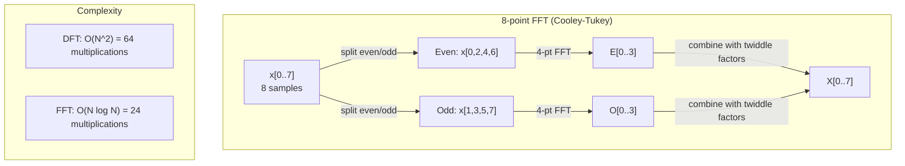
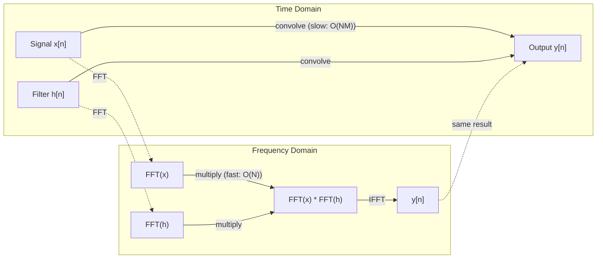

# 푸리에 변환

> 모든 신호는 시노파의 합입니다. 푸리에 변환은 어떤 신호인지 알려줍니다.

**Type:** Build
**Language:**파이썬
**Prerequisites:** Phase 1, Lessons 01-04, 19 (complex numbers)
**Time:** ~90 minutes

## 학습 목표

- DFT를 처음부터 실행하고$O(N \log N)$쿠리 투키 FFT
- 주파수 계수를 해석: 신호에서 양폭, 단계 및 전력 스펙트럼을 추출
- FFT 곱셈을 통해 convolution를 수행하기 위해 convolution 정리를 적용한다
- 포리어 주파수 분해를 변환기 위치 코딩 및 CNN convolution 레이어에 연결

## 문제

오디오 녹음 은 시간 간 압력 측정의 순서 이다. 주식 가격은 며칠 동안의 값의 순서 이다. 이미지는 공간 상의 픽셀 강도의 격자 이다. 이 모든 것은 시간 영역 (또는 공간 영역) 의 데이터 이다. 당신은 어떤 지표에서 값의 변화를 볼 수 있습니다.

하지만 시간 영역에서 많은 패턴이 보이지 않습니다. 이 오디오 신호는 순수한 음색이나 음색이 있습니까? 이 주식 가격은 주 주 주 순환을 가지고 있습니까? 이 이미지는 반복적인 질감을 가지고 있습니까? 이 질문은 주파수 내용에 관한 것이고 시간 영역은 그것을 숨깁니다.

푸리에 변환은 시간 영역에서 주파수 영역으로 데이터를 변환합니다. 신호를 받아 다른 주파수의 시노파로 분해합니다. 각 시노파는 양폭 (이 얼마나 강) 과 단계를 (이 시작되는 곳) 가지고 있습니다. 푸리에 변환은 두 가지 모두 알려줍니다.

이것은 ML에 중요한 이유는 주파수 영역 사고가 모든 곳에 나타나기 때문입니다. 컨볼루션 신경망은 주파수 영역에서 곱하는 컨볼루션을 수행합니다. 트랜스포머 위치 코딩은 위치를 표현하기 위해 주파수 분해를 사용합니다. 오디오 모델 (말 인식, 음악 생성) 은 스펙트로그램을 기반으로 작동합니다. 시간 시리즈 모델은 주기적인 패턴을 찾습니다. 푸리에 변환을 이해하면 이 모든 것에 대해 일할 수 있는 어휘가 있습니다.

## 개념

### DFT 정의

주어진 $N$샘플$x[0], x[1], \ldots, x[N-1]$, 디스크리트 푸리에 변환이 생산합니다$N$주파수 계수$X[0], X[1], \ldots, X[N-1]$이 부분의 본문은

```math
X[k] = \sum_{n=0}^{N-1} x[n] \, e^{-2\pi i k n/N} \qquad \text{for } k = 0, 1, \ldots, N-1
```

각각$X[k]$이 숫자는 복잡한 숫자입니다.$\lvert X[k] \rvert$주파수 amplitude를 알려줍니다$k$- 그 단계$\angle X[k]$이 주파수의 단계적 오프셋을 알려줍니다.

핵심 통찰력:$e^{-2\pi i k n/N}$주파수에서 회전하는 파저입니다$k$. DFT는 신호와 각 신호의 상관관계를 계산합니다 $N$같은 공간의 주파수. 신호가 주파수에서 에너지를 포함한다면$k$, 상관관계가 크다. 그렇지 않으면 거의 0이 됩니다.

### 각 계수는 무엇을 의미하는지

**$X[0]$: the DC component.**이것은 모든 샘플의 합입니다. 평균에 비례합니다. 신호의 상수 (제곱 주파수) 이변을 나타냅니다.

```math
X[0] = \sum_{n=0}^{N-1} x[n] \, e^0 = \text{sum of all samples}
```

**$X[k]$ for $1 \le k \le N/2$: positive frequencies.** $X[k]$주파수를 나타냅니다$k$주행$N$샘플. 더 높습니다.$k$더 높은 주파수를 뜻한다 (더 빠른 진동).

**$X[N/2]$: the Nyquist frequency.**가장 높은 주파수를 표현할 수 있습니다$N$표본 위에, 여러분은 별명을 얻습니다. 높은 주파수가 낮은 주파수로 변신합니다.

**$X[k]$ for $N/2 < k < N$: negative frequencies.**실제 값의 신호를 위해$X[N-k] = \overline{X[k]}$음향파수는 긍정적인파수의 거울 이미지입니다. 이 때문에 유용한 정보는 첫 번째에 있습니다.$N/2 + 1$계수

### 역 DFT

역 DFT는 원래 신호를 그 주파수 계수에서 재구성한다.

```math
x[n] = \frac{1}{N} \sum_{k=0}^{N-1} X[k] \, e^{2\pi i k n/N} \qquad \text{for } n = 0, 1, \ldots, N-1
```

전향 DFT와 유일한 차이점은: 기하급수에서 표시되는 신호는 긍정적 (負) 이며,$1/N$정상화 요인

역 DFT는 완벽한 재구성입니다. 정보가 손실되지 않습니다. 시간 영역에서 주파수 영역으로 돌아가서 오류 없이 돌아갈 수 있습니다. DFT는 기본 변경입니다. 다른 좌표 시스템에서 동일한 정보를 다시 표현합니다.

### FFT: 빨리 해

위 정의된 DFT는$O(N^2)$: 각 $N$출력 계수, 합시다 $N$입품 샘플$N$1백만, 즉$10^{12}$운영

빠른 푸리에 변환 (FFT) 은 같은 결과를 계산합니다 $O(N \log N)$- $N$1백만, 즉, 1조가 아닌 약 2천만개의 작업입니다. 이것이 주파수 분석을 실용화시키는 것입니다.

쿠리-투케이 알고리즘 (최종 FFT) 은 나뉘어 정복을 통해 작동합니다.

1. 신호를 적도 지표와 적도 지표 샘플로 나눌 수 있습니다.
2. 각 반의 DFT를 반복적으로 계산한다.
3. "비들 팩터"를 사용하여 반 크기의 두 DFT를 결합하십시오.$e^{-2\pi i k/N}$- 그래

```math
\begin{aligned}
X[k] &= E[k] + e^{-2\pi i k/N} \, O[k] && \text{for } k = 0, \ldots, N/2 - 1 \\
X[k + N/2] &= E[k] - e^{-2\pi i k/N} \, O[k] && \text{for } k = 0, \ldots, N/2 - 1 \\[6pt]
\text{where } E &= \text{DFT of even-indexed samples} \\
O &= \text{DFT of odd-indexed samples}
\end{aligned}
```

대칭은 각각의 리큐션 레벨이$O(N)$일하고 있습니다.$\log_2(N)$수준:$O(N \log N)$- 그래



FFT는 신호 길이가 2의 힘으로 요구됩니다. 실제로 신호는 다음 힘으로 0으로 부착됩니다.

### 스펙트럼 분석

**power spectrum** $\lvert X[k] \rvert^2$-- 각 주파수 계수의 제곱대입니다.

**phase spectrum** $\angle X[k]$대부분의 분석 작업에서는 전력 스펙트럼에 대해 신경쓰고

```math
\begin{aligned}
\text{Power at frequency } k: \quad P[k] &= |X[k]|^2 = \mathop{\mathrm{Re}}(X[k])^2 + \mathop{\mathrm{Im}}(X[k])^2 \\
\text{Phase at frequency } k: \quad \phi[k] &= \mathop{\mathrm{atan2}}(\mathop{\mathrm{Im}}(X[k]), \mathop{\mathrm{Re}}(X[k]))
\end{aligned}
```

### 주파수 해상

DFT의 주파수 해상도는 샘플의 수에 달려 있습니다 $N$그리고 샘플링 비율$f_s$- 그래

```math
\begin{aligned}
\text{Frequency of bin } k: \quad & f_k = k \cdot f_s / N \\
\text{Frequency resolution:} \quad & \Delta f = f_s / N \\
\text{Maximum frequency:} \quad & f_{\max} = f_s / 2 \quad \text{(Nyquist)}
\end{aligned}
```

서로 가까운 두 주파수를 파악하려면 더 많은 샘플이 필요합니다. 높은 주파수를 캡처하려면 더 높은 샘플링 비율이 필요합니다.

### convolution 정리는

이것은 신호 처리에서 가장 중요한 결과 중 하나이며 CNN에 직접적으로 관련이 있습니다.

**Convolution in the time domain equals pointwise multiplication in the frequency domain.**

```math
\begin{aligned}
& x * h = \text{IFFT}(\text{FFT}(x) \cdot \text{FFT}(h)) \\[4pt]
& \text{where } * \text{ is convolution and } \cdot \text{ is element-wise multiplication}
\end{aligned}
```

왜 이 점 이 중요 합니까?

- 길이의 두 신호의 직전 구슬$N$그리고$M$$O(NM)$운영
- FFT 기반의 convolution가 $O(N \log N)$이 둘 다 변형하고 곱하고 다시 변형한다.
- 큰 커널에서 FFT convolution는 훨씬 더 빨라집니다.
- 이것은 바로 큰 수용장들을 가진 convolutional 층에서 일어나는 일입니다.

참고: DFT는 순환 회전 (신호는 회전) 을 계산한다. 선형 회전 (복복이 없다) 에 대해서는 두 신호의 길이를 0 패드로 계산한다.$N + M - 1$컴퓨터가 시작되기 전에



### 창문

DFT는 신호가 주기적으로 발생한다고 가정합니다.$N$이 시그널은 무한히 반복되는 신호의 한 기간으로 샘플을 나타냅니다. 신호가 같은 값에서 시작되고 끝나는 것이 아니라면, 이는 경계에서 불질이 발생하여 가짜 고 주파수 내용으로 나타납니다. 이것을 스펙트럼 누출이라고 합니다.

창문 은 DFT를 계산하기 전에 두 끝에서 신호를 제로로 줄임으로써 누출을 감소시킵니다.

일반적인 창:

| Window | Shape | Main lobe width | Side lobe level | Use case |
|--------|-------|----------------|-----------------|----------|
| Rectangular | Flat (no window) | Narrowest | Highest (-13 dB) | When signal is exactly periodic in N samples |
| Hann | Raised cosine | Moderate | Low (-31 dB) | General purpose spectral analysis |
| Hamming | Modified cosine | Moderate | Lower (-42 dB) | Audio processing, speech analysis |
| Blackman | Triple cosine | Wide | Very low (-58 dB) | When side lobe suppression is critical |

```math
\begin{aligned}
\text{Hann window:} \quad & w[n] = 0.5 \left(1 - \cos\frac{2\pi n}{N-1}\right) \\
\text{Hamming window:} \quad & w[n] = 0.54 - 0.46 \cos\frac{2\pi n}{N-1}
\end{aligned}
```

DFT 전에 신호를 통해 요소에 따라 곱하여 창을 적용하십시오: `X = DFT(x * w)`- 그래

### DFT 속성

| Property | Time Domain | Frequency Domain |
|----------|-------------|-----------------|
| Linearity | $ax + by$ | $aX + bY$ |
| Time shift | $x[n - k]$ | $X[f] e^{-2\pi i f k/N}$ |
| Frequency shift | $x[n] e^{2\pi i f_0 n/N}$ | $X[f - f_0]$ |
| Convolution | $x * h$ | $X \cdot H$ (pointwise) |
| Multiplication | $x \cdot h$ (pointwise) | $X * H$ (circular convolution, scaled by $1/N$) |
| Parseval's theorem | $\sum \lvert x[n] \rvert^2$ | $\frac{1}{N} \sum \lvert X[k] \rvert^2$ |
| Conjugate symmetry (real input) | $x[n]$ real | $X[k] = \overline{X[N-k]}$ |

파르세발 정리는 전체 에너지가 두 영역에서 동일하다고 말합니다. 에너지는 변환을 통해 보존됩니다.

### 위치 코딩에 대한 연결

원래 트랜스포머는 시누사이드 위치 코딩을 사용합니다.

```math
\begin{aligned}
PE(pos, 2i) &= \sin\left(pos / 10000^{2i/d_{\text{model}}}\right) \\
PE(pos, 2i+1) &= \cos\left(pos / 10000^{2i/d_{\text{model}}}\right)
\end{aligned}
```

각 차원 쌍$(2i, 2i+1)$다른 주파수에서 오슬레이션합니다. 주파수는 기하학적으로 높은 (차원 0.1) 에서 낮은 (최후 차원) 까지 떨어져 있습니다. 이것은 모든 주파수 범위에 걸쳐 각각의 위치에 독특한 패턴을 제공합니다. 푸리에 계수들이 신호를 독특하게 식별하는 것과 비슷합니다.

이 자료가 제공하는 주요 성질은

- **Uniqueness:**두 개의 위치도 같은 코딩을 하지 않습니다.
- **Bounded values:**죄와 사물은 항상 함께 있습니다.$[-1, 1]$- 그래
- **Relative position:**위치의 코딩$p+k$위치에서 코딩의 선형 함수로 표현할 수 있습니다 $p$모델은 상대적인 위치에서 관찰하는 것을 배울 수 있습니다.

### CNN에 연결

convolution 레이어는 신호 또는 이미지에 걸쳐 스라이드함으로써 학습된 필터 (원 kernel) 를 입력에 적용합니다. 수학적으로 이것은 convolution 작업입니다.

convolution 정리에 따르면 이것은:
1. FFT 입력
2. FFT 커널
3. 주파수 영역에서 곱하기
4. 이 결과

표준 CNN 구현은 직접적 convolution (소형 3x3 커널에서 더 빠른) 를 사용합니다. 그러나 큰 커널이나 글로벌 convolution에 대해서는 FFT 기반 접근 방식이 상당히 빠르다. 일부 아키텍처 (FNET와 같은) 는 FFT로 전체적으로 관심을 대체하여 경쟁적 정확성을 달성합니다.$O(N \log N)$대신$O(N^2)$복잡성

### 스펙트로그램 및 짧은 시간 푸리어 변환

하나의 FFT는 전체 신호의 주파수 내용을 알려 주지만, 그 주파수가 발생할 때에 대해 아무 것도 알려주지 않는다. 시어프 (시간과 함께 주파수가 증가하는 신호) 와 콩 (모든 주파수가 동시에 존재) 는 같은 규모의 스펙트럼을 가질 수 있다.

짧은 시간 푸리에 변환 (STFT) 은 신호의 초복되는 창에 FFT를 계산하여 이를 해결합니다. 결과는 스펙트럼입니다. 한 축에 시간과 다른 축에 있는 주파수와 2D 표현입니다. 각 지점에서 인텐스리티는 그 시간에 있는 주파수를 보여줍니다.

```
STFT procedure:
1. Choose a window size (e.g., 1024 samples)
2. Choose a hop size (e.g., 256 samples -- 75% overlap)
3. For each window position:
   a. Extract the windowed segment
   b. Apply a Hann/Hamming window
   c. Compute FFT
   d. Store the magnitude spectrum as one column of the spectrogram
```

스펙트로그램은 오디오 ML 모델의 표준 입력 표현입니다. 음성 인식 모델 (Whisper, DeepSpeech) 은 mel 스펙트로그램 - 인간의 음향 인식에 더 잘 맞는 mel 스케일에 매핑된 주파수와 같은 스펙트로그램을 사용하여 작동합니다.

### 별명

신호가 초등파수를 포함하면$f_s/2$(Nyquist 주파수)  속도 샘플링$f_s$100 Hz에서 샘플링된 90 Hz 신호는 10 Hz 신호와 동일합니다. 샘플에서만 구별할 방법은 없습니다.

```
Example:
  True signal: 90 Hz sine wave
  Sampling rate: 100 Hz
  Apparent frequency: 100 - 90 = 10 Hz

  The samples from the 90 Hz signal at 100 Hz sampling rate
  are identical to the samples from a 10 Hz signal.
  No amount of math can recover the original 90 Hz.
```

그래서 아날로그-디지털 변환기는 샘플링 전에 Nyquist 위에 있는 주파수를 제거하는 반알리징 필터를 포함합니다. ML에서는 적절한 저 패스 필터링 없이 기능 지도를 다운 샘플링할 때 알리징이 나타납니다. 일부 아키텍처는 이를 반알리징 퓨리징 레이어로 해결합니다.

### 0-패딩은 해상도를 증가시키지 않습니다

일반적인 오해: FFT 전에 신호를 무상화하면 주파수 해상도를 향상시킵니다. 그렇지 않습니다. 무상화물은 기존 주파수 캔들 사이에 간섭하여 더 부드러운 스펙트럼을 제공합니다. 그러나 원래 샘플에서 존재하지 않는 주파수 세부 사항을 밝혀낼 수 없습니다.

실제 주파수 해상도는 관찰 시간에만 달려 있습니다$T = N / f_s$2개의 주파수를 분리하여$\Delta f$적어도$T = 1 / \Delta f$데이터의 초. 0의 부가량은 이 기본 한계를 변경하지 않습니다.

```figure
fourier-synthesis
```

## 건설 해

### 단계 1: 처음부터 DFT

$O(N^2)$DFT는 정의에서 직결된다.

```python
import math

class Complex:
    ...

def dft(x):
    N = len(x)
    result = []
    for k in range(N):
        total = Complex(0, 0)
        for n in range(N):
            angle = -2 * math.pi * k * n / N
            w = Complex(math.cos(angle), math.sin(angle))
            xn = x[n] if isinstance(x[n], Complex) else Complex(x[n])
            total = total + xn * w
        result.append(total)
    return result
```

### 단계 2: 역 DFT

같은 구조, 양성 기하급수, 분배 $N$- 그래

```python
def idft(X):
    N = len(X)
    result = []
    for n in range(N):
        total = Complex(0, 0)
        for k in range(N):
            angle = 2 * math.pi * k * n / N
            w = Complex(math.cos(angle), math.sin(angle))
            total = total + X[k] * w
        result.append(Complex(total.real / N, total.imag / N))
    return result
```

### 단계 3: FFT (Cooley-Tukey)

리커스티브 FFT는 2의 길이를 필요로 합니다. 이직과 이직으로 나눌 때 리커스, 트위들 요소와 결합합니다.

```python
def fft(x):
    N = len(x)
    if N <= 1:
        return [x[0] if isinstance(x[0], Complex) else Complex(x[0])]
    if N % 2 != 0:
        return dft(x)

    even = fft([x[i] for i in range(0, N, 2)])
    odd = fft([x[i] for i in range(1, N, 2)])

    result = [Complex(0)] * N
    for k in range(N // 2):
        angle = -2 * math.pi * k / N
        twiddle = Complex(math.cos(angle), math.sin(angle))
        t = twiddle * odd[k]
        result[k] = even[k] + t
        result[k + N // 2] = even[k] - t
    return result
```

### 단계 4: 스펙트럼 분석 보조

```python
def power_spectrum(X):
    return [xk.real ** 2 + xk.imag ** 2 for xk in X]

def convolve_fft(x, h):
    N = len(x) + len(h) - 1
    padded_N = 1
    while padded_N < N:
        padded_N *= 2

    x_padded = x + [0.0] * (padded_N - len(x))
    h_padded = h + [0.0] * (padded_N - len(h))

    X = fft(x_padded)
    H = fft(h_padded)

    Y = [xk * hk for xk, hk in zip(X, H)]

    y = idft(Y)
    return [y[n].real for n in range(N)]
```

## 사용 하 고

실제 작업에 대해 Numpy의 FFT를 사용하세요. 이 FFT는 C 라이브러리에서 매우 최적화된 라이브러리를 지원합니다.

```python
import numpy as np

signal = np.sin(2 * np.pi * 5 * np.arange(256) / 256)
spectrum = np.fft.fft(signal)
freqs = np.fft.fftfreq(256, d=1/256)

power = np.abs(spectrum) ** 2

positive_freqs = freqs[:len(freqs)//2]
positive_power = power[:len(power)//2]
```

창문 및 더 고급 스펙트럼 분석을 위해:

```python
from scipy.signal import windows, stft

window = windows.hann(256)
windowed = signal * window
spectrum = np.fft.fft(windowed)
```

용:

```python
from scipy.signal import fftconvolve

result = fftconvolve(signal, kernel, mode='full')
```

스펙트로그램:

```python
from scipy.signal import stft

frequencies, times, Zxx = stft(signal, fs=sample_rate, nperseg=256)
spectrogram = np.abs(Zxx) ** 2
```

스펙트로그램 매트릭스는 모양 (n_frequencies, n_time_frames) 을 가지고 있다. 각 열은 한 시간 창의 전력 스펙트럼이다. 이것은 오디오 ML 모델들이 입력으로 소비하는 것입니다.

## 선박

달아`code/fourier.py`생산하기 위해`outputs/prompt-spectral-analyzer.md`- 그래

## 운동

1. **Pure tone identification.**1 Hz에서 50 Hz 사이에 있는 알 수 없는 주파수에서 단일 시노파를 사용하여 신호를 생성하고, 1초 동안 128 Hz에서 샘플링합니다. 주파수를 식별하기 위해 DFT를 사용하세요. 응답 일치 여부를 확인하세요. 이제 표준차각 0.5을 가진 가우스 소음을 추가하고 반복하세요. 소음이 스펙트럼에 어떻게 영향을 미치나요?

2. **FFT vs DFT verification.**64의 무작위 신호를 생성합니다. 두 DFT ($O(N^2){}$1e-10 내에서 모든 계수들이 일치하는지 확인합니다. 시간은 모두 길이 256, 512, 1024, 2048.의 신호에서 작동합니다. DFT 시간과 FFT 시간 비율을 표시합니다.

3. **Convolution theorem proof by example.**신호 x = [1, 2, 3, 4, 0, 0, 0, 0]를 생성하고 h = [1, 1, 1, 0, 0, 0, 0, 0]를 필터링하십시오. 그들의 순환 회전화를 직접 계산하십시오. (둥근 루프) 다음 FFT (변화, 곱, 역 변환) 를 통해 계산하십시오. 결과 일치 여부를 확인합니다. 이제 적당한 제로 패딩을 통해 선형 회전화를 수행하십시오.

4. **Windowing effects.**10 Hz와 12 Hz (매우 가까운) 의 두 개의 시노파의 합을 나타내는 신호를 생성하십시오. 1초 동안 128 Hz에서 샘플을 구하십시오. 창이 없는 전력 스펙트럼, 한 창과 해밍 창을 계산하십시오. 두 개의 정상을 구별하는 것을 가장 쉽게 만드는 창은 무엇입니까? 왜?

5. **Positional encoding analysis.**d_model = 128 및 max_pos = 512의 시노스오이드 위치 코딩을 생성합니다. 각 위치 쌍에 대해$(p_1, p_2)$, 그들의 코딩의 점수 곱을 계산합니다. 점수 곱이$\lvert p_1 - p_2 \rvert$이 점 곱셈은 거리가 커지면 어떻게 될까요?

### 암시

**Exercise 1.**1초 동안 128개의 샘플을 가지고$k$ $k$Hz, 즉 정수 주파수에서 1~63의 가장 큰 값의 지수는 주파수입니다. 정수 주파수를 선택하세요. 두 개의 주파수 사이의 주파수는 이웃으로 퍼져나가고, 최고가 가장 가까운 주파수를 제공합니다. 사용 `generate_signal`그리고`magnitude_spectrum`잡음을 추가한 후, 다른 쓰레기통이 올라가는 동안 윗부분이 여전히 같은 쓰레기통에 있는지 확인하십시오.

**Exercise 2.**2의 힘을 사용하세요, 왜냐하면`fft`신호를 반으로 나누고 확인해`max(abs(a - b))`모든 계수보다 더 많은 시간 비율이$N / \log_2 N$- 그래

**Exercise 3.**원형 회전용으로 계산$y[n] = \sum_k h[k] x[(n-k) \bmod 8]$$n$= 0, 1 및 2 그리고 의 첫 3개의 값을 비교합니다`convolve_direct`그리고`convolve_fft`선형 구슬은 길이 4 + 3 - 1 = 6이므로 먼저 8의 길이 이미 충분히 길지 확인하십시오.

**Exercise 4.**사용`hann_window``hamming_window``apply_window`그리고`power_spectrum`10 Hz와 12 Hz 모두 1초에 전체 주기를 완료하므로 창문이 가장 잘 보일 수 없습니다. 10.5 Hz와 12.5 Hz로 반복하여 창문이 감소하는 누출을 볼 수 있습니다.

**Exercise 5.**각 코딩을 계산하여 `positional_encoding(pos, 128)`. 위치 (0, 10) 의 점수 곱과 (100, 110) 의 점수 곱을 비교하십시오: 두 값은 1e-10에 해당해야 합니다.$\lvert p_1 - p_2 \rvert$한 명으로 고정된$p_1$- 그래

## 주요 용어

| Term | What it means |
|------|---------------|
| DFT (Discrete Fourier Transform) | Converts $N$ time-domain samples into $N$ frequency-domain coefficients. Each coefficient is the correlation with a complex sinusoid at that frequency |
| FFT (Fast Fourier Transform) | An $O(N \log N)$ algorithm to compute the DFT. The Cooley-Tukey algorithm splits even/odd indices recursively |
| Inverse DFT | Reconstructs the time-domain signal from frequency coefficients. Same formula as DFT with flipped exponent sign and $1/N$ scaling |
| Frequency bin | Each index $k$ in the DFT output represents frequency $k f_s/N$ Hz. The "bin" is the discrete frequency slot |
| DC component | $X[0]$, the zero-frequency coefficient. Proportional to the signal mean |
| Nyquist frequency | $f_s/2$, the maximum frequency representable at sampling rate $f_s$. Frequencies above this alias |
| Power spectrum | $\lvert X[k] \rvert^2$, the squared magnitude of each frequency coefficient. Shows energy distribution across frequencies |
| Phase spectrum | $\angle X[k]$, the phase offset of each frequency component. Often ignored in analysis |
| Spectral leakage | Spurious frequency content caused by treating a non-periodic signal as periodic. Reduced by windowing |
| Window function | A tapering function (Hann, Hamming, Blackman) applied before DFT to reduce spectral leakage |
| Twiddle factor | The complex exponential $e^{-2\pi i k/N}$ used to combine sub-DFTs in the FFT butterfly computation |
| Convolution theorem | Convolution in time domain equals pointwise multiplication in frequency domain. Fundamental to signal processing and CNNs |
| Circular convolution | Convolution where the signal wraps around. This is what the DFT naturally computes |
| Linear convolution | Standard convolution without wraparound. Achieved by zero-padding before DFT |
| Parseval's theorem | Total energy is preserved through the Fourier transform. $\sum \lvert x[n] \rvert^2 = \frac{1}{N} \sum \lvert X[k] \rvert^2$ |
| Aliasing | When frequencies above Nyquist appear as lower frequencies due to insufficient sampling rate |

## 더 많은 읽기

- [Cooley & Tukey: An Algorithm for the Machine Calculation of Complex Fourier Series (1965)](https://www.ams.org/journals/mcom/1965-19-090/S0025-5718-1965-0178586-1/)- 컴퓨터의 변화를 일으킨 원래의 FFT 논문
- [3Blue1Brown: But what is the Fourier Transform?](https://www.youtube.com/watch?v=spUNpyF58BY)- 푸리에 변환에 대한 최고의 시각적 소개
- [Lee-Thorp et al.: FNet: Mixing Tokens with Fourier Transforms (2021)](https://arxiv.org/abs/2105.03824)- 트랜스포머에서 자기주의를 FFT로 대체합니다
- [Smith: The Scientist and Engineer's Guide to Digital Signal Processing](http://www.dspguide.com/)- FFT, 창문 및 스펙트럼 분석을 상세히 다루는 무료 온라인 교과서
- [Vaswani et al.: Attention Is All You Need (2017)](https://arxiv.org/abs/1706.03762)- 푸리에 주파수 분해에서 얻은 시누소이드 위치 코딩
- [Radford et al.: Whisper (2022)](https://arxiv.org/abs/2212.04356)- 입력을 나타내는 메일 스펙트로그램을 이용한 음성 인식
