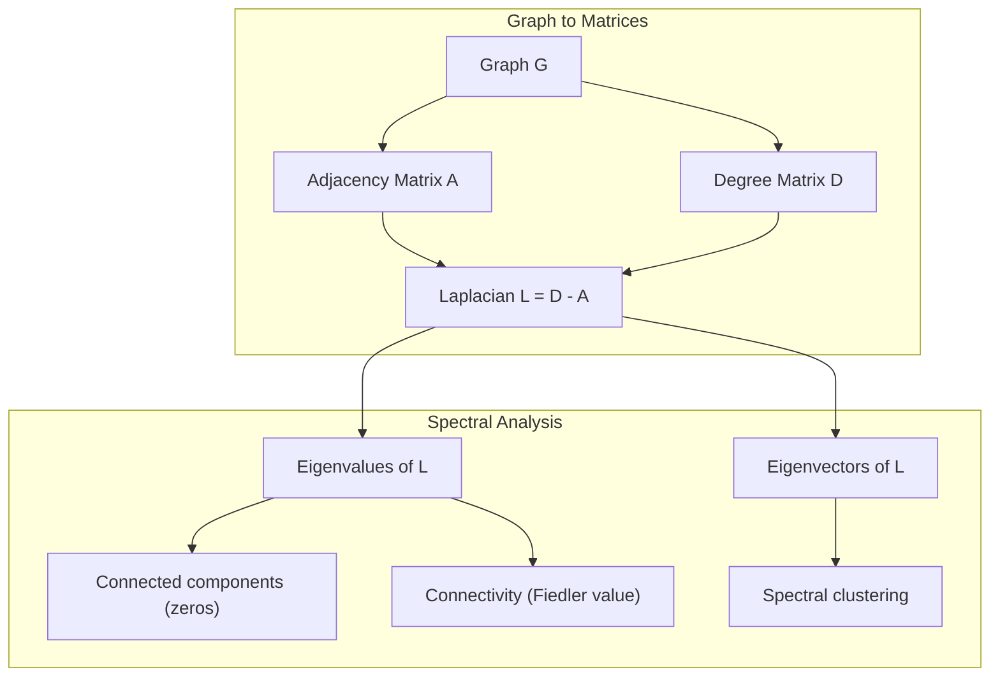
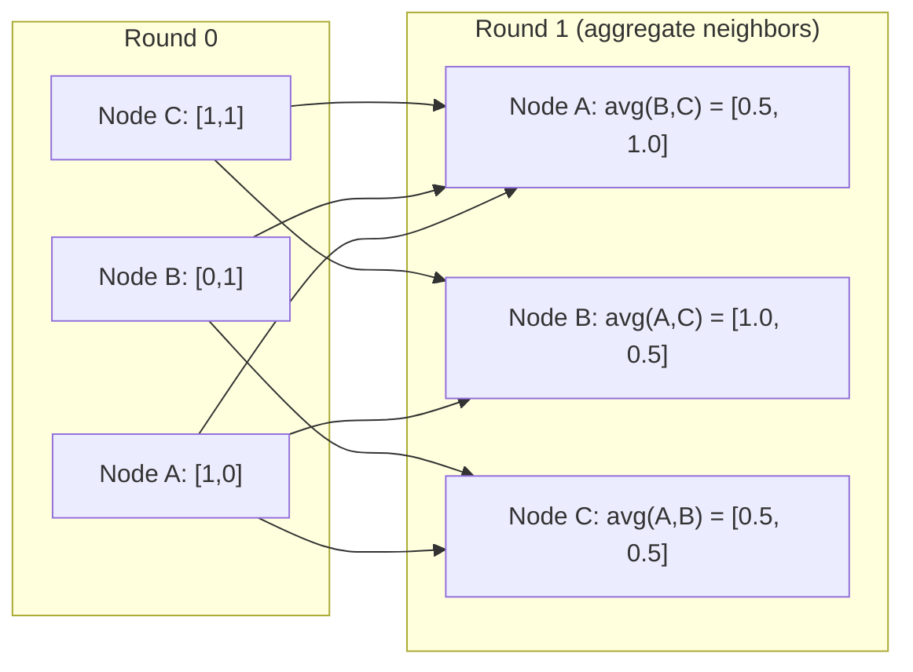

# 기계 학습에 대한 그래프 이론

> 그래프는 관계의 데이터 구조입니다. 데이터가 연결을 가지고 있다면 그래프 이론이 필요합니다.

**Type:** Build
**Language:**파이썬
**Prerequisites:** Phase 1, Lessons 01-03 (linear algebra, matrices)
**Time:** ~90 minutes

## 학습 목표

- 인접 매트릭스/ 리스트 표현을 가진 그래프 클래스를 구성하고 BFS 및 DFS 트로스얼을 구현
- 라플라시아 그래프를 계산하고 연결된 구성 요소와 클러스터 노드를 감지하기 위해 그 고유 값을 사용하십시오
- 표준화된 접경 매트릭스 곱으로 전달되는 GNN 스타일의 메시지 라운드 1개를 구현
- 피들러 벡터를 사용하여 그래프를 분할하기 위해 스펙트럼 클러스터링을 적용

## 문제

소셜 네트워크, 분자, 지식 기반, 인용 네트워크, 도로 지도 - 모두 그래프입니다. 전통적인 ML는 데이터를 평면 테이블로 취급합니다. 각 줄은 독립적입니다. 각 특징은 열입니다. 그러나 연결 구조가 중요할 때, 테이블은 실패합니다.

소셜 네트워크에 대해 생각해보세요. 어떤 제품을 구매할지 예측하고 싶으세요. 구매역사도 중요하지만 친구들의 구매역사도 더 중요하죠. 연결은 신호를 전달합니다.

분자를 생각해 보세요. 단백질에 결합하는지 예측하고 싶으세요. 원자는 중요하지만, 실제로 중요한 것은 원자가 어떻게 결합되는지입니다. 구조는 데이터입니다.

그래프 신경망 (GNN) 은 딥러닝에서 가장 빠르게 성장하는 영역입니다. 그들은 약물 발견, 사회적 추천, 사기 탐지, 지식 그래프 추론을 촉진합니다. 모든 GNN는 동일한 기초: 기본 그래프 이론을 기반으로합니다.

네 가지 필요해요
1. 그래프를 매트릭스로 표현하는 방법 (그러면 곱할 수 있습니다)
2. 그래프 구조를 탐구하기 위한 트래버셜 알고리즘
3. 라플라시아어 - 스펙트럼 그래프 이론에서 가장 중요한 단일 매트릭스
4. 메시지 전달 - GNN를 작동시키는 작업

## 개념

### 그래프: 노드 및 가장자리

그래프$G = (V, E)$꼭대기 (노드) 으로 구성됩니다.$V$그리고 가장자리$E$각 가장자리는 두 개의 노드를 연결합니다.

**Directed vs undirected.**방향이 없는 그래프에서 가장자리$(u, v)$수단$u$연결합니다$v$그리고$v$연결합니다$u$. 지향 그래프 (digraph) 에서 가장자리 $(u, v)$수단$u$$v$하지만 꼭 반대로 하는 것은 아닙니다.

**Weighted vs unweighted.**무중화 그래프에서 가장자리는 존재하거나 존재하지 않습니다. 중화 그래프에서 각 가장자리는 숫자 무게를 가지고 있습니다. 거리와 비용, 강도.

| Graph type | Example |
|-----------|---------|
| Undirected, unweighted | Facebook friendship network |
| Directed, unweighted | Twitter follow network |
| Undirected, weighted | Road map (distances) |
| Directed, weighted | Web page links (PageRank scores) |

### 근접성 매트릭스

접경 행렬$A$이 그래프의 핵심은$n$노드:

```math
A[i][j] = \begin{cases} 1 & \text{if there is an edge from node } i \text{ to node } j \\ 0 & \text{otherwise} \end{cases}
```

방향이 없는 그래프에 대해서는$A$대칭성: $A[i][j] = A[j][i]$. 중형 그래프에 대해,$A[i][j]$= 가장자리의 무게$(i, j)$- 그래

**Example -- a triangle:**

```
Nodes: 0, 1, 2
Edges: (0,1), (1,2), (0,2)

A = [[0, 1, 1],
     [1, 0, 1],
     [1, 1, 0]]
```

인접 매트릭스는 각 GNN에 입력된 입력입니다.$A$그래프에 있는 동작에 해당한다.

### 학위

노드의 정도는 그 노드에 연결된 가장자리 수입니다. 방향 그래프에서는 인-도 (입입한 가장자리) 와 외-도 (출출하는 가장자리) 를 가지고 있습니다.

학위 행렬$D$이 직사각형은

```math
\begin{aligned}
D[i][i] &= \text{degree of node } i \\
D[i][j] &= 0 \quad \text{for } i \ne j
\end{aligned}
```

삼각형의 예로:$D = \mathop{\mathrm{diag}}(2, 2, 2)$왜냐하면 각 노드는 다른 두개로 연결되기 때문입니다.

학위 는 노드 중요성에 대해 알려줍니다. 높은 학위 = 허브 노드. 네트워크의 학위 분포는 그 구조를 보여줍니다. 소셜 네트워크는 전력 법칙을 따르고 있습니다.

### BFS 및 DFS

두 가지 기본 그래프 트로스링 알고리즘이 필요합니다.

**Breadth-First Search (BFS):**먼저 이웃을 찾아보고, 이웃 이웃을 찾아보죠.

```
BFS from node 0:
  Visit 0
  Queue: [1, 2]        (neighbors of 0)
  Visit 1
  Queue: [2, 3]        (add neighbors of 1)
  Visit 2
  Queue: [3]           (neighbors of 2 already visited)
  Visit 3
  Queue: []            (done)
```

BFS는 비중형 그래프에서 가장 짧은 경로를 찾습니다. 시작에서 어떤 노드까지의 거리는 그 노드가 처음 발견되는 BFS 수준과 같습니다. 이것이 BFS가 소셜 네트워크에서 홉 카운트 거리를 위해 사용되는 이유입니다.

**Depth-First Search (DFS):**뒤로 물러나기 전에 최대한 깊이 들어가서, 스택 (LIFO) 또는 재발을 사용합니다.

```
DFS from node 0:
  Visit 0
  Stack: [1, 2]        (neighbors of 0)
  Visit 2               (pop from stack)
  Stack: [1, 3]         (add neighbors of 2)
  Visit 3               (pop from stack)
  Stack: [1]
  Visit 1               (pop from stack)
  Stack: []             (done)
```

DFS는 다음과 같은 경우에 유용합니다.
- 연결된 구성 요소를 찾는 (비즈팅되지 않은 노드에서 DFS를 실행)
- 사이클 탐지 (DFS 나무의 뒷 가장자리)
- 토폴로직 분류 (반복 DFS 완결 순서)

| Algorithm | Data structure | Finds | Use case |
|-----------|---------------|-------|----------|
| BFS | Queue | Shortest paths | Social network distance, knowledge graph traversal |
| DFS | Stack | Components, cycles | Connectivity, topological sort |

### 라플라시아 인 그래프

$L = D - A$스펙트럼 그래프 이론에서 가장 중요한 매트릭스

삼각형에 대해:

```math
D = \begin{bmatrix} 2 & 0 & 0 \\ 0 & 2 & 0 \\ 0 & 0 & 2 \end{bmatrix} \qquad A = \begin{bmatrix} 0 & 1 & 1 \\ 1 & 0 & 1 \\ 1 & 1 & 0 \end{bmatrix} \qquad L = \begin{bmatrix} 2 & -1 & -1 \\ -1 & 2 & -1 \\ -1 & -1 & 2 \end{bmatrix}
```

라플라시아인은 놀라운 특성을 가지고 있습니다.

1. **$L$ is positive semi-definite.**모든 고유값은$\ge 0$- 그래

2. **The number of zero eigenvalues equals the number of connected components.**연결된 그래프는 정확히 0의 고유값을 가지고 있습니다. 연결되지 않은 3개의 구성 요소가 있는 그래프는 3개의 0의 고유값을 가지고 있습니다.

3. **The smallest non-zero eigenvalue (Fiedler value) measures connectivity.**큰 피들러 값은 그래프가 잘 연결되어 있다는 것을 의미합니다. 작은 피들러 값은 그래프가 약한 지점을 가지고 있다는 것을 의미합니다.

4. **The eigenvector of the Fiedler value (Fiedler vector) reveals the best split.**긍정적인 값이 있는 노드는 한 그룹에 들어가고 부정적인 값이 있는 노드는 다른 그룹에 들어가게 됩니다. 이것은 스펙트럼 클러스터링입니다.



### 스펙트럼 특성이

인접 매트릭스와 라플라시아의 고유값은 어떠한 통과도 없이 구조적 특성을 나타냅니다.

**Spectral clustering**이렇게 작동합니다.
1. 라플라시아어 를 계산하라$L$
2. $k$의 가장 작은 자기벡터$L$(첫 번째를 건너뛰어, 연결된 그래프에 대한 모든 것)
3. 각 노드의 새로운 좌표로 그 고유 벡터를 사용
4. 달아$k$-이 좌표에 있는 평균

왜 이렇게 작동할까요?$L$그래프에서 가장 부드러운 함수를 암호화합니다. 잘 연결된 노드는 유사한 고유벡터 값을 얻습니다. 병목으로 분리된 노드는 다른 값을 얻습니다. 고유벡터는 자연스럽게 클러스터를 분리합니다.

**Random walk connection.**정상화된 라플라시아어 는 그래프에서 무작위로 걷는 것과 관련이 있다. 무작위로 걷는 것의 고정 분포는 노드 정도에 비례한다. 혼합 시간은 (무작위로 걷는 것이 얼마나 빨리 공감되는가) 스펙트럼 격차에 달려 있다.

### 메시지 전달

그래프 신경망의 핵심 운영. 각 노드는 이웃으로부터 메시지를 수집하고, 그것들을 합쳐서 자신의 상태를 업데이트합니다.

```math
h_v^{(k+1)} = \text{UPDATE}\left(h_v^{(k)}, \text{AGGREGATE}\left(\{h_u^{(k)} : u \in \text{neighbors}(v)\}\right)\right)
```

가장 간단한 형태로, AGGREGATE = 평균, UPDATE = 선형 변환 + 활성화:

```math
h_v^{(k+1)} = \sigma\left(W \cdot \text{mean}\left(\{h_u^{(k)} : u \in \text{neighbors}(v)\}\right)\right)
```

이것은 매트릭스 곱셈이 위장되어 있습니다.$H$모든 노드 특징의 매트릭스입니다$A$인접 행렬입니다:

```math
H^{(k+1)} = \sigma\left(A_{\text{norm}} H^{(k)} W\right)
```

어디$A_{\text{norm}}$정상화된 접경 행렬 (각 행은 1으로 합당한다).

한 라운드 메시지가 전달되면 각 노드는 가까운 이웃을 "보는데" 수 있습니다. 두 라운드에서는 이웃의 이웃을 볼 수 있습니다. $K$라운드들은 각 노드에 그 $K$- 팝네이커



### 개념 및 ML 응용

| Concept | ML Application |
|---------|---------------|
| Adjacency matrix | GNN input representation |
| Graph Laplacian | Spectral clustering, community detection |
| BFS/DFS | Knowledge graph traversal, path finding |
| Degree distribution | Node importance, feature engineering |
| Message passing | GNN layers (GCN, GAT, GraphSAGE) |
| Eigenvalues of L | Community detection, graph partitioning |
| Spectral clustering | Unsupervised node grouping |
| PageRank | Node importance, web search |

```figure
graph-degree-distribution
```

## 건설 해

### 단계 1: 처음부터 그래프 수업

```python
class Graph:
    def __init__(self, n_nodes, directed=False):
        self.n = n_nodes
        self.directed = directed
        self.adj = {i: {} for i in range(n_nodes)}

    def add_edge(self, u, v, weight=1.0):
        self.adj[u][v] = weight
        if not self.directed:
            self.adj[v][u] = weight

    def neighbors(self, node):
        return list(self.adj[node].keys())

    def degree(self, node):
        return len(self.adj[node])

    def adjacency_matrix(self):
        import numpy as np
        A = np.zeros((self.n, self.n))
        for u in range(self.n):
            for v, w in self.adj[u].items():
                A[u][v] = w
        return A

    def degree_matrix(self):
        import numpy as np
        D = np.zeros((self.n, self.n))
        for i in range(self.n):
            D[i][i] = self.degree(i)
        return D

    def laplacian(self):
        return self.degree_matrix() - self.adjacency_matrix()
```

인접 목록 (`self.adj`(이하) 부근 매트릭스 변환은 모든 스펙트럼 작업이 그것을 필요로 하기 때문에 numpy를 사용합니다.

### 단계 2: BFS 및 DFS

```python
from collections import deque

def bfs(graph, start):
    visited = set()
    order = []
    distances = {}
    queue = deque([(start, 0)])
    visited.add(start)
    while queue:
        node, dist = queue.popleft()
        order.append(node)
        distances[node] = dist
        for neighbor in graph.neighbors(node):
            if neighbor not in visited:
                visited.add(neighbor)
                queue.append((neighbor, dist + 1))
    return order, distances


def dfs(graph, start):
    visited = set()
    order = []
    stack = [start]
    while stack:
        node = stack.pop()
        if node in visited:
            continue
        visited.add(node)
        order.append(node)
        for neighbor in reversed(graph.neighbors(node)):
            if neighbor not in visited:
                stack.append(neighbor)
    return order
```

BFS는  에 대해 덱 (다발 끝의 줄을) 를 사용합니다.$O(1)$DFS는 리스트를 스택으로 사용합니다. 두 개의 노드는 정확히 한 번 방문합니다.$O(V + E)$시간

### 단계 3: 연결된 구성 요소 및 라플라시아 고유 값

```python
def connected_components(graph):
    visited = set()
    components = []
    for node in range(graph.n):
        if node not in visited:
            order, _ = bfs(graph, node)
            visited.update(order)
            components.append(order)
    return components


def laplacian_eigenvalues(graph):
    import numpy as np
    L = graph.laplacian()
    eigenvalues = np.linalg.eigvalsh(L)
    return eigenvalues
```

`eigvalsh`대칭 매트릭스 (symmetric matrix) 에 대해 설명합니다. 라플라시아는 항상 대칭입니다.

### 단계 4: 스펙트럼 클러스터링

```python
def spectral_clustering(graph, k=2):
    import numpy as np
    L = graph.laplacian()
    eigenvalues, eigenvectors = np.linalg.eigh(L)
    features = eigenvectors[:, 1:k+1]

    labels = np.zeros(graph.n, dtype=int)
    for i in range(graph.n):
        if features[i, 0] >= 0:
            labels[i] = 0
        else:
            labels[i] = 1
    return labels
```

$k=2$, 피들러 벡터의 표기 그래프를 두 개의 클러스터로 나눈다$k>2$, 당신은 도망칠 것입니다$k$- 첫 번째에 대한 의미$k$독자적인 벡터 (비관한 모든 하나의 독자적인 벡터를 제외한)

### 단계 5: 메시지 전달

```python
def message_passing(graph, features, weight_matrix):
    import numpy as np
    A = graph.adjacency_matrix()
    row_sums = A.sum(axis=1, keepdims=True)
    row_sums[row_sums == 0] = 1
    A_norm = A / row_sums
    aggregated = A_norm @ features
    output = aggregated @ weight_matrix
    return output
```

이것은 GNN 메시지 전달의 한 라운드입니다. 각 노드의 새로운 특징은 무게 매트릭스에 의해 변형된 이웃의 특징의 중량 평균입니다. 정보를 더 널리 퍼뜨리기 위해 여러 라운드를 쌓아두십시오.

## 사용 하 고

네트워크x와 numpy와 같은 작업은 1 라인:

```python
import networkx as nx
import numpy as np

G = nx.karate_club_graph()

A = nx.adjacency_matrix(G).toarray()
L = nx.laplacian_matrix(G).toarray()

eigenvalues = np.linalg.eigvalsh(L.astype(float))
print(f"Smallest eigenvalues: {eigenvalues[:5]}")
print(f"Connected components: {nx.number_connected_components(G)}")

communities = nx.community.greedy_modularity_communities(G)
print(f"Communities found: {len(communities)}")

pr = nx.pagerank(G)
top_nodes = sorted(pr.items(), key=lambda x: x[1], reverse=True)[:5]
print(f"Top 5 PageRank nodes: {top_nodes}")
```

networkx는 최적화된 C 백엔드를 사용하여 모든 크기의 그래프를 처리합니다. 제작에 사용하십시오. 처음부터 구현을 사용하여 그것이 무엇을 하는지 이해하십시오.

### 피 스펙트럼 분석

```python
import numpy as np

A = np.array([
    [0, 1, 1, 0, 0],
    [1, 0, 1, 0, 0],
    [1, 1, 0, 1, 0],
    [0, 0, 1, 0, 1],
    [0, 0, 0, 1, 0]
])

D = np.diag(A.sum(axis=1))
L = D - A

eigenvalues, eigenvectors = np.linalg.eigh(L)
print(f"Eigenvalues: {np.round(eigenvalues, 4)}")
print(f"Fiedler value: {eigenvalues[1]:.4f}")
print(f"Fiedler vector: {np.round(eigenvectors[:, 1], 4)}")

fiedler = eigenvectors[:, 1]
group_a = np.where(fiedler >= 0)[0]
group_b = np.where(fiedler < 0)[0]
print(f"Cluster A: {group_a}")
print(f"Cluster B: {group_b}")
```

피들러 벡터는 무거운 일을 합니다. 한 클러스터에 긍정적인 입체, 다른 클러스터에 부정적인 입체. 반복적인 최적화가 필요하지 않습니다. 단지 하나의 고유의 구성만 필요합니다.

## 선박

이 교훈은 다음과 같은 결과를 낳습니다.
- `outputs/skill-graph-analysis.md`-- 그래프 구조화된 데이터를 분석하는 기술 참조

## 연결

| Concept | Where it shows up |
|---------|------------------|
| Adjacency matrix | GCN, GAT, GraphSAGE input |
| Laplacian | Spectral clustering, ChebNet filters |
| BFS | Knowledge graph traversal, shortest path queries |
| Message passing | Every GNN layer, neural message passing |
| Spectral gap | Graph connectivity, mixing time of random walks |
| Degree distribution | Power-law networks, node feature engineering |
| Connected components | Preprocessing, handling disconnected graphs |
| PageRank | Node importance ranking, attention initialization |

GNNs는 특별한 언급을 받아야 합니다. GCN의 그래프 convolution 작업 (Kipf & Welling, 2017) 은 추가된 자율 루프와 인접 매트릭스를 사용합니다.$\hat{A} = A + I$이 부분의 본문은

```math
H^{(l+1)} = \sigma\left(\hat{D}^{-1/2} \hat{A} \hat{D}^{-1/2} H^{(l)} W^{(l)}\right)
```

어디$\hat{A} = A + I$(접근성과 자기순환) 그리고$\hat{D}$의 수분 행렬입니다$\hat{A}$.자동 루프는 각 노드가 집합 과정에서 자신의 특징을 포함하도록 합니다. 이것은 바로 대칭 정상화와 함께 메시지를 전달합니다. $\hat{D}^{-1/2} \hat{A} \hat{D}^{-1/2}$이 정상화는 이와 관련이 있기 때문에 이 나타납니다$L_{\text{sym}} = I - D^{-1/2} A D^{-1/2}$라플라시아어를 이해한다는 것은 GCN가 왜 작동하는지 이해하는 것입니다.

## 운동

1. **Implement PageRank from scratch.**각 단계: 점수 ((v) = (1-d) /n + d * 합액(점수(u) /out_degree(u)) 는 v를 가리키는 모든 u에 대해. d=0.85을 사용하십시오.

2. **Find communities using spectral clustering.**두 개의 명확하게 분리된 클러스터 (예를 들어, 하나의 가장자리로 연결된 두 클리크) 를 가진 그래프를 생성하십시오. 스펙트럼 클러스터링을 실행하고 올바른 분할을 찾는지 확인합니다. 더 많은 크로스 클러스터 가장자리를 추가하면 어떻게 될까요?

3. **Implement Dijkstra's algorithm**중량 그래프에서 가장 짧은 경로를 위해. 동일한 그래프에서 균일 무게의 BFS와 결과를 비교하십시오.

4. **Build a 2-layer message passing network.**2차로 전달되는 메시지를 두 번 다른 무게 매트릭스를 사용하여 적용합니다. 2차로 전송된 후 각 노드는 2차로 이동하는 이웃에서 정보를 가지고 있음을 보여주십시오.

5. **Analyze a real-world graph.**카라테 클럽 그래프를 사용하십시오 (34 노드, 78 엣지). 학위 분포, 라플라시아 고유 값 및 스펙트럼 클러스터링을 계산하십시오. 스펙트럼 클러스터링 결과를 알려진 지상 진실 분포와 비교하십시오.

### 암시

**Exercise 1.**연습에서 나온 공식을 사용하십시오. 출력한 가장자리가 없는 노드는 모든 노드와 점수를 동등하게 나누어야 합니다. 또는 전체는 1보다 낮게 떨어집니다. 각 단계 후에 점수가 1이 될 수 있는지 확인하고 결과를 비교하십시오.`pagerank(graph)`- 그래

**Exercise 2.**두 개의 을 만들죠`add_edge`한쪽 끝으로 연결하고,`spectral_clustering(graph, k=2)`을 을 을 을 을 을 을 을 을 을 을 을 을 을 을 을 을 을 을 을 을 을 을 을 을 을 을 을 을 을 을 을 을 을 을 을 을 을 을 을 을 을 을 을 을 을 을 을 을 을 을 을 을 을 을 을 을 을 을 을 을 을 을 을 을 을 을 을 을 을 을 을 을 을 을 을 을 을 을 을 을 을 을 `laplacian()`, 두 그룹이 합류함에 따라 성장합니다.

**Exercise 3.**우선 순위를 `heapq`각 무게는 1로 만들어서 각 디크스트라 거리도 그 노드의 BFS 층과 같다는 것을 확인합니다`bfs(graph, start)`- 그래

**Exercise 4.**정체성 매트릭스를 사용해서`features`, 각 열이 하나의 노드를 표시하고 적용`message_passing`두 번. 그 다음 노드의 줄에 있는 비 0 항목$v$어떤 노드가 도달했는지 보여주세요$v$1차 검색에서 너비 2의 거리에 있는 노드와 비교해 보세요.

**Exercise 5.** `networkx.karate_club_graph()`노드 속성에서 가장자리 목록과 기본 진실을 제공합니다 `club`을 으로 복사합니다`Graph`그리고 34개의 노드와 78개의 엣지를 가지고 있는지 확인해 보세요.`spectral_clustering``club`두 개의 라벨 이름을 교환할 수 있도록 합니다.

## 주요 용어

| Term | What people say | What it actually means |
|------|----------------|----------------------|
| Graph | "Nodes and edges" | A mathematical structure $G=(V,E)$ encoding pairwise relationships |
| Adjacency matrix | "The connection table" | An $n \times n$ matrix where $A[i][j] = 1$ if nodes $i$ and $j$ are connected |
| Degree | "How connected a node is" | The number of edges touching a node |
| Laplacian | "D minus A" | $L = D - A$, the matrix whose eigenvalues reveal graph structure |
| Fiedler value | "The algebraic connectivity" | The smallest non-zero eigenvalue of $L$, measuring how well-connected the graph is |
| BFS | "Level-by-level search" | Traversal that visits all neighbors before going deeper, finds shortest paths |
| DFS | "Go deep first" | Traversal that follows one path to its end before backtracking |
| Message passing | "Nodes talk to neighbors" | Each node aggregates information from its neighbors, the core of GNNs |
| Spectral clustering | "Cluster by eigenvectors" | Partition a graph using eigenvectors of its Laplacian |
| Connected component | "A separate piece" | A maximal subgraph where every node can reach every other node |

## 더 많은 읽기

- **Kipf & Welling (2017)**-- "그래프 컨볼루션 네트워크와 반감독 된 분류". 현대 GNNs를 출시한 논문. 스펙트럼 그래프 컨볼루션이 메시지를 전달하는 것을 단순화한다는 것을 보여줍니다.
- **Spielman (2012)**-- "스펙트럼 그래프 이론" 강의 노트. 라플라시아어, 스펙트럼 격차, 그래프 분할에 대한 최종 소개.
- **Hamilton (2020)**-- "그래프 표현 학습".
- **Bronstein et al. (2021)**-- "지오메트릭 딥 러닝: 그리드, 그룹, 그래프, 지오데시크, 그리고 매거리".
- **Veličković et al. (2018)**-- "그래프 주의 네트워크". 주의 메커니즘으로 메시지를 전달하는 것을 확장합니다.
