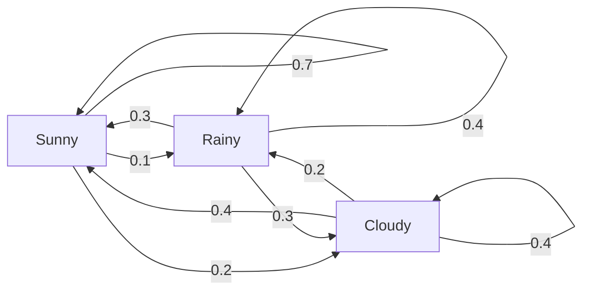
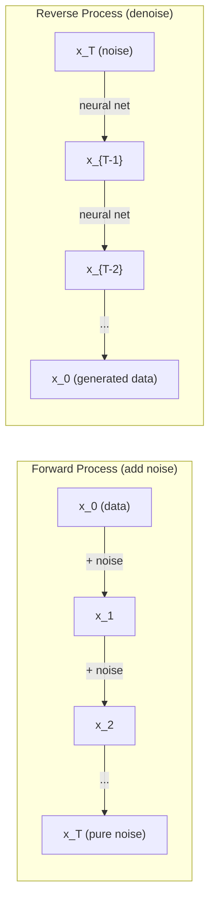

# 스토카스틱 프로세스

> 무작위성, 구조, 무작위 행진, 마르코프 연쇄, 전파 모델의 수학

**Type:** Learn
**Language:**파이썬
**Prerequisites:** Phase 1, Lessons 06-07 (probability, Bayes)
**Time:** ~75 minutes

## 학습 목표

- 1D와 2D의 무작위 걸음을 시뮬레이션하고$\sqrt{n}$이동의 규모
- 마코프 체인 시뮬레이터를 만들고 자신의 구성으로 고정된 분포를 계산합니다
- 목표 분포에서 샘플링을 위해 메트로폴리스-하스팅스 MCMC 및 랭제빈 역학을 구현
- 앞으로 전파 과정을 브라운의 움직임에 연결하고 역 과정이 데이터를 생성하는 방법을 설명합니다

## 문제

많은 인공지능 시스템은 시간이 지남에 따라 진화하는 무작위로 이루어집니다. 정적 무작위로 이루어지는 것이 아니라 구조화된 순서적 무작위로 이루어지는 것입니다. 각 단계는 이전에 일어난 일에 달려 있습니다.

언어 모델은 하나의 토큰을 생성합니다. 각각의 토큰은 이전 맥락에 달려 있습니다. 모델은 확률 분포를 내보내고 샘플을 가져다가 계속 진행합니다. 이것은 스토카스틱 프로세스입니다.

디프루전 모델은 순수적인 정적 상태가 될 때까지 단계적으로 이미지에 소음을 추가합니다. 그 다음 프로세스를 역전시켜 새로운 이미지가 나오기 전까지 단계적으로 부정합니다. 앞으로의 과정은 마르코프 연쇄입니다. 역전 과정은 배워진 마르코프 연쇄입니다.

강화 학습 에이전트는 환경에서 행동을 취합니다. 모든 행동은 어떤 확률로 새로운 상태로 이어집니다. 에이전트는 무작위 세계에서 무작위 정책을 따르습니다. 모든 것은 마르코프 결정 과정입니다.

MCMC 샘플링은 베이시안 추론의 척추입니다. 마코프 연쇄를 구성합니다. 그 고정된 분포는

이 모든 것들은 네 가지 기본적 아이디어에 기반을 두고 있습니다.
1. 무작위 걸음 - 가장 간단한 스토카스틱 과정
2. 마르코프 연쇄 -- 과도기 행렬을 가진 구조화된 무작위성
3. 랭제빈 역학 - 소음과 함께 기하급수적 하락
4. 메트로폴리스-하스팅스 - 모든 배포에서 샘플링

## 개념

### 우연한 산책

0 위치에서 시작하세요. 각 단계에 공정한 동전을 던집니다. 머리: 오른쪽으로 (+1) 이동합니다. 꼬리: 왼쪽으로 (-1).

그 후$n$단계, 당신의 위치는 $n$무작위$\pm 1$값: 예상 위치 는 0 (보행 은 편견 이 없는) 하지만 기원으로부터 예상 거리 는 증가 하 여$\sqrt{n}$- 그래

이것은 직관적으로 반동합니다. 걷는 것은 공정합니다. 어느 쪽으로도 움직이지 않습니다. 하지만 시간이 지남에 따라, 그것은 시작했던 곳에서 더 멀리 떠돌아갑니다.$n$단계입니다$\sqrt{n}$- 그래

```
Step 0:  Position = 0
Step 1:  Position = +1 or -1
Step 2:  Position = +2, 0, or -2
...
Step 100: Expected distance from origin ~ 10 (sqrt(100))
Step 10000: Expected distance from origin ~ 100 (sqrt(10000))
```

**In 2D**, 걷기 위, 아래, 왼쪽, 오른쪽 같은 확률로 이동합니다.$\sqrt{n}$스케일링은 원천에서 거리에 적용됩니다. 경로는 프랙탈과 같은 패턴을 추적합니다.

**Why $\sqrt{n}$?**각 단계가 +1 또는 -1이고 확률이 같죠$n$단계, 위치$S_n = X_1 + X_2 + \cdots + X_n$각$X_i$ $\pm 1$각 단계의 변수는 1이고 단계들은 독립적이므로$\mathop{\mathrm{Var}}(S_n) = n$. 표준차각 = $\sqrt{n}$중앙 한계 정리에 의해$S_n / \sqrt{n}$표준 정상적인 분포로 회전한다.

이$\sqrt{n}$스칼링은 ML에서 모든 곳에 나타납니다. SGD 소음 스칼은 1/sqrt (배치_ 사이즈) 로 나타납니다.$\sqrt{d}$. 제곱근은 독립적인 무작위 덧셈의 서명입니다.

**Connection to Brownian motion.**발걸음 크기로 무작위로 산책하세요$1/\sqrt{n}$그리고$n$시간 단위당 단계$n$무한으로 이동하면, 보너스 운동으로 회전합니다.$B(t)$-- 연속적인 과정으로$B(t)$보통 평균 0와 변변이로 분포합니다$t$- 그래

브라운 운동은 전파의 수학적인 기초입니다. 그것은 유체에서 유입자의 무작위적인 흔들림, 주식 가격 변동, 그리고 - 가장 중요한 것은 - 전파 모델의 잡음 과정을 모델링합니다.

**Gambler's ruin.**무작위로 발자취하는 사람이 위치에서 시작$k$, 흡수 장벽이 0 및 $N$. 도달할 확률은 얼마일까요?$N$0이 되기 전에?$P(\text{reach } N) = k/N$이것은 놀랍도록 간단하고 우아합니다. 그것은 마틴갈 이론과 연결되어 있습니다.

### 마코프 체인

마르코프 연쇄는 고정된 확률에 따라 주들 사이에 전환되는 시스템입니다. 핵심 속성은 다음 상태는 역사에 의존하지 않고 현재 상태에만 달려 있습니다.

```math
P(X_{t+1} = j \mid X_t = i, X_{t-1} = \ldots) = P(X_{t+1} = j \mid X_t = i)
```

이것은 마코프 속성입니다. 즉, 당신은 전 동적을 과도기 행렬로 설명할 수 있습니다.$P$이 부분의 본문은

```math
P[i][j] = \text{probability of going from state } i \text{ to state } j
```

각 줄$P$1까지의 수요 (당신은 어딘가에 가야 합니다).

**Example -- Weather:**

```
States: Sunny (0), Rainy (1), Cloudy (2)

P = [[0.7, 0.1, 0.2],    (if sunny: 70% sunny, 10% rainy, 20% cloudy)
     [0.3, 0.4, 0.3],    (if rainy: 30% sunny, 40% rainy, 30% cloudy)
     [0.4, 0.2, 0.4]]    (if cloudy: 40% sunny, 20% rainy, 40% cloudy)
```

여러 전환 후, 상태의 분포는 정지적인 분포로 konverges$\pi$, 어디$\pi P = \pi$이 왼쪽의 고유벡터입니다$P$자기값 1

기상 연쇄에 대해서는 정지 분포가 [0.55, 0.18, 0.27]입니다. 장기적으로 보면, 기상 상태와 상관없이 55%의 경우 햇볕이 잘 드는 것입니다.



**Computing the stationary distribution.**두 가지 방법이 있습니다.

1. **Power method**: 초기 분포를 $P$반복해서 반복해서 반복해서,
2. **Eigenvalue method**: 왼쪽의 자기벡터를 찾아$P$이 값은 의 고유벡터입니다$P^T$자기값 1

두 가지 접근 방식 모두 체인이 컨버전스 조건을 충족시켜야 합니다.

**Convergence conditions.**마코프 연쇄는 다음과 같은 경우에 고유의 고정 분포로 회합된다.
- **Irreducible**: 모든 주에서는 다른 모든 주에서 접근할 수 있습니다
- **Aperiodic**: 체인은 일정 기간 동안 순환하지 않습니다

ML에서 발견되는 대부분의 체인은 두 가지 조건을 모두 충족시킵니다.

**Absorbing states.**어떤 상태가 흡수되는 것은 당신이 그 안에 들어간 후에,$P[i][i] = 1$마코프 체인 모델 프로세스를 흡수하는 것은 터미널 상태와 함께 -- 끝나는 게임, 윙윙하는 고객, 텍스트 끝 token에 도달하는 토큰 순서입니다.

**Mixing time.**체인이 정지분배에 "가근"하기까지 몇 단계가 있습니까? 공식적으로는 정지분배에서 전체 변동 거리가 어느 한 문턱 아래로 떨어지는 단계의 수가 있습니다. 빠른 혼합 = 몇 단계가 필요합니다.$P$(1 빼기 두 번째로 큰 고유값) 은 혼합 시간을 제어합니다. 더 큰 격차 = 더 빠른 혼합.

### 언어 모델과 연결

언어 모델의 토큰 생성은 대략 마코프 프로세스입니다. 현재 맥락을 고려하면 모델은 다음 토큰에 대한 배포를 내보내게 됩니다. 온도는 날카롭게 조절합니다.

```math
P(\text{token}_i) = \frac{\exp(\text{logit}_i / \text{temperature})}{\sum_j \exp(\text{logit}_j / \text{temperature})}
```

- 온도는 = 1.0: 표준 분포
- 온도는 < 1.0: 더 날카로운 (더 결정적인)
- 온도는 > 1.0: 평평 (더 무작위)
- 온도$\to 0$: argmax (만만족)

                     $k$가장 높은 확률의 토큰: 최상위 (핵) 샘플링은 누적 확률이 더 큰 토큰의 가장 작은 집합으로 줄인다 $p$둘 다 마르코프 전환 확률을 수정합니다

### 브라운 운동

무작위 행진의 연속 시간 제한. 위치 $B(t)$세 가지 특성을 가지고 있습니다.
1. $B(0) = 0$
2. $B(t) - B(s)$보통 평균 0와 변변이로 분포합니다$t - s$($t > s$)
3. 겹치지 않는 간격의 증가량은 독립적입니다.

브라운의 움직임은 연속적이지만, 어느 곳에서도 구별되지 않습니다. 모든 스케일에서 흔들립니다. 경로는 평면에서 프랙탈 차원 2을 가지고 있습니다.

개별 시뮬레이션에서, 당신은 Brownian 움직임을 대략적으로:

```math
B(t + dt) = B(t) + \sqrt{dt} \, z, \quad \text{where } z \sim \mathcal{N}(0, 1)
```

$\sqrt{dt}$스케일링은 중요한데, 그것은 무작위로 걷는 사람들에게 적용되는 중앙 한계 정리에 의해 나온다.

### 랭제빈 역학

계층적 하락은 함수의 최소수를 찾습니다. 랭제빈 역학은 확률 분포를$\exp(-U(x)/T)$, 어디$U$에너지 함수입니다$T$온도가 높습니다.

```math
x_{t+1} = x_t - dt \, \nabla U(x_t) + \sqrt{2 T \, dt} \, z_t
```

입자에 두 가지 힘이 작용합니다.
1. **Gradient force**($-dt \cdot \nabla U$): 낮은 에너지로 (비행성 하락과 같은) 밀어
2. **Random force**($\sqrt{2T dt} \cdot z$): 무작위 방향으로 밀어 (탐색)

온도에서$T = 0$이 입자는 높은 온도에서 거의 무작위로 걸립니다. 적절한 온도에서 입자는 에너지 풍경을 탐구하고 낮은 에너지 지역에서 더 많은 시간을 보내죠.

**Connection to diffusion models.**디프루전 모델의 앞 과정은 다음과 같습니다.

```math
x_t = \sqrt{\alpha_t} \, x_{t-1} + \sqrt{1 - \alpha_t} \cdot \text{noise}
```

이것은 마코프 연쇄입니다. 이것은 데이터를 잡음과 점차적으로 혼합합니다. 충분한 단계 후에,$x_T$순수한 가우스 소음입니다.

역전 과정 - 소음에서 데이터로 돌아가는 것 - 또한 마르코프 연쇄입니다. 하지만 그 전환 확률은 신경망에 의해 학습됩니다. 네트워크는 각 단계에 추가된 소음을 예측하고 그 다음 그 소음을 빼냅니다.



### MCMC: 마르코프 체인 몬테카를로

때로는 분포에서 샘플을 가져야 합니다$p(x)$이 경우, 이 값은 수분으로 나타난 값이 같지만, 수분으로 나타난 값은 수분으로 나타난 값이 같지만, 수분으로 나타난 값은 수분으로 나타난 값이 같지만, 수분으로 나타난 값은 수분으로 나타난 값이 같지만, 수분으로 나타난 값은 수분으로 나타난 값이 같지만, 수분으로 나타난 값은 수분으로 나타난 값이 같지만, 수분으로 나타난 값은 수분으로 나타난 값이 같지만, 수분으로 나타난 값은 수분으로 나타난 값이 같지만, 수분으로 나타난 값은 수분으로 나타난 값이 같지만, 수분으로 나타난 값은 수분으로 나타난 값이 수분으로 나타난 값이 같지만, 수분으로 나타난 값은 수분으로 나타난 값이 수분으로 나타납니다.

**Metropolis-Hastings**마코프 연쇄를 건설합니다.$p(x)$이 부분의 본문은

1. 어떤 위치에서 시작하세요$x$
2. 새로운 직장을 제안해$x'$제안 배포에서$Q(x' \mid x)$
3. 계산 수용 비율: $a = p(x') Q(x \mid x') / (p(x) Q(x' \mid x))$
4. 받아들이세요$x'$확률이 높습니다$\min(1, a)$그렇지 않으면 에서$x$- 그래
5. 다시 말해

만약$Q$대칭성 (예를 들어,$Q(x' \mid x) = Q(x \mid x') = \mathcal{N}(x, \sigma^2){}$), 비율은 단순화되어 $a = p(x') / p(x)$확률의 비율만 필요해요.

이 체인은 에 합쳐질 수 있는 보장입니다$p(x)$그러나 제안이 너무 작 (자발적 행보) 또는 너무 큰 (고대 거부) 경우, 공감대가 느려질 수 있습니다.

**Why it works.**수용 비율은 상세한 균형을 보장합니다:$x$그리고 $x'$$x'$그리고 $x$. 상세한 균형은$p(x)$이 식은 체인의 고정 분포입니다.$p(x)$- 그래

**Practical considerations:**
- **Burn-in**: 첫 번째를 버리는 것$N$샘플: 체인은 출발점에서 정지된 분포에 도달하기 위해 시간이 필요합니다.
- **Thinning**: 모든 것을 보관합니다$k$-자동관계를 줄이기 위한 샘플
- **Multiple chains**: 여러 개의 연쇄를 서로 다른 출발점에서 실행합니다. 같은 분포로 konverge하면 konvergence의 증거가 있습니다.
- **Acceptance rate**: 가우스 제안에 대해$d$이 체인 은 거의 움직이지 않는다. 너무 낮아지면 모든 것을 거부한다는 뜻입니다.

### 인공지능의 스토카스틱 프로세스

| Process | AI Application |
|---------|---------------|
| Random walk | Exploration in RL, Node2Vec embeddings |
| Markov chain | Text generation, MCMC sampling |
| Brownian motion | Diffusion models (forward process) |
| Langevin dynamics | Score-based generative models, SGLD |
| Markov decision process | Reinforcement learning |
| Metropolis-Hastings | Bayesian inference, posterior sampling |

```figure
random-walk-diffusion
```

## 건설 해

### 단계 1: 무작위 걸음 시뮬레이터

```python
import numpy as np

def random_walk_1d(n_steps, seed=None):
    rng = np.random.RandomState(seed)
    steps = rng.choice([-1, 1], size=n_steps)
    positions = np.concatenate([[0], np.cumsum(steps)])
    return positions


def random_walk_2d(n_steps, seed=None):
    rng = np.random.RandomState(seed)
    directions = rng.choice(4, size=n_steps)
    dx = np.zeros(n_steps)
    dy = np.zeros(n_steps)
    dx[directions == 0] = 1   # right
    dx[directions == 1] = -1  # left
    dy[directions == 2] = 1   # up
    dy[directions == 3] = -1  # down
    x = np.concatenate([[0], np.cumsum(dx)])
    y = np.concatenate([[0], np.cumsum(dy)])
    return x, y
```

1D 걸음에는 누적 수치가 저장됩니다. 각 단계는 +1 또는 -1입니다.$n$단계, 위치는 합입니다.$n$, 따라서 표준차이는 증가합니다$\sqrt{n}$- 그래

### 단계 2: 마르코프 체인

```python
class MarkovChain:
    def __init__(self, transition_matrix, state_names=None):
        self.P = np.array(transition_matrix, dtype=float)
        self.n_states = len(self.P)
        self.state_names = state_names or [str(i) for i in range(self.n_states)]

    def step(self, current_state, rng=None):
        if rng is None:
            rng = np.random.RandomState()
        probs = self.P[current_state]
        return rng.choice(self.n_states, p=probs)

    def simulate(self, start_state, n_steps, seed=None):
        rng = np.random.RandomState(seed)
        states = [start_state]
        current = start_state
        for _ in range(n_steps):
            current = self.step(current, rng)
            states.append(current)
        return states

    def stationary_distribution(self):
        eigenvalues, eigenvectors = np.linalg.eig(self.P.T)
        idx = np.argmin(np.abs(eigenvalues - 1.0))
        stationary = np.real(eigenvectors[:, idx])
        stationary = stationary / stationary.sum()
        return np.abs(stationary)
```

정지형 분포는 좌측 고유벡터입니다$P$1의 고유값을 계산하여 찾을 수 있습니다$P^T$(전환으로 왼쪽 고유벡터를 오른 고유벡터로 변환합니다).

### 단계 3: 랭제빈 역학

```python
def langevin_dynamics(grad_U, x0, dt, temperature, n_steps, seed=None):
    rng = np.random.RandomState(seed)
    x = np.array(x0, dtype=float)
    trajectory = [x.copy()]
    for _ in range(n_steps):
        noise = rng.randn(*x.shape)
        x = x - dt * grad_U(x) + np.sqrt(2 * temperature * dt) * noise
        trajectory.append(x.copy())
    return np.array(trajectory)
```

경사선이 밀려$x$낮은 에너지로 향합니다. 소음은 그것을 막는 것입니다. 균형에서 샘플의 분포는$\exp(-U(x)/\text{temperature})$- 그래

### 4단계: 메트로폴리스-헤스팅스

```python
def metropolis_hastings(target_log_prob, proposal_std, x0, n_samples, seed=None):
    rng = np.random.RandomState(seed)
    x = np.array(x0, dtype=float)
    samples = [x.copy()]
    accepted = 0
    for _ in range(n_samples - 1):
        x_proposed = x + rng.randn(*x.shape) * proposal_std
        log_ratio = target_log_prob(x_proposed) - target_log_prob(x)
        if np.log(rng.rand()) < log_ratio:
            x = x_proposed
            accepted += 1
        samples.append(x.copy())
    acceptance_rate = accepted / (n_samples - 1)
    return np.array(samples), acceptance_rate
```

알고리즘은 새로운 점을 제안하고, 더 높은 확률을 가지고 있는지 확인 (또는 비율에 비례한 확률로 받아들이는지) 하고 반복한다. 좋은 혼합을 위해서는 수용률이 23-50% 정도가 되어야 한다.

## 사용 하 고

실제로는 이러한 알고리즘을 위해 기존 라이브러리를 사용하지만 메커니즘을 이해하는 것은 디버깅과 조정을 위해 중요합니다.

```python
import numpy as np

rng = np.random.RandomState(42)
walk = np.cumsum(rng.choice([-1, 1], size=10000))
print(f"Final position: {walk[-1]}")
print(f"Expected distance: {np.sqrt(10000):.1f}")
print(f"Actual distance: {abs(walk[-1])}")
```

### 전환 매트릭스

```python
import numpy as np

P = np.array([[0.7, 0.1, 0.2],
              [0.3, 0.4, 0.3],
              [0.4, 0.2, 0.4]])

distribution = np.array([1.0, 0.0, 0.0])
for _ in range(100):
    distribution = distribution @ P

print(f"Stationary distribution: {np.round(distribution, 4)}")
```

초기 분포를 $P$반복적으로 반복합니다. 충분한 반복 후에, 당신이 어디서 시작했든 정지형 분포로 konverges. 이것은 지배적인 왼쪽 고유 벡터를 찾는 힘 방법입니다.

### 실제 프레임워크에 대한 연결

- **PyTorch diffusion:**`DDPMScheduler`포옹하는 얼굴`diffusers`앞과 뒤쪽 마코프 연쇄를 구현합니다
- **NumPyro / PyMC:**베이시안 추론을 위해 MCMC (Metropolis-Hastings에서 개선되는 NUTS 샘플러) 를 사용한다.
- **Gymnasium (RL):**환경 단계 함수는 마르코프 결정 과정을 정의합니다

### 마코프 연쇄의 공감대를 확인하는 것

```python
import numpy as np

P = np.array([[0.9, 0.1], [0.3, 0.7]])

eigenvalues = np.linalg.eigvals(P)
spectral_gap = 1 - sorted(np.abs(eigenvalues))[-2]
print(f"Eigenvalues: {eigenvalues}")
print(f"Spectral gap: {spectral_gap:.4f}")
print(f"Approximate mixing time: {1/spectral_gap:.1f} steps")
```

스펙트럼 격차는 체인이 초기 상태를 얼마나 빨리 잊는지 보여줍니다. 0.2의 격차는 혼합하기 위해 대략 5 단계입니다. 0.01의 격차는 약 100 단계입니다. 긴 시뮬레이션을 실행하기 전에 항상 이것을 확인하십시오. 천천히 혼합하는 체인 폐기물 계산.

## 선박

이 교훈은 다음과 같은 결과를 낳습니다.
- `outputs/prompt-stochastic-process-advisor.md`-- 어떤 문제에서 어떤 스토카스틱 프로세스 프레임워크가 적용되는지 확인하는

## 연결

| Concept | Where it shows up |
|---------|------------------|
| Random walk | Node2Vec graph embeddings, exploration in RL |
| Markov chain | Token generation in LLMs, MCMC sampling |
| Brownian motion | Forward diffusion process in DDPM, SDE-based models |
| Langevin dynamics | Score-based generative models, stochastic gradient Langevin dynamics (SGLD) |
| Stationary distribution | MCMC convergence target, PageRank |
| Metropolis-Hastings | Bayesian posterior sampling, simulated annealing |
| Temperature | LLM sampling, Boltzmann exploration in RL, simulated annealing |
| Mixing time | Convergence speed of MCMC, spectral gap analysis |
| Absorbing state | End-of-sequence token, terminal states in RL |
| Detailed balance | Correctness guarantee for MCMC samplers |

디프루션 모델은 특별한 관심을 받을 필요가 있다. DDPM (Ho et al., 2020) 는 앞마르코프 연쇄를 정의한다.

```math
q(x_t \mid x_{t-1}) = \mathcal{N}\left(x_t; \sqrt{1-\beta_t} \, x_{t-1}, \beta_t I\right)
```

어디$\beta_t$소음 스케줄입니다.$T$단계,$x_T$대략적으로$\mathcal{N}(0, I)$역전 과정은 노이즈를 예측하는 신경망에 의해 매개 변수를 나타냅니다.

```math
p_\theta(x_{t-1} \mid x_t) = \mathcal{N}\left(x_{t-1}; \mu_\theta(x_t, t), \sigma_t^2 I\right)
```

발전의 모든 단계는 학습된 마르코프 연쇄의 단계입니다. 마르코프 연쇄를 이해하는 것은 어떻게 그리고 왜 전파 모델이 데이터를 생성하는지 이해하는 것을 의미합니다.

SGLD (Stochastic Gradient Langevin Dynamics) 는 랭제빈 소음과 미니 배트 랭제인트 하락을 결합합니다. 전체 gradient를 계산하기 보다는, 당신은 Stochastic 추정을 사용하고, 학습 속도가 떨어지면서 SGLD는 최적화에서 샘플링으로 전환합니다. 대략적인 베이시안 후속 샘플을 무료로 얻을 수 있습니다. 이것은 신경망에서 불확실성을 추정하는 가장 간단한 방법 중 하나입니다.

이러한 모든 연결에 대한 핵심 통찰력은: 스토카스틱 프로세스는 단지 이론적인 도구가 아닙니다. 이들은 현대 인공지능 시스템 내부의 계산 메커니즘입니다. LLM의 온도를 조정하면 마코프 체인을 조정합니다. 전파 모델을 훈련시키면 브로wni의 움직임과 같은 과정을 뒤집어내는 법을 배우게 됩니다. 베이시안 추론을 실행하면 뒷부분으로 회전하는 체인을 만들어냅니다.

## 운동

1. **Simulate 1000 random walks of 10000 steps.**최종 위치 분포를 그려보세요. 평균 0 및 표준 경각심을 가진 가우스산의 대략적인 분포를 확인합니다.$\sqrt{10000} = 100$- 그래

2. **Build a text generator using a Markov chain.**작은 코퍼스에서 훈련하세요. 각 단어에 대한 전환을 다음 단어로 계산하세요. 전환 매트릭스를 구축하세요. 사슬에서 샘플을 채취함으로써 새로운 문장을 생성하세요.

3. **Implement simulated annealing**메트로폴리스-하스팅스를 사용하다. 높은 온도에서 시작 (거짓 모든 것을 받아들이) 그리고 점차적으로 냉각 (개선을만 받아들이)

4. **Compare Langevin dynamics at different temperatures.**두 개의 우물 잠재력에서 샘플$U(x) = (x^2 - 1)^2$낮은 온도에서는 샘플이 한 우물 안에 모여 높은 온도에서는 둘 다 퍼져나갑니다.

5. **Implement the forward diffusion process.**1차원 신호 (예를 들어, 시노파) 를 시작하여 라인적 잡음 스케줄을 통해 100단계 이상의 잡음을 점차 추가하십시오. 신호가 순수한 잡음으로 어떻게 저하되는지를 보여주십시오. 그 다음 프로세스를 역전시키는 간단한 디노이저 (예컨대 추정된 잡음을 빼는 순수한 소음) 를 구현하십시오.

### 암시

**Exercise 1.**전화`random_walk_1d(10000, seed=i)`1000개의 씨앗을 위해 마지막 위치를 유지하세요. 평균이 0에 가깝는지 확인하세요. 표준차이는 100에 가깝고, 마지막 위치의 약 68%는 -100에서 100 사이의지입니다.

**Exercise 2.**각 단어 쌍을 계산하고, 각 행을 전체로 나눈 다음 각 행이 1까지 합치도록 매트릭스를 `MarkovChain(transition_matrix, state_names)`그리고 전화`simulate`출력된 모든 단어들이 코퍼스에서 나오는지 확인해 보세요.

**Exercise 3.**더 나쁜 점을 확률로 받아들여$\exp(-\Delta / T)$그리고 곱하기$T$각 단계 후 0.99 같은 요소로 테스트를 수행합니다. 당신이 아는 최소 함수를 테스트하고,

**Exercise 4.**그레이디언은$4x(x^2 - 1)$, 그래서 그걸 `langevin_dynamics(grad_U, x0, dt, temperature, n_steps)`- 에 있는 장벽$x = 0$높이는 1이고, 그 신호의 빈도를 계산해 보세요.$x$온도가 0.05에서 1까지 변하고, 그 온도가 빠르게 증가하기 시작하는 온도를 찾아보세요.

**Exercise 5.**전화`diffusion_forward(signal, 100)`그리고 계산$\bar{\alpha}$마지막 단계로 $(1 - \beta_t)$- 만약$\bar{\alpha}$0에서 멀어지므로 신호는 순수한 소음이 아닙니다.`beta_end`먼저 소음으로 소음기를 테스트해 보세요$(x_t - \sqrt{1 - \bar{\alpha}_t} \epsilon)/\sqrt{\bar{\alpha}_t}$원래 신호를 정확히 돌려야 합니다.

## 주요 용어

| Term | What people say | What it actually means |
|------|----------------|----------------------|
| Random walk | "Coin-flip movement" | A process where position changes by random increments at each step |
| Markov property | "Memoryless" | The future depends only on the present state, not on the history |
| Transition matrix | "The probability table" | $P[i][j]$ = probability of moving from state $i$ to state $j$ |
| Stationary distribution | "The long-run average" | The distribution $\pi$ where $\pi P = \pi$ -- the chain's equilibrium |
| Brownian motion | "Random jiggling" | The continuous-time limit of a random walk, $B(t) \sim \mathcal{N}(0, t)$ |
| Langevin dynamics | "Gradient descent with noise" | Update rule that combines deterministic gradient and random perturbation |
| MCMC | "Walking toward the target" | Constructing a Markov chain whose stationary distribution is the one you want |
| Metropolis-Hastings | "Propose and accept/reject" | MCMC algorithm that uses acceptance ratios to ensure convergence |
| Temperature | "The randomness knob" | Parameter controlling the tradeoff between exploration and exploitation |
| Diffusion process | "Noise in, noise out" | Forward: gradually add noise. Reverse: gradually remove it. Generates data. |

## 더 많은 읽기

- **Ho, Jain, Abbeel (2020)**"방산 확률 모델의 부정" DDPM 논문으로 방산 모델 혁명을 시작했습니다.
- **Song & Ermon (2019)**-- "데이터 분포의 계층을 추정함으로써 생성 모델링".
- **Roberts & Rosenthal (2004)**"모르코프 체인과 MCMC 알고리즘"
- **Norris (1997)**"마르코프 체인" 표준 교과서.
- **Welling & Teh (2011)**-- "Stochastic Gradient Langevin Dynamics를 통해 베이시안 학습".
