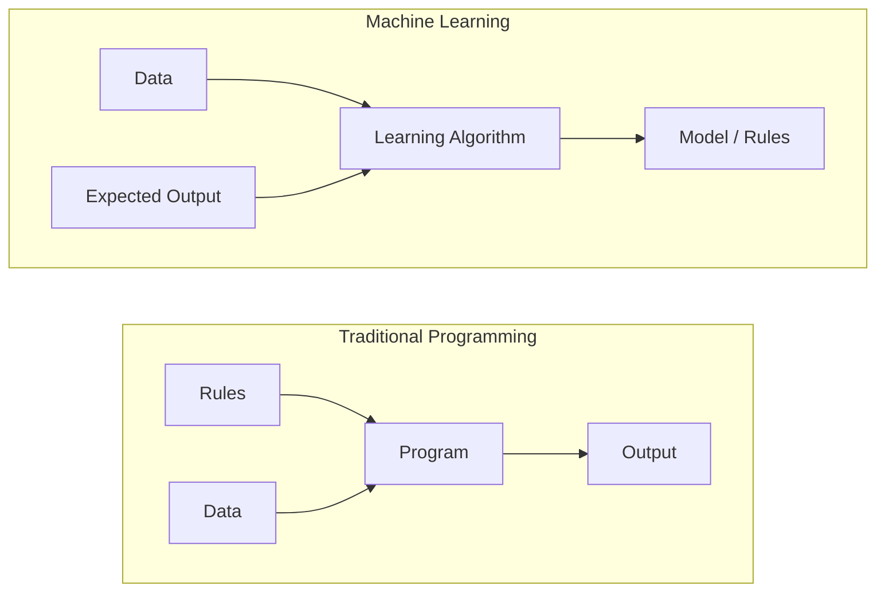
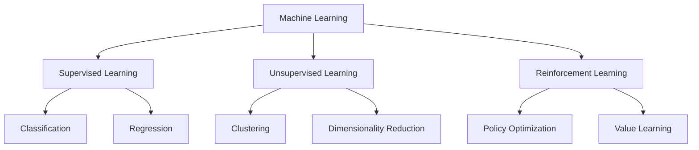
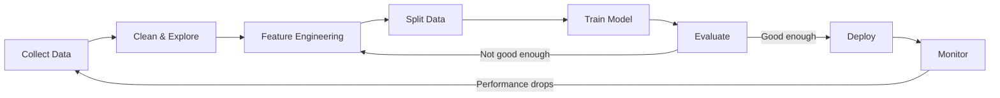
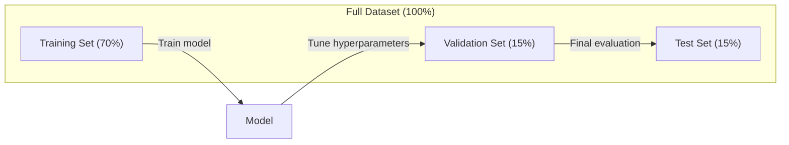
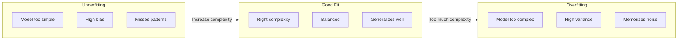
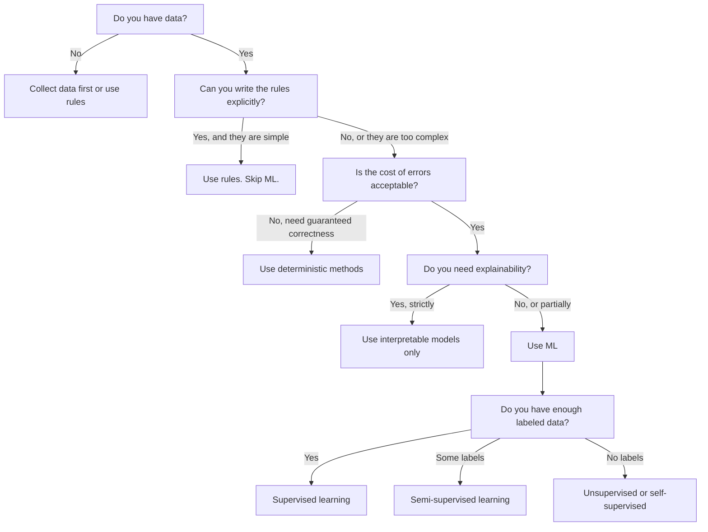

# 기계 학습 은 무엇 입니까?

> 기계 학습은 컴퓨터가 손으로 규칙을 작성하는 대신 데이터에서 패턴을 찾는 것을 가르치고 있습니다.

**Type:** Learn
**Languages:** Python
**Prerequisites:** Phase 1 (Math Foundations)
**Time:** ~45 minutes

## 학습 목표

- 감독, 감독 없이 학습, 강화 학습의 차이점을 설명하고 어떤 유형이 특정 문제에 적용되는지를 파악하십시오.
- 가장 가까운 중장층 분류기를 처음부터 구현하고 무작위로 평가합니다
- 분류와 회귀 작업 사이의 구별을 하고 각각의 적절한 손실 함수를 선택
- 주어진 비즈니스 문제가 ML에 적합하거나 결정적 규칙으로 더 잘 해결되는지 평가

## 문제

스팸 필터를 만들고 싶으세요. 전통적인 접근 방식은: 앉아서 수백 개의 규칙을 작성하세요. "이메일에는 'FREE MONEY'가 있다면 스팸을 표시하세요. 3개 이상의 외침표가 있다면 스팸을 표시하세요". 당신은 몇 주 동안 규칙을 작성합니다. 그러면 스팸꾼들은 문장을 변경합니다. 당신의 규칙이 깨집니다. 당신은 더 많은 규칙을 작성합니다. 순환은 끝나는 것이 없습니다.

기계 학습은 이것을 뒤집고 있습니다. 규칙을 작성하는 대신 컴퓨터에게 수천 개의 라벨 된 이메일 ("스팸" 또는 "스팸이 아닙니다") 를 주고, 스스로 규칙을 알아낼 수 있도록 합니다. 컴퓨터는 당신이 생각했던 패턴을 찾습니다. 스팸메이터가 전술을 변경할 때, 코드를 다시 작성하는 대신 새로운 데이터에 대해 재훈련합니다.

"프로그래밍 규칙"에서 "데이터로부터 학습"으로의 이 전환은 기계 학습의 핵심입니다. 모든 추천 엔진, 음성 보조, 자율주행 자동차, 언어 모델은 이렇게 작동합니다.

## 개념

### 규칙 이 아닌 데이터 로 부터 배울 것

전통적인 프로그래밍과 기계 학습은 문제를 반대 방향으로 해결합니다.



전통적인 프로그래밍: 당신은 규칙을 작성합니다. 프로그램은 데이터를 적용하여 출력을 생성합니다.

기계 학습: 데이터와 예상 출력을 제공합니다. 알고리즘은 규칙을 발견합니다.

훈련에서 나온 "모델"은 규칙입니다. 숫자로 (중량, 매개 변수) 로 암호화됩니다.

### 기계 학습 의 3 가지 종류



**Supervised Learning**: 입력 출력 쌍이 있습니다. 모델은 출력으로 입력 매프를 배우게 됩니다.
- "고양이나 개라는 표기판을 붙인 사진 10,000개 있습니다.
- "이곳은 집의 특징과 가격입니다. 가격을 예측하는 법을 배우십시오".

**Unsupervised Learning**입력값만 있고, 표지가 없습니다. 모델은 자체적으로 구조를 찾습니다.
- "이곳에는 10,000명의 고객 구매 기록이 있습니다. 자연적인 그룹을 찾아보세요".
- "1000개 차원 데이터 포인트, 구조를 유지하면서 2개 차원으로 줄여주세요".

**Reinforcement Learning**: 에이전트는 환경 속에서 행동을 취하고 보상이나 처벌을 받으며 전체 보상을 극대화하기 위한 전략을 (정책을) 학습한다.
- "이 게임을 해봐, 1승 1패를 해봐, 전략을 구해봐".
- "이 로봇 팔을 제어하세요. 물체를 잡기 위해 +1이고, 낭비된 초마다 -0.01입니다".

실제에서 구축할 대부분의 것들은 감독된 학습을 사용합니다. 감독되지 않은 학습은 사전 처리 및 탐구에 일반적입니다. 강화 학습은 언어 모델에 대한 게임 AI, 로봇 및 RLHF를 제공합니다.

### 3대대국 이 너머

위의 세 가지 범주들은 깨끗하지만 실제 ML는 종종 선을 흐리게 합니다.

**Semi-supervised learning**소규모로 표시된 데이터와 큰 양의 비표준된 데이터들을 사용합니다. 100개의 표기된 의료 이미지와 100,000개의 비표준된 이미지를 가질 수 있습니다.

- **Label propagation:**비슷한 데이터 포인트를 연결하는 그래프를 만들죠. 레이블은 라벨을 붙인 노드에서 라벨이 붙지 않은 이웃으로 그래프를 통해 퍼집니다.
- **Pseudo-labeling:**라벨을 붙인 데이터에 대한 모델을 훈련시키고, 라벨이 붙지 않은 데이터에 대한 레이블을 예측하는 데 사용해서, 모든 것을 다시 훈련시킵니다. 모델은 자체 훈련 세트를 시작합니다.
- **Consistency regularization:**모델은 입력값과 약간 혼란스러운 입력값의 예측을 동일하게 해야 합니다. 이것은 레이블 없이도 작동합니다.

**Self-supervised learning**데이터 자체를 통해 감독을 만들어냅니다. 인간 표기판이 전혀 필요하지 않습니다. 모델은 데이터 구조를 통해 자신의 예측 작업을 만듭니다.

- **Masked language modeling (BERT):**문장 안에 15%의 단어를 숨기며, 모형을 missing words를 예측하도록 훈련시켜라. "etiket"은 원래 텍스트에서 나온다.
- **Contrastive learning (SimCLR):**이미지를 찍고 두 개의 증강된 버전을 만들어서 모델을 훈련시켜 다른 이미지들의 증강된 버전에 비해 구별하면서 같은 이미지에서 나온 것을 인식하도록 훈련시켜라.
- **Next-token prediction (GPT):**이전 모든 단어를 고려해 다음 단어를 예측해 보세요. 모든 텍스트 문서는 훈련 예제가 됩니다.

이 세 가지는 큰 세 가지에서 분리된 범주가 아닙니다. 그들은 감독되고 감독되지 않은 아이디어를 결합하는 전략입니다. 자감받는 학습은 기술적으로 감독됩니다 (모델은 무언가를 예측하지만), 그러나 레이블은 자동으로 생성됩니다. 인간에 의해 아닙니다.

### 분류와 회귀

이 두 가지 주요 감독 학습 과제입니다.

| Aspect | Classification | Regression |
|--------|---------------|------------|
| Output | Discrete categories | Continuous numbers |
| Example | "Is this email spam?" | "What will the house price be?" |
| Output space | {cat, dog, bird} | Any real number |
| Loss function | Cross-entropy, accuracy | Mean squared error, MAE |
| Decision | Boundaries between classes | A curve that fits the data |

분류는 "어떤 범주"에 답하고, 회귀는 "무엇에 달한다?"

어떤 문제는 어느 쪽이든 틀을 수 있습니다. 주가가 상승하거나 하락하는 것을 예측하는 것은 분류입니다. 정확한 가격을 예측하는 것은 회귀입니다.

### ML 작업 흐름

모든 기계 학습 프로젝트는 알고리즘에 상관없이 동일한 파이프라인을 따르고 있습니다.



**Collect Data**: 원료 데이터를 수집합니다. 더 많은 데이터는 거의 항상 더 좋지만 양보다 품질은 더 중요합니다.

**Clean & Explore**: 실종된 값들을 처리하고, 복제물을 제거하고, 분포를 시각화하고, 부호를 발견한다. 이 단계는 프로젝트 전체 시간의 60-80%를 차지한다.

**Feature Engineering**: 원료 데이터를 모델이 사용할 수 있는 기능으로 변환합니다. 날짜를 주일로 변환합니다. 수학적 열을 정상화합니다. 범주 변수를 암호화합니다. 좋은 기능은 고급 알고리즘보다 더 중요합니다.

**Split Data**: 훈련, 검증 및 시험 세트에 나눌 수 있습니다. 모델은 훈련 데이터에 따라 훈련, 당신은 검증 데이터에 대한 하이퍼 파라미터를 조정하고, 당신은 테스트 데이터에 대한 최종 성과를보고합니다.

**Train Model**: 알고리즘에 훈련 데이터를 입력합니다. 알고리즘은 손실 함수를 최소화하기 위해 내부 매개 변수를 조정합니다.

**Evaluate**검증/실험 데이터에 대한 성능을 측정합니다. 성능이 받아들일 수 없는 경우, 다시 돌아가 다른 기능, 알고리즘 또는 하이퍼 파라미터를 시도하십시오.

**Deploy**: 새로운 데이터에 대한 예측을 하는 모델을 생산에 넣습니다.

**Monitor**: 시간 흐름에 따라 성능을 추적합니다. 데이터 분포는 변화합니다 (데이터 유동) 그리고 모델은 저하됩니다. 성능이 떨어지면 재 훈련합니다.

### 훈련, 검증, 시험 분단

이것은 초보자들이 잘못 알고 있는 가장 중요한 개념입니다. 훈련 중에 본 적이 없는 데이터에 따라 모델을 평가해야 합니다. 그렇지 않으면 학습이 아니라 기억을 측정합니다.



| Split | Purpose | When used | Typical size |
|-------|---------|-----------|-------------|
| Training | Model learns from this data | During training | 60-80% |
| Validation | Tune hyperparameters, compare models | After each training run | 10-20% |
| Test | Final unbiased performance estimate | Once, at the very end | 10-20% |

테스트 세트는 신성한 것입니다. 당신은 그것을 정확히 한 번만 볼 수 있습니다. 테스트 성능에 따라 모델을 계속 조정하면 테스트 세트에 효과적으로 훈련하고 있으며 보고된 숫자는 의미가 없습니다.

작은 데이터 세트에서 k-fold 크로스-버디레이션을 사용하세요: 데이터를 로 나눌 수 있습니다$k$부품, 열차$k-1$부품, 나머지 부분에서 검증, 회전, 평균 결과.

### 과장형과 과장형



**Underfitting**: 모델은 데이터의 패턴을 캡처하기에는 너무 간단합니다. 곡선 관계에 맞게 시도하는 직선. 훈련 오류가 높습니다. 테스트 오류가 높습니다.

**Overfitting**: 모델은 너무 복잡하고 소음과 함께 훈련 데이터를 기억합니다. 모든 훈련 지점을 통과하지만 새로운 데이터를 실패하는 휘글 곡선입니다. 훈련 오류는 낮습니다. 테스트 오류는 높습니다.

**Good fit**: 모델은 잡음을 기억하지 않고 실제 패턴을 캡처합니다. 훈련 오류와 시험 오류 모두 합리적으로 낮습니다.

과장착의 징후:
- 훈련 정확도는 검증 정확보다 훨씬 높습니다
- 모델은 훈련 데이터에 좋은 성능을 보이지만 새로운 데이터에 좋지 않은 성능을 보이는데
- 더 많은 훈련 데이터를 추가하면 성능이 향상됩니다 (모델은 학습이 아니라 기억하는 것입니다)

과장착 장치:
- 더 많은 훈련 데이터를 얻으세요
- 모델 복잡성을 줄이는 것 (단계 매개 변수, 더 간단한 건축)
- 규제 (큰 무게에 대한 벌금 추가)
- 훈련 중 무작위로 신경 세포를  수)
- 초기 중단 (확인 오류가 증가하기 시작하면 훈련 중단)

부착용 고정:
- 더 복잡한 모델을 사용
- 추가 기능
- 규칙화 를 줄이십시오
- 더 긴 기차

### 편견적 인 변동 의 대조

이것은 과잉 부착과 부적합의 수학적인 틀입니다.

**Bias**: 모델의 잘못된 가정에서 발생하는 오류. 선형 모델은 진정한 관계가 비선형이 되면 높은 편향을 가지고 있다. 높은 편향은 부적합으로 이어진다.

**Variance**: 훈련 데이터의 작은 변동에 대한 민감성 오류. 높은 변동성 있는 모델은 다른 데이터 하위 집합에 훈련되면 매우 다른 예측을 제공합니다. 높은 변동성으로 인해 과잉 적합성이 발생합니다.

| Model complexity | Bias | Variance | Result |
|-----------------|------|----------|--------|
| Too low (linear model for curved data) | High | Low | Underfitting |
| Just right | Medium | Medium | Good generalization |
| Too high (degree-20 polynomial for 10 points) | Low | High | Overfitting |

$\text{Total error} = \text{Bias}^2 + \text{Variance} + \text{Irreducible noise}$

줄일 수 없는 소음을 줄일 수 없습니다. (데이터 자체의 무작위성입니다.)$\text{bias}^2 + \text{variance}$최소화됩니다.

### 무료 점심 식사 이론은 없다

모든 문제에 가장 잘 맞는 단 하나의 알고리즘은 없습니다. 한 클래스 문제에서 잘 수행하는 알고리즘은 다른 클래스에 좋지 않은 결과를 가져올 것입니다. 데이터 과학자들은 여러 알고리즘을 시도하고 결과를 비교하는 이유입니다.

실제적으로 선택은 다음에 달려 있습니다.
- 얼마나 많은 데이터가 있습니다
- 몇 가지 특징이 있습니다
- 이 관계는 선형 또는 비선형인지
- 해석이 필요하든
- 얼마나 많은 계산을 할 수 있는지

### 기계 학습 을 사용 하지 않는 시점

ML는 강력하지만 항상 올바른 도구는 아닙니다. 모델에 도달하기 전에, 실제로 필요한지 물어보십시오.

**Do not use ML when:**

- **Rules are simple and well-defined.**세금 계산, 분류 알고리즘, 단위 변환. 만약 당신이 몇 가지 if-statements에 논리를 쓸 수 있다면, 모델은 아무런 이익도 없이 복잡성을 추가합니다.
- **You have no data or very little data.**ML는 배울 수 있는 예시를 필요로 합니다. 10개의 데이터 포인트로, 당신은 의미 있는 것을 훈련시킬 수 없습니다. 먼저 데이터를 수집합니다.
- **The cost of being wrong is catastrophic and you need guaranteed correctness.**의학적인 복용량 계산, 핵 원자로 제어, 암호 검증. ML 모델은 확률적 이다. 그들은 때때로 틀릴 것이다. "때때로 틀린"은 허용되지 않는 경우, 결정적 방법을 사용.
- **A lookup table or heuristic solves the problem.**간단한 임계수나 테이블이 99%의 경우 ML를 추가하면 실질적인 개선 없이 유지보수 비용을 증가시킵니다.
- **You cannot explain the decision and explainability is required.**규제 된 산업 (금융, 보험, 형사 정의) 은 때때로 모든 결정이 완전히 설명 될 수 있어야 합니다. 일부 ML 모델은 해석 할 수 있습니다.
- **The problem changes faster than you can retrain.**규칙이 매일 바뀌고 재교육이 일주일 정도 걸리면 모델은 항상 노후화됩니다.

이 결정 흐름표를 사용하세요:



```figure
f3-learning-boundary
```

## 건설 해

코드는 `code/ml_intro.py`가장 가까운 중추기 분류기를 처음부터 구현합니다. 가능한 가장 간단한 ML 알고리즘입니다. 그것은 핵심 아이디어를 보여줍니다. 데이터에서 배우고, 새로운 데이터에 대한 예측입니다.

### 단계 1: 처음부터 가장 가까운 센트ராய드 분류자

가장 가까운 중추점 분류기는 훈련 데이터에서 각 클래스의 중심 (평균) 을 계산합니다. 예측하기 위해, 모든 새로운 포인트를 가장 가까운 중심이있는 클래스에 할당합니다.

```python
class NearestCentroid:
    def fit(self, X, y):
        self.classes = np.unique(y)
        self.centroids = np.array([
            X[y == c].mean(axis=0) for c in self.classes
        ])

    def predict(self, X):
        distances = np.array([
            np.sqrt(((X - c) ** 2).sum(axis=1))
            for c in self.centroids
        ])
        return self.classes[distances.argmin(axis=0)]
```

이것이 전체 알고리즘입니다. Fit은 두 가지 방법을 계산합니다. 예측은 거리를 계산합니다. gradient 하락, 반복, 하이퍼 파라미터 없습니다.

### 단계 2: 합성 데이터 를 훈련 시키십시오

우리는 2D 분류 데이터 세트를 생성합니다. 두 개의 클래스가 약간 초복되어 있습니다. 중부 분류기는 클래스 센터 사이에 선형 결정 경계를 그리습니다.

```python
rng = np.random.RandomState(42)
X_class0 = rng.randn(100, 2) + np.array([1.0, 1.0])
X_class1 = rng.randn(100, 2) + np.array([-1.0, -1.0])
X = np.vstack([X_class0, X_class1])
y = np.array([0] * 100 + [1] * 100)
```

### 3단계: 기본 기준 에 비해 비교 해 보십시오

모든 ML 모델은 비범한 기본 라인에 비교되어야 합니다. 여기, 기본 라인은 무작위 클래스를 예측합니다. ML 모델이 무작위 추측을 이길 수 없다면 뭔가 잘못되었습니다.

```python
baseline_preds = rng.choice([0, 1], size=len(y_test))
baseline_acc = np.mean(baseline_preds == y_test)
```

중앙선 분류기는 이 깨끗한 데이터 세트에 대해 90% 이상의 정확성을 얻어야 합니다.

### 왜 이 점 이 중요 합니까?

가장 가까운 중추층 분류기는 비범히 간단합니다. 하이퍼 파라미터, 반복, 경진 감소가 없습니다. 그러나 근본적인 ML 패턴을 캡처합니다.

1. **Learn**교육 데이터 (중앙체) 에서 나타난
2. **Predict**그 표현을 이용한 새로운 데이터 (최근 거리에 있는 거리)
3. **Evaluate**기본 기준에 비해 (자발적 추측)

모든 ML 알고리즘은 물적 회귀에서부터 변환기까지 같은 3단계 패턴을 따르고 있습니다. 표현은 더 복잡해집니다. 하지만 작업 흐름은 동일합니다.

### 단계 4: 센트로이드 분류기가 할 수 없는 일

가장 가까운 중추층 분류기는 각 클래스가 하나의 블로프를 형성한다고 가정합니다. 선형 결정 경계를 그리는 것입니다.

- 클래스는 여러 클러스터를 가지고 있습니다 (예를 들어, 숫자 "1"는 여러 가지 다른 방식으로 쓸 수 있습니다)
- 결정 경계는 비선형 (예를 들어 한 클래스가 다른 클래스를 둘러싸고)
- 특징은 매우 다른 스케일을 가지고 있습니다 (거리는 가장 큰 스케일의 특징으로 지배됩니다)

이 제한은 당신이 배울 모든 다른 알고리즘을 동원합니다. K-가 가장 가까운 이웃은 여러 클러스터를 처리합니다. 결정 나무는 비선형 경계를 처리합니다. 특징 확장은 규모 문제를 해결합니다. 모든 수업은 이전 한 가지의 한계를 기반으로합니다.

## 사용 하 고

sklearn은 제공 합니다`NearestCentroid`그리고 합성 데이터 생성기:

```python
from sklearn.neighbors import NearestCentroid
from sklearn.datasets import make_classification
from sklearn.model_selection import train_test_split

X, y = make_classification(
    n_samples=500, n_features=2, n_redundant=0,
    n_clusters_per_class=1, random_state=42
)
X_train, X_test, y_train, y_test = train_test_split(X, y, test_size=0.3)

clf = NearestCentroid()
clf.fit(X_train, y_train)
print(f"Accuracy: {clf.score(X_test, y_test):.3f}")
```

## 선박

이 교훈은`outputs/prompt-ml-problem-framer.md`-- 비호한 비즈니스 문제를 구체적인 ML 작업으로 바꾸는 명령어 문제 설명 ("우리는 추세를 줄이고 싶다" 또는 "다음 분기 수요를 예측한다") 를 제공하여 학습 유형을 식별하고 예측 목표를 정의하고, 후보 특징을 나열하고, 성공 메트릭을 선택하고, 기본선을 설정하고, 데이터 누출이나 클래스 불균형과 같은 함정을 표시합니다. 잘못된 것을 만드는 것을 피하기 위해 ML 프로젝트의 시작에 사용하십시오.

## 주요 용어

| Term | What people say | What it actually means |
|------|----------------|----------------------|
| Model | "The AI" | A mathematical function with learnable parameters that maps inputs to outputs |
| Training | "Teaching the AI" | Running an optimization algorithm to adjust model parameters so predictions match known outputs |
| Feature | "An input column" | A measurable property of the data that the model uses to make predictions |
| Label | "The answer" | The known output for a training example, used to compute the error signal |
| Hyperparameter | "A setting you tweak" | A parameter set before training that controls the learning process (learning rate, number of layers) |
| Loss function | "How wrong the model is" | A function that measures the gap between predicted and actual outputs, which training tries to minimize |
| Overfitting | "It memorized the test" | The model learned training-specific noise instead of general patterns, so it fails on new data |
| Underfitting | "It didn't learn anything" | The model is too simple to capture the real patterns in the data |
| Generalization | "It works on new data" | The model's ability to make accurate predictions on data it was not trained on |
| Cross-validation | "Testing on different chunks" | Repeatedly splitting data into train/test folds and averaging results, giving a more robust performance estimate |
| Regularization | "Keeping weights small" | Adding a penalty term to the loss function that discourages overly complex models |
| Data drift | "The world changed" | The statistical distribution of incoming data shifts over time, degrading model performance |

## 운동

1. 어떤 데이터 세트를 (예: 아이리스, 타이타닉) 가져가서, 70/15/15로 열차/정확/시험으로 나눌 수 있습니다. 테스트 세트에 있는 하이퍼 파라미터들을 조정하지 않는 이유를 설명해 주십시오.
2. 실제 세계 의 3 가지 문제 를 나열 해 보십시오. 그 각각 에 대해 분류, 회귀, 집합, 그리고 감독 을 받는 것 인가, 감독 하지 않는 것 인가 를 확인 해 보십시오.
3. 모델은 99%의 정확도를 훈련 데이터에 얻지만 60%의 정확도를 테스트 데이터에 얻습니다. 문제를 진단하고 문제를 해결하려고 시도하는 세 가지 사항을 나열하십시오.

## 더 많은 읽기

- [An Introduction to Statistical Learning](https://www.statlearning.com/)- 모든 고전 ML 방법들을 다루는 무료 교과서
- [Google's Machine Learning Crash Course](https://developers.google.com/machine-learning/crash-course)- ML 개념에 대한 간결한 시각적 소개
- [Scikit-learn User Guide](https://scikit-learn.org/stable/user_guide.html)- 파이썬에서 ML 구현을 위한 실제 참조
