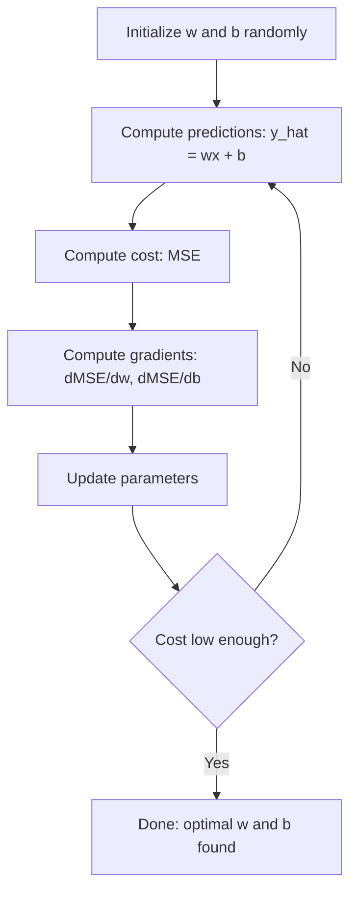

# 선형 회귀

> 선형 회귀는 데이터를 통해 가장 좋은 직선을 그리는데, 기계 학습의 "안녕하세요"라는 세계입니다.

**Type:** Build
**Languages:** Python
**Prerequisites:** Phase 1 (Linear Algebra, Calculus, Optimization), Phase 2 Lesson 1
**Time:** ~90 minutes

## 학습 목표

- 평균 제곱 오류의 gradient descent 업데이트 규칙을 추출하고 초점부터 선형 회귀를 구현
- 계산 복잡성 및 각을 언제 사용할지 기준으로 gradient 하락과 정상적인 방정식을 비교하십시오.
- 특징 표준화와 함께 여러 선형 회귀 모델을 구축하고 학습된 무게를 해석
- 큰 무게를 처벌함으로써 리지 회귀 (L2 정규화) 가 어떻게 과잉 부합을 방지하는지 설명하십시오.

## 문제

집의 크기와 판매 가격에 대한 데이터를 가지고 있습니다. 새로운 집의 크기를 고려하여 집의 가격을 예측하고 싶으세요. 분포 지표에 눈을 돌릴 수 있지만 공식이 필요합니다. 데이터에 가장 잘 맞는 라인이 필요합니다. 그래서 모든 크기를 연결하여 가격 예측을 얻을 수 있습니다.

선형 회귀는 그 선을 제공합니다. 더 중요한 것은 ML 훈련 루프를 소개합니다. 모델을 정의하고 비용 함수를 정의하고 매개 변수를 최적화합니다. 모든 ML 알고리즘은 같은 패턴을 따르고 있습니다. 가장 간단한 케이스로 이것을 마스터합니다. 당신은 그것을 모든 곳에서 인식합니다.

이것은 단순한 문제뿐만 아니라 수요 예측, A/B 테스트 분석, 금융 모델링 및 모든 회귀 작업의 기본 라인으로 생산 시스템에서 선형 회귀가 사용됩니다.

## 개념

### 모델

선형 회귀는 입력 ($x$) 및 출력 ($y$):

```math
y = wx + b
```

- `w`(중/ 기울기): 얼마나 $y$변화$x$1 증가
- `b`(bias/intercept): 의 값$y$언제$x = 0$

여러 입력 (기능) 에 대해서는 다음으로 확장됩니다:

```math
y = w_1 x_1 + w_2 x_2 + \cdots + w_n x_n + b
```

또는 벡터 형태로:$y = w^T x + b$

목표는: $w$그리고$b$예측된 것을 이루는 것입니다.$y$실제와 가능한 한 가까운$y$모든 교육 사례를 통해

### 비용 함수 (평균 제곱 오류)

어떻게 "가능한 가까운"을 측정할 수 있습니까? 예측이 얼마나 잘못되었는지 파악하는 단일 숫자가 필요합니다. 가장 일반적인 선택은 평균 제곱 오류 (MSE):

```math
\text{MSE} = \frac{1}{n} \sum (y_{\text{predicted}} - y_{\text{actual}})^2
```

왜 제곱? 두 가지 이유. 첫째, 그것은 작은 오류보다 큰 오류를 더 처벌합니다 (10의 오류는 1의 오류보다 100배 더 나쁘다, 10x가 아닙니다). 둘째, 제곱 함수는 매방면에서 부드럽고 차별화 될 수 있습니다. 이는 최적화를 쉽게 만듭니다.

비용 함수는 표면을 만듭니다.$w$그리고 편향$b$MSE 표면은 그릇 (상형 패라볼로이드) 처럼 보입니다. 그릇의 바닥은 MSE가 최소화되는 곳입니다. 훈련은 그 바닥을 찾는 것을 의미합니다.

### 점진적 인 하락

진하가 내려가면서 그릇의 바닥을 찾습니다.



그라디엔트는 두 가지를 말해줍니다. 각 매개 변수를 어느 방향으로 이동해야 하는지, 그리고 얼마나 이동해야 하는지

$\hat{y} = wx + b$이 부분의 본문은

```math
\begin{aligned}
\frac{\partial \text{MSE}}{\partial w} &= \frac{2}{n} \sum (\hat{y} - y) \, x \\
\frac{\partial \text{MSE}}{\partial b} &= \frac{2}{n} \sum (\hat{y} - y)
\end{aligned}
```

업데이트 규칙:

```math
\begin{aligned}
w &= w - \text{learning\_rate} \cdot \frac{\partial \text{MSE}}{\partial w} \\
b &= b - \text{learning\_rate} \cdot \frac{\partial \text{MSE}}{\partial b}
\end{aligned}
```

학습 속도는 단계 크기를 조절합니다. 너무 큰 경우 최소를 초과하고 거리를 나갑니다. 너무 작은 경우 훈련은 영원히 걸립니다. 전형적인 시작 값은: 0.01, 0.001, 또는 0.0001.

### 일반 방정식 (결정형 솔루션)

선형 회귀에 대해 구체적으로, 어떤 반복 없이 최적의 무게를 주는 직접적인 공식이 있습니다.

```math
w = (X^T X)^{-1} X^T y
```

이것은 풀 수 있는 매트릭스를 역전화합니다$w$작은 데이터 세트에서는 완벽하게 작동합니다. 큰 데이터 세트 (백만 개의 줄 또는 수천 개의 기능) 에 있어서 매트릭스 인버전이$O(n^3)$특징의 수

### 여러 가지 선형 회귀

여러 가지 특징으로 모델은 다음과 같습니다.

```math
y = w_1 x_1 + w_2 x_2 + \cdots + w_n x_n + b
```

모든 것이 동일합니다. MSE는 비용 함수입니다. 기하급수 하락은 모든 무게를 동시에 업데이트합니다. 유일한 차이점은 당신이 라인을 대신 하이퍼플레인을 설치하고 있다는 것입니다.

특징 스칼링은 여기서 중요 합니다. 한 특징이 0에서 1까지, 다른 특징이 0에서 1,000,000까지의 범위에서 있다면, 차원의 하락은 비용이 길어지기 때문에 어려움을 겪을 것입니다. 훈련 전에 특징을 표준화하십시오 (평균을 빼고 표준 deviation로 나눌 수 있습니다).

### 다항항제 회귀

만약 관계가 선형이 아니라면 어떻게 될까요?

```math
y = w_1 x + w_2 x^2 + w_3 x^3 + b
```

이것은 여전히 "선형" 회귀입니다. 왜냐하면 모델은 무게에선형이기 때문입니다 ($w_1, w_2, w_3$√ 당신은 단지 $x$- 그래

더 높은 수준의 다항항은 더 복잡한 곡선을 맞을 수 있지만 과잉 맞출 위험이 있습니다. 10도 다항은 10점 데이터 세트의 모든 점들을 통과하지만 새로운 데이터에 대해 나쁘게 예측합니다.

### R-제곱 점수

MSE는 얼마나 잘못되었는지 알려줍니다. 하지만 그 숫자는$y$. R-제곱 ($R^2$) 는 규모에 독립된 측정값을 제시합니다.

```math
\begin{aligned}
R^2 &= 1 - \frac{\text{sum of squared residuals}}{\text{sum of squared deviations from mean}} \\
&= 1 - \frac{SS_{\text{res}}}{SS_{\text{tot}}}
\end{aligned}
```

- $R^2 = 1.0$: 완벽한 예측
- $R^2 = 0.0$: 모델은 매번 평균을 예측하는 것보다 더 낫지 않습니다
- $R^2 < 0.0$: 모델은 평균을 예측하는 것보다 더 나쁘다

### 규제 시범 (Ridge Regression)

많은 특징이 있을 때, 모델은 큰 무게를 할당함으로써 과잉 조정할 수 있습니다.

```math
\text{Cost} = \text{MSE} + \lambda \sum w_i^2
```

형벌은 큰 무게를 억제합니다.$\lambda$거래율을 조절합니다: 더 높습니다 $\lambda$더 작은 무게와 더 많은 규칙화라는 것을 의미합니다. 이 점은 나중에 수업에서 자세히 다루어집니다.

```figure
linear-regression-fit
```

## 건설 해

### 단계 1: 샘플 데이터를 생성

```python
import random
import math

random.seed(42)

TRUE_W = 3.0
TRUE_B = 7.0
N_SAMPLES = 100

X = [random.uniform(0, 10) for _ in range(N_SAMPLES)]
y = [TRUE_W * x + TRUE_B + random.gauss(0, 2.0) for x in X]

print(f"Generated {N_SAMPLES} samples")
print(f"True relationship: y = {TRUE_W}x + {TRUE_B} (+ noise)")
print(f"First 5 points: {[(round(X[i], 2), round(y[i], 2)) for i in range(5)]}")
```

### 단계 2: 경각지대 하락과 함께 처음부터 선형 회귀

```python
class LinearRegression:
    def __init__(self, learning_rate=0.01):
        self.w = 0.0
        self.b = 0.0
        self.lr = learning_rate
        self.cost_history = []

    def predict(self, X):
        return [self.w * x + self.b for x in X]

    def compute_cost(self, X, y):
        predictions = self.predict(X)
        n = len(y)
        cost = sum((pred - actual) ** 2 for pred, actual in zip(predictions, y)) / n
        return cost

    def compute_gradients(self, X, y):
        predictions = self.predict(X)
        n = len(y)
        dw = (2 / n) * sum((pred - actual) * x for pred, actual, x in zip(predictions, y, X))
        db = (2 / n) * sum(pred - actual for pred, actual in zip(predictions, y))
        return dw, db

    def fit(self, X, y, epochs=1000, print_every=200):
        for epoch in range(epochs):
            dw, db = self.compute_gradients(X, y)
            self.w -= self.lr * dw
            self.b -= self.lr * db
            cost = self.compute_cost(X, y)
            self.cost_history.append(cost)
            if epoch % print_every == 0:
                print(f"  Epoch {epoch:4d} | Cost: {cost:.4f} | w: {self.w:.4f} | b: {self.b:.4f}")
        return self

    def r_squared(self, X, y):
        predictions = self.predict(X)
        y_mean = sum(y) / len(y)
        ss_res = sum((actual - pred) ** 2 for actual, pred in zip(y, predictions))
        ss_tot = sum((actual - y_mean) ** 2 for actual in y)
        return 1 - (ss_res / ss_tot)


print("=== Training Linear Regression (Gradient Descent) ===")
model = LinearRegression(learning_rate=0.005)
model.fit(X, y, epochs=1000, print_every=200)
print(f"\nLearned: y = {model.w:.4f}x + {model.b:.4f}")
print(f"True:    y = {TRUE_W}x + {TRUE_B}")
print(f"R-squared: {model.r_squared(X, y):.4f}")
```

### 단계 3: 정상적인 방정식 (결정형 솔루션)

```python
class LinearRegressionNormal:
    def __init__(self):
        self.w = 0.0
        self.b = 0.0

    def fit(self, X, y):
        n = len(X)
        x_mean = sum(X) / n
        y_mean = sum(y) / n
        numerator = sum((X[i] - x_mean) * (y[i] - y_mean) for i in range(n))
        denominator = sum((X[i] - x_mean) ** 2 for i in range(n))
        self.w = numerator / denominator
        self.b = y_mean - self.w * x_mean
        return self

    def predict(self, X):
        return [self.w * x + self.b for x in X]

    def r_squared(self, X, y):
        predictions = self.predict(X)
        y_mean = sum(y) / len(y)
        ss_res = sum((actual - pred) ** 2 for actual, pred in zip(y, predictions))
        ss_tot = sum((actual - y_mean) ** 2 for actual in y)
        return 1 - (ss_res / ss_tot)


print("\n=== Normal Equation (Closed-Form) ===")
model_normal = LinearRegressionNormal()
model_normal.fit(X, y)
print(f"Learned: y = {model_normal.w:.4f}x + {model_normal.b:.4f}")
print(f"R-squared: {model_normal.r_squared(X, y):.4f}")
```

### 단계 4: 여러 선형 회귀

```python
class MultipleLinearRegression:
    def __init__(self, n_features, learning_rate=0.01):
        self.weights = [0.0] * n_features
        self.bias = 0.0
        self.lr = learning_rate
        self.cost_history = []

    def predict_single(self, x):
        return sum(w * xi for w, xi in zip(self.weights, x)) + self.bias

    def predict(self, X):
        return [self.predict_single(x) for x in X]

    def compute_cost(self, X, y):
        predictions = self.predict(X)
        n = len(y)
        return sum((pred - actual) ** 2 for pred, actual in zip(predictions, y)) / n

    def fit(self, X, y, epochs=1000, print_every=200):
        n = len(y)
        n_features = len(X[0])
        for epoch in range(epochs):
            predictions = self.predict(X)
            errors = [pred - actual for pred, actual in zip(predictions, y)]
            for j in range(n_features):
                grad = (2 / n) * sum(errors[i] * X[i][j] for i in range(n))
                self.weights[j] -= self.lr * grad
            grad_b = (2 / n) * sum(errors)
            self.bias -= self.lr * grad_b
            cost = self.compute_cost(X, y)
            self.cost_history.append(cost)
            if epoch % print_every == 0:
                print(f"  Epoch {epoch:4d} | Cost: {cost:.4f}")
        return self

    def r_squared(self, X, y):
        predictions = self.predict(X)
        y_mean = sum(y) / len(y)
        ss_res = sum((actual - pred) ** 2 for actual, pred in zip(y, predictions))
        ss_tot = sum((actual - y_mean) ** 2 for actual in y)
        return 1 - (ss_res / ss_tot)


random.seed(42)
N = 100
X_multi = []
y_multi = []
for _ in range(N):
    size = random.uniform(500, 3000)
    bedrooms = random.randint(1, 5)
    age = random.uniform(0, 50)
    price = 50 * size + 10000 * bedrooms - 1000 * age + 50000 + random.gauss(0, 20000)
    X_multi.append([size, bedrooms, age])
    y_multi.append(price)


def standardize(X):
    n_features = len(X[0])
    means = [sum(X[i][j] for i in range(len(X))) / len(X) for j in range(n_features)]
    stds = []
    for j in range(n_features):
        variance = sum((X[i][j] - means[j]) ** 2 for i in range(len(X))) / len(X)
        stds.append(variance ** 0.5)
    X_scaled = []
    for i in range(len(X)):
        row = [(X[i][j] - means[j]) / stds[j] if stds[j] > 0 else 0 for j in range(n_features)]
        X_scaled.append(row)
    return X_scaled, means, stds


y_mean_val = sum(y_multi) / len(y_multi)
y_std_val = (sum((yi - y_mean_val) ** 2 for yi in y_multi) / len(y_multi)) ** 0.5
y_scaled = [(yi - y_mean_val) / y_std_val for yi in y_multi]

X_scaled, x_means, x_stds = standardize(X_multi)

print("\n=== Multiple Linear Regression (3 features) ===")
print("Features: house size, bedrooms, age")
multi_model = MultipleLinearRegression(n_features=3, learning_rate=0.01)
multi_model.fit(X_scaled, y_scaled, epochs=1000, print_every=200)

print(f"\nWeights (standardized): {[round(w, 4) for w in multi_model.weights]}")
print(f"Bias (standardized): {multi_model.bias:.4f}")
print(f"R-squared: {multi_model.r_squared(X_scaled, y_scaled):.4f}")
```

### 단계 5: 다항항제 회귀

```python
class PolynomialRegression:
    def __init__(self, degree, learning_rate=0.01):
        self.degree = degree
        self.weights = [0.0] * degree
        self.bias = 0.0
        self.lr = learning_rate

    def make_features(self, X):
        return [[x ** (d + 1) for d in range(self.degree)] for x in X]

    def predict(self, X):
        features = self.make_features(X)
        return [sum(w * f for w, f in zip(self.weights, row)) + self.bias for row in features]

    def fit(self, X, y, epochs=1000, print_every=200):
        features = self.make_features(X)
        n = len(y)
        for epoch in range(epochs):
            predictions = [sum(w * f for w, f in zip(self.weights, row)) + self.bias for row in features]
            errors = [pred - actual for pred, actual in zip(predictions, y)]
            for j in range(self.degree):
                grad = (2 / n) * sum(errors[i] * features[i][j] for i in range(n))
                self.weights[j] -= self.lr * grad
            grad_b = (2 / n) * sum(errors)
            self.bias -= self.lr * grad_b
            if epoch % print_every == 0:
                cost = sum(e ** 2 for e in errors) / n
                print(f"  Epoch {epoch:4d} | Cost: {cost:.6f}")
        return self

    def r_squared(self, X, y):
        predictions = self.predict(X)
        y_mean = sum(y) / len(y)
        ss_res = sum((actual - pred) ** 2 for actual, pred in zip(y, predictions))
        ss_tot = sum((actual - y_mean) ** 2 for actual in y)
        return 1 - (ss_res / ss_tot)


random.seed(42)
X_poly = [x / 10.0 for x in range(0, 50)]
y_poly = [0.5 * x ** 2 - 2 * x + 3 + random.gauss(0, 1.0) for x in X_poly]

x_max = max(abs(x) for x in X_poly)
X_poly_norm = [x / x_max for x in X_poly]
y_poly_mean = sum(y_poly) / len(y_poly)
y_poly_std = (sum((yi - y_poly_mean) ** 2 for yi in y_poly) / len(y_poly)) ** 0.5
y_poly_norm = [(yi - y_poly_mean) / y_poly_std for yi in y_poly]

print("\n=== Polynomial Regression (degree 2 vs degree 5) ===")
print("True relationship: y = 0.5x^2 - 2x + 3")

print("\nDegree 2:")
poly2 = PolynomialRegression(degree=2, learning_rate=0.1)
poly2.fit(X_poly_norm, y_poly_norm, epochs=2000, print_every=500)
print(f"  R-squared: {poly2.r_squared(X_poly_norm, y_poly_norm):.4f}")

print("\nDegree 5:")
poly5 = PolynomialRegression(degree=5, learning_rate=0.1)
poly5.fit(X_poly_norm, y_poly_norm, epochs=2000, print_every=500)
print(f"  R-squared: {poly5.r_squared(X_poly_norm, y_poly_norm):.4f}")

print("\nDegree 2 fits the true curve well. Degree 5 fits training data slightly better")
print("but risks overfitting on new data.")
```

### 단계 6: 돌 회귀 (L2 정규화)

```python
class RidgeRegression:
    def __init__(self, n_features, learning_rate=0.01, alpha=1.0):
        self.weights = [0.0] * n_features
        self.bias = 0.0
        self.lr = learning_rate
        self.alpha = alpha

    def predict_single(self, x):
        return sum(w * xi for w, xi in zip(self.weights, x)) + self.bias

    def predict(self, X):
        return [self.predict_single(x) for x in X]

    def fit(self, X, y, epochs=1000, print_every=200):
        n = len(y)
        n_features = len(X[0])
        for epoch in range(epochs):
            predictions = self.predict(X)
            errors = [pred - actual for pred, actual in zip(predictions, y)]
            mse = sum(e ** 2 for e in errors) / n
            reg_term = self.alpha * sum(w ** 2 for w in self.weights)
            cost = mse + reg_term
            for j in range(n_features):
                grad = (2 / n) * sum(errors[i] * X[i][j] for i in range(n))
                grad += 2 * self.alpha * self.weights[j]
                self.weights[j] -= self.lr * grad
            grad_b = (2 / n) * sum(errors)
            self.bias -= self.lr * grad_b
            if epoch % print_every == 0:
                print(f"  Epoch {epoch:4d} | Cost: {cost:.4f} | L2 penalty: {reg_term:.4f}")
        return self


print("\n=== Ridge Regression (L2 Regularization) ===")
print("Same data as multiple regression, with alpha=0.1")
ridge = RidgeRegression(n_features=3, learning_rate=0.01, alpha=0.1)
ridge.fit(X_scaled, y_scaled, epochs=1000, print_every=200)
print(f"\nRidge weights: {[round(w, 4) for w in ridge.weights]}")
print(f"Plain weights: {[round(w, 4) for w in multi_model.weights]}")
print("Ridge weights are smaller (shrunk toward zero) due to the L2 penalty.")
```

## 사용 하 고

이제, 스키트-러닝과 같은 일이 있습니다. 이것은 실제로 생산에서 사용할 것입니다.

```python
from sklearn.linear_model import LinearRegression as SklearnLR
from sklearn.linear_model import Ridge
from sklearn.preprocessing import PolynomialFeatures, StandardScaler
from sklearn.model_selection import train_test_split
from sklearn.metrics import mean_squared_error, r2_score
import numpy as np

np.random.seed(42)
X_sk = np.random.uniform(0, 10, (100, 1))
y_sk = 3.0 * X_sk.squeeze() + 7.0 + np.random.normal(0, 2.0, 100)

X_train, X_test, y_train, y_test = train_test_split(X_sk, y_sk, test_size=0.2, random_state=42)

lr = SklearnLR()
lr.fit(X_train, y_train)
y_pred = lr.predict(X_test)

print("=== Scikit-learn Linear Regression ===")
print(f"Coefficient (w): {lr.coef_[0]:.4f}")
print(f"Intercept (b): {lr.intercept_:.4f}")
print(f"R-squared (test): {r2_score(y_test, y_pred):.4f}")
print(f"MSE (test): {mean_squared_error(y_test, y_pred):.4f}")

poly = PolynomialFeatures(degree=2, include_bias=False)
X_poly_sk = poly.fit_transform(X_train)
X_poly_test = poly.transform(X_test)

lr_poly = SklearnLR()
lr_poly.fit(X_poly_sk, y_train)
print(f"\nPolynomial degree 2 R-squared: {r2_score(y_test, lr_poly.predict(X_poly_test)):.4f}")

scaler = StandardScaler()
X_train_scaled = scaler.fit_transform(X_train)
X_test_scaled = scaler.transform(X_test)

ridge = Ridge(alpha=1.0)
ridge.fit(X_train_scaled, y_train)
print(f"Ridge R-squared: {r2_score(y_test, ridge.predict(X_test_scaled)):.4f}")
print(f"Ridge coefficient: {ridge.coef_[0]:.4f}")
```

초등 구현과 scikit-learn은 동일한 결과를 만들어냅니다. 차이점은: scikit-learn은 가장자리 케이스, 수치 안정성, 성능 최적화를 처리합니다. 라이브러리를 생산에 사용하십시오. 무슨 일이 일어나고 있는지 이해하기 위해 초등 버전을 사용하십시오.

## 선박

이 교훈은 다음과 같은 결과를 낳습니다.
- `outputs/skill-regression.md`- 문제점에 따라 올바른 회귀 접근 방식을 선택하는 능력

## 운동

1. 배트 계층 하락, 스토카스틱 계층 하락 (SGD) 및 미니 배트 계층 하락을 구현하십시오. 동일한 데이터 세트에 대한 회전 속도를 비교하십시오. 어느 것이 가장 빠르게 회전합니까? 가장 부드러운 비용 곡선을 가지고 있습니까?
2. 큐브 함수에서 데이터를 생성 ($y = ax^3 + bx^2 + cx + d + \text{noise}$) 1, 3 및 10등급의 복수항식에 적합합니다. 훈련을 비교하십시오.$R^2$그리고 테스트$R^2$얼마나 과잉 부합이 명백해질까요?
3. 라소 회귀를 구현 (L1 정규화: $\text{penalty} = \alpha \sum \lvert w_i \rvert$다중 기능 주택 데이터를 훈련하십시오. 어떤 무게가 0에 도달하는지 비교하십시오. 왜 L1가 희소한 솔루션을 생산하고 L2가 그렇지 않은가?

## 주요 용어

| Term | What people say | What it actually means |
|------|----------------|----------------------|
| Linear regression | "Draw a line through data" | Find weight $w$ and bias $b$ that minimize the sum of squared differences between $wx+b$ and actual $y$ values |
| Cost function | "How bad the model is" | A function that maps model parameters to a single number measuring prediction error, which optimization minimizes |
| Mean squared error | "Average of squared errors" | $\frac{1}{n} \sum (\text{predicted} - \text{actual})^2$, penalizing large errors disproportionately |
| Gradient descent | "Walk downhill" | Iteratively adjust parameters in the direction that reduces the cost function, using partial derivatives |
| Learning rate | "Step size" | A scalar that controls how much parameters change per gradient descent step |
| Normal equation | "Solve it directly" | The closed-form solution $w = (X^T X)^{-1} X^T y$ that gives optimal weights without iteration |
| R-squared | "How good the fit is" | The fraction of variance in $y$ explained by the model, ranging from negative infinity to 1.0 |
| Feature scaling | "Make features comparable" | Transforming features to similar ranges (e.g., zero mean, unit variance) so gradient descent converges faster |
| Regularization | "Penalize complexity" | Adding a term to the cost function that shrinks weights, preventing overfitting |
| Ridge regression | "L2 regularization" | Linear regression with a penalty of $\lambda \sum w_i^2$ added to MSE |
| Polynomial regression | "Fitting curves with linear math" | Linear regression on polynomial features ($x, x^2, x^3, \ldots$), still linear in the weights |
| Overfitting | "Memorizing training data" | Using a model so complex that it fits noise in training data and fails on new data |

## 더 많은 읽기

- [An Introduction to Statistical Learning (ISLR)](https://www.statlearning.com/)-- 무료 PDF, 3 및 6 장은 실용적인 R 예시로 선형 회귀와 정규화를 다루고 있습니다
- [The Elements of Statistical Learning (ESL)](https://hastie.su.domains/ElemStatLearn/)-- 무료 PDF, ISLR의 보다 수학적인 동반자
- [Stanford CS229 Lecture Notes on Linear Regression](https://cs229.stanford.edu/main_notes.pdf)-- 앤드류 앵의 노트, 원리에서 정상적인 방정식과 기하급수적 하락을 도출
- [scikit-learn LinearRegression documentation](https://scikit-learn.org/stable/modules/linear_model.html)-- 코드 예제와 함께 라이너레그리션, 리지, 라소, 엘라스틱넷에 대한 실제 참조
