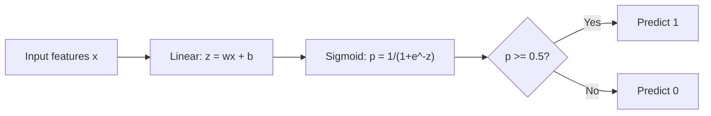
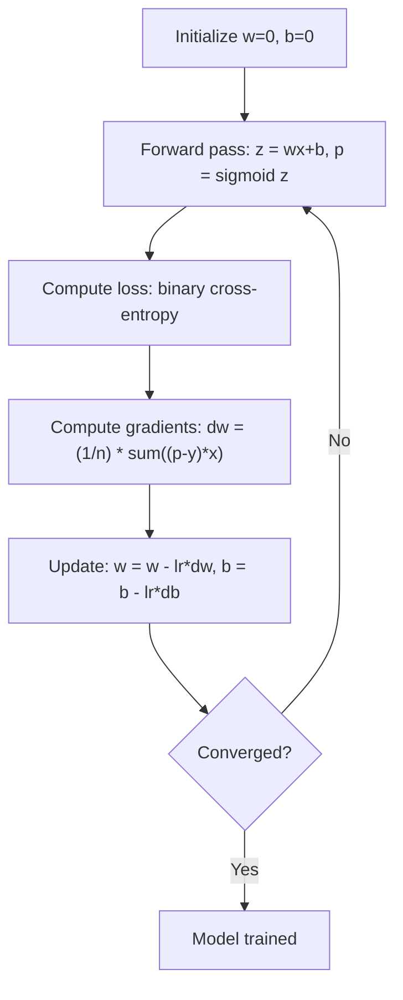

# 물적 인 회귀

> 물적 회귀는 확률로 예 또는 아니오 질문에 답하기 위해 직선을 S 곡선으로 구부러줍니다.

**Type:** Build
**Languages:** Python
**Prerequisites:** Phase 2 Lesson 1-2 (What Is ML, Linear Regression)
**Time:** ~90 minutes

## 학습 목표

- 시그모이드 함수와 바이너리 크로스 엔트로피 손실을 사용하여 처음부터 물류 회귀를 구현
- 정밀성, 회수, F1 점수, 그리고 바이너리 분류에 대한 혼동 매트릭스를 계산하고 해석한다
- MSE가 분류에 실패하는 이유와 바이너리 크로스 엔트로피가 왜 직한 비용 표면을 생성하는지 설명하십시오.
- 다중급 분류에 대한 소프트맥스 회귀 모델을 구축하고 임계 조정 타협을 평가

## 문제

종양이 악성인지 양성인지 예측하고 싶으면 그 크기를 고려하면 선형 회귀를 시도합니다. 0.3 또는 1.7 또는 -0.5 같은 숫자를 내놓습니다. 그 의미는 무엇입니까? 1.7은 "매우 악성"입니까? -0.5은 "매우 양성"입니까? 선형 회귀는 무제한 숫자를 내놓습니다. 분류는 0에서 1 사이의 제한된 확률이 필요합니다. 그리고 명확한 결정: 예 또는 아니오.

로지스틱 회귀는 이것을 해결합니다.$wx + b$) 를 통해 통과하여 시그모이드 함수를 통해, 그 함수는 어떤 숫자를 (0, 1) 범위로 압축합니다. 출력은 확률입니다. 당신은 임계점을 설정합니다 (일반적으로 0.5) 그리고 결정을 합니다.

이 알고리즘은 실제에서 가장 널리 사용되는 알고리즘 중 하나입니다. 이름에도 불구하고, 물류 회귀는 분류 알고리즘이 아니라 회귀 알고리즘입니다. 이름은 사용하는 물류 (시그모이드) 함수에서 왔습니다.

## 개념

### 왜 선형적 인 회귀가 분류에 실패하는가

연구시간에 따라 합격/실패 (1/0) 를 예측하는 것을 상상해 보세요. 선형 회귀는 데이터를 통해 선을 맞습니다.

```
hours:  1   2   3   4   5   6   7   8   9   10
actual: 0   0   0   0   1   1   1   1   1   1
```

선형적 맞춤은 -1시 0.2와 1시 1.3와 같은 예측을 생성할 수 있습니다. 이 값들은 확률이 아닙니다. 0 이하의 경우 1보다 높습니다. 더 나쁜 것은, 하나의 외상 (50시간을 연구한 사람이) 이 모든 선을 끌어당기고 모든 예측을 변경할 것입니다.

분류는 다음과 같은 기능을 필요로 한다.
- 출력 값은 0에서 1 사이의 값 (가능성)
- 급격한 전환을 만들어냅니다 (결정 경계가)
- 경계로부터 멀리 떨어진 외상자들에 의해 왜곡되지 않습니다

### 시그모이드 기능

시그모이드 함수는 정확히 이렇게 합니다.

```math
\sigma(z) = \frac{1}{1 + e^{-z}}
```

특성은:
- 언제$z$크고 긍정적이죠$\sigma(z)$접근법 1
- 언제$z$크거나 음의$\sigma(z)$접근 0
- 언제$z = 0$$\sigma(z) = 0.5$
- 출력은 0에서 1 사이의 항상
- 기능은 매끄럽고 모든 곳에서 구별됩니다

이 파생물은 편리한 형태를 가지고 있습니다: $\sigma'(z) = \sigma(z) (1 - \sigma(z))$이것은 gradient 계산을 효율적으로 합니다.

### 물적 회귀 = 선형 모델 + 시그모이드

모델은 계산합니다$z = wx + b$(선형 회귀와 동일) 이 적용되는 시그모이드:



출력$p$$P(y=1 \mid x)$, 입력값이 1급에 속할 확률이 결정한 경계가$wx + b = 0$, 즉, 시그모이드 출력도 정확히 0.5입니다.

### 바이너리 크로스 엔트로피 손실

로지스틱 회귀에 대해 MSE를 사용할 수 없습니다. sigmoid의 MSE는 많은 로컬 최소의 비상형 비용 표면을 만듭니다. 대신 바이너리 크로스 엔트로피 (log loss) 를 사용하십시오.

```math
\text{Loss} = -\frac{1}{n} \sum \left( y \log(p) + (1-y) \log(1-p) \right)
```

왜 효과가 있을까요?
- 언제$y=1$그리고$p$1에 가깝습니다.$\log(1) = 0$, 즉 손실은 0에 가깝다 (정확, 낮은 비용)
- 언제$y=1$그리고$p$0에 가깝다: $\log(0)$음의 무한도를 접근하여 손실이 매우 크다 (잘못하고 높은 비용)
- 언제$y=0$그리고$p$0에 가깝다: $\log(1) = 0$, 즉 손실은 0에 가깝다 (정확, 낮은 비용)
- 언제$y=0$그리고$p$1에 가깝습니다.$\log(0)$음의 무한도를 접근하여 손실이 매우 크다 (잘못하고 높은 비용)

이 손실 함수는 물적 회귀에 있어서 직하며, 단일 글로벌 최소의 보장이다.

### 물적 인 퇴행성 에 대한 점진적 인 감소

시그모이드와 바이너리 크로스 엔트로피의 기하급수들은 깨끗한 형태를 가지고 있습니다.

```math
\begin{aligned}
\frac{\partial L}{\partial w} &= \frac{1}{n} \sum (p - y) \, x \\
\frac{\partial L}{\partial b} &= \frac{1}{n} \sum (p - y)
\end{aligned}
```

이 값들은 선형 회귀 gradients와 동일합니다.$p = \sigma(wx + b)$대신$p = wx + b$. 시그모이드는 비선형성을 도입하지만 gradient update 규칙은 동일합니다.



### 결정 한계

2D 입력 (두 가지 특징) 에 있어서 결정 경계는 다음과 같은 라인입니다.

```math
w_1 x_1 + w_2 x_2 + b = 0
```

한쪽의 포인트는 1로 분류되며, 다른 쪽은 0로 분류된다. 물류 회귀는 항상 선형 결정 경계를 생성한다. 곡선 경계가 필요한 경우 다항분적 특징을 추가하거나 비선형 모델을 사용합니다.

### Softmax로 복합급 분류

이진 물류 회귀는 두 가지 클래스를 처리합니다.$k$클래스, 소프트맥스 함수를 사용:

```math
\text{softmax}(z_i) = \frac{e^{z_i}}{\sum_j e^{z_j}}
```

각 클래스는 자신의 무게 벡터를 가지고 있습니다. 모델은 점수를 계산합니다.$z_i$각 클래스에서, Softmax는 점수를 확률로 변환합니다.

손실 함수는 범주적 십계 엔트로피가 됩니다.

```math
\text{Loss} = -\frac{1}{n} \sum \sum_k y_k \log(p_k)
```

어디$y_k$진정한 클래스 1이고 다른 모든 클래스 (one-hot encoding) 에 0입니다.

### 평가 매트릭스

정확성만으로는 충분하지 않습니다. 95% 부정적과 5% 긍정적 인 데이터 세트에 대해 항상 부정적 예측을 하는 모델은 95% 정확성을 얻지만 쓸모가 없습니다.

**Confusion Matrix**이 부분의 본문은

| | Predicted Positive | Predicted Negative |
|---|---|---|
| Actually Positive | True Positive (TP) | False Negative (FN) |
| Actually Negative | False Positive (FP) | True Negative (TN) |

**Precision**: 예측된 모든 긍정적인 결과들 중 실제로 얼마나 많은 것이 긍정적인가?
```math
\text{Precision} = \frac{TP}{TP + FP}
```

**Recall**(감각성): 실제 긍정적인 결과들 중 몇 개?
```math
\text{Recall} = \frac{TP}{TP + FN}
```

**F1 Score**: 정확성과 회수의 조화적 평균. 두 메트릭을 모두 균형 잡는다.
```math
F_1 = 2 \cdot \frac{\text{Precision} \cdot \text{Recall}}{\text{Precision} + \text{Recall}}
```

우선 순위를 설정 하는 시간:
- **Precision**: 거짓 긍정적이 고가의 경우 (스팸 필터, 합법적인 이메일을 차단하고 싶지 않습니다)
- **Recall**: 거짓 부정적 결과가 비싸면 (암 검진을 하면 종양을 놓치지 않으실 수 있습니다.)
- **F1**: 단일 균형 잡힌 측정값이 필요할 때

```figure
logistic-sigmoid
```

## 건설 해

### 단계 1: Sigmoid 함수 및 데이터 생성

```python
import random
import math

def sigmoid(z):
    z = max(-500, min(500, z))
    return 1.0 / (1.0 + math.exp(-z))


random.seed(42)
N = 200
X = []
y = []

for _ in range(N // 2):
    X.append([random.gauss(2, 1), random.gauss(2, 1)])
    y.append(0)

for _ in range(N // 2):
    X.append([random.gauss(5, 1), random.gauss(5, 1)])
    y.append(1)

combined = list(zip(X, y))
random.shuffle(combined)
X, y = zip(*combined)
X = list(X)
y = list(y)

print(f"Generated {N} samples (2 classes, 2 features)")
print(f"Class 0 center: (2, 2), Class 1 center: (5, 5)")
print(f"First 5 samples:")
for i in range(5):
    print(f"  Features: [{X[i][0]:.2f}, {X[i][1]:.2f}], Label: {y[i]}")
```

### 단계 2: 처음부터 물적 회귀

```python
class LogisticRegression:
    def __init__(self, n_features, learning_rate=0.01):
        self.weights = [0.0] * n_features
        self.bias = 0.0
        self.lr = learning_rate
        self.loss_history = []

    def predict_proba(self, x):
        z = sum(w * xi for w, xi in zip(self.weights, x)) + self.bias
        return sigmoid(z)

    def predict(self, x, threshold=0.5):
        return 1 if self.predict_proba(x) >= threshold else 0

    def compute_loss(self, X, y):
        n = len(y)
        total = 0.0
        for i in range(n):
            p = self.predict_proba(X[i])
            p = max(1e-15, min(1 - 1e-15, p))
            total += y[i] * math.log(p) + (1 - y[i]) * math.log(1 - p)
        return -total / n

    def fit(self, X, y, epochs=1000, print_every=200):
        n = len(y)
        n_features = len(X[0])
        for epoch in range(epochs):
            dw = [0.0] * n_features
            db = 0.0
            for i in range(n):
                p = self.predict_proba(X[i])
                error = p - y[i]
                for j in range(n_features):
                    dw[j] += error * X[i][j]
                db += error
            for j in range(n_features):
                self.weights[j] -= self.lr * (dw[j] / n)
            self.bias -= self.lr * (db / n)
            loss = self.compute_loss(X, y)
            self.loss_history.append(loss)
            if epoch % print_every == 0:
                print(f"  Epoch {epoch:4d} | Loss: {loss:.4f} | w: [{self.weights[0]:.3f}, {self.weights[1]:.3f}] | b: {self.bias:.3f}")
        return self

    def accuracy(self, X, y):
        correct = sum(1 for i in range(len(y)) if self.predict(X[i]) == y[i])
        return correct / len(y)


split = int(0.8 * N)
X_train, X_test = X[:split], X[split:]
y_train, y_test = y[:split], y[split:]

print("\n=== Training Logistic Regression ===")
model = LogisticRegression(n_features=2, learning_rate=0.1)
model.fit(X_train, y_train, epochs=1000, print_every=200)

print(f"\nTrain accuracy: {model.accuracy(X_train, y_train):.4f}")
print(f"Test accuracy:  {model.accuracy(X_test, y_test):.4f}")
print(f"Weights: [{model.weights[0]:.4f}, {model.weights[1]:.4f}]")
print(f"Bias: {model.bias:.4f}")
```

### 단계 3: 초점부터 혼란 매트릭스 및 매트릭스

```python
class ClassificationMetrics:
    def __init__(self, y_true, y_pred):
        self.tp = sum(1 for t, p in zip(y_true, y_pred) if t == 1 and p == 1)
        self.tn = sum(1 for t, p in zip(y_true, y_pred) if t == 0 and p == 0)
        self.fp = sum(1 for t, p in zip(y_true, y_pred) if t == 0 and p == 1)
        self.fn = sum(1 for t, p in zip(y_true, y_pred) if t == 1 and p == 0)

    def accuracy(self):
        total = self.tp + self.tn + self.fp + self.fn
        return (self.tp + self.tn) / total if total > 0 else 0

    def precision(self):
        denom = self.tp + self.fp
        return self.tp / denom if denom > 0 else 0

    def recall(self):
        denom = self.tp + self.fn
        return self.tp / denom if denom > 0 else 0

    def f1(self):
        p = self.precision()
        r = self.recall()
        return 2 * p * r / (p + r) if (p + r) > 0 else 0

    def print_confusion_matrix(self):
        print(f"\n  Confusion Matrix:")
        print(f"                  Predicted")
        print(f"                  Pos   Neg")
        print(f"  Actual Pos     {self.tp:4d}  {self.fn:4d}")
        print(f"  Actual Neg     {self.fp:4d}  {self.tn:4d}")

    def print_report(self):
        self.print_confusion_matrix()
        print(f"\n  Accuracy:  {self.accuracy():.4f}")
        print(f"  Precision: {self.precision():.4f}")
        print(f"  Recall:    {self.recall():.4f}")
        print(f"  F1 Score:  {self.f1():.4f}")


y_pred_test = [model.predict(x) for x in X_test]
print("\n=== Classification Report (Test Set) ===")
metrics = ClassificationMetrics(y_test, y_pred_test)
metrics.print_report()
```

### 4단계: 결정 경계 분석

```python
print("\n=== Decision Boundary ===")
w1, w2 = model.weights
b = model.bias
print(f"Decision boundary: {w1:.4f}*x1 + {w2:.4f}*x2 + {b:.4f} = 0")
if abs(w2) > 1e-10:
    print(f"Solved for x2:     x2 = {-w1/w2:.4f}*x1 + {-b/w2:.4f}")

print("\nSample predictions near the boundary:")
test_points = [
    [3.0, 3.0],
    [3.5, 3.5],
    [4.0, 4.0],
    [2.5, 2.5],
    [5.0, 5.0],
]
for point in test_points:
    prob = model.predict_proba(point)
    pred = model.predict(point)
    print(f"  [{point[0]}, {point[1]}] -> prob={prob:.4f}, class={pred}")
```

### 단계 5: 소프트맥스와 함께 멀티 클래스

```python
class SoftmaxRegression:
    def __init__(self, n_features, n_classes, learning_rate=0.01):
        self.n_features = n_features
        self.n_classes = n_classes
        self.lr = learning_rate
        self.weights = [[0.0] * n_features for _ in range(n_classes)]
        self.biases = [0.0] * n_classes

    def softmax(self, scores):
        max_score = max(scores)
        exp_scores = [math.exp(s - max_score) for s in scores]
        total = sum(exp_scores)
        return [e / total for e in exp_scores]

    def predict_proba(self, x):
        scores = [
            sum(self.weights[k][j] * x[j] for j in range(self.n_features)) + self.biases[k]
            for k in range(self.n_classes)
        ]
        return self.softmax(scores)

    def predict(self, x):
        probs = self.predict_proba(x)
        return probs.index(max(probs))

    def fit(self, X, y, epochs=1000, print_every=200):
        n = len(y)
        for epoch in range(epochs):
            grad_w = [[0.0] * self.n_features for _ in range(self.n_classes)]
            grad_b = [0.0] * self.n_classes
            total_loss = 0.0
            for i in range(n):
                probs = self.predict_proba(X[i])
                for k in range(self.n_classes):
                    target = 1.0 if y[i] == k else 0.0
                    error = probs[k] - target
                    for j in range(self.n_features):
                        grad_w[k][j] += error * X[i][j]
                    grad_b[k] += error
                true_prob = max(probs[y[i]], 1e-15)
                total_loss -= math.log(true_prob)
            for k in range(self.n_classes):
                for j in range(self.n_features):
                    self.weights[k][j] -= self.lr * (grad_w[k][j] / n)
                self.biases[k] -= self.lr * (grad_b[k] / n)
            if epoch % print_every == 0:
                print(f"  Epoch {epoch:4d} | Loss: {total_loss / n:.4f}")
        return self

    def accuracy(self, X, y):
        correct = sum(1 for i in range(len(y)) if self.predict(X[i]) == y[i])
        return correct / len(y)


random.seed(42)
X_3class = []
y_3class = []

centers = [(1, 1), (5, 1), (3, 5)]
for label, (cx, cy) in enumerate(centers):
    for _ in range(50):
        X_3class.append([random.gauss(cx, 0.8), random.gauss(cy, 0.8)])
        y_3class.append(label)

combined = list(zip(X_3class, y_3class))
random.shuffle(combined)
X_3class, y_3class = zip(*combined)
X_3class = list(X_3class)
y_3class = list(y_3class)

split_3 = int(0.8 * len(X_3class))
X_train_3 = X_3class[:split_3]
y_train_3 = y_3class[:split_3]
X_test_3 = X_3class[split_3:]
y_test_3 = y_3class[split_3:]

print("\n=== Multi-class Softmax Regression (3 classes) ===")
softmax_model = SoftmaxRegression(n_features=2, n_classes=3, learning_rate=0.1)
softmax_model.fit(X_train_3, y_train_3, epochs=1000, print_every=200)
print(f"\nTrain accuracy: {softmax_model.accuracy(X_train_3, y_train_3):.4f}")
print(f"Test accuracy:  {softmax_model.accuracy(X_test_3, y_test_3):.4f}")

print("\nSample predictions:")
for i in range(5):
    probs = softmax_model.predict_proba(X_test_3[i])
    pred = softmax_model.predict(X_test_3[i])
    print(f"  True: {y_test_3[i]}, Predicted: {pred}, Probs: [{', '.join(f'{p:.3f}' for p in probs)}]")
```

### 단계 6: 임계율 조정

```python
print("\n=== Threshold Tuning ===")
print("Default threshold: 0.5. Adjusting the threshold trades precision for recall.\n")

thresholds = [0.3, 0.4, 0.5, 0.6, 0.7]
print(f"{'Threshold':>10} {'Accuracy':>10} {'Precision':>10} {'Recall':>10} {'F1':>10}")
print("-" * 52)

for t in thresholds:
    y_pred_t = [1 if model.predict_proba(x) >= t else 0 for x in X_test]
    m = ClassificationMetrics(y_test, y_pred_t)
    print(f"{t:>10.1f} {m.accuracy():>10.4f} {m.precision():>10.4f} {m.recall():>10.4f} {m.f1():>10.4f}")
```

## 사용 하 고

이제 을 배우면 같은 일이 벌어질 겁니다.

```python
from sklearn.linear_model import LogisticRegression as SklearnLR
from sklearn.metrics import accuracy_score, precision_score, recall_score, f1_score
from sklearn.metrics import confusion_matrix, classification_report
from sklearn.model_selection import train_test_split
from sklearn.preprocessing import StandardScaler
import numpy as np

np.random.seed(42)
X_0 = np.random.randn(100, 2) + [2, 2]
X_1 = np.random.randn(100, 2) + [5, 5]
X_sk = np.vstack([X_0, X_1])
y_sk = np.array([0] * 100 + [1] * 100)

X_tr, X_te, y_tr, y_te = train_test_split(X_sk, y_sk, test_size=0.2, random_state=42)

scaler = StandardScaler()
X_tr_sc = scaler.fit_transform(X_tr)
X_te_sc = scaler.transform(X_te)

lr = SklearnLR()
lr.fit(X_tr_sc, y_tr)
y_pred = lr.predict(X_te_sc)

print("=== Scikit-learn Logistic Regression ===")
print(f"Accuracy:  {accuracy_score(y_te, y_pred):.4f}")
print(f"Precision: {precision_score(y_te, y_pred):.4f}")
print(f"Recall:    {recall_score(y_te, y_pred):.4f}")
print(f"F1:        {f1_score(y_te, y_pred):.4f}")
print(f"\nConfusion Matrix:\n{confusion_matrix(y_te, y_pred)}")
print(f"\nClassification Report:\n{classification_report(y_te, y_pred)}")
```

처음부터 구현하는 것은 동일한 결정 경계와 매트릭을 생성합니다. Scikit-learn는 해제 옵션 (liblinear, lbfgs, saga), 자동 정규화, 다 클래스 전략 (one-vs-rest, multomial), 그리고 수치 안정성 최적화를 추가합니다.

## 선박

이 교훈은 다음과 같은 결과를 낳습니다.
- `code/logistic_regression.py`- 매트릭을 통해 처음부터 물류 회귀

## 운동

1. 선형적으로 분리될 수 없는 데이터 세트를 생성하십시오 (예를 들어, 두 개의 집중적 원). 물류 회귀를 훈련하고 그 실패를 관찰하십시오.$x_1^2, x_2^2, x_1 x_2$) 를 다시 훈련시켜 정확도가 향상되는 것을 보여주십시오.
2. 3급 소프트맥스 모델에 대해 다급 혼동 매트릭스를 구현합니다. 한급별 정밀도를 계산하고 회수합니다. 어느 클래스를 분류하기가 가장 어렵습니다?
3. 0에서 1까지의 100개의 임계값을 위해, 진전 양성율과 거짓 양성율을 계산하고, 트래페이이드 규칙을 사용하여 AUC (변속값 아래의 영역) 를 계산한다.

## 주요 용어

| Term | What people say | What it actually means |
|------|----------------|----------------------|
| Logistic regression | "Regression for classification" | A linear model followed by a sigmoid function that outputs class probabilities |
| Sigmoid function | "The S-curve" | The function $1/(1+e^{-z})$ that maps any real number to the range (0, 1) |
| Binary cross-entropy | "Log loss" | The loss function $-[y \log(p) + (1-y) \log(1-p)]$ that penalizes confident wrong predictions severely |
| Decision boundary | "The dividing line" | The surface where the model's output probability equals 0.5, separating predicted classes |
| Softmax | "Multi-class sigmoid" | A function that converts a vector of scores into probabilities that sum to 1 |
| Precision | "How many selected are relevant" | $TP / (TP + FP)$, the fraction of positive predictions that are actually positive |
| Recall | "How many relevant are selected" | $TP / (TP + FN)$, the fraction of actual positives that the model correctly identifies |
| F1 score | "Balanced accuracy" | The harmonic mean of precision and recall: $2PR / (P+R)$ |
| Confusion matrix | "The error breakdown" | A table showing TP, TN, FP, FN counts for each class pair |
| Threshold | "The cutoff" | The probability value above which the model predicts class 1 (default 0.5, tunable) |
| One-hot encoding | "Binary columns for categories" | Representing class $k$ as a vector of zeros with a 1 at position $k$ |
| Categorical cross-entropy | "Multi-class log loss" | The extension of binary cross-entropy to $k$ classes using one-hot encoded labels |
