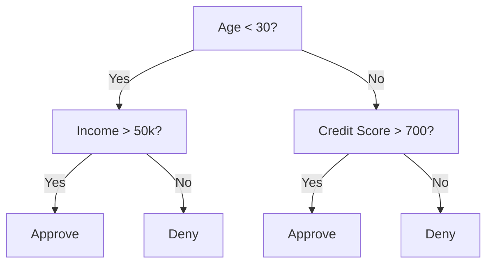
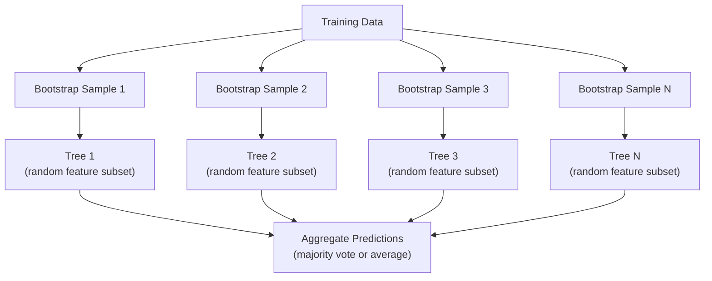

# 결정 나무 와 무작위 숲

> 결정나무는 단지 흐름표일 뿐이지만, 그 숲은 ML에서 가장 강력한 도구 중 하나입니다.

**Type:** Build
**Language:**파이썬
**Prerequisites:** Phase 1 (Lessons 09 Information Theory, 06 Probability)
**Time:** ~90 minutes

## 학습 목표

- 최적의 결정 트리 분리를 찾기 위해 기니 미화, 엔트로피 및 정보 획득 계산을 구현
- 정제 전제 컨트롤 (최고 깊이, 최소 샘플) 을 사용하여 결정나무 분류기를 처음부터 구축하십시오.
- 부트스트랩 샘플링과 기능 무작위화를 사용하여 무작위 숲을 구축하고 왜 변수를 줄이는지를 설명하십시오
- MDI 특징의 중요성을 변동의 중요성과 비교하고 MDI가 편향된 경우를 파악하십시오.

## 문제

표기 자료가 있습니다. 줄은 샘플, 열은 특징이며, 예측하려는 목표 열이 있습니다. 당신은 신경 네트워크를 던질 수 있습니다. 그러나 표기 자료에 대해서는 나무 기반 모델 (결정나무, 무작위 숲, 기하급수 증가 나무) 는 지속적으로 딥 러닝보다 우월합니다. 구조화된 데이터에 대한 Kaggle 경쟁은 XGBoost 및 LightGBM가 지배하고 있습니다. 트랜스포머가 아닙니다.

왜? 나무는 사전 처리 없이 혼합된 특징 유형 (수적 및 범주적) 을 처리합니다. 그들은 특징 공학 없이 비선형 관계를 처리합니다. 그들은 해석 가능합니다: 나무를 살펴보고 예측이 정확히 왜 이루어졌는지 알 수 있습니다. 그리고 많은 나무를 평균하는 무작위 숲은 중소 규모의 데이터 세트에 과도하게 적합하지 않습니다.

이 수업은 재발적 분리를 사용하여 결정 나무를 처음부터 만들고, 그 위에 무작위 숲을 만듭니다. 분할 기준 (기니 미화, 엔트로피, 정보 획득) 뒤에 있는 수학을 구현하고 약한 학습자의 집합이 왜 강한가지를 이해합니다.

## 개념

### 결정나무가 하는 일

결정 트리는 예/아니오 질문의 순서를 던지는 방식으로 특징 공간을 정사각형 영역으로 나눕니다.



각 내부 노드는 한 가지 특징을 임계값에 대해 테스트합니다. 각 잎 노드는 예측을 합니다. 새로운 데이터 포인트를 분류하려면 뿌리에서 시작해서 잎에 도달할 때까지 가지들을 따라가십시오.

나무는 각 노드에서 데이터를 가장 잘 분리하는 기능과 임계값을 선택함으로써 위에서 아래로 구성됩니다. "최고"는 분할 기준으로 정의됩니다.

### 분할 기준: 미세먼지를 측정하는 방법

각 노드에는 샘플의 집합이 있습니다. 우리는 그 결과의 자식 노드들이 가능한 한 "순수"하도록 나누고 싶어합니다. 즉, 각 아이는 대부분 한 클래스를 포함합니다.

**Gini impurity**무작위로 선택된 샘플이 해당 노드에서의 클래스 분포에 따라 표기될 경우 잘못된 분류될 확률을 측정합니다.

```math
\text{Gini}(S) = 1 - \sum_k p_k^2 \quad \text{where } p_k \text{ is the proportion of class } k \text{ in set } S.
```

순수 노드 (모든 하나의 클래스) 에 대해서는 Gini = 0. 50/50 클래스 있는 바이너리 분할에 대해서는 Gini = 0.5.

```
Example: 6 cats, 4 dogs

Gini = 1 - (0.6^2 + 0.4^2) = 1 - (0.36 + 0.16) = 0.48
```

**Entropy**노드에서의 정보 내용 (장애) 를 측정합니다.

```math
\text{Entropy}(S) = -\sum_k p_k \log_2(p_k)
```

순수 노드에서는 엔트로피 = 0. 50/50 바이너리 분할에서는 엔트로피 = 1.0.

```
Example: 6 cats, 4 dogs

Entropy = -(0.6 * log2(0.6) + 0.4 * log2(0.4))
        = -(0.6 * -0.737 + 0.4 * -1.322)
        = 0.442 + 0.529
        = 0.971 bits
```

**Information gain**분할 후 미세먼지 (엔트로피 또는 기니) 감소입니다.

```math
\begin{aligned}
& IG(S, \text{feature}, \text{threshold}) = \text{Impurity}(S) - \text{weighted\_avg}(\text{Impurity}(S_{\text{left}}), \text{Impurity}(S_{\text{right}})) \\[4pt]
& \text{where the weights are the proportions of samples in each child.}
\end{aligned}
```

각 노드에서 탐욕적인 알고리즘: 모든 기능과 가능한 임대점을 시도해 보세요. 정보의 최대 효과를 낼 수 있는 (특수, 임대) 쌍을 선택하세요.

### 분할이 어떻게 이루어지는지

$n$특징 및$m$현재 노드에서 샘플:

1. 각 기능에 대해$j$($j = 1$ $n$):
   - 샘플을 특징에 따라 분류합니다 $j$
   - 연속적인 다른 값 사이의 모든 중간점을 임계로 시도하십시오
   - 각 임계값에 대한 정보 획득을 계산한다
2. 가장 높은 정보 획득을 가진 기능과 임계값을 선택
3. 데이터를 왼쪽 (특수 <= 열) 과 오른쪽 (특수 > 열) 으로 나눌 수 있습니다.
4. 각 아이에게 반복

이 탐욕적인 접근 방식은 세계적으로 최적의 나무를 보장하지는 않습니다. 최적의 나무를 찾는 것은 NP- 어렵지만 탐욕적인 분할은 실제로 잘 작동합니다.

### 정지 조건

그 나무 는 정지 상태 없이 모든 잎 이 순수 (잎 한 표본) 까지 성장 합니다. 이 는 훈련 자료 를 완벽하게 기억 하고, 끔찍 하게 일반화 합니다.

**Pre-pruning**나무가 완전히 자라기 전에 멈추게 합니다.
- 최대 깊이는: 나무가 정해진 깊이를 달성하면 분할을 멈추게 한다
- 한 잎에 최소 샘플: 잎이 보다 적은 노드를 가지고 있다면 중지합니다.$k$샘플
- 최소 정보 획득: 가장 좋은 분산이 미세먼지를 한계보다 낮게 개선하면 중지
- 최대 잎 노드: 잎의 총 수를 제한한다

**Post-pruning**나무가 자라서 다시 잘라내며
- 비용 복잡성 절단 (scikit-learn) 으로 사용: 잎 수 에 비례 한 벌금 을 추가 한다. 더 작은 나무 를 얻기 위해 벌금 을 증가 시키십시오
- 오류 절단 감소: 유효성 오류가 증가하지 않으면 하위 나무를 제거하십시오

사전에 절단 하는 것 은 더 간단 하고 더 빨리 합니다. 절단 후 에는 더 좋은 나무 가 생깁니다. 왜냐하면 그 나무 가 더 유익 한 더 많은 절단 을 초래 할 수 있는 분열 을 조기 막지 않기 때문 입니다.

### 회귀에 대한 결정 나무

회귀에 있어서, 잎 예측은 그 잎의 목표 값의 평균입니다. 분할 기준도 변경됩니다:

**Variance reduction**정보의 획득을 대체합니다.

```math
VR(S, \text{feature}, \text{threshold}) = \text{Var}(S) - \text{weighted\_avg}(\text{Var}(S_{\text{left}}), \text{Var}(S_{\text{right}}))
```

가장 많은 변수를 줄이는 분할을 선택하세요. 나무는 입력 공간을 영역으로 분할하고 각 영역에 대한 상수 (평균) 를 예측합니다.

### 무작위 숲: 집합의 힘

하나의 결정나무는 높은 변형을 가지고 있습니다. 데이터의 작은 변화는 완전히 다른 나무를 생성할 수 있습니다. 무작위 숲은 많은 나무를 평균적으로 계산함으로써 이것을 수정합니다.



두 가지 무작위적인 원천은 나무를 다양하게 만듭니다.

**Bagging (bootstrap aggregating):**각 나무는 배트스트랩 샘플에 훈련됩니다. 배트스트랩 데이터에서 대체되는 무작위 샘플입니다. 각 배트스트랩에서 원래 샘플의 약 63%가 나타납니다. 나머지는 검증에 사용할 수있는 가방 밖으로 샘플입니다.

**Feature randomization:**각 분할에서, 무작위 부분 집합의 기능만 고려됩니다. 분류에 대해서는 기본값은 $\sqrt{n_{\text{features}}}$. 회귀를 위해,$n_{\text{features}}/3$이것은 모든 나무가 같은 지배적인 특징에 따라 분열되는 것을 막습니다.

핵심 통찰력: 여러 가지 비관절 나무를 평균하면 편향을 증가시키지 않고 변형을 줄이는데. 각각의 나무는 중간일 수 있습니다. 집합은 강합니다.

### 특징의 중요성

무작위 숲은 자연적으로 특징의 중요성 점수를 제공합니다. 가장 일반적인 방법은:

**Mean Decrease in Impurity (MDI):**각 특징에 대해, 모든 나무와 그 특징을 사용하는 모든 노드에서 미세먼지 감소의 전체량을 합시다. 이전 분할에서 더 큰 미세먼지 감소를 일으키는 특징은 더 중요합니다.

```math
\text{importance}(\text{feature}_j) = \sum_{\text{nodes where feature}_j \text{ is used}} \frac{n_{\text{samples at node}}}{n_{\text{total samples}}} \cdot \text{impurity\_decrease}
```

이것은 빠른 (훈련 중에 계산) 하지만 많은 가능한 분할 점과 높은 카드널리티 특징과 특징에 편향되어 있습니다.

**Permutation importance**다른 방법은 한 가지 특징의 값을 섞어서 모델의 정확도가 얼마나 떨어지는지를 측정하는 것입니다. 더 신뢰할 수 있지만 느립니다.

### 나무가 신경망을 때릴 때

나무와 숲은 테이블 데이터에 의해 신경망에 지배적이다.

| Factor | Trees | Neural networks |
|--------|-------|----------------|
| Mixed types (numeric + categorical) | Native support | Need encoding |
| Small datasets (< 10k rows) | Work well | Overfit |
| Feature interactions | Found by splitting | Need architecture design |
| Interpretability | Full transparency | Black box |
| Training time | Minutes | Hours |
| Hyperparameter sensitivity | Low | High |

신경망은 데이터가 공간적 또는 순서적 구조 (사진, 텍스트, 오디오) 를 가지고 있을 때 승리한다.

```figure
decision-tree-depth
```

## 건설 해

### 단계 1: 기니 미화 및 엔트로피

두 분할 기준을 처음부터 만들어서 어떤 분할이 좋은지에 동의하는지 확인합니다.

```python
import math

def gini_impurity(labels):
    n = len(labels)
    if n == 0:
        return 0.0
    counts = {}
    for label in labels:
        counts[label] = counts.get(label, 0) + 1
    return 1.0 - sum((c / n) ** 2 for c in counts.values())

def entropy(labels):
    n = len(labels)
    if n == 0:
        return 0.0
    counts = {}
    for label in labels:
        counts[label] = counts.get(label, 0) + 1
    return -sum(
        (c / n) * math.log2(c / n) for c in counts.values() if c > 0
    )
```

### 2단계: 가장 좋은 분할을 찾아

모든 기능과 임계점을 시도해 보세요. 가장 높은 정보 획득을 가진 것을 반환하세요.

```python
def information_gain(parent_labels, left_labels, right_labels, criterion="gini"):
    measure = gini_impurity if criterion == "gini" else entropy
    n = len(parent_labels)
    n_left = len(left_labels)
    n_right = len(right_labels)
    if n_left == 0 or n_right == 0:
        return 0.0
    parent_impurity = measure(parent_labels)
    child_impurity = (
        (n_left / n) * measure(left_labels) +
        (n_right / n) * measure(right_labels)
    )
    return parent_impurity - child_impurity
```

### 단계 3: 결정나무 클래스를 구성

반복적인 분화, 예측, 기능 중요성 추적. `_build`나무의 중심입니다. 목줄이 순수하거나 정절 전 한계에 도달하면 멈추고, 그렇지 않으면 가장 좋은 분리를 받아 두 아이에게 반복됩니다.

```python
import random

class DecisionTree:
    def __init__(self, max_depth=None, min_samples_split=2,
                 min_samples_leaf=1, criterion="gini",
                 max_features=None):
        self.max_depth = max_depth
        self.min_samples_split = min_samples_split
        self.min_samples_leaf = min_samples_leaf
        self.criterion = criterion
        self.max_features = max_features
        self.tree = None
        self.feature_importances_ = None

    def fit(self, X, y):
        self.n_features = len(X[0])
        self.feature_importances_ = [0.0] * self.n_features
        self.n_samples = len(X)
        self.tree = self._build(X, y, depth=0)
        total = sum(self.feature_importances_)
        if total > 0:
            self.feature_importances_ = [
                fi / total for fi in self.feature_importances_
            ]

    def predict(self, X):
        return [self._predict_one(x, self.tree) for x in X]

    def _build(self, X, y, depth):
        if len(set(y)) == 1:
            return {"leaf": True, "value": y[0]}

        if self.max_depth is not None and depth >= self.max_depth:
            return self._make_leaf(y)

        if len(y) < self.min_samples_split:
            return self._make_leaf(y)

        best_feature, best_threshold, best_gain = self._best_split(X, y)

        if best_feature is None or best_gain <= 0:
            return self._make_leaf(y)

        left_X, left_y, right_X, right_y = self._split_data(
            X, y, best_feature, best_threshold
        )

        if len(left_y) < self.min_samples_leaf or len(right_y) < self.min_samples_leaf:
            return self._make_leaf(y)

        weight = len(y) / self.n_samples
        self.feature_importances_[best_feature] += weight * best_gain

        return {
            "leaf": False,
            "feature": best_feature,
            "threshold": best_threshold,
            "left": self._build(left_X, left_y, depth + 1),
            "right": self._build(right_X, right_y, depth + 1),
        }

    def _make_leaf(self, y):
        counts = {}
        for label in y:
            counts[label] = counts.get(label, 0) + 1
        return {"leaf": True, "value": max(counts, key=counts.get)}

    def _best_split(self, X, y):
        best_feature = None
        best_threshold = None
        best_gain = -1.0

        if self.max_features == "sqrt":
            k = max(1, int(math.sqrt(self.n_features)))
            feature_indices = random.sample(range(self.n_features), k)
        elif isinstance(self.max_features, int):
            if self.max_features < 1:
                raise ValueError("max_features must be at least 1 when given as an integer")
            k = min(self.max_features, self.n_features)
            feature_indices = random.sample(range(self.n_features), k)
        else:
            feature_indices = list(range(self.n_features))

        for feature_idx in feature_indices:
            values = sorted(set(X[i][feature_idx] for i in range(len(X))))
            if len(values) <= 1:
                continue

            for i in range(len(values) - 1):
                threshold = (values[i] + values[i + 1]) / 2.0
                left_y = [y[j] for j in range(len(X)) if X[j][feature_idx] <= threshold]
                right_y = [y[j] for j in range(len(X)) if X[j][feature_idx] > threshold]

                if len(left_y) < self.min_samples_leaf or len(right_y) < self.min_samples_leaf:
                    continue

                gain = information_gain(y, left_y, right_y, self.criterion)
                if gain > best_gain:
                    best_gain = gain
                    best_feature = feature_idx
                    best_threshold = threshold

        return best_feature, best_threshold, best_gain

    def _split_data(self, X, y, feature, threshold):
        left_X, left_y, right_X, right_y = [], [], [], []
        for i in range(len(X)):
            if X[i][feature] <= threshold:
                left_X.append(X[i])
                left_y.append(y[i])
            else:
                right_X.append(X[i])
                right_y.append(y[i])
        return left_X, left_y, right_X, right_y

    def _predict_one(self, x, node):
        if node["leaf"]:
            return node["value"]
        if x[node["feature"]] <= node["threshold"]:
            return self._predict_one(x, node["left"])
        return self._predict_one(x, node["right"])
```

### 4단계: 랜덤포레스트 수업을 구성

부트스트랩 샘플링, 기능 무작위화, 과반수의 투표.

```python
class RandomForest:
    def __init__(self, n_trees=100, max_depth=None,
                 min_samples_split=2, max_features="sqrt",
                 criterion="gini"):
        self.n_trees = n_trees
        self.max_depth = max_depth
        self.min_samples_split = min_samples_split
        self.max_features = max_features
        self.criterion = criterion
        self.trees = []

    def fit(self, X, y):
        n = len(X)
        for _ in range(self.n_trees):
            indices = [random.randint(0, n - 1) for _ in range(n)]
            X_boot = [X[i] for i in indices]
            y_boot = [y[i] for i in indices]
            tree = DecisionTree(
                max_depth=self.max_depth,
                min_samples_split=self.min_samples_split,
                max_features=self.max_features,
                criterion=self.criterion,
            )
            tree.fit(X_boot, y_boot)
            self.trees.append(tree)

    def predict(self, X):
        all_preds = [tree.predict(X) for tree in self.trees]
        predictions = []
        for i in range(len(X)):
            votes = {}
            for preds in all_preds:
                v = preds[i]
                votes[v] = votes.get(v, 0) + 1
            predictions.append(max(votes, key=votes.get))
        return predictions
```

보시다시피`code/trees.py`모든 보조 방법과 함께 완전한 구현을 위해.

## 사용 하 고

스키트-러닝으로 무작위 숲을 훈련시키는 것은 3개의 라인입니다.

```python
from sklearn.ensemble import RandomForestClassifier
from sklearn.datasets import load_iris
from sklearn.model_selection import train_test_split

X, y = load_iris(return_X_y=True)
X_train, X_test, y_train, y_test = train_test_split(X, y, random_state=42)

rf = RandomForestClassifier(n_estimators=100, random_state=42)
rf.fit(X_train, y_train)
print(f"Accuracy: {rf.score(X_test, y_test):.4f}")
print(f"Feature importances: {rf.feature_importances_}")
```

실제로, 기하급수 증진 나무 (XGBoost, LightGBM, CatBoost) 는 나무를 순차적으로 만들어서 나무보다 강해지기 때문에, 각각의 나무는 이전의 오류를 수정한다. 그러나 무작위 숲은 잘못 구성되기 어렵고 거의 하이퍼파라미터 조정이 필요하지 않습니다.

## 선박

이 교훈은`outputs/prompt-tree-interpreter.md`-- 비즈니스 이해관계자들에게 의사결정 트리 스플리트를 해석하는 프롬프트. 훈련된 트리의 구조 ( 깊, 특징, 분할 문턱, 정확성) 를 제공하여 모델을 단순 언어로 번역하고, 중요성을 나타내는 특징 순위, 플래그 과잉 또는 누출 및 다음 단계를 권장합니다. 코드를 읽지 않는 사람에게 트리 기반 모델을 설명해야 할 때마다 사용하십시오.

## 운동

1. 3 클래스 2D 데이터 세트에 단일 결정 트리를 훈련하십시오. 분할을 수동으로 추적하고 정사각형 결정 경계를 그리십시오. 경계를 최대_ 깊음=2와 최대_ 깊음=10에서 비교하십시오.

2. 회귀 나무에 대한 변함 감소 분할을 구현.$y = \sin(x) + \text{noise}$200점으로 정렬하고 그 나무의 부분형 일정한 예측을 실제 곡선에 맞춰

3. 1, 5, 10, 50 및 200개의 나무를 가진 무작위 숲을 건설하십시오. 전면 훈련 정확성과 나무의 정확성 대의 테스트 정확성을 측정하십시오.

4. 기니 미세먼지와 엔트로피를 5가지 데이터 세트에 나뉘어 기준으로 비교해 보세요. 정확성과 나무 깊이를 측정하세요. 대부분의 경우 거의 동일한 결과를 얻습니다. 이유를 설명하세요.

5. 변동 중요성을 구현하십시오. 무작위 소음이지만 고의 추대성을 가진 데이터 세트에 MDI 중요성과 비교하십시오. MDI는 소음 기능을 높게 평가합니다. 변동 중요성은 그렇지 않습니다.

## 주요 용어

| Term | What people say | What it actually means |
|------|----------------|----------------------|
| Decision tree | "A flowchart for predictions" | A model that partitions feature space into rectangular regions by learning a sequence of if/else splits |
| Gini impurity | "How mixed the node is" | Probability of misclassifying a random sample at a node. 0 = pure, 0.5 = maximum impurity for binary |
| Entropy | "The disorder in a node" | Information content at a node. 0 = pure, 1.0 = maximum uncertainty for binary. From information theory |
| Information gain | "How good a split is" | Reduction in impurity after a split. The greedy criterion for choosing splits |
| Pre-pruning | "Stop the tree early" | Stopping tree growth early by setting max depth, min samples, or min gain thresholds |
| Post-pruning | "Trim the tree after" | Growing the full tree, then removing subtrees that do not improve validation performance |
| Bagging | "Train on random subsets" | Bootstrap aggregating. Train each model on a different random sample with replacement |
| Random forest | "A bunch of trees" | Ensemble of decision trees, each trained on a bootstrap sample with random feature subsets at each split |
| Feature importance (MDI) | "Which features matter" | Total impurity decrease contributed by each feature, summed across all trees and nodes |
| Permutation importance | "Shuffle and check" | Accuracy drop when a feature's values are randomly shuffled. More reliable than MDI for noisy features |
| Variance reduction | "The regression version of info gain" | The regression tree analogue of information gain. Picks the split that reduces target variance the most |
| Bootstrap sample | "Random sample with repeats" | A random sample drawn with replacement from the original dataset. Same size, but with duplicates |

## 더 많은 읽기

- [Breiman: Random Forests (2001)](https://link.springer.com/article/10.1023/A:1010933404324)- 원래의 무작위 숲 종이
- [Grinsztajn et al.: Why do tree-based models still outperform deep learning on tabular data? (2022)](https://arxiv.org/abs/2207.08815)- 테이블 작업에 대해 나무와 신경 네트워크의 엄격한 비교
- [scikit-learn Decision Trees documentation](https://scikit-learn.org/stable/modules/tree.html)- 시각화 도구로 실용적인 가이드
- [XGBoost: A Scalable Tree Boosting System (Chen & Guestrin, 2016)](https://arxiv.org/abs/1603.02754)- Kaggle를 지배하는 gradient boosting paper
