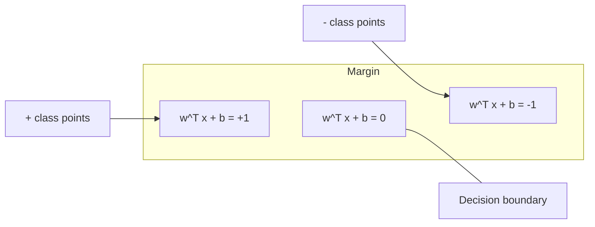
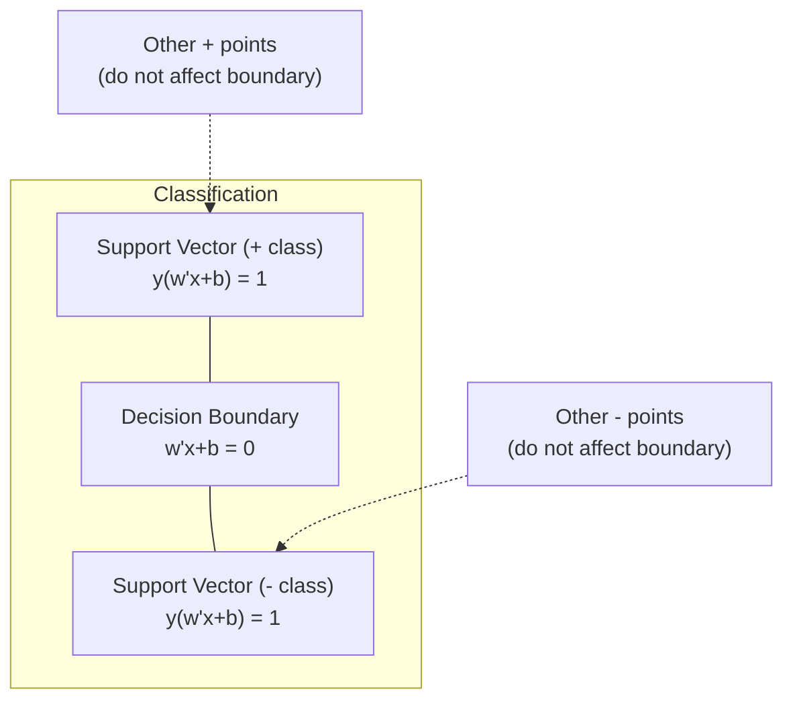
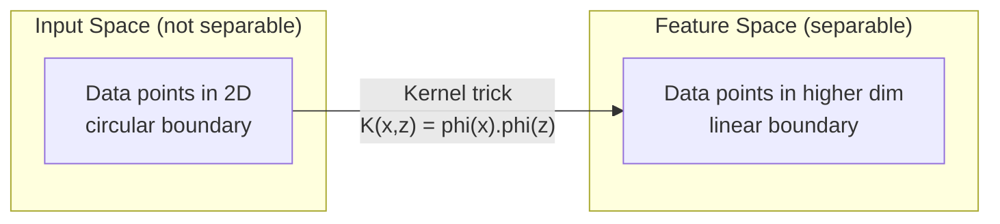

# 지원 벡터 기계

> 두 계층 사이의 가장 넓은 거리를 찾아라

**Type:** Build
**Language:**파이썬
**Prerequisites:** Phase 1 (Lessons 08 Optimization, 14 Norms and Distances, 18 Convex Optimization)
**Time:** ~90 minutes

## 학습 목표

- 초기의 공식에  손실과 기하급수 하락을 사용하여 초점부터 선형 SVM를 구현
- 최대 마진 원칙을 설명하고 훈련된 모델에서 지원 벡터를 식별하십시오.
- 선형, 다항식, RBF 커널을 비교하고 커널 트릭이 명백한 고차원 지도를 피하는 방법을 설명합니다
- C 매개 변수에서 제어되는 매진 너비와 분류 오류 사이의 타협을 평가한다

## 문제

두 개의 데이터 포인트 클래스를 가지고 있고, 그것들을 분리하는 라인 (또는 하이퍼플라인) 을 그리는 것이 필요합니다. 무한한 많은 라인은 작동할 수 있습니다. 어느 하나를 선택해야합니까?

가장 큰 지표가 있는 경우. 지표는 결정 경계와 각 쪽에서 가장 가까운 데이터 포인트 사이의 거리가 됩니다. 더 넓은 지표는 분류자가 더 자신감을 가지고 보이지 않는 데이터에 더 잘 일반화한다는 것을 의미합니다.

이 직관으로 ML에서 가장 수학적으로 우아한 알고리즘 중 하나인 지원 벡터 기계가 탄생했습니다. SVMs는 딥 러닝 이전까지 지배적인 분류 방법이었고, 작은 데이터 집합, 고차원 데이터 및 이론적 보장과 함께 원칙적이고 잘 이해되는 모델을 필요로 하는 문제에 대한 최고의 선택으로 남아 있습니다.

SVM는 1단계와 직접 연결된다. 최적화는 구부러져 있다 (목록 18), 가장자리는 규범으로 측정된다 (목록 14), 그리고 커널 트릭은 초차원 공간에서 계산을 하지 않고 비선형 경계를 처리하기 위해 점 제품들을 활용한다.

## 개념

### 최대 지분 분류

라인형으로 분리 가능한 표기된 데이터를 제공함 $y_i \in \lbrace -1, +1 \rbrace$그리고 특징 벡터$x_i$, 우리는 하이퍼플라인을 원한다$w^T x + b = 0$그 점이 교리를 분리하는 것입니다.

한 지점으로부터의 거리는$x_i$이하계계로

```math
\text{distance} = \frac{\lvert w^T x_i + b \rvert}{\lVert w \rVert}
```

정밀하게 분류된 점: $y_i (w^T x_i + b) > 0$. 둘 다 가장 가까운 지점까지의 거리의 두 배가 가장 큰



최적화 문제:

```math
\begin{aligned}
\text{maximize} \quad & \frac{2}{\lVert w \rVert} \quad \text{(the margin width)} \\
\text{subject to} \quad & y_i (w^T x_i + b) \ge 1 \quad \text{for all } i
\end{aligned}
```

동등한 (최소)$\lVert w \rVert^2$최적화하기 쉽다):

```math
\begin{aligned}
\text{minimize} \quad & \frac{1}{2} \lVert w \rVert^2 \\
\text{subject to} \quad & y_i (w^T x_i + b) \ge 1 \quad \text{for all } i
\end{aligned}
```

이것은 형 사각형 프로그램입니다. 그것은 독특한 글로벌 솔루션을 가지고 있습니다.$y_i (w^T x_i + b) = 1$) 는 지원 벡터 입니다. 결정 경계를 결정하는 유일한 점입니다. 지원 벡터 아닌 모든 점들을 이동하거나 제거하고, 경계는 변하지 않습니다.

### 지원 벡터: 비중이 적다



대부분의 훈련 포인트는 중요하지 않습니다. 지원 벡터만 중요합니다. 이것이 SVM가 예측 시간에 메모리 효율성이있는 이유입니다. 당신은 전체 훈련 세트를 저장하지 않고 지원 벡터를 저장해야합니다.

지원 벡터 수 또한 일반화 오류에 한계를 부여합니다. 데이터 세트 크기에 비해 지원 벡터 수가 적으면 더 나은 일반화입니다.

### 부드러운 경계: C 매개 변수와 함께 소음을 처리

실제 데이터는 거의 완벽하게 분리되지 않습니다. 일부 포인트는 경계의 잘못된 편에 있거나 경계 내부에있을 수 있습니다. 부드러운 경계 공식은 느슨한 변수를 도입함으로써 위반을 허용합니다.

```math
\begin{aligned}
\text{minimize} \quad & \frac{1}{2} \lVert w \rVert^2 + C \sum_i \xi_i \\
\text{subject to} \quad & y_i (w^T x_i + b) \ge 1 - \xi_i \\
& \xi_i \ge 0 \quad \text{for all } i
\end{aligned}
```

스 변수$\xi_i$얼마나 많은 점수를 측정합니다$i$이 점수를 위반합니다.$C$거래소 통제:

| $C$ value | Behavior |
|---------|----------|
| Large $C$ | Penalizes violations heavily. Narrow margin, fewer misclassifications. Overfits |
| Small $C$ | Allows more violations. Wide margin, more misclassifications. Underfits |

$C$정규화 강도는 거꾸로$C$= 덜 규칙화$C$= 더 많은 규칙화

###  손실: SVM 손실 함수

소프트 마진 SVM는 무제한 최적화로 다시 쓸 수 있습니다.

```math
\text{minimize} \quad \frac{1}{2} \lVert w \rVert^2 + C \sum_i \max(0, 1 - y_i (w^T x_i + b))
```

용어$\max(0, 1 - y_i f(x_i))$지점이 올바르게 분류되어 지점 너머로 갈 때 0입니다. 지점이 지점 안에 있거나 잘못 분류되었을 때 선형입니다.

```
Hinge loss for a single point:

loss
  |
  | \
  |  \
  |   \
  |    \
  |     \_______________
  |
  +-----|-----|-------->  y * f(x)
       0     1

Zero loss when y*f(x) >= 1 (correctly classified, outside margin).
Linear penalty when y*f(x) < 1.
```

물적 손실 (물적 회귀) 과 비교:

```math
\begin{aligned}
\text{Hinge:} \quad & \max(0, 1 - y f(x)) && \text{Hard cutoff at margin} \\
\text{Logistic:} \quad & \log(1 + \exp(-y f(x))) && \text{Smooth, never exactly zero}
\end{aligned}
```

 손실은 희귀한 솔루션을 생성합니다 (지원 벡터만 비 0 기여를 합니다). 물류 손실은 모든 데이터 포인트를 사용합니다. 이것은 예측 시간에 SVM를 더 메모리 효율적으로 만듭니다.

### 경각층 하락을 가진 선형 SVM의 훈련

제한된 QP를 해결하지 않고,  손실과 L2 정규화를 통해 선형 SVM를 훈련시킬 수 있습니다.

```math
\begin{aligned}
& L(w, b) = \frac{\lambda}{2} \lVert w \rVert^2 + \frac{1}{n} \sum_i \max(0, 1 - y_i (w^T x_i + b)) \\[6pt]
& \text{Gradient with respect to } w\text{:} \\
& \quad \text{If } y_i (w^T x_i + b) \ge 1\text{:} \quad \frac{\partial L}{\partial w} = \lambda w \\
& \quad \text{If } y_i (w^T x_i + b) < 1\text{:} \quad \frac{\partial L}{\partial w} = \lambda w - y_i x_i \\[6pt]
& \text{Gradient with respect to } b\text{:} \\
& \quad \text{If } y_i (w^T x_i + b) \ge 1\text{:} \quad \frac{\partial L}{\partial b} = 0 \\
& \quad \text{If } y_i (w^T x_i + b) < 1\text{:} \quad \frac{\partial L}{\partial b} = -y_i
\end{aligned}
```

이것은 원본 형식이라고 합니다.$O(n \cdot d)$시대별로,$n$샘플의 수와$d$큰, 희소하고 고차원 데이터 ( 텍스트 분류) 에 대해서는, 이것은 빠르게 됩니다.

### 이중 공식과 커널 트릭

SVM 문제의 라그랑지안 이중 (단계 1 레슨 18에서 KKT 조건) 은 다음과 같습니다.

```math
\begin{aligned}
\text{maximize} \quad & \sum_i \alpha_i - \frac{1}{2} \sum_{i,j} \alpha_i \alpha_j y_i y_j (x_i \cdot x_j) \\
\text{subject to} \quad & 0 \le \alpha_i \le C \\
& \sum_i \alpha_i y_i = 0
\end{aligned}
```

이중은 점 제품만을 포함합니다 $x_i \cdot x_j$데이터 포인트 사이에 있는 점들 중 하나. 이것이 핵심 통찰력입니다. 각 점 제품들을 커널 함수로 교체하세요.$K(x_i, x_j)$그리고 SVM는 변수를 명시적으로 계산하지 않고 비선형 경계를 배울 수 있습니다.

```math
\begin{aligned}
\text{Linear kernel:} \quad & K(x, z) = x \cdot z \\
\text{Polynomial kernel:} \quad & K(x, z) = (x \cdot z + c)^d \\
\text{RBF (Gaussian):} \quad & K(x, z) = \exp(-\gamma \lVert x - z \rVert^2)
\end{aligned}
```

RBF 커널은 데이터를 무한 차원 공간에 매핑합니다. 입력 공간에서 가까운 지점들은 1 근처의 커널 값을 가지고 있습니다. 멀리 떨어져 있는 지점들은 0 근처의 커널 값을 가지고 있습니다.



커널 트릭은 높은 차원의 공간에서 점의 곱을 계산합니다.$d$$D$크기는 명시적인 특징 공간에 $O(D^d)$차원만$K(x, z)$계산된 $O(D)$시간

### 회귀 SVM (SVR)

지원 벡터 회귀는 너비의 튜브에 적합합니다$\epsilon$튜브 내부의 포인트는 손실이 0이고 튜브 외부의 포인트는 선형적으로 처벌됩니다.

```math
\begin{aligned}
\text{minimize} \quad & \frac{1}{2} \lVert w \rVert^2 + C \sum_i (\xi_i + \xi_i^*) \\
\text{subject to} \quad & y_i - (w^T x_i + b) \le \epsilon + \xi_i \\
& (w^T x_i + b) - y_i \le \epsilon + \xi_i^* \\
& \xi_i, \xi_i^* \ge 0
\end{aligned}
```

$\epsilon$변수 는 튜브 너비 를 조절 한다. 더 넓은 튜브 = 더 적은 지지 벡터 = 더 부드러운 튜브. 좁은 튜브 = 더 많은 지지 벡터 = 더 긴밀한 벡터.

### 왜 SVM가 딥러닝에 패했는가 (그리고 여전히 승리할 때)

SVM는 1990년대 후반부터 2010년대 초까지 ML를 지배했다.

| Factor | SVMs | Deep learning |
|--------|------|---------------|
| Feature engineering | Requires it | Learns features |
| Scalability | $O(n^2)$ to $O(n^3)$ for kernel | $O(n)$ per epoch with SGD |
| Image/text/audio | Needs handcrafted features | Learns from raw data |
| Large datasets (>100k) | Slow | Scales well |
| GPU acceleration | Limited benefit | Massive speedup |

SVM는 여전히 이 상황에서 승리합니다.
- 작은 데이터 세트 (백에서 수천 개의 샘플)
- 고차원 희소 데이터 (TF-IDF 기능이 있는 텍스트)
- 수학적인 보증이 필요할 때 (마진 제한)
- 훈련 시간은 최소되어야 할 때 (선형 SVM는 매우 빠르다)
- 명확한 지분 구조를 가진 바이너리 분류
- 기상상실증 검출 (단계 SVM)

```figure
svm-margin
```

## 건설 해

### 단계 1: 이 떨어지고 기울기는

배트와 그 기하급수의 이 손실을 계산해 보세요.

```python
def hinge_loss(X, y, w, b):
    n = len(X)
    total_loss = 0.0
    for i in range(n):
        margin = y[i] * (dot(w, X[i]) + b)
        total_loss += max(0.0, 1.0 - margin)
    return total_loss / n
```

### 단계 2: 경각층 하락을 통해 선형 SVM

정규화 된  손실을 최소화함으로써 훈련하십시오. QP 용매가 필요하지 않습니다.

```python
class LinearSVM:
    def __init__(self, lr=0.001, lambda_param=0.01, n_epochs=1000):
        self.lr = lr
        self.lambda_param = lambda_param
        self.n_epochs = n_epochs
        self.w = None
        self.b = 0.0

    def fit(self, X, y):
        n_features = len(X[0])
        self.w = [0.0] * n_features
        self.b = 0.0

        for epoch in range(self.n_epochs):
            for i in range(len(X)):
                margin = y[i] * (dot(self.w, X[i]) + self.b)
                if margin >= 1:
                    self.w = [wj - self.lr * self.lambda_param * wj
                              for wj in self.w]
                else:
                    self.w = [wj - self.lr * (self.lambda_param * wj - y[i] * X[i][j])
                              for j, wj in enumerate(self.w)]
                    self.b -= self.lr * (-y[i])

    def predict(self, X):
        return [1 if dot(self.w, x) + self.b >= 0 else -1 for x in X]
```

### 단계 3: 커널 기능

선형, 다항식, RBF 커널을 구현한다.

```python
def linear_kernel(x, z):
    return dot(x, z)

def polynomial_kernel(x, z, degree=3, c=1.0):
    return (dot(x, z) + c) ** degree

def rbf_kernel(x, z, gamma=0.5):
    diff = [xi - zi for xi, zi in zip(x, z)]
    return math.exp(-gamma * dot(diff, diff))
```

### 단계 4: 경계 및 지원 벡터 식별

훈련 후 어떤 점들이 지지 벡터인지 확인하고 경계 너비를 계산한다.

```python
def find_support_vectors(X, y, w, b, tol=1e-3):
    support_vectors = []
    for i in range(len(X)):
        margin = y[i] * (dot(w, X[i]) + b)
        if abs(margin - 1.0) < tol:
            support_vectors.append(i)
    return support_vectors
```

보시다시피`code/svm.py`모든 데모와 함께 완전하게 구현하기 위해서

## 사용 하 고

이치-러닝으로

```python
from sklearn.svm import SVC, LinearSVC, SVR
from sklearn.preprocessing import StandardScaler
from sklearn.pipeline import Pipeline

clf = Pipeline([
    ("scaler", StandardScaler()),
    ("svm", SVC(kernel="rbf", C=1.0, gamma="scale")),
])
clf.fit(X_train, y_train)
print(f"Accuracy: {clf.score(X_test, y_test):.4f}")
print(f"Support vectors: {clf['svm'].n_support_}")
```

중요한 것은: SVM를 훈련하기 전에 항상 당신의 특징을 확장하십시오. SVM는 특징의 크기에 민감합니다.$\lVert w \rVert$, 그리고 비중형 특징은 기하학을 왜곡합니다.

큰 데이터 집합에 대해서는 사용 `LinearSVC`(초음 공식, $O(n)$시대별) 대신`SVC`(중개 공식, $O(n^2)$ $O(n^3){}$):

```python
from sklearn.svm import LinearSVC

clf = Pipeline([
    ("scaler", StandardScaler()),
    ("svm", LinearSVC(C=1.0, max_iter=10000)),
])
```

## 운동

1. 2D 선형 분리 가능한 데이터 세트를 생성합니다. 선형SVM을 훈련시키고 지원 벡터를 식별하십시오. 지원 벡터가 결정 경계에 가장 가까운 지점인지 확인합니다.

2. 다양함$C$음 한 데이터 세트에 0.001에서 1000까지의$C$값: 넓은 지점 (부적절) 에서 좁은 지점 (부적절) 으로의 전환을 관찰하십시오.

3. 클래스 경계가 순환 (선형적이지 않은) 이 있는 데이터 세트를 생성하십시오. 선형 SVM가 실패한 것을 표시하십시오. RBF 커널 매트릭스를 계산하고 커널에서 유발된 기능 공간에서 클래스가 분리 될 수 있음을 표시하십시오.

4. 동일한 데이터 세트에 있는  loss vs logistic loss를 비교하십시오. 선형 SVM와 물적 회귀를 훈련하십시오. 각 모델의 결정 경계에 얼마나 많은 훈련 포인트가 기여하는지 계산하십시오.

5. SVR (epsilon- 불감각성 손실) 를 적용하여$y = \sin(x) + \text{noise}$. 전망을 중심으로 에프실론 튜브를 그려서 지지 벡터를 (튜브 외부의 점) 강조한다.

## 주요 용어

| Term | What it actually means |
|------|----------------------|
| Support vectors | The training points closest to the decision boundary. The only points that determine the hyperplane |
| Margin | The distance between the decision boundary and the nearest support vectors. SVMs maximize this |
| Hinge loss | $\max(0, 1 - y f(x))$. Zero when correctly classified and outside the margin. Linear penalty otherwise |
| C parameter | Trade-off between margin width and classification errors. Large $C$ = narrow margin, small $C$ = wide margin |
| Soft margin | SVM formulation that allows margin violations via slack variables. Handles non-separable data |
| Kernel trick | Computing dot products in a high-dimensional feature space without explicitly mapping to that space |
| Linear kernel | $K(x, z) = x \cdot z$. Equivalent to standard dot product. For linearly separable data |
| RBF kernel | $K(x, z) = \exp(-\gamma \Vert x-z \Vert^2)$. Maps to infinite dimensions. Learns any smooth boundary |
| Polynomial kernel | $K(x, z) = (x \cdot z + c)^d$. Maps to a feature space of polynomial combinations |
| Dual formulation | Reformulation of the SVM problem that depends only on dot products between data points. Enables kernels |
| SVR | Support Vector Regression. Fits an epsilon-tube around the data. Points inside the tube have zero loss |
| Slack variables | $\xi_i$: measures how much a point violates the margin. Zero for correctly classified points outside margin |
| Maximum margin | The principle of choosing the hyperplane that maximizes the distance to the nearest points of each class |

## 더 많은 읽기

- [Vapnik: The Nature of Statistical Learning Theory (1995)](https://link.springer.com/book/10.1007/978-1-4757-3264-1)- SVM 및 통계학 학습에 관한 기초 텍스트
- [Cortes & Vapnik: Support-vector networks (1995)](https://link.springer.com/article/10.1007/BF00994018)- 원래 SVM 종이
- [Platt: Sequential Minimal Optimization (1998)](https://www.microsoft.com/en-us/research/publication/sequential-minimal-optimization-a-fast-algorithm-for-training-support-vector-machines/)- SVM 훈련을 실용화시킨 SMO 알고리즘
- [scikit-learn SVM documentation](https://scikit-learn.org/stable/modules/svm.html)- 실행에 대한 세부 사항과 함께 실무 가이드
- [LIBSVM: A Library for Support Vector Machines](https://www.csie.ntu.edu.tw/~cjlin/libsvm/)- 대부분의 SVM 구현의 배후인 C++ 라이브러리
