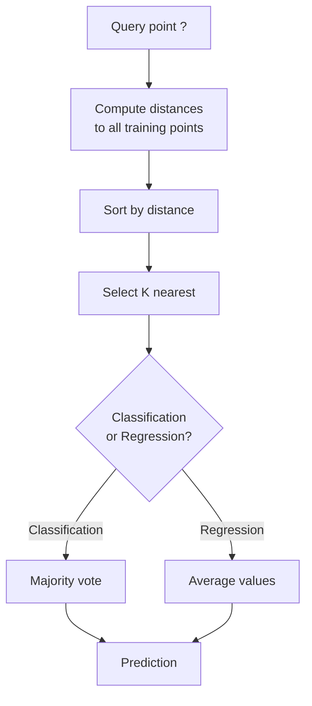
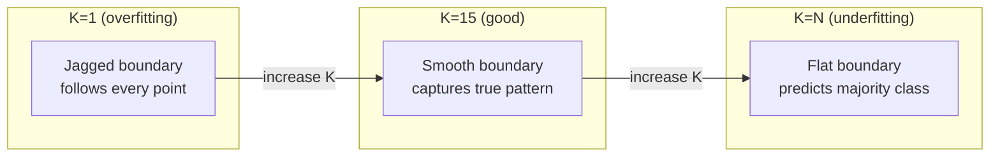
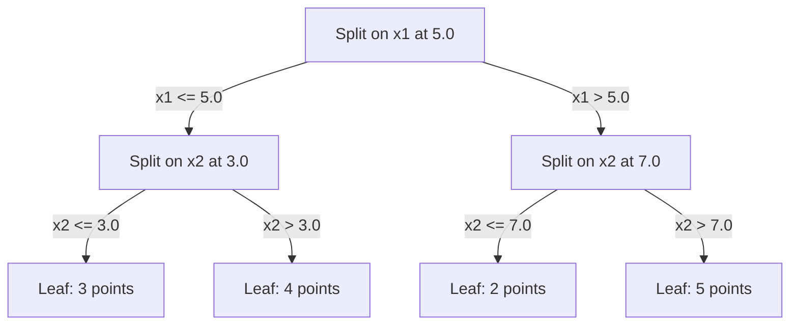

# K- 가장 가까운 이웃 과 거리가

> 모든 것을 저장하고 이웃을 보고 예측해 보세요. 실제로 작동하는 가장 간단한 알고리즘입니다.

**Type:** Build
**Language:**파이썬
**Prerequisites:** Phase 1 (Lesson 14 Norms and Distances)
**Time:** ~90 minutes

## 학습 목표

- KNN 분류 및 회귀를 설정 가능한 K 및 거리 중량 투표로 처음부터 구현
- L1, L2, cosine, 그리고 Minkowski 거리 측정값을 비교하고 주어진 데이터 타입에 적합한 것을 선택하십시오.
- 차원성의 저주와 KNN가 높은 차원 공간에서 왜 붕괴되는지 설명하십시오.
- 가장 가까운 이웃을 효율적으로 검색하고 분석하기 위해 KD 나무를 구축

## 문제

데이터 세트가 있습니다. 새로운 데이터 포인트가 도착합니다. 당신은 그것을 분류하거나 그 값을 예측해야합니다. 데이터에서 매개 변수를 배우는 대신 (선형 회귀 또는 SVM와 같은), 당신은 단지 새로운 포인트와 가장 가까운 K 훈련 포인트를 찾아서 투표하도록 합니다.

K가 가장 가까운 이웃입니다. 훈련 단계가 없습니다. 학습할 파라미터도 없습니다. 최소화 할 손실 함수는 없습니다. 전 훈련 세트를 저장하고 예측 시간에 거리를 계산합니다.

하지만 KNN는 특히 작은 데이터 세트에서 중형 데이터 세트까지 많은 문제들에 대해 놀랍도록 경쟁력을 갖춘 것으로 들리는데, 이를 이해하는 것은 근본적인 개념을 깊이 드러내는데, 이는 거리의 측정값을 선택하는 것 (단계 1 수업 14에 연결되는 것), 차원성의 저주, 그리고 게으른 학습과 열망한 학습 사이의 차이입니다.

KNN는 현대 인공지능에서 다른 이름으로 모든 곳에서 나타납니다. 벡터 데이터베이스에서는 KNN가 임베디션을 검색합니다. 검색 증강 생성 (RAG) 는 K에 가장 가까운 문서 조각을 찾습니다. 추천 시스템은 유사한 사용자 또는 항목을 찾습니다. 알고리즘은 동일합니다. 규모와 데이터 구조는 다릅니다.

## 개념

### KNN의 작동 방식

표기된 포인트의 데이터 세트와 새로운 쿼리 포인트에 따라:

1. 데이터 세트의 모든 점까지의 거리
2. 거리에 따라 분류
3. K에 가장 가까운 지점을 가져라
4. 분류: K 이웃들 중 과반수의 투표
5. 회귀에 대해서는 K 이웃의 값의 평균 (또는 중량 평균)



그 알고리즘은 전부입니다. 부착도 없고, 경각도도 없고, 시대도 없습니다.

### K를 선택

K는 단일 하이퍼파라미터입니다.

| K | Behavior |
|---|----------|
| $K = 1$ | Decision boundary follows every point. Zero training error. High variance. Overfits |
| Small K (3-5) | Sensitive to local structure. Can capture complex boundaries |
| Large K | Smoother boundaries. More robust to noise. May underfit |
| $K = N$ | Predicts the majority class for every point. Maximum bias |

공통적인 출발점은$K = \sqrt{N}$ 데이터 세트$N$점: 쌍성 분류에 있어서 홀수 K를 사용해서



### 거리 측정

거리 함수는 "가근"의 의미를 정의합니다. 다른 매트릭은 다른 이웃을 생성하고 다른 예측을 만듭니다.

**L2 (Euclidean)**정렬 직선 거리입니다.

```math
d(a, b) = \sqrt{\sum_i (a_i - b_i)^2}
```

기능 규모에 민감합니다. KNN와 L2를 사용하기 전에 항상 기능을 표준화하십시오.

**L1 (Manhattan)**절대적 차이를 합하는 것입니다. L2보다 이상으로 강합니다. 왜냐하면 그것은 차이를 제곱하지 않기 때문입니다.

```math
d(a, b) = \sum_i \lvert a_i - b_i \rvert
```

**Cosine distance**대도도와 같은 각을 측정합니다. 텍스트와 데이터를 삽입하는 데 필수적입니다.

```math
d(a, b) = 1 - \frac{a \cdot b}{\lVert a \rVert \, \lVert b \rVert}
```

**Minkowski**L1와 L2를 일반화하여 매개 변수를 $p$- 그래

```math
\begin{aligned}
& d(a, b) = \left( \sum_i \lvert a_i - b_i \rvert^p \right)^{1/p} \\[6pt]
& p=1\text{: Manhattan} \\
& p=2\text{: Euclidean} \\
& p \to \infty\text{: Chebyshev (max absolute difference)}
\end{aligned}
```

어떤 메트릭을 사용해야 하는지는 데이터에 달려 있습니다.

| Data type | Best metric | Why |
|-----------|------------|-----|
| Numeric features, similar scale | L2 (Euclidean) | Default, works for spatial data |
| Numeric features, outliers | L1 (Manhattan) | Robust, does not amplify large differences |
| Text embeddings | Cosine | Magnitude is noise, direction is meaning |
| High-dimensional sparse | Cosine or L1 | L2 suffers from curse of dimensionality |
| Mixed types | Custom distance | Combine metrics per feature type |

### 중량 KNN

표준 KNN는 모든 K 이웃에게 동일한 무게를 부여합니다. 하지만 0.1 거리의 이웃은 5.0 거리의 이웃보다 더 중요해야합니다.

**Distance-weighted KNN**각 이웃을 거리에 따라 반대의 무게로 측정합니다.

```math
\begin{aligned}
& \text{weight}_i = \frac{1}{\text{distance}_i + \epsilon} \\[6pt]
& \text{For classification: weighted vote} \\
& \text{For regression: weighted average} = \frac{\sum_i w_i y_i}{\sum_i w_i}
\end{aligned}
```

$\epsilon$질의점이 훈련점과 정확히 일치할 때 0으로 나뉘는 것을 방지합니다.

중형 KNN는 K의 선택에 덜 민감하기 때문에 멀리 있는 이웃들은 거의 기여하지 않습니다.

### 차원성의 저주

KNN 성능은 높은 차원에서 저하되고 있습니다. 이것은 모호한 우려가 아닙니다. 그것은 수학적인 사실입니다.

**Problem 1: distances converge.**차원적성이 증가함에 따라 최대 거리와 최소 거리의 비율이 1에 가까워집니다. 모든 점들은 질의에서 똑같이 "거리가 멀다".

```
In d dimensions, for random uniform points:

d=2:    max_dist / min_dist = varies widely
d=100:  max_dist / min_dist ~ 1.01
d=1000: max_dist / min_dist ~ 1.001

When all distances are nearly equal, "nearest" is meaningless.
```

**Problem 2: volume explodes.**데이터의 고정된 부분 내에서 K 이웃을 캡처하려면 더 큰 부분의 공간을 커버하기 위해 검색 반경을 확장해야합니다. 높은 차원의 "네이버리"는 공간의 대부분을 포괄합니다.

**Problem 3: corners dominate.**d 차원의 단위 하이퍼큐브에서, 부피의 대부분은 중심이 아닌 각 근처에 집중됩니다.

실용적인 결과: KNN는 약 20-50 기능까지 잘 작동합니다. 그 외에도 KNN을 적용하기 전에 차원적 감소 (PCA, UMAP, t-SNE) 를 필요로 합니다. 또는 데이터의 본질적인 낮은 차원성을 활용하는 나무 기반 검색 구조를 사용해야합니다.

### KD-나무: 가장 가까운 이웃을 빠르게 검색

중력 KNN는 질의에서 훈련 포인트까지의 거리를 계산합니다.$O(n \cdot d)$대용량 데이터 세트에서는 너무 느립니다.

KD 트리는 특징 축을 따라 공간을 반복적으로 나눕니다. 각 레벨에서, 그것은 중형 값에서 한 차원을 따라 나눕니다.



가장 가까운 이웃을 찾기 위해, 나무를 건너서 쿼리를 포함하는 잎으로 이동하고, 그 다음으로 돌아서 이웃 파티션을 확인하고 단지 더 가까운 점들을 포함할 수 있다면만 확인하십시오.

평균 검색 시간: $O(\log n)$하지만 KD 나무는$O(n)$높은 차원에서 ($d > 20$) 왜냐하면 후퇴로 인해 점점 더 적은 분자들이 사라지고 있기 때문입니다.

### 볼 트리: 중간 크기에 더 좋습니다

볼 트리는 축이 정렬된 상자 대신 둥지를 틀어 놓은 하이퍼스피어로 데이터를 분할한다. 각 노드는 그 하위 트리의 모든 점들을 포함하는 볼 (중심 + 반경) 을 정의한다.

KD 나무에 비해 장점:
- 중간 크기에 더 잘 작동한다 (~50개까지)
- 손잡기 비축 정렬 구조
- 더 좁은 경계 부피는 검색 중에 더 많은 가지들이 절단되는 것을 의미합니다

KD 나무와 공 나무 모두 정확한 알고리즘이다. 정말 대규모 검색 (백만 개의 포인트, 수백 개의 차원) 에 대해, 가장 가까운 이웃 방법 (HNSW, IVF, 제품 양분화) 를 대신 사용한다. 이 단계 1 수업 14에 다루어진다.

### 게으른 학습과 열망한 학습

KNN는 게으른 학습자: 훈련 시간에 작동하지 않고 예측 시간에 작동합니다. 대부분의 다른 알고리즘 (선형 회귀, SVM, 신경 네트워크) 은 열망있는 학습자입니다. 그들은 컴팩트 모델을 만들기 위해 훈련 시간에 무거운 계산을합니다.

| Aspect | Lazy (KNN) | Eager (SVM, neural net) |
|--------|------------|------------------------|
| Training time | $O(1)$ just store data | $O(n \cdot \text{epochs})$ |
| Prediction time | $O(n \cdot d)$ per query | $O(d)$ or $O(\text{parameters})$ |
| Memory at prediction | Store entire training set | Store model parameters only |
| Adapts to new data | Add points instantly | Retrain the model |
| Decision boundary | Implicit, computed on the fly | Explicit, fixed after training |

게으른 학습은 다음과 같은 경우 이상적입니다.
- 데이터 세트는 자주 변경됩니다 (재교육 없이 포인트를 추가/ 제거)
- 예측은 몇 가지 질문에서 필요합니다.
- 훈련시간은 제로
- 데이터 세트는 크기가 작아서 부력 검색이 빠르게

### 회귀 KNN

과반수의 투표 대신, K 이웃의 목표값을 평균하는 회귀 KNN입니다.

```math
\begin{aligned}
& \text{prediction} = \frac{1}{K} \sum_{i \in K \text{ nearest neighbors}} y_i \\[6pt]
& \text{Or with distance weighting:} \\
& \text{prediction} = \frac{\sum_i w_i y_i}{\sum_i w_i} \quad \text{where } w_i = \frac{1}{\text{distance}_i + \epsilon}
\end{aligned}
```

KNN 회귀는 조각상 일정 (또는 무게와 함께 조각상 부드러운) 예측을 생성합니다. 훈련 데이터 범위를 초과할 수 없습니다. 훈련 목표 모두 0에서 100 사이의 경우, KNN는 결코 200를 예측하지 않습니다.

```figure
knn-smoothness
```

## 건설 해

### 단계 1: 거리 함수

L1, L2, 코시네, 미스코프스키 거리를 구현해 보세요. 이 거리는 1단계 14강과 직접 연결됩니다.

```python
import math

def l2_distance(a, b):
    return math.sqrt(sum((ai - bi) ** 2 for ai, bi in zip(a, b)))

def l1_distance(a, b):
    return sum(abs(ai - bi) for ai, bi in zip(a, b))

def cosine_distance(a, b):
    dot_val = sum(ai * bi for ai, bi in zip(a, b))
    norm_a = math.sqrt(sum(ai ** 2 for ai in a))
    norm_b = math.sqrt(sum(bi ** 2 for bi in b))
    if norm_a == 0 or norm_b == 0:
        return 1.0
    return 1.0 - dot_val / (norm_a * norm_b)

def minkowski_distance(a, b, p=2):
    if p == float('inf'):
        return max(abs(ai - bi) for ai, bi in zip(a, b))
    return sum(abs(ai - bi) ** p for ai, bi in zip(a, b)) ** (1 / p)
```

### 단계 2: KNN 분류기와 회귀기

구성 가능한 K, 거리 측정 및 선택적 거리 중량으로 전체 KNN를 구성하십시오.

```python
class KNN:
    def __init__(self, k=5, distance_fn=l2_distance, weighted=False,
                 task="classification"):
        self.k = k
        self.distance_fn = distance_fn
        self.weighted = weighted
        self.task = task
        self.X_train = None
        self.y_train = None

    def fit(self, X, y):
        self.X_train = X
        self.y_train = y

    def predict(self, X):
        return [self._predict_one(x) for x in X]
```

### 단계 3: 효율적인 검색을 위한 KD 트리

각 차원의 중간에 반복적으로 갈라진 KD 트리를 처음부터 만들어 보세요.

```python
class KDTree:
    def __init__(self, X, indices=None, depth=0):
        # Recursively partition the data
        self.axis = depth % len(X[0])
        # Split on median of the current axis
        ...

    def query(self, point, k=1):
        # Traverse to leaf, then backtrack
        ...
```

보시다시피`code/knn.py`모든 보조 방법과 데모를 통해 완전한 구현을 위해.

### 단계 4: 특징 확장

KNN는 특징의 크기에 민감한 거리이기 때문에 특징의 확장이 필요합니다. 0에서 1000까지의 특징은 0에서 1까지의 특징을 지배합니다.

```python
def standardize(X):
    n = len(X)
    d = len(X[0])
    means = [sum(X[i][j] for i in range(n)) / n for j in range(d)]
    stds = [
        max(1e-10, (sum((X[i][j] - means[j]) ** 2 for i in range(n)) / n) ** 0.5)
        for j in range(d)
    ]
    return [[((X[i][j] - means[j]) / stds[j]) for j in range(d)] for i in range(n)], means, stds
```

## 사용 하 고

이치-러닝으로

```python
from sklearn.neighbors import KNeighborsClassifier
from sklearn.preprocessing import StandardScaler
from sklearn.pipeline import Pipeline

clf = Pipeline([
    ("scaler", StandardScaler()),
    ("knn", KNeighborsClassifier(n_neighbors=5, metric="euclidean")),
])
clf.fit(X_train, y_train)
print(f"Accuracy: {clf.score(X_test, y_test):.4f}")
```

스키트-러닝은 데이터 세트가 충분히 크고 차원성이 충분히 낮을 때 자동으로 KD 나무나 볼 트리를 사용합니다.`algorithm`매개 변수

가장 가까운 이웃을 대규모로 검색하기 위해 (백만 개의 벡터) FAISS, Annoy 또는 벡터 데이터베이스를 사용하십시오.

```python
import faiss

index = faiss.IndexFlatL2(dimension)
index.add(embeddings)
distances, indices = index.search(query_vectors, k=5)
```

## 운동

1. 3급의 2D 데이터 세트에 KNN 분류를 구현합니다.$K=1$$K=5$$K=15$그리고$K=N$과잉 부착에서 과잉 부착으로 전환하는 과정을 관찰합니다.

2. 2, 5, 10, 50, 100, 500 차원에서 1000 개의 무작위 포인트를 생성하십시오. 각 차원별로 최대 쌍방향 거리의 비율을 최소 쌍방향 거리에 계산하십시오. 차원적의 저주와 비교하여 차원적의 비율을 그려보십시오.

3. 텍스트 분류 문제에 대해 KNN의 L1, L2 및 코시노스 거리를 비교하십시오. TF-IDF 벡터를 사용하십시오. 어떤 메트릭이 가장 정확한 결과를 제공합니다? 코시노스는 텍스트에 대해 왜 승리하는 경향이 있습니까?

4. KD 트리를 구현하고 2D, 10D, 50D에서 1k, 10k, 100k 포인트의 데이터 세트에서 질의 시간과 무력력을 측정합니다. KD 트리는 무력보다 얼마나 더 빨리 멈추나요?

5. 중중화 KNN 회전기를 만들$y = \sin(x) + \text{noise}$. KNN와 비교해 보세요$K=3, 10, 30$.중심은 특히 큰 K에 대해 더 부드러운 예측을 만들어내는 것을 보여주십시오.

## 주요 용어

| Term | What it actually means |
|------|----------------------|
| K-nearest neighbors | Non-parametric algorithm that predicts by finding the K closest training points to a query |
| Lazy learning | No computation at training time. All work happens at prediction time. KNN is the canonical example |
| Eager learning | Heavy computation at training time to build a compact model. Most ML algorithms are eager |
| Curse of dimensionality | In high dimensions, distances converge and neighborhoods expand to cover most of the space, making KNN ineffective |
| KD-tree | Binary tree that recursively partitions space along feature axes. $O(\log n)$ queries in low dimensions |
| Ball tree | Tree of nested hyperspheres. Works better than KD-trees in moderate dimensions (up to ~50) |
| Weighted KNN | Neighbors weighted inversely by distance. Closer neighbors have more influence on the prediction |
| Feature scaling | Normalizing features to comparable ranges. Required for distance-based methods like KNN |
| Majority vote | Classification by counting which class is most common among K neighbors |
| Brute force search | Computing distance to every training point. $O(n \cdot d)$ per query. Exact but slow for large $n$ |
| Approximate nearest neighbor | Algorithms (HNSW, LSH, IVF) that find approximately nearest points much faster than exact search |
| Voronoi diagram | The partition of space where each region contains all points closer to one training point than any other. $K=1$ KNN produces Voronoi boundaries |

## 더 많은 읽기

- [Cover & Hart: Nearest Neighbor Pattern Classification (1967)](https://ieeexplore.ieee.org/document/1053964)- 기본 KNN 논문으로 증명된 오류율은 최대 Bayes 최적의 2배
- [Friedman, Bentley, Finkel: An Algorithm for Finding Best Matches in Logarithmic Expected Time (1977)](https://dl.acm.org/doi/10.1145/355744.355745)- 원본 KD 나무 종이
- [Beyer et al.: When Is "Nearest Neighbor" Meaningful? (1999)](https://link.springer.com/chapter/10.1007/3-540-49257-7_15)- 가장 가까운 이웃에게 차원성의 저주에 대한 공식적인 분석
- [scikit-learn Nearest Neighbors documentation](https://scikit-learn.org/stable/modules/neighbors.html)- 알고리즘 선택과 관련된 실용적인 가이드
- [FAISS: A Library for Efficient Similarity Search](https://github.com/facebookresearch/faiss)- 메타의 도서관에서 수십억 규모의 대략적인 이웃 검색
