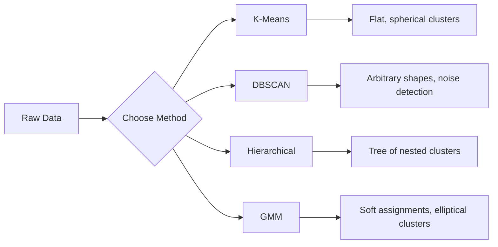

# 감독 없이 배우는 것

> 라벨도 없고 선생님도 없고 알고리즘은 자체적으로 구조를 찾습니다.

**Type:** Build
**Languages:** Python
**Prerequisites:** Phase 1 (Norms & Distances, Probability & Distributions), Phase 2 Lessons 1-6
**Time:** ~90 minutes

## 학습 목표

- K-Means, DBSCAN, 그리고 가우스 혼합 모델을 처음부터 구현하고 그들의 집합 행동 비교
- 시루엣 점수와 팔꿈치 방법을 사용하여 최적의 K를 선택하여 클러스터 품질을 평가합니다.
- DBSCAN이 K-Means보다 더 좋은 성능을 발휘할 때 설명하고 어떤 알고리즘이 비구름 클러스터와 비정상적 성질을 처리하는지 확인합니다.
- 정상 패턴에서 벗어난 지표점들을 클러스터링 방법을 사용하여 기상물질 탐지 파이프라인을 구축

## 문제

지금까지 ML 수업마다 "이곳은 입력, 여기 정답이 나온다"라는 표기된 데이터를 가정했습니다. 병원에는 수백만 명의 환자 기록이 있지만 아무도 병에 대한 범위를 손으로 표시하지 않았습니다. 전자 상거래 사이트에는 수백만 명의 사용자 세션이 있지만 아무도 손으로 라벨을 붙인 고객 세그먼트를 가지고 있지 않습니다. 보안팀은 네트워크 로그를 가지고 있지만 아무도 모든 기조를 표시하지 않았습니다.

감독되지 않은 학습은 무엇을 찾아야 하는지 알려지지 않고 패턴을 찾습니다. 비슷한 데이터 포인트를 그룹화하고 숨겨진 구조를 발견하고 이상성을 표면에 내립니다. 감독되지 않은 학습은 답 키가 있는 교과서에서 학습하는 경우, 감독되지 않은 학습은 패턴이 드러나는 때까지 원료 데이터를 쳐다보고 있습니다.

: 라벨이 없으면 "옳은 것"이나 "잘한 것"을 직접 측정할 수 없습니다. 알고리즘이 발견한 구조가 의미 있는지 아닌지 평가하기 위해 다양한 도구가 필요합니다.

## 개념

### 집단화: 비슷한 것 을 집단화

클러스터링은 각 데이터 포인트를 그룹 (클러스터) 에 배치하여 같은 그룹 내의 포인트가 다른 그룹 내의 포인트보다 서로 더 유사하도록 합니다.



### K-Means: 작업마

K-Means는 데이터를 정확히 K 클러스터로 나누고 있습니다. 각 클러스터는 중추지방 (중추지방) 를 가지고 있으며, 각 점은 가장 가까운 중추지방에 속합니다.

로이드 알고리즘:

1. 초기 중점으로 K의 무작위점을 선택
2. 각 데이터 포인트를 가장 가까운 중앙 지형에 할당하십시오
3. 각 중추선을 그 주어진 점의 평균으로 재정
4. 과제가 변경되는 것을 멈추기 전까지는 단계 2-3을 반복하십시오.

객관 함수 (인터시아) 는 각 점에서 주어진 중추점까지의 전체 제곱 거리를 측정한다. K-Means는 이것을 최소화하지만, 로컬 최소만을 찾는다. 다른 초기화는 다른 결과를 줄 수 있다.

### K를 선택

두 가지 표준 방법:

**Elbow method:**K-Means를 실행하세요$K = 1, 2, 3, \ldots, n$. 이역역학과 K. 더 많은 클러스터를 추가하면 이역학력을 크게 줄이는 것을 멈추는 "구름"을 찾아보세요.

**Silhouette score:**각 점에 대해, 그 점의 자신의 클러스터와 얼마나 유사하는지 측정하십시오 ($a$) 와 가장 가까운 다른 클러스터 ($b$). 실루엣 계수는$(b - a) / \max(a, b)$, -1 (잘못된 클러스터) 에서 +1 (잘 집합된) 까지의 범위.

### DBSCAN: 밀도 기반 클러스터링

K-Means는 클러스터가 구형적이라고 가정하고 K를 미리 선택해야 합니다. DBSCAN은 두 가지 가정도 하지 않습니다. 클러스터는 희소한 영역으로 분리된 밀집한 영역으로 발견됩니다.

두 가지 매개 변수:
- **eps**: 이웃의 반경
- **min_samples**: 밀집한 지역을 형성하기 위해 필요한 최소한의 점수

3가지 유형의 포인트:
- **Core point**: eps 거리 내에서 최소 min_sample 포인트를 가지고 있습니다
- **Border point**: 핵심점의 eps 내에서 하지만 그 자체는 핵심점이 아닙니다
- **Noise point**핵이나 경계도 없습니다.

DBSCAN은 서로 eps 내에 있는 핵심 포인트를 같은 클러스터로 연결합니다. 국경 포인트는 가까운 핵심 포인트의 클러스터에 합류합니다. 노이즈 포인트는 클러스터에 속하지 않습니다.

강점: 어떤 모양의 집합을 찾아, 자동으로 집합의 수를 결정, 이상점을 식별. 약점: 다양한 밀도의 집합과 투쟁.

### 계층적 집합

둥지를 틀어 놓은 집합의 나무 (dendrogram) 를 만듭니다.

합동 (저쪽에서 위로):
1. 각 점마다 자신의 클러스터로 시작
2. 가장 가까운 두 개의 클러스터를 합쳐
3. 한 개의 클러스터가 남아있을 때까지 반복합니다.
4. K 클러스터를 얻기 위해 원하는 수준에서 덩어리를 잘라

클러스터들 사이의 "거밀함"은 다음과 같이 측정될 수 있습니다.
- **Single linkage**: 두 클러스터의 두 개점 사이의 최소 거리는
- **Complete linkage**: 두 점 사이의 최대 거리는
- **Average linkage**: 모든 쌍 사이의 평균 거리
- **Ward's method**: 클러스터 내 전체 변동의 가장 작은 증가에

### 가우스 미세조형 (GMM)

K-Means는 어려운 과제를 부여한다: 각 점은 정확히 하나의 클러스터에 속한다. GMM는 부드러운 과제를 부여한다: 각 점은 각 클러스터에 속할 확률이 있다.

GMM는 데이터가 K 가우스 분포의 혼합에서 생성된 것으로 가정합니다. 각각의 평균과 변동이 있습니다. 예상-최대화 (EM) 알고리즘은 다음과 같은 중 하나를 대체합니다.

- **E-step**: 각 점의 가우시안 점의 확률을 계산합니다
- **M-step**: 데이터의 확률을 극대화하기 위해 각 가우시안의 평균, 코바리안스, 혼합중량을 업데이트합니다

GMM는 eliptical clusters (K-Means와 같은 구형적인 것뿐만 아니라) 를 모델링할 수 있으며 자연스럽게 겹치는 clusters를 처리합니다.

### 언제 사용 해야 하는 것

| Method | Best for | Avoid when |
|--------|----------|------------|
| K-Means | Large datasets, spherical clusters, known K | Irregular shapes, outliers present |
| DBSCAN | Unknown K, arbitrary shapes, outlier detection | Varying densities, very high dimensions |
| Hierarchical | Small datasets, need dendrogram, unknown K | Large datasets ($O(n^2)$ memory) |
| GMM | Overlapping clusters, soft assignments needed | Very large datasets, too many dimensions |

### 클러스터링으로 기상상별성 검출

클러스터링은 자연적으로 변칙 탐지 기능을 지원합니다.
- **K-Means**: 중앙극에서 멀리 있는 점들은 이상성입니다
- **DBSCAN**: 노이즈 포인트는 정의에 따라 이상성입니다
- **GMM**: 모든 가우시안의 확률이 낮은 점들은 기상상이다

```figure
kmeans-step
```

## 건설 해

### 단계 1: K-초부터

```python
import math
import random


def euclidean_distance(a, b):
    return math.sqrt(sum((ai - bi) ** 2 for ai, bi in zip(a, b)))


def kmeans(data, k, max_iterations=100, seed=42):
    random.seed(seed)
    n_features = len(data[0])

    centroids = random.sample(data, k)

    for iteration in range(max_iterations):
        clusters = [[] for _ in range(k)]
        assignments = []

        for point in data:
            distances = [euclidean_distance(point, c) for c in centroids]
            nearest = distances.index(min(distances))
            clusters[nearest].append(point)
            assignments.append(nearest)

        new_centroids = []
        for cluster in clusters:
            if len(cluster) == 0:
                new_centroids.append(random.choice(data))
                continue
            centroid = [
                sum(point[j] for point in cluster) / len(cluster)
                for j in range(n_features)
            ]
            new_centroids.append(centroid)

        if all(
            euclidean_distance(old, new) < 1e-6
            for old, new in zip(centroids, new_centroids)
        ):
            print(f"  Converged at iteration {iteration + 1}")
            break

        centroids = new_centroids

    return assignments, centroids
```

### 단계 2: 팔꿈치 방법 및 실루엣 점수

```python
def compute_inertia(data, assignments, centroids):
    total = 0.0
    for point, cluster_id in zip(data, assignments):
        total += euclidean_distance(point, centroids[cluster_id]) ** 2
    return total


def silhouette_score(data, assignments):
    n = len(data)
    if n < 2:
        return 0.0

    clusters = {}
    for i, c in enumerate(assignments):
        clusters.setdefault(c, []).append(i)

    if len(clusters) < 2:
        return 0.0

    scores = []
    for i in range(n):
        own_cluster = assignments[i]
        own_members = [j for j in clusters[own_cluster] if j != i]

        if len(own_members) == 0:
            scores.append(0.0)
            continue

        a = sum(euclidean_distance(data[i], data[j]) for j in own_members) / len(own_members)

        b = float("inf")
        for cluster_id, members in clusters.items():
            if cluster_id == own_cluster:
                continue
            avg_dist = sum(euclidean_distance(data[i], data[j]) for j in members) / len(members)
            b = min(b, avg_dist)

        if max(a, b) == 0:
            scores.append(0.0)
        else:
            scores.append((b - a) / max(a, b))

    return sum(scores) / len(scores)


def find_best_k(data, max_k=10):
    print("Elbow method:")
    inertias = []
    for k in range(1, max_k + 1):
        assignments, centroids = kmeans(data, k)
        inertia = compute_inertia(data, assignments, centroids)
        inertias.append(inertia)
        print(f"  K={k}: inertia={inertia:.2f}")

    print("\nSilhouette scores:")
    for k in range(2, max_k + 1):
        assignments, centroids = kmeans(data, k)
        score = silhouette_score(data, assignments)
        print(f"  K={k}: silhouette={score:.4f}")

    return inertias
```

### 단계 3: 처음부터 DBSCAN

```python
def dbscan(data, eps, min_samples):
    n = len(data)
    labels = [-1] * n
    cluster_id = 0

    def region_query(point_idx):
        neighbors = []
        for i in range(n):
            if euclidean_distance(data[point_idx], data[i]) <= eps:
                neighbors.append(i)
        return neighbors

    visited = [False] * n

    for i in range(n):
        if visited[i]:
            continue
        visited[i] = True

        neighbors = region_query(i)

        if len(neighbors) < min_samples:
            labels[i] = -1
            continue

        labels[i] = cluster_id
        seed_set = list(neighbors)
        seed_set.remove(i)

        j = 0
        while j < len(seed_set):
            q = seed_set[j]

            if not visited[q]:
                visited[q] = True
                q_neighbors = region_query(q)
                if len(q_neighbors) >= min_samples:
                    for nb in q_neighbors:
                        if nb not in seed_set:
                            seed_set.append(nb)

            if labels[q] == -1:
                labels[q] = cluster_id

            j += 1

        cluster_id += 1

    return labels
```

### 단계 4: 가우스 혼합 모델 (EM 알고리즘)

```python
def gmm(data, k, max_iterations=100, seed=42):
    random.seed(seed)
    n = len(data)
    d = len(data[0])

    indices = random.sample(range(n), k)
    means = [list(data[i]) for i in indices]
    variances = [1.0] * k
    weights = [1.0 / k] * k

    def gaussian_pdf(x, mean, variance):
        d = len(x)
        coeff = 1.0 / ((2 * math.pi * variance) ** (d / 2))
        exponent = -sum((xi - mi) ** 2 for xi, mi in zip(x, mean)) / (2 * variance)
        return coeff * math.exp(max(exponent, -500))

    for iteration in range(max_iterations):
        responsibilities = []
        for i in range(n):
            probs = []
            for j in range(k):
                probs.append(weights[j] * gaussian_pdf(data[i], means[j], variances[j]))
            total = sum(probs)
            if total == 0:
                total = 1e-300
            responsibilities.append([p / total for p in probs])

        old_means = [list(m) for m in means]

        for j in range(k):
            r_sum = sum(responsibilities[i][j] for i in range(n))
            if r_sum < 1e-10:
                continue

            weights[j] = r_sum / n

            for dim in range(d):
                means[j][dim] = sum(
                    responsibilities[i][j] * data[i][dim] for i in range(n)
                ) / r_sum

            variances[j] = sum(
                responsibilities[i][j]
                * sum((data[i][dim] - means[j][dim]) ** 2 for dim in range(d))
                for i in range(n)
            ) / (r_sum * d)
            variances[j] = max(variances[j], 1e-6)

        shift = sum(
            euclidean_distance(old_means[j], means[j]) for j in range(k)
        )
        if shift < 1e-6:
            print(f"  GMM converged at iteration {iteration + 1}")
            break

    assignments = []
    for i in range(n):
        assignments.append(responsibilities[i].index(max(responsibilities[i])))

    return assignments, means, weights, responsibilities
```

### 단계 5: 테스트 데이터를 생성하고 모든 것을 실행

```python
def make_blobs(centers, n_per_cluster=50, spread=0.5, seed=42):
    random.seed(seed)
    data = []
    true_labels = []
    for label, (cx, cy) in enumerate(centers):
        for _ in range(n_per_cluster):
            x = cx + random.gauss(0, spread)
            y = cy + random.gauss(0, spread)
            data.append([x, y])
            true_labels.append(label)
    return data, true_labels


def make_moons(n_samples=200, noise=0.1, seed=42):
    random.seed(seed)
    data = []
    labels = []
    n_half = n_samples // 2
    for i in range(n_half):
        angle = math.pi * i / n_half
        x = math.cos(angle) + random.gauss(0, noise)
        y = math.sin(angle) + random.gauss(0, noise)
        data.append([x, y])
        labels.append(0)
    for i in range(n_half):
        angle = math.pi * i / n_half
        x = 1 - math.cos(angle) + random.gauss(0, noise)
        y = 1 - math.sin(angle) - 0.5 + random.gauss(0, noise)
        data.append([x, y])
        labels.append(1)
    return data, labels


if __name__ == "__main__":
    centers = [[2, 2], [8, 3], [5, 8]]
    data, true_labels = make_blobs(centers, n_per_cluster=50, spread=0.8)

    print("=== K-Means on 3 blobs ===")
    assignments, centroids = kmeans(data, k=3)
    print(f"  Centroids: {[[round(c, 2) for c in cent] for cent in centroids]}")
    sil = silhouette_score(data, assignments)
    print(f"  Silhouette score: {sil:.4f}")

    print("\n=== Elbow Method ===")
    find_best_k(data, max_k=6)

    print("\n=== DBSCAN on 3 blobs ===")
    db_labels = dbscan(data, eps=1.5, min_samples=5)
    n_clusters = len(set(db_labels) - {-1})
    n_noise = db_labels.count(-1)
    print(f"  Found {n_clusters} clusters, {n_noise} noise points")

    print("\n=== GMM on 3 blobs ===")
    gmm_assignments, gmm_means, gmm_weights, _ = gmm(data, k=3)
    print(f"  Means: {[[round(m, 2) for m in mean] for mean in gmm_means]}")
    print(f"  Weights: {[round(w, 3) for w in gmm_weights]}")
    gmm_sil = silhouette_score(data, gmm_assignments)
    print(f"  Silhouette score: {gmm_sil:.4f}")

    print("\n=== DBSCAN on moons (non-spherical clusters) ===")
    moon_data, moon_labels = make_moons(n_samples=200, noise=0.1)
    moon_db = dbscan(moon_data, eps=0.3, min_samples=5)
    n_moon_clusters = len(set(moon_db) - {-1})
    n_moon_noise = moon_db.count(-1)
    print(f"  Found {n_moon_clusters} clusters, {n_moon_noise} noise points")

    print("\n=== K-Means on moons (will fail to separate) ===")
    moon_km, moon_centroids = kmeans(moon_data, k=2)
    moon_sil = silhouette_score(moon_data, moon_km)
    print(f"  Silhouette score: {moon_sil:.4f}")
    print("  K-Means splits moons poorly because they are not spherical")

    print("\n=== Anomaly detection with DBSCAN ===")
    anomaly_data = list(data)
    anomaly_data.append([20.0, 20.0])
    anomaly_data.append([-5.0, -5.0])
    anomaly_data.append([15.0, 0.0])
    anomaly_labels = dbscan(anomaly_data, eps=1.5, min_samples=5)
    anomalies = [
        anomaly_data[i]
        for i in range(len(anomaly_labels))
        if anomaly_labels[i] == -1
    ]
    print(f"  Detected {len(anomalies)} anomalies")
    for a in anomalies[-3:]:
        print(f"    Point {[round(v, 2) for v in a]}")
```

## 사용 하 고

스키트-러닝의 경우, 동일한 알고리즘은 1 라인입니다.

```python
from sklearn.cluster import KMeans, DBSCAN, AgglomerativeClustering
from sklearn.mixture import GaussianMixture
from sklearn.metrics import silhouette_score as sklearn_silhouette

km = KMeans(n_clusters=3, random_state=42).fit(data)
db = DBSCAN(eps=1.5, min_samples=5).fit(data)
agg = AgglomerativeClustering(n_clusters=3).fit(data)
gmm_model = GaussianMixture(n_components=3, random_state=42).fit(data)
```

초기의 버전은 이러한 라이브러리가 정확히 계산하는 것을 보여줍니다. K-Means는 할당과 재회산 사이에 반복합니다. DBSCAN는 밀집한 씨앗에서 클러스터를 키웁니다. GMM는 기대와 극대화 사이에 대를 돌립니다. 라이브러리 버전은 수치 안정, 더 똑똑한 초기화 (K-Means++), GPU 가속화와 같은 것을 추가합니다.

## 선박

이 수업은 K-Means, DBSCAN, GMM의 작업 구현을 처음부터 생산합니다. 클러스터링 코드는 더 진보된 감독되지 않은 방법의 기초로 재사용될 수 있습니다.

## 운동

1. K-Means++ 초기화를 구현: 무작위로 중심을 선택하기 보다는, 가장 가까운 현존 중심을 거리에 있는 거리에 비례한 확률로 첫 번째 중심을 무작위로 선택하고, 다음 중심을 각각 선택하십시오.
2. 코드에 계층적 집합집단을 추가하십시오. 워드의 연결을 구현하고 둥지를 틀어 놓은 융합 목록으로 덩도그램을 생성하십시오. 다른 수준에서 잘라서 K-Means 결과와 비교하십시오.
3. 간단한 기상물질 탐지 파이프라인을 구축: 동일한 데이터에 DBSCAN과 GMM를 실행하고, 두 방법 모두 동의하는 표지점들이 비정상적 (DBSCAN에서 소음, GMM에서 낮은 확률) 이다.

## 주요 용어

| Term | What people say | What it actually means |
|------|----------------|----------------------|
| Clustering | "Grouping similar things" | Partitioning data into subsets where within-group similarity exceeds between-group similarity, measured by a specific distance metric |
| Centroid | "The center of a cluster" | The mean of all points assigned to a cluster; used by K-Means as the cluster representative |
| Inertia | "How tight the clusters are" | Sum of squared distances from each point to its assigned centroid; lower is tighter |
| Silhouette score | "How well-separated clusters are" | For each point, $(b - a) / \max(a, b)$ where $a$ is mean intra-cluster distance and $b$ is mean nearest-cluster distance |
| Core point | "A point in a dense region" | A point with at least min_samples neighbors within eps distance, in DBSCAN |
| EM algorithm | "Soft K-Means" | Expectation-Maximization: iteratively compute membership probabilities (E-step) and update distribution parameters (M-step) |
| Dendrogram | "A tree of clusters" | A tree diagram showing the order and distance at which clusters were merged in hierarchical clustering |
| Anomaly | "An outlier" | A data point that does not conform to the expected pattern, identified as noise by DBSCAN or low-probability by GMM |

## 더 많은 읽기

- [Stanford CS229 - Unsupervised Learning](https://cs229.stanford.edu/notes2022fall/main_notes.pdf)- 앤드류 랭의 집합과 EM에 관한 강의 노트
- [scikit-learn Clustering Guide](https://scikit-learn.org/stable/modules/clustering.html)- 모든 클러스터링 알고리즘을 시각적 예제와 실제 비교
- [DBSCAN original paper (Ester et al., 1996)](https://www.aaai.org/Papers/KDD/1996/KDD96-037.pdf)- 밀도 기반 클러스터링을 도입한 논문
