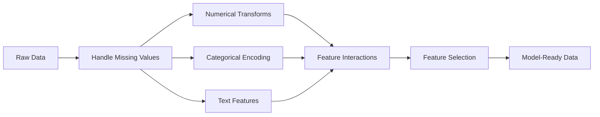

# 특징 엔지니어링 및 선택

> 좋은 기능은 수천 개의 데이터 포인트에 가치가 있습니다.

**Type:** Build
**Languages:** Python
**Prerequisites:** Phase 1 (Statistics for ML, Linear Algebra), Phase 2 Lessons 1-7
**Time:** ~90 minutes

## 학습 목표

- 수치 변환 (표준화, 최소 최대 규모, 로그 변환, 빗) 을 실시하고 각각의 적절한 시기를 설명합니다.
- 범주적 특징을 위한 일-핫, 레이블 및 목표 코딩을 구축하고 목표 코딩에서 데이터 누출 위험을 확인
- TF-IDF 벡터라이저를 처음부터 구축하고 텍스트 분류에 대한 원자 단어 수를 왜 우월하는지 설명하십시오
- 필터 기반의 기능 선택 (변화 문턱, 상관관계, 상호 정보) 을 적용하여 차원성을 줄이십시오

## 문제

데이터 세트를 가지고 있습니다. 알고리즘을 선택하고 훈련합니다. 결과는 중간입니다. 더 멋진 알고리즘을 시도합니다. 여전히 중간입니다. 한 주 동안 하이퍼파레머를 조정합니다.

그러면 누군가가 원료 데이터를 더 나은 기능으로 변환하고 간단한 물적 회귀가 조율된 gradient-boosted 무대를 이길 수 있습니다.

이것은 끊임없이 발생합니다. 고전 ML에서 데이터의 표현은 알고리즘의 선택보다 더 중요합니다. "평방 영상"과 "방의 숫자를 가진 집 가격 모델은 학습자가 얼마나 정교하더라도 "자료 문자열로 주소"를 가진 모델을 이길 것입니다. 알고리즘은 당신이 제공하는 것에 따라만 작동합니다.

기능 공학은 원료 데이터를 모델이 쉽게 찾을 수 있는 패턴으로 변환하는 과정이다. 기능 선택은 신호를 추가하지 않고 노이즈를 추가하는 기능을 던지는 과정이다. 함께, 그들은 고전 ML에서 가장 높은 레버리지 활동이다.

## 개념

### 특징 파이프라인



### 수학적 특징

원자수는 거의 모델 준비가 되지 않습니다. 일반적인 변환:

**Scaling:**특징을 같은 범위에 배치하여 거리 기반 알고리즘 (K-Means, KNN, SVM) 은 모든 특징을 동일하게 취급합니다. 미인 최대 확장 지도는 [0, 1]로 표준화 (z-점) 지도는 평균=0, std=1로 처리합니다.

**Log transform:**오른쪽 편향 분포 (소득, 인구, 단어 수) 를 압축합니다. 곱성 관계를 합성으로 변환합니다.

**Binning:**연속값을 범주로 변환합니다. 특징과 목표 사이의 관계는 비선형이지만 단계적 (예를 들어, 연령 그룹) 이 될 때 유용합니다.

**Polynomial features:**창조합니다$x^2$$x^3$$x_1 x_2$선형 모델은 더 많은 기능의 비용으로 비선형 관계를 캡처 할 수 있습니다.

### 분류적 특징

모델은 숫자를 필요로 하고 카테고리들은 코딩을 필요로 합니다.

**One-hot encoding:**각 카테고리별로 바이너리 열을 생성합니다. "color = red/blue/green"는 3 개의 열로 변합니다. is_red, is_blue, is_green. 낮은 카드널리티 기능에서는 잘 작동하지만 많은 카테고리에서 폭발합니다.

**Label encoding:**각 카테고리를 정수로 지도: 빨간=0, 파란색=1, 녹색=2. 잘못된 순서를 도입합니다 (모델은 녹색 > 파란색 > 빨간색을 생각할 수 있습니다). 개별 값에 분할되는 나무 기반 모델에서만 적합합니다.

**Target encoding:**각 범주마다 그 범주의 목표 변수의 평균을 붙여줍니다. 강력하지만 위험: 데이터 유출 위험도가 높습니다. 훈련 데이터에만 계산되어 테스트 데이터에 적용되어야 합니다.

### 텍스트 특징

**Count vectorizer:**문서에 각각의 단어들이 얼마나 자주 등장하는지 계산합니다. "고양이 매트에 앉았어요"는 {the: 2, cat: 1, sat: 1, on: 1, mat: 1}.

**TF-IDF:**문서 주파수 역 주파수 용어. 문서 중 단어의 독특성에 따라 무게를 가집니다. "the"와 같은 일반적인 단어들은 무게가 낮습니다. 희귀하고 독특한 단어들은 무게가 높습니다.

```math
\begin{aligned}
\text{TF}(\text{word}, \text{doc}) &= \frac{\text{count(word in doc)}}{\text{total words in doc}} \\
\text{IDF}(\text{word}) &= \log \frac{\text{total docs}}{\text{docs containing word}} \\
\text{TF-IDF} &= \text{TF} \cdot \text{IDF}
\end{aligned}
```

### 실종된 가치

실제 데이터에는 구멍이 있습니다.

- **Drop rows:**단지 실종된 데이터가 희귀하고 무작위일 때만
- **Mean/median imputation:**단순하고 분포 형태를 유지합니다 (중앙은 이상으로 견고합니다)
- **Mode imputation:**분류적인 특징에 대해서는
- **Indicator column:**이 공을 하기 전에 "was_this_missing"라는 바이너리 열을 추가합니다. 데이터가 부족하다는 사실은 정보적일 수 있습니다.
- **Forward/backward fill:**시간 시리즈 데이터

### 특징 상호 작용

때로는 그 관계가 조합에 있습니다. "높이"와 "중"만으로는 예측력이 덜 있습니다.$\text{BMI} = \text{weight} / \text{height}^2$기능 상호작용은 기능 공간을 증배하므로 영역 지식을 사용하여 올바른 것을 선택하십시오.

### 기능 선택

더 많은 기능 은 항상 더 낫지 않습니다. 비관적 인 기능 은 소음 을 증가 시키고 훈련 시간 을 늘리고 과잉 에 적합 하게 만들 수 있습니다.

**Filter methods (pre-model):**
- 상관관계: 서로 밀접한 상관관계를 가진 특징을 제거한다 (비용)
- 상호 정보: 특징을 아는 것이 목표에 대한 불확실성을 얼마나 줄이는지를 측정합니다
- 변동률: 거의 변하지 않는 특징을 제거

**Wrapper methods (model-based):**
- L1 정규화 (Lasso): 무관한 특징 무게를 정확히 0으로 끌어당깁니다
- 반복적인 기능 제거: 열, 가장 중요하지 않은 기능 제거, 반복

**Why selection matters:**10가지 좋은 특징을 가진 모델은 보통 10가지 좋은 특징과 90가지 험한 특징을 가진 모델보다 더 좋은 성능을 발휘할 수 있다. 험한 특징은 모델에게 일반화되지 않는 훈련 데이터 패턴에 오버피트할 기회를 제공한다.

```figure
feature-scaling
```

## 건설 해

### 단계 1: 숫자 변환은 처음부터

```python
import math


def min_max_scale(values):
    min_val = min(values)
    max_val = max(values)
    if max_val == min_val:
        return [0.0] * len(values)
    return [(v - min_val) / (max_val - min_val) for v in values]


def standardize(values):
    n = len(values)
    mean = sum(values) / n
    variance = sum((v - mean) ** 2 for v in values) / n
    std = math.sqrt(variance) if variance > 0 else 1.0
    return [(v - mean) / std for v in values]


def log_transform(values):
    return [math.log(v + 1) for v in values]


def bin_values(values, n_bins=5):
    min_val = min(values)
    max_val = max(values)
    bin_width = (max_val - min_val) / n_bins
    if bin_width == 0:
        return [0] * len(values)
    result = []
    for v in values:
        bin_idx = int((v - min_val) / bin_width)
        bin_idx = min(bin_idx, n_bins - 1)
        result.append(bin_idx)
    return result


def polynomial_features(row, degree=2):
    n = len(row)
    result = list(row)
    if degree >= 2:
        for i in range(n):
            result.append(row[i] ** 2)
        for i in range(n):
            for j in range(i + 1, n):
                result.append(row[i] * row[j])
    return result
```

### 단계 2: 처음부터 카테고리 코딩

```python
def one_hot_encode(values):
    categories = sorted(set(values))
    cat_to_idx = {cat: i for i, cat in enumerate(categories)}
    n_cats = len(categories)

    encoded = []
    for v in values:
        row = [0] * n_cats
        row[cat_to_idx[v]] = 1
        encoded.append(row)

    return encoded, categories


def label_encode(values):
    categories = sorted(set(values))
    cat_to_int = {cat: i for i, cat in enumerate(categories)}
    return [cat_to_int[v] for v in values], cat_to_int


def target_encode(feature_values, target_values, smoothing=10):
    global_mean = sum(target_values) / len(target_values)

    category_stats = {}
    for feat, target in zip(feature_values, target_values):
        if feat not in category_stats:
            category_stats[feat] = {"sum": 0.0, "count": 0}
        category_stats[feat]["sum"] += target
        category_stats[feat]["count"] += 1

    encoding = {}
    for cat, stats in category_stats.items():
        cat_mean = stats["sum"] / stats["count"]
        weight = stats["count"] / (stats["count"] + smoothing)
        encoding[cat] = weight * cat_mean + (1 - weight) * global_mean

    return [encoding[v] for v in feature_values], encoding
```

### 단계 3: 처음부터 텍스트 특징

```python
def count_vectorize(documents):
    vocab = {}
    idx = 0
    for doc in documents:
        for word in doc.lower().split():
            if word not in vocab:
                vocab[word] = idx
                idx += 1

    vectors = []
    for doc in documents:
        vec = [0] * len(vocab)
        for word in doc.lower().split():
            vec[vocab[word]] += 1
        vectors.append(vec)

    return vectors, vocab


def tfidf(documents):
    n_docs = len(documents)

    vocab = {}
    idx = 0
    for doc in documents:
        for word in doc.lower().split():
            if word not in vocab:
                vocab[word] = idx
                idx += 1

    doc_freq = {}
    for doc in documents:
        seen = set()
        for word in doc.lower().split():
            if word not in seen:
                doc_freq[word] = doc_freq.get(word, 0) + 1
                seen.add(word)

    vectors = []
    for doc in documents:
        words = doc.lower().split()
        word_count = len(words)
        tf_map = {}
        for word in words:
            tf_map[word] = tf_map.get(word, 0) + 1

        vec = [0.0] * len(vocab)
        for word, count in tf_map.items():
            tf = count / word_count
            idf = math.log(n_docs / doc_freq[word])
            vec[vocab[word]] = tf * idf
        vectors.append(vec)

    return vectors, vocab
```

### 단계 4: 처음부터 실종된 값의 배정

```python
def impute_mean(values):
    present = [v for v in values if v is not None]
    if not present:
        return [0.0] * len(values), 0.0
    mean = sum(present) / len(present)
    return [v if v is not None else mean for v in values], mean


def impute_median(values):
    present = sorted(v for v in values if v is not None)
    if not present:
        return [0.0] * len(values), 0.0
    n = len(present)
    if n % 2 == 0:
        median = (present[n // 2 - 1] + present[n // 2]) / 2
    else:
        median = present[n // 2]
    return [v if v is not None else median for v in values], median


def impute_mode(values):
    present = [v for v in values if v is not None]
    if not present:
        return values, None
    counts = {}
    for v in present:
        counts[v] = counts.get(v, 0) + 1
    mode = max(counts, key=counts.get)
    return [v if v is not None else mode for v in values], mode


def add_missing_indicator(values):
    return [0 if v is not None else 1 for v in values]
```

### 단계 5: 처음부터 기능 선택

```python
def correlation(x, y):
    n = len(x)
    mean_x = sum(x) / n
    mean_y = sum(y) / n
    cov = sum((xi - mean_x) * (yi - mean_y) for xi, yi in zip(x, y)) / n
    std_x = math.sqrt(sum((xi - mean_x) ** 2 for xi in x) / n)
    std_y = math.sqrt(sum((yi - mean_y) ** 2 for yi in y) / n)
    if std_x == 0 or std_y == 0:
        return 0.0
    return cov / (std_x * std_y)


def mutual_information(feature, target, n_bins=10):
    feat_min = min(feature)
    feat_max = max(feature)
    bin_width = (feat_max - feat_min) / n_bins if feat_max != feat_min else 1.0
    feat_binned = [
        min(int((f - feat_min) / bin_width), n_bins - 1) for f in feature
    ]

    n = len(feature)
    target_classes = sorted(set(target))

    feat_bins = sorted(set(feat_binned))
    p_feat = {}
    for b in feat_bins:
        p_feat[b] = feat_binned.count(b) / n

    p_target = {}
    for t in target_classes:
        p_target[t] = target.count(t) / n

    mi = 0.0
    for b in feat_bins:
        for t in target_classes:
            joint_count = sum(
                1 for fb, tv in zip(feat_binned, target) if fb == b and tv == t
            )
            p_joint = joint_count / n
            if p_joint > 0:
                mi += p_joint * math.log(p_joint / (p_feat[b] * p_target[t]))

    return mi


def variance_threshold(features, threshold=0.01):
    n_features = len(features[0])
    n_samples = len(features)
    selected = []

    for j in range(n_features):
        col = [features[i][j] for i in range(n_samples)]
        mean = sum(col) / n_samples
        var = sum((v - mean) ** 2 for v in col) / n_samples
        if var >= threshold:
            selected.append(j)

    return selected


def remove_correlated(features, threshold=0.9):
    n_features = len(features[0])
    n_samples = len(features)

    to_remove = set()
    for i in range(n_features):
        if i in to_remove:
            continue
        col_i = [features[r][i] for r in range(n_samples)]
        for j in range(i + 1, n_features):
            if j in to_remove:
                continue
            col_j = [features[r][j] for r in range(n_samples)]
            corr = abs(correlation(col_i, col_j))
            if corr >= threshold:
                to_remove.add(j)

    return [i for i in range(n_features) if i not in to_remove]
```

### 단계 6: 전체 파이프라인 및 데모

```python
import random


def make_housing_data(n=200, seed=42):
    random.seed(seed)
    data = []
    for _ in range(n):
        sqft = random.uniform(500, 5000)
        bedrooms = random.choice([1, 2, 3, 4, 5])
        age = random.uniform(0, 50)
        neighborhood = random.choice(["downtown", "suburbs", "rural"])
        has_pool = random.choice([True, False])

        sqft_with_missing = sqft if random.random() > 0.05 else None
        age_with_missing = age if random.random() > 0.08 else None

        price = (
            50 * sqft
            + 20000 * bedrooms
            - 1000 * age
            + (50000 if neighborhood == "downtown" else 10000 if neighborhood == "suburbs" else 0)
            + (15000 if has_pool else 0)
            + random.gauss(0, 20000)
        )

        data.append({
            "sqft": sqft_with_missing,
            "bedrooms": bedrooms,
            "age": age_with_missing,
            "neighborhood": neighborhood,
            "has_pool": has_pool,
            "price": price,
        })
    return data


if __name__ == "__main__":
    data = make_housing_data(200)

    print("=== Raw Data Sample ===")
    for row in data[:3]:
        print(f"  {row}")

    sqft_raw = [d["sqft"] for d in data]
    age_raw = [d["age"] for d in data]
    prices = [d["price"] for d in data]

    print("\n=== Missing Value Handling ===")
    sqft_missing = sum(1 for v in sqft_raw if v is None)
    age_missing = sum(1 for v in age_raw if v is None)
    print(f"  sqft missing: {sqft_missing}/{len(sqft_raw)}")
    print(f"  age missing: {age_missing}/{len(age_raw)}")

    sqft_indicator = add_missing_indicator(sqft_raw)
    age_indicator = add_missing_indicator(age_raw)
    sqft_imputed, sqft_fill = impute_median(sqft_raw)
    age_imputed, age_fill = impute_mean(age_raw)
    print(f"  sqft filled with median: {sqft_fill:.0f}")
    print(f"  age filled with mean: {age_fill:.1f}")

    print("\n=== Numerical Transforms ===")
    sqft_scaled = standardize(sqft_imputed)
    age_scaled = min_max_scale(age_imputed)
    sqft_log = log_transform(sqft_imputed)
    age_binned = bin_values(age_imputed, n_bins=5)
    print(f"  sqft standardized: mean={sum(sqft_scaled)/len(sqft_scaled):.4f}, std={math.sqrt(sum(v**2 for v in sqft_scaled)/len(sqft_scaled)):.4f}")
    print(f"  age min-max: [{min(age_scaled):.2f}, {max(age_scaled):.2f}]")
    print(f"  age bins: {sorted(set(age_binned))}")

    print("\n=== Categorical Encoding ===")
    neighborhoods = [d["neighborhood"] for d in data]

    ohe, ohe_cats = one_hot_encode(neighborhoods)
    print(f"  One-hot categories: {ohe_cats}")
    print(f"  Sample encoding: {neighborhoods[0]} -> {ohe[0]}")

    le, le_map = label_encode(neighborhoods)
    print(f"  Label encoding map: {le_map}")

    te, te_map = target_encode(neighborhoods, prices, smoothing=10)
    print(f"  Target encoding: {({k: round(v) for k, v in te_map.items()})}")

    print("\n=== Text Features ===")
    descriptions = [
        "large modern house with pool",
        "small cozy cottage near downtown",
        "spacious family home with large yard",
        "modern apartment downtown with view",
        "rustic cabin in rural area",
    ]
    cv, cv_vocab = count_vectorize(descriptions)
    print(f"  Vocabulary size: {len(cv_vocab)}")
    print(f"  Doc 0 non-zero features: {sum(1 for v in cv[0] if v > 0)}")

    tf, tf_vocab = tfidf(descriptions)
    print(f"  TF-IDF vocabulary size: {len(tf_vocab)}")
    top_words = sorted(tf_vocab.keys(), key=lambda w: tf[0][tf_vocab[w]], reverse=True)[:3]
    print(f"  Doc 0 top TF-IDF words: {top_words}")

    print("\n=== Polynomial Features ===")
    sample_row = [sqft_scaled[0], age_scaled[0]]
    poly = polynomial_features(sample_row, degree=2)
    print(f"  Input: {[round(v, 4) for v in sample_row]}")
    print(f"  Polynomial: {[round(v, 4) for v in poly]}")
    print(f"  Features: [x1, x2, x1^2, x2^2, x1*x2]")

    print("\n=== Feature Selection ===")
    feature_matrix = [
        [sqft_scaled[i], age_scaled[i], float(sqft_indicator[i]), float(age_indicator[i])]
        + ohe[i]
        for i in range(len(data))
    ]

    print(f"  Total features: {len(feature_matrix[0])}")

    surviving_var = variance_threshold(feature_matrix, threshold=0.01)
    print(f"  After variance threshold (0.01): {len(surviving_var)} features kept")

    surviving_corr = remove_correlated(feature_matrix, threshold=0.9)
    print(f"  After correlation filter (0.9): {len(surviving_corr)} features kept")

    binary_prices = [1 if p > sum(prices) / len(prices) else 0 for p in prices]
    print("\n  Mutual information with target:")
    feature_names = ["sqft", "age", "sqft_missing", "age_missing"] + [f"neigh_{c}" for c in ohe_cats]
    for j in range(len(feature_matrix[0])):
        col = [feature_matrix[i][j] for i in range(len(feature_matrix))]
        mi = mutual_information(col, binary_prices, n_bins=10)
        print(f"    {feature_names[j]}: MI={mi:.4f}")

    print("\n  Correlation with price:")
    for j in range(len(feature_matrix[0])):
        col = [feature_matrix[i][j] for i in range(len(feature_matrix))]
        corr = correlation(col, prices)
        print(f"    {feature_names[j]}: r={corr:.4f}")
```

## 사용 하 고

이 변환은 스키트-러닝으로 구성 가능한 파이프라인을 만듭니다.

```python
from sklearn.preprocessing import StandardScaler, OneHotEncoder, PolynomialFeatures
from sklearn.impute import SimpleImputer
from sklearn.feature_extraction.text import TfidfVectorizer
from sklearn.feature_selection import mutual_info_classif, VarianceThreshold
from sklearn.compose import ColumnTransformer
from sklearn.pipeline import Pipeline

numeric_pipe = Pipeline([
    ("imputer", SimpleImputer(strategy="median")),
    ("scaler", StandardScaler()),
])

categorical_pipe = Pipeline([
    ("encoder", OneHotEncoder(sparse_output=False)),
])

preprocessor = ColumnTransformer([
    ("num", numeric_pipe, ["sqft", "age"]),
    ("cat", categorical_pipe, ["neighborhood"]),
])
```

초기의 버전은 각 변환 내부에서 정확히 일어나는 일을 보여줍니다. 라이브러리 버전은 가장자리 케이스 처리, 희소 매트릭스 지원 및 파이프라인 구성을 추가합니다. 그러나 수학은 동일합니다.

## 선박

이 교훈은 다음과 같은 결과를 낳습니다.
- `outputs/prompt-feature-engineer.md`- 원료 데이터에서 체계적으로 엔지니어링된 특징을 위한

## 운동

1. 수치 변환에 강력한 스케일링 (중간 및 분자간 범위를 평균 및 표준 경각차 대신 사용하여) 을 추가하십시오. 극한 이상값의 데이터에 표준 스케일링과 비교하십시오.
2. 1번 꼴로 꼴로 꼴로 꼴로 꼴로 꼴로 꼴로 꼴로 꼴로 꼴로 꼴로 꼴로 꼴로 꼴로 꼴로 꼴로 꼴로 꼴로 꼴로 꼴로 꼴로 꼴로 꼴로 꼴로 꼴로 꼴로 꼴로 꼴로 꼴로 꼴로 꼴로 꼴로 꼴로 꼴로 꼴로 꼴로 꼴로 꼴로 꼴로 꼴로 꼴로 꼴로 꼴로 꼴로 꼴로 꼴로 꼴로 꼴로 꼴로 꼴로 꼴로 꼴로 꼴로 꼴로 꼴로 꼴로 꼴로 꼴로 꼴로 꼴로 꼴로 꼴로 꼴로 꼴로 꼴로 꼴로 꼴로 꼴로 꼴로 꼴로 꼴로 꼴로 꼴로 꼴로 꼴로 꼴로 꼴로 꼴로 꼴로 꼴로 꼴로 꼴로 꼴로 꼴로 꼴로 꼴로 꼴로 꼴로 꼴로 꼴로 꼴로 꼴로 꼴로 꼴로 꼴로 꼴로 꼴로 꼴로 꼴로 꼴로 꼴로 꼴로 꼴로 꼴로 꼴로 꼴로 꼴로 꼴로 꼴로 꼴로 꼴로 꼴로 꼴로 꼴로 꼴로 꼴로 꼴로 꼴로 꼴로 꼴로 꼴로 꼴로 꼴로 꼴로 꼴로 꼴로 꼴로 꼴로 꼴로 꼴로 꼴로 꼴로 꼴로 꼴로 꼴로 꼴로 꼴로 꼴로 꼴로 꼴로 꼴로 꼴로 꼴로 꼴로 꼴로 꼴로 꼴로 꼴로 꼴로 꼴로 꼴로 꼴로 꼴로 꼴로 꼴로 꼴로 꼴로 꼴로 꼴로 꼴로 꼴로 꼴로 꼴로 꼴로 꼴로 꼴로 꼴로 꼴로 꼴로 
3. 변함 문턱, 상관관계 필터링 및 상호 정보 순위를 결합한 자동화된 기능 선택 파이프 라인을 구축하십시오. 이를 주택 데이터 세트에 적용하고 모든 기능과 선택한 기능과 모델 성능을 비교하십시오.

## 주요 용어

| Term | What people say | What it actually means |
|------|----------------|----------------------|
| Feature engineering | "Making new columns" | Transforming raw data into representations that expose patterns to the model |
| Standardization | "Making it normal" | Subtracting the mean and dividing by standard deviation so the feature has mean=0 and std=1 |
| One-hot encoding | "Making dummy variables" | Creating one binary column per category, where exactly one column is 1 for each row |
| Target encoding | "Using the answer to encode" | Replacing each category with the average target value for that category, with smoothing to prevent overfitting |
| TF-IDF | "Fancy word counts" | Term Frequency times Inverse Document Frequency: words weighted by how distinctive they are across the corpus |
| Imputation | "Filling in blanks" | Replacing missing values with estimated values (mean, median, mode, or model-predicted) |
| Feature selection | "Throwing out bad columns" | Removing features that add noise or redundancy, keeping only those with signal about the target |
| Mutual information | "How much one thing tells you about another" | A measure of the reduction in uncertainty about variable Y gained by observing variable X |
| Data leakage | "Accidentally cheating" | Using information during training that would not be available at prediction time, giving falsely optimistic results |

## 더 많은 읽기

- [Feature Engineering and Selection (Max Kuhn & Kjell Johnson)](http://www.feat.engineering/)- 기능 공학의 전체적인 영역을 다루는 무료 온라인 책
- [scikit-learn Preprocessing Guide](https://scikit-learn.org/stable/modules/preprocessing.html)- 모든 표준 변환에 대한 실제 참조
- [Target Encoding Done Right (Micci-Barreca, 2001)](https://dl.acm.org/doi/10.1145/507533.507538)- 표적 코딩과 연평한
