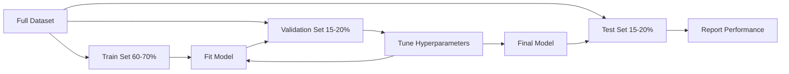

# 모델 평가

> 모델은 측정하는 방식만큼 좋은 것입니다.

**Type:** Build
**Languages:** Python
**Prerequisites:** Phase 1 (Probability & Distributions, Statistics for ML), Phase 2 Lessons 1-8
**Time:** ~90 minutes

## 학습 목표

- K-fold 및 stratified K-fold 크로스-발디레이션을 처음부터 구현하고 왜 부적합 데이터에 stratification가 중요하는지 설명합니다
- 정밀성, 회수, F1, AUC-ROC, 회귀 측정 (MSE, RMSE, MAE, R-squared) 를 처음부터 계산한다
- 학습 곡선을 해석하여 모델이 높은 편향이나 높은 변형을 앓고 있는지 진단합니다
- 데이터 누출, 잘못된 측정 선택 및 테스트 세트 오염 등 일반적인 평가 오류를 식별합니다.

## 문제

모델은 95% 정확성을 얻습니다

- 그럴 수도 있어 아니, 아니 만약 95%의 데이터가 하나의 클래스에 속한다면, 항상 그 클래스를 예측하는 모델은 95%의 정확성을 얻으면서도 완전히 쓸모가 없습니다. 만약 여러분이 훈련한 데이터에 따라 평가한다면, 95%의 숫자는 의미가 없습니다. 왜냐하면 모델은 단지 답을 기억하기 때문입니다. 만약 데이터 세트가 시간 구성 요소를 가지고 있고 분할 전에 무작위로 헷갈렸다면, 모델은 미래를 예측하기 위해 미래의 데이터를 사용했을 수도 있습니다.

모델 평가는 대부분의 ML 프로젝트가 잘못되는 곳입니다. 잘못된 측정은 나쁜 모델을 좋게 만듭니다. 잘못된 분할은 모델을 속이는 것을 허용합니다. 잘못된 비교는 최악의 모델을 선택하도록 만듭니다. 올바른 평가는 선택적이지 않습니다. 그것은 생산에서 작동하는 모델과 실제 데이터를 볼 때 실패하는 모델 사이의 차이입니다.

## 개념

### 훈련, 검증, 시험



세 가지 목적이 있습니다.

- **Training set**이 자료를 통해 모델이 학습하고, 훈련 중에 이러한 예제를 보게 됩니다.
- **Validation set**이 모델은 이 데이터에 대해 훈련하지 않지만, 당신의 결정은 그것에 의해 영향을 받는다.
- **Test set**: 최종 성능을 보고하기 위해 정확히 한 번 만져봤습니다. 테스트 성능을 보고서 다시 모델을 변경하면 더 이상 테스트 세트가 아닙니다. 그것은 두 번째 검증 세트가되었습니다.

테스트 세트는 보고된 성능이 실제로 보이지 않는 데이터에 모델이 어떻게 작동하는지 반영한다는 보증입니다.

### K-Fold 크로스 검증

작은 데이터 세트에서, 단일 열차/확인 분배는 폐기물 데이터를 처리하고 소란한 추정치를 제공합니다. K-fold 십자확인은 훈련과 검증 모두에 대한 모든 데이터를 사용합니다:

```mermaid
flowchart TB
    subgraph Fold1["Fold 1"]
        direction LR
        V1["Val"] --- T1a["Train"] --- T1b["Train"] --- T1c["Train"] --- T1d["Train"]
    end
    subgraph Fold2["Fold 2"]
        direction LR
        T2a["Train"] --- V2["Val"] --- T2b["Train"] --- T2c["Train"] --- T2d["Train"]
    end
    subgraph Fold3["Fold 3"]
        direction LR
        T3a["Train"] --- T3b["Train"] --- V3["Val"] --- T3c["Train"] --- T3d["Train"]
    end
    subgraph Fold4["Fold 4"]
        direction LR
        T4a["Train"] --- T4b["Train"] --- T4c["Train"] --- V4["Val"] --- T4d["Train"]
    end
    subgraph Fold5["Fold 5"]
        direction LR
        T5a["Train"] --- T5b["Train"] --- T5c["Train"] --- T5d["Train"] --- V5["Val"]
    end
    Fold1 --> R["Average scores"]
    Fold2 --> R
    Fold3 --> R
    Fold4 --> R
    Fold5 --> R
```



1. 데이터를 나눌 수 있습니다$K$크기가 같을 수 있는 접착
2. 각 접점에 따라 열차를 계속 $K-1$접어서 나머지 접기에 검증합니다
3. 평균 $K$검증 점수

$K=5$또는$K=10$모든 데이터 포인트는 정확히 한번 검증에 사용됩니다. 평균 점수는 단일 분할보다 안정적인 추정입니다.

**Stratified K-fold**: 각 폴드에서 클래스 분포를 보존합니다. 데이터 세트가 70% A 클래스 및 30% B 클래스이라면, 각 폴드는 대략 같은 비율을 가질 것입니다. 무균형 데이터 세트에서 이것은 중요한데, 무작위 분포는 모든 소수 샘플을 하나의 폴드에 넣을 수 있습니다.

### 분류 측정

**Confusion matrix**: 기본. 바이너리 분류:

|  | Predicted Positive | Predicted Negative |
|--|---|---|
| Actually Positive | True Positive (TP) | False Negative (FN) |
| Actually Negative | False Positive (FP) | True Negative (TN) |

이 매트릭스에서 다른 모든 매트릭은 다음과 같습니다.

- **Accuracy**=$(TP + TN) / (TP + TN + FP + FN)$정확한 예측의 분자, 클래스가 불균형할 때 잘못된 예측
- **Precision**=$TP / (TP + FP)$. 모든 예측된 긍정적인 것들 중 실제로 얼마나 많은 것이 있었습니까? 거짓 긍정적인 것들이 비용이 많이 들 때 사용하세요 (예를 들어, 실제 이메일을 스팸으로 표시하는 스팸 필터).
- **Recall**(감각성) = $TP / (TP + FN)$실제 긍정적인 결과들 중 몇 개나 발견했습니까? 거짓 부정적 결과들이 비싸면 사용하세요 (예: 암 검진이 종양을 빼놓을 때 사용하세요).
- **F1 score**=$2 \cdot \text{precision} \cdot \text{recall} / (\text{precision} + \text{recall})$- 정확성과 회수력을 위한 조화로운 수단.
- **AUC-ROC**: 수신자 운영 특성 곡선 아래 영역. 각종 분류 문턱에서 진실 긍정적 인 비율과 거짓 긍정적 인 비율을 표시합니다. AUC = 0.5는 무작위 추측을 의미합니다. AUC = 1.0는 완벽한 분리을 의미합니다. 문턱 독립: 당신이 선택한 절단량에 관계없이 모델이 긍정적 인 양을 부정적보다 얼마나 잘 순위하는지 측정합니다.

### 회귀 측정

- **MSE**(평균 제곱 오류) = $\text{mean}((y_{\text{true}} - y_{\text{pred}})^2)$큰 오류를 사각형으로 처벌합니다.
- **RMSE**(뿌리 평균 제곱 오류) = $\sqrt{\text{MSE}}$- 목표 변수와 같은 단위, MSE보다 해석이 쉬워요
- **MAE**(평균 절대 오류) = $\text{mean}(\lvert y_{\text{true}} - y_{\text{pred}} \rvert)$모든 오류를 선형적으로 처리합니다. MSE보다 견고하고 비정상적입니다.
- **R-squared**=$1 - SS_{\text{res}} / SS_{\text{tot}}$, 어디$SS_{\text{res}} = \sum (y_{\text{true}} - y_{\text{pred}})^2$그리고$SS_{\text{tot}} = \sum (y_{\text{true}} - y_{\text{mean}})^2$. 모델에 의해 설명된 변함의 분자. $R^2 = 1.0$완벽해요$R^2 = 0.0$모델은 평균을 예측하는 것보다 더 나은 것이 아닙니다.$R^2$평균보다 더 나쁜 모델이라면

### 학습 곡선

훈련 세트의 크기에 따라 훈련과 검증 점수를:

- **High bias (underfitting)**두 곡선은 낮은 점수를 얻습니다. 더 많은 데이터를 추가하는 것은 도움이 되지 않습니다. 더 복잡한 모델이 필요합니다.
- **High variance (overfitting)**교육 점수는 높지만 검증 점수는 훨씬 낮습니다. 그 사이의 격차는 크습니다. 더 많은 데이터를 추가하는 것이 도움이 될 것입니다.

### 유효성 곡선

초변수 기능으로 플롯 훈련 및 검증 점수는:

- 낮은 복잡성: 두 점수는 낮은 (부적합)
- 적절한 복잡성: 두 점수는 높고 서로 가깝습니다
- 높은 복잡성: 훈련 점수는 높지만 검증 점수는 떨어집니다 (overfitting)

최적의 하이퍼파라미터 값은 검증 점수가 최고치를 차지하는 곳이다.

### 평가를 하는 데 흔히 발생하는 실수

**Data leakage**: 테스트 세트에서 얻은 정보들이 훈련에 유출된다. 예: 시간 시리즈 예측에서 미래의 데이터를 포함하여 전체 데이터 세트에 스칼러를 배치하기 전에 목표에서 파생된 기능을 사용하여 분할한다. 항상 먼저 분할하고, 그 다음 사전 처리한다.

**Class imbalance**99%의 거래는 합법적이고 1%는 사기입니다. 항상 "정당한"을 예측하는 모델은 99%의 정확성을 얻습니다. 정확성, 회수, F1 또는 AUC-ROC를 사용하십시오.

**Wrong metric**상기 회수 (의학적 진단) 를 최적화해야 할 때 정확성을 최적화하거나 데이터의 중위 이상값이 있을 때 RMSE를 최적화 (MAE를 대신 사용) 합니다.

**Not using stratified splits**: 불균형된 데이터로, 무작위 분할은 검증 폴드에 소수 샘플을 거의 넣을 수 있어 불안정한 추정치를 얻을 수 있습니다.

**Testing too often**테스트 성능과 조정을 살펴보면 테스트 세트에 너무 적합합니다.

```figure
precision-recall-threshold
```

## 건설 해

### 단계 1: 기차/정확/실험 분할

```python
import random
import math


def train_val_test_split(X, y, train_ratio=0.6, val_ratio=0.2, seed=42):
    random.seed(seed)
    n = len(X)
    indices = list(range(n))
    random.shuffle(indices)

    train_end = int(n * train_ratio)
    val_end = int(n * (train_ratio + val_ratio))

    train_idx = indices[:train_end]
    val_idx = indices[train_end:val_end]
    test_idx = indices[val_end:]

    X_train = [X[i] for i in train_idx]
    y_train = [y[i] for i in train_idx]
    X_val = [X[i] for i in val_idx]
    y_val = [y[i] for i in val_idx]
    X_test = [X[i] for i in test_idx]
    y_test = [y[i] for i in test_idx]

    return X_train, y_train, X_val, y_val, X_test, y_test
```

### 단계 2: K-fold 및 계층화된 K-fold 십자정확인

```python
def kfold_split(n, k=5, seed=42):
    random.seed(seed)
    indices = list(range(n))
    random.shuffle(indices)

    fold_size = n // k
    folds = []

    for i in range(k):
        start = i * fold_size
        end = start + fold_size if i < k - 1 else n
        val_idx = indices[start:end]
        train_idx = indices[:start] + indices[end:]
        folds.append((train_idx, val_idx))

    return folds


def stratified_kfold_split(y, k=5, seed=42):
    random.seed(seed)

    class_indices = {}
    for i, label in enumerate(y):
        class_indices.setdefault(label, []).append(i)

    for label in class_indices:
        random.shuffle(class_indices[label])

    folds = [{"train": [], "val": []} for _ in range(k)]

    for label, indices in class_indices.items():
        fold_size = len(indices) // k
        for i in range(k):
            start = i * fold_size
            end = start + fold_size if i < k - 1 else len(indices)
            val_part = indices[start:end]
            train_part = indices[:start] + indices[end:]
            folds[i]["val"].extend(val_part)
            folds[i]["train"].extend(train_part)

    return [(f["train"], f["val"]) for f in folds]


def cross_validate(X, y, model_fn, k=5, metric_fn=None, stratified=False):
    n = len(X)

    if stratified:
        folds = stratified_kfold_split(y, k)
    else:
        folds = kfold_split(n, k)

    scores = []
    for train_idx, val_idx in folds:
        X_train = [X[i] for i in train_idx]
        y_train = [y[i] for i in train_idx]
        X_val = [X[i] for i in val_idx]
        y_val = [y[i] for i in val_idx]

        model = model_fn()
        model.fit(X_train, y_train)
        predictions = [model.predict(x) for x in X_val]

        if metric_fn:
            score = metric_fn(y_val, predictions)
        else:
            score = sum(1 for yt, yp in zip(y_val, predictions) if yt == yp) / len(y_val)
        scores.append(score)

    return scores
```

### 단계 3: 혼동 매트릭스 및 분류 매트릭스

```python
def confusion_matrix(y_true, y_pred):
    tp = sum(1 for yt, yp in zip(y_true, y_pred) if yt == 1 and yp == 1)
    tn = sum(1 for yt, yp in zip(y_true, y_pred) if yt == 0 and yp == 0)
    fp = sum(1 for yt, yp in zip(y_true, y_pred) if yt == 0 and yp == 1)
    fn = sum(1 for yt, yp in zip(y_true, y_pred) if yt == 1 and yp == 0)
    return tp, tn, fp, fn


def accuracy(y_true, y_pred):
    tp, tn, fp, fn = confusion_matrix(y_true, y_pred)
    total = tp + tn + fp + fn
    return (tp + tn) / total if total > 0 else 0.0


def precision(y_true, y_pred):
    tp, tn, fp, fn = confusion_matrix(y_true, y_pred)
    return tp / (tp + fp) if (tp + fp) > 0 else 0.0


def recall(y_true, y_pred):
    tp, tn, fp, fn = confusion_matrix(y_true, y_pred)
    return tp / (tp + fn) if (tp + fn) > 0 else 0.0


def f1_score(y_true, y_pred):
    p = precision(y_true, y_pred)
    r = recall(y_true, y_pred)
    return 2 * p * r / (p + r) if (p + r) > 0 else 0.0


def roc_curve(y_true, y_scores):
    thresholds = sorted(set(y_scores), reverse=True)
    tpr_list = []
    fpr_list = []

    total_positives = sum(y_true)
    total_negatives = len(y_true) - total_positives

    for threshold in thresholds:
        y_pred = [1 if s >= threshold else 0 for s in y_scores]
        tp = sum(1 for yt, yp in zip(y_true, y_pred) if yt == 1 and yp == 1)
        fp = sum(1 for yt, yp in zip(y_true, y_pred) if yt == 0 and yp == 1)

        tpr = tp / total_positives if total_positives > 0 else 0.0
        fpr = fp / total_negatives if total_negatives > 0 else 0.0

        tpr_list.append(tpr)
        fpr_list.append(fpr)

    return fpr_list, tpr_list, thresholds


def auc_roc(y_true, y_scores):
    fpr_list, tpr_list, _ = roc_curve(y_true, y_scores)

    pairs = sorted(zip(fpr_list, tpr_list))
    fpr_sorted = [p[0] for p in pairs]
    tpr_sorted = [p[1] for p in pairs]

    area = 0.0
    for i in range(1, len(fpr_sorted)):
        width = fpr_sorted[i] - fpr_sorted[i - 1]
        height = (tpr_sorted[i] + tpr_sorted[i - 1]) / 2
        area += width * height

    return area
```

### 단계 4: 회귀 측정

```python
def mse(y_true, y_pred):
    n = len(y_true)
    return sum((yt - yp) ** 2 for yt, yp in zip(y_true, y_pred)) / n


def rmse(y_true, y_pred):
    return math.sqrt(mse(y_true, y_pred))


def mae(y_true, y_pred):
    n = len(y_true)
    return sum(abs(yt - yp) for yt, yp in zip(y_true, y_pred)) / n


def r_squared(y_true, y_pred):
    mean_y = sum(y_true) / len(y_true)
    ss_res = sum((yt - yp) ** 2 for yt, yp in zip(y_true, y_pred))
    ss_tot = sum((yt - mean_y) ** 2 for yt in y_true)
    if ss_tot == 0:
        return 0.0
    return 1.0 - ss_res / ss_tot
```

### 단계 5: 학습 곡선

```python
def learning_curve(X, y, model_fn, metric_fn, train_sizes=None, val_ratio=0.2, seed=42):
    random.seed(seed)
    n = len(X)
    indices = list(range(n))
    random.shuffle(indices)

    val_size = int(n * val_ratio)
    val_idx = indices[:val_size]
    pool_idx = indices[val_size:]

    X_val = [X[i] for i in val_idx]
    y_val = [y[i] for i in val_idx]

    if train_sizes is None:
        train_sizes = [int(len(pool_idx) * r) for r in [0.1, 0.2, 0.4, 0.6, 0.8, 1.0]]

    train_scores = []
    val_scores = []

    for size in train_sizes:
        subset = pool_idx[:size]
        X_train = [X[i] for i in subset]
        y_train = [y[i] for i in subset]

        model = model_fn()
        model.fit(X_train, y_train)

        train_pred = [model.predict(x) for x in X_train]
        val_pred = [model.predict(x) for x in X_val]

        train_scores.append(metric_fn(y_train, train_pred))
        val_scores.append(metric_fn(y_val, val_pred))

    return train_sizes, train_scores, val_scores
```

### 단계 6: 테스트를 위한 간단한 분류자, 그리고 전체 디모

```python
class SimpleLogistic:
    def __init__(self, lr=0.1, epochs=100):
        self.lr = lr
        self.epochs = epochs
        self.weights = None
        self.bias = 0.0

    def sigmoid(self, z):
        z = max(-500, min(500, z))
        return 1.0 / (1.0 + math.exp(-z))

    def fit(self, X, y):
        n_features = len(X[0])
        self.weights = [0.0] * n_features
        self.bias = 0.0

        for _ in range(self.epochs):
            for xi, yi in zip(X, y):
                z = sum(w * x for w, x in zip(self.weights, xi)) + self.bias
                pred = self.sigmoid(z)
                error = yi - pred
                for j in range(n_features):
                    self.weights[j] += self.lr * error * xi[j]
                self.bias += self.lr * error

    def predict_proba(self, x):
        z = sum(w * xi for w, xi in zip(self.weights, x)) + self.bias
        return self.sigmoid(z)

    def predict(self, x):
        return 1 if self.predict_proba(x) >= 0.5 else 0


class SimpleLinearRegression:
    def __init__(self, lr=0.001, epochs=200):
        self.lr = lr
        self.epochs = epochs
        self.weights = None
        self.bias = 0.0

    def fit(self, X, y):
        n_features = len(X[0])
        self.weights = [0.0] * n_features
        self.bias = 0.0
        n = len(X)

        for _ in range(self.epochs):
            for xi, yi in zip(X, y):
                pred = sum(w * x for w, x in zip(self.weights, xi)) + self.bias
                error = yi - pred
                for j in range(n_features):
                    self.weights[j] += self.lr * error * xi[j] / n
                self.bias += self.lr * error / n

    def predict(self, x):
        return sum(w * xi for w, xi in zip(self.weights, x)) + self.bias


def standardize(values):
    n = len(values)
    mean = sum(values) / n
    var = sum((v - mean) ** 2 for v in values) / n
    std = math.sqrt(var) if var > 0 else 1.0
    return [(v - mean) / std for v in values], mean, std


def make_classification_data(n=300, seed=42):
    random.seed(seed)
    X = []
    y = []
    for _ in range(n):
        x1 = random.gauss(0, 1)
        x2 = random.gauss(0, 1)
        label = 1 if (x1 + x2 + random.gauss(0, 0.5)) > 0 else 0
        X.append([x1, x2])
        y.append(label)
    return X, y


def make_regression_data(n=200, seed=42):
    random.seed(seed)
    X = []
    y = []
    for _ in range(n):
        x1 = random.uniform(0, 10)
        x2 = random.uniform(0, 5)
        target = 3 * x1 + 2 * x2 + random.gauss(0, 2)
        X.append([x1, x2])
        y.append(target)
    return X, y


def make_imbalanced_data(n=300, minority_ratio=0.05, seed=42):
    random.seed(seed)
    X = []
    y = []
    for _ in range(n):
        if random.random() < minority_ratio:
            x1 = random.gauss(3, 0.5)
            x2 = random.gauss(3, 0.5)
            label = 1
        else:
            x1 = random.gauss(0, 1)
            x2 = random.gauss(0, 1)
            label = 0
        X.append([x1, x2])
        y.append(label)
    return X, y


if __name__ == "__main__":
    X_clf, y_clf = make_classification_data(300)

    print("=== Train/Validation/Test Split ===")
    X_train, y_train, X_val, y_val, X_test, y_test = train_val_test_split(X_clf, y_clf)
    print(f"  Train: {len(X_train)}, Val: {len(X_val)}, Test: {len(X_test)}")
    print(f"  Train class distribution: {sum(y_train)}/{len(y_train)} positive")
    print(f"  Val class distribution: {sum(y_val)}/{len(y_val)} positive")

    model = SimpleLogistic(lr=0.1, epochs=200)
    model.fit(X_train, y_train)

    print("\n=== Classification Metrics ===")
    y_pred = [model.predict(x) for x in X_test]
    tp, tn, fp, fn = confusion_matrix(y_test, y_pred)
    print(f"  Confusion matrix: TP={tp}, TN={tn}, FP={fp}, FN={fn}")
    print(f"  Accuracy:  {accuracy(y_test, y_pred):.4f}")
    print(f"  Precision: {precision(y_test, y_pred):.4f}")
    print(f"  Recall:    {recall(y_test, y_pred):.4f}")
    print(f"  F1 Score:  {f1_score(y_test, y_pred):.4f}")

    y_scores = [model.predict_proba(x) for x in X_test]
    auc = auc_roc(y_test, y_scores)
    print(f"  AUC-ROC:   {auc:.4f}")

    print("\n=== K-Fold Cross-Validation (K=5) ===")
    cv_scores = cross_validate(
        X_clf, y_clf,
        model_fn=lambda: SimpleLogistic(lr=0.1, epochs=200),
        k=5,
        metric_fn=accuracy,
    )
    mean_cv = sum(cv_scores) / len(cv_scores)
    std_cv = math.sqrt(sum((s - mean_cv) ** 2 for s in cv_scores) / len(cv_scores))
    print(f"  Fold scores: {[round(s, 4) for s in cv_scores]}")
    print(f"  Mean: {mean_cv:.4f} (+/- {std_cv:.4f})")

    print("\n=== Stratified K-Fold Cross-Validation (K=5) ===")
    strat_scores = cross_validate(
        X_clf, y_clf,
        model_fn=lambda: SimpleLogistic(lr=0.1, epochs=200),
        k=5,
        metric_fn=accuracy,
        stratified=True,
    )
    strat_mean = sum(strat_scores) / len(strat_scores)
    strat_std = math.sqrt(sum((s - strat_mean) ** 2 for s in strat_scores) / len(strat_scores))
    print(f"  Fold scores: {[round(s, 4) for s in strat_scores]}")
    print(f"  Mean: {strat_mean:.4f} (+/- {strat_std:.4f})")

    print("\n=== Imbalanced Data: Why Accuracy Lies ===")
    X_imb, y_imb = make_imbalanced_data(300, minority_ratio=0.05)
    positives = sum(y_imb)
    print(f"  Class distribution: {positives} positive, {len(y_imb) - positives} negative ({positives/len(y_imb)*100:.1f}% positive)")

    always_negative = [0] * len(y_imb)
    print(f"  Always-negative baseline:")
    print(f"    Accuracy:  {accuracy(y_imb, always_negative):.4f}")
    print(f"    Precision: {precision(y_imb, always_negative):.4f}")
    print(f"    Recall:    {recall(y_imb, always_negative):.4f}")
    print(f"    F1 Score:  {f1_score(y_imb, always_negative):.4f}")

    X_tr_i, y_tr_i, X_v_i, y_v_i, X_te_i, y_te_i = train_val_test_split(X_imb, y_imb)
    model_imb = SimpleLogistic(lr=0.5, epochs=500)
    model_imb.fit(X_tr_i, y_tr_i)
    y_pred_imb = [model_imb.predict(x) for x in X_te_i]
    print(f"\n  Trained model on imbalanced data:")
    print(f"    Accuracy:  {accuracy(y_te_i, y_pred_imb):.4f}")
    print(f"    Precision: {precision(y_te_i, y_pred_imb):.4f}")
    print(f"    Recall:    {recall(y_te_i, y_pred_imb):.4f}")
    print(f"    F1 Score:  {f1_score(y_te_i, y_pred_imb):.4f}")

    print("\n=== Regression Metrics ===")
    X_reg, y_reg = make_regression_data(200)

    col0 = [x[0] for x in X_reg]
    col1 = [x[1] for x in X_reg]
    col0_s, m0, s0 = standardize(col0)
    col1_s, m1, s1 = standardize(col1)
    X_reg_scaled = [[col0_s[i], col1_s[i]] for i in range(len(X_reg))]

    X_tr_r, y_tr_r, X_v_r, y_v_r, X_te_r, y_te_r = train_val_test_split(X_reg_scaled, y_reg)
    reg_model = SimpleLinearRegression(lr=0.01, epochs=500)
    reg_model.fit(X_tr_r, y_tr_r)
    y_pred_r = [reg_model.predict(x) for x in X_te_r]

    print(f"  MSE:       {mse(y_te_r, y_pred_r):.4f}")
    print(f"  RMSE:      {rmse(y_te_r, y_pred_r):.4f}")
    print(f"  MAE:       {mae(y_te_r, y_pred_r):.4f}")
    print(f"  R-squared: {r_squared(y_te_r, y_pred_r):.4f}")

    mean_baseline = [sum(y_tr_r) / len(y_tr_r)] * len(y_te_r)
    print(f"\n  Mean baseline:")
    print(f"    MSE:       {mse(y_te_r, mean_baseline):.4f}")
    print(f"    R-squared: {r_squared(y_te_r, mean_baseline):.4f}")

    print("\n=== Learning Curve ===")
    sizes, train_sc, val_sc = learning_curve(
        X_clf, y_clf,
        model_fn=lambda: SimpleLogistic(lr=0.1, epochs=200),
        metric_fn=accuracy,
    )
    print(f"  {'Size':>6} {'Train':>8} {'Val':>8}")
    for s, tr, va in zip(sizes, train_sc, val_sc):
        print(f"  {s:>6} {tr:>8.4f} {va:>8.4f}")

    print("\n=== Statistical Model Comparison ===")
    model_a_scores = cross_validate(
        X_clf, y_clf,
        model_fn=lambda: SimpleLogistic(lr=0.1, epochs=100),
        k=5, metric_fn=accuracy,
    )
    model_b_scores = cross_validate(
        X_clf, y_clf,
        model_fn=lambda: SimpleLogistic(lr=0.1, epochs=500),
        k=5, metric_fn=accuracy,
    )
    diffs = [a - b for a, b in zip(model_a_scores, model_b_scores)]
    mean_diff = sum(diffs) / len(diffs)
    std_diff = math.sqrt(sum((d - mean_diff) ** 2 for d in diffs) / len(diffs))
    t_stat = mean_diff / (std_diff / math.sqrt(len(diffs))) if std_diff > 0 else 0.0
    print(f"  Model A (100 epochs) mean: {sum(model_a_scores)/len(model_a_scores):.4f}")
    print(f"  Model B (500 epochs) mean: {sum(model_b_scores)/len(model_b_scores):.4f}")
    print(f"  Mean difference: {mean_diff:.4f}")
    print(f"  Paired t-statistic: {t_stat:.4f}")
    print(f"  (|t| > 2.78 for significance at p<0.05 with df=4)")
```

## 사용 하 고

scikit-learn을 통해 평가가 작업 흐름에 포함됩니다.

```python
from sklearn.model_selection import cross_val_score, StratifiedKFold, learning_curve
from sklearn.metrics import (
    accuracy_score, precision_score, recall_score, f1_score,
    roc_auc_score, confusion_matrix, mean_squared_error, r2_score,
)
from sklearn.linear_model import LogisticRegression

model = LogisticRegression()
scores = cross_val_score(model, X, y, cv=StratifiedKFold(5), scoring="f1")
```

초기의 버전은 십자정 검증이 정확히 무엇을 하는지 (마법을 하지 않고, 단지 포 루프와 인덱스 추적) 을 보여줍니다. 각 매트릭이 어떻게 계산되는지 (TP/FP/TN/FN를 계산하는 것) 과 왜 계층화 (모든 폴드에 클래스 비율을 보존하는 것) 이 중요하다는 것을 보여줍니다. 라이브러리 버전은 평행성, 더 많은 점수 옵션 및 파이프라인과의 통합을 추가합니다.

## 선박

이 교훈은 다음과 같은 결과를 낳습니다.
- `outputs/skill-evaluation.md`- 분류 및 회귀 모델에 대한 평가 전략을 다루는 기술

## 운동

1. 정확성 회수 곡선을 구현: 차트 정확성 vs 다른 임대점에서의 회수. 평균 정확성을 계산 (PR 곡선 아래의 영역). 불균형 데이터 세트에 있는 ROC 곡선과 PR 곡선을 비교하고 각각의 곡선이 언제 더 정보적인지를 설명하십시오.
2. 둥지를 틀어 놓은 크로스 검증 루프를 구축하십시오. 외부 루프는 모델 성능을 평가하고 내부 루프는 하이퍼 파라미터를 조정합니다. 평가에 검증 데이터를 누르지 않고 두 모델을 공정하게 비교하는 데 사용하십시오.
3. 모델 비교에 대한 변동 테스트를 수행: 라벨을 섞고 재 훈련하고 성능을 측정하십시오. null 분포를 만들기 위해 100 번 반복하십시오. 관찰된 모델 성능의 p 값을 이 분포에 따라 계산하십시오.

## 주요 용어

| Term | What people say | What it actually means |
|------|----------------|----------------------|
| Overfitting | "Memorizing the training data" | The model captures noise in the training data, performing well on training but poorly on unseen data |
| Cross-validation | "Testing on different subsets" | Systematically rotating which portion of data is used for validation, averaging results across all rotations |
| Precision | "How many predicted positives are correct" | $TP / (TP + FP)$: the fraction of positive predictions that are actually positive |
| Recall | "How many actual positives we found" | $TP / (TP + FN)$: the fraction of actual positives that were correctly identified |
| AUC-ROC | "How well the model separates classes" | The area under the curve of true positive rate vs false positive rate across all thresholds, from 0.5 (random) to 1.0 (perfect) |
| R-squared | "How much variance is explained" | $1 - (\text{sum of squared residuals} / \text{total sum of squares})$: the fraction of target variance captured by the model |
| Data leakage | "The model cheated" | Using information during training that would not be available at prediction time, leading to optimistic evaluation |
| Learning curve | "How performance changes with more data" | A plot of training and validation scores vs training set size, revealing underfitting or overfitting |
| Stratified split | "Keeping class ratios balanced" | Splitting data so each subset has the same proportion of each class as the full dataset |

## 더 많은 읽기

- [scikit-learn Model Selection Guide](https://scikit-learn.org/stable/model_selection.html)- 십자정확, 측정 및 하이퍼파라미터 조정에 대한 종합적인 참조
- [Beyond Accuracy: Precision and Recall (Google ML Crash Course)](https://developers.google.com/machine-learning/crash-course/classification/precision-and-recall)- 상호작용적 예제들로 명확한 설명
- [A Survey of Cross-Validation Procedures (Arlot & Celisse, 2010)](https://projecteuclid.org/journals/statistics-surveys/volume-4/issue-none/A-survey-of-cross-validation-procedures-for-model-selection/10.1214/09-SS054.full)- 다른 CV 전략이 언제 그리고 왜 효과가 있는지에 대한 엄격한
