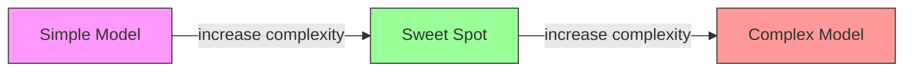
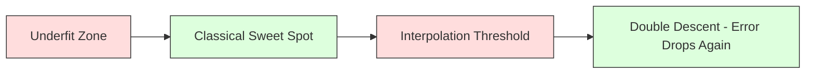
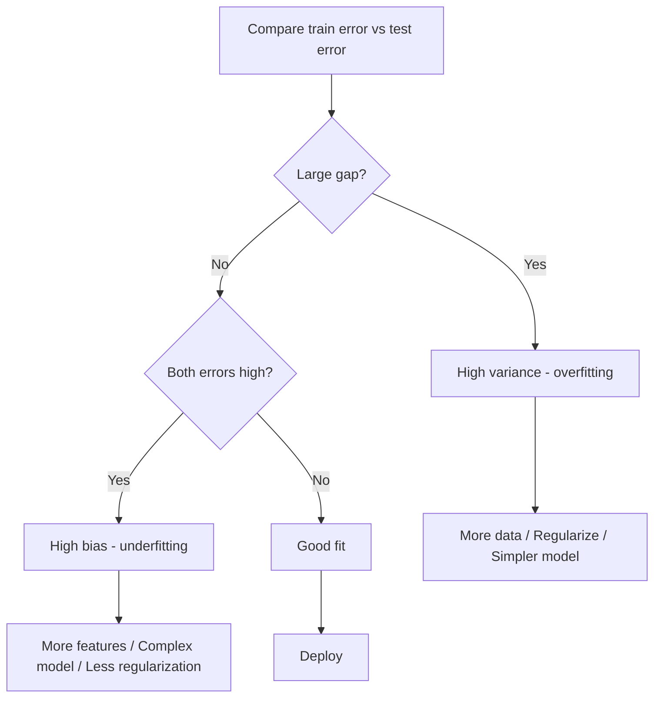
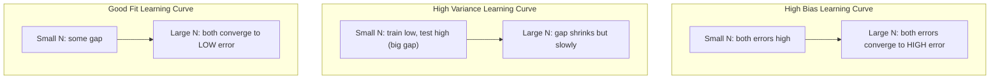
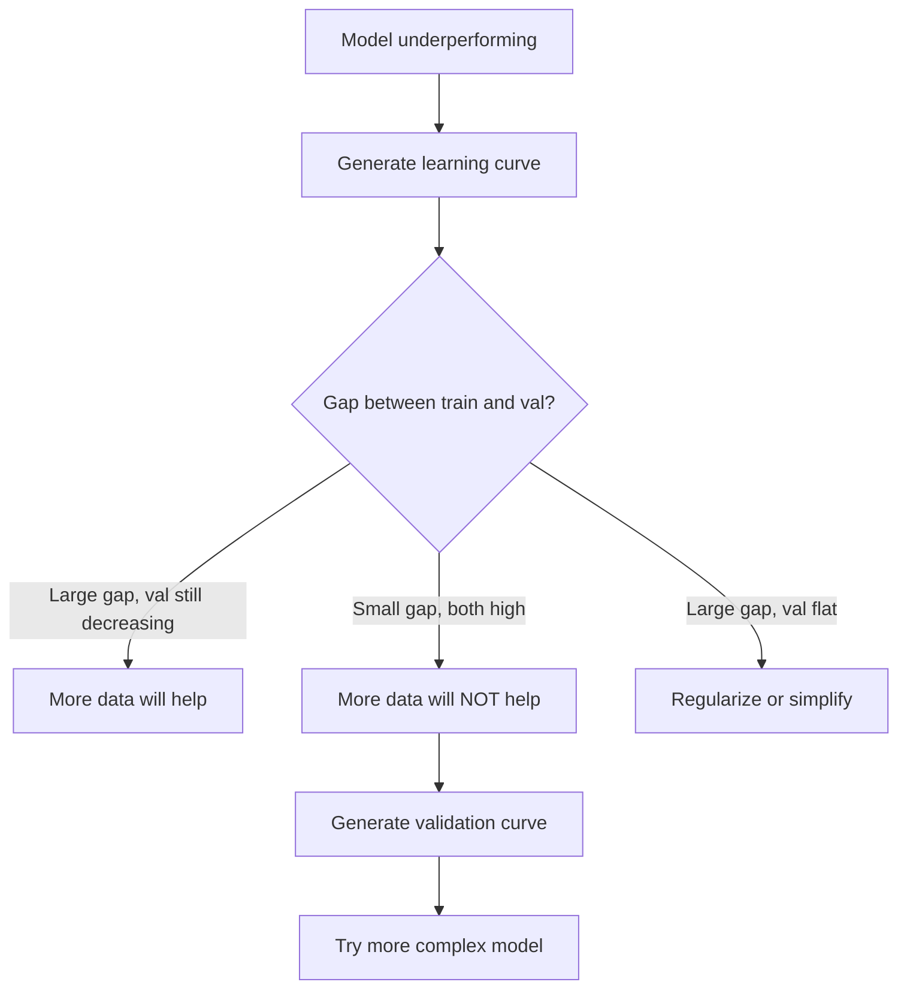

# 편견 변동 거래

> 모든 모델 오류는 세 가지 원천 중 하나에서 발생합니다. 편향, 변동 또는 잡음. 당신은 첫 두 가지만 제어할 수 있습니다.

**Type:** Learn
**Language:**파이썬
**Prerequisites:** Phase 2, Lessons 01-09 (ML basics, regression, classification, evaluation)
**Time:** ~75 minutes

## 학습 목표

- 예상 예측 오류의 편향 변수 분해를 도출하고, 불완전한 잡음의 역할을 설명
- 훈련 및 테스트 오류 패턴을 사용하여 모델이 높은 편향 또는 높은 변형을 앓고 있는지 진단
- 규칙화 기술 (L1, L2, drop-out, early stopping) 의 변수를 위한 편향을 어떻게 거래하는지 설명한다
- 복잡성이 증가하는 모델들 간의 편향-변화 교류를 시각화하는 실험을 구현

## 문제

모델은 테스트 데이터에 오류가 있습니다. 그 오류는 어디서 왔을까요?

만약 당신의 모델이 너무 단순 (곡선 데이터 세트에서 선형 회귀)이라면, 그것은 항상 진정한 패턴을 놓칠 것이다. 그것이 편향이다. 만약 당신의 모델이 너무 복잡하다면 (15 데이터 포인트에서 20도 다항) 는 훈련 데이터에 완벽하게 맞게 될 것이지만 새로운 데이터에 대해 매우 다른 예측을 할 것이다. 그것은 변동이다.

고정된 모델 용량에 대해 동시에 둘 다 최소화할 수 없습니다. 편향을 낮추고 변동이 증가합니다. 편향을 낮추고 변동이 증가합니다. 이 교류를 이해하는 것은 기계 학습에서 가장 유용한 진단 기술입니다. 그것은 모델을 더 복잡하거나 덜 복잡하게 만들 것인지, 더 많은 데이터를 얻거나 더 나은 기능을 엔지니어링하는지, 더 많이 또는 덜 정규화하는지 알려줍니다.

## 개념

### 편견: 체계적 오류

편견은 모델의 평균 예측이 실제 값에서 얼마나 멀리 떨어져 있는지 측정합니다. 같은 배포에서 얻은 여러 가지 다른 훈련 세트에 동일한 모델을 훈련시키고 예측을 평균한 경우 편견은 그 평균과 진실 사이의 격차입니다.

높은 편향은 모델이 실제 패턴을 캡처하기에는 너무 딱딱하다는 것을 의미합니다. 파라볼라에 맞는 직선은 얼마나 많은 데이터를 제공해도 항상 곡선을 놓칠 것입니다. 이것은 부적합합니다.

```
High bias (underfitting):
  Model always predicts roughly the same wrong thing.
  Training error: HIGH
  Test error: HIGH
  Gap between them: SMALL
```

### 변동: 훈련 데이터에 대한 민감성

변동은 다른 데이터 하위 집합에 훈련할 때 예측이 얼마나 많이 변하는지 측정합니다. 훈련 집합에 작은 변화가 모델에 큰 변화를 일으킨다면 변동은 높습니다.

높은 변동은 모델이 훈련 데이터에 소음을 맞게 하고, 그 밑바탕 신호가 맞지 않는다는 것을 의미합니다. 20도 다항식은 훈련 포인트마다 을 지만 둘 사이에는 야생적으로 흔들립니다. 이것은 과잉 맞습니다.

```
High variance (overfitting):
  Model fits training data perfectly but fails on new data.
  Training error: LOW
  Test error: HIGH
  Gap between them: LARGE
```

### 부패

어떤 의미에도$x$, 예상 예측 오류가 제곱 손실에서 정확히 분해됩니다:

```math
\begin{aligned}
& \text{Expected Error} = \text{Bias}^2 + \text{Variance} + \text{Irreducible Noise} \\[6pt]
& \text{where:} \\
& \quad \text{Bias}^2 = (\mathbb{E}[\hat{f}(x)] - f(x))^2 \\
& \quad \text{Variance} = \mathbb{E}[(\hat{f}(x) - \mathbb{E}[\hat{f}(x)])^2] \\
& \quad \text{Noise} = \mathbb{E}[(y - f(x))^2] \quad (\sigma^2)
\end{aligned}
```

- $f(x)$이 함수는
- $\hat{f}(x)$이 모델의 예측입니다.
- $\mathbb{E}[\ldots]$다른 교육 세트들에 대한 기대가
- $y$관찰된 레이블 (진정한 함수 + 잡음)

소음이라는 용어는 줄일 수 없습니다. 어떤 모델도 더 잘 할 수 없습니다.$\sigma^2$음적인 데이터에 대한$\text{bias}^2$그리고 변동성.

### 모델 복잡성 vs 오류



클래식 U 모양의 곡선:

| Complexity | Bias | Variance | Total Error |
|-----------|------|----------|-------------|
| Too low | HIGH | LOW | HIGH (underfitting) |
| Just right | MODERATE | MODERATE | LOWEST |
| Too high | LOW | HIGH | HIGH (overfitting) |

### 편견 변동 조절으로 규제

정규화는 차이는 줄이기 위해 의도적으로 편향을 증가시킵니다. 그것은 모형을 제한하여 소음을 쫓아낼 수 없습니다.

- **L2 (Ridge):**모든 무게를 제로로 줄이고 모든 특징을 유지하지만 그 영향력을 줄입니다.
- **L1 (Lasso):**일부 무게를 정확히 0으로 밀어 넣고 기능 선택을 수행합니다.
- **Dropout:**훈련 중에 신경세포를 무작위로 비활성화시켜
- **Early stopping:**모델이 훈련 데이터에 완전히 맞지 않는 한 훈련이 중단됩니다.

규칙화 강도는 (lambda, 중퇴율, 시대적 수) 편향-변화 곡선에서 앉아있는 위치를 직접 제어합니다. 더 많은 규칙화는 더 많은 편향, 더 적은 변이를 의미합니다.

### 두 번 번 내려오는 사람: 현대적 인 견해

고전 이론은 이렇게 말합니다. 달콤한 점 이후 더 많은 복잡성은 항상 아프지만, 2019 년 이후의 연구는 예상치 못한 것을 보여주었습니다. 만약 당신이 인터폴레이션 문턱을 훨씬 넘어서 모델 용량을 늘리는 것을 계속한다면 (모델이 훈련 데이터를 완벽하게 맞게 충분한 매개 변수를 가지고있는 경우), 테스트 오류는 다시 감소 할 수 있습니다.



이 "중차 계하" 현상은 왜 대대적으로 과다 매개 변수를 가진 신경망 (훈련 예제보다 훨씬 더 많은 매개 변수를 가진) 이 여전히 잘 일반화되는지를 설명합니다. 고전적 편향-변화 교류는 잘못되지 않지만 현대 정권에서는 불완전합니다.

두 번 내려가기 위한 주요 관찰:
- 선형 모델, 의사결정 트리, 신경망에서 일어나는 일입니다.
- 더 많은 데이터는 실제로 인터폴레이션 영역에서 해를 끼칠 수 있습니다 ( 샘플 방식으로 두 배로 내려가기)
- 더 많은 훈련 시대가 또한 그것을 유발할 수 있습니다 (시대적 측면에서 두 배의 하락)
- 규칙화 를 통해 밋밋 을 부드럽게 하지만 제거 하지 않습니다

왜 이런 일이 일어나는가? 인터폴레이션 임대에서 모델은 모든 훈련 지점을 수용할 수 있는 충분한 용량을 가지고 있습니다. 모든 점들을 가로질러 매우 구체적인 솔루션으로 강제되어 데이터의 작은 혼란은 적합성에서 큰 변화를 일으킨다. 이 부분에서 변동이 가장 높습니다. 그 문턱을 넘어서서 모델은 데이터에 완벽하게 맞는 많은 가능한 솔루션을 가지고 있습니다. 학습 알고리즘 (예를 들어, 암시적인 정규화와 함께 gradient 하락) 은 그 중 가장 간단한 것을 선택하는 경향이 있습니다. 간단한 해결책에 대한 이 암시적인 편향은 너무 많은 매개 변수를 가진 모델이 일반화되는 이유입니다.

| Regime | Parameters vs Samples | Behavior |
|--------|----------------------|----------|
| Underparameterized | $p \ll n$ | Classical tradeoff applies |
| Interpolation threshold | $p \sim n$ | Variance peaks, test error spikes |
| Overparameterized | $p \gg n$ | Implicit regularization kicks in, test error drops |

실용적인 목적: 신경망이나 큰 나무 집합을 사용한다면, 인터폴레이션 문턱에서 멈추지 마십시오. 그 문턱에서 훨씬 아래로 (표시적 규칙화) 또는 그 문턱을 훨씬 넘어서십시오. 가장 나쁜 장소는 문턱에 있습니다.

### 모델 을 진단 하는 것



| Symptom | Diagnosis | Fix |
|---------|-----------|-----|
| High train error, high test error | Bias | More features, complex model, less regularization |
| Low train error, high test error | Variance | More data, regularization, simpler model, dropout |
| Low train error, low test error | Good fit | Ship it |
| Train error decreasing, test error increasing | Overfitting in progress | Early stopping |

### 실용적 인 전략

**When bias is the problem:**
- 다항변 또는 상호작용 기능을 추가
- 보다 유연한 모델을 사용한다 (선형 대신 나무 집합)
- 규칙화 강도를 줄이는
- 더 긴 기차 (아직 회전되지 않은 경우)

**When variance is the problem:**
- 더 많은 훈련 데이터를 얻으세요
- 포장을 이용 (자발적인 숲)
- 규칙화 증대 (더 높은 램바다, 더 많은 탈퇴)
- 기능 선택 (더음있는 기능들을 제거)
- 초기 검출을 위해 십자정 검증을 사용한다

### 방법 을 합성 하고 변동 을 줄이는 방법

집합방법은 변함과 싸우는 가장 실용적인 도구입니다.

**Bagging (Bootstrap Aggregating)**훈련 데이터의 다른 부트스트랩 샘플에 따라 여러 모델을 훈련시키고, 그 다음 그들의 예측을 평균합니다. 각 개별 모델은 높은 변수를 가지고 있지만 평균은 훨씬 낮은 변수를 가지고 있습니다. 무작위 숲은 의사결정 나무에 적용 된 포장을 사용합니다.

수학적으로 작동하는 이유는: 평균적으로$N$독립적인 예측, 각각 변동$\sigma^2$, 평균의 변수는$\sigma^2 / N$. 모델들은 진정으로 독립적이지 않습니다 (모든 모델들은 비슷한 데이터를 볼 수 있습니다). 따라서 감소는$1/N$하지만 여전히 상당한 수준입니다.

**Boosting**모델들을 순차적으로 구축함으로써 편향을 줄이는데, 각 새로운 모델은 지금까지의 집합의 오류에 초점을 맞추고 있다. 그라디언트 부스팅과 아다보스트는 주요 예이다. 너무 많은 모델을 추가하면 부팅이 과잉화될 수 있으므로 조기 중단 또는 정규화가 필요합니다.

| Method | Primary Effect | Bias Change | Variance Change |
|--------|---------------|-------------|-----------------|
| Bagging | Reduces variance | No change | Decreases |
| Boosting | Reduces bias | Decreases | Can increase |
| Stacking | Reduces both | Depends on meta-learner | Depends on base models |
| Dropout | Implicit bagging | Slight increase | Decreases |

**Practical rule:**기본 모델의 변동률이 높으면 (깊은 나무, 높은 수준의 다항항) 포장을 사용하십시오. 기본 모델의 편향률이 높으면 (밀어 줄기, 간단한 선형 모델) 부팅을 사용하십시오.

### 학습 곡선

학습 곡선은 훈련 집합 크기의 함수로서 훈련 및 검증 오류를 표시합니다. 그들은 당신이 가지고 있는 가장 실용적인 진단 도구입니다. 단일 기차/ 테스트 비교와 달리, 학습 곡선은 모델의 궤도를 보여줍니다. 더 많은 데이터가 도움이 될지 알려줍니다.



어떻게 읽어야 하는지:

| Scenario | Training Error | Validation Error | Gap | What It Means | What to Do |
|----------|---------------|-----------------|-----|---------------|------------|
| High bias | High | High | Small | Model cannot capture the pattern | More features, complex model, less regularization |
| High variance | Low | High | Large | Model memorizes training data | More data, regularization, simpler model |
| Good fit | Moderate | Moderate | Small | Model generalizes well | Ship it |
| High variance, improving | Low | Decreasing with more data | Shrinking | Variance problem that data can fix | Collect more data |
| High bias, flat | High | High and flat | Small and flat | More data will NOT help | Change model architecture |

중요한 통찰력: 두 곡선이 평평하고 격차가 작지만 두 오류가 높으면 더 많은 데이터가 쓸모가 없습니다. 더 나은 모델이 필요합니다. 격차가 크고 여전히 줄어들면 더 많은 데이터가 도움이 될 것입니다.

### 학습 곡선을 생성 하는 방법

두 가지 방법이 있습니다.

**Approach 1: Vary training set size, fixed model.**모델과 하이퍼파레머를 일정하게 유지하세요. 훈련 데이터의 점점 더 큰 하위 집합을 훈련하세요. 훈련 오류와 검증 오류를 각 크기에 측정하세요. 이것은 표준 학습 곡선입니다.

**Approach 2: Vary model complexity, fixed data.**데이터 상수를 유지하십시오. 복잡성 매개 변수를 (항항식수, 나무 깊, 계층 수) 스캔하십시오. 각 복잡성에서 훈련 오류와 검증 오류를 측정하십시오. 이것은 검증 곡선이며 편향 변수 교류를 직접 보여줍니다.

두 가지 접근 방식은 서로 보완합니다. 첫 번째 방법은 더 많은 데이터가 도움이 될지, 두 번째 방법은 다른 모델이 도움이 될지 알려줍니다. 다음 단계에 대한 결정을 내리기 전에 두 가지 방법을 실행하십시오.



```figure
bias-variance
```

## 건설 해

코드는 `code/bias_variance.py`전체 편향 변수 분해 실험을 실행합니다.

### 단계 1: 알려진 함수에서 합성 데이터를 생성

우리는 사용 `f(x) = sin(1.5x) + 0.5x`가우스 소음과 함께 하는 것입니다.

```python
def true_function(x):
    return np.sin(1.5 * x) + 0.5 * x

def generate_data(n_samples=30, noise_std=0.5, x_range=(-3, 3), seed=None):
    rng = np.random.RandomState(seed)
    x = rng.uniform(x_range[0], x_range[1], n_samples)
    y = true_function(x) + rng.normal(0, noise_std, n_samples)
    return x, y
```

### 단계 2: 부트스트랩 샘플링 및 다항제적 융합

각 다항수수수수수수수수수수수수수수수수수수수수수수수수수수수수수수수수수수수수수수수수수수수수수수수수수수수수수수수수수수수수수수수수수수수수수수수수수수수수수수수수수수수수수수수수수수수수수수수수수수수수수수수수수수수수수수수수수수수수수수수수수수수수수수수수수수수수수수수수수수수수수수수수수수수수수수수수수수수수수수수수수수수수수수수수수수수수수수수수수수수수수수수수수수수수수수수수수수수수수수수수수수수수수수수수수수수수수수수수수수수수수수수수수수수수수수수수수수수수수수수수수수수수수수수수수수수수수수수수수수수수수수수수수수수수수수수수수수수수수수수수수수수수수수수수수수수수수수수수수수수수수수수수수수수수수수수수수수수수수수수수수수수수수수수수수수수수수수수수수수수수수수수수수수수수수수수수수수수수수수수수수수수수수수수수수수수수수수수수수수수수수수수수수수수수수수수수수수수수수수수수수수수수수수수수수수수수수수수수수수수수수수수수수수수수수수수수수수수수수수수수수수수수수수수수수수수수수수수수수수수수수수수수수수수수수수수수수수수수수수수수수수수수수수수수수수수수수수수수수수수수수수수수수수수

```python
def fit_polynomial(x_train, y_train, degree, lam=0.0):
    X = np.column_stack([x_train ** d for d in range(degree + 1)])
    if lam > 0:
        penalty = lam * np.eye(X.shape[1])
        penalty[0, 0] = 0
        w = np.linalg.solve(X.T @ X + penalty, X.T @ y_train)
    else:
        w = np.linalg.lstsq(X, y_train, rcond=None)[0]
    return w
```

우리는 200개의 다른 부트스트랩 샘플에 부착합니다. 각 부트스트랩 샘플은 동일한 기본 배포에서 추출되지만 다른 포인트를 포함합니다.

### 단계 3: 계산 편견^2, 변함 분해

각각의 테스트 포인트에서 200개의 예측 세트를 통해 우리는 정의에서 직접 분해를 계산할 수 있습니다.

```python
mean_pred = predictions.mean(axis=0)
bias_sq = np.mean((mean_pred - y_true) ** 2)
variance = np.mean(predictions.var(axis=0))
total_error = np.mean(np.mean((predictions - y_true) ** 2, axis=1))
```

- `mean_pred` $\mathbb{E}[\hat{f}(x)]$부트스트랩 샘플에서 추정된
- `bias_sq`평균 예측과 진실 사이의 격차가
- `variance`부트스트랩 샘플에서 예측의 평균 확산입니다
- `total_error`대략적으로 같아야 합니다$\text{bias}^2 + \text{variance} + \text{noise}$

### 4단계: 학습 곡선

학습 곡선은 훈련 세트의 크기를 매개하고 모델 복잡성을 고정시켜줍니다. 그들은 당신의 모델이 데이터 제한 또는 용량 제한 여부를 보여줍니다.

```python
def demo_learning_curves():
    sizes = [10, 15, 20, 30, 50, 75, 100, 150, 200, 300]
    degree = 5

    for n in sizes:
        train_errors = []
        test_errors = []
        for seed in range(50):
            x_train, y_train = generate_data(n_samples=n, seed=seed * 100)
            w = fit_polynomial(x_train, y_train, degree)
            train_pred = predict_polynomial(x_train, w)
            train_mse = np.mean((train_pred - y_train) ** 2)
            test_pred = predict_polynomial(x_test, w)
            test_mse = np.mean((test_pred - y_test) ** 2)
            train_errors.append(train_mse)
            test_errors.append(test_mse)
        # Average over runs gives the learning curve point
```

높은 변형을 가진 모델 (5급) 에서 작은 데이터를 볼 때,
- 훈련 오류는 낮게 시작되고 더 많은 데이터가 메모리를 더 어렵게 만들수록 증가합니다
- 테스트 오류가 높게 시작되고 모델이 더 많은 신호를 받으면서 감소합니다
- 더 많은 데이터로 격차가 줄어들게 됩니다

고 편향 모델 (도 1) 에서 두 오류 모두 같은 높은 값으로 빠르게 합쳐지며 더 많은 데이터가 도움이 되지 않습니다.

### 5단계: 규칙화 검열

이 코드에는 또한 `demo_regularization_sweep()`, 고도 다항변수를 고정하고 (도 15) 그리고 0.001에서 100까지의 릴리저화 강도를 닦아줍니다. 이것은 다른 각에서 편향-변화 교류를 보여줍니다. 모델 복잡성이 달라지기 보다는 제한 강도를 변화시킵니다.

```python
def demo_regularization_sweep():
    alphas = [0.001, 0.005, 0.01, 0.05, 0.1, 0.5, 1.0, 5.0, 10.0, 50.0, 100.0]
    for alpha in alphas:
        results = bias_variance_decomposition([15], lam=alpha)
        r = results[15]
        print(f"alpha={alpha:.3f}  bias={r['bias_sq']:.4f}  var={r['variance']:.4f}")
```

낮은 알파에서는 15도 다항변수가 거의 제한되지 않습니다. 변이는 모델이 각 부트스트랩 샘플에서 노이즈를 쫓아다니기 때문에 지배적입니다. 높은 알파에서는 페널티가 너무 강하여 모델이 사실상 거의 일정 함수가됩니다. 편견이 지배합니다. 최적 알파는 이러한 극단 사이에 위치합니다.

이것은 서로 다른 다항식의 U 곡선이지만, 단독의 대신 연속적인 버튼으로 제어된다. 실제에서는 정규화는 특징 집합을 변경하지 않고 미세한 곡물 제어를 허용하기 때문에 교류를 제어하는 가장 선호하는 방법입니다.

## 사용 하 고

sklearn은 제공 합니다`learning_curve`그리고`validation_curve`이 진단을 자동화하기 위해

### 검증 곡선: 수척 모델 복잡성

```python
from sklearn.model_selection import validation_curve
from sklearn.pipeline import make_pipeline
from sklearn.preprocessing import PolynomialFeatures
from sklearn.linear_model import Ridge

degrees = list(range(1, 16))
train_scores_all = []
val_scores_all = []

for d in degrees:
    pipe = make_pipeline(PolynomialFeatures(d), Ridge(alpha=0.01))
    train_scores, val_scores = validation_curve(
        pipe, X, y, param_name="polynomialfeatures__degree",
        param_range=[d], cv=5, scoring="neg_mean_squared_error"
    )
    train_scores_all.append(-train_scores.mean())
    val_scores_all.append(-val_scores.mean())
```

이것은 편향-변화 교류 곡선을 직접적으로 제공합니다. 검증 점수가 훈련 점수에 비해 최악의 경우, 변수가 지배합니다. 둘 다 나쁜 경우, 편향이 지배합니다.

### 학습 곡선: 스파이 훈련 세트 크기가

```python
from sklearn.model_selection import learning_curve

pipe = make_pipeline(PolynomialFeatures(5), Ridge(alpha=0.01))
train_sizes, train_scores, val_scores = learning_curve(
    pipe, X, y, train_sizes=np.linspace(0.1, 1.0, 10),
    cv=5, scoring="neg_mean_squared_error"
)
train_mse = -train_scores.mean(axis=1)
val_mse = -val_scores.mean(axis=1)
```

줄거리 `train_mse`그리고`val_mse`반대`train_sizes`형태는 모델에 대해 모든 것을 말해줍니다.

### 정규화 검열과 십자 검증

```python
from sklearn.model_selection import cross_val_score

alphas = [0.001, 0.01, 0.1, 1.0, 10.0, 100.0]
for alpha in alphas:
    pipe = make_pipeline(PolynomialFeatures(10), Ridge(alpha=alpha))
    scores = cross_val_score(pipe, X, y, cv=5, scoring="neg_mean_squared_error")
    print(f"alpha={alpha:>7.3f}  MSE={-scores.mean():.4f} +/- {scores.std():.4f}")
```

이것은 고정된 모델 복잡성을 위해 규칙화 강도를 닦습니다. 당신은 같은 편향-차원화 교류를 보게 될 것입니다: 낮은 알파는 높은 변형을 의미하고 높은 알파는 높은 편향을 의미합니다.

### 모든 것 을 합쳐 놓는 것: 완전한 진단 작업 과정

실제에서는 다음과 같은 진단들을 순서대로 실행합니다.

1. 모델 훈련, 기차 계산, 테스트 오류
2. 두 가지 모두 높으면 편향 문제가 있습니다. 4 단계로 건너뛰십시오.
3. 열차가 낮지만 시험이 높으면: 변동 문제 있습니다. 더 많은 데이터가 도움이 될지 확인하기 위해 학습 곡선을 생성하십시오. 그렇지 않으면, 규칙화하십시오.
4. 주요 복잡성 매개 변수를 휩쓸고 검증 곡선을 생성하고
5. 좋은 점에서는 학습 곡선을 생성합니다. 그 격차가 여전히 큰 경우 더 많은 데이터 또는 규칙화가 필요합니다.
6. 다른 알파 값의 Ridge/Lasso를 사용해 보세요.`cross_val_score`- 가장 낮은 크로스 검증 오류가 있는 알파를 선택하세요.

이것은 대부분의 표 데이터 세트에 10-15 분의 계산을 필요로 하며 몇 시간 동안 추측을 절약합니다.

## 선박

이 교훈은 다음과 같은 결과를 낳습니다.`outputs/prompt-model-diagnostics.md`

## 운동

1.    으로 분해를 실행`noise_std=0`(소음 없이) 이변화 불가능한 오류 용어는 어떻게 될까요? 최적의 복잡성이 변하는가?

2. 훈련 세트의 크기를 30에서 300으로 늘리는 것. 이것은 변함 구성 요소에 어떻게 영향을 미치는가? 최적의 다항수 수위가 변하는가?

3. 실험에 L2 정규화 (리지 회귀) 를 추가하십시오. 고정된 높은 수분 (도 15) 의 경우, lambda를 0에서 100까지 닦습니다.$\text{bias}^2$그리고 람다 함수로서의 변함

4. 복수에서 로 진정한 함수를 변경`sin(x)`편향 변수 분해는 어떻게 변할까요? 아직 명확한 최적의 정도가 있나요?

5. 간단한 부트스트랩 집합 (백) 팩을 구현: 10 개의 모델을 부트스트랩 샘플과 평균 예측에 훈련하십시오. 이것은 편향을 크게 증가시키지 않고 변형을 줄이는 것을 보여주십시오.

## 주요 용어

| Term | What people say | What it actually means |
|------|----------------|----------------------|
| Bias | "The model is too simple" | Systematic error from wrong assumptions. The gap between the average model prediction and truth. |
| Variance | "The model is overfitting" | Error from sensitivity to training data. How much predictions change across different training sets. |
| Irreducible error | "Noise in the data" | Error from randomness in the true data-generating process. No model can eliminate it. |
| Underfitting | "Not learning enough" | Model has high bias. It misses the real pattern even on training data. |
| Overfitting | "Memorizing the data" | Model has high variance. It fits noise in training data that does not generalize. |
| Regularization | "Constraining the model" | Adding a penalty to reduce model complexity, trading bias for lower variance. |
| Double descent | "More parameters can help" | Test error decreases again when model capacity far exceeds the interpolation threshold. |
| Model complexity | "How flexible the model is" | The capacity of a model to fit arbitrary patterns. Controlled by architecture, features, or regularization. |

## 더 많은 읽기

- [Hastie, Tibshirani, Friedman: Elements of Statistical Learning, Ch. 7](https://hastie.su.domains/ElemStatLearn/)-- 편향 변함 분해의 최종 처리
- [Belkin et al., Reconciling modern machine learning practice and the bias-variance trade-off (2019)](https://arxiv.org/abs/1812.11118)-- 두 배로 내려오는 종이
- [Nakkiran et al., Deep Double Descent (2019)](https://arxiv.org/abs/1912.02292)-- 시대적, 샘플적 두 배로 내려다
- [Scott Fortmann-Roe: Understanding the Bias-Variance Tradeoff](http://scott.fortmann-roe.com/docs/BiasVariance.html)-- 명확한 시각적 설명
