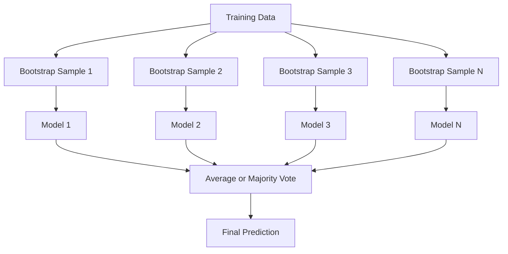
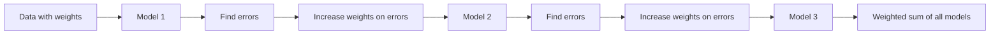
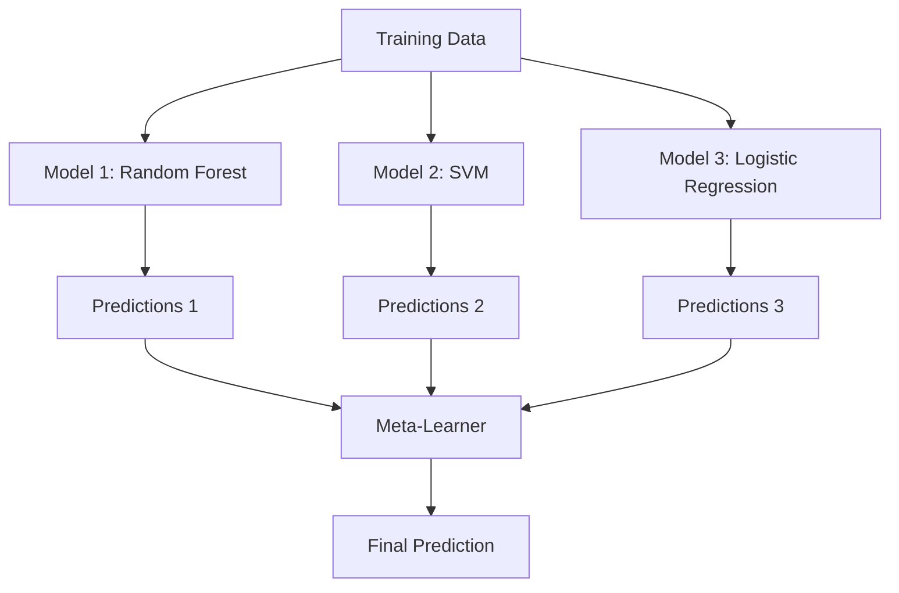

# 방법 을 집합

> 약한 학습자 집단이 올바르게 결합되면 강렬한 학습자가 됩니다. 이것은 은유가 아닙니다. 그것은 정설입니다.

**Type:** Build
**Language:**파이썬
**Prerequisites:** Phase 2, Lesson 10 (Bias-Variance Tradeoff)
**Time:** ~120 minutes

## 학습 목표

- AdaBoost 및 gradient boosting을 처음부터 구현하고 boosting이 어떻게 순차적으로 편향을 줄이는지를 설명합니다
- 포장을 구성하고 평균적으로 비관형 모델을 증가시키지 않고 변수를 감소시키는 방법을 보여주십시오
- 각 방법의 목표 오류 구성 요소에 대해 포지, 붐, 스택을 비교하십시오
- 집단 다양성을 평가하고, 보다 독립적인 약한 학습자들로 인해 다수의 투표 정확도가 향상되는 이유를 설명합니다.

## 문제

하나의 결정나무는 훈련이 빠르고 해석이 쉽지만, 과잉입니다. 하나의 선형 모델은 복잡한 경계에 부합합니다. 완벽한 모델 아키텍처를 설계하는 데 며칠을 보낼 수도 있습니다. 또는 불완전한 모델들을 조합하여 개별적으로 그 어느 하나보다 더 나은 것을 얻을 수 있습니다.

집합 방법들은 정확히 이렇게 합니다. 그들은 테이블 데이터에 대한 Kaggle 경쟁에서 승리하는 가장 신뢰할 수 있는 기술입니다. 그들은 대부분의 생산 ML 시스템을 작동시키고, 행동에서 편향-변화 교섭을 보여줍니다. 배낭은 변수를 줄입니다. 증폭은 편향을 줄입니다. 스택은 어떤 모델을 신뢰할 수 있는지 배우습니다.

## 개념

### 집단 이 일 하는 이유

당신이 $N$독립적인 분류자, 각각 정확함$p > 0.5$. 과반수의 찬성표는 정확합니다:

```math
P(\text{majority correct}) = \sum_{k > N/2} \binom{N}{k} p^k (1-p)^{N-k}
```

각 분류기 21개에서 60%의 정확성을 가진 경우, 과반수의 정확도는 약 74%입니다. 101개 분류기에서는 84%로 증가합니다. 모델이 다른 실수를 했을 때 오류는 취소됩니다.

핵심 요건은**diversity**모든 모델이 같은 실수를 한다면, 그것들을 결합하는 것은 아무 것도 도움이 되지 않습니다.

- 다른 훈련 하위 집합 (백)
- 다른 특징 하위 집합 (자발적인 숲)
- 순서 오류 수정 (추진)
- 다른 모델 가족 (배포)

### 배낭 (부트스트랩 집합)

배낭화는 각 모델을 훈련 데이터의 다른 부트스트랩 샘플에 훈련함으로써 다양성을 창출합니다.



본래 데이터의 대용량으로 부트스트랩 샘플을 도출한다. 각 부트스트랩에서 독특한 샘플의 약 63.2%가 나타난다. 나머지 36.8% (백 밖으로 샘플) 는 무료 검증 세트를 제공합니다.

배그링은 편향을 크게 증가시키지 않고 변형을 줄이는데, 각각의 나무는 부트스트랩 샘플에 과잉으로 부착되지만, 과잉 부팅은 각각의 나무에 따라 다르므로 평균적으로 소음을 취소합니다.

**Random Forests**이 부분에서, 나무의 특징은 다른 나무와 다른 나무의 특징을 포함하고 있습니다.`sqrt(n_features)`분류 및`n_features / 3`회귀를 위한

### 증폭 (열차 오류 수정)

기차 모델들을 순차적으로 강화합니다. 새로운 모델마다 이전 모델들이 잘못한 사례에 초점을 맞추고 있습니다.



증진은 편향을 줄이는데, 새로운 모델마다 지금까지의 집합의 체계적인 오류를 수정한다. 최종 예측은 모든 모델의 중량 합이므로, 더 좋은 모델은 더 높은 무게를 얻는다.

타협: 너무 많은 공을 치면 부풀리는 것이 너무 적합합니다. 왜냐하면 그것은 더 어려운 예제를 계속 부풀려주기 때문입니다. 그 중 일부는 소음일 수도 있습니다.

### 아다보스트

AdaBoost (응응동성 보급) 은 최초의 실용적인 보급 알고리즘이다. 그것은 모든 기초 학습자와, 일반적으로 의사 결정 줄기 (깊음-1 나무) 와 함께 작동합니다.

알고리즘:

```
1. Initialize sample weights: w_i = 1/N for all i

2. For t = 1 to T:
   a. Train weak learner h_t on weighted data
   b. Compute weighted error:
      err_t = sum(w_i * I(h_t(x_i) != y_i)) / sum(w_i)
   c. Compute model weight:
      alpha_t = 0.5 * ln((1 - err_t) / err_t)
   d. Update sample weights:
      w_i = w_i * exp(-alpha_t * y_i * h_t(x_i))
   e. Normalize weights to sum to 1

3. Final prediction: H(x) = sign(sum(alpha_t * h_t(x)))
```

낮은 오류를 가진 모델은 더 높은 알파를 얻습니다. 잘못된 분류 샘플은 더 높은 무게를 얻습니다. 그래서 다음 모델은 그들에 초점을 맞추습니다.

### 점진적 인 증가

계층성향은 임의 손실 함수로 보급을 일반화한다. 샘플을 재중화하는 대신, 그것은 현재 집합의 잔해 (손실의 부정적인 계층) 에 각 새로운 모델을 적합합니다.

```
1. Initialize: F_0(x) = argmin_c sum(L(y_i, c))

2. For t = 1 to T:
   a. Compute pseudo-residuals:
      r_i = -dL(y_i, F_{t-1}(x_i)) / dF_{t-1}(x_i)
   b. Fit a tree h_t to the residuals r_i
   c. Find optimal step size:
      gamma_t = argmin_gamma sum(L(y_i, F_{t-1}(x_i) + gamma * h_t(x_i)))
   d. Update:
      F_t(x) = F_{t-1}(x) + learning_rate * gamma_t * h_t(x)

3. Final prediction: F_T(x)
```

실수 손실의 제곱에서, 사이두 잔재는 실제 잔재입니다:$r_i = y_i - F_{t-1}(x_i)$각각의 나무는 이전 집합의 실수와 맞닿아 있습니다.

학습 속도 (감축) 는 각각의 나무가 얼마나 기여하는지 제어합니다. 더 작은 학습 속도에는 더 많은 나무가 필요하지만 더 잘 일반화됩니다. 전형적인 값은: 0.01에서 0.3.

### XGBoost: 왜 테이블 데이터에 지배를 가하는 지

XGBoost (eXtreme Gradient Boosting) 은 엔지니어링 최적화로 기하급수 증진을 통해 빠르고 정확하며 과잉 부착에 저항합니다.

- **Regularized objective:**잎 무게에 대한 L1 및 L2 제재는 개별 나무들이 너무 자신감을 가질 수 없도록 막습니다.
- **Second-order approximation:**손실의 첫 번째 및 두 번째 파생자를 모두 사용하며 더 나은 분할 결정을 제공합니다
- **Sparsity-aware splits:**실종된 데이터의 가장 좋은 방향을 학습함으로써 실종된 값을 네이티브로 처리합니다
- **Column subsampling:**무작위 숲과 마찬가지로, 각각의 분할에서 샘플은 다양성을 위해 특징입니다
- **Weighted quantile sketch:**분산 데이터에 연속적인 특징을 위한 분할 포인트를 효율적으로 찾습니다
- **Cache-aware block structure:**CPU 캐시 라인에서 최적화된 메모리 레이아웃

표기 데이터에 대해서는 XGBoost (그리고 그 후속인 LightGBM) 은 신경 네트워크보다 지속적으로 우수한 성능을 발휘합니다. 이것은 얼마 안 될 때 변경되지 않습니다.

###  (메타 학습)

스택은 메타 학습자의 특징으로 여러 기본 모델의 예측을 사용합니다.



메타 학습자는 어떤 기본 모델에 어떤 입력에 대해 신뢰해야 하는지 학습합니다. 특정 지역에서 무작위 숲이 더 좋고 다른 지역에서 SVM가 더 좋다면, 메타 학습자는 그에 따라 라우팅을 배우게 됩니다.

데이터 유출을 피하기 위해, 기본 모델 예측은 훈련 세트에서 십자정확화를 통해 생성되어야 합니다. 당신은 결코 기본 모델을 훈련하지 않으며 동일한 데이터에 대한 메타 기능을 생성하지 않습니다.

### 투표

가장 간단한 집합이죠. 예측을 직접 결합하세요.

- **Hard voting:**과반수의 투표가 수업 라벨에 있습니다.
- **Soft voting:**평균 예측 확률은 평균 확률이 가장 높은 클래스를 선택합니다. 일반적으로 신뢰 정보를 사용하기 때문에 더 좋습니다.

```figure
f3-ensemble-average
```

## 건설 해

### 단계 1: 결정 스탬프 (기본 학습자)

코드는 `code/ensembles.py`모든 것을 처음부터 구현합니다. 우리는 결정 줄기 시작합니다. 하나의 분할을 가진 나무.

```python
class DecisionStump:
    def __init__(self):
        self.feature_idx = None
        self.threshold = None
        self.polarity = 1
        self.alpha = None

    def fit(self, X, y, weights):
        n_samples, n_features = X.shape
        best_error = float("inf")

        for f in range(n_features):
            thresholds = np.unique(X[:, f])
            for thresh in thresholds:
                for polarity in [1, -1]:
                    pred = np.ones(n_samples)
                    pred[polarity * X[:, f] < polarity * thresh] = -1
                    error = np.sum(weights[pred != y])
                    if error < best_error:
                        best_error = error
                        self.feature_idx = f
                        self.threshold = thresh
                        self.polarity = polarity

    def predict(self, X):
        n = X.shape[0]
        pred = np.ones(n)
        idx = self.polarity * X[:, self.feature_idx] < self.polarity * self.threshold
        pred[idx] = -1
        return pred
```

### 단계 2: 처음부터 AdaBoost

```python
class AdaBoostScratch:
    def __init__(self, n_estimators=50):
        self.n_estimators = n_estimators
        self.stumps = []
        self.alphas = []

    def fit(self, X, y):
        n = X.shape[0]
        weights = np.full(n, 1 / n)

        for _ in range(self.n_estimators):
            stump = DecisionStump()
            stump.fit(X, y, weights)
            pred = stump.predict(X)

            err = np.sum(weights[pred != y])
            err = np.clip(err, 1e-10, 1 - 1e-10)

            alpha = 0.5 * np.log((1 - err) / err)
            weights *= np.exp(-alpha * y * pred)
            weights /= weights.sum()

            stump.alpha = alpha
            self.stumps.append(stump)
            self.alphas.append(alpha)

    def predict(self, X):
        total = sum(a * s.predict(X) for a, s in zip(self.alphas, self.stumps))
        return np.sign(total)
```

### 단계 3: 처음부터 단계적 인 증가

```python
class GradientBoostingScratch:
    def __init__(self, n_estimators=100, learning_rate=0.1, max_depth=3):
        self.n_estimators = n_estimators
        self.lr = learning_rate
        self.max_depth = max_depth
        self.trees = []
        self.initial_pred = None

    def fit(self, X, y):
        self.initial_pred = np.mean(y)
        current_pred = np.full(len(y), self.initial_pred)

        for _ in range(self.n_estimators):
            residuals = y - current_pred
            tree = SimpleRegressionTree(max_depth=self.max_depth)
            tree.fit(X, residuals)
            update = tree.predict(X)
            current_pred += self.lr * update
            self.trees.append(tree)

    def predict(self, X):
        pred = np.full(X.shape[0], self.initial_pred)
        for tree in self.trees:
            pred += self.lr * tree.predict(X)
        return pred
```

### 단계 4: 쿨러른과 비교

이 코드는 우리의 처음부터 구현이 스클라어너의 정확도에 비슷한 정확성을 생산하는지 확인합니다 `AdaBoostClassifier`그리고`GradientBoostingClassifier`, 그리고 모든 방법을 옆으로 비교합니다.

## 사용 하 고

### 각 방법 을 언제 사용 해야 합니까?

| Method | Reduces | Best for | Watch out for |
|--------|---------|----------|---------------|
| Bagging / Random Forest | Variance | Noisy data, many features | Does not help with bias |
| AdaBoost | Bias | Clean data, simple base learners | Sensitive to outliers and noise |
| Gradient Boosting | Bias | Tabular data, competitions | Slow to train, easy to overfit without tuning |
| XGBoost / LightGBM | Both | Production tabular ML | Many hyperparameters |
| Stacking | Both | Getting last 1-2% accuracy | Complex, risk of overfitting meta-learner |
| Voting | Variance | Quick combination of diverse models | Only helps if models are diverse |

### 표기 데이터의 생산 스택

대부분의 표형 예측 문제에서는 다음과 같은 순서로 시도합니다.

1. **LightGBM or XGBoost**기본 매개 변수를 가진
2. n_estimators, 학습률, 최대_ 깊음, 미인_아동_중
3. 마지막 0.5%가 필요하다면 3-5가지 다양한 모델로 겹치는 집합을 만들죠
4. 전체적으로 십자정확을 사용

표기 데이터에 대한 신경망은 지속적인 연구 시도에도 불구하고 거의 항상 그라디언트 증진보다 더 나쁘다.

## 선박

이 교훈은`outputs/prompt-ensemble-selector.md`- 주어진 데이터 세트에 대한 올바른 집합 방법을 선택하는 데 도움이 되는 명령어. 데이터 (장치, 기능 유형, 잡음 수준, 클래스 균형) 과 해결 중인 문제를 설명하십시오. 명령어는 의사 결정 체크리스트를 통해 방법을 추천하고 하이퍼 파라미터를 시작하도록 제안하고 그 방법에 대한 일반적인 오류에 대해 경고합니다. 또한 생성합니다.`outputs/skill-ensemble-builder.md`전체 선택 안내서를 함께

## 운동

1. AdaBoost 구현을 수정하여 각 라운드 후 훈련 정확도를 추적합니다. 음반 정확성 vs 추정치 수. 언제 공렴합니까?

2. 재귀 나무에 무작위 표본을 추가하여 무작위 숲을 처음부터 구현하십시오.`max_features=sqrt(n_features)`그리고 평균 예측. 한 나무에 있는 변함 감소를 비교해 보세요.

3. 그라디언트 증진 구현에서, 초기 정지: 각 라운드 후 유효성 손실을 추적하고 10 라운드 연속으로 개선되지 않은 경우 정지. 실제로 얼마나 많은 나무가 필요합니다?

4. 3개의 기본 모델 (물리학 회귀, 결정나무, k-가 가까운 이웃) 과 물리학 회귀 메타 학습자를 포함하는 스택링 집합을 구성하십시오. 메타 기능을 생성하기 위해 5배의 십자 검증을 사용하십시오. 각 기본 모델을 혼자 비교하십시오.

5. XGBoost을 기본 매개 변수와 같은 데이터 세트에 실행하세요. 그 정확도를 처음부터 gradient를 증가시키는 것과 비교하세요. 두 시간 모두. 속도 차이가 얼마나 큰가요?

## 주요 용어

| Term | What people say | What it actually means |
|------|----------------|----------------------|
| Bagging | "Train on random subsets" | Bootstrap aggregating: train models on bootstrap samples, average predictions to reduce variance |
| Boosting | "Focus on hard examples" | Train models sequentially, each correcting errors of the ensemble so far, to reduce bias |
| AdaBoost | "Reweight the data" | Boosting via sample weight updates; misclassified points get higher weight for the next learner |
| Gradient boosting | "Fit the residuals" | Boosting via fitting each new model to the negative gradient of the loss function |
| XGBoost | "The Kaggle weapon" | Gradient boosting with regularization, second-order optimization, and systems-level speed tricks |
| Stacking | "Models on top of models" | Use predictions of base models as input features for a meta-learner |
| Random forest | "Many randomized trees" | Bagging with decision trees, adding random feature subsampling at each split for diversity |
| Ensemble diversity | "Make different mistakes" | Models must be uncorrelated in their errors for the ensemble to improve over individuals |
| Out-of-bag error | "Free validation" | Samples not in a bootstrap draw (~36.8%) serve as a validation set without needing a holdout |

## 더 많은 읽기

- [Schapire & Freund: Boosting: Foundations and Algorithms](https://mitpress.mit.edu/9780262526036/)-- AdaBoost의 창작자들에 의해
- [Friedman: Greedy Function Approximation: A Gradient Boosting Machine (2001)](https://doi.org/10.1214/aos/1013203451)-- 원래의 기하급수 증강 종이
- [Chen & Guestrin: XGBoost (2016)](https://arxiv.org/abs/1603.02754)-- XGBoost 종이
- [Wolpert: Stacked Generalization (1992)](https://www.sciencedirect.com/science/article/abs/pii/S0893608005800231)-- 원래의 겹잎 종이
- [scikit-learn Ensemble Methods](https://scikit-learn.org/stable/modules/ensemble.html)-- 실무적 참조
