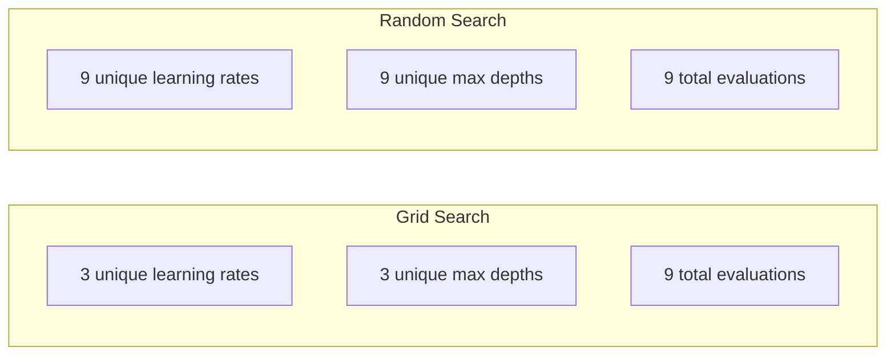
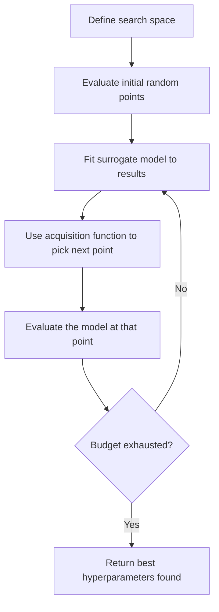
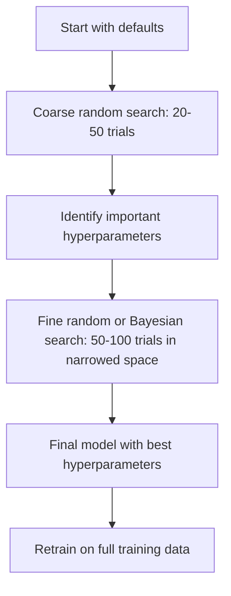
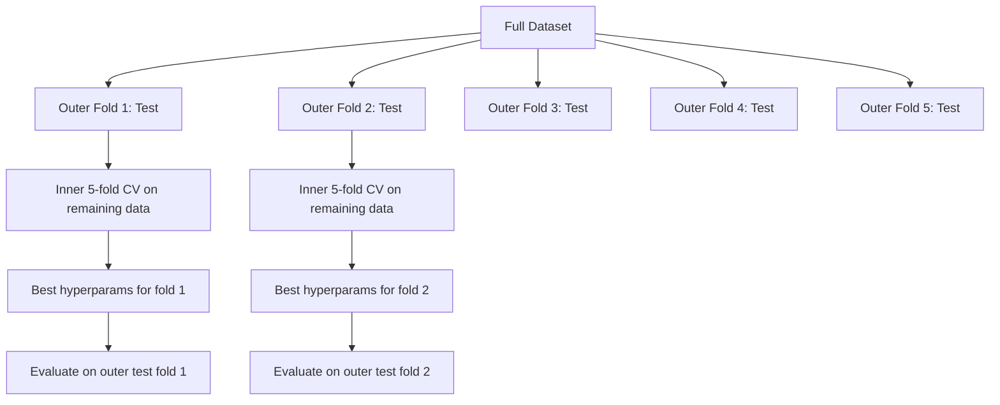

# 하이퍼파라미터 조율

> 하이퍼파라메터는 훈련이 시작되기 전에 을 때입니다. 잘 는 것은 중간 모델과 훌륭한 모델의 차이입니다.

**Type:** Build
**Language:**파이썬
**Prerequisites:** Phase 2, Lesson 11 (Ensemble Methods)
**Time:** ~90 minutes

## 학습 목표

- 그리드 검색, 무작위 검색, 그리고 베이시안 최적화를 처음부터 구현하고 샘플 효율성을 비교
- 대부분의 하이퍼파라미터들이 효과적 차원성이 낮은 경우 무작위 검색이 그릴 검색을 왜 우월하게 하는지를 설명해 주십시오.
- 대리 모델과 인수 기능을 사용하여 검색을 안내하는 베이시안 최적화 루프를 구축
- 적절한 십계 검증을 통해 검증 집합에 과잉 부합하는 것을 피하는 하이퍼파라미터 조정 전략을 설계

## 문제

그라디언트 증진 모델은 학습 속도, 나무의 수, 최대 깊이, 한 잎에 최소 샘플, 하위 샘플 비율, 기둥 샘플 비율을 가지고 있습니다. 즉 6개의 하이퍼 파라미터입니다. 각각의 5개의 합리적인 값이 있다면 그릴은 $5^6 = 15{,}625$모든 훈련은 10초 정도 걸립니다.

그리드 검색은 명백한 접근 방식이며 규모에서 최악의 방법이다. 무작위 검색은 계산이 적은 경우 더 잘합니다. 바이에스ियन 최적화는 과거의 평가에서 배우는 것만으로도 더 잘합니다. 어떤 전략을 사용해야 하는지, 그리고 어떤 하이퍼 파라미터가 실제로 중요하는지 아는 것은 며칠 동안 낭비되는 GPU 시간을 절약합니다.

## 개념

### 파라미터와 하이퍼 파라미터

기하 는 훈련 도중 학습 됩니다 (중량, 편견, 분할 문턱).

| Hyperparameter | What it controls | Typical range |
|---------------|-----------------|---------------|
| Learning rate | Step size per update | 0.001 to 1.0 |
| Number of trees/epochs | How long to train | 10 to 10,000 |
| Max depth | Model complexity | 1 to 30 |
| Regularization ($\lambda$) | Overfitting prevention | 0.0001 to 100 |
| Batch size | Gradient estimation noise | 16 to 512 |
| Dropout rate | Fraction of neurons dropped | 0.0 to 0.5 |

### 그리드 검색

그리드 검색은 지정된 값의 모든 조합을 평가합니다. 그것은 완전하고 이해하기 쉽습니다. 그러나 하이퍼 파라미터의 수와 함께 기하급수적으로 확장됩니다.

```
Grid for 2 hyperparameters:

  learning_rate: [0.01, 0.1, 1.0]
  max_depth:     [3, 5, 7]

  Evaluations: 3 x 3 = 9 combinations

  (0.01, 3)  (0.01, 5)  (0.01, 7)
  (0.1,  3)  (0.1,  5)  (0.1,  7)
  (1.0,  3)  (1.0,  5)  (1.0,  7)
```

그리드 검색은 근본적인 결점을 가지고 있습니다. 한 하이퍼파라미터가 중요하고 다른 하나는 그렇지 않으면 대부분의 평가들이 낭비됩니다. 9개의 평가에서 중요한 파라미터의 고유한 값은 3개밖에 없습니다.

### 무작위 검색

무작위 검색 샘플은 그리드 대신 분포에서 하이퍼파레머를 찾습니다. 같은 예산 9 평가로, 당신은 각각의 하이퍼파레머의 9개의 고유한 값을 얻습니다.



왜 무작위로 그리드를 때리는지 (Bergstra & Bengio, 2012):

- 대부분의 하이퍼파레머는 효과적 차원성이 낮습니다. 일반적으로 주어진 문제에 있어서 6개의 하이퍼파레머 중 1-2개만이 중요합니다.
- 비중이 크지 않은 크기의 쓰레기 평가
- 무작위 검색은 동일한 예산에 대한 중요한 차원을 더 밀집하게 다루고 있습니다.
- 60개의 무작위 실험에서, 당신은 최적의 5% 내에 있는 포인트를 찾을 확률이 95%에 달한다 (색 공간에서 하나 존재한다면).

### 베이시안 최적화

무작위 검색은 결과를 무시합니다. 높은 학습률이 분리를 유발하는지 또는 깊이 3가 깊이 10보다 지속적으로 우위를 점하는지 학습하지 않습니다. 베이시안 최적화는 다음 검색을 결정하기 위해 과거의 평가들을 사용합니다.



두 가지 핵심 요소:

**Surrogate model:**값싼 객관적 함수를 근접하는 값싼 평가 모델 (일반적으로 가우시안 프로세스) 은 검색 공간의 어느 시점에서 예측과 불확실성 추정을 모두 제공합니다.

**Acquisition function:**다음으로 어떤 곳을 평가해야 하는지 결정하는 것은 착취 (알린 좋은 점 근처에 검색) 과 탐구 (불확정성이 높은 곳에서의 검색) 를 균형 잡음으로써입니다.

- **Expected Improvement (EI):**현재보다 얼마나 많은 개선이 기대되는가?
- **Upper Confidence Bound (UCB):**예측과 불확실성의 복수. 더 높은 UCB는 희망적이거나 탐구되지 않은 것을 의미합니다.
- **Probability of Improvement (PI):**이 점이 현재 가장 좋은 점보다 확률이 얼마나 높습니까?

베이시안 최적화는 일반적으로 2-5배 더 적은 평가와 함께 무작위 검색보다 더 나은 하이퍼 파라미터를 찾습니다. 대리 모델의 부착 비용은 실제 모델을 훈련시키는 것과 비교하면 무시할 수 없습니다.

### 일찍 멈출 것

모든 훈련 경기가 끝나지 않아도 됩니다. 10 시대 후에 구성이 분명하게 나쁘다면, 그것을 멈추고 앞으로 나아가십시오. 이것은 초파리미터 검색의 맥락에서 조기 중단입니다.

전략:
- **Patience-based:**N 연속 기간 동안 유효성 손실이 개선되지 않은 경우 중지
- **Median pruning:**실험의 중간 결과가 같은 단계에 완료된 실험의 평균보다 더 나쁘다면 중단하십시오.
- **Hyperband:**작은 예산들을 여러 구성에 배정하고, 그 다음으로 가장 좋은 예산들을 점진적으로 늘려

하이퍼밴드는 특히 효과적입니다. 각 구성원 1 시대를 가진 81 개의 구성원을 시작하여 상위 3위를 유지하며, 3 개의 시대를 부여하며, 상위 3위를 유지합니다. 이것은 전체 예산에 대한 모든 구성원들을 평가하는 것보다 좋은 구성원을 10 - 50x 더 빨리 찾습니다.

### 학습 시간표

학습 속도는 거의 항상 가장 중요한 과다 매개 변수 입니다. 스케줄러들은 그것을 고정하지 않고 훈련 중에 조정합니다.

| Scheduler | Formula | When to use |
|-----------|---------|-------------|
| Step decay | Multiply by 0.1 every N epochs | Classic CNN training |
| Cosine annealing | $\text{lr} \cdot 0.5 \cdot (1 + \cos(\pi t / T))$ | Modern default |
| Warmup + decay | Linear increase then cosine decay | Transformers |
| One-cycle | Increase then decrease over one cycle | Fast convergence |
| Reduce on plateau | Reduce by factor when metric stalls | Safe default |

### 하이퍼파라메터 중요성

모든 하이퍼파레머가 동일하게 중요하지 않습니다. 무작위 숲 (Probst et al., 2019) 과 그라디언 증진에 대한 연구는 일관된 패턴을 보여줍니다.

**High importance:**
- 학습률 (항상 먼저 조율)
- 추정기/시대 수 (조각기보다는 조기 정지하는 것을 사용)
- 정규화 강도는

**Medium importance:**
- 최대 깊이/층의 수
- 분과형 표본
- 표본 비율

**Low importance:**
- 최대 특징 (자발적인 숲에 대한)
- 특정 활성화 기능 선택
- 배트 크기는 (이용적 범위 내에서)

우선 중요한 부분을 조정하고 나머지는 기본으로 남겨주세요.

### 실용적 전략



콘크리트 작업 흐름:

1. **Start with library defaults.**그들은 경험이 풍부한 전문가들이 선택하고 종종 80%의 경우 그 길을 간다.
2. **Coarse random search.**20~50번의 실험을 해내면 빨리 무사할 수 있어요
3. **Analyze results.**어떤 하이퍼파레머가 성능과 상관관계를 맺는 걸까요?
4. **Fine search.**베이시안 최적화 또는 좁은 공간에서 집중된 무작위 검색 50-100 실험
5. **Retrain on all training data**가장 좋은 하이퍼파라미터가 발견되었습니다.

### 크로스 검증 통합

단일 검증 분할에 대한 하이퍼파레머를 조정하는 것은 위험하다. 가장 좋은 하이퍼파레머는 특정 검증 접면에 부합될 수 있습니다. 네이스드 크로스 검증은 두 개의 루프를 사용하여 해결합니다.

- **Outer loop**(평가): 데이터를 열차+발 및 테스트로 나눈다.
- **Inner loop**(조정): 열차+발을 열차와 발로 나눈다. 가장 좋은 하이퍼파라미터를 찾습니다.



각 외부 접수는 독립적으로 자신의 최고의 하이퍼 파라미터를 찾습니다. 외부 점수는 일반화 성능의 편향없는 추정입니다.

슐러런으로:

```python
from sklearn.model_selection import cross_val_score, GridSearchCV
from sklearn.ensemble import GradientBoostingRegressor

inner_cv = GridSearchCV(
    GradientBoostingRegressor(),
    param_grid={
        "learning_rate": [0.01, 0.05, 0.1],
        "max_depth": [2, 3, 5],
        "n_estimators": [50, 100, 200],
    },
    cv=5,
    scoring="neg_mean_squared_error",
)

outer_scores = cross_val_score(
    inner_cv, X, y, cv=5, scoring="neg_mean_squared_error"
)

print(f"Nested CV MSE: {-outer_scores.mean():.4f} +/- {outer_scores.std():.4f}")
```

이 방법은 비싸다 (5개의 외부 접수 x 5개의 내부 접수 x 27개의 그리드 포인트 = 675개의 모델이 적합하다) 하지만 신뢰성 있는 성능 추정치를 제공합니다. 종이에 최종 결과를 보고하거나 결정의 위험성이 높을 때 사용하세요.

### 실용적 인 조언

**Start with the learning rate.**그라디언트 기반 방법의 가장 중요한 하이퍼파라미터는 항상 그것이다. 나쁜 학습률은 다른 모든 것을 무관하게 만듭니다. 다른 하이퍼파라미터를 기본값에 수정하고 먼저 학습률을 스캔합니다.

**Use log-uniform distributions for learning rate and regularization.**0.001와 0.01의 차이점은 0.1와 1.0의 차이만큼이나 중요합니다. 선형적으로 검색하는 것은 큰 끝에서 예산 낭비입니다.

**Use early stopping instead of tuning n_estimators.**증진 및 신경 네트워크에 대해 n_estimators 또는 epochs를 높게 설정하고 초기 중지이 언제 중지할지 결정하도록하십시오. 이것은 검색에서 한 하이퍼 파라미터를 제거합니다.

**Budget allocation.**가장 중요한 2개의 하이퍼파레머에 60%를 투자하고 나머지 40%를 다른 모든 것에 투자하세요.

**Scale matters.**로그 스케일 (16, 32, 64는 괜찮습니다) 에서 배열 크기를 결코 검색하지 마십시오. 항상 로그 스케일에서 학습 속도를 검색하십시오. 검색 분포와 하이퍼 파라미터가 모델을 어떻게 영향을 미치는지 비교하십시오.

| Model Type | Top Hyperparameters | Recommended Search | Budget |
|-----------|--------------------|--------------------|--------|
| Random Forest | n_estimators, max_depth, min_samples_leaf | Random search, 50 trials | Low (fast training) |
| Gradient Boosting | learning_rate, n_estimators, max_depth | Bayesian, 100 trials + early stopping | Medium |
| Neural Network | learning_rate, weight_decay, batch_size | Bayesian or random, 100+ trials | High (slow training) |
| SVM | C, gamma (RBF kernel) | Grid on log scale, 25-50 trials | Low (2 params) |
| Lasso/Ridge | alpha | 1D search on log scale, 20 trials | Very low |
| XGBoost | learning_rate, max_depth, subsample, colsample | Bayesian, 100-200 trials + early stopping | Medium |

**When in doubt:**실험으로 하이퍼파레미터의 2배를 사용하는 무작위 검색 (예를 들어, 6 하이퍼파레미터 = 최소 12+ 실험) 을 통해 50개의 실험으로 이루어진 무작위 검색은 신중하게 설계된 그리드 검색을 능가하는 경우가 얼마나 많는지 놀랄 것입니다.

```figure
k-fold-cv
```

## 건설 해

### 단계 1: 처음부터 그리드 검색

코드는 `code/tuning.py`그릿 검색, 무작위 검색, 그리고 처음부터 간단한 베이시안 최적화 프로그램을 구현합니다.

```python
def grid_search(model_fn, param_grid, X_train, y_train, X_val, y_val):
    keys = list(param_grid.keys())
    values = list(param_grid.values())
    best_score = -float("inf")
    best_params = None
    n_evals = 0

    for combo in itertools.product(*values):
        params = dict(zip(keys, combo))
        model = model_fn(**params)
        model.fit(X_train, y_train)
        score = evaluate(model, X_val, y_val)
        n_evals += 1

        if score > best_score:
            best_score = score
            best_params = params

    return best_params, best_score, n_evals
```

### 2단계: 무작위 검색

```python
def random_search(model_fn, param_distributions, X_train, y_train,
                  X_val, y_val, n_iter=50, seed=42):
    rng = np.random.RandomState(seed)
    best_score = -float("inf")
    best_params = None

    for _ in range(n_iter):
        params = {k: sample(v, rng) for k, v in param_distributions.items()}
        model = model_fn(**params)
        model.fit(X_train, y_train)
        score = evaluate(model, X_val, y_val)

        if score > best_score:
            best_score = score
            best_params = params

    return best_params, best_score, n_iter
```

### 단계 3: 베이시안 최적화 (편화)

핵심 아이디어: 관찰된 (하이퍼 파라미터, 점수) 쌍에 가우시안 프로세스를 적용하고, 다음으로 어디에서 살펴야 하는지 결정하기 위해 획득 함수를 사용합니다.

```python
class SimpleBayesianOptimizer:
    def __init__(self, search_space, n_initial=5):
        self.search_space = search_space
        self.n_initial = n_initial
        self.X_observed = []
        self.y_observed = []

    def _kernel(self, x1, x2, length_scale=1.0):
        dists = np.sum((x1[:, None, :] - x2[None, :, :]) ** 2, axis=2)
        return np.exp(-0.5 * dists / length_scale ** 2)

    def _fit_gp(self, X_new):
        X_obs = np.array(self.X_observed)
        y_obs = np.array(self.y_observed)
        y_mean = y_obs.mean()
        y_centered = y_obs - y_mean

        K = self._kernel(X_obs, X_obs) + 1e-4 * np.eye(len(X_obs))
        K_star = self._kernel(X_new, X_obs)

        L = np.linalg.cholesky(K)
        alpha = np.linalg.solve(L.T, np.linalg.solve(L, y_centered))
        mu = K_star @ alpha + y_mean

        v = np.linalg.solve(L, K_star.T)
        var = 1.0 - np.sum(v ** 2, axis=0)
        var = np.maximum(var, 1e-6)

        return mu, var

    def _expected_improvement(self, mu, var, best_y):
        sigma = np.sqrt(var)
        z = (mu - best_y) / (sigma + 1e-10)
        ei = sigma * (z * norm_cdf(z) + norm_pdf(z))
        return ei

    def suggest(self):
        if len(self.X_observed) < self.n_initial:
            return sample_random(self.search_space)

        candidates = [sample_random(self.search_space) for _ in range(500)]
        X_cand = np.array([to_vector(c) for c in candidates])
        mu, var = self._fit_gp(X_cand)
        ei = self._expected_improvement(mu, var, max(self.y_observed))
        return candidates[np.argmax(ei)]

    def observe(self, params, score):
        self.X_observed.append(to_vector(params))
        self.y_observed.append(score)
```

GP 대리점은 각 후보 포인트에서 두 가지 사항을 제공합니다. 예측 점수 (mu) 와 불확실성 (var). 예상 개선은 이점을 균형을 맞추고 있습니다. 모델이 높은 점수를 예측하거나 불확실성이 높은 점을 선호합니다. 초기에는 대부분의 점들이 높은 불확실성을 가지고 있으므로 최적화가 탐구합니다. 나중에 가장 유망한 지역에 초점을 맞추습니다.

### 4단계: 모든 방법 을 비교 해 보십시오

같은 합성 목표에 대한 세 가지 방법을 모두 실행하고 비교합니다. 이 비교는 각각의 최적화 기능을 직접적인 목표 기능 (모델 훈련이 없습니다) 로 호출하는 단순화된 포장기를 사용합니다. 따라서 API는 위의 모델 기반 구현과 다릅니다:

```python
def synthetic_objective(params):
    lr = params["learning_rate"]
    depth = params["max_depth"]
    return -(np.log10(lr) + 2) ** 2 - (depth - 4) ** 2 + 10

param_grid = {
    "learning_rate": [0.001, 0.01, 0.1, 1.0],
    "max_depth": [2, 3, 4, 5, 6, 7, 8],
}

grid_best = None
grid_score = -float("inf")
grid_history = []
for combo in itertools.product(*param_grid.values()):
    params = dict(zip(param_grid.keys(), combo))
    score = synthetic_objective(params)
    grid_history.append((params, score))
    if score > grid_score:
        grid_score = score
        grid_best = params

param_dist = {
    "learning_rate": ("log_float", 0.001, 1.0),
    "max_depth": ("int", 2, 8),
}

rand_best = None
rand_score = -float("inf")
rand_history = []
rng = np.random.RandomState(42)
for _ in range(28):
    params = {k: sample(v, rng) for k, v in param_dist.items()}
    score = synthetic_objective(params)
    rand_history.append((params, score))
    if score > rand_score:
        rand_score = score
        rand_best = params

optimizer = SimpleBayesianOptimizer(param_dist, n_initial=5)
bayes_history = []
for _ in range(28):
    params = optimizer.suggest()
    score = synthetic_objective(params)
    optimizer.observe(params, score)
    bayes_history.append((params, score))
bayes_score = max(s for _, s in bayes_history)

print(f"{'Method':<20} {'Best Score':>12} {'Evaluations':>12}")
print("-" * 50)
print(f"{'Grid Search':<20} {grid_score:>12.4f} {len(grid_history):>12}")
print(f"{'Random Search':<20} {rand_score:>12.4f} {len(rand_history):>12}")
print(f"{'Bayesian Opt':<20} {bayes_score:>12.4f} {len(bayes_history):>12}")
```

같은 예산으로, 베이시안 최적화는 분명히 나쁜 지역에서 평가들을 낭비하지 않기 때문에 가장 빠른 점수를 찾습니다. 무작위 검색은 그리드 검색보다 더 많은 지지를 차지합니다. 그리드 검색은 매우 적은 하이퍼 파라미터가 있고, 충분히 할 수 있을 때만 승리합니다.

## 사용 하 고

### 실제 로 사용 된 오프투나

Optuna는 심각한 하이퍼파라미터 조정을 위한 추천 라이브러리입니다. 그것은 절단, 분산 검색, 그리고 상자 밖으로 시각화 지원합니다.

```python
import optuna

def objective(trial):
    lr = trial.suggest_float("learning_rate", 1e-4, 1e-1, log=True)
    n_est = trial.suggest_int("n_estimators", 50, 500)
    max_depth = trial.suggest_int("max_depth", 2, 10)

    model = GradientBoostingRegressor(
        learning_rate=lr,
        n_estimators=n_est,
        max_depth=max_depth,
    )
    model.fit(X_train, y_train)
    return mean_squared_error(y_val, model.predict(X_val))

study = optuna.create_study(direction="minimize")
study.optimize(objective, n_trials=100)

print(f"Best params: {study.best_params}")
print(f"Best MSE: {study.best_value:.4f}")
```

Optuna의 주요 특징:
- `suggest_float(..., log=True)`로그 스케일에서 가장 잘 검색되는 매개 변수 (학습 속도, 정규화)
- `suggest_int`정수 매개 변수
- `suggest_categorical`단독 선택에 대한
- 내장된 MedianPruner 나쁜 시험의 조기 중단
- `study.trials_dataframe()`분석을 위한

### 을 하는 것

절단 시기는 유망 없는 실험을 일찍 중단하고, 엄청난 계산을 절약합니다.

```python
import optuna
from sklearn.model_selection import cross_val_score

def objective(trial):
    params = {
        "learning_rate": trial.suggest_float("lr", 1e-4, 0.5, log=True),
        "max_depth": trial.suggest_int("max_depth", 2, 10),
        "n_estimators": trial.suggest_int("n_estimators", 50, 500),
        "subsample": trial.suggest_float("subsample", 0.5, 1.0),
    }

    model = GradientBoostingRegressor(**params)
    scores = cross_val_score(model, X_train, y_train, cv=3,
                             scoring="neg_mean_squared_error")
    mean_score = -scores.mean()

    trial.report(mean_score, step=0)
    if trial.should_prune():
        raise optuna.TrialPruned()

    return mean_score

pruner = optuna.pruners.MedianPruner(n_startup_trials=10, n_warmup_steps=5)
study = optuna.create_study(direction="minimize", pruner=pruner)
study.optimize(objective, n_trials=200)
```

`MedianPruner`시험의 중간 값이 같은 단계에 완료된 모든 시험의 평균보다 더 나빠지면 시험을 중단합니다.`trial.report()`중간 매개량 보고 및`trial.should_prune()`재판을 중단해야 하는지 확인하기 위해서입니다.`n_startup_trials=10`절단 작업이 시작되기 전에 최소 10개의 실험이 완전히 완료되도록 합니다. 이것은 일반적으로 전체 계산의 40-60%를 절약합니다.

### 스클라너의 내장 튜너

빠른 실험을 위해 sklearn은 `GridSearchCV``RandomizedSearchCV`그리고`HalvingRandomSearchCV`이 부분의 본문은

```python
from sklearn.model_selection import RandomizedSearchCV
from scipy.stats import loguniform, randint

param_dist = {
    "learning_rate": loguniform(1e-4, 0.5),
    "max_depth": randint(2, 10),
    "n_estimators": randint(50, 500),
}

search = RandomizedSearchCV(
    GradientBoostingRegressor(),
    param_dist,
    n_iter=100,
    cv=5,
    scoring="neg_mean_squared_error",
    random_state=42,
    n_jobs=-1,
)
search.fit(X_train, y_train)
print(f"Best params: {search.best_params_}")
print(f"Best CV MSE: {-search.best_score_:.4f}")
```

사용`loguniform`학습 속도와 규칙화 를 위한 학기술 을 사용 합니다.`randint`전체수 가공자에서`n_jobs=-1`플래그가 모든 CPU 코어에서 병렬됩니다.

### 하이퍼파라메터 조율 에서 흔히 발생하는 실수

**Data leakage through preprocessing.**만약 당신이 횡단 검증 전에 전체 데이터 세트에 스칼러를 설치한다면, 검증 폴드에서 얻은 정보는 훈련에 유출됩니다.`Pipeline`그래서 훈련 에만 적합합니다.

**Overfitting to the validation set.**수천 개의 테스트를 실행하면 유효성 검증 세트에 효과적으로 훈련됩니다. 최종 성능 추정을 위해 둥지를 틀어있는 크로스 검증을 사용하거나 조정 중에 만지지 않는 별도의 테스트 세트를 유지하십시오.

**Searching too narrow a range.**가장 좋은 값은 검색 공간의 한계에 있는 경우, 충분히 넓게 검색하지 않은 경우입니다. 최적 값은 범위 밖에도 있을 수 있습니다. 항상 가장 좋은 매개 변수가 가장자리에 있는지 확인하십시오.

**Ignoring interaction effects.**학습률과 추정자 수가 강화에 강력하게 상호 작용한다. 낮은 학습률은 더 많은 추정자들로 인해 조정하는 것이 서로 조정하는 것보다 더 나쁜 결과를 낳는다.

**Not using early stopping for iterative models.**기하급수 증진 및 신경 네트워크에 대해 n_estimators 또는 epochs를 높은 값으로 설정하고 조기 중지하는 것을 사용하십시오. 이것은 하이퍼 파라미터로 반복 수를 조정하는 것보다 엄격히 좋습니다.

## 운동

1. 같은 전체 예산 (예를 들어, 50 평가) 을 가지고 그리드 검색과 무작위 검색을 실행하십시오. 발견된 최고의 점수를 비교하십시오. 실험을 10 번 다른 씨앗으로 실행하십시오. 무작위 검색이 얼마나 자주 승리합니까?

2. 초등부터 하이퍼밴드를 구현하십시오. 1 시대 동안 훈련된 81 개의 구성으로 시작하십시오. 각 라운드에서 상위 1/3을 유지하고 예산을 세 배로 증가하십시오. 전체 계산 (모든 구성에서 모든 시대의 합) 을 전체 예산에 대한 81 개의 구성으로 실행하십시오.

3. 학습 속도 스케줄러 (코시네 어네일링) 를 수업 11에서 실시를 촉진하는 기하급수에 추가하십시오. 고정된 학습 속도와 비교하면 도움이 될까요?

4. 실제 데이터 세트에 (예를 들어, sklearn의 유방암 데이터 세트) RandomForestClassifier를 조정하기 위해 Optuna를 사용하십시오. 사용 `optuna.visualization.plot_param_importances(study)`이 강의에서 나오는 중요성 순위와 일치하는가?

5. 간단한 인수 함수를 구현 (예산 개선) 하고 탐구와 착취를 증명하고, 대리 모델의 평균과 불확실성을 그려, 다음으로 EI가 평가하는 곳을 보여주십시오.

## 주요 용어

| Term | What people say | What it actually means |
|------|----------------|----------------------|
| Hyperparameter | "A setting you choose" | A value set before training that controls the learning process, not learned from data |
| Grid search | "Try every combination" | Exhaustive search over a specified parameter grid. Exponential cost. |
| Random search | "Just sample randomly" | Sample hyperparameters from distributions. Covers important dimensions better than grid search. |
| Bayesian optimization | "Smart search" | Uses a surrogate model of the objective to decide where to evaluate next, balancing exploration and exploitation |
| Surrogate model | "A cheap approximation" | A model (usually Gaussian process) that approximates the expensive objective function from observed evaluations |
| Acquisition function | "Where to look next" | Scores candidate points by balancing expected improvement with uncertainty. EI and UCB are common choices. |
| Early stopping | "Stop wasting time" | Terminate training early when validation performance stops improving |
| Hyperband | "Tournament bracket for configs" | Adaptive resource allocation: start many configs with small budgets, keep the best and increase their budgets |
| Learning rate scheduler | "Change lr during training" | A function that adjusts the learning rate over the course of training for better convergence |

## 더 많은 읽기

- [Bergstra & Bengio: Random Search for Hyper-Parameter Optimization (2012)](https://jmlr.org/papers/v13/bergstra12a.html)-- 랜덤 비트 그리드를 보여주는 논문
- [Snoek et al., Practical Bayesian Optimization of Machine Learning Algorithms (2012)](https://arxiv.org/abs/1206.2944)-- ML에 대한 베이시안 최적화
- [Li et al., Hyperband: A Novel Bandit-Based Approach (2018)](https://jmlr.org/papers/v18/16-558.html)-- 하이퍼밴드 종이
- [Optuna: A Next-generation Hyperparameter Optimization Framework](https://arxiv.org/abs/1907.10902)-- 오프투나 신문
- [Probst et al., Tunability: Importance of Hyperparameters (2019)](https://jmlr.org/papers/v20/18-444.html)-- 어떤 하이퍼파레머가 중요할까요?
