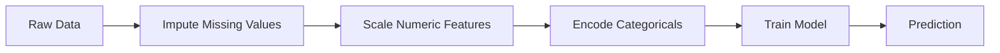
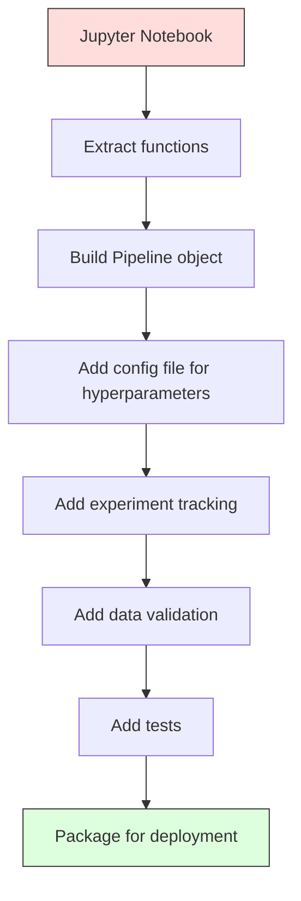

# ML 파이프라인

> 모델은 제품이 아닙니다. 파이프라인은 파이프라인은 원료 데이터부터 배포된 예측까지 모든 것을 의미합니다. 그리고 모든 단계는 재생가능해야 합니다.

**Type:** Build
**Language:**파이썬
**Prerequisites:** Phase 2, Lesson 12 (Hyperparameter Tuning)
**Time:** ~120 minutes

## 학습 목표

- 무늬에서 ML 파이프라인을 구축하여 배정, 확장, 코딩 및 모델 훈련을 하나의 재생 가능한 객체로 묶어
- 데이터 유출 시나리오를 파악하고 파이프라인에서 트랜스퍼머를 훈련 데이터에만 설치함으로써 이를 방지하는 방법을 설명합니다
- 숫자 및 범주적 기능에 다른 사전 처리를 적용하는 ColumnTransformer를 구축
- 파이프라인 시리에리얼화를 실시하고, 동일한 펌프 라인이 훈련과 생산에서 동일한 결과를 생산한다는 것을 증명합니다.

## 문제

데이터 로드를 하고, 미미한 값을 채우고, 스캔 기능을 하고, 모델을 훈련시키고, 정확성을 인쇄하는 노트북이 있습니다. 작동합니다.

한 달 후, 누군가가 모델을 다시 훈련시키고 다른 결과를 얻습니다. 시험 데이터를 포함한 전체 데이터 세트에 의해 평균을 계산하였다 (데이터 누출). 스케일링 매개 변수는 저장되지 않았으므로 추론은 다른 통계를 사용합니다. 기능 공학 코드는 훈련과 서비스 사이에 복사- 붙여졌고 복사본은 분화되었습니다. 카테고리 칼럼은 엔코더가 본 적이 없는 새로운 생산 가치를 얻었습니다.

이러한 것들은 가설적인 것이 아닙니다. 그것들은 생산에서 ML 시스템이 실패하는 가장 흔한 이유입니다. 파이프 라인은 모든 변환 단계를 하나의 순서적이고 재생 가능한 물체로 포장함으로써 모든 문제를 해결합니다.

## 개념

### 파이프라인 은 무엇 입니까?

파이프라인 (pipeline) 은 데이터 변환의 순서열을 모델이 따라가며, 각 단계에서는 이전 단계의 출력을 입력으로 취하고, 전체 파이프라인은 훈련 데이터에 한 번 설치된다. 추론 시, 동일한 설치된 파이프라인은 새로운 데이터를 변환하고 예측을 생성한다.



파이프라인으로 보장되는
- 변환은 훈련 데이터에만 설치된다 (출출이 없다)
- 추론 시에도 동일한 변환이 적용됩니다.
- 전체 객체는 일련화되어 하나의 유물으로 배포될 수 있습니다
- 횡단 검증은 파이프 라인을 접면으로 적용하여 미묘한 누출을 방지합니다

### 데이터 유출: 침묵 살인자

데이터 유출은 테스트 세트나 미래의 데이터로부터의 정보가 훈련에 오염될 때 발생합니다. 파이프 라인은 가장 일반적인 형태를 방지합니다.

**Leaky (wrong):**
```python
X = df.drop("target", axis=1)
y = df["target"]

scaler = StandardScaler()
X_scaled = scaler.fit_transform(X)

X_train, X_test = X_scaled[:800], X_scaled[800:]
y_train, y_test = y[:800], y[800:]
```

스칼러는 테스트 데이터를 봤습니다. 평균과 표준 경각심을 테스트 샘플이 포함합니다. 이것은 정확성 추정치를 부풀립니다.

**Correct:**
```python
X_train, X_test = X[:800], X[800:]

scaler = StandardScaler()
X_train_scaled = scaler.fit_transform(X_train)
X_test_scaled = scaler.transform(X_test)
```

파이프라인에서는 이런 생각을 할 필요가 없습니다. 파이프라인은 자동으로 처리합니다.

### 스카르노 파이프라인

 스클라너의`Pipeline`체인 트랜스포머와 추정기를`.fit()``.predict()`그리고`.score()`모든 단계를 순서대로 적용하는 것입니다.

```python
from sklearn.pipeline import Pipeline
from sklearn.preprocessing import StandardScaler
from sklearn.linear_model import LogisticRegression

pipe = Pipeline([
    ("scaler", StandardScaler()),
    ("model", LogisticRegression()),
])

pipe.fit(X_train, y_train)
predictions = pipe.predict(X_test)
```

전화할 때`pipe.fit(X_train, y_train)`이 부분의 본문은
1. 스칼러 전화`fit_transform`X_트레인
2. 모델 호출`fit`스케일 X_트레인

전화할 때`pipe.predict(X_test)`이 부분의 본문은
1. 스칼러 전화`transform`(fit_transform) 에 대한 X_test
2. 모델 호출`predict`스케일 X_test에

스칼러는 설치 중에 테스트 데이터를 볼 수 없습니다. 이것이 전부입니다.

### 컬럼 트랜스포머: 다른 컬럼에 대한 다른 파이프라인

실제 데이터 세트는 다른 사전 처리가 필요한 수치 및 범주 열을 가지고 있습니다. `ColumnTransformer`이 일을 처리해

```python
from sklearn.compose import ColumnTransformer
from sklearn.preprocessing import StandardScaler, OneHotEncoder
from sklearn.impute import SimpleImputer

numeric_pipe = Pipeline([
    ("impute", SimpleImputer(strategy="median")),
    ("scale", StandardScaler()),
])

categorical_pipe = Pipeline([
    ("impute", SimpleImputer(strategy="most_frequent")),
    ("encode", OneHotEncoder(handle_unknown="ignore")),
])

preprocessor = ColumnTransformer([
    ("num", numeric_pipe, ["age", "income", "score"]),
    ("cat", categorical_pipe, ["city", "gender", "plan"]),
])

full_pipeline = Pipeline([
    ("preprocess", preprocessor),
    ("model", GradientBoostingClassifier()),
])
```

`handle_unknown="ignore"`OneHotEncoder는 생산에 매우 중요합니다. 새로운 카테고리가 나타나면 (모델이 본 적이 없는 도시) 그것은 충돌하는 대신 0 벡터를 생성합니다.

### 실험 추적

파이프라인으로 훈련이 재생가능하지만 실험에서 어떤 하이퍼파레머가 사용되었는지, 어떤 데이터 세트 버전이 사용되었는지, 어떤 메트릭이 사용되었는지, 어떤 코드를 실행했는지 추적해야 합니다.

**MLflow**가장 일반적인 오픈소스 솔루션입니다.

```python
import mlflow

with mlflow.start_run():
    mlflow.log_param("max_depth", 5)
    mlflow.log_param("n_estimators", 100)
    mlflow.log_param("learning_rate", 0.1)

    pipe.fit(X_train, y_train)
    accuracy = pipe.score(X_test, y_test)

    mlflow.log_metric("accuracy", accuracy)
    mlflow.sklearn.log_model(pipe, "model")
```

모든 실행은 매개 변수, 측정, 유물 및 전체 모델로 기록됩니다. 당신은 실행을 비교하고, 어떤 실험을 재생하고, 어떤 모델 버전을 배포할 수 있습니다.

**Weights & Biases (wandb)**호스팅 된 대시보드와 동일한 기능을 제공합니다:

```python
import wandb

wandb.init(project="my-pipeline")
wandb.config.update({"max_depth": 5, "n_estimators": 100})

pipe.fit(X_train, y_train)
accuracy = pipe.score(X_test, y_test)

wandb.log({"accuracy": accuracy})
```

### 모델 버전

실험 추적 후, 모델 버전을 관리해야 합니다. 어떤 모델이 생산되고 있는지, 어떤 모델이 단계화되고 있는지,

MLflow의 모델 레지스트리는 다음과 같이 규정하고 있습니다.
- **Version tracking:**저장된 모든 모델은 버전 번호를 얻습니다.
- **Stage transitions:**"연극", "제작", "고장"
- **Approval workflow:**모델은 생산에 명시적으로 촉진되어야 합니다
- **Rollback:**이전 버전으로 즉시 전환

### DVC로 데이터 버전을

코드는 git와 함께 버전됩니다. 데이터 또한 버전되어야합니다. 그러나 git은 큰 파일을 처리 할 수 없습니다. DVC (데이터 버전 제어) 는 이것을 해결합니다.

```
dvc init
dvc add data/training.csv
git add data/training.csv.dvc data/.gitignore
git commit -m "Track training data"
dvc push
```

DVC는 실제 데이터를 원격 저장 장치 (S3, GCS, Azure) 에 저장하고`.dvc`Git에 있는 파일에서 해시를 기록합니다. Git 컴백을 체크하면`dvc checkout`사용된 정확한 데이터를 복원합니다.

즉, 모든 git 커밋 핀은 코드와 데이터를 모두 재생할 수 있습니다.

### 재현 가능한 실험

재생 가능한 실험은 네 가지 요건을 요구합니다.

1. **Fixed random seeds:**이거나 무작위 또는 프레임워크 (토치,  sklearn) 에 대한 씨앗을 설정
2. **Pinned dependencies:**정확한 버전의 requirements.txt 또는 poetry.lock
3. **Versioned data:**DVC 또는 유사한
4. **Config files:**모든 하이퍼파라메터, 하드코딩되지 않은 구성

```python
import numpy as np
import random

def set_seed(seed=42):
    random.seed(seed)
    np.random.seed(seed)
    try:
        import torch
        torch.manual_seed(seed)
        torch.cuda.manual_seed_all(seed)
        torch.backends.cudnn.deterministic = True
    except ImportError:
        pass
```

### 노트북 에서 생산 파이프라인



전형적인 진행:

1. **Notebook exploration:**빠른 실험, 시각화, 기능 아이디어
2. **Extract functions:**사전 처리, 기능 공학, 평가, 모듈로 옮기기
3. **Build Pipeline:**체인 변환을 sklearn 파이프라인 또는 사용자 지정 클래스로
4. **Config management:**모든 하이퍼파레머를 YAML/JSON 구성으로 이동
5. **Experiment tracking:**MLflow 또는 wandb 로그링을 추가
6. **Data validation:**훈련 전에 스케마, 분포 및 실종 값 패턴을 확인합니다
7. **Tests:**변환기 단위 시험, 전체 파이프라인 통합 시험
8. **Deployment:**파이프 라인을 Serialize, API (FastAPI, Flask) 에 포장, 컨테이너

### 파이프라인 에 대한 일반적인 실수

| Mistake | Why it is bad | Fix |
|---------|-------------|-----|
| Fitting on full data before splitting | Data leakage | Use Pipeline with cross_val_score |
| Feature engineering outside pipeline | Different transforms at train vs serve | Put all transforms in the Pipeline |
| Not handling unknown categories | Production crash on new values | OneHotEncoder(handle_unknown="ignore") |
| Hardcoded column names | Breaks when schema changes | Use column name lists from config |
| No data validation | Silently wrong predictions on bad data | Add schema checks before prediction |
| Training/serving skew | Model sees different features in prod | One Pipeline object for both |

```figure
f3-pipeline-flow
```

## 건설 해

코드는 `code/pipeline.py`처음부터 ML 파이프라인을 완성합니다.

### 단계 1: 사용자 지정 트랜스포머

```python
class CustomTransformer:
    def __init__(self):
        self.means = None
        self.stds = None

    def fit(self, X):
        self.means = np.mean(X, axis=0)
        self.stds = np.std(X, axis=0)
        self.stds[self.stds == 0] = 1.0
        return self

    def transform(self, X):
        return (X - self.means) / self.stds

    def fit_transform(self, X):
        return self.fit(X).transform(X)
```

### 2단계: 처음부터 파이프라인

```python
class PipelineFromScratch:
    def __init__(self, steps):
        self.steps = steps

    def fit(self, X, y=None):
        X_current = X.copy()
        for name, step in self.steps[:-1]:
            X_current = step.fit_transform(X_current)
        name, model = self.steps[-1]
        model.fit(X_current, y)
        return self

    def predict(self, X):
        X_current = X.copy()
        for name, step in self.steps[:-1]:
            X_current = step.transform(X_current)
        name, model = self.steps[-1]
        return model.predict(X_current)
```

### 단계 3: 파이프라인과 교차 검증

코드는 파이프라인과 교차 검증이 데이터 유출을 방지하는 방법을 보여줍니다. 스칼러는 각 폴드의 훈련 데이터에 별도로 부착됩니다.

### 단계 4: sklearn을 가진 전체 생산 파이프라인

`ColumnTransformer`, 여러 개의 사전 처리 경로와 적절한 십자 검증과 실험 기록에 훈련된 모델

## 선박

이 교훈은 다음과 같은 결과를 낳습니다.
- `outputs/prompt-ml-pipeline.md`-- ML 파이프 라인 구축 및 디버깅 기술
- `code/pipeline.py`-- 처음부터 스클라른을 통한 전체 파이프라인

## 운동

1. 3개의 숫자 열과 2개의 범주 열을 가진 데이터 세트를 처리하는 파이프라인을 구축하십시오. 사용 `ColumnTransformer`중등상수 + 스케일링을 수치에 적용하고 가장 빈번한상수 + 한 번 열기 코딩을 카테고리컬에 적용하기 위해 훈련합니다.

2. 의도적으로 데이터 유출을 도입: 스컬러를 전체 데이터 세트에 배치하여 분할하기 전에 횡단 유효성 평가 점수를 (유출) 과 파이프라인 크로스 유효성 평가 점수를 (정확) 비교하십시오. 얼마나 큰 차이가 있습니까?

3. `joblib.dump`다른 스크립트로 로드해서 예측을 실행해 보시면 예측이 동일하다는 것을 확인하세요

4. 파이프라인에 사용자 지정 트랜스포머를 추가하여 가장 중요한 두 개의 숫자 열에 대해 다항함수 (도 2) 를 생성합니다. 파이프라인에서 어디로 가야합니까?

5. 파이프라인에서 MLflow 추적을 설정하고, 5개의 실험을 다른 하이퍼파레머로 실행하고, MLflow UI를 사용해서`mlflow ui`) 를 비교하고 가장 좋은 모델을 선택하기 위해서

## 주요 용어

| Term | What people say | What it actually means |
|------|----------------|----------------------|
| Pipeline | "Chain of transforms + model" | An ordered sequence of fitted transformers and a model, applied as one unit to prevent leakage |
| Data leakage | "Test info leaked into training" | Using information from outside the training set to build the model, inflating performance estimates |
| ColumnTransformer | "Different preprocessing per column" | Applies different pipelines to different subsets of columns, combining results |
| Experiment tracking | "Logging your runs" | Recording parameters, metrics, artifacts, and code versions for every training run |
| MLflow | "Track and deploy models" | Open-source platform for experiment tracking, model registry, and deployment |
| DVC | "Git for data" | Version control system for large data files, storing hashes in git and data in remote storage |
| Model registry | "Model version catalog" | A system that tracks model versions with stage labels (staging, production, archived) |
| Training/serving skew | "It worked in the notebook" | Differences between how data is processed during training versus inference, causing silent errors |
| Reproducibility | "Same code, same result" | The ability to get identical results from the same code, data, and configuration |

## 더 많은 읽기

- [scikit-learn Pipeline docs](https://scikit-learn.org/stable/modules/compose.html)-- 공식 파이프라인 참조
- [MLflow documentation](https://mlflow.org/docs/latest/index.html)-- 실험 추적 및 모델 레지스트리
- [DVC documentation](https://dvc.org/doc)-- 데이터 버전을
- [Sculley et al., Hidden Technical Debt in Machine Learning Systems (2015)](https://papers.nips.cc/paper/2015/hash/86df7dcfd896fcaf2674f757a2463eba-Abstract.html)-- ML 시스템 복잡성에 관한 시초 논문
- [Google ML Best Practices: Rules of ML](https://developers.google.com/machine-learning/guides/rules-of-ml)-- 실제 생산 ML 조언
