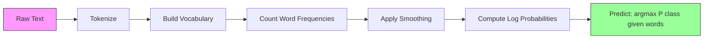

# 순진한 베이즈

> "나이프" 가설은 틀렸지만 어쨌든 효과가 있습니다. 그게 그 아름다움입니다.

**Type:** Build
**Language:**파이썬
**Prerequisites:** Phase 2, Lessons 01-07 (classification, Bayes' theorem)
**Time:** ~75 minutes

## 학습 목표

- 텍스트 분류를 위해 라플라스 평행으로 멀티노미얼 순진 베이즈를 처음부터 구현
- 왜 순진한 독립 가정이 수학적으로 잘못되었는지 설명하지만 실제적으로 올바른 계급 순위를 생성하는지 설명하십시오.
- 멀티노미얼, 베르누리, 그리고 가우스 미성숙한 베이스 변형을 비교하고 주어진 기능 유형에 적합한 것을 선택하십시오
- 고차원 희소 데이터에 대한 물적 회귀에 대해 순진적인 베이즈를 평가하고, 직장에서 편향 변동의 타협을 설명합니다

## 문제

텍스트를 분류해야 합니다. 이메일들은 스팸 또는 비스팸으로 분류해야 합니다. 고객 리뷰는 긍정적 또는 부정적인 것으로 분류해야 합니다. 지원 티켓은 카테고리로 분류해야 합니다. 수천 가지 기능 (언어당 하나) 및 제한된 교육 데이터가 있습니다.

대부분의 분류가 여기서 질식합니다. 물류 회귀는 수천 개의 무게를 신뢰할 수 있는 방법으로 추정하기 위해 충분한 샘플이 필요합니다. 결정 나무는 한 단어에 따라 갈라지고 야생하게 과장됩니다. 10,000 차원의 KNN는 모든 점과 동등하게 떨어져 있기 때문에 의미가 없습니다.

이색한 베이즈가 처리할 거야 수학적으로 잘못된 가정 (모든 특징은 클래스를 고려한 다른 모든 특징에 독립된다는) 을 하고, 특히 작은 훈련 세트에서 텍스트 분류에 대한 "스마트" 모델을 여전히 우월합니다. 데이터들을 한 번만 통과시켜서 수백만 가지의 특징을 가지고 있습니다. 그것은 확률 추정치를 생성합니다 (독립 가정으로 인해 종종 잘 캘리브되지 않지만).

왜 잘못된 가정이 좋은 예측으로 이어지는지 이해하면 머신러닝에 대해 근본적인 것을 가르쳐줍니다. 최고의 모델은 가장 정확한 모델이 아니라 데이터에 대한 가장 좋은 편향 변동 대상이 되는 모델입니다.

## 개념

### 베이즈 정리 (단순한 검토)

베이즈 정리는 조건부 확률을 뒤집고 있습니다.

```math
P(\text{class} \mid \text{features}) = \frac{P(\text{features} \mid \text{class}) \cdot P(\text{class})}{P(\text{features})}
```

우리는`P(class | features)`-- 문서가 그 단어들을 고려한 클래스에 속하는 확률입니다.
- `P(features | class)`-- 이 단어들을 이 클래스의 문서에서 볼 확률
- `P(class)`-- 클래스의 이전 확률 (전반적으로 스팸은 얼마나 흔한가요?)
- `P(features)`-- 모든 클래스에서 동일한 증거, 그래서 우리는 비교할 때 무시 할 수 있습니다

가장 높은 클래스`P(class | features)`이기는 거란 거야

### 순진 한 독립 의 가정

컴퓨터`P(features | class)`정확히 모든 특징의 합동 확률을 추정하는 것을 필요로 합니다. 10,000 단어의 어휘를 가지고,$2^{10{,}000}$가능한 조합이 불가능합니다.

순진한 가정: 모든 특징은 클래스를 고려하면 조건적으로 독립적입니다.

```math
P(w_1, w_2, \ldots, w_n \mid \text{class}) = P(w_1 \mid \text{class}) \cdot P(w_2 \mid \text{class}) \cdots P(w_n \mid \text{class})
```

불가능한 공동 분포가 아니라,$n$간단한 분포가 필요하죠. 각각의 분포는

이 가정은 분명히 틀렸습니다. "기기"와 "학습"이라는 단어는 어떤 문서에서도 독립적이지 않습니다. 하지만 분류자는 정확한 확률 추정치가 필요하지 않습니다. 올바른 순위가 필요합니다. 어느 클래스가 가장 높은 확률을 가지고 있습니다. 독립 가정은 체계적인 오류를 도입하지만, 이러한 오류는 모든 클래스에 동일하게 영향을 미칩니다. 그래서 순위는 올바르게 유지됩니다.

### 왜 아직도 효과적 이 됩니까?

세 가지 이유:

1. **Ranking over calibration.**분류는 가장 높은 순위에서만 정확해야 합니다.$P(\text{spam}) = 0.99999$만약 확률이 0.7이 되면, 분류자는 여전히 스팸을 올바르게 선택합니다.

2. **High bias, low variance.**독립 가정은 강력한 전제이다. 그것은 모델을 크게 제한하여 과잉 적합성을 방지합니다. 제한된 훈련 데이터로, 약간 잘못된 그러나 안정적인 모델은 이론적으로 올바른 그러나 야생적으로 불안정한 모델을 이길 수 있습니다. 이것은 행동에서 편향 변동 거래입니다.

3. **Feature redundancy cancels out.**상관관계된 특징은 과잉 증거를 제공합니다. 분류기는 이 증거를 두 배로 계산하지만 올바른 클래스에서도 두 배로 계산합니다. "기기"와 "학습"이 항상 함께 나타나면, 둘 다 "기술" 클래스에 대한 증거를 제공합니다. NB는 두 번 계산하지만 올바른 클래스에서는 두 번 계산합니다.

네 번째, 실용적인 이유는: 이 naive Bayes는 매우 빠르다. 훈련은 데이터 카운팅 주파수를 통과하는 단일 통과입니다. 예측은 매트릭스 곱셈입니다. 당신은 초에 백만 개의 문서에 훈련 할 수 있습니다. 이 속도는 더 빨리 반복할 수 있다는 것을 의미합니다. 더 많은 기능 세트를 시도하고 더 느린 모델보다 더 많은 실험을 실행합니다.

### 수학 단계

구체적인 예시를 통해 찾아봅시다. 스팸과 비스팸이라는 두 가지 클래스를 가지고 있다고 가정해보죠. 우리의 어휘는 "자유", "돈", "회담"이라는 세 단어로 구성되어 있습니다.

교육 자료:
- 스팸 메일에는 "무료" 80번, "돈" 60번, "회담" 10번 (총 150개의 단어)
- 스팸메일 아닌 이메일에는 "무료" 5번, "돈" 10번, "회담" 100번 (115개의 단어)
- 40%의 이메일들은 스팸, 60%는 비스팸

라플라스 가벼운 ($\alpha=1$):

```math
\begin{aligned}
P(\text{free} \mid \text{spam}) &= (80 + 1) / (150 + 3) = 81/153 = 0.529 \\
P(\text{money} \mid \text{spam}) &= (60 + 1) / (150 + 3) = 61/153 = 0.399 \\
P(\text{meeting} \mid \text{spam}) &= (10 + 1) / (150 + 3) = 11/153 = 0.072 \\[6pt]
P(\text{free} \mid \text{not-spam}) &= (5 + 1) / (115 + 3) = 6/118 = 0.051 \\
P(\text{money} \mid \text{not-spam}) &= (10 + 1) / (115 + 3) = 11/118 = 0.093 \\
P(\text{meeting} \mid \text{not-spam}) &= (100 + 1) / (115 + 3) = 101/118 = 0.856
\end{aligned}
```

새로운 이메일에는 "자료" (2번), "돈" (1번), "회담" (0번) 이 포함되어 있습니다.

```math
\begin{aligned}
\log P(\text{spam} \mid \text{email}) &= \log(0.4) + 2 \log(0.529) + 1 \log(0.399) + 0 \log(0.072) \\
&= -0.916 + 2(-0.637) + (-0.919) + 0 \\
&= -3.109 \\[6pt]
\log P(\text{not-spam} \mid \text{email}) &= \log(0.6) + 2 \log(0.051) + 1 \log(0.093) + 0 \log(0.856) \\
&= -0.511 + 2(-2.976) + (-2.375) + 0 \\
&= -8.838
\end{aligned}
```

스팸은 큰 차이로 승리합니다. 두 번 등장하는 "자유"라는 단어는 스팸에 대한 강력한 증거입니다.$0 \cdot \log P$) - 다중명 NB에서, 없는 단어들은 아무런 효과도 없습니다.

### 3 가지 변종

이색 베이즈는 세 가지 맛으로 제공됩니다.`P(feature | class)`다른 방식으로요.

#### 다수명 순진한 베이즈

모델은 각 기능을 수록으로 한다. 특징은 단어 주파수 또는 TF-IDF 값이 있는 텍스트 데이터에 가장 좋습니다.

```math
P(\text{word}_i \mid \text{class}) = \frac{\text{count of } \text{word}_i \text{ in class} + \alpha}{\text{total words in class} + \alpha \cdot \text{vocab\_size}}
```

`alpha`이 변종은 텍스트 분류의 작업마자입니다.

#### 가우스 선명한 베이즈

각각의 특징을 정상적인 분포로 모델링합니다. 연속적인 특징을 위해 가장 좋습니다.

```math
P(x_i \mid \text{class}) = \frac{1}{\sqrt{2 \pi \cdot \text{var}}} \cdot \exp\left(-\frac{(x_i - \text{mean})^2}{2 \cdot \text{var}}\right)
```

각 클래스는 각각의 특징에 따라 자신의 평균과 변수를 얻습니다. 각각의 클래스 내에서 특징이 실제로 벨 곡선을 따르는 경우 이것은 잘 작동합니다.

#### 베르누리 순진한 베이즈

각각의 특징을 바이너리 (현재 또는 없는) 로 모델링합니다. 짧은 텍스트 또는 바이너리 특징 벡터에 가장 좋습니다.

```math
P(\text{word}_i \mid \text{class}) = \frac{\text{docs in class containing } \text{word}_i + \alpha}{\text{total docs in class} + 2 \alpha}
```

멀티노미얼과 달리 베르누리 (Bernoulli) 는 단어의 부재를 명시적으로 처벌합니다. "자유"는 일반적으로 스팸에 나타나지만 이 이메일에서 অনুপস্থিত이라면, 베르누리 (Bernoulli) 는 스팸에 대한 증거로 간주합니다.

### 각 변종 을 언제 사용 해야 합니까?

| Variant | Feature Type | Best For | Example |
|---------|-------------|----------|---------|
| Multinomial | Counts or frequencies | Text classification, bag-of-words | Email spam, topic classification |
| Gaussian | Continuous values | Tabular data with normal-ish features | Iris classification, sensor data |
| Bernoulli | Binary (0/1) | Short text, binary feature vectors | SMS spam, presence/absence features |

### 라플라스 매끄러움

시험 데이터에 단어가 나타나지만 특정 클래스의 훈련 데이터에 나타나지 않은 경우 어떻게 될까요?

부드러운 것 없이:`P(word | class) = 0/N = 0`. 전체 제품으로 곱한 1개의 0은`P(class | features) = 0`다른 증거와 상관없이, 보이지 않는 단 한 단어만 예측을 파괴합니다.

랩라스 평행은 작은 수를 더합니다`alpha`(일반적으로 1) 각 특징의 수에:

```math
P(\text{word}_i \mid \text{class}) = \frac{\text{count}(\text{word}_i, \text{class}) + \alpha}{\text{total\_words\_in\_class} + \alpha \cdot \text{vocab\_size}}
```

$\alpha=1$, 각 단어에는 적어도 작은 확률이 있습니다. 테스트 이메일에서 나타나는 "분분분분분분분분"이라는 단어는 더 이상 스팸 확률을 죽이지 않습니다. 평평화는 베이시어 해석을 가지고 있습니다. 그것은 단어 배포에 일률적인 디리첼트를 배치하는 것과 동등합니다.

더 높은 알파는 더 강한 평형 (더 균일한 분포) 를 의미합니다. 낮은 알파는 모델이 데이터를 더 신뢰한다는 것을 의미합니다. 알파는 조정하는 하이퍼 파라미터입니다.

알파의 효과:

| Alpha | Effect | When to use |
|-------|--------|-------------|
| 0.001 | Almost no smoothing, trust the data | Very large training set, no unseen features expected |
| 0.1 | Light smoothing | Large training set |
| 1.0 | Standard Laplace smoothing | Default starting point |
| 10.0 | Heavy smoothing, flattens distributions | Very small training set, many unseen features expected |

### 로그 공간 계산

수백 개의 확률을 곱하면 (하나가 1보다 작지만) 유동점 하위 흐름이 발생한다. 실제 값은 매우 작은 긍정적 인 숫자임에도 불구하고 유동점의 결과물은 무리가 된다.

해법은 로그 공간에서 작업합니다. 확률을 곱하기 대신 로그리듬을 더하십시오.

```math
\log P(\text{class} \mid x_1, x_2, \ldots, x_n) = \log P(\text{class}) + \sum_i \log P(x_i \mid \text{class})
```

이것은 예측을 점수산물로 변환합니다.

```
log_scores = X @ log_feature_probs.T + log_class_priors
prediction = argmax(log_scores)
```

매트릭스 곱셈. 이 때문에 이성적인 베이즈 예측은 매우 빠르죠.

### 순진한 베이즈와 물류적 퇴행

두 가지 모두 텍스트의 선형 분류자입니다. 차이점은 모델에 있습니다.

| Aspect | Naive Bayes | Logistic Regression |
|--------|------------|-------------------|
| Type | Generative (models $P(X \mid Y){}$) | Discriminative (models $P(Y \mid X){}$) |
| Training | Count frequencies | Optimize loss function |
| Small data | Better (strong prior helps) | Worse (not enough to estimate weights) |
| Large data | Worse (wrong assumption hurts) | Better (flexible boundary) |
| Features | Assumes independence | Handles correlations |
| Speed | Single pass, very fast | Iterative optimization |
| Calibration | Poor probabilities | Better probabilities |

엄지손가락 규칙: 순수적인 베이즈로 시작하세요. 충분한 데이터와 NB 고원지원을 가지고 있다면, 물적 회귀로 전환하세요.

### 분류 파이프라인



실제에서는 로그 공간에서 작동하여 부동의 지점 하류를 피합니다. 많은 작은 확률을 곱하기 대신 로그리듬을 더합니다.

```math
\log P(\text{class} \mid \text{features}) = \log P(\text{class}) + \sum_i \log P(\text{feature}_i \mid \text{class})
```

```figure
naive-bayes
```

## 건설 해

코드는 `code/naive_bayes.py`MultinomialNB와 GaussianNB를 처음부터 구현합니다.

### 다수명 NB

처음부터 실행:

1. **fit(X, y)**: 각 클래스별로 각 기능의 주파수를 계산합니다. 라플라스 평행성을 추가합니다. 로그 확률을 계산합니다. 클래스 전등을 저장합니다.

2. **predict_log_proba(X)**: 각 샘플에 대해 계산합니다 $\log P(\text{class})$+ 수$\log P(\text{feature}_i \mid \text{class})$모든 클래스에서 볼 수 있습니다. 이것은 매트릭스 곱셈입니다: X @ log_probs.T + log_priors

3. **predict(X)**: 가장 높은 로그 확률을 가진 클래스를 반환하십시오.

```python
class MultinomialNB:
    def __init__(self, alpha=1.0):
        self.alpha = alpha

    def fit(self, X, y):
        classes = np.unique(y)
        n_classes = len(classes)
        n_features = X.shape[1]

        self.classes_ = classes
        self.class_log_prior_ = np.zeros(n_classes)
        self.feature_log_prob_ = np.zeros((n_classes, n_features))

        for i, c in enumerate(classes):
            X_c = X[y == c]
            self.class_log_prior_[i] = np.log(X_c.shape[0] / X.shape[0])
            counts = X_c.sum(axis=0) + self.alpha
            self.feature_log_prob_[i] = np.log(counts / counts.sum())

        return self
```

핵심 통찰은: 맞춤화 후 예측은 매트릭스 곱셈과 편향이 됩니다. 이 때문에 이 naive Bayes는 그렇게 빨리 합니다.

### 가우스 NB

연속적인 특징을 위해, 우리는 특징에 대한 클래스별 평균과 변수를 추정합니다:

```python
class GaussianNB:
    def __init__(self):
        pass

    def fit(self, X, y):
        classes = np.unique(y)
        self.classes_ = classes
        self.means_ = np.zeros((len(classes), X.shape[1]))
        self.vars_ = np.zeros((len(classes), X.shape[1]))
        self.priors_ = np.zeros(len(classes))

        for i, c in enumerate(classes):
            X_c = X[y == c]
            self.means_[i] = X_c.mean(axis=0)
            self.vars_[i] = X_c.var(axis=0) + 1e-9
            self.priors_[i] = X_c.shape[0] / X.shape[0]

        return self
```

예측은 각 기능에 대한 가우스 PDF를 사용하여 기능들을 곱합니다 (록 공간에 추가됩니다).

### 데모: 텍스트 분류

이 코드는 두 클래스를 시뮬레이션하는 합성 단어 가방 데이터를 생성합니다. (기술 기사와 스포츠 기사). 각 클래스는 다른 단어 주파수 분포를 가지고 있습니다.

합성 데이터는 다음과 같이 작동합니다. 우리는 200개의 "말" (특성 열) 을 만듭니다. 0-39 단어들은 기술 기사에 높은 주파수를 가지고 있고 스포츠에서 낮은 주파수를 가지고 있습니다. 80-119 단어들은 스포츠에서 높은 주파수를 가지고 있고 기술에서 낮은 주파수를 가지고 있습니다. 40-79 단어들은 둘 다 중소 주파수를 가지고 있습니다. 이것은 어떤 단어들이 강한 클래스 지표가 있고 다른 단어들이 소음이라는 현실적인 시나리오를 만듭니다.

### 디모: 연속 기능

이 코드는 아이리스와 비슷한 데이터를 생성한다 (3 클래스, 4 기능, 가우스 클러스터). 가우스 NB는 클래스 당 평균 및 변수를 사용하여 분류한다. 각 클래스는 다른 센터 (중앙 벡터) 및 다른 퍼포먼스를 (변수를) 가지고 있으며, 측정이 범주 간 체계적으로 다르며 실제 데이터를 모방한다.

또한 코드는 다음과 같이 증명합니다.
- **Smoothing comparison:**다른 알파 값들을 가진 MultinomialNB를 훈련시켜 부드러운 힘의 정확성에 미치는 효과를 보여준다.
- **Training size experiment:**훈련 데이터의 정확도는 20개에서 1600개까지 증가함에 따라 어떻게 향상되는지 NB는 아주 적은 샘플에도 불구하고 적당한 정확성을 달성합니다. 이것이 주요 장점입니다.
- **Confusion matrix:**클래스별 정확성, 회수, 그리고 F1 점수는 NB가 실수를 저지르는 곳을 보여줍니다.

### 예측 속도

이 naive Bayes 예측은 매트릭스 곱셈입니다$n$$d$특징 및$k$클래스:
- 멀티노미얼NB: 한 매트릭스 곱하기 $(n \times d) \mathbin{@} (d \times k) = O(n \cdot d \cdot k)$
- 가우시안NB: $n \cdot k$가우시안 PDF 평가, 각 $d$특징 = $O(n \cdot d \cdot k)$

이 두 가지 모두 모든 차원에서 선형이다. 이것을 KNN (모든 훈련점까지 거리의 계산이 필요한) 또는 RBF 커널 (모든 지원 벡터에 대한 커널 평가가 필요한) 과 SVM (RBF 커널) 과 비교하십시오. NB는 예측 시간에 규모 순위로 더 빨라집니다.

## 사용 하 고

sklearn의 경우 두 가지 변종 모두 1 라인형입니다.

```python
from sklearn.naive_bayes import GaussianNB, MultinomialNB

gnb = GaussianNB()
gnb.fit(X_train, y_train)
print(f"GaussianNB accuracy: {gnb.score(X_test, y_test):.3f}")

mnb = MultinomialNB(alpha=1.0)
mnb.fit(X_train_counts, y_train)
print(f"MultinomialNB accuracy: {mnb.score(X_test_counts, y_test):.3f}")
```

스클러너와 텍스트 분류:

```python
from sklearn.feature_extraction.text import CountVectorizer
from sklearn.naive_bayes import MultinomialNB
from sklearn.pipeline import Pipeline

text_clf = Pipeline([
    ("vectorizer", CountVectorizer()),
    ("classifier", MultinomialNB(alpha=1.0)),
])

text_clf.fit(train_texts, train_labels)
accuracy = text_clf.score(test_texts, test_labels)
```

코드는 `naive_bayes.py`정확성을 확인하기 위해 동일한 데이터에 대한 스쿨라인과 처음부터 구현을 비교합니다.

### TF-IDF, Naive Bayes

원자 단어 수치는 모든 단어의 무게를 같은 경우에 부여합니다. 하지만 "the"와 "is" 같은 일반적인 단어들은 모든 클래스에서 자주 나타납니다. 그들은 정보를 가지고 있지 않습니다. TF-IDF (Term Frequency - Inverse Document Frequency) 는 일반적인 단어의 무게를 낮추고 희귀하고 차별적인 단어를 높입니다.

```python
from sklearn.feature_extraction.text import TfidfVectorizer
from sklearn.naive_bayes import MultinomialNB
from sklearn.pipeline import Pipeline

text_clf = Pipeline([
    ("tfidf", TfidfVectorizer()),
    ("classifier", MultinomialNB(alpha=0.1)),
])
```

TF-IDF 값은 부정적이기 때문에 MultinomialNB와 작동합니다. TF-IDF + MultinomialNB의 조합은 텍스트 분류에 대한 가장 강력한 기본 라인 중 하나입니다. 10,000 개 이상의 훈련 샘플이있는 데이터 세트에 대한 더 복잡한 모델을 종종 이길 수 있습니다.

### 짧은 텍스트를 위한 베르누리NB

짧은 텍스트 (트윗, SMS, 채팅 메시지) 에 대해서는 BernoulliNB는 MultinomialNB를 능가할 수 있습니다. 짧은 텍스트는 단어 수치가 낮기 때문에 MultinomialNB가 의존하는 주파수 정보는 소란적입니다. BernoulliNB는 단지 존재 또는 অনুপস্থিতি에 대해 신경쓰고 있습니다. 짧은 텍스트는 더 신뢰할 수 있습니다.

```python
from sklearn.naive_bayes import BernoulliNB
from sklearn.feature_extraction.text import CountVectorizer

text_clf = Pipeline([
    ("vectorizer", CountVectorizer(binary=True)),
    ("classifier", BernoulliNB(alpha=1.0)),
])
```

`binary=True`CountVectorizer의 플래그는 모든 계산을 0/1로 변환합니다. 그 없이는 BernoulliNB는 여전히 작동하지만 설계되지 않은 계산을 보고 있습니다.

### 기량 측정 NB 확률

NB 확률은 잘 정렬되지 않습니다. NB는$P(\text{spam}) = 0.95$, 실제 확률은 0.7일 수 있습니다. 신뢰할 수 있는 확률 추정치가 필요하다면 (예를 들어, 임계값을 설정하거나 다른 모델과 결합하려면) sklearn의 캘리브레이트 클래시퍼CV를 사용하십시오.

```python
from sklearn.calibration import CalibratedClassifierCV

calibrated_nb = CalibratedClassifierCV(MultinomialNB(), cv=5, method="sigmoid")
calibrated_nb.fit(X_train, y_train)
proba = calibrated_nb.predict_proba(X_test)
```

이것은 십자정확을 사용하여 NB의 원자 점수를 상대로 로지스트적 회귀에 적합합니다. 결과 확률은 실제 클래스 주파수와 훨씬 가깝습니다.

### 일반적인 고타스

1. **Negative feature values.**멀티노미얼NB는 부정적 기능이 필요하지 않습니다. 만약 당신이 부정적인 값을 가지고 있다면 (특정 설정 또는 표준화된 기능과 같은 TF-IDF) 가 가우스 NB를 사용하거나, 긍정적 인 기능으로 변경하십시오.

2. **Zero variance features.**가우스 NB는 변함에 따라 나 ?? 다. 만약 어떤 기능이 클래스 (모든 값이 동일) 에 대해 0 변수를 가지고 있다면 확률 계산이 끊어진다. 코드는 이를 방지하기 위해 모든 변수에 작은 평행 용어를 (1e-9) 추가한다.

3. **Class imbalance.**만약 99%의 이메일들이 스팸이 아니라면,$P(\text{not-spam}) = 0.99$확률 증거는 압도할 정도로 강하다. 당신은 수동으로 클래스 우선 순위를 설정하거나 sklearn에서 클래스_프라이어 매개 변수를 사용할 수 있습니다.

4. **Feature scaling.**멀티노미얼NB는 스케일링이 필요하지 않습니다 (수정에서 작동합니다). 가우시안NB는 스케일링이 필요하지 않습니다 (분자별 통계를 추정합니다). 이것은 특징 스케일에 민감한 물류 회귀와 SVM에 비해 장점입니다.

## 선박

이 교훈은 다음과 같은 결과를 낳습니다.
- `outputs/skill-naive-bayes-chooser.md`-- 올바른 NB 변종을 선택하는 의사 결정 능력
- `code/naive_bayes.py`-- MultinomialNB와 GaussianNB는 처음부터, sklearn 비교

### 순진 한 베이스 이 실패 할 때

NB는 독립 가정이 잘못된 순위를 유발할 때 실패합니다. 이것은 잘못된 확률뿐만 아니라 발생합니다.

1. **Strong feature interactions.**만약 클래스가 두 가지 특징의 조합에 의존하지만 둘 중 하나가 따로 (XOR형 패턴) 이 아니라면, NB는 완전히 놓칠 것입니다. 각각의 특징은 단독으로 증거가 없으며 NB는 그것들을 비선형적으로 결합할 수 없습니다.

2. **Highly correlated features with opposing evidence.**기능 A가 "스팸"라고 말하고 기능 B가 "스팸이 아닌 것"이라고 말하고 있지만 A와 B가 완벽하게 상관관계가 있는 경우 (현실에서는 항상 동의합니다), NB는 전혀 없는 곳에서 모순적인 증거를 보게 될 것입니다.

3. **Very large training sets.**충분한 데이터로, 물적 회귀와 같은 차별적인 모델은 진정한 의사 결정 경계를 배우고 NB를 능가합니다. 작은 데이터에 도움이 된 독립 가정은 이제 모델을 뒤로 합니다.

실제에서 이러한 실패 모드는 텍스트 분류에 드문 경우입니다. 텍스트 기능은 다양하고 개별적으로 약하며 독립 가정의 오류는 취소되는 경향이 있습니다. 몇 가지 강한 상관관계를 가진 테이블 데이터에 대해 먼저 물적 회귀 또는 나무 기반 모델을 고려하십시오.

## 운동

1. **Smoothing experiment.**MultinomialNB를 0.01, 0.1, 1.0, 10.0, 100.0의 알파 값으로 텍스트 데이터에 훈련하십시오.

2. **Feature independence test.**실제 텍스트 데이터 세트를 선택하여 명백하게 상관관계를 갖는 두 단어를 선택하세요.$P(\text{word}_1 \mid \text{class}) \cdot P(\text{word}_2 \mid \text{class})$그리고 비교해 보세요$P(\text{word}_1 \text{ AND } \text{word}_2 \mid \text{class})$독립 가정은 얼마나 잘못된 것일까요?

3. **Bernoulli implementation.**BernoulliNB 클래스를 사용하여 코드를 확장하고, 단어의 팩을 바이너리로 변환하고, 텍스트 데이터에 있는 MultinomialNB에 대한 정확성을 비교하십시오. Bernoulli는 언제 승리합니까?

4. **NB vs Logistic Regression.**텍스트 데이터에 따라 두 가지 모두 훈련하십시오. 100 개의 훈련 샘플을 시작하여 10,000으로 증가하십시오. 두 가지의 전사 정확성과 훈련 세트 크기가 다릅니다. 물류 회귀는 어떤 시점에서 이 naive Bayes를 능가합니까?

5. **Spam filter.**완전한 스팸 분류기를 만들죠. 원본 이메일 텍스트를 토큰화하고, 어휘를 만들며, 단어의 가방 기능을 만들며, MultinomialNB를 훈련시키고, 정확도로 평가하고, 회수합니다.

## 주요 용어

| Term | What people say | What it actually means |
|------|----------------|----------------------|
| Naive Bayes | "Simple probabilistic classifier" | A classifier that applies Bayes' theorem with the assumption that features are conditionally independent given the class |
| Conditional independence | "Features don't affect each other" | $P(A, B \mid C) = P(A \mid C) \cdot P(B \mid C)$ -- knowing $B$ tells you nothing new about $A$ once you know $C$ |
| Laplace smoothing | "Add-one smoothing" | Adding a small count to every feature to prevent zero probabilities from dominating the prediction |
| Prior | "What you believed before seeing data" | $P(\text{class})$ -- the probability of each class before observing any features |
| Likelihood | "How well the data fits" | $P(\text{features} \mid \text{class})$ -- the probability of observing these features if the class is known |
| Posterior | "What you believe after seeing data" | $P(\text{class} \mid \text{features})$ -- the updated probability of the class after observing the features |
| Generative model | "Models how data is generated" | A model that learns $P(X \mid Y)$ and $P(Y)$, then uses Bayes' theorem to get $P(Y \mid X)$ |
| Discriminative model | "Models the decision boundary" | A model that directly learns $P(Y \mid X)$ without modeling how $X$ is generated |
| Log probability | "Avoid underflow" | Working with $\log P$ instead of $P$ to prevent the product of many small numbers from becoming zero in floating point |

## 더 많은 읽기

- [scikit-learn Naive Bayes docs](https://scikit-learn.org/stable/modules/naive_bayes.html)-- 수학적인 세부사항을 가진 세 가지 변수 모두
- [McCallum and Nigam, A Comparison of Event Models for Naive Bayes Text Classification (1998)](https://www.cs.cmu.edu/~knigam/papers/multinomial-aaaiws98.pdf)-- 텍스트를 위한 멀티노미얼과 베르누리
- [Rennie et al., Tackling the Poor Assumptions of Naive Bayes Text Classifiers (2003)](https://people.csail.mit.edu/jrennie/papers/icml03-nb.pdf)-- 텍스트에 대한 NB의 개선
- [Ng and Jordan, On Discriminative vs. Generative Classifiers (2001)](https://ai.stanford.edu/~ang/papers/nips01-discriminativegenerative.pdf)-- NB가 LR보다 더 빠른 속도로
