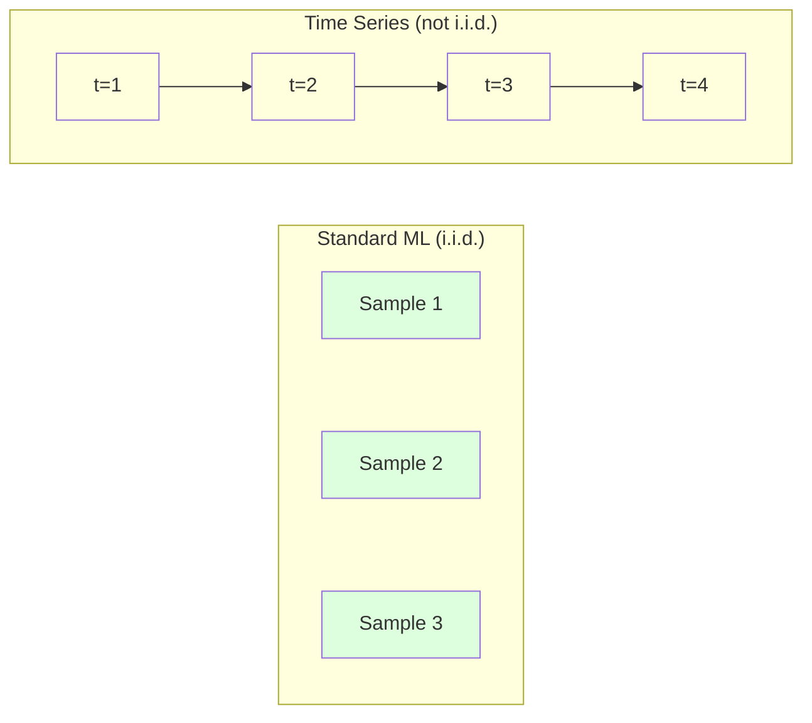
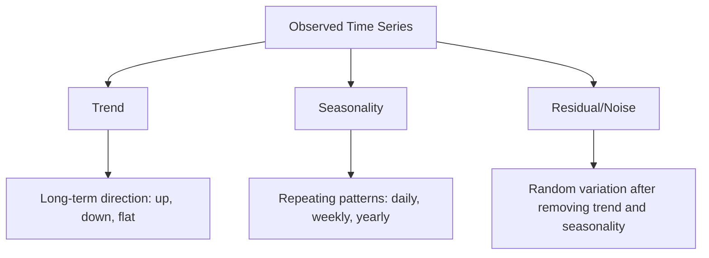
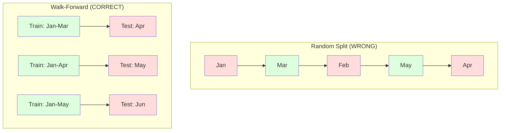

# 시간 시리즈 기본 사항

> 과거 성능은 미래의 결과를 예측합니다. 먼저 정지성을 확인하면요.

**Type:** Build
**Language:**파이썬
**Prerequisites:** Phase 2, Lessons 01-09
**Time:** ~90 minutes

## 학습 목표

- 시간 시리즈를 트렌드, 계절성, 잔류 구성 요소로 분해하고 고정성 테스트
- 시간 시리즈를 감독된 학습 문제로 변환하기 위해 지연 기능과 롤링 통계를 구현
- 미래 데이터의 교육에 유출되는 것을 방지하는 진행중인 검증 프레임워크를 구축
- 무작위 열/시험 분할이 시간 시리즈에 대해 무효가 되는 이유를 설명하고, 적절한 시간 분할과 성능 격차를 증명한다.

## 문제

시간별 순서를 가지고 있습니다. 매일 매출, 시간당 온도, 분당 CPU 사용량, 주간 주식 가격. 다음 주, 다음 분기, 다음 세월에

표준 ML 도구 킷을 찾아보세요. 무작위 열/테스트 분할, 십자정확인, 기능 매트릭스, 예측. 모든 단계는 잘못됩니다.

시간 시리즈는 표준 ML가 의존하는 가정들을 깨고 있습니다. 샘플은 독립적이지 않습니다. 오늘날의 온도는 어제 온도에 달려 있습니다. 무작위 분할은 미래의 정보를 과거에 유출합니다. 백테스트에서 훌륭하게 보이는 기능은 시간이 지남에 따라 변화하는 패턴에 의존하기 때문에 생산에서 실패합니다.

무작위적으로 횡단 검증을 통해 95%의 정확도를 얻는 모델은 적절한 시간 기반 평가로 55%를 얻을 수 있습니다. 차이점은 기술적인 것이 아닙니다. 그것은 종이 위에 작동하는 모델과 생산에서 작동하는 모델 사이의 차이입니다.

이 수업은 기본 내용을 다루고 있습니다. 시간 데이터를 어떻게 다르게 만들 수 있는지, 모델을 정직하게 평가하는 방법과 시간 시리즈를 표준 ML 모델이 소비할 수 있는 기능으로 바꾸는 방법.

## 개념

### 시간 시리즈 를 다른 것 으로 만드는 것

표준 ML는 i.i.d.를 가정한다. 독립적이고 동일하게 분포된다. 각 샘플은 다른 샘플과 독립적으로 같은 분포에서 추출된다. 시간 시리즈는 둘 다 위반한다:

- **Not independent.**오늘 주가가 어제와 달라지고 이번 주 매출은 지난주와 상관관계가 있습니다.
- **Not identically distributed.**분포는 시간이 지남에 따라 변합니다. 12월 판매는 3월 판매와는 다릅니다.

이 위반은 사소한 것이 아닙니다. 기능들을 만드는 방법, 모델을 평가하는 방법, 그리고 어떤 알고리즘이 작동하는지 변화시킵니다.



표준 ML에서 샘플은 교환이 가능해집니다. 그것들을 섞는 것은 아무것도 바꾸지 않습니다. 시간 연속에서 질서가 모든 것입니다. 혼합은 신호를 파괴합니다.

### 시간 연계 의 구성 요소

시간 시리즈는 다음과 같은 조합입니다.



- **Trend**장기적인 방향: 연간 10%의 수입 증가, 세계 온도 상승
- **Seasonality**: 일정한 간격으로 반복되는 패턴. 12 월 월 월 월 월 월 월 월 월 월 월 월 월 월 월 월 월 월 월 월 월 월 월 월 월 월 월 월 월 월 월 월 월 월 월 월 월 월 월 월 월 월 월 월 월 월 월 월 월 월 월 월 월 월 월 월 월 월 월 월 월 월 월 월 월 월 월 월 월 월 월 월 월 월 월 월 월 월 월 월 월 월 월 월 월 월 월 월 월 월 월 월 월 월 월 월 월 월 월 월 월 월 월 월 월 월 월 월 월 월 월 월 월 월 월 월 월 월 월 월 월 월 월 월 월 월 월 월 월 월 월 월 월 월 월 월 월 월 월 월 월 월 월 월 월 월 월 월 월 월 월 월 월 월 월 월 월 월 월 월 월 월 월 월 월 월 월 월 월 월 월 월 월 월 월 월 월 월 월 월 월 월 월 월 월 월 월 월 월 월 월 월 월 월 월 월 월 월 월 월 월 월 월 월 월 월 월 월 월 월 월 월 월 월 월 월 월 월 월 월 월 월 월 월 월 월 월 월 월 월 월 월 월 월 월 월 월 월 월 월 월 월 월 월 월 월 월 월 월 월 월 월 월 월 월 월 월 월 월 월 월 월 월 월 월 월 월 월 월 월 월 월 월 월 월 월 월 월 월 월 월 월 월 월 월 월 월 월 월 월 월 월 월 월 월 월 월 월 월 월 월 월 월 월 월 월 월 월 월 월 월 월 월 월 월 월 월 월 월 월 월 월 월 월 월 월 월 월 월 월 월 월 월 월 월 월 월 월 월 월 월 월 월 월 월 월 월 월 월 월 월 월 월 월 월 월 월 월 월 월 월 월 월 월 월 월 월 월 월 월 월 월 월 월 월 월 월 월 월 월 월 월 월 월 월 월 월 월 월 월 월 월 월 월 월 월 월 월 월 월 월 월 월 월 월 월 월 월 월 월 월 월 월 월 월 월 월 월 월 월 월 월 월 월 월 월 월 월 월 월 월 월 월 월 월 월 월 월 월 월 월 월 월 월 월 월 월 월 월 월 월 월 월 월 월 월 월 월 월 월 월 월 월 월 월 월 월 월 월 월 월 월 월 월 월 월 월 월 월 월 월 월 월 월 월 월 월 월 월 월 월 월 월 월 월 월 월 월 월
- **Residual**트렌드와 계절성 제거 후 남은 것은 무엇이든 하얀 소음처럼 보인다면 분해는 신호를 포착합니다.

### 정지성

시간 연계 (시간 연계) 는 시간 동안 통계적 특성 (평균, 변동, 자율 상관관계가) 이 변하지 않으면 고정된다. 대부분의 예측 방법은 고정성을 가정한다.

**Why it matters:**비정형 시리즈는 변동하는 평균을 가지고 있습니다. 1 월의 데이터를 바탕으로 훈련된 모델은 2 월의 평균보다 다른 평균을 배웠습니다. 그것은 체계적으로 잘못 될 것입니다.

**How to check:**창문 위에 굴곡 평균과 굴곡 표준차를 계산한다. 만약 그 원형이 흐르면, 시리즈는 정지되지 않는다.

**How to fix:**차별화: 원자 값을 모델링하는 대신 연속적인 값 사이의 변화를 모델링하십시오.

```math
\text{diff}[t] = \text{value}[t] - \text{value}[t-1]
```

한 라운드의 차별화로 인해 시리즈가 정지하지 않으면 다시 적용하십시오 (제2 순서별 차별화). 대부분의 실제 시리즈는 최대 두 라운드가 필요합니다.

**Example:**

본래 시리즈: [100, 102, 106, 112, 120]
첫 번째 차이: [2, 4, 6, 8] (아직 상승 추세)
두 번째 차이: [2, 2, 2] (상수 -- 정지)

원래의 시리즈는 사각형 트렌드를 가지고 있었습니다. 첫 번째 차별화는 선형 트렌드로 전환했습니다. 두 번째 차별화는 평평했습니다. 실제로는 두 라운드 이상 필요하지 않습니다.

**Formal test:**증강된 디키-플러 (ADF) 테스트는 정지성 표준 통계 테스트입니다. null 가설은 "시리즈는 정지성이 없습니다". 0.05 이하의 p 값은 정지성을 거부하고 결론을 내릴 수 있음을 의미합니다. 우리는 ADF를 처음부터 구현하지 않습니다 (이것이 증상주의 분포 테이블을 필요로합니다), 그러나 우리의 코드에서 롤링 통계 접근법은 실제적인 시계를 제공합니다.

### 자율 상관관계

자율 상관관계는 한 번에 어떤 값이 얼마나 많은지를 측정합니다 $t$시간적 값과 상관관계가 있습니다$t-k$($k$자동 상관관계 함수 (ACF) 는 각 지연에 대한 이 상관관계를 표시합니다.$k$- 그래

**ACF tells you:**
- 5단계 이상의 값이 5단계 이전보다 0단계로 떨어지면
- 계절성 여부: ACF가 12년 (월간 데이터) 이 지점으로 급증한다면, 연간 계절성 여부는 나타난다.
- 얼마나 많은 지연 기능이 생성될 수 있는지 ACF가 무시할 수 있는 지연 기능을 사용하세요.

**PACF (Partial Autocorrelation Function)**만약 오늘이 3일 전과 상관관계를 맺고 있는 이유는 모두 어제와 상관관계가 있기 때문에, PACF는 3일 후반에서 0이고, ACF는 3일 후반에서 0일 안 된다.

### 래그 특징: 시간 시리즈 를 감독 된 학습 으로 바꾸는 것

표준 ML 모델은 특징 매트릭스 X와 목표 y가 필요합니다. 시간 시리즈는 하나의 값 열을 제공합니다. 다리는 지연 기능입니다.

[10, 12, 14, 13, 15] 시리즈를 가지고 lag-1 및 lag-2 기능을 생성하십시오.

| lag_2 | lag_1 | target |
|-------|-------|--------|
| 10    | 12    | 14     |
| 12    | 14    | 13     |
| 14    | 13    | 15     |

이제 표준 회귀 문제가 있습니다. 모든 ML 모델 (선형 회귀, 무작위 숲, 기하급수 증진) 은 미루어있는 목표에서 목표를 예측할 수 있습니다.

추가 기능들을 설계할 수 있습니다.
- **Rolling statistics:**평균, std, min, max 마지막 k 값에
- **Calendar features:**주, 달, 휴일, 주말
- **Differenced values:**이전 단계의 변화
- **Expanding statistics:**누적 평균, 누적 수
- **Ratio features:**현재 값/중반 순환 (최근 평균과 얼마나 멀었는가)
- **Interaction features:**1 * 일일일일일일일일일일일일일일일일일일일일일일일일일일일일일일일일일일일일일일일일일일일일일일일일일일일일일일일일일일일일일일일일일일일일일일일일일일일일일일일일일일일일일일일일일일일일일일일일일일일일일일일일일일일일일일일일일일일일일일일일일일일일일일일일일일일일일일일일일일일일일일일일일일일일일일일일일일일일일일일일일일일일일일일일일일일일일일일일일일일일일일일일일일일일일일일일일일일일일일일일일일일일일일일일일일일일일일일일일일일일일일일일일일일일일일일일일일일일일일일일일일일일일일일일일일일일일일일일일일일일일일일일일일일일일일일일일일일일일일일일일일일일일일일일일일일일일일일일일일일일일일일일일일일일일일일일일일일일일일일일일일일일일일일일일일일일일일일일일일일일일일일일일일일일일일일일일일일일일일일일일일일일일일일일일일일일일일일일일일일일일일일일일일일일일일일일일일일일일일일일일일일일일일일일일일일일일일일일일일일일일일일일일일일일일일일일일일일일일일일일일일일일일일일일일일일일일일일일일일일일일일일일일일일일일일일일일일일일일일일일일일일일일일일일일일일일일일일일일일일일일일일일일일일일

**How many lags?**자율 상관관계 함수를 사용하십시오. ACF가 10가지 미루어 있는 경우 최소 10가지 미루어 사용하십시오. 주간 계절성일 경우 7가지 미루어 (그리고 14가지가 가능) 를 포함하세요. 더 많은 미루어지는 경우 모델에 더 많은 역사를 제공하지만, 더 많은 기능도 적용하여 과잉 부착의 위험을 증가시킵니다.

**The target alignment trap.**지연 기능을 생성할 때, 목표가 시간적 값이어야 합니다 $t$, 모든 기능들은 값들을 동시에 사용해야 합니다 $t-1$또는 이전에. 만약 실수로 값을 적시하면$t$기능으로 완벽한 예측을 하고, 완전히 쓸모없는 모델을 가지고 있습니다. 이것은 시간 시리즈 기능 공학에서 가장 흔한 오류입니다.

### 앞 으로 진료

이 강의에서 가장 중요한 개념은 이것입니다. 표준 k 배열 십자 검증은 무작위로 훈련 및 테스트에 샘플을 할당합니다. 시간 시리즈에 대해서는 이것은 미래의 정보를 누출합니다.



앞으로의 검증:
1. 데이터에 대한 최신 트레이닝$t$
2. 시간대로 예측해봐$t+1$(또는$t+1$ $t+k$다발적)
3. 창을 앞으로 슬라이드
4. 반복

각 테스트 폴드는 모든 훈련 데이터 이후에 나온 데이터만 포함합니다. 미래 누출은 없습니다. 이것은 모델이 배치되면 어떻게 작동하는지 정직한 추정치를 제공합니다.

**Expanding window**모든 역사 자료를 훈련에 사용한다 (창이 커진다).**Sliding window**고정 크기의 훈련 창 (창 슬라이드) 을 사용 합니다. 오래된 데이터가 여전히 관련 있다고 생각하면 확장을 사용 합니다. 세상이 바뀌고 오래된 데이터가 아프면 슬라이드를 사용 합니다.

### ARIMA 직관

아리마는 고전적인 시간 시리즈 모델입니다.

- **AR (Autoregressive):**과거 값에서 예측. AR(p) 는 마지막을 사용합니다 $p$가치관
- **I (Integrated):**고정성을 달성하기 위해 차별화.$d$분화 라운드
- **MA (Moving Average):**과거 예측 오류에서 예측. MA(q) 는 마지막을 사용합니다 $q$오류

ARIMA (p, d, q) 는 세 가지를 모두 합쳐줍니다.$p$$d$$q$ACF/PACF 분석이나 자동 검색 (자동 ARIMA) 에 기초한

우리는 아리마를 처음부터 구현하지 않을 것입니다. 이 수업의 범위를 넘어서는 수치적인 최적화가 필요합니다. 핵심 통찰은 각 구성 요소가 무엇을 하는지 이해하는 것입니다. 그래서 아리마 결과를 해석하고 언제 사용할지 알 수 있습니다.

### 언제 무엇 을 사용 해야 합니까?

| Approach | Best For | Handles Seasonality | Handles External Features |
|----------|---------|-------------------|------------------------|
| Lag features + ML | Tabular with many external features | With calendar features | Yes |
| ARIMA | Single univariate series, short-term | SARIMA variant | No (ARIMAX for limited) |
| Exponential smoothing | Simple trend + seasonality | Yes (Holt-Winters) | No |
| Prophet | Business forecasting, holidays | Yes (Fourier terms) | Limited |
| Neural networks (LSTM, Transformer) | Long sequences, many series | Learned | Yes |

대부분의 실용적인 문제에서는 레이그 기능 + 그라디언트 증진이 가장 강력한 출발점이다. 그것은 외부 기능을 자연스럽게 처리하고, 정지성이 필요하지 않으며 디버깅이 쉽습니다.

### 예측 시점 과 전략

단일 단계 예측은 한 단계 앞선 시간을 예측합니다. 다 단계 예측은 여러 단계를 예측합니다. 세 가지 전략이 있습니다.

**Recursive (iterated):**한 걸음 앞선 예측을 다음 단계에 입력으로 사용하세요. 간단하지만 오류가 축적됩니다. 각 예측은 이전 예측을 사용해서 오류가 증가합니다.

**Direct:**각 지평선에 대해 별도의 모델을 훈련시켜 보세요.$t+1$, 모델 5의 예측$t+5$오류가 축적되지 않지만 각각의 모델은 훈련 샘플이 적고 정보를 공유하지 않습니다.

**Multi-output:**모든 지평을 동시에 출력하는 하나의 모델을 훈련하십시오. 지평을 가로지르는 정보를 공유하지만 여러 출력을 지원하는 모델을 필요로합니다.

대부분의 실용적인 문제에서는 짧은 지평선 (1-5 단계) 에 대한 재발 (recursive) 과 긴 지평선에 대한 직선으로 시작하십시오.

### 시간 순서 에서 흔히 발생하는 실수

| Mistake | Why it happens | How to fix |
|---------|---------------|-----------|
| Random train/test split | Habit from standard ML | Use walk-forward or temporal split |
| Using future features | Feature at time $t$ included by mistake | Audit every feature for temporal alignment |
| Overfitting to seasonality | Model memorizes calendar patterns | Hold out a full seasonal cycle in the test set |
| Ignoring scale changes | Revenue doubles but patterns stay | Model percentage change instead of absolute |
| Too many lag features | "More history is better" | Use ACF to determine relevant lags |
| Not differencing | "The model will figure it out" | Tree models handle trends; linear models need stationarity |

```figure
f3-series-decompose
```

## 건설 해

코드는 `code/time_series.py`초점부터 핵심 구성 요소를 구현합니다.

### Lag 특징 크리에이터

```python
def make_lag_features(series, n_lags):
    n = len(series)
    X = np.full((n, n_lags), np.nan)
    for lag in range(1, n_lags + 1):
        X[lag:, lag - 1] = series[:-lag]
    valid = ~np.isnan(X).any(axis=1)
    return X[valid], series[valid]
```

이것은 1D 시리즈를 각각의 행이 마지막 행렬을 갖는 특징 매트릭스로 변환합니다`n_lags`특징으로 값과 목표로 현재 값

### 앞뒤로 횡단 검증

```python
def walk_forward_split(n_samples, n_splits=5, min_train=50):
    assert min_train < n_samples, "min_train must be less than n_samples"
    step = max(1, (n_samples - min_train) // n_splits)
    for i in range(n_splits):
        train_end = min_train + i * step
        test_end = min(train_end + step, n_samples)
        if train_end >= n_samples:
            break
        yield slice(0, train_end), slice(train_end, test_end)
```

각 분할은 훈련 데이터가 테스트 데이터보다 엄격하게 먼저 제공되는 것을 보장합니다. 훈련 창은 각 접면으로 확장됩니다.

### 간단한 오토레그레시브 모델

순수한 AR 모델은 단지 지연 기능에 대한 선형 회귀입니다:

```python
class SimpleAR:
    def __init__(self, n_lags=5):
        self.n_lags = n_lags
        self.weights = None
        self.bias = None

    def fit(self, series):
        X, y = make_lag_features(series, self.n_lags)
        # Solve via normal equations
        X_b = np.column_stack([np.ones(len(X)), X])
        theta = np.linalg.lstsq(X_b, y, rcond=None)[0]
        self.bias = theta[0]
        self.weights = theta[1:]
        return self
```

이것은 개념적으로 레슨 02에서 선형 회귀와 동일하지만 동일한 변수의 시간 지연 버전에 적용됩니다.

### 정지성 검증

코드는 비상성을 시각적으로 및 수치적으로 평가하기 위해 롤링 통계를 계산합니다.

```python
def check_stationarity(series, window=50):
    rolling_mean = np.array([
        series[max(0, i - window):i].mean()
        for i in range(1, len(series) + 1)
    ])
    rolling_std = np.array([
        series[max(0, i - window):i].std()
        for i in range(1, len(series) + 1)
    ])
    return rolling_mean, rolling_std
```

굴곡 평균 도리 또는 굴곡 std가 변경되면, 시리즈는 정지되지 않습니다.

또한 코드는 일련의 첫 번째 반과 두 번째 반을 비교함으로써 고정성을 검사합니다. 중간 중간에 표준차각의 절반 이상이나 변률 비율이 2x를 초과하면 시리즈는 고정되지 않은 것으로 표시됩니다.

### 자율 상관관계

```python
def autocorrelation(series, max_lag=20):
    n = len(series)
    mean = series.mean()
    var = series.var()
    acf = np.zeros(max_lag + 1)
    for k in range(max_lag + 1):
        cov = np.mean((series[:n-k] - mean) * (series[k:] - mean))
        acf[k] = cov / var if var > 0 else 0
    return acf
```

## 사용 하 고

sklearn로, 당신은 어떤 regressor과도 직접 lag 기능을 사용합니다:

```python
from sklearn.linear_model import Ridge
from sklearn.ensemble import GradientBoostingRegressor

X, y = make_lag_features(series, n_lags=10)

for train_idx, test_idx in walk_forward_split(len(X)):
    model = Ridge(alpha=1.0)
    model.fit(X[train_idx], y[train_idx])
    predictions = model.predict(X[test_idx])
```

ARIMA에 대해서는 통계 모델을 사용하십시오.

```python
from statsmodels.tsa.arima.model import ARIMA

model = ARIMA(train_series, order=(5, 1, 2))
fitted = model.fit()
forecast = fitted.forecast(steps=30)
```

코드는 `time_series.py`두 가지 접근 방식을 증명하고, 걸음으로 검증을 사용하여 비교합니다.

### sklearn 시간 시리즈 분할

sklearn은 제공 합니다`TimeSeriesSplit`앞으로의 검증을 시행하는

```python
from sklearn.model_selection import TimeSeriesSplit

tscv = TimeSeriesSplit(n_splits=5)
for train_index, test_index in tscv.split(X):
    X_train, X_test = X[train_index], X[test_index]
    y_train, y_test = y[train_index], y[test_index]
    model.fit(X_train, y_train)
    score = model.score(X_test, y_test)
```

이것은 처음부터 우리의 것과 동등합니다`walk_forward_split`하지만 sklearn의 십자정확인 프레임워크에 통합되어 있습니다.`cross_val_score`이 부분의 본문은

```python
from sklearn.model_selection import cross_val_score

scores = cross_val_score(model, X, y, cv=TimeSeriesSplit(n_splits=5))
print(f"Mean score: {scores.mean():.4f} +/- {scores.std():.4f}")
```

### 평가 매트릭스

시간 시리즈 예측은 회귀 측정치를 사용하지만 시간 인식의 맥락으로:

- **MAE (Mean Absolute Error):**평균 $\lvert y_{\text{true}} - y_{\text{pred}} \rvert$원래의 단위로 해석하기 쉽다. "평균적으로 예측은 3.2도 이상입니다".
- **RMSE (Root Mean Squared Error):**평균 2차 오류의 제곱근은 큰 오류가 MAE보다 더 큰 오류가 더 큰 오류가 많은 작은 오류보다 더 나쁜 경우 사용한다
- **MAPE (Mean Absolute Percentage Error):**평균 값 = error/true_value = 100 = 100 = error/true_value = error = true_value = 100 = error = true_value = true_value = true_value = true_value = true_value = true_value = true_value = true_value = true_value = true_value = true_value = true_value = true_value = true_value = true_value = true_value = true_value = true_value = true_value = true_value = true_value = true_value = true_value = true_value = true_value = true_value = true_value = true_value = true_value = true_value = true_value = true_value = true_value = true_value = true_value = true_value = true_value = true_value = true_value = true_value = true_value = true_value = true_value = true_value = true_value = true_value = true_value = true_value = true_value = true_value = true_value = true_value = true_value = true_value = true_value = true_value = true_value = true_value = true_value = true_value = true_value = true_value = 0_value = true_value = true_value = true_value = true_value = true_value = 0_value = true_value = true_value = = = = 0_value = true_value = = 0_value_value_value = = = = = = 0_value_value_value_value_value_value_value_value_value_value_value_value_value_value_value_value_value_value_value_value_value_value_value_value_value_value_value_value_value_
- **Naive baseline comparison:**항상 간단한 기준선에 비교해 보세요. 계절 순수 기준선은 지난 기간 (어제, 지난주) 의 값을 예측합니다. 모델이 순수점을 이길 수 없다면 뭔가 잘못되었습니다.

### 롤링 특징

이 코드는 레이그 특징을 위해 롤링 통계를 (평균, std, min, max 7 및 14 일 창) 추가하는 것을 보여줍니다. 이들은 모델에 최근 트렌드와 변동성에 대한 정보를 제공합니다. 레이그 특징만 포착하지 않습니다.

예를 들어, 롤링 평균이 상승하는 경우 상승 추세를 나타냅니다. 롤링 STD가 증가하는 경우 변동성을 증가시키는 것을 나타냅니다. 이러한 패턴은 나무 기반 모델이 배울 수 있지만 선형 모델은 배울 수 없습니다.

## 선박

이 교훈은 다음과 같은 결과를 낳습니다.
- `outputs/prompt-time-series-advisor.md`-- 시간 시리즈 문제를 프레임하는 명령어
- `code/time_series.py`-- 지연 기능, 앞으로의 검증, AR 모델, 정지성 검사

### 반드시 극복 해야 할 기본 기준

어떤 모델을 만들기 전에 기본선을 설정하십시오.

1. **Last value (persistence).**내일은 오늘과 같을 거라고 예측해 보세요. 많은 시리즈들에서는 이기는 놀랍게도 어렵습니다.
2. **Seasonal naive.**오늘이 지난 주 (또는 작년) 같은 날일 것이라고 예측하십시오. 만약 당신의 모델이 이것을 이길 수 없다면, 그것은 계절적 이외에 유용한 패턴을 배우지 않았습니다.
3. **Moving average.**마지막 k 값의 평균을 예측해 보죠. 소음을 부드럽게 하지만 급격한 변화를 파악할 수 없습니다.

만약 당신의 한 ML 모델이 계절적인 순진한 기본 기준에 떨어지면, 당신은 버그를 가지고 있습니다. 가장 흔한 것은: 미래의 기능의 누출, 잘못된 평가 방법, 또는 시리즈는 정말로 무작위적이고 예측 불가능합니다.

### 실용적 인 조언

1. **Start with plotting.**어떤 모델링도 하기 전에 원자리 시리즈를 그려보세요. 트렌드, 계절성, 비정상적, 구조적 휴식 (행동의 급격한 변화) 을 찾아보세요. 30초의 시각 검사는 종종 자동 분석 한 시간 이상 알려줍니다.

2. **Difference first, model second.**만약 시리즈가 명확한 트렌드를 가지고 있다면, 지연 기능을 만들기 전에 그 차이를 구분해 보세요. 나무 기반 모델은 트렌드를 처리할 수 있지만 선형 모델은 할 수 없으며, 차별화는 결코 해를 끼치지 않습니다.

3. **Hold out at least one full seasonal cycle.**만약 당신이 주간 계절성 (seasonal) 을 가지고 있다면, 당신의 테스트 세트는 적어도 한 주 이상, 월간이라면 적어도 한 달 이상, 필요 합니다. 그렇지 않으면 모델이 계절 패턴을 캡처했는지 여부를 평가할 수 없습니다.

4. **Monitor in production.**시간 시리즈 모델은 시간이 지남에 따라 변화하고 있습니다. 예측 오류를 순차적으로 추적합니다. 오류가 증가하기 시작하면 최신 데이터를 기반으로 모델을 재 훈련하십시오.

5. **Beware of regime changes.**전염병 이전의 데이터에 훈련된 모델은 전염병 후 행동을 예측하지 않습니다. 알려진 정권 변경의 지표를 기능으로 포함하거나 오래된 데이터를 잊는 슬라이딩 창을 사용합니다.

6. **Log-transform skewed series.**수익, 가격, 계산은 종종 오른쪽으로 기울여집니다. 로그를 가져가는 것은 변형을 안정시키고 곱셈 패턴을 추가로 만듭니다. 선형 모델이 처리 할 수 있습니다. 로그 공간에서 예측하고, 원래 단위로 돌아가기 위해 기하급수적으로 증가합니다.

## 운동

1. **Stationarity experiment.**선형 추세를 가진 일련을 생성하고, 롤링 통계를 통해 정지성을 확인하고, 먼저 차별화를 적용하고, 다시 확인합니다. 사각형 추세를 위해 얼마나 많은 분화 라운드가 필요합니까?

2. **Lag selection.**계절 연수 (period=7) 에 대한 ACF를 계산하십시오. 어떤 지연이 가장 높은 자동 상관관계를 가지고 있습니까? 그 지연을 사용하여 지연 기능을 생성하십시오.

3. **Walk-forward vs random split.**리지 회귀를 늦추기 기능에 훈련하십시오. 무작위 80/20 분량과 앞으로의 검증으로 평가하십시오. 무작위 분량은 성능을 얼마나 과격합니까?

4. **Feature engineering.**로링 평균 (window=7), 로링 std (window=7), 그리고 주일 기능들을 게이트 기능에 추가한다. 이 추가와 그 없이의 정확성을 걸음으로 보급 검증을 사용하여 비교한다.

5. **Multi-step forecasting.**AR 모델을 수정하여 5 단계의 앞선 예측을 수행하십시오. 1 대신 두 가지 전략을 비교하십시오. (a) 한 단계를 예측하고 다음 단계 (복귀적) 에 대한 입력으로 예측을 사용하십시오. (b) 각 지평을 위한 별도의 모델을 훈련하십시오. (직접) 어느 것이 더 정확합니까?

## 주요 용어

| Term | What people say | What it actually means |
|------|----------------|----------------------|
| Stationarity | "The stats don't change over time" | A series whose mean, variance, and autocorrelation structure are constant over time |
| Differencing | "Subtract consecutive values" | Computing $y[t] - y[t-1]$ to remove trends and achieve stationarity |
| Autocorrelation (ACF) | "How a series correlates with itself" | The correlation between a time series and a lagged copy of itself, as a function of the lag |
| Partial autocorrelation (PACF) | "Direct correlation only" | Autocorrelation at lag $k$ after removing the effect of all shorter lags |
| Lag features | "Past values as inputs" | Using $y[t-1], y[t-2], \ldots, y[t-k]$ as features to predict $y[t]$ |
| Walk-forward validation | "Time-respecting cross-validation" | Evaluation where training data always precedes test data chronologically |
| ARIMA | "The classic time series model" | AutoRegressive Integrated Moving Average: combines past values (AR), differencing (I), and past errors (MA) |
| Seasonality | "Repeating calendar patterns" | Regular, predictable cycles in a time series tied to calendar periods (daily, weekly, yearly) |
| Trend | "The long-term direction" | A persistent increase or decrease in the series level over time |
| Expanding window | "Use all history" | Walk-forward validation where the training set grows with each fold |
| Sliding window | "Fixed-size history" | Walk-forward validation where the training set is a fixed-length window that slides forward |

## 더 많은 읽기

- [Hyndman and Athanasopoulos, Forecasting: Principles and Practice (3rd ed.)](https://otexts.com/fpp3/)-- 시간대 예측에 관한 최고의 무료 교과서
- [scikit-learn Time Series Split](https://scikit-learn.org/stable/modules/generated/sklearn.model_selection.TimeSeriesSplit.html)-- 클라너의 워크 फॉरवर्ड 스플리터
- [statsmodels ARIMA docs](https://www.statsmodels.org/stable/generated/statsmodels.tsa.arima.model.ARIMA.html)-- 진단과 함께 ARIMA 구현
- [Makridakis et al., The M5 Competition (2022)](https://www.sciencedirect.com/science/article/pii/S0169207021001874)-- ML 방법과 통계 방법의 대조를 보여주는 대규모 예측 경쟁
