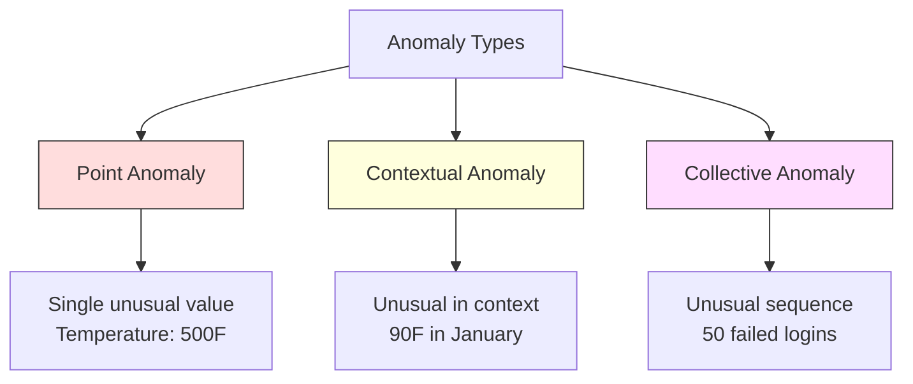
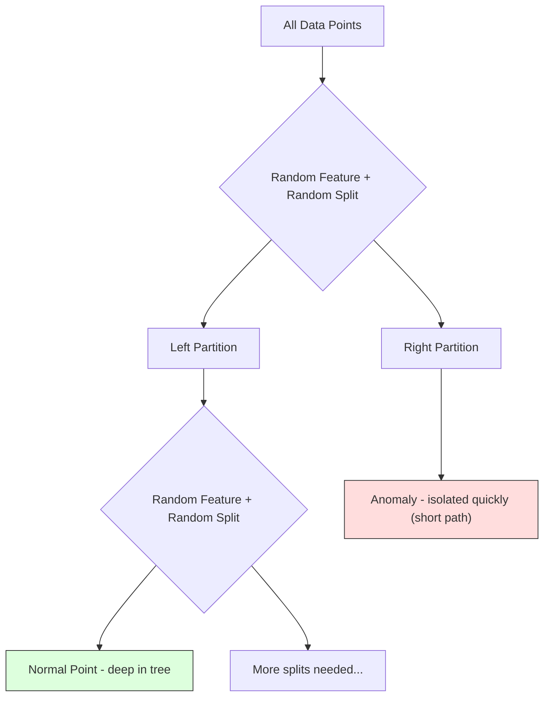
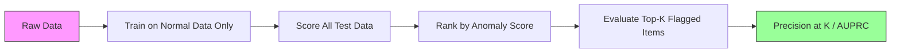

# 기상상상식 검출

> 정상은 정의하기 쉽지만 비정상적인 것은 맞지 않는 것입니다.

**Type:** Build
**Language:**파이썬
**Prerequisites:** Phase 2, Lessons 01-09
**Time:** ~75 minutes

## 학습 목표

- Z 점수, IQR, 그리고 격리 숲의 비정상성 탐지 방법을 처음부터 구현
- 점, 맥락 및 집단적 이상들 사이의 구별을 하고 각별로 적절한 검출 방법을 선택한다.
- 왜 기상상별 검출이 기상별을 분류하는 것이 아니라 정상적인 데이터를 모델링하는 것으로 구성되는지 설명하십시오.
- 감독되지 않은 기상상실 검사를 감독된 분류와 비교하고 새로운 기상실의 보급과 정확성 사이의 타협을 평가한다

## 문제

신용카드는 뉴욕에서 오후 2시, 도쿄에서는 오후 2시05시에 사용된다. 공장 센서는 일반적인 범위가 80~120이 되면 150도까지 읽는다. 서버는 하루 평균 200이 되면 초당 50,000개의 요청을 전송한다.

이건 이상성입니다. 그들을 찾는 것은 중요합니다. 사기에는 수십억 달러가 소요됩니다. 장비 장애는 정전 시간, 네트워크 침입은 비용 데이터입니다.

문제는 드물게 이상적인 사례를 표시하는 것입니다. 사기 행위는 거래의 0.1%를 차지합니다. 장비의 고장은 일년에 몇 번씩 발생합니다. 표준 분류자를 훈련시킬 수는 없습니다. 왜냐하면 "이상" 수업에서 배울 것이 거의 없기 때문입니다. 어떤 표기를 가지고 있더라도, 본 이상은 당신이 만날 유일한 유형은 아닙니다. 내일의 사기 계획은 오늘과는 다른 것 같습니다.

기상절차 검출은 문제를 뒤집고 있습니다. 기상절차를 배우는 대신, 정상적인 것을 배웁니다. 정상에서 벗어나는 것은 의심스러운 것입니다. 이것은 레이블 없이 작동하고, 새로운 유형의 기상절도에 적응하고, 대규모 데이터 세트에 확장됩니다.

## 개념

### 이상 의 종류

모든 기상들은 동일하지 않습니다.

- **Point anomalies.**하나의 데이터 포인트, 즉, 맥락에 상관없이 특이한 데이터 포인트, 온도 500도$50,000 from an account that normally spends $50년
- **Contextual anomalies.**그 배경에 있어서 특이한 데이터 포인트입니다. 여름에는 90도 온도가 정상이고 겨울에는 이상입니다. 같은 값, 다른 배경입니다.
- **Collective anomalies.**데이터 포인트의 연속은 그룹으로 비정상적이지만 각 개별 포인트도 정상적이기도 합니다. 로그인 실패는 5번입니다. 50번 연속으로 무력 공격입니다.

대부분의 방법은 점적 기호를 감지합니다. 맥락적 기호는 시간이나 위치 특징이 필요합니다. 집단적 기호는 순서 인식하는 방법을 필요로합니다.



### 감독 없이 틀 을 만드는 것

표준 분류에서는 두 클래스 모두에 대한 레이블이 있습니다. 기상실 검출에서는 일반적으로 세 가지 상황 중 하나를 가지고 있습니다.

1. **Fully unsupervised.**모든 데이터에 탐지기를 맞게 하고, 이상은 "정상" 모델을 손상시키지 않을 정도로 희귀해졌으면 좋겠습니다.
2. **Semi-supervised.**여러분은 정해진 데이터 세트를 가지고 있습니다. 정해진 데이터 세트에 맞게 됩니다. 그리고 다른 모든 것을 점수를 합니다. 이 세트는 가능한 가장 강력한 설정입니다.
3. **Weakly supervised.**몇 가지 표기된 기절이 있습니다. 훈련이 아닌 평가로 사용하세요. 감독되지 않은 훈련을 해, 표기된 하위 집합에 대한 정확성/회복을 측정하세요.

핵심 통찰력: 기상성 검출은 분류와는 근본적으로 다릅니다. 당신은 두 클래스 사이의 의사 결정 경계를 아니라 정상적인 데이터의 분포를 모델링하고 있습니다.

### 감독 과 감독 없는 사람: 거래

만약 당신이 기호를 붙인 경우, 훈련 (감독된 분류) 또는 평가 (감독되지 않은 검출) 에만 사용해야 하는가?

**Supervised (treat as classification):**
- 당신이 전에 본 이상과 같은
- 알려진 기상류 유형에 대한 더 높은 정확성
- 새로운 기상류 유형을 완전히 놓치고 있습니다
- 새로운 기질이 발생했을 때 재교육이 필요합니다.
- 충분한 기상 예제 (일반적으로 너무 적은) 를 필요로 한다

**Unsupervised (model normal, flag deviations):**
- 신형 타입을 포함한 정상에서 벗어나는 모든 것을 잡는다
- 표기된 이상이 필요하지 않습니다
- 더 높은 거짓 양성률 (일반적으로 비정상적인 것은 나쁘지 않습니다)
- 더 강력한 분배 전환

실제적으로, 가장 좋은 시스템은 두 가지를 결합합니다. 광범위한 보도를 위해 감독되지 않은 검출, 알려진 고 우선순위 기상류 유형에 대한 감독된 모델, 그리고 모호한 경우 인적 검토.

### Z 점수 방법

가장 간단한 접근법. 각 특징의 평균과 표준차를 계산합니다.$k$평균에서 표준차각

```text
z_score = (x - mean) / std
anomaly if |z_score| > threshold
```

기본 임계値は 3.0 (정상 데이터의 99.7%는 가우스 분포의 표준차각 3개 안에 들어있다).

**Strengths:**간단하고 빠르게 해석이 가능합니다 ("이 값은 정상에서 표준차각 4.5입니다").

**Weaknesses:**데이터의 분포가 정상적으로 이루어지는 것으로 가정합니다. 훈련 데이터의 외상 (외상) 에 민감합니다. (외상) 은 평균을 변화시키고 STD를 부풀려, 이를 더 어렵게 감지합니다.)

**When it works well:**데이터의 형태가 대략적으로 벨 모양으로 있는 단일 기능 모니터링 서버 응답 시간, 제조 용인, 안정적인 기본 라인 센서 가수

**When it fails:**다중 클러스터 데이터 (기본 온도가 다른 두 사무실 위치), 왜곡된 데이터 (거래 금액은 1000 달러가 드문 것이지만 이상적이지 않은 경우), 훈련 세트에서 비정상적 인 데이터.

### IQR 방법

Z 점수를 보다 강하다. 평균과 표준 경각차 대신

```
Q1 = 25th percentile
Q3 = 75th percentile
IQR = Q3 - Q1
lower_bound = Q1 - factor * IQR
upper_bound = Q3 + factor * IQR
anomaly if x < lower_bound or x > upper_bound
```

기본 요소는 1.5.

**Strengths:**튼튼한 이상 (퍼센티얼은 극단적 값에 영향을 받지 않는다). 왜곡된 분포에 관한 작업. 정상성 가설이 없다.

**Weaknesses:**일차원만 (분별적으로 각각의 특징에 적용된다). 특이한 특성을 발견할 수 있는 것은 특징을 함께 고려할 때만 (분별적으로 각각의 특징에서 정상적이지만 관절 공간에서 이상적이 될 수 있다).

**Practical note:**IQR의 1.5 인수는 상자 plot의 콧수염과 일치한다. 콧수염 바깥의 점들은 잠재적인 외상값이다. 1.5 대신 3.0을 사용하면 탐지기가 더 보수적 (하르기 플래그, 거짓 긍정) 이다. 올바른 인수는 거짓 알람에 대한 용납량에 달려 있다.

### 격리 숲

핵심 통찰은: 기상들은 거의 없고, 다양합니다. 데이터의 무작위 분할에서 기상들은 분리하기 쉬워요.



**How it works:**
1. 무작위 나무를 많이 짓 ( 격리 숲)
2. 각 노드에서 무작위 기능과 기능의 min와 max 사이의 무작위 분할 값을 선택하십시오
3. 각 점들이 분리될 때까지 계속 분할하라 (자신의 잎에)
4. 모든 나무에서 평균 경로 길이가 짧습니다

**Why it works:**보통 점들은 밀집한 영역에서 살고 있습니다. 이웃으로부터 분리하기 위해 많은 무작위 분할이 필요합니다. 이상은 희귀한 영역에서 살고 있습니다. 하나 또는 두 개의 무작위 분할이 그들을 분리하기에 충분합니다.

기상점 점수는 모든 나무의 평균 경로 길이를 기준으로 합니다.

```math
\text{score}(x) = 2^{-\text{average\_path\_length}(x) / c(n)}
```

어디`c(n)`$n$샘플: 1에 가까운 점수는 기상상입니다. 0.5에 가까운 점수는 정상입니다. 0에 가까운 점수는 매우 정상입니다.

**Strengths:**분배 가설이 없습니다. 높은 차원에서 작동합니다. 스케일 잘합니다 (모집 크기에 따라 하위 라인형이 있습니다. 왜냐하면 모든 나무가 하위 샘플을 사용합니다). 혼합된 특징 유형을 처리합니다.

**Weaknesses:**밀집한 지역에서 이상과 싸우는 것 (마스킹 효과). 많은 특징이 중요하지 않을 때 무작위 분할이 덜 효과적입니다.

**Key hyperparameters:**
- `n_estimators`나무의 수가 100개는 보통 충분합니다. 더 많은 나무는 더 안정적인 점수를 얻지만 계산이 느립니다.
- `max_samples`나무마다 샘플의 수가 있습니다. 256는 원래의 종이에 기본값입니다. 작은 값은 개별 나무를 정확도가 떨어뜨리지만 다양성을 증가시킵니다.
- `contamination`: 예상된 비정상성 분자. 임계값을 설정하는 데만 사용된다. 점수 자체에 영향을 미치지 않는다.

### 지역 외상 요인 (LOF)

LOF는 한 지점 주변의 지역 밀도를 이웃의 밀도에 비교한다. 밀도가 은 지역으로 둘러싸인 희소한 지역에서 한 지점이 이상적이다.

**How it works:**
1. 각 점에 대해, 그 점들을 찾아보세요.$k$가장 가까운 이웃
2. 지역 접근성 밀도를 계산하십시오 (네이센 지역이 얼마나 밀집한지)
3. 각 점의 밀도를 이웃의 밀도에 비교해 보세요
4. 만약 어떤 점의 밀도가 이웃보다 훨씬 낮다면, 그것은 외상

**LOF score:**
- LOF가 1.0에 가까운 것은 이웃과 비슷한 밀도가 (정상)
- LOF가 1.0보다 크면 이웃보다 더 낮은 밀도가 (가능한 이상)
- LOF가 1.0보다 훨씬 더 크다 (예를 들어, 2.0+) 는 상당히 낮은 밀도를 의미합니다 (가능한 기호)

"지역" 부분은 매우 중요합니다. 두 개의 클러스터를 가진 데이터 세트를 생각해 보세요. 밀집한 클러스터는 1000 포인트와 희소한 클러스터는 50 포인트입니다. 희소한 클러스터의 가장자리에 있는 점은 세계적으로 특이하지 않습니다. 50개의 이웃이 있습니다. 그러나 가까운 이웃이 그보다 밀집한 경우 지역적으로 특이합니다. LOF는 글로벌 방법들이 놓친 이 뉘앙스를 캡처합니다.

**Strengths:**지역적 기상 (네방에서 특이한 점, 비록 전 세계적으로 특이한 점이 아니더라도) 을 감지합니다.

**Weaknesses:**대규모 데이터 세트에서 느린 ($O(n^2)$순수적인 실행에 옮기는 것)$k$아주 높은 차원에서 잘 작동하지 않습니다 (차원의 저주로 거리의 계산에 영향을 미칩니다).

### 비교

| Method | Assumptions | Speed | Handles High Dims | Detects Local Anomalies |
|--------|------------|-------|-------------------|------------------------|
| Z-score | Normal distribution | Very fast | Yes (per feature) | No |
| IQR | None (per feature) | Very fast | Yes (per feature) | No |
| Isolation Forest | None | Fast | Yes | Partially |
| LOF | Distance is meaningful | Slow | Poorly | Yes |

### 평가 의 도전

기상상별 탐지기를 평가하는 것은 분류자를 평가하는 것보다 더 어렵습니다.

- **Extreme class imbalance.**0.1%의 기조성으로 모든 것을 "정상"이라고 예측하면 99.9%의 정확도가 있습니다. 정확도는 쓸모가 없습니다.
- **AUROC is misleading.**심각한 불균형으로 AUROC는 실제 임대에서 대부분의 이상성을 놓친 경우에도 잘 보일 수 있습니다.
- **Better metrics:**Precision@k (최고의 $k$표기된 항목, 실제 이상이 얼마나 많은지), AUPRC (정밀 회수 곡선 아래 지역) 및 고정된 거짓 긍정률로 회수.



### 기상상물질 탐지 파이프라인

실제적으로, 기상실 검사는 다음과 같은 작업 과정을 따르습니다.

1. **Collect baseline data.**이상적으로는, 어떤 기질이 없는 (또는 아주 적은) 것을 알고 있는 시기입니다.
2. **Feature engineering.**원료 기능과 파생 기능 (rolling statistics, time features, ratios)
3. **Train the detector.**기본 데이터에 맞게 모델은 "정상적"이 무엇인지 알게 됩니다.
4. **Score new data.**새로운 관찰마다 기상점수가 됩니다.
5. **Threshold selection.**이 결정은 사업입니다. 더 높은 임계량은 거짓 알람이 줄어들지만, 더 많은 실종된 기호가 발생한다는 것을 의미합니다.
6. **Alert and investigate.**플래그 포인트는 인간 검토 또는 자동 반응에 사용됩니다.
7. **Feedback collection.**표시된 항목이 실제 이상 또는 거짓 알림인지 기록하고 이 데이터를 사용하여 탐지기를 평가하고 시간이 지남에 따라 임계값을 조정합니다.

파이프라인 은 결코 "결국" 되지 않습니다. 데이터 분포 는 바뀐다. 새로운 기상 유형 이 등장 하고, 임계값 은 조정 해야 합니다. 기상 발견 은 일회적 인 모델 이 아니라 살아있는 시스템 으로 간주 하십시오.

```figure
f3-anomaly-fence
```

## 건설 해

코드는 `code/anomaly_detection.py`Z 점수, IQR, 그리고 격리 숲을 처음부터 구현합니다.

### Z 점수 탐지

```python
def zscore_detect(X, threshold=3.0):
    mean = X.mean(axis=0)
    std = X.std(axis=0)
    std[std == 0] = 1.0
    z = np.abs((X - mean) / std)
    return z.max(axis=1) > threshold
```

단순하고 벡터화된. 어떤 특징이 문턱을 초과하면 포인트를 표시합니다.

### IQR 탐지

```python
def iqr_detect(X, factor=1.5):
    q1 = np.percentile(X, 25, axis=0)
    q3 = np.percentile(X, 75, axis=0)
    iqr = q3 - q1
    iqr[iqr == 0] = 1.0
    lower = q1 - factor * iqr
    upper = q3 + factor * iqr
    outside = (X < lower) | (X > upper)
    return outside.any(axis=1)
```

### 초점부터 고립 숲

처음부터 구현은 특징 공간을 무작위로 파티션하는 격리 트리를 만듭니다.

```python
class IsolationTree:
    def __init__(self, max_depth):
        self.max_depth = max_depth

    def fit(self, X, depth=0):
        n, p = X.shape
        if depth >= self.max_depth or n <= 1:
            self.is_leaf = True
            self.size = n
            return self
        self.is_leaf = False
        self.feature = np.random.randint(p)
        x_min = X[:, self.feature].min()
        x_max = X[:, self.feature].max()
        if x_min == x_max:
            self.is_leaf = True
            self.size = n
            return self
        self.threshold = np.random.uniform(x_min, x_max)
        left_mask = X[:, self.feature] < self.threshold
        self.left = IsolationTree(self.max_depth).fit(X[left_mask], depth + 1)
        self.right = IsolationTree(self.max_depth).fit(X[~left_mask], depth + 1)
        return self
```

지점을 분리하는 길이의 길이는 그 기상점의 기상점을 결정합니다. 더 짧은 경로는 더 기상점을 의미합니다.

`IsolationForest`클래스는 여러 나무를 습니다.

```python
class IsolationForest:
    def __init__(self, n_estimators=100, max_samples=256, seed=42):
        self.n_estimators = n_estimators
        self.max_samples = max_samples

    def fit(self, X):
        sample_size = min(self.max_samples, X.shape[0])
        max_depth = int(np.ceil(np.log2(sample_size)))
        for _ in range(self.n_estimators):
            idx = rng.choice(X.shape[0], size=sample_size, replace=False)
            tree = IsolationTree(max_depth=max_depth)
            tree.fit(X[idx])
            self.trees.append(tree)

    def anomaly_score(self, X):
        avg_path = average path length across all trees
        scores = 2.0 ** (-avg_path / c(max_samples))
        return scores
```

정상화 요인`c(n)`                                        $n$이 원자수는`2 * H(n-1) - 2*(n-1)/n`어디`H`이 정상화는 각 크기의 데이터 세트에서 점수가 비교될 수 있도록 합니다.

### 데모 시나리오

코드는 여러 테스트 시나리오를 생성합니다.

1. **Single cluster with outliers.**2차원 가우시안 집합으로, 중앙에서 멀리 떨어진 곳에 기상 부작용이 있습니다.
2. **Multimodal data.**3개의 크기와 밀도가 다른 집합체, 집합체 사이의 지점은 이상적이기 때문에 Z 점수가 어려워요.
3. **High-dimensional data.**50가지 특징이지만, 그 중 5가지에만 기상 차이가 있다. 기상 부수에서 기상점을 찾을 수 있는지 테스트한다.

각 데모는 정확성, 회수, F1 및 Precision@k를 사용하여 모든 방법을 비교합니다.

## 사용 하 고

sklearn (사서관 구현을 사용하여 처음부터 사용하지 않습니다):

```python
from sklearn.ensemble import IsolationForest
from sklearn.neighbors import LocalOutlierFactor

iso = IsolationForest(n_estimators=100, contamination=0.05, random_state=42)
iso.fit(X_train)
predictions = iso.predict(X_test)

lof = LocalOutlierFactor(n_neighbors=20, contamination=0.05, novelty=True)
lof.fit(X_train)
predictions = lof.predict(X_test)
```

참고`contamination`정해진 기하급수에서 기하급수적으로 기하급수적으로 기하급수적으로 기하급수적으로 기하급수적으로 기하급수적으로 기하급수적으로 기하급수적으로 기하급수적으로 기하급수적으로 기하급수적으로 기하급수적으로 기하급수적으로 기하급수적으로 기하급수적으로 기하급수적으로 기하급수적으로 기하급수적으로 기하급수적으로 기하급수적으로 기하급수적으로 기하급수적으로 기하급수적으로 기하급수적으로 기하급수적으로 기하급수적으로 기하급수적으로 기하급수적으로 기하급수적으로 기하급수적으로 기하급수적으로 기하급수적으로 기하급수적으로 기하급수적으로 기하급수적으로 기하급수적으로 기하급수적으로 기하급수적으로 기하급수적으로 기하급수적으로 기하급수적으로 기하급수적으로 기하급수적으로 기하급수적으로 기하급수적으로 기하급수적으로 기하급수적으로 기하급수적으로 기하급수적으로 기하급수적으로 기하급수적으로 기하급수적으로 기하급수적으로 기하를 수를 수를 수를 수를 수를 수를 수를 수를 수를 수를 수를 수를 수를 수를 수를 수를 수를 수를 수 수 있습니다

코드는 `anomaly_detection.py`같은 데이터에 근거하여 처음부터 실행된 것을 스클라어너와 비교합니다.

### sklearn 오염 파라미터

`contamination`sklearn의 매개 변수는 연속적 기호점 점수를 바이너리 예측으로 변환하는 임계값을 결정합니다.

```python
iso_5 = IsolationForest(contamination=0.05)
iso_10 = IsolationForest(contamination=0.10)
```

둘 다 같은 기상점점을 내놓습니다`iso_5`상위 5%를 표시하고`iso_10`만약 당신이 진짜 기상율을 알지 못한다면 (일반적으로 그렇지 않은 경우) 오염을 "자동"로 설정하고 직접 원자조 점수를 사용하세요. 거짓 긍정과 거짓 부정부패 사이의 비용 대립에 기초하여 자신의 임대점을 설정하세요.

### 1급 SVM

또 다른 감독되지 않은 기상성 탐지기는 알아야 합니다. 1급 SVM는 고차원 기능 공간 (핵 트릭을 사용하여) 에서 정상적인 데이터 주변 경계를 맞게합니다.

```python
from sklearn.svm import OneClassSVM

oc_svm = OneClassSVM(kernel="rbf", gamma="auto", nu=0.05)
oc_svm.fit(X_train)
predictions = oc_svm.predict(X_test)
```

`nu`매개 변수는 변함의 분수를 근접한다. 1급 SVM는 작은 데이터 세트에서 중형 데이터 세트에 잘 작동하지만 매우 큰 데이터로 확장되지 않습니다 (핵 매트릭스는 사각형적으로 성장합니다).

### 자동코더 접근 방식 (예방)

자동코더는 데이터를 압축하고 재구성하는 신경망입니다. 정상적인 데이터에 훈련합니다. 테스트 시에는 비정상성이 높은 재구성 오류가 있습니다. 네트워크는 정상적인 패턴만 재구성하는 것을 배웠습니다.

이것은 3단계 (Deep Learning) 에서 다루어졌지만 원칙은 동일합니다.

### 기상상별 검출을 조립

집합 방법들이 분류를 개선하는 것처럼 (강좌 11), 여러 기상성 탐지기를 결합하면 검출이 향상됩니다. 가장 간단한 접근법:

1. 여러 탐지기를 실행하십시오 (Z 점수, IQR, 격리 숲, LOF)
2. 각각의 탐지기의 점수를 [0, 1]로 정상화
3. 정상화된 점수를 평균
4. 평균 점수에 대한 임계점 이상의 플래그 포인트

이 방법은 잘못된 긍정을 줄이는 것입니다. 왜냐하면 다른 방법들은 다른 실패 모드를 가지고 있기 때문입니다. 네 가지 방법 모두에 의해 표시된 포인트는 거의 확실히 이상적입니다. 한 가지로 표시된 포인트는 그 방법의 특색이 될 수 있습니다.

더 정교한 집합은 각각의 탐지기를 추정된 신뢰성 (가용 경우 알려진 변칙을 가진 검증 집합에서 측정) 에 의해 무게로 구성한다.

### 생산 고려 사항

1. **Threshold drift.**데이터 분포가 변화함에 따라 고정된 임계값이 구시되고 있습니다.
2. **Alert fatigue.**너무 많은 가짜 알람과 운영자 들 은 주의 를 기울이지 않게 합니다. 높은 임대 (더 적은, 더 신뢰할 수 있는 알람) 를 시작 하여 신뢰가 높아질수록 그 수치를 낮추십시오.
3. **Ensemble approach.**생산에서 여러 탐지기를 결합합니다. 여러 방법이 동의하는 경우에만 포인트를 표시합니다. 그것은 이상적입니다. 이것은 거짓 긍정을 크게 감소시킵니다.
4. **Feature engineering.**원료 기능은 거의 충분하지 않습니다. 롤링 통계, 비율, 마지막 사건 이후 시간 및 도메인 특정 기능을 추가하십시오. 좋은 기능은 탐지기를 선택하는 것보다 더 중요합니다.
5. **Feedback loop.**운영자 들 이 표지 된 항목 을 조사 하고 확인 하거나 거부 할 때, 이 항목 을 시스템 에 다시 입력 하여 표시 된 데이터를 시간 내에 축적 하여 탐지기를 평가 하고 개선 한다.

## 선박

이 교훈은 다음과 같은 결과를 낳습니다.
- `outputs/skill-anomaly-detector.md`-- 올바른 탐지기를 선택하는 의사 결정 능력
- `code/anomaly_detection.py`-- Z 점수, IQR, 그리고 격리 숲

### 한계 를 선택 하는 것

비정상점수는 연속적이죠. 바이너리 결정을 내리기 위해 임계점이 필요합니다. 이것은 기술적인 결정이 아닙니다.

두 가지 상황을 생각해 보십시오.
- **Fraud detection.**사기 실종은 비싸다 (회담, 고객 신뢰). 거짓 알람은 인간 분석가에게 5분 동안 조사 할 수 있습니다. 더 많은 사기들을 잡기 위해 최저를 설정하고, 더 많은 거짓 알람을 받아 들인다.
- **Equipment maintenance.**거짓 경보는 불필요한 폐쇄 비용을 발생시키는 것을 의미합니다$50,000. A missed failure means a $500만 건의 수리, 그 비용을 균형 있게 해주는 임대값을 설정해

두 경우 모두 최적의 임계량은 거짓 긍정과 거짓 부정부 사이의 비용 비율에 달려 있습니다. 각기 다른 임계점에 정확한 음계와 회수, 비용 함수를 덮고, 최소 비용 지점을 선택합니다.

### 생산에 대한 규모

생산에서 실시간 기상실험 검출을 위해:

1. **Batch training, online scoring.**최근 정상 데이터 에 따라 주기적으로 (일당, 주간) 모델을 훈련 시키십시오. 새로운 관찰 이 도착 할 때 각 점수를 얻으십시오.
2. **Feature computation must match.**30일 동안 통계를 수행한 경험이 있다면 새로운 관찰을 위한 특징을 계산하기 위해 30일간의 역사를 필요로 합니다.
3. **Score distribution monitoring.**시간 동안 기상점의 분포를 추적합니다. 중점점 점수가 상승으로 이동하면 데이터가 변하거나 모델이 구석이 됩니다.
4. **Explainability.**기상상상태를 표시할 때 왜 그런지 말해주세요. Z 점수는: "X 특징은 정상보다 4.2개의 표준차각입니다".

## 운동

1. **Threshold tuning.**Z 점수 탐지기를 0.5 단계로 1.0에서 5.0까지의 임계값으로 실행하세요. 각 임계값에서 정밀하게 맵을 그려서 회수하세요.

2. **Multivariate anomalies.**각 특징이 개별적으로 정상적으로 보이는 2D 데이터를 생성하지만 조합은 이상 (예를 들어, 주요 클러스터 지각에서 멀리 떨어진 지점) 이다. 각각의 특징에 대한 Z 점수가 이 점들을 놓쳤지만 격리 숲이 그들을 잡는 것을 보여주십시오.

3. **LOF from scratch.**k-가 가장 가까운 이웃을 사용하여 로컬 아웃리어 팩터를 구현하십시오. 같은 데이터에 대해 sklearn의 로컬 아웃리어 팩터와 비교하십시오. 사용 $k=10$그리고$k=50$-- 어떻게 선택해야 할까요?$k$결과로 영향을 미치는가?

4. **Streaming anomaly detection.**스트리밍 설정에서 작동하도록 Z 점수 탐지기를 수정: 새로운 포인트 도착에 따라 실행 중인 평균과 변수를 업데이트하십시오 (웰포드 온라인 알고리즘). 동일한 데이터에 대한 배트 Z 점수를 비교하십시오.

5. **Real-world evaluation.**알려진 변칙 (예를 들어, 카글의 신용 카드 사기) 을 가진 데이터 세트를 생각해 보세요. precision@100, precision@500, AUPRC를 사용하여 네 가지 방법을 모두 평가하세요. 어떤 방법은 가장 잘 작동합니까? 왜요?

## 주요 용어

| Term | What people say | What it actually means |
|------|----------------|----------------------|
| Anomaly | "Outlier, unusual point" | A data point that deviates significantly from the expected pattern of normal data |
| Point anomaly | "A single weird value" | An individual observation that is unusual regardless of context |
| Contextual anomaly | "Normal value, wrong context" | An observation that is unusual given its context (time, location, etc.) but might be normal in another context |
| Isolation Forest | "Random splits to find outliers" | An ensemble of random trees that isolates anomalies with fewer splits than normal points |
| Local Outlier Factor | "Compare density to neighbors" | A method that flags points whose local density is much lower than their neighbors' density |
| Z-score | "Standard deviations from mean" | $(x - \text{mean}) / \text{std}$, measuring how far a point is from the center in units of standard deviation |
| IQR | "Interquartile range" | $Q3 - Q1$, measuring the spread of the middle 50% of data, used for robust outlier detection |
| Contamination | "Expected fraction of anomalies" | A hyperparameter telling the detector what proportion of the data it should flag as anomalous |
| Precision@k | "Of the top k flags, how many are real" | Precision computed on only the $k$ most suspicious points, useful for imbalanced anomaly detection |
| AUPRC | "Area under precision-recall curve" | A metric that summarizes precision-recall performance across all thresholds, better than AUROC for imbalanced data |

## 더 많은 읽기

- [Liu et al., Isolation Forest (2008)](https://cs.nju.edu.cn/zhouzh/zhouzh.files/publication/icdm08b.pdf)-- 원래의 '이솔레이션 포스트' 종이
- [Breunig et al., LOF: Identifying Density-Based Local Outliers (2000)](https://dl.acm.org/doi/10.1145/342009.335388)-- 원래 LOF 종이
- [scikit-learn Outlier Detection docs](https://scikit-learn.org/stable/modules/outlier_detection.html)-- 모든 쿨러른 기상상상식 탐지기의 개요
- [Chandola et al., Anomaly Detection: A Survey (2009)](https://dl.acm.org/doi/10.1145/1541880.1541882)-- 기상상실 검출 방법의 종합적인 조사
- [Goldstein and Uchida, A Comparative Evaluation of Unsupervised Anomaly Detection Algorithms (2016)](https://journals.plos.org/plosone/article?id=10.1371/journal.pone.0152173)-- 실제 데이터 세트에서 10가지 방법을 경험적으로 비교
