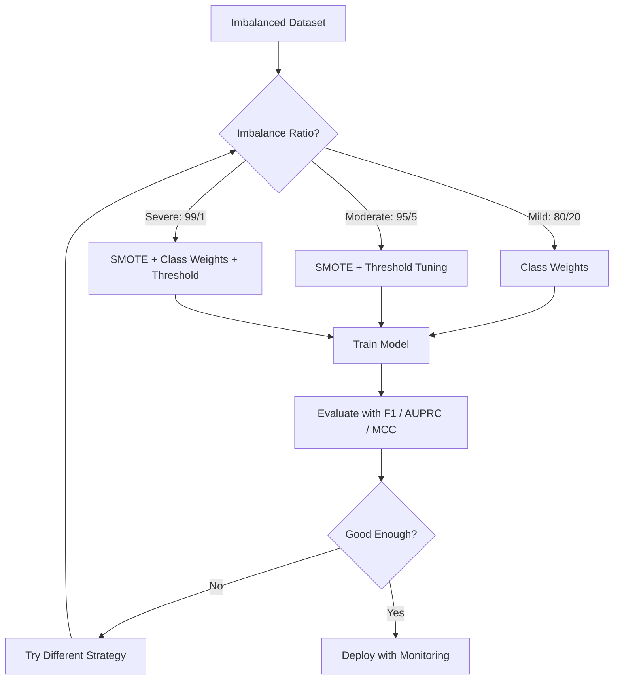
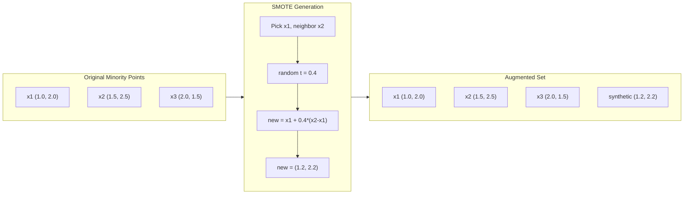
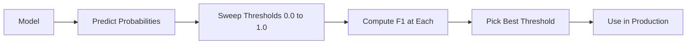
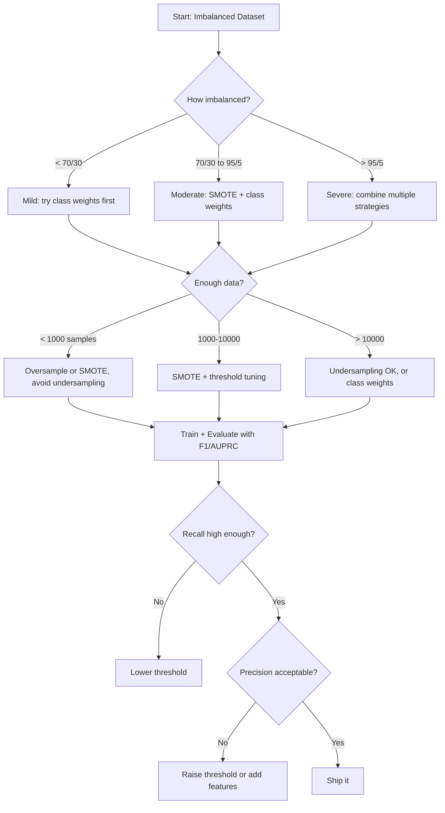

# 균형 없는 데이터 를 처리 하는 것

> 99%의 데이터가 "정상적"일 때 정확성은 거짓말입니다.

**Type:** Build
**Language:**파이썬
**Prerequisites:** Phase 2, Lessons 01-09 (especially evaluation metrics)
**Time:** ~90 minutes

## 학습 목표

- SMOTE를 처음부터 구현하고 합성 과잉 샘플링이 무작위 복제와 어떻게 다르는지 설명합니다
- 정확성 대신 F1, AUPRC, 및 매튜스 상관관계 계수를 사용하여 불균형 분류자를 평가합니다.
- 클래스 중량, 임계 조정, 재 샘플링 전략을 비교하고 주어진 불균형 비율에 대한 올바른 접근 방식을 선택하십시오.
- SMOTE, 클래스 중량 및 임계 최적화를 결합한 완전한 불균형 데이터 파이프라인을 구축하십시오

## 문제

사기 탐지 모델을 만들면 99.9%의 정확도를 얻습니다. 축하합니다. 그리고는 모든 거래에 대해 "사기를 하지 않는 것"을 예측한다는 것을 깨닫습니다.

이것은 버그가 아닙니다. 거래의 0.1%만이 사기적일 때 합리적인 일이죠. 모델은 항상 대다수 계급을 추측하는 것이 전체 오류를 최소화한다는 것을 알게됩니다. 그것은 기술적으로 정확하고 완전히 쓸모가 없습니다.

이것은 모든 곳에서 일어나는 것입니다. 실제 분류 사항. 질병 진단: 1% 긍정적 비율. 네트워크 침입: 0.01% 공격. 제조 결함이: 0.5% 결함. 스팸 필터링: 20% 스팸.  예측: 5% 너. 소수 계급이 더 영향력있는 경우, 희귀합니다.

정확성은 실패하기 때문에 모든 정확한 예측을 동일하게 취급합니다. 합법적인 거래를 올바르게 표시하고 사기 사실을 올바르게 파악하는 것은 정확성의 한 점입니다. 그러나 사기 사실을 파악하는 것은 모델이 존재하는 전체 이유입니다. 우리는 모델이 희귀하지만 중요한 클래스에 관심을 기울이는 메트릭, 기술 및 훈련 전략을 필요로합니다.

## 개념

### 정확성 이 실패 하는 이유

1000개의 샘플을 가진 데이터 세트를 생각해 봅시다. 990개의 부정적, 10개의 긍정적. 항상 부정적 예측을 하는 모델:

|  | Predicted Positive | Predicted Negative |
|--|---|---|
| Actually Positive | 0 (TP) | 10 (FN) |
| Actually Negative | 0 (FP) | 990 (TN) |

```math
\text{Accuracy} = (0 + 990) / 1000 = 99.0\%
```

모델은 사기, 질병, 결함이 없죠. 하지만 정확도는 99%입니다.

### 더 나은 측정

**Precision**=$\text{TP} / (\text{TP} + \text{FP})$긍정적인 신호를 표시한 모든 것 중 실제로 몇개가 있습니다?

**Recall**=$\text{TP} / (\text{TP} + \text{FN})$사실 긍정적인 것 중 몇 개를 잡았나요?

**F1 Score**=$2 \cdot \text{precision} \cdot \text{recall} / (\text{precision} + \text{recall})$- 합성 평균은 정확성과 기억 사이의 극한 불균형을 처벌합니다.

**F-beta Score**=$(1 + \beta^2) \cdot \text{precision} \cdot \text{recall} / (\beta^2 \cdot \text{precision} + \text{recall})$언제$\beta > 1$기억하는 것이 더 중요해요$\beta < 1$부정행위 탐지에는 F2가 일반적입니다 (실종 부정행위는 거짓 경고보다 더 나쁜 것입니다).

**AUPRC**(정밀함-회복 곡선 아래 지역) AUC-ROC와 비슷하지만 불균형 데이터에 대해 더 정보를 제공합니다. 무작위 분류자는 AUPRC를 긍정적 클래스 비율과 동등합니다.

**Matthews Correlation Coefficient**=$(\text{TP} \cdot \text{TN} - \text{FP} \cdot \text{FN}) / \sqrt{(\text{TP}+\text{FP})(\text{TP}+\text{FN})(\text{TN}+\text{FP})(\text{TN}+\text{FN})}$-1에서 +1까지의 범위에서, 모델이 두 클래스에서 잘 수행 할 때만 높은 점수를 제공합니다. 클래스가 매우 다른 크기에있을 때에도 균형 잡힌다.

위의 "항상 부정적 예측" 모델에 대해서는: $\text{precision} = 0/0$(정부 정의가 없는, 종종 0으로 설정되는)$\text{recall} = 0/10 = 0$$\text{F1} = 0$$\text{MCC} = 0$이 측정값은 모델을 가치 없는 것으로 정확하게 식별합니다.

### 불균형 데이터 파이프라인



### SMOTE: 합성 소수자 과잉 샘플링 기술

무작위 표본 과잉 표본은 기존의 소수 표본을 복제합니다. 이것은 효과가 있지만 모델이 동일한 점들을 반복적으로 볼 수 있기 때문에 과잉 부합의 위험이 있습니다.

SMOTE는 새로운 합성 소수 샘플을 만들어서 유력하지만 복사되지 않습니다. 알고리즘은:

1. 소수자 샘플에 대해$x$, 그 $k$다른 소수 집단 표본 중 가장 가까운 이웃
2. 우연히 이웃을 선택해
3.  사이의 라인 세그먼트에 새로운 샘플을 생성합니다$x$그리고 그 이웃

공식:`new_sample = x + random(0, 1) * (neighbor - x)`

이것은 실제 소수점들 사이에 간섭하여 기존 데이터를 복사하지 않고 동일한 영역의 특징 공간에서 샘플을 생성합니다.



### 샘플링 전략 을 비교

**Random Oversampling**: 다수인수를 일치시키기 위해 소수인 표본을 복제합니다.
- 장점: 간단하고 정보 손실이 없습니다
- 단점: 정확한 복제 결과, 과잉 부착, 훈련 시간을 늘리는

**Random Undersampling**: 소수자 수를 일치시키기 위해 다수 샘플을 제거합니다.
- 장점: 빠른 훈련, 간단한 훈련
- 단점: 잠재적으로 유용한 다수 데이터, 더 높은 변동성을 버리는

**SMOTE**: 인성 소수자 샘플을 인터폴레이션으로 생성한다.
- 장점: 새로운 데이터 포인트를 생성하고, 무작위적인 과잉 샘플링과 비교하여 과잉 적립을 줄입니다
- 단점: 결정 경계 근처에서 잡음 샘플을 만들 수 있으며, 대다수 클래스 분포를 고려하지 않습니다

| Strategy | Data Changed | Risk | When to Use |
|----------|-------------|------|-------------|
| Oversample | Minority duplicated | Overfitting | Small datasets, moderate imbalance |
| Undersample | Majority removed | Information loss | Large datasets, want fast training |
| SMOTE | Synthetic minority added | Boundary noise | Moderate imbalance, enough minority samples for k-NN |

### 클래스 무게

데이터를 변경하는 대신 모델이 오류를 처리하는 방식을 변경하고 소수급을 잘못 분류하는 데 더 큰 무게를 부여하십시오.

950 음과 50 음의 샘플을 가진 바이너리 문제:
- 음력 클래스 중량 = $n_{\text{samples}} / (2 \cdot n_{\text{negative}}) = 1000 / (2 \cdot 950) = 0.526$
- 양성 클래스 중량은 = $n_{\text{samples}} / (2 \cdot n_{\text{positive}}) = 1000 / (2 \cdot 50) = 10.0$

긍정적인 클래스는 19배의 무게를 얻습니다. 하나의 긍정적 샘플을 잘못 분류하는 것은 19 개의 부정적인 샘플을 잘못 분류하는 것과 같습니다. 모델은 소수층 클래스에 관심을 기울여야합니다.

물적 회귀에서, 이것은 손실 함수를 수정합니다:

```math
\text{weighted\_loss} = -\sum \bigl( w_i \cdot [y_i \log(p_i) + (1-y_i) \log(1-p_i)] \bigr)
```

어디$w_i$샘플의 종류에 따라 달라집니다 $i$- 그래

클래스 무게는 수학적으로 예상에서 과잉 샘플링과 동등하지만 새로운 데이터 포인트를 생성하지 않습니다. 이것은 그것들을 더 빨리 만들고 복제 된 샘플의 과잉 적합 위험을 피합니다.

### 임계율 조정

대부분의 분류기는 확률을 내보내기. 기본 임계値は 0.5입니다.$P(\text{positive}) \ge 0.5$0.5는 임의입니다. 클래스가 불균형이 되면 최적의 임의가 보통 훨씬 낮습니다.

이 과정:
1. 모델 훈련
2. 검증 집합에서 예측된 확률을 얻으십시오
3. 0.0에서 1.0까지의 수면 열
4. 각 임계점에서 F1 (또는 선택한 매트릭) 를 계산하십시오.
5. 메트릭을 극대화하는 임대값을 선택하세요



모델이 출력할 수 있습니다$P(\text{fraud}) = 0.15$0.5의 임계에서는 사기하지 않는 것으로 분류됩니다. 0.10의 임계에서는 올바르게 잡습니다. 확률 기량화는 순위보다 덜 중요합니다. 사기보다 더 높은 확률이 있는 한, 그들을 분리하는 임계점이 있습니다.

### 비용 을 감수 하는 학습

클래스 무게의 일반화. 일정한 비용 대신, 특정 오차 분류 비용을 지정하십시오.

| | Predict Positive | Predict Negative |
|--|---|---|
| Actually Positive | 0 (correct) | $C_{\text{FN}} = 100$ |
| Actually Negative | $C_{\text{FP}} = 1$ | 0 (correct) |

사기 거래 (FN) 를 놓치는 것은 거짓 경고 (FP) 보다 100배 더 많은 비용입니다. 모델은 전체 비용에 최적화합니다. 전체 오류 수는 아닙니다.

이것은 실제 비용에 대한 가장 원칙적인 접근 방식입니다. 암 진단이 놓친다는 것은 추가 생체검사를 이끌어내는 거짓 경보보다 매우 다른 비용입니다. 이러한 비용을 명시적으로 설정하는 것은 올바른 타협을 강요합니다.

### 결정 흐름표



```figure
class-imbalance
```

## 건설 해

### 단계 1: 불균형 데이터 세트를 생성

```python
import numpy as np


def make_imbalanced_data(n_majority=950, n_minority=50, seed=42):
    rng = np.random.RandomState(seed)

    X_maj = rng.randn(n_majority, 2) * 1.0 + np.array([0.0, 0.0])
    X_min = rng.randn(n_minority, 2) * 0.8 + np.array([2.5, 2.5])

    X = np.vstack([X_maj, X_min])
    y = np.concatenate([np.zeros(n_majority), np.ones(n_minority)])

    shuffle_idx = rng.permutation(len(y))
    return X[shuffle_idx], y[shuffle_idx]
```

### 단계 2: 처음부터 SMOTE

```python
def euclidean_distance(a, b):
    return np.sqrt(np.sum((a - b) ** 2))


def find_k_neighbors(X, idx, k):
    distances = []
    for i in range(len(X)):
        if i == idx:
            continue
        d = euclidean_distance(X[idx], X[i])
        distances.append((i, d))
    distances.sort(key=lambda x: x[1])
    return [d[0] for d in distances[:k]]


def smote(X_minority, k=5, n_synthetic=100, seed=42):
    rng = np.random.RandomState(seed)
    n_samples = len(X_minority)
    k = min(k, n_samples - 1)
    synthetic = []

    for _ in range(n_synthetic):
        idx = rng.randint(0, n_samples)
        neighbors = find_k_neighbors(X_minority, idx, k)
        neighbor_idx = neighbors[rng.randint(0, len(neighbors))]
        t = rng.random()
        new_point = X_minority[idx] + t * (X_minority[neighbor_idx] - X_minority[idx])
        synthetic.append(new_point)

    return np.array(synthetic)
```

### 단계 3: 무작위적으로 과잉 샘플링 및 과잉 샘플링

```python
def random_oversample(X, y, seed=42):
    rng = np.random.RandomState(seed)
    classes, counts = np.unique(y, return_counts=True)
    max_count = counts.max()

    X_resampled = list(X)
    y_resampled = list(y)

    for cls, count in zip(classes, counts):
        if count < max_count:
            cls_indices = np.where(y == cls)[0]
            n_needed = max_count - count
            chosen = rng.choice(cls_indices, size=n_needed, replace=True)
            X_resampled.extend(X[chosen])
            y_resampled.extend(y[chosen])

    X_out = np.array(X_resampled)
    y_out = np.array(y_resampled)
    shuffle = rng.permutation(len(y_out))
    return X_out[shuffle], y_out[shuffle]


def random_undersample(X, y, seed=42):
    rng = np.random.RandomState(seed)
    classes, counts = np.unique(y, return_counts=True)
    min_count = counts.min()

    X_resampled = []
    y_resampled = []

    for cls in classes:
        cls_indices = np.where(y == cls)[0]
        chosen = rng.choice(cls_indices, size=min_count, replace=False)
        X_resampled.extend(X[chosen])
        y_resampled.extend(y[chosen])

    X_out = np.array(X_resampled)
    y_out = np.array(y_resampled)
    shuffle = rng.permutation(len(y_out))
    return X_out[shuffle], y_out[shuffle]
```

### 단계 4: 클래스 웨이트와 함께 물적 회귀

```python
def sigmoid(z):
    return 1.0 / (1.0 + np.exp(-np.clip(z, -500, 500)))


def logistic_regression_weighted(X, y, weights, lr=0.01, epochs=200):
    n_samples, n_features = X.shape
    w = np.zeros(n_features)
    b = 0.0

    for _ in range(epochs):
        z = X @ w + b
        pred = sigmoid(z)
        error = pred - y
        weighted_error = error * weights

        gradient_w = (X.T @ weighted_error) / n_samples
        gradient_b = np.mean(weighted_error)

        w -= lr * gradient_w
        b -= lr * gradient_b

    return w, b


def compute_class_weights(y):
    classes, counts = np.unique(y, return_counts=True)
    n_samples = len(y)
    n_classes = len(classes)
    weight_map = {}
    for cls, count in zip(classes, counts):
        weight_map[cls] = n_samples / (n_classes * count)
    return np.array([weight_map[yi] for yi in y])
```

### 단계 5: 임계율 조정

```python
def find_optimal_threshold(y_true, y_probs, metric="f1"):
    best_threshold = 0.5
    best_score = -1.0

    for threshold in np.arange(0.05, 0.96, 0.01):
        y_pred = (y_probs >= threshold).astype(int)
        tp = np.sum((y_pred == 1) & (y_true == 1))
        fp = np.sum((y_pred == 1) & (y_true == 0))
        fn = np.sum((y_pred == 0) & (y_true == 1))

        if metric == "f1":
            precision = tp / (tp + fp) if (tp + fp) > 0 else 0.0
            recall = tp / (tp + fn) if (tp + fn) > 0 else 0.0
            score = 2 * precision * recall / (precision + recall) if (precision + recall) > 0 else 0.0
        elif metric == "recall":
            score = tp / (tp + fn) if (tp + fn) > 0 else 0.0
        elif metric == "precision":
            score = tp / (tp + fp) if (tp + fp) > 0 else 0.0

        if score > best_score:
            best_score = score
            best_threshold = threshold

    return best_threshold, best_score
```

### 단계 6: 평가 기능

```python
def confusion_matrix_values(y_true, y_pred):
    tp = np.sum((y_pred == 1) & (y_true == 1))
    tn = np.sum((y_pred == 0) & (y_true == 0))
    fp = np.sum((y_pred == 1) & (y_true == 0))
    fn = np.sum((y_pred == 0) & (y_true == 1))
    return tp, tn, fp, fn


def compute_metrics(y_true, y_pred):
    tp, tn, fp, fn = confusion_matrix_values(y_true, y_pred)
    accuracy = (tp + tn) / (tp + tn + fp + fn)
    precision = tp / (tp + fp) if (tp + fp) > 0 else 0.0
    recall = tp / (tp + fn) if (tp + fn) > 0 else 0.0
    f1 = 2 * precision * recall / (precision + recall) if (precision + recall) > 0 else 0.0

    denom = np.sqrt(float((tp + fp) * (tp + fn) * (tn + fp) * (tn + fn)))
    mcc = (tp * tn - fp * fn) / denom if denom > 0 else 0.0

    return {
        "accuracy": accuracy,
        "precision": precision,
        "recall": recall,
        "f1": f1,
        "mcc": mcc,
    }
```

### 7단계: 모든 접근법을 비교

```python
X, y = make_imbalanced_data(950, 50, seed=42)
split = int(0.8 * len(y))
X_train, X_test = X[:split], X[split:]
y_train, y_test = y[:split], y[split:]

# Baseline: no treatment
w_base, b_base = logistic_regression_weighted(
    X_train, y_train, np.ones(len(y_train)), lr=0.1, epochs=300
)
probs_base = sigmoid(X_test @ w_base + b_base)
preds_base = (probs_base >= 0.5).astype(int)

# Oversampled
X_over, y_over = random_oversample(X_train, y_train)
w_over, b_over = logistic_regression_weighted(
    X_over, y_over, np.ones(len(y_over)), lr=0.1, epochs=300
)
preds_over = (sigmoid(X_test @ w_over + b_over) >= 0.5).astype(int)

# SMOTE
minority_mask = y_train == 1
X_minority = X_train[minority_mask]
synthetic = smote(X_minority, k=5, n_synthetic=len(y_train) - 2 * int(minority_mask.sum()))
X_smote = np.vstack([X_train, synthetic])
y_smote = np.concatenate([y_train, np.ones(len(synthetic))])
w_sm, b_sm = logistic_regression_weighted(
    X_smote, y_smote, np.ones(len(y_smote)), lr=0.1, epochs=300
)
preds_smote = (sigmoid(X_test @ w_sm + b_sm) >= 0.5).astype(int)

# Class weights
sample_weights = compute_class_weights(y_train)
w_cw, b_cw = logistic_regression_weighted(
    X_train, y_train, sample_weights, lr=0.1, epochs=300
)
probs_cw = sigmoid(X_test @ w_cw + b_cw)
preds_cw = (probs_cw >= 0.5).astype(int)

# Threshold tuning (tune on held-out validation set, not test set)
probs_val = sigmoid(X_val @ w_cw + b_cw)
best_thresh, best_f1 = find_optimal_threshold(y_val, probs_val, metric="f1")
preds_thresh = (probs_cw >= best_thresh).astype(int)
```

코드 파일은 이 모든 것을 하나의 스크립트로 실행하고 결과를 인쇄합니다.

## 사용 하 고

스키트-러닝과 불균형-러닝의 경우, 이러한 기술은 한 라인입니다.

```python
from sklearn.linear_model import LogisticRegression
from sklearn.metrics import classification_report, f1_score
from sklearn.model_selection import train_test_split
from imblearn.over_sampling import SMOTE
from imblearn.under_sampling import RandomUnderSampler
from imblearn.pipeline import Pipeline

X_train, X_test, y_train, y_test = train_test_split(X, y, stratify=y)

model_weighted = LogisticRegression(class_weight="balanced")
model_weighted.fit(X_train, y_train)
print(classification_report(y_test, model_weighted.predict(X_test)))

smote = SMOTE(random_state=42)
X_resampled, y_resampled = smote.fit_resample(X_train, y_train)
model_smote = LogisticRegression()
model_smote.fit(X_resampled, y_resampled)
print(classification_report(y_test, model_smote.predict(X_test)))

pipeline = Pipeline([
    ("smote", SMOTE()),
    ("model", LogisticRegression(class_weight="balanced")),
])
pipeline.fit(X_train, y_train)
print(classification_report(y_test, pipeline.predict(X_test)))
```

초점 구현은 각각의 기술이 정확히 무엇을 하는지 보여줍니다. SMOTE는 소수층 클래스에 k-NN 인터폴레이션입니다. 클래스 중량은 손실을 곱합니다. 임계층 조정은 커트오프에 대한 포 루프입니다. 마법은 없습니다.

## 선박

이 교훈은 다음과 같은 결과를 낳습니다.
- `outputs/skill-imbalanced-data.md`-- 불균형 분류 문제를 처리하기 위한 결정 체크리스트

## 운동

1. **Borderline-SMOTE**: 결정 경계 근처에 있는 소수점 (k-가 가장 가까운 이웃이 다수 클래스 샘플을 포함) 에 대한 합성 샘플을 생성하는 SMOTE 구현을 수정합니다. 클래스가 겹치는 데이터 세트에서 표준 SMOTE와 결과를 비교하십시오.

2. **Cost matrix optimization**비용 매트릭스가 매개 변수인 경우 비용 감성적 학습을 구현합니다. 비용 매트릭스를 취하고 예상 비용을 최소화하는 최적의 예측을 반환하는 함수를 생성합니다. 다른 비용 비율 (1:10, 1:100, 1:1000) 을 사용하여 테스트하고 정확성 회수 교류가 어떻게 변화하는지 표시합니다.

3. **Threshold calibration**: 플래트 스케일링을 구현 (모델의 원본 출력에서 로지스트적 회귀를 적용하여 캘리브레이션 확률을 생성한다). 캘리브레이션 전과 이후에 정밀 리콜 곡선을 비교한다. 캘리브레이션이 순위를 변경하지 않는다는 것을 보여주십시오 (AUC는 동일하다) 하지만 확률을 더 의미있게 만듭니다.

4. **Ensemble with balanced bagging**: 여러 모델을 훈련시켜, 각각 균형 잡힌 부트스트랩 샘플 (모든 소수자원 + 대다수의 무작위 하위 집합) 에 따라. 그들의 예측을 평균. 이 접근 방식을 SMOTE와 단일 모델과 비교하십시오. 실행 중 성능과 변형을 모두 측정합니다.

5. **Imbalance ratio experiment**이 경우, 이 비율은 50/50, 70/30, 90/10, 95/5, 99/1로 증가합니다. 각 비율에 대해 SMOTE와 함께 훈련합니다. 이 두 가지 접근법의 F1 플롯 vs. 불균형 비율. SMOTE는 어떤 비율에서 의미있는 차이를 만들어지기 시작합니다?

## 주요 용어

| Term | What people say | What it actually means |
|------|----------------|----------------------|
| Class imbalance | "One class has way more samples" | The distribution of classes in the dataset is significantly skewed, causing models to favor the majority class |
| SMOTE | "Synthetic oversampling" | Creates new minority samples by interpolating between existing minority samples and their k-nearest minority neighbors |
| Class weights | "Making errors on rare classes more expensive" | Multiplying the loss function by class-specific weights so the model penalizes minority misclassification more heavily |
| Threshold tuning | "Moving the decision boundary" | Changing the probability cutoff for classification from the default 0.5 to a value that optimizes the desired metric |
| Precision-recall tradeoff | "You cannot have both" | Lowering the threshold catches more positives (higher recall) but also flags more false positives (lower precision), and vice versa |
| AUPRC | "Area under the PR curve" | Summarizes the precision-recall curve into a single number; more informative than AUC-ROC when classes are heavily imbalanced |
| Matthews Correlation Coefficient | "The balanced metric" | A correlation between predicted and actual labels that produces a high score only when the model performs well on both classes |
| Cost-sensitive learning | "Different mistakes cost different amounts" | Incorporating real-world misclassification costs into the training objective so the model optimizes for total cost, not error count |
| Random oversampling | "Duplicate the minority" | Repeating minority class samples to balance class counts; simple but risks overfitting to duplicated points |

## 더 많은 읽기

- [SMOTE: Synthetic Minority Over-sampling Technique (Chawla et al., 2002)](https://arxiv.org/abs/1106.1813)-- 원래의 SMOTE 논문, 여전히 불균형 학습에 대한 가장 많이 인용된
- [Learning from Imbalanced Data (He & Garcia, 2009)](https://ieeexplore.ieee.org/document/5128907)-- 샘플링, 비용 감수적, 알고리즘적 접근법을 다루는 종합적인 조사
- [imbalanced-learn documentation](https://imbalanced-learn.org/stable/)-- SMOTE 변종, 미세 샘플링 전략 및 파이프라인 통합을 가진 파이썬 라이브러리
- [The Precision-Recall Plot Is More Informative than the ROC Plot (Saito & Rehmsmeier, 2015)](https://journals.plos.org/plosone/article?id=10.1371/journal.pone.0118432)-- 왜 그리고 언제 비균형 문제로 인해 PR 곡선을 ROC 곡선을 선호해야 하는지에
