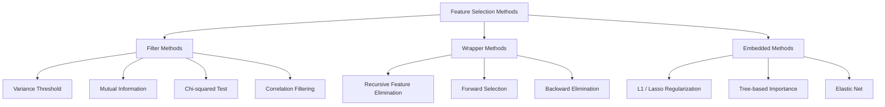
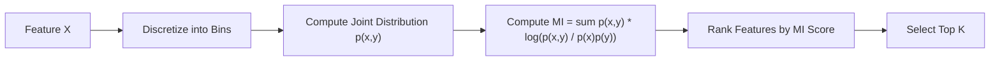
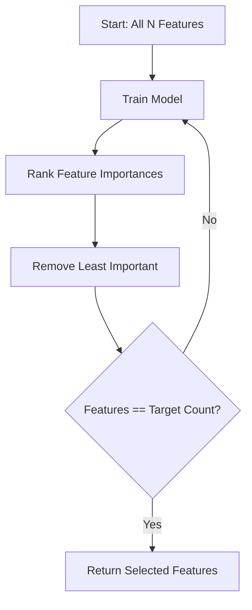
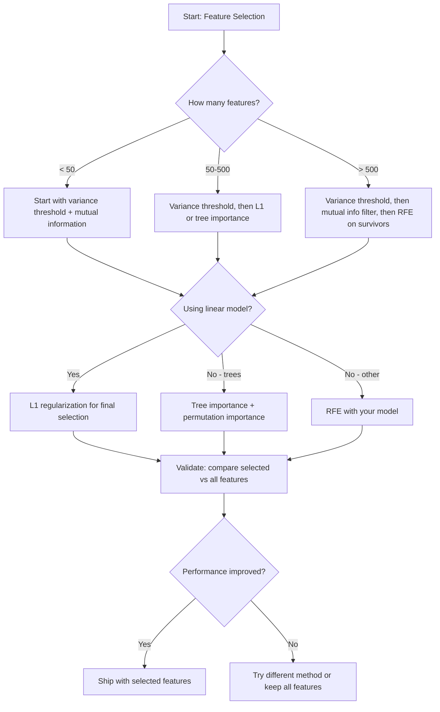

# 기능 선택

> 더 많은 기능이 더 좋지 않습니다. 올바른 기능이 더 좋습니다.

**Type:** Build
**Language:**파이썬
**Prerequisites:** Phase 2, Lessons 01-09, 08 (feature engineering)
**Time:** ~75 minutes

## 학습 목표

- 필터 방법 (변화 문턱, 상호 정보, chi-제곱) 과 팩어 방법 (RFE, 앞으로 선택) 을 처음부터 구현
- 상호 정보에 대한 상관관계가 생략되는 비선형 특징-목표 관계를 왜 캡처하는지 설명하십시오.
- L1 정규화 (이베드 선택) 과 RFE (복 선택) 를 비교하고 그들의 계산적 타협을 평가한다
- 여러 방법을 결합하고, 보유된 데이터에 대한 더 나은 일반화를 보여주는 기능 선택 파이프라인을 구축합니다.

## 문제

500가지 기능이 있습니다. 모델은 천천히 훈련하고, 끊임없이 과장하고, 아무도 배운 것을 설명할 수 없습니다. 당신은 성능을 향상시킬 수 있는 더 많은 기능들을 추가합니다. 그것은 더 악화됩니다.

이것은 행동에서 차원성의 저주입니다. 특징의 수가 증가함에 따라 특징 공간의 부피가 폭발합니다. 데이터 포인트는 희소화됩니다. 포인트 사이의 거리가 공렴됩니다. 모델은 실제 패턴을 찾기 위해 기하급수적으로 더 많은 데이터를 필요로합니다. 잡음 기능은 신호 특징을 익사합니다. 과장착은 기본이됩니다.

기능 선택은 항독입니다. 소음을 제거하고, 과잉을 제거합니다. 목표에 대한 실제 정보를 담은 기능을 유지합니다. 결과는: 더 빠른 훈련, 더 나은 일반화, 그리고 실제로 설명할 수 있는 모델입니다.

목표 는 모든 가용 정보 를 사용 하는 것 이 아니라 올바른 정보 를 사용 하는 것 이다.

## 개념

### 특징 선택의 세 가지 종류

각 특징 선택 방법은 세 가지 범주에 해당합니다.



**Filter methods**각각의 특징을 독립적으로 통계 측정 방법을 사용하여 점수를 합니다. 그들은 모델을 사용하지 않습니다. 빠른, 하지만 특징 상호 작용을 놓치고 있습니다.

**Wrapper methods**모델의 성능을 점수로 사용한다. 더 좋은 결과이지만, 많은 시간을 모델에 재교육하기 때문에 비용이 많이 들죠.

**Embedded methods**L1 정규화는 무게를 0으로 끌어올립니다. 결정 나무는 가장 유용한 특징에 나뉘어 있습니다. 선택은 별도의 단계로 이루어지지 않고, 설치 중에 발생합니다.

### 변동률

가장 간단한 필터입니다. 샘플마다 특징이 거의 변하지 않으면 거의 정보를 가지고 있지 않습니다.

1000개의 샘플 중 999개의 0.0의 특징을 생각해 봅시다. 그 변수는 거의 0입니다. 어떤 모델도 클래스를 구별하기 위해 사용할 수 없습니다. 그것을 제거하십시오.

```math
\text{variance}(x) = \text{mean}\bigl((x - \text{mean}(x))^2\bigr)
```

한계값을 설정 (예를 들어 0.01). 그 이하의 변수를 가진 모든 특징을 떨어뜨립니다. 이것은 목표 변수를 전혀 보지 않고 일정 또는 거의 일정한 특징을 제거합니다.

언제 사용해야 하는지: 다른 방법보다 먼저 미리 처리하는 단계로 사용한다. 그것은 분명히 무용한 특징을 거의 무대 비용으로 잡는다.

제한: 특징은 높은 변수를 가지고 있지만 여전히 순수적인 소음일 수 있습니다. 변수 임기는 필요하지만 충분하지 않습니다.

### 상호 정보

상호 정보 제공은 기능의 가치를 얼마나 알고 있는지 측정합니다 $X$목표에 대한 불확실성을 줄이는$Y$- 그래

```math
I(X; Y) = \sum_x \sum_y p(x, y) \cdot \log \frac{p(x, y)}{p(x) \cdot p(y)}
```

만약$X$그리고$Y$독립적이죠$p(x, y) = p(x) \cdot p(y)$, 로그 용어는 0이고$I(X; Y) = 0$- 더 많은$X$이 이야기는$Y$, 상호 정보의 수치가 높습니다.

상관관계에 비해 핵심적인 장점은: 상호 정보들은 비선형 관계를 포착한다. 특징은 목표와 상관관계를 줄일 수 있지만 관계가 사각형 또는 주기적이기 때문에 상호 정보가 높을 수 있다.

연속적인 특징을 위해 먼저 버그로 분할해 보세요 (기생진표에 기반한 추정). 버그 수는 추정에 영향을 미칩니다. 너무 적은 버그가 정보를 잃게 되고 너무 많은 버그가 소음을 추가합니다. 일반적인 선택:$\sqrt{n}$버섯이나 스터거스 규칙 ($1 + \log_2 n$)



### 재발성 특징 제거 (RFE)

RFE는 팩어 방법이다. 모델의 고유의 특징 중요성을 반복적으로 절단하기 위해 사용합니다.

1. 모든 특징을 가진 모델을 훈련
2. 중요성별 순위 특징 (선형 모델의 계수, 나무의 미세먼지 감소)
3. 가장 중요하지 않은 특징을 제거합니다.
4. 원하는 기능이 남아있는 때까지 반복합니다.



RFE는 특징 상호작용을 고려하기 때문에 모델은 나머지 모든 특징을 함께 볼 수 있습니다. 한 특징을 제거하면 다른 기능의 중요성이 달라집니다. 이것은 필터 방법보다 더 철저하게 만듭니다.

비용: 모델을 훈련시켜야 합니다$N - \text{target}$500개의 기능과 10개의 목표가 있는 경우 490개의 훈련 라인입니다. 비싼 모델에서는 느립니다. 한 단계에 여러 가지 기능을 제거함으로써 속도를 높일 수 있습니다.

### L1 (라소) 규제

L1 정규화는 손실 함수에 무게의 절대 값을 추가합니다:

```math
\text{loss} = \text{prediction\_error} + \alpha \cdot \sum \lvert w_i \rvert
```

알파 매개 변수는 성능이 얼마나 공격적으로 절단되는지 조절합니다. 더 높은 알파는 더 많은 무게가 정확히 0으로 가는 것을 의미합니다.

왜 정확히 0? L1 페널티는 무게 공간에서 다이아몬드 모양의 제약 영역을 만듭니다. 최적의 해결책은 이 다이아몬드의 한 구석에 착륙하는 경향이 있습니다. 하나 이상의 무게가 0이있는 곳. L2 정규화는 (리지) 는 무게가 축소되는 원형 제약을 만듭니다. 그러나 거의 0을 달성하지 않습니다.

이것은 임베디드 기능 선택입니다. 모델은 훈련 중에 무시할 수 있는 기능들을 학습합니다. 무중함의 기능들은 효과적으로 제거됩니다.

장점: 단일 훈련 실행, 상관관계 기능을 처리 (하나를 선택하고 다른 것을 0으로 선택), 대부분의 선형 모델 구현에 내장되어 있습니다.

제한: 선형 모델에서만 작동합니다. 비선형 특징의 중요성을 파악할 수 없습니다.

### 나무 에 기초 한 특징 의 중요성

결정나무와 그 집합 (자발적인 숲, 계층 증가) 은 자연적으로 특징을 순위화 합니다. 각 분단으로 미세먼지가 감소합니다.

이랑 무작위 숲에$T$나무:

```math
\text{importance}(\text{feature}_j) = \frac{1}{T} \sum_{\text{all trees}} \; \sum_{\text{all nodes splitting on } \text{feature}_j} (\text{n\_samples} \cdot \text{impurity\_decrease})
```

이것은 각 기능에 대한 정상화된 중요성 점수를 제공합니다. 비선형 관계를 처리하고 기능 상호 작용을 자동으로 처리합니다.

주의: 나무 기반의 중요성은 많은 고유 값 (고한 카드나리티) 을 가진 특징에 편향되어 있습니다. 무작위 ID 열은 모든 샘플을 완벽하게 나눌 수 있기 때문에 중요하게 보일 것입니다. 상식 검증으로 변변의 중요성을 사용하십시오.

### 변변의 중요성

모델-아고스틱 방법:

1. 모델을 훈련시키고 검증 데이터에 기초 성능을 기록
2. 각각의 기능에 대해: 값들을 무작위로 섞어, 성능의 하락을 측정
3. 더 큰 점수가 더 중요한 특징

기능 을 섞는 것 이 성능 을 손상시키지 않는다면, 모델 은 그 에 의존 하지 않습니다. 성능 이 붕괴되면, 그 기능 은 중요 합니다.

변변의 중요성은 나무에 기반한 중요성의 추대성 편향을 피합니다. 그러나 느립니다.

### 비교 표

| Method | Type | Speed | Nonlinear | Feature Interactions |
|--------|------|-------|-----------|---------------------|
| Variance threshold | Filter | Very fast | No | No |
| Mutual information | Filter | Fast | Yes | No |
| Correlation filter | Filter | Fast | No | No |
| RFE | Wrapper | Slow | Depends on model | Yes |
| L1 / Lasso | Embedded | Fast | No (linear) | No |
| Tree importance | Embedded | Medium | Yes | Yes |
| Permutation importance | Model-agnostic | Slow | Yes | Yes |

### 결정 흐름표



```figure
f3-feature-prune
```

## 건설 해

### 단계 1: 알려진 기능 구조를 가진 합성 데이터를 생성합니다

```python
import numpy as np


def make_feature_selection_data(n_samples=500, seed=42):
    rng = np.random.RandomState(seed)

    x1 = rng.randn(n_samples)
    x2 = rng.randn(n_samples)
    x3 = rng.randn(n_samples)
    x4 = x1 + 0.1 * rng.randn(n_samples)
    x5 = x2 + 0.1 * rng.randn(n_samples)

    informative = np.column_stack([x1, x2, x3, x4, x5])

    correlated = np.column_stack([
        x1 * 0.9 + 0.1 * rng.randn(n_samples),
        x2 * 0.8 + 0.2 * rng.randn(n_samples),
        x3 * 0.7 + 0.3 * rng.randn(n_samples),
        x1 * 0.5 + x2 * 0.5 + 0.1 * rng.randn(n_samples),
        x2 * 0.6 + x3 * 0.4 + 0.1 * rng.randn(n_samples),
    ])

    noise = rng.randn(n_samples, 10) * 0.5

    X = np.hstack([informative, correlated, noise])
    y = (2 * x1 - 1.5 * x2 + x3 + 0.5 * rng.randn(n_samples) > 0).astype(int)

    feature_names = (
        [f"info_{i}" for i in range(5)]
        + [f"corr_{i}" for i in range(5)]
        + [f"noise_{i}" for i in range(10)]
    )

    return X, y, feature_names
```

우리는 기본 진실을 알고 있습니다. 0-4의 특징은 정보 (그대 3와 4는 0와 1의 상관된 복사본) 이며, 5-9의 특징은 정보적 특징과 상관관계가 있으며, 10-19의 특징은 순수적인 소음입니다. 좋은 선택 방법은 0-4의 가장 높은 순위와 10-19의 가장 낮은 순위를 차지해야 합니다.

### 단계 2: 변동률

```python
def variance_threshold(X, threshold=0.01):
    variances = np.var(X, axis=0)
    mask = variances > threshold
    return mask, variances
```

### 단계 3: 상호 정보 (비밀)

```python
def discretize(x, n_bins=10):
    min_val, max_val = x.min(), x.max()
    if max_val == min_val:
        return np.zeros_like(x, dtype=int)
    bin_edges = np.linspace(min_val, max_val, n_bins + 1)
    binned = np.digitize(x, bin_edges[1:-1])
    return binned


def mutual_information(X, y, n_bins=10):
    n_samples, n_features = X.shape
    mi_scores = np.zeros(n_features)

    y_vals, y_counts = np.unique(y, return_counts=True)
    p_y = y_counts / n_samples

    for f in range(n_features):
        x_binned = discretize(X[:, f], n_bins)
        x_vals, x_counts = np.unique(x_binned, return_counts=True)
        p_x = dict(zip(x_vals, x_counts / n_samples))

        mi = 0.0
        for xv in x_vals:
            for yi, yv in enumerate(y_vals):
                joint_mask = (x_binned == xv) & (y == yv)
                p_xy = np.sum(joint_mask) / n_samples
                if p_xy > 0:
                    mi += p_xy * np.log(p_xy / (p_x[xv] * p_y[yi]))
        mi_scores[f] = mi

    return mi_scores
```

### 4단계: 반복적 인 특징을 제거

```python
def simple_logistic_importance(X, y, lr=0.1, epochs=100):
    n_samples, n_features = X.shape
    w = np.zeros(n_features)
    b = 0.0

    for _ in range(epochs):
        z = X @ w + b
        pred = 1.0 / (1.0 + np.exp(-np.clip(z, -500, 500)))
        error = pred - y
        w -= lr * (X.T @ error) / n_samples
        b -= lr * np.mean(error)

    return w, b


def rfe(X, y, n_features_to_select=5, lr=0.1, epochs=100):
    n_total = X.shape[1]
    remaining = list(range(n_total))
    rankings = np.ones(n_total, dtype=int)
    rank = n_total

    while len(remaining) > n_features_to_select:
        X_subset = X[:, remaining]
        w, _ = simple_logistic_importance(X_subset, y, lr, epochs)
        importances = np.abs(w)

        least_idx = np.argmin(importances)
        original_idx = remaining[least_idx]
        rankings[original_idx] = rank
        rank -= 1
        remaining.pop(least_idx)

    for idx in remaining:
        rankings[idx] = 1

    selected_mask = rankings == 1
    return selected_mask, rankings
```

### 단계 5: L1 기능 선택

```python
def soft_threshold(w, alpha):
    return np.sign(w) * np.maximum(np.abs(w) - alpha, 0)


def l1_feature_selection(X, y, alpha=0.1, lr=0.01, epochs=500):
    n_samples, n_features = X.shape
    w = np.zeros(n_features)
    b = 0.0

    for _ in range(epochs):
        z = X @ w + b
        pred = 1.0 / (1.0 + np.exp(-np.clip(z, -500, 500)))
        error = pred - y

        gradient_w = (X.T @ error) / n_samples
        gradient_b = np.mean(error)

        w -= lr * gradient_w
        w = soft_threshold(w, lr * alpha)
        b -= lr * gradient_b

    selected_mask = np.abs(w) > 1e-6
    return selected_mask, w
```

### 단계 6: 나무에 기반한 중요성 (단순한 의사결정 나무)

```python
def gini_impurity(y):
    if len(y) == 0:
        return 0.0
    classes, counts = np.unique(y, return_counts=True)
    probs = counts / len(y)
    return 1.0 - np.sum(probs ** 2)


def best_split(X, y, feature_idx):
    values = np.unique(X[:, feature_idx])
    if len(values) <= 1:
        return None, -1.0

    best_threshold = None
    best_gain = -1.0
    parent_gini = gini_impurity(y)
    n = len(y)

    for i in range(len(values) - 1):
        threshold = (values[i] + values[i + 1]) / 2.0
        left_mask = X[:, feature_idx] <= threshold
        right_mask = ~left_mask

        n_left = np.sum(left_mask)
        n_right = np.sum(right_mask)

        if n_left == 0 or n_right == 0:
            continue

        gain = parent_gini - (n_left / n) * gini_impurity(y[left_mask]) - (n_right / n) * gini_impurity(y[right_mask])

        if gain > best_gain:
            best_gain = gain
            best_threshold = threshold

    return best_threshold, best_gain


def tree_importance(X, y, n_trees=50, max_depth=5, seed=42):
    rng = np.random.RandomState(seed)
    n_samples, n_features = X.shape
    importances = np.zeros(n_features)

    for _ in range(n_trees):
        sample_idx = rng.choice(n_samples, size=n_samples, replace=True)
        feature_subset = rng.choice(n_features, size=max(1, int(np.sqrt(n_features))), replace=False)

        X_boot = X[sample_idx]
        y_boot = y[sample_idx]

        tree_imp = _build_tree_importance(X_boot, y_boot, feature_subset, max_depth)
        importances += tree_imp

    total = importances.sum()
    if total > 0:
        importances /= total

    return importances


def _build_tree_importance(X, y, feature_subset, max_depth, depth=0):
    n_features = X.shape[1]
    importances = np.zeros(n_features)

    if depth >= max_depth or len(np.unique(y)) <= 1 or len(y) < 4:
        return importances

    best_feature = None
    best_threshold = None
    best_gain = -1.0

    for f in feature_subset:
        threshold, gain = best_split(X, y, f)
        if gain > best_gain:
            best_gain = gain
            best_feature = f
            best_threshold = threshold

    if best_feature is None or best_gain <= 0:
        return importances

    importances[best_feature] += best_gain * len(y)

    left_mask = X[:, best_feature] <= best_threshold
    right_mask = ~left_mask

    importances += _build_tree_importance(X[left_mask], y[left_mask], feature_subset, max_depth, depth + 1)
    importances += _build_tree_importance(X[right_mask], y[right_mask], feature_subset, max_depth, depth + 1)

    return importances
```

### 단계 7: 모든 방법을 실행하고 비교

코드 파일은 동일한 합성 데이터 세트에 모든 다섯 가지 방법을 실행하고 각각의 방법이 선택한 특징을 나타내는 비교 테이블을 인쇄합니다.

## 사용 하 고

scikit-learn의 경우 기능 선택이 파이프라인에 들어서게 됩니다.

```python
from sklearn.feature_selection import (
    VarianceThreshold,
    mutual_info_classif,
    RFE,
    SelectFromModel,
)
from sklearn.linear_model import Lasso, LogisticRegression
from sklearn.ensemble import RandomForestClassifier

vt = VarianceThreshold(threshold=0.01)
X_filtered = vt.fit_transform(X)

mi_scores = mutual_info_classif(X, y)
top_k = np.argsort(mi_scores)[-10:]

rfe_selector = RFE(LogisticRegression(), n_features_to_select=10)
rfe_selector.fit(X, y)
X_rfe = rfe_selector.transform(X)

lasso_selector = SelectFromModel(Lasso(alpha=0.01))
lasso_selector.fit(X, y)
X_lasso = lasso_selector.transform(X)

rf = RandomForestClassifier(n_estimators=100)
rf.fit(X, y)
importances = rf.feature_importances_
```

초점 구현은 각 방법 안에서 정확히 일어나는 일을 보여줍니다. 변수 임기는 단지 계산입니다.`var(X, axis=0)`그리고 마스크를 적용합니다. 상호 정보는 응급 테이블에서 관절 및 소외 주파수를 계산합니다. RFE는 열, 순위, 그리고 정자리를 만드는 루프입니다. L1는 부드러운 문턱 단계로 경진하입니다. 나무 중요성은 분할을 통해 미세 감소를 축적합니다. 마법이 없습니다. 통계와 루프 만입니다.

sklearn 버전은 강도를 추가합니다 (예를 들어, mutual_info_classif는 binning 대신 k-NN 밀도 추정을 사용합니다), 속도 (C 구현) 및 파이프라인 통합.

## 선박

이 교훈은 다음과 같은 결과를 낳습니다.
- `outputs/skill-feature-selector.md`-- 적절한 기능 선택 방법을 선택하는 빠른 참조 결정 트리

## 운동

1. **Forward selection**RFE의 반대를 구현하십시오. 0 기능으로 시작하십시오. 각 단계에 모델 성능을 가장 많이 향상시키는 기능을 추가하십시오. 기능이 더 이상 도움이되지 않을 때 중지하십시오. 선택된 기능을 RFE 결과와 비교하십시오. 어느 것이 더 빠르습니까? 어느 것이 더 나은 결과를 제공합니다?

2. **Stability selection**: L1 기능 선택은 50 번 실행, 각각의 경우 데이터의 무작위 80% 하위 샘플에 의해 약간 다른 알파 값으로 실행합니다. 각 기능이 얼마나 자주 선택되는지 계산합니다. 실행 중 80% 이상에서 선택된 기능은 "స్థిరంగా" 있습니다.

3. **Multicollinearity detection**: 모든 기능에 대한 상관관계 행렬을 계산합니다. 상관관계 임계값 (예를 들어 0.9) 를 고려하면 각 고 상관관계 있는 쌍에서 한 가지 특징을 제거하는 함수를 구현합니다. (목적과 더 높은 상호 정보를 가진 쌍을 유지합니다). 합성 데이터 세트를 테스트하고 확인하면 과잉 상관관계된 특징을 제거합니다.

4. **Feature selection pipeline**: 체인 변동률 문턱, 상호 정보 필터 및 RFE를 하나의 파이프라인으로 넣습니다. 먼저 거의 0 변동 기능들을 제거하고, 상호 정보로 상위 50%를 유지하고, 생존자들에 RFE를 실행하십시오. 이 파이프라인을 모든 기능에 RFE를 혼자 실행하는 것과 비교하십시오. 파이프라인은 더 빠르습니까? 그것은 똑같이 정확합니까?

5. **Permutation importance from scratch**F1 점수 평균 감소를 측정하여 각 특징에 대한 값을 10 번 섞어 F1 점수의 평균 감소를 측정하여 나무 기반의 중요성에 대한 순위를 비교하여 의견이 일치하지 않는 경우를 찾아서 이유를 설명하십시오 (힌트: 상관관계 있는 특징)

## 주요 용어

| Term | What people say | What it actually means |
|------|----------------|----------------------|
| Filter method | "Score features independently" | A feature selection approach that ranks features using a statistical measure without training a model, evaluating each feature in isolation |
| Wrapper method | "Use the model to pick features" | A feature selection approach that evaluates feature subsets by training a model and using its performance as the selection criterion |
| Embedded method | "The model selects features during training" | Feature selection that happens as part of model fitting, such as L1 regularization driving weights to zero |
| Mutual information | "How much one variable tells you about another" | A measure of the reduction in uncertainty about $Y$ given knowledge of $X$, capturing both linear and nonlinear dependencies |
| Recursive Feature Elimination | "Train, rank, prune, repeat" | An iterative wrapper method that trains a model, removes the least important feature(s), and repeats until a target count is reached |
| L1 / Lasso regularization | "Penalty that kills features" | Adding the sum of absolute weight values to the loss function, which drives unimportant feature weights to exactly zero |
| Variance threshold | "Remove constant features" | Dropping features whose variance across samples falls below a specified threshold, filtering out features that carry no information |
| Feature importance | "Which features matter most" | A score indicating how much each feature contributes to model predictions, computed from split gains (trees) or coefficient magnitudes (linear) |
| Permutation importance | "Shuffle and measure the damage" | Evaluating feature importance by randomly shuffling each feature's values and measuring the resulting drop in model performance |
| Curse of dimensionality | "Too many features, not enough data" | The phenomenon where adding features increases the volume of the feature space exponentially, making data sparse and distances meaningless |

## 더 많은 읽기

- [An Introduction to Variable and Feature Selection (Guyon & Elisseeff, 2003)](https://jmlr.org/papers/v3/guyon03a.html)-- 특징 선택 방법들에 대한 기초적인 조사, 여전히 널리 언급되고 있습니다
- [scikit-learn Feature Selection Guide](https://scikit-learn.org/stable/modules/feature_selection.html)-- 코드 예시로 필터, 팩터 및 임베디드 방법의 실제 참조
- [Stability Selection (Meinshausen & Buhlmann, 2010)](https://arxiv.org/abs/0809.2932)-- 탄탄하고 재생 가능한 결과를 위해 하위 샘플링과 기능 선택을 결합합니다
- [Beware Default Random Forest Importances (Strobl et al., 2007)](https://bmcbioinformatics.biomedcentral.com/articles/10.1186/1471-2105-8-25)-- 나무에 기반한 중요성에 대한 추대성 편향을 보여 주고
