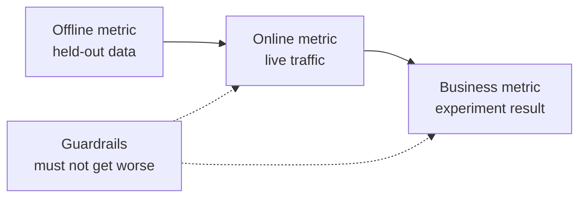

# ML 시스템 설계  문제부터 도입된 모델까지

> 모델은 시스템의 한 부분입니다. 디자인은 모델이 예측하는 것을 결정합니다. 누가 그것에 따라 행동하는지, 비용이 얼마나 들는지, 그리고 실패하면 어떻게 될까요?

**Type:** Build
**Languages:** Python
**Prerequisites:** Phase 2, Lessons 09 (Model Evaluation) and 13 (ML Pipelines)
**Time:** ~110 minutes

## 학습 목표

- 비즈니스 문제를 예측, 그것을 사용하는 결정, 규칙이 충분하지 않은 이유와 함께 ML 작업으로 프레임
- 오프라인, 온라인, 비즈니스 및 경비 라인 매트릭을 분리하고 모든 모델을 비약적이고 유리스틱한 기본 라인에 비교하십시오
- 교통 수치를 통해 일일 비용, 지연 및 패치 및 온라인 추론의 지연을 추정합니다
- 각 실패 모드 (shadow, canary, A/B test) 에 대한 로롤러 패턴과 안전한 기본 설정을 선택하십시오.
- 모델이 다음 버전을 훈련시키는 데이터를 변경하는 피드백 루프를 식별하십시오
- ML 설계 문서를 작성하고 고정된 체크리스트에 맞춰 점수를 부여하십시오

## 문제

한 가입 회사는 "추른 모델"을 요청합니다. 데이터 과학자는 gradient-boosted 분류기를 훈련시키고 0.91의 AUC를 보고합니다. 3개월 후 아무도 사용하지 않습니다.

그 이유는 알고리즘과 관련이 없습니다. 아무도 스코어가 어떤 동작을 시작하는지 결정하지 않았습니다. 스코어가 일주일에 한 번 도착하지만 유지팀은 매일 고객을 호출합니다. 레이블은 취소 이유를 저장하는 취소 테이블에서 왔습니다. 그래서 한 기능에는 답이 포함되어 있습니다. 아무도 모델을 지원 팀이 이미 사용한 규칙과 비교하지 않았습니다. 누구든 2주 동안 비활성으로 호출하십시오.

이 모든 실패는 훈련 시작 전에 발생했습니다. 그것들은 설계 실패입니다. 그리고 한 페이지의 설계 문서는 그 각각의 문제에 대해 묻습니다. 이 수업은 그 문서의 결정을 가르칩니다. 당신은 대량 가격과 온라인 서비스 가격을 나타내는 도구 킷을 만들고, 모델을 기본 라인들과 비교하고, 체크리스트에 대한 설계 문서를 점수합니다.

## 개념

### 비즈니스 목표에서 ML 작업으로

비즈니스 목표는 ML 작업이 아닙니다. 당신은 그것을 네 가지 질문으로 바꾸어 놓습니다.

1. 모델은 정확히 무엇을 예측하고, 어떤 엔티티 (이용자, 지불, 저장, 항목) 에 대해?
2. 예언 을 이용 하여 어떤 결정 을 취 합니까? 누가 또는 무엇 이 그러한 결정 을 취 합니까?
3. 예측이 언제 필요한가? 그리고 그 순간에 어떤 자료가 존재하는가?
4. 어떻게 결정이 더 나아졌는지 알 수 있을까요?

| Business goal | Prediction | Decision that uses it | ML task |
|---|---|---|---|
| Reduce churn | Probability that a user cancels in the next 30 days | Send a save offer to the top 5 percent each night | Binary classification |
| Cut fraud losses | Probability that a payment is fraud | Approve, review, or block within 100 ms | Binary classification |
| Keep shelves stocked | Units sold per store per day next week | Order quantity for each store | Forecasting |
| Show relevant items | Relevance score for a (user, item) pair | Order of items in the feed | Ranking |

두 번째 열은 가장 주의가 필요하다. "예술 "는 지평선, 엔티티, 그리고 액션을 열어 놓습니다. "이 사용자가 다음 30 일 내에 취소하는지 예측하십시오. 그래서 오늘 밤의 작업은 누가 제안을 받을 수 있는지 선택할 수 있습니다".

### ML를 사용하지 않는 경우

구글의 머신러닝 규칙의 규칙 1는 머신러닝 없이 제품을 출시하는 것을 두려워하지 말라고 말합니다. 머신러닝은 데이터에 필요하며 간단한 유리스틱은 종종 길을 갈 수 있습니다. 이러한 경우에 ML를 사용하지 마십시오:

- 짧은 규칙 은 목표 를 달성 하고 정확 하게 유지 합니다. 규칙 을 실행 하고 시험 하고 설명 하는 것 은 더 저렴 합니다.
- 당신은 별다른 레이블도 없고, 그것들을 수집하는 실용적인 방법이 없습니다.
- 아무도 예측에 따라 행동하지 않으므로 더 나은 예측은 아무것도 바꾸지 않습니다.
- 예측 시간에 존재하는 데이터는 신호를 포함하지 않습니다.
- 하나의 오류는 허용되지 않으며 아무도 출력을 확인할 수 없습니다.
- 시스템을 구축하고 운영하는 것은 더 나은 결정보다 더 많은 비용이 든다.

규칙이 길고 취약해지면 ML는 결실을 맺기 시작합니다. 같은 가이드의 규칙 #3은 복잡한 유리스틱보다 ML를 선호합니다. 왜냐하면 학습된 모델은 업데이트하고 유지하기가 쉽기 때문입니다.

### 3층의 측정

ML 시스템을 세 층으로 측정하고, 한계 세트를 더합니다.

| Layer | When you can measure it | Churn example |
|---|---|---|
| Offline metric | Before launch, on held-out past data | F1 at the offer threshold, precision in the top 5 percent |
| Online metric | During launch, on live traffic | Offer acceptance rate, share of users scored, score distribution |
| Business metric | Weeks after launch, with an experiment | 30-day churn rate in the treated group versus a holdout group |
| Guardrail metric | All the time | Offer cost per saved user, unsubscribe rate, p99 latency |



여러 계층은 종종 동의하지 않습니다. 오프라인 매트릭은 과거의 데이터를 점수하고, 과거는 당신의 모델을 포함하지 않았습니다. 온라인 매트릭은 결정에 사람들이 어떻게 반응하는지에 달려 있습니다. 비즈니스 매트릭은 천천히 움직이고 회사 내 모든 다른 부분에서 소음을 가져옵니다.

결정에 맞는 오프라인 매트릭을 선택하세요. 만약 작업이 가장 높은 5%의 사용자와 접촉한다면, 가장 높은 5%의 사용자에서 정확도를 측정하세요. AUC는 절대 사용하지 않는 임대값을 포함하여 모든 임대값을 평균적으로 측정합니다. 같은 가이드의 #2 규칙은 ML 시스템이 무엇을 할 것인지 결정하기 전에 먼저 매트릭을 설계하고 구현해야 한다고 말합니다.

### 기준

미트릭 값은 혼자만 아무것도 의미하지 않습니다. F1 는 0.56의 가장 좋은 대안이 0.30에 도달하면 좋으며 규칙이 0.60에 도달하면 나쁘습니다. 모든 모델을 세 가지 유형의 기본 라인과 비교하십시오.

- **Trivial baseline.**항상 과반급을 예측하거나 훈련 평균을 예측합니다. 우리는 이 검사를 모델 평가 수업에서 사용했습니다.
- **Heuristic baseline.**영역 지식의 규칙이나 훈련 데이터에 맞는 하나의 특징의 임대점입니다.
- **Current system.**오늘날 어떤 결정이 내려진다고 해도, 심지어는 계산표가 있는 사람이라도

리프트는 모델 스코어입니다. 가장 강력한 기본 라인점의 스코어 빼면 됩니다. 결과를 보기 전에 최소한의 리프트를 설정하고, 추가 시스템을 지불하기에 충분한 크기를 만들어 보세요. 비비얼 기본 라인트는 보통 약합니다. 유리스틱 기본 라인지는 이길 수 없습니다.

### 데이터 및 라벨 요구 사항

훈련 하기 전 에 다음 질문 에 대답 하십시오.

- **Label source.**어떤 테이블이나 이벤트로 이 표를 정의하고 누가 소유하는가?
- **Label delay.**예측 후 얼마나 오래 걸리죠? 실제 결과는 도착합니다. 사기 회수금은 지불 후 몇 주 후에 도착할 수 있습니다.
- **Label quality.**누가 그 표기를 부여 합니까? 얼마나 자주 잘못 되어 있습니까?
- **Availability at prediction time.**예측 시점에 모든 특징이 존재하는가? 그 결과로 시스템이 작성한 특징은
- **Volume per class.**얼마나 많은 긍정적인 사례가 존재하는가? 200개의 긍정적인 사례는 단순한 모델로만 제한됩니다.
- **Time split.**가장 최근의 기간을 유지하세요. 우리는 같은 이유로 시간 시리즈 수업에서 시간에 따라 데이터를 나눕니다.

### 지연성, 처리량 및 비용 예산

세 개의 숫자가 모든 서비스 디자인을 묶어줍니다.

- **Latency budget.**p99 지연은 100개의 요청 중 99개의 요청이 지연되는 시간입니다. 결제 체크는 50ms가 필요할 수 있습니다. 밤마다 보고서는 몇 시간 걸릴 수 있습니다.
- **Peak throughput.**가장 바쁜 분 에 맞춰서 시스템을 측정 해 보십시오. 하루 평균 에 따라 하지 마십시오. 최고 QPS는 평균 이 몇 배나 높습니다.
- **Cost budget.**하루에 달러나 1000개의 예측에 달러로 표현해 보세요. 그래서 디자인을 비교할 수 있습니다.

리틀의 법칙은 첫 번째 두 가지를 연결합니다. 진행 중인 요청의 수는 처리 시간 지연과 같습니다. 초당 400 개의 요청과 50 ms 각각, 20 개의 요청이 언제든지 진행 중입니다.

### 대량 추론과 온라인 추론

예측을 수행하는 두 가지 기본적인 방법이 있습니다.

- **Batch inference.**일정한 작업은 모든 엔티티를 점수를 받고 테이블 또는 키-값 저장소에 점수를 작성합니다. 응용 프로그램은 요청 시 저장된 점수를 읽습니다.
- **Online inference.**응용 프로그램은 요청 시간에 기능들을 모델 서비스에 보내고 점수를 기다립니다.

| Property | Batch | Online |
|---|---|---|
| Freshness | As old as the last run, plus the run time | Uses the data of the request |
| Request latency | One key-value read, a few ms | Feature fetch plus model time |
| Cost driver | Number of entities times runs per day | Replicas sized for peak QPS |
| New entities | No score until the next run | Scored on the first request |
| When it breaks | Old scores stay readable | Requests fail or time out |

이 수업의 도구 킷은 두 가지 모두 가격입니다. 단체의 수와 하루에 실행되는 수와 함께 배트 비용이 증가합니다. 더 짧은 대기 제한은 더 많은 실행을 의미합니다. 온라인 비용은 최고 트래픽으로 증가합니다. 왜냐하면 당신은 정상 사이에 비활성 복제 비용을 지불하기 때문입니다. 한 시간 동안 걸리는 배트 작업은 어떤 가격에서도 한 시간 이하의 대기 제한을 충족시킬 수 없습니다.

하이브리드 디자인은 일반적입니다. 밤마다 일괄 작업은 알려진 사용자들을 점수하고 온라인 경로는 신선한 데이터를 필요로 하는 새로운 사용자와 요청을 점수합니다.

### 배포 패턴

새로운 모델은 단계적으로 사용자들에게 도달합니다.

1. **Shadow.**새로운 모델은 실시간 트래픽의 복사본을 수신합니다. 시스템은 예측을 기록하고 사용하지 않습니다. 현재 모델과 지연, 오류율 및 예측 분포를 비교합니다.
2. **Canary.**새로운 모델은 작은 교통량, 종종 1~5%에 대한 실제 결정을 내립니다.
3. **A/B test.**사용자들의 무작위 분포가 각각의 모델을 보고 있습니다. 통계적인 테스트를 통해 비즈니스 메트릭을 측정하고, 그 차이를 보기 위해 충분한 트래픽과 충분한 시간이 필요합니다.

각 단계마다 몇 분 걸리는 롤백이 필요합니다. 오래된 모델 버전을 배치하고 구성과 함께 트래픽을 전환하십시오. LLM 서비스 단계는 언어 모델에 대한 동일한 세 패턴을 포함합니다.[shadow and canary lesson](../../../17-infrastructure-and-production/20-shadow-canary-progressive/docs/en.md)그리고[A/B testing lesson](../../../17-infrastructure-and-production/21-ab-testing-llm-features/docs/en.md)- 그래

### 피드백 루프

모델의 결정이 다음 버전을 훈련시키는 데이터를 변경할 때 피드백 루프가 존재한다. 스컬리等人. ML 시스템에서 기술 부채의 주요 출처 중 직접적이고 숨겨진 피드백 루프를 목록에 나열합니다. 세 가지 일반적인 경우:

- **Interventions hide the label.**어 모델은 제안서를 보내고 제안은 일부 사용자를 유지합니다. 다음 달, 위험 높은 사용자들은 충성스럽다고 보이지만, 재 훈련된 모델은 그들의 기능이 어 기능을 예측하지 않는다는 것을 알게됩니다.
- **Blocked actions have no outcome.**사기 모델은 결제를 차단하기 때문에 결제가 결코 회수 표기를 받지 않습니다. 훈련된 모델들은 차단된 지역에서 사기 사례가 줄어든다.
- **Exposure limits feedback.**순위 모델은 가장 높은 항목을 표시하므로 그 항목만이 클릭을 수집합니다.

수정된 것은 하나의 아이디어를 공유합니다. 모델이 영향을 미치지 않은 데이터를 보관합니다. 간섭을 받지 않는 작은 무작위 그룹을 유지하십시오. 트래픽의 작은 부분을 무작위 결정으로 지정하십시오. 각 예제와 함께 점수와 결정을 기록하여 나중에 훈련이 영향을 받은 데이터를 깨끗한 데이터에서 구별할 수 있도록합니다.

### 실패 모드 및 안전 기본 설정

모든 시스템 부품이 일찍이 실패합니다. 설계에서 실패하는 모든 경우 기본 동작을 결정합니다.

| Failure | Result without a plan | Safe default |
|---|---|---|
| Model service times out | The request fails | Use the heuristic baseline |
| Nightly batch job fails | Scores go missing or get old | Serve the last good scores for a fixed time, then the rule |
| Feature is missing or out of range | The model scores bad input | Use the documented default value and log the event |
| New entity with no history | No score exists | Use the rule or the population average |
| Score distribution moves suddenly | Wrong decisions at scale | Pause automatic actions and alert a person |

메트릭 섹션의 유리스틱 기본선은 대부분의 실패의 기본입니다. 그래서 먼저 만들어 보세요.

### 설계 문서

설계 문서는 훈련 시작 전에 위의 모든 결정을 한 곳에서 기록합니다. 이 수업의 검사기는 JSON 버전을 점수합니다. 6 개 항목은 검토를 차단합니다. 왜냐하면 각각의 항목은 시스템을 안전하지 않거나 쓸모없는 것이기 때문입니다.

| Section | Question it answers | Blocking |
|---|---|---|
| Problem | What is predicted, which decision uses it, and why rules are not enough? | The decision |
| Metrics | Which offline, online, business, and guardrail metrics apply? | The business metric |
| Baselines | Which trivial, heuristic, and current-system baselines apply? | A heuristic or current baseline |
| Data | Where do labels come from, how late, and does each feature exist at prediction time? | No leakage |
| Budgets and serving | Which latency, peak QPS, cost, and staleness limits apply, and which serving mode fits them? | No |
| Rollout | Which shadow, canary, and A/B stages apply, and how do you roll back? | Shadow or canary, plus rollback |
| Feedback loops | How can the model change its own future data, and what keeps clean data? | No |
| Failure modes | What is the default action for each failure? | A default for every failure |
| Monitoring | What do you watch after launch? | No |

```figure
mlprod-serving-cost
```

## 건설 해

코드는 `code/main.py`표준 라이브러리를 이용합니다. 세 가지 도구가 있습니다. 서비스 비용 모델, 기본 비교기, 디자인 문서 검사기.

### 단계 1: 작업량과 가격을 설명하라

작업량에는 교통수단과 예산이 있고 비용 모델에서는 가격이 있습니다. 가격은 판매자 공상과 같은 순환 숫자입니다.

```python
@dataclass(frozen=True)
class Workload:
    name: str
    entities: int
    requests_per_day: int
    peak_qps: float
    max_staleness_hours: float
    latency_budget_ms: float


@dataclass(frozen=True)
class CostModel:
    batch_dollars_per_million: float = 0.40
    batch_job_hours: float = 1.0
    lookup_dollars_per_million: float = 0.25
    lookup_latency_ms: float = 4.0
    replica_dollars_per_hour: float = 0.50
    replica_qps: float = 200.0
    min_replicas: int = 2
    online_latency_ms: float = 35.0
```

### 단계 2: 대량 가격 및 온라인 서비스

배트 작업은 지연 한계 내에서 완료되어야 합니다. 라인 사이의 시간은 라인 한계 미소 작업 시간입니다. 각 라인은 그 점수를 요청하거나하지 않더라도 모든 엔티티를 점수합니다.

```python
def batch_plan(workload: Workload, costs: CostModel) -> ServingPlan:
    refresh_hours = workload.max_staleness_hours - costs.batch_job_hours
    if refresh_hours <= 0:
        return ServingPlan(
            "batch", False, math.inf, costs.lookup_latency_ms, math.inf, 0.0,
            "staleness limit is shorter than one batch job",
        )
    runs_per_day = 24.0 / refresh_hours
    predictions = workload.entities * runs_per_day
    dollars = (
        predictions / 1e6 * costs.batch_dollars_per_million
        + workload.requests_per_day / 1e6 * costs.lookup_dollars_per_million
    )
    ...
```

온라인 서비스에서는 피크를 처리할 수 있는 충분한 복제품이 지불되며, 최소 2개의 복제품이 사용가능합니다.

```python
def online_plan(workload: Workload, costs: CostModel) -> ServingPlan:
    replicas = max(costs.min_replicas, math.ceil(workload.peak_qps / costs.replica_qps))
    dollars = replicas * costs.replica_dollars_per_hour * 24.0
    feasible = costs.online_latency_ms <= workload.latency_budget_ms
    ...
```

`choose_serving`지연 및 지연 제한을 충족하는 계획을 유지하고 가장 저렴한 것을 반환합니다.`None`계획이 맞지 않는데 예산이 바뀌어야 한다는 거죠.

### 3단계: 모델을 기본 라인들과 비교

비교기계는 모델과 모든 기저선을 같은 매트릭으로 점수합니다. 가장 강한 기저선을 측정합니다. 가장 약한 기저선을 측정하지 않습니다.

```python
def compare_to_baselines(
    y_true: list,
    model_pred: list,
    baselines: dict[str, list],
    metric,
    metric_name: str,
    higher_is_better: bool = True,
    min_lift: float = 0.02,
) -> BaselineReport:
    if not baselines:
        raise ValueError("a model needs at least one baseline")
    scores = {name: metric(y_true, pred) for name, pred in baselines.items()}
    pick = max if higher_is_better else min
    best_name = pick(scores, key=scores.get)
    model_score = metric(y_true, model_pred)
    lift = model_score - scores[best_name] if higher_is_better else scores[best_name] - model_score
    return BaselineReport(metric_name, {"model": model_score, **scores}, best_name, lift, min_lift)
```

유리스틱 기본은 하나의 특징의 규칙입니다.`fit_rule`훈련 데이터에 대한 임계로 기능의 각 값을 시험하고 최고의 F1로 임계로 유지합니다.

### 단계 4: 디자인 문서의 점수를 작성

체크리스트 항목마다 키, 무게, 차단 깃발, 메시지, 체크 기능이 있습니다. 차단 항목은 무게 2.

```python
CheckItem("decision", 2, True, "name the action that uses each prediction", lambda d: _text(d, "problem.decision")),
CheckItem("baselines", 2, True, "add a heuristic or current-system baseline", check_baselines),
CheckItem("no_leakage", 2, True, "confirm every feature exists at prediction time",
          lambda d: get_path(d, "data.features_available_at_prediction_time") is True),
CheckItem("serving_fit", 1, False, "pick a serving mode that meets the staleness, latency, and cost budgets",
          check_serving_fit),
```

`check_serving_fit`비용 모델을 재사용합니다. 문서에서 작업량 번호를 읽고 선택한 모드를 가격합니다. 시계가 실패할 때 그 모드는 지연기계약, 지연기계약 또는 일일비계약을 놓치지 않습니다. 3분 동안의 정전 제한을 가진 "배치"라고 쓰인 문서가 이 검사를 실패합니다. 비용 모델에는 하이브리드 계획이 없습니다. 그래서 "히브리드"라고 하는 문서에서는 이 체크를 실패합니다.

`review_design_doc`통과된 항목의 무게를 더하고 전체로 나눈 결과, 판례는 점수가 0.85에 도달하고 차단 항목이 실패할 때만 "검정 준비"됩니다.

### 5단계: 실행

```bash
python3 code/main.py
```

```console
nightly churn scores
  ok batch        $0.91/day      4 ms  1.0 runs per day over 2,000,000 entities
  ok online      $24.00/day     35 ms  2 replicas sized for 40 peak QPS
  choose: batch

feed ranking, 2-hour freshness
  ok batch       $48.50/day      4 ms  24.0 runs per day over 5,000,000 entities
  ok online      $24.00/day     35 ms  2 replicas sized for 120 peak QPS
  choose: online

=== Model versus baselines (churn, metric F1) ===
  model                    0.564
  days_idle > 12.8688      0.500
  random at base rate      0.232
  majority class           0.000
  model beats the strongest baseline (days_idle > 12.8688) by +0.064
```

대부분의 기본 라인은 F1에서 0점을 얻습니다. 왜냐하면 그것은 결코 을 예측하지 않기 때문입니다. 부착된 규칙은 실제 경쟁자입니다. 모델은 0.064로 이기고, 모델은 그 자리를 얻습니다. 약한 기능으로 규칙은 이길 수 있으며, 규칙은 배치하기에 적합한 시스템입니다.

디자인 문서 검토는 6개의 차단 항목과 전체 문서의 점수를 1.00으로 표시합니다.

```bash
python3 code/main.py my_design_doc.json
```

## 사용 하 고

도구 집합의 각 부분은 제작에서 팀들이 사용하는 도구에 지도를 만듭니다.

**Baselines.**scikit-learn는 비약적인 기본선을 추정자로 제공하므로 모델과 같은 파이프라인에 적합합니다.

```python
from sklearn.dummy import DummyClassifier, DummyRegressor
from sklearn.metrics import f1_score

majority = DummyClassifier(strategy="most_frequent").fit(X_train, y_train)
base_rate = DummyClassifier(strategy="stratified", random_state=0).fit(X_train, y_train)
mean_value = DummyRegressor(strategy="mean").fit(X_train, y_reg_train)

print(f1_score(y_test, majority.predict(X_test)))
```

`most_frequent` 맞춤형`majority_baseline`그리고`stratified` 맞춤형`base_rate_baseline`.skit-learn는 유리스틱한 기본 라인을 가지고 있지 않습니다. 왜냐하면 유리스틱은 여러분의 영역에서 왔기 때문입니다.

**Batch serving.**아파치 에어플로우 또는 다그스터와 같은 워크플로우 스케줄러에서 점수를 작성하는 작업이 이루어집니다. 작업은 웨어하우스 테이블 또는 레디스 또는 다이노DB와 같은 키-값 스토어에 점수를 작성합니다.

**Online serving.**KServe, BentoML, NVIDIA Triton, TorchServe와 같은 모델 서버는 HTTP 또는 gRPC 엔드포인트 뒤에 모델을 포장합니다. 로드된 모델이있는 일반 웹 서비스는 작은 모델에도 작동합니다.

**Rollouts.**쿠버네티스 도구인 아르고 롤러우츠는 카나리 리시즈에 대한 트래픽을 분할한다. GrowthBook 및 Statsig 같은 실험 플랫폼은 A/B 그룹에 사용자를 지정하고 통계를 계산한다.

**Design review.**브렉 등은 ML 테스트 스코어를 발표했습니다. 이는 생산 ML 시스템에 대한 28 가지 테스트와 모니터링 요구 사항의 항목입니다. 우리의 검증기는 더 작습니다.

## 선박

이 교훈은`outputs/skill-ml-design-review.md`. 기술 은 ML 설계 문서 를 섹션 으로 검토 하고, 먼저 차단 빈틈 을 명명 한다. 또한 이 수업 에서 배트 및 온라인 비용 수학적 으로서 서비스 선택 을 확인 한다.

## 운동

1. 하이브리드 플랜을 추가합니다`choose_serving`. 알려진 사용자들을 대량으로 온라인에서 새로운 사용자들을 대상으로 합니다.
2. 모델이 규칙을 더 이상 치르지 않는 한 턴 데이터를 변경하고 리프트를 제거하는 가장 작은 계수를 보고하십시오.
3. `budgets.max_dollars_per_1k_predictions`체크리스트에 항목을 넣고, 그 없이 실패하는 테스트를 작성하세요.
4. 지불 사기 확인을 위해 JSON 설계 문서를 작성하고 검사를 실행하고 모든 차단 항목을 수정하십시오.
5. 어 피드백 루프를 시뮬레이션하고, 제안을 받은 사용자의 레이블을 제거하고, 재훈련하고, F1의 변화를 측정합니다.

## 주요 용어

| Term | What people say | What it means |
|------|----------------|----------------------|
| ML task | "Build a churn model" | A prediction target, an entity, a horizon, and the decision that uses the prediction |
| Offline metric | "The model score" | A metric computed on held-out past data before launch |
| Online metric | "Live numbers" | A metric measured on real traffic while the model runs |
| Business metric | "The goal" | The company outcome that the decision must change, measured with an experiment |
| Guardrail metric | "Do no harm" | A metric that must not get worse when the new model launches |
| Baseline | "The dumb model" | A trivial, heuristic, or current-system predictor that the model must beat by a set margin |
| Batch inference | "Precomputed scores" | A scheduled job scores every entity and stores the results for lookup |
| Online inference | "Real-time model" | The model scores each request when it arrives |
| Shadow deployment | "Dark launch" | The new model scores live traffic, and nobody uses its output |
| Canary release | "Slow rollout" | The new model decides for a small, growing share of traffic, with a rollback ready |
| Feedback loop | "The model trains itself" | The model's decisions change the data that trains its next version |

## 더 많은 읽기

- [Sculley et al., Hidden Technical Debt in Machine Learning Systems (NeurIPS 2015)](https://papers.nips.cc/paper/2015/hash/86df7dcfd896fcaf2674f757a2463eba-Abstract.html): 피드백 루프, 얽힘, 그리고 모델에 대한 시스템 비용
- [Google, Rules of Machine Learning](https://developers.google.com/machine-learning/guides/rules-of-ml): 첫 번째 모델, 측정값 및 교육 서비스 일관성
- [Breck et al., The ML Test Score (IEEE Big Data 2017)](https://research.google/pubs/the-ml-test-score-a-rubric-for-ml-production-readiness-and-technical-debt-reduction/): 생산 준비도를 측정하는 28개의 시험
- [Kohavi, Tang, and Xu, Trustworthy Online Controlled Experiments (Cambridge University Press, 2020)](https://experimentguide.com/)A/B 테스트를 실행하는 방법
- [Sato, Wider, and Windheuser, Continuous Delivery for Machine Learning (2019)](https://martinfowler.com/articles/cd4ml.html): 버전 데이터, 모델 및 배포 파이프라인
- [Google Cloud, MLOps: Continuous delivery and automation pipelines in machine learning](https://cloud.google.com/architecture/mlops-continuous-delivery-and-automation-pipelines-in-machine-learning): 교육 및 서비스 자동화 3개 성숙 수준
