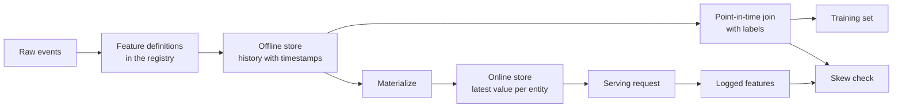

# 특징 매장 및 훈련 서비스 스케이

> 한 기능은 하나의 정의와 두 개의 리더를 가지고 있습니다. 훈련은 각 레이블 시간부터 그 역사를 읽고, 서비스는 최신 값을 읽습니다. 두 독자가 동의하지 않을 때, 모델은 훈련되지 않은 입력 사항을 봅니다.

**Type:** Build
**Languages:** Python
**Prerequisites:** Phase 2, Lessons 08 (Feature Engineering), 13 (ML Pipelines), 15 (Time Series), and 19 (ML System Design)
**Time:** ~100 minutes

## 학습 목표

- 오프라인 매장, 온라인 매장, 엔티티, 이벤트 시간표, TTL 및 각 매장의 작업에 대해 설명하십시오.
- 시점에서의 올바른 결합을 구현하고 순진한 결합이 미래의 값을 훈련 데이터에 어떻게 복사하는지 보여주십시오
- 훈련 서비스 왜곡의 네 가지 원인을 명명하라: 두 개의 코드 경로, 오래된 기능, 다른 기본 설정, 시간 여행
- 하나의 정의가 훈련 경과와 서비스 경로를 모두 공급하는 기능 레지스트리를 구축하십시오
- 날짜가 끝난 후의 데이터를 읽지 않고 이전 날짜에 대한 새로운 기능을 다시 작성하십시오
- 같은 단체와 시간 동안 훈련 경로와 기록된 서비스 기능을 비교하여 왜곡을 감지합니다

## 문제

팀 한 팀 은 urn 모델을 만들 습니다. 각 레이블 은 레이블 날 이후 30 일 이내에 사용자가 구매 하지 않았는지 알려 줍니다. 팀 은 레이블 을 사용자 기능 테이블 에 꽂습니다.`user_id`그리고 규칙에 대한 훈련`days_since_last_purchase`오프라인 정확도는 0.948입니다.

실시간 트래픽에서, 모델은 더 오래된 더 간단한 버전에 비해 더 나쁘게 작동합니다. 특징 테이블은 각 사용자에 대한 가장 새로운 값을 표시한 날짜가 끝난 몇 주 후부터 나타냈다. 마지막 구매가 115일인 사용자가 175일 60일 동안 무작위로 촬영한 것을 보여주었습니다. 한편, 다른 팀에서는 다른 서비스에서 서비스 기능들을 다시 작성했습니다. 30일 창에는 1일 추가가 포함되었고 새로운 사용자에게는 기본값은 365 대신 -1입니다.

두 가지 결함이 동일한 원인입니다. 훈련과 서비스는 두 가지 다른 방법으로 " 동일한 기능 "을 계산합니다. 이 수업은 기능 매장의 조각을 처음부터 만듭니다. 당신은 레지스트리, 백필, 포인트 인 타임 결합, TTL와 온라인 매장 및 편향 체크를 작성합니다. 데모는 두 가지 결함을 숫자로 재생합니다.

## 개념

### 같은 특징의 두 독자

훈련과 봉사는 다양한 형태의 특징을 요구합니다.

| Property | Training (offline) | Serving (online) |
|---|---|---|
| Question | "What was the value for each of 10 million (entity, time) pairs?" | "What is the value for this one entity now?" |
| Time | Many points in the past | The present |
| Volume | Millions of rows per job | One row per request |
| Latency | Minutes are fine | A few milliseconds |
| Storage | Offline store: full history with timestamps, in columnar files or a warehouse | Online store: the latest value per entity, in a key-value database |

기능 스토어는 두 매장을 하나의 기능 정의에서 채우도록 합니다. 물질화는 온라인 스토어에서 최신 값을 복사하는 작업입니다.



### 단체는, 시간표, TTL

4개의 용어는 각 특징 줄을 설명합니다.

- **Entity.**특징에서 설명하는 키, 예를 들어`user_id`또는`card_id`- 그래
- **Event timestamp.**값이 사실이 된 시간. 구매 수정은 "14일부터"로 이벤트 시간표가 14일입니다.
- **Created timestamp.**시스템에서 행렬을 작성한 시간. 오늘날 실행되는 백필은 오래된 이벤트 시간표와 새로운 시간표로 행렬을 작성합니다.
- **TTL (time to live).**값의 최대 연령. TTL보다 오래된 값은 실종된 것으로 간주되므로 독자는 기본값을 사용합니다.

동일한 엔티티, 소스 및 TTL를 가진 기능 그룹은 종종 기능 조치가라고합니다.

### 시점에서의 올바른 결합

훈련 줄은 레이블과 레이블 시간에 존재했던 특징 값들을 결합합니다.

1. 같은 엔티티의 특징 줄을 찾아라.
2. 이벤트 시간표가 표시된 라인을 라벨 시간표에 위치하거나 그 전에 보관하십시오.
3. 그 줄들 중 마지막을 보세요.
4. 레이블 타임 스탬프 미이너스 이벤트 타임 스탬프가 TTL보다 더 많으면 떨어뜨립니다.

여기 한 사용자, 16일 에 대한 라벨과 주간 기능 라인:

| Feature row day | `purchases_30d` | Point-in-time join | Naive join on `user_id` |
|---|---|---|---|
| 7 | 4 | | |
| 14 | 3 | Selected | |
| 21 | 1 | Future | |
| 28 | 0 | Future | Selected |

에이블은 사용자가 17일부터 46일까지 구매하는지 여부를 묻습니다. 28일 줄은 이미 에이블 날 이후의 조용한 날을 계산합니다. 사용자가 구매를 중단했기 때문에 구매 0개를 표시합니다. 이 경우 에이블이 측정합니다. 순진한 조합은 입력에 답변을 복사합니다.

우리는 시간 시리즈 수업에서 같은 이유로 데이터를 시간으로 나눕니다. 시간 안에 점의 합치는 하나의 분할점 대신 모든 줄에 해당 규칙을 적용합니다.

### 훈련 서비스 중 왜곡의 원인은

구글의 머신러닝 규칙은 훈련과 서비스의 수행 사이의 차이로 훈련 서비스 왜곡을 정의합니다. 그들은 두 파이프라인에서 서로 다른 데이터 처리, 훈련과 서비스 사이의 데이터의 변화, 피드백 루프 등 세 가지 원인을 지정합니다. 기능 파이프라인에서 네 가지 구체적인 원인은 반복적으로 나타납니다.

| Cause | What happens | Example from the demo |
|---|---|---|
| Two code paths | Training and serving compute the feature with different code | The serving window includes day `now - 30`, and the training window does not |
| Stale features | The value that serving reads has a different age from the value that training used | Training reads weekly snapshots, and a new service computes fresh values |
| Different defaults | The two paths fill a missing value differently | Training uses 365 for "no purchase yet", and serving uses -1 |
| Time travel | Training reads a value from after the label time | The naive join reads the newest snapshot for every label |

같은 가이드의 규칙 #32은 훈련 파이프라인과 서비스 파이프라인 사이에 코드를 가능한 한 재사용하도록 말합니다. 기능 스토어는 두 길 모두 호출하는 하나의 정의로 그 규칙을 따르습니다.

### 기능 레지스트리

레지스트리는 기능 정의의 카탈로그입니다. 각 항목에는 이름, 엔티티, 소스, 변환, 창, 기본 값, TTL, 소유자, 버전 및 설명이 있습니다.

두 가지 규칙이 안전합니다.

- 두 개의 경로는 레지스트리에서 정의를 읽습니다. 어떤 서비스도 변환의 사적인 복사본을 보관하지 않습니다.
- 정의의 변경은 새로운 버전을 만들어냅니다. 오래된 버전은 남아있기 때문에 오래된 모델들은 훈련된 기능을 유지합니다.

### 배낭

새로운 기능은 역사가 없지만, 훈련은 모든 오래된 레이블 시간에 그 가치를 필요로 합니다. 백필은 모든 과거 날짜에 정의를 실행하고 단위 및 날짜에 한 줄을 작성합니다. 각 실행은 날짜 또는 그 이전에는 시간표가있는 이벤트를만 읽습니다.

백필은 날짜의 수와 같은 개체 수와 함께 증가하는 비용 계산입니다. 또한 미묘한 누출을 가져옵니다. 오늘날 실행되는 백필은 오래된 이벤트 시간표로 줄을 작성하지만 늦게 도착하거나 나중에 수정된 데이터를 읽을 수 있습니다. 엄격한 포인트 인 타임 결합은 생성된 시간표가 레이블 시간 또는 그 전에 있는지 확인합니다.

### 편향을 감지

같은 가이드의 규칙 #29는 서비스 시간 동안 기능들을 기록하고 훈련에 사용하도록 말합니다. 작은 기록된 샘플조차도 일관성을 확인할 수 있습니다. 기록된 각 값을 동일한 엔티티와 시간 동안 훈련 경로가 생성하는 값과 비교하십시오. 각 기능에 대한 부합의 비율과 평균 절대 차이점을 보고하십시오.

원인을 찾기 위해 세 쌍을 비교해 보세요.

1. 온라인 상점 읽기 vs 훈련 합성. 이것은 전체 시스템을 테스트하고
2. 새로운 계산과 훈련 결합이
3. 두번째 코드 경로와 새로운 계산에 비해. 이것은 윈도우와 기본값과 같은 코드 차이를 분리합니다.

```figure
mlprod-pit-join
```

## 건설 해

코드는 `code/main.py`표준 라이브러리를 이용합니다. 시간은 하루의 전체입니다. 주간 배트 작업은 7일, 14일, 175일까지 기능 스냅샷을 작성합니다.

### 단계 1: 기능 정의 및 레지스트리

A`FeatureDefinition`변환을 데이터로 저장합니다. 집합, 창, 그리고 기본.`compute`이 방법은 사건들을 읽지 않습니다`as_of`- 그래

```python
@dataclass(frozen=True)
class FeatureDefinition:
    name: str
    entity: str
    aggregate: str
    window_days: int | None
    default: float
    version: int = 1
    owner: str = "growth-team"
    description: str = ""

    def compute(self, events: list[Event], as_of: int) -> float:
        visible = [e for e in events if e.day <= as_of]
        if self.window_days is not None:
            visible = [e for e in visible if e.day > as_of - self.window_days]
        if self.aggregate == "count":
            return float(len(visible))
        if self.aggregate == "sum":
            return round(sum(e.amount for e in visible), 2)
        if self.aggregate == "days_since_last":
            return float(as_of - max(e.day for e in visible)) if visible else self.default
        raise ValueError(f"unknown aggregate {self.aggregate!r}")
```

`FeatureRegistry.register`같은 정의를 두 번 받아들이지만 같은 이름과 버전을 가진 다른 정의를 거부합니다. `fill_defaults`두 경로를 모두 누락된 값에 대해 동일한 기본값을 제공합니다.

모델은 정의를 참조와 함께 `spend_30d@1`-`compute`그리고`fill_defaults`참조를 해결하고, 이름 없이`@`최신 버전으로 읽습니다.`@`그리고 버전 번호가 증가하지 않습니다 `ValueError`, 즉 타이핑 오류가 경고 없이 최신 버전을 읽을 수 없습니다. 참조는 또한 저장된 각 줄의 키입니다. 따라서 백필, 온라인 스토어, 그리고 서비스 읽기 모두 고정된 정의를 사용합니다.

### 단계 2: 오프라인 매장을 다시 채워라

```python
def backfill(registry: FeatureRegistry, names: list[str], events: list[Event], days: list[int]) -> list[FeatureRow]:
    rows = []
    for entity, entity_events in sorted(group_events(events).items()):
        for day in days:
            rows.append(FeatureRow(entity, day, registry.compute(names, entity_events, day)))
    return rows
```

데모는 25일 동안 299명의 사용자에게 3가지 기능을 제공하여 7475개의 라인을 제공합니다.

### 단계 3: 시간적 합성

각 엔티티의 라인을 하루에 한 번 분류합니다. 각 레이블에 대해,`bisect_right`라벨 날짜 또는 그 이전 마지막 줄을 찾습니다. TTL 체크는 너무 오래된 줄을 떨어뜨립니다.

```python
def point_in_time_join(labels: list[LabelRow], rows: list[FeatureRow], ttl_days: int | None = None) -> list[JoinedRow]:
    by_entity: dict[str, list[FeatureRow]] = defaultdict(list)
    for row in rows:
        by_entity[row.entity].append(row)
    days_index = {}
    for entity, entity_rows in by_entity.items():
        entity_rows.sort(key=lambda r: r.day)
        days_index[entity] = [r.day for r in entity_rows]
    joined = []
    for label in labels:
        days = days_index.get(label.entity, [])
        pos = bisect.bisect_right(days, label.day) - 1
        match = by_entity[label.entity][pos] if pos >= 0 else None
        if match is not None and ttl_days is not None and label.day - match.day > ttl_days:
            match = None
        joined.append(JoinedRow(
            label.entity, label.day, label.label,
            match.day if match else None, match.values if match else None,
        ))
    return joined
```

### 4단계: 순진한 결합에서 유출을 측정

`naive_latest_join`단체를만 연결하여 각 레이블의 최신 행을 반환합니다. 데모는 100, 120 및 140일에 레이블을 구축하고 각 훈련 세트에 한 가지 특징의 규칙을 적용합니다.

```console
  naive join used a snapshot from after the label day for 100% of rows
  offline accuracy, naive join: 0.948 (rule: idle > 53 days)
  offline accuracy, PIT join:   0.893 (rule: idle > 19 days)
  accuracy on day 145, trained with naive join: 0.763
  accuracy on day 145, trained with PIT join:   0.876
```

순진한 합치는 오프라인에서 0.948 대 0.893로 더 좋아 보입니다. 새로운 데이터에서는 더 나쁘습니다. 0.763 대 0.876. 유출된 기능은 19일에서 53일까지 부적절한 임기를 옮겼다.

### 단계 5: 온라인 상점 및 물질화

온라인 스토어는 한 단위로 한 줄을 유지하며 TTL보다 오래된 줄을 거부합니다. `materialize`일 시간 또는 직전에 있는 선만을 작성합니다.

```python
class OnlineStore:
    def __init__(self, ttl_days: int):
        self.ttl_days = ttl_days
        self._latest: dict[str, FeatureRow] = {}

    def write(self, row: FeatureRow) -> None:
        current = self._latest.get(row.entity)
        if current is None or row.day >= current.day:
            self._latest[row.entity] = row

    def read(self, entity: str, now: int) -> dict[str, float] | None:
        row = self._latest.get(entity)
        if row is None or row.day > now or now - row.day > self.ttl_days:
            return None
        return dict(row.values)
```

10일 TTL를 사용하면 145일 판독은 140일 행을 반환합니다. 160일 판독은 새로운 물질화 없이, 기본값을 반환합니다. 왜냐하면 행은 20일 오래된 것이기 때문입니다.

### 단계 6: 편향 검진

`detect_skew``(entity, day)`. 그것은 부합률과 특징별 평균 절대적 차이를 보고하고, 값의 1% 이상이 다른 경우 특징을 표시합니다.`ValueError`두 개의 조치가 다른 키가 있거나 키가 없습니다. 부족한 요청은 왜곡을 숨길 수 있으며 요청이 없는 체크는 아무것도 보여주지 않습니다.

```python
def detect_skew(
    training: dict[tuple[str, int], dict[str, float]],
    serving: dict[tuple[str, int], dict[str, float]],
    features: list[str],
    tolerance: float = 1e-6,
    max_mismatch_rate: float = 0.01,
) -> list[SkewReport]:
    if set(training) != set(serving):
        raise ValueError(f"{len(set(training) ^ set(serving))} keys are in only one view: log and compare the same requests")
    if not training:
        raise ValueError("no requests to compare")
    keys = sorted(training)
    reports = []
    for feature in features:
        diffs = [abs(training[k][feature] - serving[k][feature]) for k in keys]
        mismatches = sum(1 for d in diffs if d > tolerance)
        rate = mismatches / len(keys)
        mean_diff = sum(diffs) / len(keys)
        reports.append(SkewReport(feature, len(keys), rate, mean_diff, rate > max_mismatch_rate))
    return reports
```

데모 로그는 141~150일 동안 요청들을 기록하고, 콘셉트 섹션에서 세 가지 비교를 실행합니다. 요청 풀에는 역사 없는 20명의 새로운 사용자가 포함되어 있습니다.

```bash
python3 code/main.py
```

```console
=== Skew checks on 383 logged requests, days 141 to 150 ===
  online store read  vs  training join (one definition, same snapshots)
    ok   days_since_last_purchase   mismatch   0.0%  mean |diff|    0.00
    ok   purchases_30d              mismatch   0.0%  mean |diff|    0.00
    ok   spend_30d                  mismatch   0.0%  mean |diff|    0.00
  fresh compute      vs  training join (staleness only)
    SKEW days_since_last_purchase   mismatch  83.0%  mean |diff|    2.77
    SKEW purchases_30d              mismatch  30.5%  mean |diff|    0.38
    SKEW spend_30d                  mismatch  37.1%  mean |diff|   16.77
  second code path   vs  fresh compute (code differences only)
    SKEW days_since_last_purchase   mismatch   5.5%  mean |diff|   20.07
    SKEW purchases_30d              mismatch  12.5%  mean |diff|    0.13
    SKEW spend_30d                  mismatch  12.5%  mean |diff|    5.09
```

세 블록을 순서대로 읽어보세요.

- **One definition, same snapshots.**온라인 상점과 훈련 부합은 동일한 생체 된 줄을 읽습니다. 그래서 왜곡은 0입니다.
- **Staleness.**신선한 값은 대부분의 요청에 대한 주간 스냅샷과 다릅니다. 신선한 데이터는 자동적으로 더 나은 것은 아닙니다. 모델은 6일 이하의 값에서 배운 것이기 때문입니다.
- **Code differences.**두 번째 코드 경로는 창의 12.5%에 차이가 있습니다. 창의 1일 추가로 포함되기 때문에`days_since_last_purchase`새로운 사용자만 사용하지만 큰 금액: -1 대 365.

## 사용 하 고

Feast은 오픈소스 기능 스토어입니다. 처음부터 코드의 각 조각에는 Feast의 대칭이 있습니다.

| From scratch | Feast |
|---|---|
| `FeatureDefinition`, `FeatureRegistry` | `Entity`, `FeatureView`, and `Field` in a feature repository, registered with `feast apply` |
| `FeatureRow` history | An offline store, for example a `FileSource` over Parquet files or a warehouse table |
| `point_in_time_join` with a TTL | `store.get_historical_features(entity_df=..., features=[...])` |
| `materialize` | `feast materialize-incremental <end time>` |
| `OnlineStore.read` | `store.get_online_features(features=[...], entity_rows=[...])` |
| Created timestamp check | `created_timestamp_column` on the source and `filter_by_created_timestamp=True` |

정의는 다음과 같습니다. 코드는 축제 초기에 따라 이 수업을 실행하는 데 필요하지 않습니다.

```python
from datetime import timedelta

from feast import Entity, FeatureView, Field, FileSource
from feast.types import Float32, Int64

user = Entity(name="user", join_keys=["user_id"])

user_activity_source = FileSource(
    name="user_activity_source",
    path="data/user_activity.parquet",
    timestamp_field="event_timestamp",
    created_timestamp_column="created",
)

user_activity = FeatureView(
    name="user_activity",
    entities=[user],
    ttl=timedelta(days=10),
    schema=[
        Field(name="purchases_30d", dtype=Int64),
        Field(name="spend_30d", dtype=Float32),
        Field(name="days_since_last_purchase", dtype=Int64),
    ],
    source=user_activity_source,
)
```

훈련과 봉사는 같은 특징을 읽을 수 있습니다:

```python
from feast import FeatureStore

store = FeatureStore(repo_path=".")

training_df = store.get_historical_features(
    entity_df=labels_df,
    features=["user_activity:purchases_30d", "user_activity:days_since_last_purchase"],
    filter_by_created_timestamp=True,
).to_df()

online = store.get_online_features(
    features=["user_activity:purchases_30d", "user_activity:days_since_last_purchase"],
    entity_rows=[{"user_id": 42}],
).to_dict()
```

`labels_df``user_id``event_timestamp`, 및 레이블. Feast 문서에서는 TTL가 엔터테인먼트 데이터 프레임의 각 시간표에 비해서, 질의 시간에 비해서 나타난다고 명시하고 있습니다.`point_in_time_join`같은 페이지에서 설명합니다`filter_by_created_timestamp=True`, 즉, 배포된 값이 훈련 데이터에 유출되는 것을 막는 것입니다. 모든 오프라인 스토어는 이 옵션을 지원하지 않습니다. 지원 없는 스토어는 옵션을 무시하는 대신 오류를 일으킨다.

테크톤, 호프스워크, 그리고 큰 클라우드 ML 플랫폼의 기능 스토어는 오프라인과 온라인 스토어 사이에 동일한 분할을 사용합니다. 편향 검사를 위해, TensorFlow 데이터 검증은 편향을 감지하기 위해 훈련 데이터를 서비스 데이터와 비교할 수 있습니다. Breck et al.

## 선박

이 교훈은`outputs/skill-feature-skew-audit.md`. 기술감사 는 시간 여행 및 훈련 서비스 스키에 대한 기능 파이프 라인을 검사 합니다. 그것은 결합, 정의, 기본 설정, 각 경로의 신선함 및 스키 체크에 필요한 기록을 통해 진행합니다.

## 운동

1. 7일에서 1일로 간격된 간격을 변경하고, 재발성 비교를 반복하고 결과를 설명하십시오.
2. 3일까지 TTL를 설정하고, 기능이 없어지고 기본값이 되는 훈련 라인을 계산해 보세요.
3. 생성된 날을 추가합니다`FeatureRow`. 이 라인을 은 날 후에 쓰인 줄을 무시하도록 한다.
4. 등록`spend_7d``spend_30d`- 다시 채워서 레지스트리에서 두 버전을 인쇄해 보세요.
5. 고쳐`legacy_serving_features`세 번째 편향 검증이 통과될 때까지 모든 변경 사항을 나열하세요.

## 주요 용어

| Term | What people say | What it means |
|------|----------------|----------------------|
| Feature store | "A database for features" | A system that computes features from one set of definitions and serves them to training and to serving |
| Offline store | "The training data" | Full feature history with event timestamps, read by training jobs and backfills |
| Online store | "The feature cache" | The latest value per entity, read by the serving path in milliseconds |
| Entity | "The ID" | The key that a feature describes, such as a user or a card |
| Event timestamp | "When it happened" | The time at which a feature value became true |
| Point-in-time join | "An as-of join" | A join that pairs each label with the latest feature row at or before the label time |
| TTL | "Expiry" | The maximum age of a feature value before a reader treats it as missing |
| Materialization | "Syncing to online" | The job that copies the latest feature values from the offline store to the online store |
| Backfill | "Computing history" | Running a feature definition at past dates to create its history |
| Training-serving skew | "It worked offline" | A difference between the features or behavior in training and in serving |

## 더 많은 읽기

- [Feast, Point-in-time joins](https://docs.feast.dev/getting-started/concepts/point-in-time-joins): TTL 의미와 생성된 시간표 필터
- [Feast documentation](https://docs.feast.dev/): 기능 보람, 오프라인 매장, 온라인 매장, 그리고 물질화
- [Google, Rules of Machine Learning](https://developers.google.com/machine-learning/guides/rules-of-ml): 훈련 서비스 중 편향 규칙, 규칙 #29에서 규칙 #37까지
- [Breck et al., Data Validation for Machine Learning (SysML 2019)](https://research.google/pubs/data-validation-for-machine-learning/): Google에서 데이터 검증, 교육 서비스 편향을 포함하여
- [TensorFlow Data Validation guide](https://www.tensorflow.org/tfx/guide/tfdv): 스케마 검사, 왜곡 탐지, 유동 탐지
- [Sculley et al., Hidden Technical Debt in Machine Learning Systems (NeurIPS 2015)](https://papers.nips.cc/paper/2015/hash/86df7dcfd896fcaf2674f757a2463eba-Abstract.html): 데이터 의존성과 모델에 대한 파이프라인 채무
