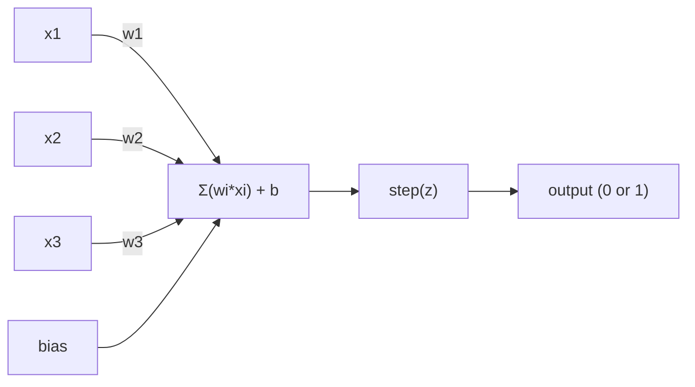
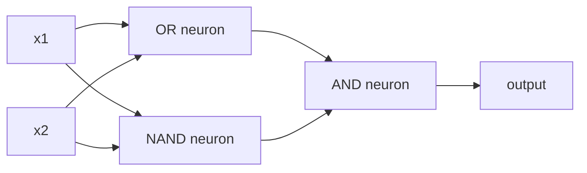

# 퍼셉트론

> 인식론은 신경망의 원자입니다. 그것을 열면 무게와 편향과 결정을 찾을 수 있습니다.

**Type:** Build
**Languages:** Python
**Prerequisites:** Phase 1 (Linear Algebra Intuition)
**Time:** ~60 minutes

## 학습 목표

- 웨이트 업데이트 규칙과 단계 활성화 기능을 포함하여 파이썬에서 perceptron을 처음부터 구현
- 왜 하나의 인식tron이 선형적으로 분리 가능한 문제를만 해결할 수 있는지 설명하고 XOR 실패 사례를 보여
- OR, NAND, AND 게이트를 구성하여 XOR를 해결하여 다층 인식론을 구성합니다.
- 시그모이드 활성화 및 후속 확산을 통해 2층 네트워크를 훈련시켜 XOR를 자동으로 학습합니다

## 문제

여러분은 벡터와 점수 제품을 알고 있습니다. 매트릭스가 입력값을 출력으로 변환한다는 것을 알고 있습니다. 하지만 기계가 어떤 변환을 사용하는지 어떻게 배울 수 있을까요?

인식론은 이 질문에 답합니다. 그것은 가능한 가장 간단한 학습 기계입니다. 몇 가지 입력물을 가져가 무게로 곱하고 편향을 추가하고 바이너리 결정을 내립니다.

인식론을 이해하는 것은 코드에서 "학습"이 실제로 무엇을 의미하는지 이해하는 것을 의미합니다. 출력이 현실과 일치할 때까지 숫자를 조정합니다.

## 개념

### 한 신경 세포, 한 결정

스톤이 가져오죠$n$입력값을 곱해서 무게를 곱하고 합쳐서 편향을 추가하고



단계 함수는 잔인합니다: 중량 수량 더하기 편향이 $\ge 0$, 출력 1 그렇지 않으면 출력 0

```math
\text{step}(z) = \begin{cases} 1 & \text{if } z \ge 0 \\ 0 & \text{if } z < 0 \end{cases}
```

이것은 선형 분류자입니다. 무게와 편향은 입력 공간을 두 영역으로 나누는 선을 (또는 더 높은 차원의 하이퍼플라인을) 정의합니다.

### 결정 한계

두 개의 입력에 대해, 퍼셉트론은 2D 공간을 통해 선을 그리는 것입니다.

```
  x2
  ┤
  │  Class 1        /
  │    (0)          /
  │                /
  │               / w1·x1 + w2·x2 + b = 0
  │              /
  │             /     Class 2
  │            /        (1)
  ┼───────────/──────────── x1
```

한쪽의 모든 것이 0을 내놓습니다. 다른 쪽의 모든 것이 1을 내놓습니다. 훈련은 이 선을 교과들을 올바르게 분리할 때까지 움직입니다.

### 학습 규칙

퍼펙트론 학습 규칙은 간단합니다.

```
For each training example (x, y_true):
    y_pred = predict(x)
    error = y_true - y_pred

    For each weight:
        w_i = w_i + learning_rate * error * x_i
    bias = bias + learning_rate * error
```

예측이 맞다면$\text{error} = 0$0을 예측하지만 1이어야만 한다면 무게가 증가합니다. 1을 예측하지만 0이어야만 한다면 무게가 감소합니다. 학습 속도는 각 조정의 크기를 제어합니다.

### XOR 문제

여기가 니다. 이 논리 문들을 보세요.

```
AND gate:           OR gate:            XOR gate:
x1  x2  out         x1  x2  out         x1  x2  out
0   0   0           0   0   0           0   0   0
0   1   0           0   1   1           0   1   1
1   0   0           1   0   1           1   0   1
1   1   1           1   1   1           1   1   0
```

AND와 OR는 선형적으로 분리될 수 있다. 0을 1에서 분리하기 위해 하나의 선을 그려볼 수 있다. XOR는 그렇지 않다. 단일 선은 [0,1]와 [1,0]를 [0,0]와 [1,1]에서 분리할 수 없다.

```
AND (separable):        XOR (not separable):

  x2                      x2
  1 ┤  0     1            1 ┤  1     0
    │     /                 │
  0 ┤  0 / 0              0 ┤  0     1
    ┼──/──────── x1         ┼──────────── x1
       line works!          no single line works!
```

이것은 근본적인 한계입니다. 하나의 인식tron은 선형적으로 분리될 수 있는 문제를만 해결할 수 있습니다. 미ンス키와 파퍼트는 1969년에 이것을 증명했고, 10년간 신경 네트워크 연구를 거의 죽였습니다.

여러 층의 인식론은 2개의 선형 결정들을 비선형 결정으로 결합하여 XOR를 해결할 수 있습니다.

```figure
perceptron-boundary
```

## 건설 해

### 단계 1: 퍼셉트론 클래스

```python
class Perceptron:
    def __init__(self, n_inputs, learning_rate=0.1):
        self.weights = [0.0] * n_inputs
        self.bias = 0.0
        self.lr = learning_rate

    def predict(self, inputs):
        total = sum(w * x for w, x in zip(self.weights, inputs))
        total += self.bias
        return 1 if total >= 0 else 0

    def train(self, training_data, epochs=100):
        for epoch in range(epochs):
            errors = 0
            for inputs, target in training_data:
                prediction = self.predict(inputs)
                error = target - prediction
                if error != 0:
                    errors += 1
                    for i in range(len(self.weights)):
                        self.weights[i] += self.lr * error * inputs[i]
                    self.bias += self.lr * error
            if errors == 0:
                print(f"Converged at epoch {epoch + 1}")
                return
        print(f"Did not converge after {epochs} epochs")
```

### 단계 2: 논리 게이트를 훈련

```python
and_data = [
    ([0, 0], 0),
    ([0, 1], 0),
    ([1, 0], 0),
    ([1, 1], 1),
]

or_data = [
    ([0, 0], 0),
    ([0, 1], 1),
    ([1, 0], 1),
    ([1, 1], 1),
]

not_data = [
    ([0], 1),
    ([1], 0),
]

print("=== AND Gate ===")
p_and = Perceptron(2)
p_and.train(and_data)
for inputs, _ in and_data:
    print(f"  {inputs} -> {p_and.predict(inputs)}")

print("\n=== OR Gate ===")
p_or = Perceptron(2)
p_or.train(or_data)
for inputs, _ in or_data:
    print(f"  {inputs} -> {p_or.predict(inputs)}")

print("\n=== NOT Gate ===")
p_not = Perceptron(1)
p_not.train(not_data)
for inputs, _ in not_data:
    print(f"  {inputs} -> {p_not.predict(inputs)}")
```

### 단계 3: XOR 실패를 관찰하십시오

```python
xor_data = [
    ([0, 0], 0),
    ([0, 1], 1),
    ([1, 0], 1),
    ([1, 1], 0),
]

print("\n=== XOR Gate (single perceptron) ===")
p_xor = Perceptron(2)
p_xor.train(xor_data, epochs=1000)
for inputs, expected in xor_data:
    result = p_xor.predict(inputs)
    status = "OK" if result == expected else "WRONG"
    print(f"  {inputs} -> {result} (expected {expected}) {status}")
```

이것은 하나의 인식론이 XOR를 배울 수 없다는 확실한 증거입니다.

### 단계 4: XOR를 2층으로 해결

트릭:$\text{XOR} = (x_1 \text{ OR } x_2) \text{ AND NOT } (x_1 \text{ AND } x_2)$3개의 인식선을 조합해



```python
def xor_network(x1, x2):
    or_neuron = Perceptron(2)
    or_neuron.weights = [1.0, 1.0]
    or_neuron.bias = -0.5

    nand_neuron = Perceptron(2)
    nand_neuron.weights = [-1.0, -1.0]
    nand_neuron.bias = 1.5

    and_neuron = Perceptron(2)
    and_neuron.weights = [1.0, 1.0]
    and_neuron.bias = -1.5

    hidden1 = or_neuron.predict([x1, x2])
    hidden2 = nand_neuron.predict([x1, x2])
    output = and_neuron.predict([hidden1, hidden2])
    return output


print("\n=== XOR Gate (multi-layer network) ===")
for inputs, expected in xor_data:
    result = xor_network(inputs[0], inputs[1])
    print(f"  {inputs} -> {result} (expected {expected})")
```

네 가지 경우 모두 맞습니다. 지각자를 층으로 쌓아 놓으면 어떤 지각자가 만들 수 없는 결정적 경계를 만들어냅니다.

### 5단계: 두 층 의 네트워크 를 훈련 시키십시오

4단계: 무게를 손으로 연결해 놓습니다. XOR에 효과가 있지만, 적절한 무게를 미리 알지 못하는 실제 문제에 대해서는 아닙니다. 해결 방법은: 단계 함수를 sigmoid로 교체하고, 배전으로 무게를 자동으로 배웁니다.

```python
class TwoLayerNetwork:
    def __init__(self, learning_rate=0.5):
        import random
        random.seed(0)
        self.w_hidden = [[random.uniform(-1, 1), random.uniform(-1, 1)] for _ in range(2)]
        self.b_hidden = [random.uniform(-1, 1), random.uniform(-1, 1)]
        self.w_output = [random.uniform(-1, 1), random.uniform(-1, 1)]
        self.b_output = random.uniform(-1, 1)
        self.lr = learning_rate

    def sigmoid(self, x):
        import math
        x = max(-500, min(500, x))
        return 1.0 / (1.0 + math.exp(-x))

    def forward(self, inputs):
        self.inputs = inputs
        self.hidden_outputs = []
        for i in range(2):
            z = sum(w * x for w, x in zip(self.w_hidden[i], inputs)) + self.b_hidden[i]
            self.hidden_outputs.append(self.sigmoid(z))
        z_out = sum(w * h for w, h in zip(self.w_output, self.hidden_outputs)) + self.b_output
        self.output = self.sigmoid(z_out)
        return self.output

    def train(self, training_data, epochs=10000):
        for epoch in range(epochs):
            total_error = 0
            for inputs, target in training_data:
                output = self.forward(inputs)
                error = target - output
                total_error += error ** 2

                d_output = error * output * (1 - output)

                saved_w_output = self.w_output[:]
                hidden_deltas = []
                for i in range(2):
                    h = self.hidden_outputs[i]
                    hd = d_output * saved_w_output[i] * h * (1 - h)
                    hidden_deltas.append(hd)

                for i in range(2):
                    self.w_output[i] += self.lr * d_output * self.hidden_outputs[i]
                self.b_output += self.lr * d_output

                for i in range(2):
                    for j in range(len(inputs)):
                        self.w_hidden[i][j] += self.lr * hidden_deltas[i] * inputs[j]
                    self.b_hidden[i] += self.lr * hidden_deltas[i]
```

```python
net = TwoLayerNetwork(learning_rate=2.0)
net.train(xor_data, epochs=10000)
for inputs, expected in xor_data:
    result = net.forward(inputs)
    predicted = 1 if result >= 0.5 else 0
    print(f"  {inputs} -> {result:.4f} (rounded: {predicted}, expected {expected})")
```

4단계에서 두 가지 주요 차이점입니다. 첫째, 시그모이드는 단계 함수를 대체합니다.`train`이 방법은 출력에서 숨겨진 층으로 오류를 뒤로 전파하고, 모든 무게를 오류에 대한 기여에 비례하여 조정합니다.

이 점은 제3강의 다리입니다.`d_output`그리고`hidden_deltas`네트워크 그래프에 적용되는 체인 규칙입니다.

## 사용 하 고

당신이 처음부터 만든 모든 것은 하나의 수입으로 존재합니다.

```python
from sklearn.linear_model import Perceptron as SkPerceptron
import numpy as np

X = np.array([[0,0],[0,1],[1,0],[1,1]])
y = np.array([0, 0, 0, 1])

clf = SkPerceptron(max_iter=100, tol=1e-3)
clf.fit(X, y)
print([clf.predict([x])[0] for x in X])
```

5줄, 30줄`Perceptron`클래스는 같은 것을 합니다. sklearn 버전은 컨버전스 체크, 멀티 펄스 함수, 그리고 희소 입력 지원이 추가됩니다. 하지만 핵심 루프는 동일합니다. 중량 수, 단계 함수, 오류에 대한 중량 업데이트.

실제 격차는 규모로 나타납니다. 생산 네트워크의 변화는

- 단계 함수는 sigmoid, ReLU 또는 다른 부드러운 활성화가 됩니다.
- 무게는 자동으로 배후 확산을 통해 학습됩니다 (강좌 03)
- 층이 깊어지는: 3, 10, 100+ 층
- 같은 원칙은 유효합니다. 각 층은 이전 층의 출력에서 새로운 특징을 만듭니다.

하나의 인식론은 직선을만 그리는데, 그 직선을 쌓아 놓으면 어떤 모양도 그리게 됩니다.

## 선박

이 교훈은 다음과 같은 결과를 낳습니다.
- `outputs/skill-perceptron.md`- 단일층과 다층 구조가 필요할 때

## 운동

1. NAND 게이트 (유니버설 게이트) 에 페르세트론을 훈련시켜 (유니버설 게이트 - 모든 논리 회로를 NAND에서 만들 수 있다). 그 무게와 편향을 검증하여 유효한 의사 결정 경계를 형성한다.
2. 결정 경계를 추적하기 위해 Perceptron 클래스를 수정 ($w_1 x_1 + w_2 x_2 + b = 0$각 시대마다 AND 게이트에서 훈련 중에 라인 바뀐 모습을 인쇄합니다.
3. 3개의 입력 중 적어도 2개의 입력이 1이 될 때만 1을 출력하는 3개의 입력 인식tron을 만들 수 있습니다. 이 함수는 선형적으로 분리될 수 있습니까? 왜요?

## 주요 용어

| Term | What people say | What it actually means |
|------|----------------|----------------------|
| Perceptron | "A fake neuron" | A linear classifier: dot product of inputs and weights, plus bias, through a step function |
| Weight | "How important an input is" | A multiplier that scales each input's contribution to the decision |
| Bias | "The threshold" | A constant that shifts the decision boundary, letting the perceptron fire even with zero inputs |
| Activation function | "The thing that squishes values" | A function applied after the weighted sum - step function for perceptrons, sigmoid/ReLU for modern networks |
| Linearly separable | "You can draw a line between them" | A dataset where a single hyperplane can perfectly separate the classes |
| XOR problem | "The thing perceptrons can't do" | Proof that single-layer networks cannot learn non-linearly-separable functions |
| Decision boundary | "Where the classifier switches" | The hyperplane $w \cdot x + b = 0$ that divides input space into two classes |
| Multi-layer perceptron | "A real neural network" | Perceptrons stacked in layers, where each layer's output feeds the next layer's input |

## 더 많은 읽기

- 프랭크 로젠블랫, "퍼셉트론: 뇌의 정보 저장 및 조직에 대한 확률적 모델" (1958) - 이 모든 것을 시작한 원작 논문
- 미ンス키와 파퍼트, "퍼셉트론" (1969) - XOR가 단일층 네트워크에 의해 해결되지 않는 것으로 증명한 책
- 마이클 닐슨, "신경 네트워크 및 딥러닝", 1장 (http://neuralnetworksanddeeplearning.com/) -- 온라인에서 무료로, 인식론이 네트워크로 구성되는 방식에 대한 최고의 시각적 설명
